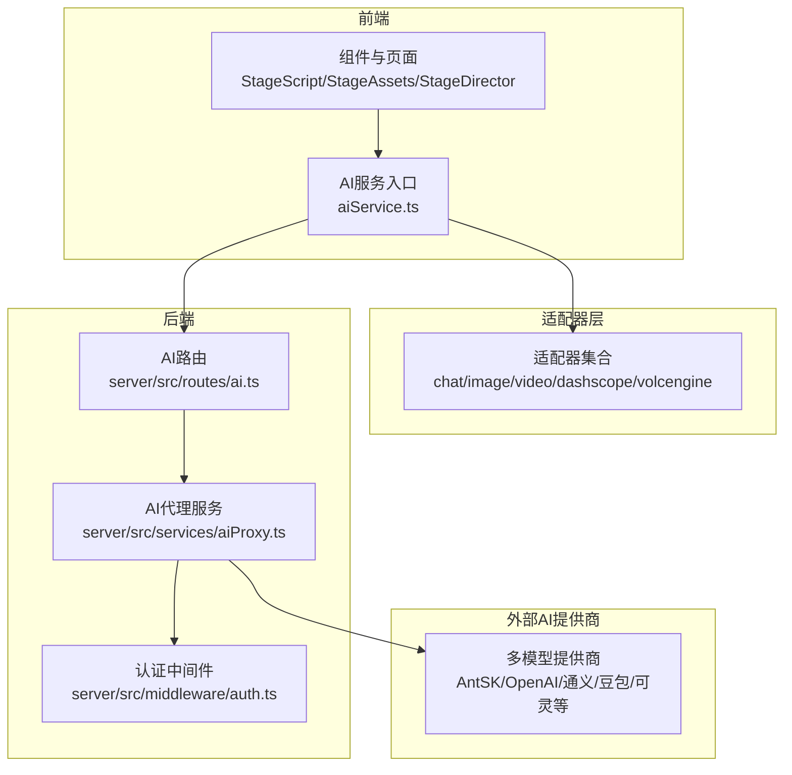
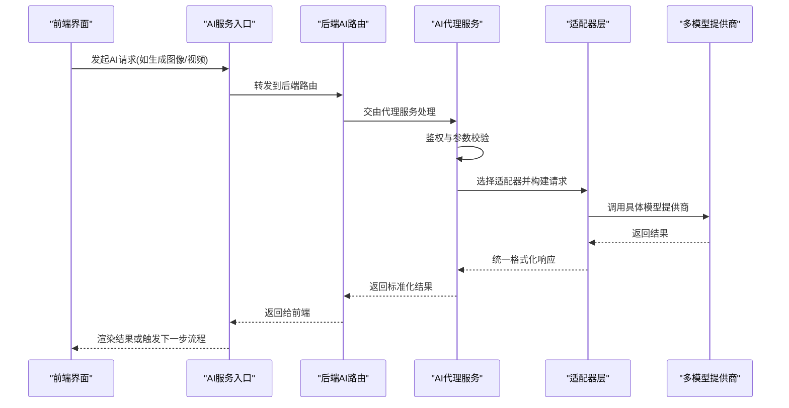
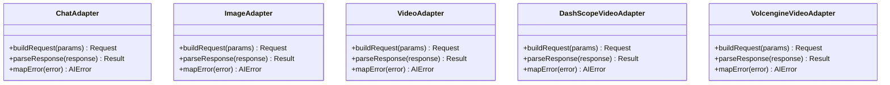
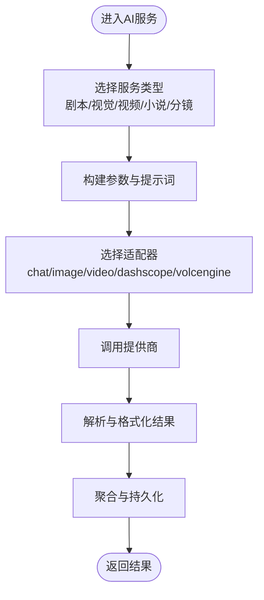
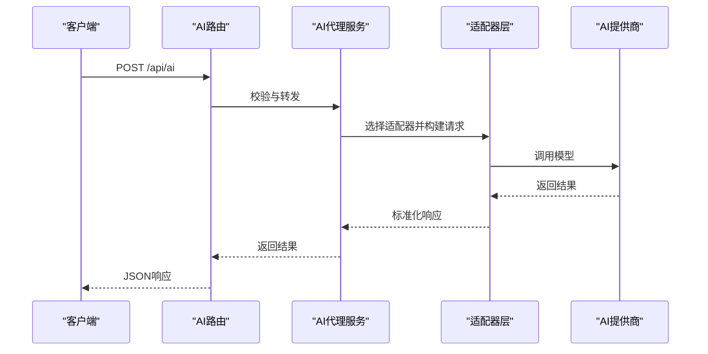
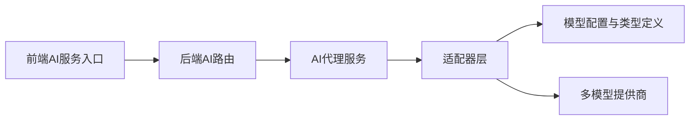

# AI服务层

<cite>
**本文引用的文件**
- [README.md](file://README.md)
- [README_EN.md](file://README_EN.md)
- [config.ts](file://src/config.ts)
- [types.ts](file://src/types.ts)
- [vite.config.ts](file://vite.config.ts)
- [adapters/chatAdapter.ts](file://services/adapters/chatAdapter.ts)
- [adapters/imageAdapter.ts](file://services/adapters/imageAdapter.ts)
- [adapters/videoAdapter.ts](file://services/adapters/videoAdapter.ts)
- [adapters/dashscopeVideoAdapter.ts](file://services/adapters/dashscopeVideoAdapter.ts)
- [adapters/volcengineVideoAdapter.ts](file://services/adapters/volcengineVideoAdapter.ts)
- [adapters/index.ts](file://services/adapters/index.ts)
- [ai/apiCore.ts](file://services/ai/apiCore.ts)
- [ai/index.ts](file://services/ai/index.ts)
- [ai/novelScriptService.ts](file://services/ai/novelScriptService.ts)
- [ai/scriptService.ts](file://services/ai/scriptService.ts)
- [ai/shotService.ts](file://services/ai/shotService.ts)
- [ai/videoService.ts](file://services/ai/videoService.ts)
- [ai/visualService.ts](file://services/ai/visualService.ts)
- [ai/promptConstants.ts](file://services/ai/promptConstants.ts)
- [aiService.ts](file://services/aiService.ts)
- [apiClient.ts](file://services/apiClient.ts)
- [server/src/routes/ai.ts](file://server/src/routes/ai.ts)
- [server/src/services/aiProxy.ts](file://server/src/services/aiProxy.ts)
- [server/src/middleware/auth.ts](file://server/src/middleware/auth.ts)
- [server/src/index.ts](file://server/src/index.ts)
- [server/src/proxy.ts](file://server/src/proxy.ts)
- [types/model.ts](file://types/model.ts)
</cite>

## 目录
1. [简介](#简介)
2. [项目结构](#项目结构)
3. [核心组件](#核心组件)
4. [架构总览](#架构总览)
5. [详细组件分析](#详细组件分析)
6. [依赖关系分析](#依赖关系分析)
7. [性能考虑](#性能考虑)
8. [故障排查指南](#故障排查指南)
9. [结论](#结论)
10. [附录](#附录)

## 简介
本文件面向AI服务层，系统性阐述分层架构设计、服务接口定义与业务逻辑封装。重点覆盖以下AI服务能力：
- 剧本处理服务：负责剧本解析、场景拆解、角色与道具管理、分镜建议生成
- 视觉资产生成服务：基于提示词生成图像、风格迁移与素材库管理
- 视频生成服务：多厂商视频模型接入、关键帧插值与批量渲染
- 小说剧本生成服务：基于大模型的小说章节生成与续写
- 分镜辅助服务：结合场景与提示词生成镜头语言建议

同时，文档说明服务间依赖关系、数据流转与错误传播机制，提供调用示例路径、参数配置要点与性能优化策略，并给出扩展与自定义服务开发指导。

## 项目结构
AI服务层位于前端与后端之间，通过适配器层统一对接多家AI模型提供商，后端提供路由与代理服务，前端通过统一的AI服务入口进行调用。

**图示来源**
- [README.md:127-137](file://README.md#L127-L137)
- [README_EN.md:89-96](file://README_EN.md#L89-L96)
- [adapters/index.ts](file://services/adapters/index.ts)
- [server/src/routes/ai.ts](file://server/src/routes/ai.ts)
- [server/src/services/aiProxy.ts](file://server/src/services/aiProxy.ts)
- [server/src/middleware/auth.ts](file://server/src/middleware/auth.ts)

**章节来源**
- [README.md:127-137](file://README.md#L127-L137)
- [README_EN.md:89-96](file://README_EN.md#L89-L96)

## 核心组件
- 适配器层：封装不同AI提供商的调用差异，统一输入输出格式，便于替换与扩展
- AI服务层：面向业务的服务编排，包括剧本、视觉、视频、小说与分镜辅助
- 后端路由与代理：提供安全访问、鉴权与跨域代理
- 前端AI服务入口：统一调用入口，隐藏底层实现细节

关键职责划分：
- 适配器：负责具体模型请求构建、响应解析与错误映射
- AI服务：负责业务流程编排、参数校验、提示词工程与结果聚合
- 后端：负责鉴权、限流、日志与代理转发
- 前端：负责UI交互与调用编排

**章节来源**
- [adapters/index.ts](file://services/adapters/index.ts)
- [ai/index.ts](file://services/ai/index.ts)
- [server/src/routes/ai.ts](file://server/src/routes/ai.ts)
- [server/src/services/aiProxy.ts](file://server/src/services/aiProxy.ts)

## 架构总览
AI服务层采用“适配器 + 业务服务 + 后端代理”的三层架构。前端通过AI服务入口发起请求，后端路由接收后交由代理服务完成鉴权与转发，适配器层根据配置选择对应模型提供商执行任务。

**图示来源**
- [server/src/routes/ai.ts](file://server/src/routes/ai.ts)
- [server/src/services/aiProxy.ts](file://server/src/services/aiProxy.ts)
- [adapters/index.ts](file://services/adapters/index.ts)

## 详细组件分析

### 适配器层
适配器层负责屏蔽不同AI提供商的差异，统一请求与响应格式。主要适配器包括：
- 文本聊天适配器：封装对话式文本生成
- 图像生成适配器：封装文本到图像生成
- 视频生成适配器：封装文本/图像到视频生成
- DashScope视频适配器：封装阿里云DashScope视频能力
- 火山引擎视频适配器：封装字节跳动火山引擎视频能力

适配器层的关键点：
- 输入标准化：统一参数命名与数据结构
- 错误映射：将第三方错误转换为统一错误码与消息
- 超时与重试：在适配器内实现基础超时与重试策略
- 日志记录：记录请求与响应摘要，便于追踪

**图示来源**
- [adapters/chatAdapter.ts](file://services/adapters/chatAdapter.ts)
- [adapters/imageAdapter.ts](file://services/adapters/imageAdapter.ts)
- [adapters/videoAdapter.ts](file://services/adapters/videoAdapter.ts)
- [adapters/dashscopeVideoAdapter.ts](file://services/adapters/dashscopeVideoAdapter.ts)
- [adapters/volcengineVideoAdapter.ts](file://services/adapters/volcengineVideoAdapter.ts)

**章节来源**
- [adapters/chatAdapter.ts](file://services/adapters/chatAdapter.ts)
- [adapters/imageAdapter.ts](file://services/adapters/imageAdapter.ts)
- [adapters/videoAdapter.ts](file://services/adapters/videoAdapter.ts)
- [adapters/dashscopeVideoAdapter.ts](file://services/adapters/dashscopeVideoAdapter.ts)
- [adapters/volcengineVideoAdapter.ts](file://services/adapters/volcengineVideoAdapter.ts)

### AI服务层
AI服务层面向业务需求，对适配器进行组合与编排，形成可复用的服务模块：

- 剧本处理服务（scriptService）
  - 功能：解析剧本文本、提取场景、角色与道具信息，生成分镜建议
  - 关键流程：提示词工程 -> 多轮对话 -> 结构化输出 -> 分镜卡片生成
  - 参数：剧本文本、场景描述、角色设定、风格要求
  - 输出：结构化场景列表、角色与道具清单、镜头建议

- 视觉资产生成服务（visualService）
  - 功能：基于提示词生成图像、风格迁移与素材库管理
  - 关键流程：提示词优化 -> 适配器选择 -> 生成 -> 存储与索引
  - 参数：提示词、风格、分辨率、数量
  - 输出：图像URL列表、元数据

- 视频生成服务（videoService）
  - 功能：文本/图像到视频生成，支持关键帧插值与批量渲染
  - 关键流程：输入预处理 -> 适配器选择 -> 提交任务 -> 轮询状态 -> 完成回调
  - 参数：提示词、关键帧、分辨率、时长、模型配置
  - 输出：视频URL、任务ID、进度

- 小说剧本生成服务（novelScriptService）
  - 功能：基于大模型生成小说章节与续写
  - 关键流程：章节规划 -> 内容生成 -> 校对与优化 -> 导入到剧本编辑器
  - 参数：题材、风格、章节长度、上下文
  - 输出：章节内容、章节标题、可编辑结构

- 分镜辅助服务（shotService）
  - 功能：结合场景与提示词生成镜头语言建议（景别、运动、构图等）
  - 关键流程：场景分析 -> 镜头建议 -> 可视化预览
  - 参数：场景描述、镜头类型偏好、拍摄手法
  - 输出：镜头卡片、预览图

**图示来源**
- [ai/scriptService.ts](file://services/ai/scriptService.ts)
- [ai/visualService.ts](file://services/ai/visualService.ts)
- [ai/videoService.ts](file://services/ai/videoService.ts)
- [ai/novelScriptService.ts](file://services/ai/novelScriptService.ts)
- [ai/shotService.ts](file://services/ai/shotService.ts)

**章节来源**
- [ai/scriptService.ts](file://services/ai/scriptService.ts)
- [ai/visualService.ts](file://services/ai/visualService.ts)
- [ai/videoService.ts](file://services/ai/videoService.ts)
- [ai/novelScriptService.ts](file://services/ai/novelScriptService.ts)
- [ai/shotService.ts](file://services/ai/shotService.ts)

### 后端路由与代理
后端提供统一的AI路由，负责：
- 接收前端请求
- 鉴权与权限校验
- 参数校验与日志
- 转发至适配器层
- 错误统一处理与返回

代理服务承担：
- 跨域与安全控制
- 请求转发与响应回传
- 超时与失败重试
- 限流与熔断

**图示来源**
- [server/src/routes/ai.ts](file://server/src/routes/ai.ts)
- [server/src/services/aiProxy.ts](file://server/src/services/aiProxy.ts)
- [server/src/middleware/auth.ts](file://server/src/middleware/auth.ts)

**章节来源**
- [server/src/routes/ai.ts](file://server/src/routes/ai.ts)
- [server/src/services/aiProxy.ts](file://server/src/services/aiProxy.ts)
- [server/src/middleware/auth.ts](file://server/src/middleware/auth.ts)

## 依赖关系分析
AI服务层的依赖关系如下：
- 前端通过AI服务入口调用后端路由
- 后端路由经代理服务转发至适配器层
- 适配器层根据配置选择具体模型提供商
- 类型定义与配置贯穿全链路，确保一致性

**图示来源**
- [aiService.ts](file://services/aiService.ts)
- [server/src/routes/ai.ts](file://server/src/routes/ai.ts)
- [server/src/services/aiProxy.ts](file://server/src/services/aiProxy.ts)
- [adapters/index.ts](file://services/adapters/index.ts)
- [types/model.ts](file://types/model.ts)

**章节来源**
- [aiService.ts](file://services/aiService.ts)
- [types/model.ts](file://types/model.ts)

## 性能考虑
- 连接池与并发控制：在适配器层限制并发数，避免触发第三方速率限制
- 缓存策略：对重复提示词与常用参数进行缓存，减少重复调用
- 异步任务：视频生成等耗时任务采用异步队列，轮询状态并及时通知
- 超时与重试：为每个适配器设置合理超时与指数退避重试
- 批量处理：对相似任务进行批量化，提升吞吐量
- 前端节流：对频繁触发的请求进行前端节流，降低网络压力

## 故障排查指南
常见问题与定位方法：
- 鉴权失败：检查后端认证中间件与前端Token传递
- 参数错误：核对适配器输入参数与模型要求的字段映射
- 超时与限流：查看代理服务日志，调整超时与重试策略
- 第三方错误：适配器层会将第三方错误映射为统一错误码，便于前端展示
- 网络异常：检查代理服务与提供商连通性

建议的日志与监控：
- 记录请求ID、时间戳、适配器类型、耗时
- 对错误码与重试次数进行统计
- 对关键流程节点埋点，便于回放与分析

**章节来源**
- [server/src/middleware/auth.ts](file://server/src/middleware/auth.ts)
- [server/src/services/aiProxy.ts](file://server/src/services/aiProxy.ts)
- [adapters/index.ts](file://services/adapters/index.ts)

## 结论
AI服务层通过“适配器 + 业务服务 + 后端代理”的分层设计，实现了多模型提供商的统一接入与业务流程的模块化编排。该架构具备良好的扩展性与可维护性，能够支撑从剧本到视频的全流程创作工作流。建议在生产环境中配合完善的监控与缓存策略，持续优化性能与稳定性。

## 附录

### 服务调用示例（路径指引）
- 剧本处理服务调用：[scriptService.ts](file://services/ai/scriptService.ts)
- 视觉资产生成服务调用：[visualService.ts](file://services/ai/visualService.ts)
- 视频生成服务调用：[videoService.ts](file://services/ai/videoService.ts)
- 小说剧本生成服务调用：[novelScriptService.ts](file://services/ai/novelScriptService.ts)
- 分镜辅助服务调用：[shotService.ts](file://services/ai/shotService.ts)

### 参数配置要点
- 模型配置：在类型定义中明确各模型的参数字段与默认值
- 适配器选择：根据任务类型与提供商能力选择合适适配器
- 提示词工程：遵循提示词常量与模板，保证一致性与可复用性
- 安全与鉴权：确保后端路由与代理服务正确配置认证与跨域策略

**章节来源**
- [types/model.ts](file://types/model.ts)
- [ai/promptConstants.ts](file://services/ai/promptConstants.ts)
- [server/src/routes/ai.ts](file://server/src/routes/ai.ts)
- [server/src/services/aiProxy.ts](file://server/src/services/aiProxy.ts)