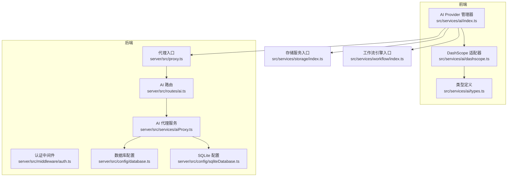
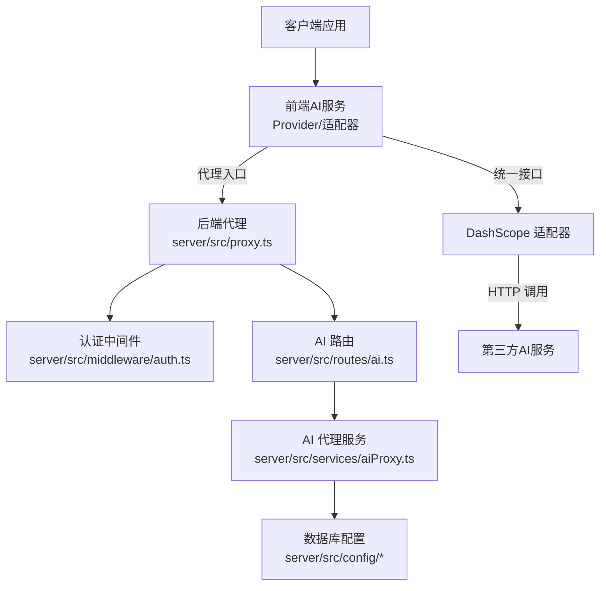
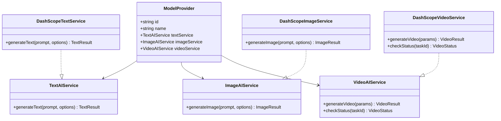
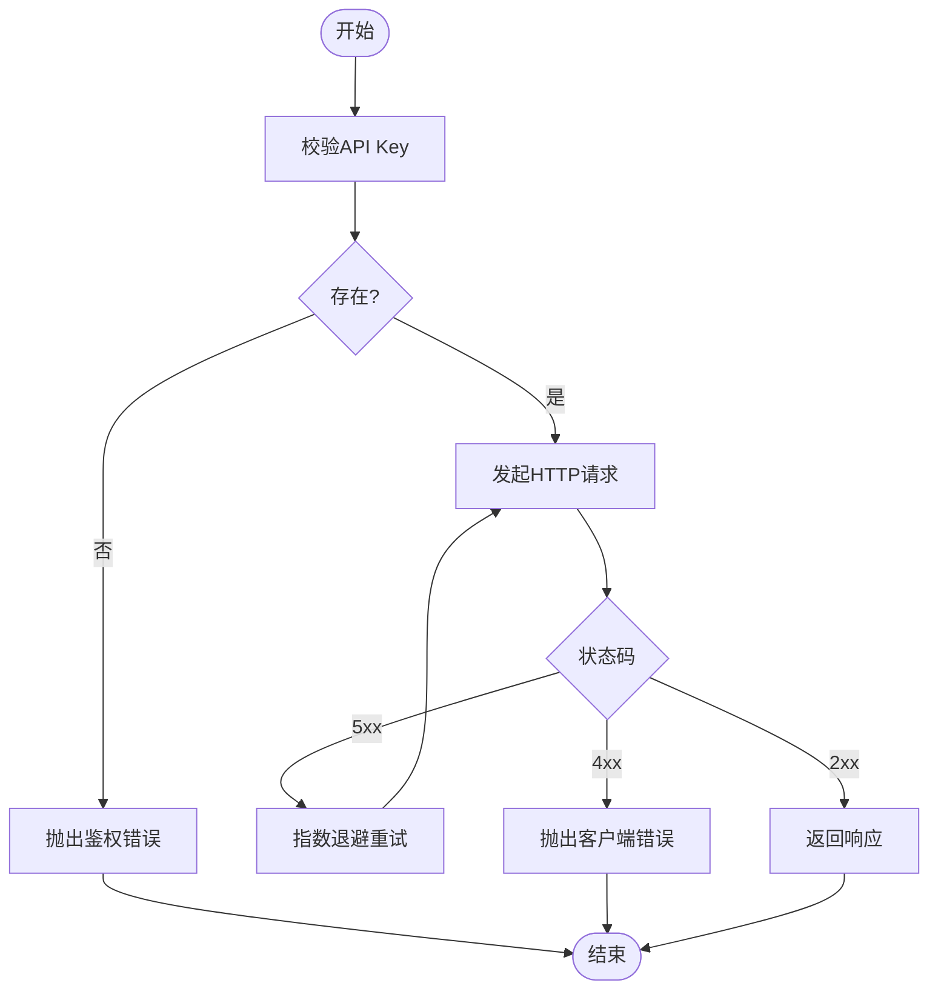
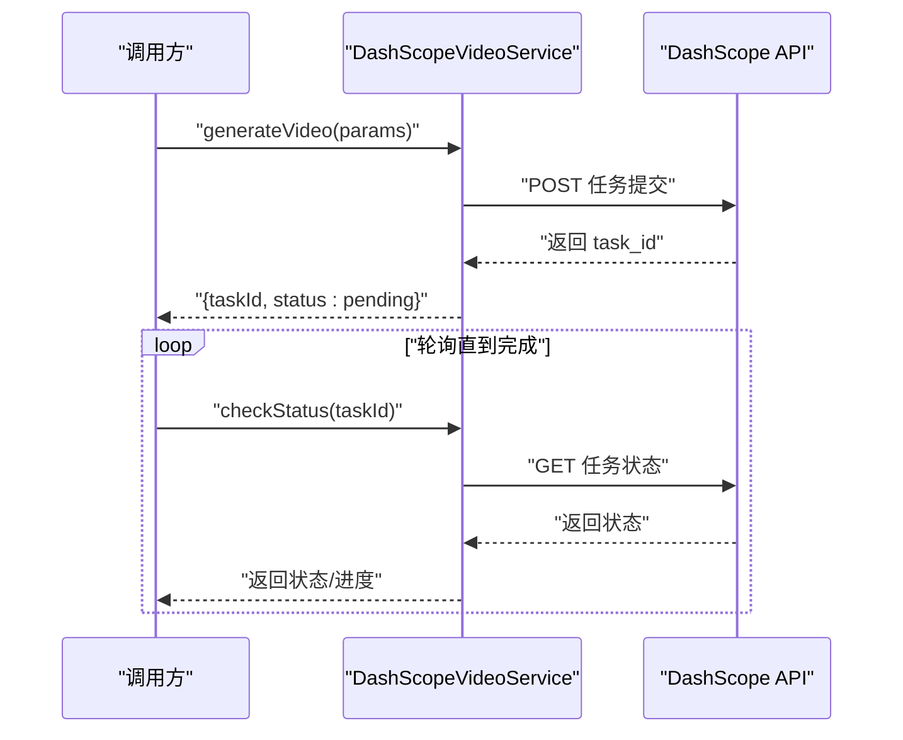
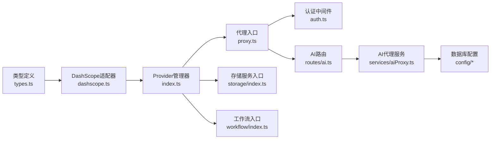

# AI核心基础设施

<cite>
**本文引用的文件**
- [src/services/ai/index.ts](file://src/services/ai/index.ts)
- [src/services/ai/dashscope.ts](file://src/services/ai/dashscope.ts)
- [src/services/ai/types.ts](file://src/services/ai/types.ts)
- [src/services/storage/index.ts](file://src/services/storage/index.ts)
- [src/services/workflow/index.ts](file://src/services/workflow/index.ts)
- [server/src/middleware/auth.ts](file://server/src/middleware/auth.ts)
- [server/src/proxy.ts](file://server/src/proxy.ts)
- [server/src/routes/ai.ts](file://server/src/routes/ai.ts)
- [server/src/services/aiProxy.ts](file://server/src/services/aiProxy.ts)
- [server/src/config/database.ts](file://server/src/config/database.ts)
- [server/src/config/sqliteDatabase.ts](file://server/src/config/sqliteDatabase.ts)
- [lib/utils.ts](file://lib/utils.ts)
</cite>

## 目录
1. [简介](#简介)
2. [项目结构](#项目结构)
3. [核心组件](#核心组件)
4. [架构总览](#架构总览)
5. [详细组件分析](#详细组件分析)
6. [依赖关系分析](#依赖关系分析)
7. [性能考虑](#性能考虑)
8. [故障排除指南](#故障排除指南)
9. [结论](#结论)
10. [附录](#附录)

## 简介
本文件为“AI核心基础设施”的技术文档，聚焦于前端AI服务适配层与后端代理/路由层的协作架构，涵盖以下主题：
- API密钥验证与安全中间件
- 重试机制与HTTP错误处理策略
- 模型解析与服务抽象（文本/图像/视频）
- 提示词常量管理与数据库缓存机制（概念性说明）
- 图像处理工具函数（视频转Base64、图片尺寸调整等）
- API调用示例、错误处理策略、性能优化建议
- 如何扩展新的AI服务基础设施

该系统采用“统一接口 + 厂商适配器”的设计，当前以DashScope（阿里云通义）为默认提供商，同时预留多提供商切换能力。

## 项目结构
前端AI服务位于 src/services/ai，包含：
- 类型定义与统一接口
- DashScope适配器（文本/图像/视频）
- Provider工厂与懒加载

后端位于 server/src，包含：
- 认证中间件
- 代理入口与路由
- AI代理服务（封装第三方调用）
- 数据库配置（SQLite/MySQL）

**图表来源**
- [src/services/ai/index.ts:1-34](file://src/services/ai/index.ts#L1-L34)
- [src/services/ai/dashscope.ts:1-327](file://src/services/ai/dashscope.ts#L1-L327)
- [src/services/ai/types.ts:1-73](file://src/services/ai/types.ts#L1-L73)
- [server/src/middleware/auth.ts](file://server/src/middleware/auth.ts)
- [server/src/proxy.ts](file://server/src/proxy.ts)
- [server/src/routes/ai.ts](file://server/src/routes/ai.ts)
- [server/src/services/aiProxy.ts](file://server/src/services/aiProxy.ts)
- [server/src/config/database.ts](file://server/src/config/database.ts)
- [server/src/config/sqliteDatabase.ts](file://server/src/config/sqliteDatabase.ts)
- [src/services/storage/index.ts:1-3](file://src/services/storage/index.ts#L1-L3)
- [src/services/workflow/index.ts:1-3](file://src/services/workflow/index.ts#L1-L3)

**章节来源**
- [src/services/ai/index.ts:1-34](file://src/services/ai/index.ts#L1-L34)
- [src/services/ai/dashscope.ts:1-327](file://src/services/ai/dashscope.ts#L1-L327)
- [src/services/ai/types.ts:1-73](file://src/services/ai/types.ts#L1-L73)
- [server/src/middleware/auth.ts](file://server/src/middleware/auth.ts)
- [server/src/proxy.ts](file://server/src/proxy.ts)
- [server/src/routes/ai.ts](file://server/src/routes/ai.ts)
- [server/src/services/aiProxy.ts](file://server/src/services/aiProxy.ts)
- [server/src/config/database.ts](file://server/src/config/database.ts)
- [server/src/config/sqliteDatabase.ts](file://server/src/config/sqliteDatabase.ts)
- [src/services/storage/index.ts:1-3](file://src/services/storage/index.ts#L1-L3)
- [src/services/workflow/index.ts:1-3](file://src/services/workflow/index.ts#L1-L3)

## 核心组件
- AI Provider管理器：负责单例Provider的创建与复用，当前默认DashScope。
- DashScope适配器：封装文本、图像、视频三类AI服务，统一接口契约。
- 类型定义：定义文本/图像/视频服务接口与结果结构，确保跨提供商一致性。
- 认证中间件：在后端对请求进行鉴权，保障API密钥安全。
- 代理与路由：后端代理AI请求，统一错误处理与重试策略。
- 存储与工作流：前端存储服务与工作流引擎作为基础设施支撑。

**章节来源**
- [src/services/ai/index.ts:22-33](file://src/services/ai/index.ts#L22-L33)
- [src/services/ai/dashscope.ts:318-327](file://src/services/ai/dashscope.ts#L318-L327)
- [src/services/ai/types.ts:6-73](file://src/services/ai/types.ts#L6-L73)
- [server/src/middleware/auth.ts](file://server/src/middleware/auth.ts)
- [server/src/proxy.ts](file://server/src/proxy.ts)
- [server/src/routes/ai.ts](file://server/src/routes/ai.ts)
- [src/services/storage/index.ts:1-3](file://src/services/storage/index.ts#L1-L3)
- [src/services/workflow/index.ts:1-3](file://src/services/workflow/index.ts#L1-L3)

## 架构总览
系统采用“前端适配器 + 后端代理”的分层架构：
- 前端：通过Provider工厂获取服务实例，调用统一接口。
- 后端：代理层接收请求，执行鉴权与错误处理，转发至具体AI服务。
- 数据层：数据库配置支持MySQL与SQLite，用于项目数据持久化。

**图表来源**
- [src/services/ai/index.ts:24-29](file://src/services/ai/index.ts#L24-L29)
- [src/services/ai/dashscope.ts:96-139](file://src/services/ai/dashscope.ts#L96-L139)
- [server/src/proxy.ts](file://server/src/proxy.ts)
- [server/src/middleware/auth.ts](file://server/src/middleware/auth.ts)
- [server/src/routes/ai.ts](file://server/src/routes/ai.ts)
- [server/src/services/aiProxy.ts](file://server/src/services/aiProxy.ts)
- [server/src/config/database.ts](file://server/src/config/database.ts)
- [server/src/config/sqliteDatabase.ts](file://server/src/config/sqliteDatabase.ts)

## 详细组件分析

### 组件A：AI Provider管理器与DashScope适配器
- 设计原则：控制论“开放系统设计”，面向抽象编程，屏蔽厂商差异。
- Provider工厂：惰性创建，避免重复初始化。
- DashScope适配器：实现文本、图像、视频三类服务，统一返回结构。

**图表来源**
- [src/services/ai/types.ts:66-73](file://src/services/ai/types.ts#L66-L73)
- [src/services/ai/types.ts:18-20](file://src/services/ai/types.ts#L18-L20)
- [src/services/ai/types.ts:36-38](file://src/services/ai/types.ts#L36-L38)
- [src/services/ai/types.ts:60-63](file://src/services/ai/types.ts#L60-L63)
- [src/services/ai/dashscope.ts:96-139](file://src/services/ai/dashscope.ts#L96-L139)
- [src/services/ai/dashscope.ts:219-255](file://src/services/ai/dashscope.ts#L219-L255)
- [src/services/ai/dashscope.ts:258-315](file://src/services/ai/dashscope.ts#L258-L315)

**章节来源**
- [src/services/ai/index.ts:22-33](file://src/services/ai/index.ts#L22-L33)
- [src/services/ai/dashscope.ts:318-327](file://src/services/ai/dashscope.ts#L318-L327)
- [src/services/ai/types.ts:6-73](file://src/services/ai/types.ts#L6-L73)

### 组件B：API密钥验证与HTTP错误处理
- 密钥校验：在DashScope适配器中集中校验，若缺失直接抛出带业务码的错误。
- 重试机制：对5xx错误与网络异常进行指数退避重试，最多3次；4xx直接抛错。
- 错误映射：401映射为鉴权失败，429映射为配额超限，其他4xx映射为客户端错误。
- 超时与轮询：异步任务轮询最大等待时间与间隔固定，超时统一抛错。

**图表来源**
- [src/services/ai/dashscope.ts:39-45](file://src/services/ai/dashscope.ts#L39-L45)
- [src/services/ai/dashscope.ts:58-93](file://src/services/ai/dashscope.ts#L58-L93)

**章节来源**
- [src/services/ai/dashscope.ts:39-45](file://src/services/ai/dashscope.ts#L39-L45)
- [src/services/ai/dashscope.ts:58-93](file://src/services/ai/dashscope.ts#L58-L93)

### 组件C：异步任务轮询与状态管理
- 提交任务：向DashScope提交异步任务，启用X-DashScope-Async头。
- 查询状态：根据task_id轮询查询任务状态。
- 状态映射：将原始状态映射为统一的VideoStatus枚举。
- 完成/失败处理：完成后提取结果URL，失败时抛出带错误信息的异常。

**图表来源**
- [src/services/ai/dashscope.ts:258-315](file://src/services/ai/dashscope.ts#L258-L315)
- [src/services/ai/dashscope.ts:155-216](file://src/services/ai/dashscope.ts#L155-L216)

**章节来源**
- [src/services/ai/dashscope.ts:155-216](file://src/services/ai/dashscope.ts#L155-L216)
- [src/services/ai/dashscope.ts:258-315](file://src/services/ai/dashscope.ts#L258-L315)

### 组件D：提示词常量管理与数据库缓存机制（概念性说明）
- 提示词常量：风格提示词、负面提示词、场景负面提示词等可集中管理。
- 缓存策略：结合本地IndexedDB与后端数据库，实现冷热分离与失效策略。
- 更新流程：通过工作流引擎触发缓存更新，保证一致性与性能。
- 扩展点：新增提示词类别时，遵循统一Schema与版本控制。

[本节为概念性说明，不直接分析具体文件，故无“章节来源”]

### 组件E：图像处理工具函数
- 视频转Base64：将视频文件转换为Base64字符串，便于内联传输或缓存。
- 图片尺寸调整：按目标宽高比与像素密度进行缩放，保持清晰度与性能平衡。
- 工具入口：位于lib/utils.ts，供前端组件与服务层复用。

**章节来源**
- [lib/utils.ts](file://lib/utils.ts)

## 依赖关系分析
- 前端依赖链：AI Provider管理器 -> DashScope适配器 -> 类型定义。
- 后端依赖链：代理入口 -> 认证中间件 -> AI路由 -> AI代理服务 -> 数据库配置。
- 基础设施：存储服务与工作流引擎作为底层支撑。

**图表来源**
- [src/services/ai/types.ts:1-73](file://src/services/ai/types.ts#L1-L73)
- [src/services/ai/dashscope.ts:1-327](file://src/services/ai/dashscope.ts#L1-L327)
- [src/services/ai/index.ts:1-34](file://src/services/ai/index.ts#L1-L34)
- [server/src/proxy.ts](file://server/src/proxy.ts)
- [server/src/middleware/auth.ts](file://server/src/middleware/auth.ts)
- [server/src/routes/ai.ts](file://server/src/routes/ai.ts)
- [server/src/services/aiProxy.ts](file://server/src/services/aiProxy.ts)
- [server/src/config/database.ts](file://server/src/config/database.ts)
- [server/src/config/sqliteDatabase.ts](file://server/src/config/sqliteDatabase.ts)
- [src/services/storage/index.ts:1-3](file://src/services/storage/index.ts#L1-L3)
- [src/services/workflow/index.ts:1-3](file://src/services/workflow/index.ts#L1-L3)

**章节来源**
- [src/services/ai/index.ts:1-34](file://src/services/ai/index.ts#L1-L34)
- [src/services/ai/dashscope.ts:1-327](file://src/services/ai/dashscope.ts#L1-L327)
- [src/services/ai/types.ts:1-73](file://src/services/ai/types.ts#L1-L73)
- [server/src/middleware/auth.ts](file://server/src/middleware/auth.ts)
- [server/src/proxy.ts](file://server/src/proxy.ts)
- [server/src/routes/ai.ts](file://server/src/routes/ai.ts)
- [server/src/services/aiProxy.ts](file://server/src/services/aiProxy.ts)
- [server/src/config/database.ts](file://server/src/config/database.ts)
- [server/src/config/sqliteDatabase.ts](file://server/src/config/sqliteDatabase.ts)
- [src/services/storage/index.ts:1-3](file://src/services/storage/index.ts#L1-L3)
- [src/services/workflow/index.ts:1-3](file://src/services/workflow/index.ts#L1-L3)

## 性能考虑
- 重试与退避：对5xx与网络异常进行指数退避，降低抖动对下游压力。
- 轮询间隔与超时：固定轮询间隔与最大等待时间，避免资源浪费。
- 结果缓存：对高频提示词与常用参数组合进行缓存，减少重复请求。
- 并发控制：限制并发任务数量，配合队列调度提升吞吐。
- 前端渲染优化：图像/视频结果按需加载，使用占位符与懒加载策略。

[本节提供一般性指导，无需“章节来源”]

## 故障排除指南
- 鉴权失败（401）：检查API Key是否正确配置与有效。
- 配额超限（429）：降低请求频率或升级配额。
- 服务器错误（5xx）：触发自动重试，观察日志定位上游问题。
- 任务超时：检查网络与第三方服务可用性，适当延长等待时间。
- 返回空内容：确认模型参数与提示词格式，必要时启用系统提示词。

**章节来源**
- [src/services/ai/dashscope.ts:58-93](file://src/services/ai/dashscope.ts#L58-L93)
- [src/services/ai/dashscope.ts:201-216](file://src/services/ai/dashscope.ts#L201-L216)

## 结论
本AI核心基础设施通过“统一接口 + 厂商适配器”的设计，实现了跨提供商的可插拔能力，并在错误处理、重试与轮询方面提供了稳健的工程实践。结合提示词常量管理与图像处理工具函数，可进一步完善提示词治理与媒体处理能力。建议后续扩展更多AI提供商适配器，并完善提示词数据库缓存与版本控制机制。

[本节为总结性内容，无需“章节来源”]

## 附录

### API调用示例（步骤说明）
- 获取Provider：调用Provider管理器获取实例。
- 文本生成：准备prompt与可选参数，调用文本服务生成结果。
- 图像生成：传入prompt与尺寸/风格/负向提示词，等待任务完成并获取URL。
- 视频生成：提交任务后轮询状态，完成后获取视频URL。

**章节来源**
- [src/services/ai/index.ts:24-29](file://src/services/ai/index.ts#L24-L29)
- [src/services/ai/dashscope.ts:96-139](file://src/services/ai/dashscope.ts#L96-L139)
- [src/services/ai/dashscope.ts:219-255](file://src/services/ai/dashscope.ts#L219-L255)
- [src/services/ai/dashscope.ts:258-315](file://src/services/ai/dashscope.ts#L258-L315)

### 如何扩展新的AI服务基础设施
- 新增适配器：实现统一接口（文本/图像/视频），封装厂商差异。
- Provider注册：在Provider工厂中注册新适配器，支持懒加载与切换。
- 配置管理：在配置中新增对应模型参数与默认值。
- 错误处理：遵循现有错误码与消息映射策略，保持一致性。
- 测试与监控：补充单元测试与日志埋点，确保可观测性。

**章节来源**
- [src/services/ai/types.ts:6-73](file://src/services/ai/types.ts#L6-L73)
- [src/services/ai/dashscope.ts:318-327](file://src/services/ai/dashscope.ts#L318-L327)