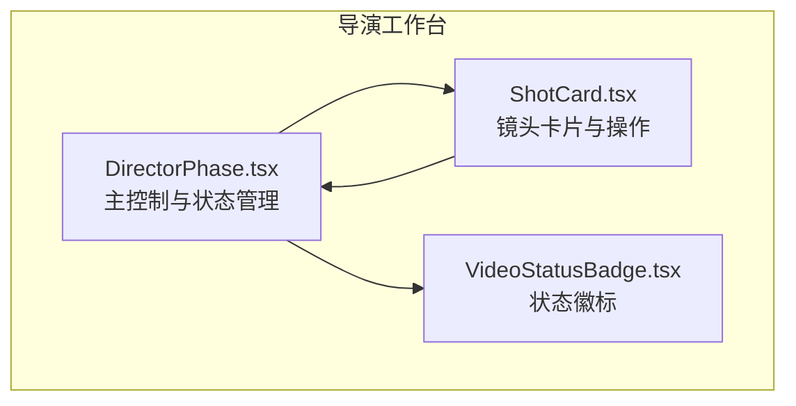
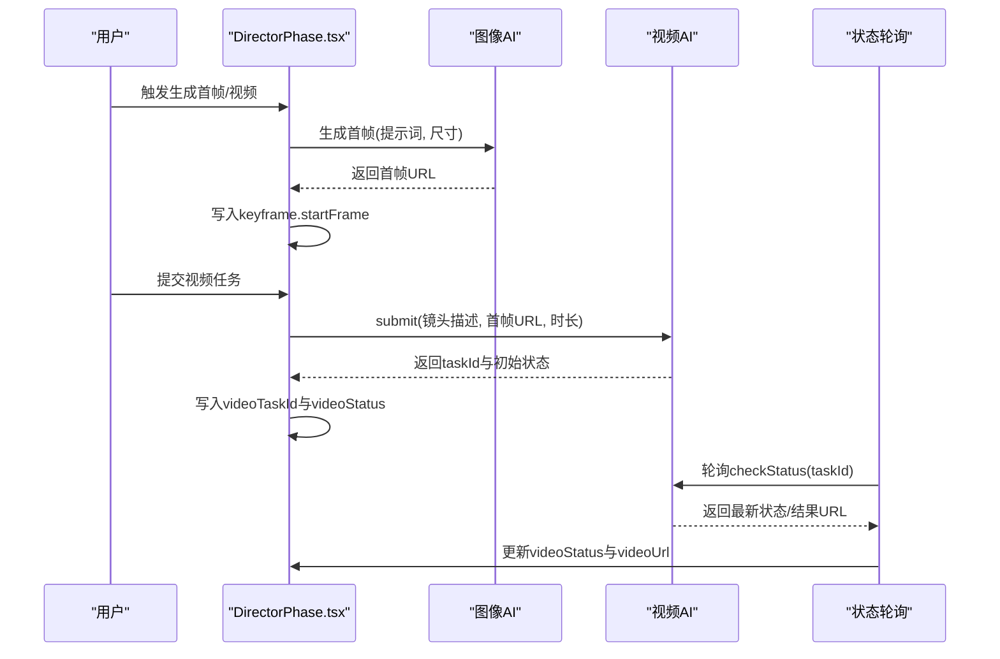
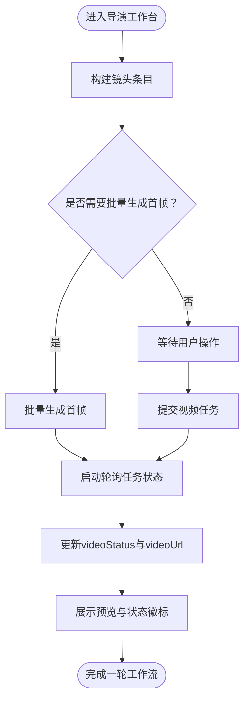
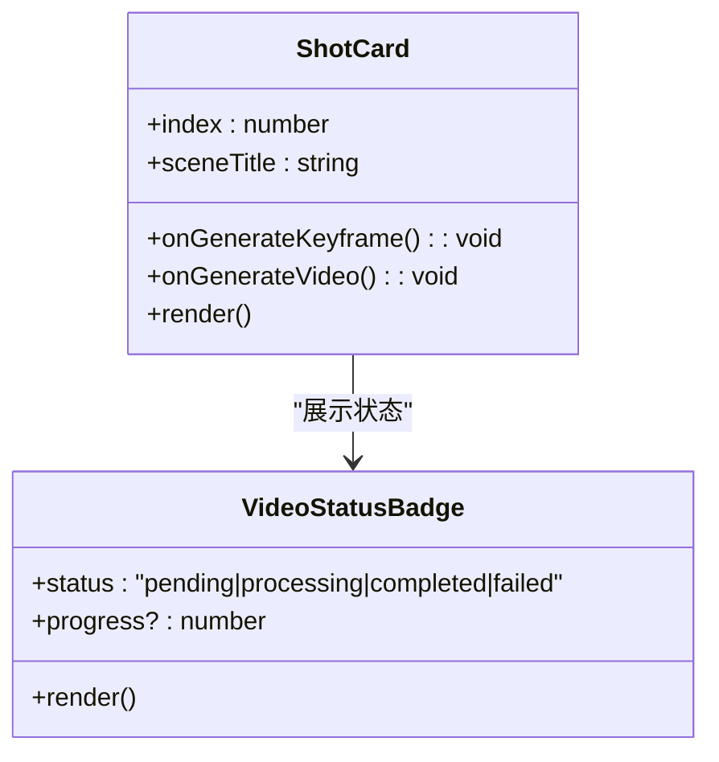
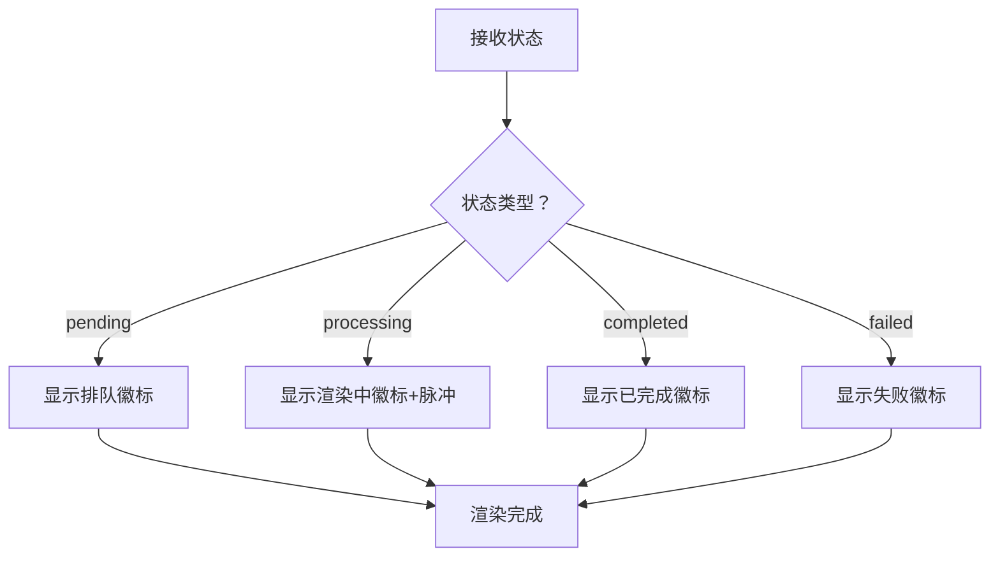
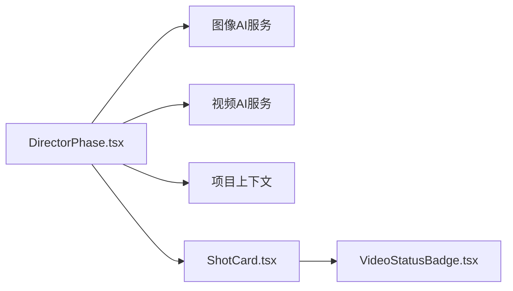

# 分镜辅助服务

<cite>
**本文引用的文件**
- [README.md](file://README.md)
- [README_EN.md](file://README_EN.md)
- [DirectorPhase.tsx](file://src/phases/director/DirectorPhase.tsx)
- [ShotCard.tsx](file://src/phases/director/components/ShotCard.tsx)
- [VideoStatusBadge.tsx](file://src/phases/director/components/VideoStatusBadge.tsx)
</cite>

## 目录
1. [简介](#简介)
2. [项目结构](#项目结构)
3. [核心组件](#核心组件)
4. [架构总览](#架构总览)
5. [详细组件分析](#详细组件分析)
6. [依赖关系分析](#依赖关系分析)
7. [性能考虑](#性能考虑)
8. [故障排查指南](#故障排查指南)
9. [结论](#结论)
10. [附录](#附录)

## 简介
本文件面向“分镜辅助服务”，系统性梳理导演工作台中的关键帧生成、提示词增强、九宫格预览、镜头语言优化与视觉效果提升等能力，并说明与导演工作台的集成方式、实时预览支持及创意辅助机制。文档基于仓库现有源码进行分析，重点覆盖以下方面：
- 关键帧优化与批量生成
- 提示词增强策略
- 动作建议与镜头语言优化（基于镜头描述、景别、时长等）
- 九宫格生成与预览（网格化分镜）
- 实时状态轮询与预览回放
- 创意辅助机制与上下文感知
- 使用示例、参数调优与扩展新算法的建议

## 项目结构
分镜辅助服务位于导演工作台阶段（Phase 03），围绕“剧本-资产-关键帧-视频”的流水线展开。核心由三部分组成：
- 导演工作台主界面：负责组织镜头、触发生成、展示状态与预览
- 镜头卡片组件：单镜头的操作入口、状态展示与错误提示
- 状态徽标组件：视频任务四态可视化（排队/渲染中/完成/失败）

图表来源
- [DirectorPhase.tsx:62-495](file://src/phases/director/DirectorPhase.tsx#L62-L495)
- [ShotCard.tsx:22-308](file://src/phases/director/components/ShotCard.tsx#L22-L308)
- [VideoStatusBadge.tsx:52-81](file://src/phases/director/components/VideoStatusBadge.tsx#L52-L81)

章节来源
- [README.md:27-59](file://README.md#L27-L59)
- [README_EN.md:18-80](file://README_EN.md#L18-L80)

## 核心组件
- 导演工作台主控（DirectorPhase）
  - 负责构建镜头条目、批量生成关键帧、提交视频任务、轮询任务状态并更新UI
  - 提供统计面板：镜头总数、已生成首帧数、渲染中数量、已完成数量
  - 提示词增强策略：结合镜头描述、景别、场景描述、角色外观等
- 镜头卡片（ShotCard）
  - 展示镜头编号、场景信息、首帧预览、状态徽标
  - 提供“生成首帧/重绘首帧”、“生成视频/重新拍摄”等操作按钮
  - 支持渲染中扫描条动画与错误弹窗
- 状态徽标（VideoStatusBadge）
  - 将视频任务状态映射为视觉元素：排队、渲染中、完成、失败
  - 渲染中状态带脉冲动画，完成状态带琥珀色边框

章节来源
- [DirectorPhase.tsx:39-60](file://src/phases/director/DirectorPhase.tsx#L39-L60)
- [DirectorPhase.tsx:110-125](file://src/phases/director/DirectorPhase.tsx#L110-L125)
- [DirectorPhase.tsx:127-159](file://src/phases/director/DirectorPhase.tsx#L127-L159)
- [DirectorPhase.tsx:191-247](file://src/phases/director/DirectorPhase.tsx#L191-L247)
- [ShotCard.tsx:22-308](file://src/phases/director/components/ShotCard.tsx#L22-L308)
- [VideoStatusBadge.tsx:52-81](file://src/phases/director/components/VideoStatusBadge.tsx#L52-L81)

## 架构总览
导演工作台采用“信息-反馈律”控制回路：
- 输入：剧本结构派生的镜头列表
- 处理：图像AI生成首帧、视频AI提交任务并轮询状态
- 输出：本地状态更新、UI即时反馈、结果落库供后续阶段读取

图表来源
- [DirectorPhase.tsx:110-125](file://src/phases/director/DirectorPhase.tsx#L110-L125)
- [DirectorPhase.tsx:127-159](file://src/phases/director/DirectorPhase.tsx#L127-L159)
- [DirectorPhase.tsx:191-247](file://src/phases/director/DirectorPhase.tsx#L191-L247)

## 详细组件分析

### 组件一：导演工作台主控（DirectorPhase）
职责与流程
- 构建镜头条目：从项目脚本派生全局镜头索引，便于批处理与统计
- 关键帧生成：基于提示词增强策略调用图像AI生成首帧
- 视频生成：提交视频任务，乐观标记为“排队/处理中”，随后轮询状态
- 批量处理：按未生成首帧的镜头集合并发执行，累积错误但不中断
- 实时轮询：每5秒轮询一次，更新任务状态与结果URL

提示词增强策略
- 基础模板：镜头描述 + 景别 + 电影感灯光 + 动漫风格 + 高质量
- 上下文增强：若存在角色外观描述，拼接“角色特征”；若存在场景描述，拼接“场景设定”
- 作用：提升角色一致性与场景连贯性，减少AI生成偏差

状态轮询机制
- 仅对处于“排队/处理中”且具备taskId的任务进行轮询
- 并行轮询所有待处理任务，容忍个别失败
- 完成后写入videoUrl，驱动UI刷新

图表来源
- [DirectorPhase.tsx:71-88](file://src/phases/director/DirectorPhase.tsx#L71-L88)
- [DirectorPhase.tsx:161-189](file://src/phases/director/DirectorPhase.tsx#L161-L189)
- [DirectorPhase.tsx:191-247](file://src/phases/director/DirectorPhase.tsx#L191-L247)

章节来源
- [DirectorPhase.tsx:39-60](file://src/phases/director/DirectorPhase.tsx#L39-L60)
- [DirectorPhase.tsx:110-125](file://src/phases/director/DirectorPhase.tsx#L110-L125)
- [DirectorPhase.tsx:127-159](file://src/phases/director/DirectorPhase.tsx#L127-L159)
- [DirectorPhase.tsx:161-189](file://src/phases/director/DirectorPhase.tsx#L161-L189)
- [DirectorPhase.tsx:191-247](file://src/phases/director/DirectorPhase.tsx#L191-L247)

### 组件二：镜头卡片（ShotCard）
职责与交互
- 展示镜头编号、场景标题、首帧预览、状态徽标
- 操作按钮：
  - 生成首帧/重绘首帧（首帧不存在时）
  - 生成视频/重新拍摄（首帧存在且非锁定时）
- 渲染中状态显示扫描条动画
- 错误弹窗：捕获生成/提交异常并提示

图表来源
- [ShotCard.tsx:22-308](file://src/phases/director/components/ShotCard.tsx#L22-L308)
- [VideoStatusBadge.tsx:52-81](file://src/phases/director/components/VideoStatusBadge.tsx#L52-L81)

章节来源
- [ShotCard.tsx:22-308](file://src/phases/director/components/ShotCard.tsx#L22-L308)

### 组件三：状态徽标（VideoStatusBadge）
职责与设计
- 将任务状态映射为颜色、图标与背景，形成统一的视觉语言
- 渲染中状态带脉冲动画，完成状态带琥珀色边框，失败状态强调警示色
- 可选进度百分比显示，用于增强反馈

图表来源
- [VideoStatusBadge.tsx:11-44](file://src/phases/director/components/VideoStatusBadge.tsx#L11-L44)
- [VideoStatusBadge.tsx:52-81](file://src/phases/director/components/VideoStatusBadge.tsx#L52-L81)

章节来源
- [VideoStatusBadge.tsx:52-81](file://src/phases/director/components/VideoStatusBadge.tsx#L52-L81)

### 九宫格生成与预览（概念说明）
根据项目README，导演工作台提供“九宫格故事板预览”能力：
- 将一个镜头拆分为9个视角，形成3x3网格
- 可选择整张网格作为首帧，或裁剪某个面板作为首帧
- 支持在编辑面板中审查与修改各视角描述，再生成3x3故事板图像

该能力属于导演工作台的创意辅助机制，帮助创作者快速探索多角度构图与动作变化。

章节来源
- [README_EN.md:67-70](file://README_EN.md#L67-L70)
- [README.md:37-39](file://README.md#L37-L39)

### 镜头语言优化与视觉效果提升（技术实现要点）
- 提示词增强：在基础模板基础上拼接角色外观与场景设定，提升一致性与连贯性
- 景别与时长：镜头卡片展示景别与时长标签，便于创作者直观评估镜头节奏
- 实时预览：完成状态后自动回填videoUrl，支持内嵌播放器预览
- 上下文感知：视频生成时读取当前场景图像与角色特定造型图像，解决连续性问题

章节来源
- [DirectorPhase.tsx:39-60](file://src/phases/director/DirectorPhase.tsx#L39-L60)
- [ShotCard.tsx:151-163](file://src/phases/director/components/ShotCard.tsx#L151-L163)
- [README_EN.md:70-71](file://README_EN.md#L70-L71)

## 依赖关系分析
- DirectorPhase 依赖：
  - 图像AI与视频AI服务（通过钩子注入）
  - 项目上下文（读取脚本与导演数据）
  - 状态轮询逻辑（定时器与ref持有最新值）
- ShotCard 依赖：
  - 状态徽标组件
  - 本地busy状态与错误弹窗
- VideoStatusBadge 依赖：
  - 任务状态枚举与样式映射表

图表来源
- [DirectorPhase.tsx:62-125](file://src/phases/director/DirectorPhase.tsx#L62-L125)
- [ShotCard.tsx:22-308](file://src/phases/director/components/ShotCard.tsx#L22-L308)
- [VideoStatusBadge.tsx:52-81](file://src/phases/director/components/VideoStatusBadge.tsx#L52-L81)

章节来源
- [DirectorPhase.tsx:62-125](file://src/phases/director/DirectorPhase.tsx#L62-L125)
- [ShotCard.tsx:22-308](file://src/phases/director/components/ShotCard.tsx#L22-L308)
- [VideoStatusBadge.tsx:52-81](file://src/phases/director/components/VideoStatusBadge.tsx#L52-L81)

## 性能考虑
- 并行轮询：对多个排队/处理中的任务并行轮询，缩短最长等待时间
- 乐观更新：提交视频任务后立即标记为“排队/处理中”，提升交互响应
- 批量生成：按未生成首帧的镜头集合并发执行，累积错误但不中断，提高吞吐
- 资源占用：渲染中扫描条动画与状态徽标均为轻量DOM，对性能影响较小

章节来源
- [DirectorPhase.tsx:191-247](file://src/phases/director/DirectorPhase.tsx#L191-L247)
- [DirectorPhase.tsx:161-189](file://src/phases/director/DirectorPhase.tsx#L161-L189)
- [ShotCard.tsx:165-179](file://src/phases/director/components/ShotCard.tsx#L165-L179)

## 故障排查指南
常见问题与定位方法
- API Key缺失：生成首帧/视频前检查API Key配置，否则会抛出明确错误
- 首帧未生成：提交视频任务前需先生成首帧，否则会提示先生成首帧
- 任务失败：查看状态徽标为“失败”，可在错误弹窗中获取具体消息
- 网络轮询失败：轮询期间的网络异常会被忽略，等待下次tick重试

章节来源
- [DirectorPhase.tsx:114-116](file://src/phases/director/DirectorPhase.tsx#L114-L116)
- [DirectorPhase.tsx:135-137](file://src/phases/director/DirectorPhase.tsx#L135-L137)
- [ShotCard.tsx:268-285](file://src/phases/director/components/ShotCard.tsx#L268-L285)

## 结论
分镜辅助服务以“关键帧驱动”为核心，通过提示词增强、上下文感知与实时轮询机制，实现了从首帧到视频的高效产出。导演工作台提供了直观的状态可视化与批量操作能力，配合九宫格预览与镜头语言优化，显著提升了创意表达与制作效率。未来可在此基础上扩展更多分镜优化算法（如动作建议、构图评分、节奏分析等），并以插件化方式接入现有工作流。

## 附录

### 使用示例
- 生成首帧：在镜头卡片点击“生成首帧”，系统将基于增强提示词生成首帧并预览
- 生成视频：在已有首帧的情况下提交视频任务，系统将轮询状态并在完成后提供预览
- 批量生成：在控制栏点击“批量生成首帧”，系统将并发处理未生成首帧的镜头

章节来源
- [DirectorPhase.tsx:110-125](file://src/phases/director/DirectorPhase.tsx#L110-L125)
- [DirectorPhase.tsx:127-159](file://src/phases/director/DirectorPhase.tsx#L127-L159)
- [DirectorPhase.tsx:161-189](file://src/phases/director/DirectorPhase.tsx#L161-L189)
- [ShotCard.tsx:43-69](file://src/phases/director/components/ShotCard.tsx#L43-L69)

### 参数调优建议
- 提示词权重：在增强策略中适当提升“角色特征”与“场景设定”的权重，有助于保持一致性
- 轮询间隔：当前固定为5秒，可根据服务端延迟与吞吐需求调整
- 批处理并发：根据网络与服务端限流策略动态调整并发度，避免触发限流

章节来源
- [DirectorPhase.tsx:39-60](file://src/phases/director/DirectorPhase.tsx#L39-L60)
- [DirectorPhase.tsx:191-247](file://src/phases/director/DirectorPhase.tsx#L191-L247)

### 如何扩展新的分镜优化算法
- 新增提示词增强规则：在提示词构建函数中增加新的上下文字段与权重
- 新增状态徽标语义：在状态徽标组件中扩展状态映射与样式
- 新增算法模块：在导演工作台中新增算法模块，提供可视化开关与参数面板
- 集成点：通过钩子或服务层扩展图像/视频AI接口，确保与现有工作流兼容

章节来源
- [DirectorPhase.tsx:39-60](file://src/phases/director/DirectorPhase.tsx#L39-L60)
- [VideoStatusBadge.tsx:11-44](file://src/phases/director/components/VideoStatusBadge.tsx#L11-L44)