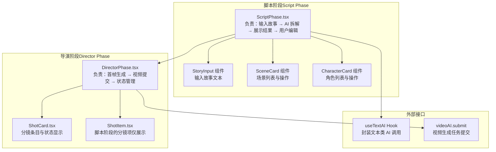
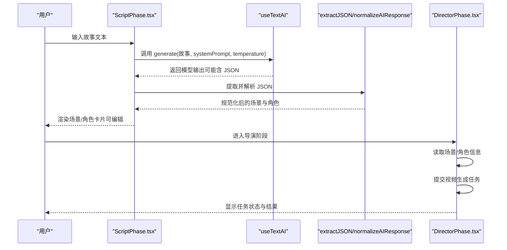
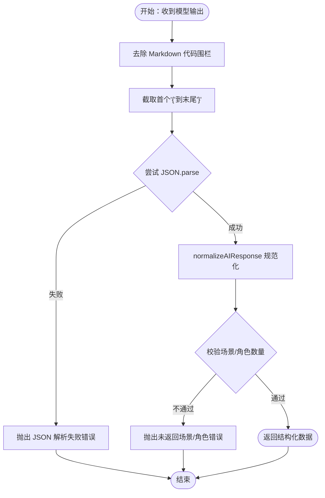
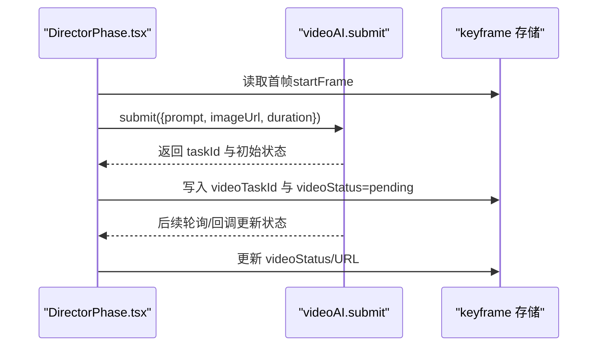
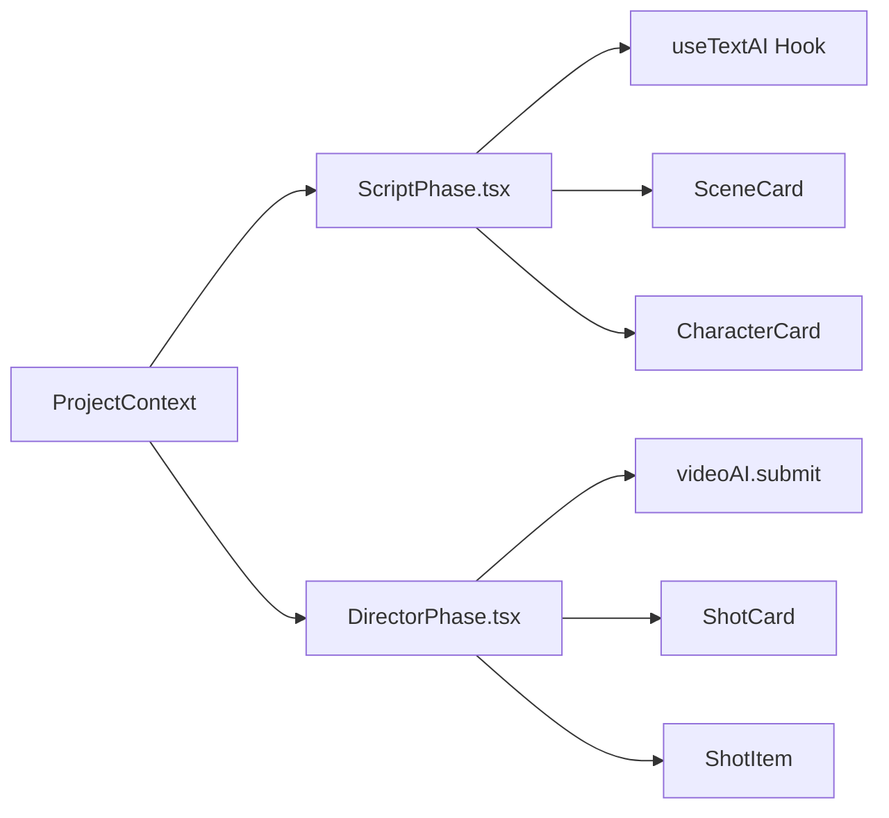

# 剧本处理服务

<cite>
**本文引用的文件**
- [ScriptPhase.tsx](file://src/phases/script/ScriptPhase.tsx)
- [DirectorPhase.tsx](file://src/phases/director/DirectorPhase.tsx)
- [ShotCard.tsx](file://src/phases/director/components/ShotCard.tsx)
- [ShotItem.tsx](file://src/phases/script/components/ShotItem.tsx)
- [README_EN.md](file://README_EN.md)
</cite>

## 目录
1. [简介](#简介)
2. [项目结构](#项目结构)
3. [核心组件](#核心组件)
4. [架构总览](#架构总览)
5. [详细组件分析](#详细组件分析)
6. [依赖关系分析](#依赖关系分析)
7. [性能考量](#性能考量)
8. [故障排查指南](#故障排查指南)
9. [结论](#结论)
10. [附录](#附录)

## 简介
本文件面向“剧本处理服务”的前端实现，聚焦于剧本解析、分镜生成、角色与场景结构化输出、以及与导演阶段的衔接。文档基于仓库中的前端源码进行分析，重点解释自然语言处理流程（提示词工程）、JSON 数据提取与规范化、分镜结构化输出、以及与视频生成阶段的集成方式。同时提供使用示例、参数配置建议、性能优化思路与扩展新剧本处理能力的实践路径。

## 项目结构
本项目采用前端单页应用架构，剧本处理服务位于“脚本阶段”（Script Phase），负责接收用户输入的故事文本，调用大模型生成结构化分镜与角色信息，并在界面中以卡片形式呈现，供用户编辑与确认。随后进入“导演阶段”（Director Phase），将分镜与角色信息用于视频生成任务。

图表来源
- [ScriptPhase.tsx:143-495](file://src/phases/script/ScriptPhase.tsx#L143-L495)
- [DirectorPhase.tsx:127-159](file://src/phases/director/DirectorPhase.tsx#L127-L159)
- [ShotCard.tsx](file://src/phases/director/components/ShotCard.tsx)
- [ShotItem.tsx](file://src/phases/script/components/ShotItem.tsx)

章节来源
- [ScriptPhase.tsx:1-583](file://src/phases/script/ScriptPhase.tsx#L1-L583)
- [DirectorPhase.tsx:127-159](file://src/phases/director/DirectorPhase.tsx#L127-L159)
- [README_EN.md:135-186](file://README_EN.md#L135-L186)

## 核心组件
- 脚本阶段主组件 ScriptPhase：负责收集用户输入的故事文本，调用 AI 生成结构化 JSON，解析并规范化为场景与角色数据，渲染为可编辑卡片。
- 导演阶段主组件 DirectorPhase：负责将分镜与角色信息用于视频生成，提交任务并跟踪状态。
- 辅助组件：StoryInput（输入）、SceneCard/CharacterCard（展示与编辑）、ShotCard/ShotItem（分镜展示）。

章节来源
- [ScriptPhase.tsx:143-495](file://src/phases/script/ScriptPhase.tsx#L143-L495)
- [DirectorPhase.tsx:127-159](file://src/phases/director/DirectorPhase.tsx#L127-L159)

## 架构总览
下图展示了从“输入故事”到“生成分镜与角色”，再到“视频生成”的端到端流程。

图表来源
- [ScriptPhase.tsx:174-202](file://src/phases/script/ScriptPhase.tsx#L174-L202)
- [ScriptPhase.tsx:79-138](file://src/phases/script/ScriptPhase.tsx#L79-L138)
- [DirectorPhase.tsx:127-159](file://src/phases/director/DirectorPhase.tsx#L127-L159)

## 详细组件分析

### 脚本阶段：剧本解析与分镜生成
- 自然语言处理流程
  - 系统提示词（System Prompt）定义角色为“专业影视分镜师”，要求严格按 JSON 输出，包含场景与角色字段，明确镜头数量与描述规范。
  - 参数配置：temperature=0.7，平衡创造性与稳定性，适合结构化 JSON 生成。
- JSON 数据提取与规范化
  - extractJSON：去除 Markdown 代码围栏，截取首个“{”到最后一个“}”，再进行 JSON.parse，异常时抛出明确错误。
  - normalizeAIResponse：对场景与镜头进行标准化（补全 ID、清洗描述、限制镜头时长范围、校验必填项），若未返回场景或角色则抛错。
- 结构化输出
  - 场景：包含 id、title、description、shots（含 id、description、cameraAngle、duration）。
  - 角色：包含 id、name、description、appearance。
- 错误恢复机制
  - 生成失败时记录日志并弹窗提示（若 useTextAI 未设置错误），引导检查 API Key 并重试。
- 流式处理支持
  - 当前实现为一次性返回 JSON 的解析流程；若需流式，可在 useTextAI 层面改为流式回调，逐步提取 JSON 片段并合并，再进行规范化。

图表来源
- [ScriptPhase.tsx:79-138](file://src/phases/script/ScriptPhase.tsx#L79-L138)

章节来源
- [ScriptPhase.tsx:21-54](file://src/phases/script/ScriptPhase.tsx#L21-L54)
- [ScriptPhase.tsx:79-138](file://src/phases/script/ScriptPhase.tsx#L79-L138)
- [ScriptPhase.tsx:174-202](file://src/phases/script/ScriptPhase.tsx#L174-L202)

### 导演阶段：分镜与视频生成衔接
- 首帧与视频生成
  - 在导演阶段，需要先生成首帧（keyframe.startFrame），然后提交视频生成任务，传入 prompt（来自分镜描述）、首帧图片、时长等参数。
  - 提交后乐观更新状态（videoStatus=pending），捕获异常并回滚状态为 failed。
- 与脚本阶段的数据衔接
  - 导演阶段读取脚本阶段生成的场景/角色信息，作为视频生成的上下文提示。

图表来源
- [DirectorPhase.tsx:127-159](file://src/phases/director/DirectorPhase.tsx#L127-L159)

章节来源
- [DirectorPhase.tsx:127-159](file://src/phases/director/DirectorPhase.tsx#L127-L159)

### 组件级交互与数据流
- 脚本阶段组件
  - StoryInput：接收用户输入，触发 AI 生成。
  - SceneCard/CharacterCard：展示与编辑场景/角色，支持增删改。
- 导演阶段组件
  - ShotCard：展示分镜条目与视频生成状态。
  - ShotItem：脚本阶段的分镜项展示（仅展示）。

章节来源
- [ScriptPhase.tsx:434-495](file://src/phases/script/ScriptPhase.tsx#L434-L495)
- [ShotCard.tsx](file://src/phases/director/components/ShotCard.tsx)
- [ShotItem.tsx](file://src/phases/script/components/ShotItem.tsx)

## 依赖关系分析
- 组件耦合
  - ScriptPhase 依赖 useTextAI（AI 文本生成）、ProjectContext（项目状态）、UI 组件（StoryInput、SceneCard、CharacterCard）。
  - DirectorPhase 依赖 videoAI.submit（视频生成）、ProjectContext（读取脚本阶段数据）、UI 组件（ShotCard、ShotItem）。
- 外部接口
  - useTextAI：封装文本类 AI 调用，支持 systemPrompt 与 temperature 等参数。
  - videoAI.submit：封装视频生成任务提交与状态管理。
- 数据一致性
  - 通过 ProjectContext 的 updateProject 方法保证跨阶段数据一致与响应式更新。

图表来源
- [ScriptPhase.tsx:143-495](file://src/phases/script/ScriptPhase.tsx#L143-L495)
- [DirectorPhase.tsx:127-159](file://src/phases/director/DirectorPhase.tsx#L127-L159)

章节来源
- [ScriptPhase.tsx:143-495](file://src/phases/script/ScriptPhase.tsx#L143-L495)
- [DirectorPhase.tsx:127-159](file://src/phases/director/DirectorPhase.tsx#L127-L159)

## 性能考量
- 模型调用成本控制
  - 使用合理的 temperature（如 0.7）与精炼的 systemPrompt，减少无效输出与重试。
  - 对 JSON 提取与解析做边界检查，尽早失败以降低无效调用次数。
- 前端渲染优化
  - 场景/镜头较多时，采用虚拟滚动或分页加载，避免一次性渲染大量 DOM。
- 网络与缓存
  - 将已生成的首帧与中间结果缓存至本地存储或服务端，减少重复请求。
- 并发与批处理
  - 导演阶段可对多个分镜并发提交视频生成任务，但需控制速率以避免触发限流。

## 故障排查指南
- 常见问题与定位
  - “未找到合法的 JSON 结构”：检查模型是否遵循 JSON 输出格式，确认 systemPrompt 中的格式约束。
  - “JSON 解析失败”：检查 extractJSON 的截取逻辑是否正确，确保输出中存在完整的 JSON 对象。
  - “未返回任何场景/角色”：检查 normalizeAIResponse 的校验逻辑，必要时放宽或增强 systemPrompt 的约束。
  - “API Key 未配置或无效”：在导演阶段提交视频任务前，确保已配置有效密钥。
- 日志与提示
  - 脚本阶段在解析失败时会记录错误并弹窗提示，建议在 UI 中增加更友好的错误面板与重试按钮。
  - 导演阶段对异常状态进行回滚（videoStatus=failed），便于用户重新提交。

章节来源
- [ScriptPhase.tsx:191-201](file://src/phases/script/ScriptPhase.tsx#L191-L201)
- [ScriptPhase.tsx:134-135](file://src/phases/script/ScriptPhase.tsx#L134-L135)
- [DirectorPhase.tsx:131-133](file://src/phases/director/DirectorPhase.tsx#L131-L133)

## 结论
本服务通过“脚本阶段”的结构化 JSON 生成与“导演阶段”的视频生成任务提交，实现了从故事到分镜再到视频的闭环。其关键在于严格的提示词工程、稳健的 JSON 提取与规范化、以及与视频生成阶段的平滑衔接。未来可扩展的方向包括：流式处理支持、多模态提示词增强、分镜质量评估与自动优化、以及与数据库的持久化集成。

## 附录

### 使用示例
- 输入故事文本并点击“AI 智能分镜”，等待解析完成后在场景/角色区域进行编辑。
- 编辑完成后进入导演阶段，确保已生成首帧并配置好 API Key，提交视频生成任务。

章节来源
- [ScriptPhase.tsx:174-202](file://src/phases/script/ScriptPhase.tsx#L174-L202)
- [DirectorPhase.tsx:127-159](file://src/phases/director/DirectorPhase.tsx#L127-L159)

### 参数配置建议
- systemPrompt：保持 JSON 输出格式与字段约束清晰，避免歧义。
- temperature：建议 0.6–0.8，兼顾稳定与多样性。
- 镜头时长：normalizeAIResponse 已限制范围，避免过长导致生成失败。

章节来源
- [ScriptPhase.tsx:21-54](file://src/phases/script/ScriptPhase.tsx#L21-L54)
- [ScriptPhase.tsx:114-117](file://src/phases/script/ScriptPhase.tsx#L114-L117)

### 扩展新剧本处理能力
- 新增处理类型：在脚本阶段新增一个子流程（例如“剧本续写”、“剧本重写”），复用 extractJSON 与 normalizeAIResponse，并在 UI 中新增对应入口。
- 流式处理：在 useTextAI 层面改造为流式回调，逐步提取 JSON 片段并合并，提升用户体验。
- 数据库集成：将项目状态与中间结果持久化至数据库，支持断点续做与团队协作。

章节来源
- [ScriptPhase.tsx:79-138](file://src/phases/script/ScriptPhase.tsx#L79-L138)
- [README_EN.md:135-186](file://README_EN.md#L135-L186)