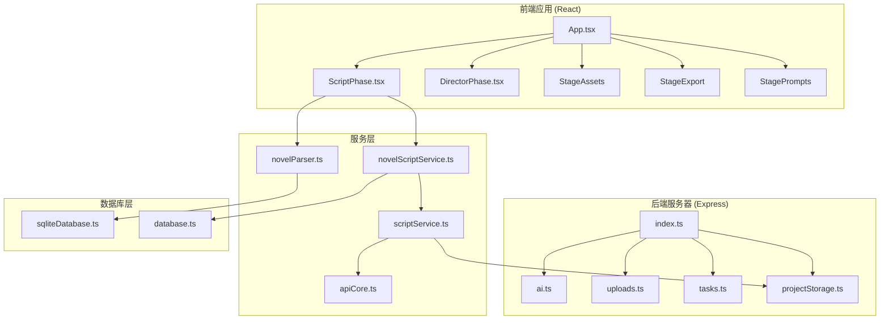
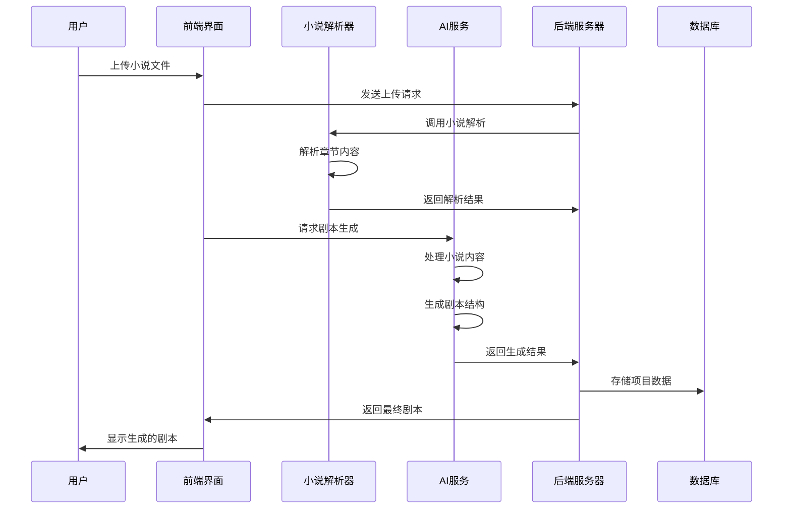
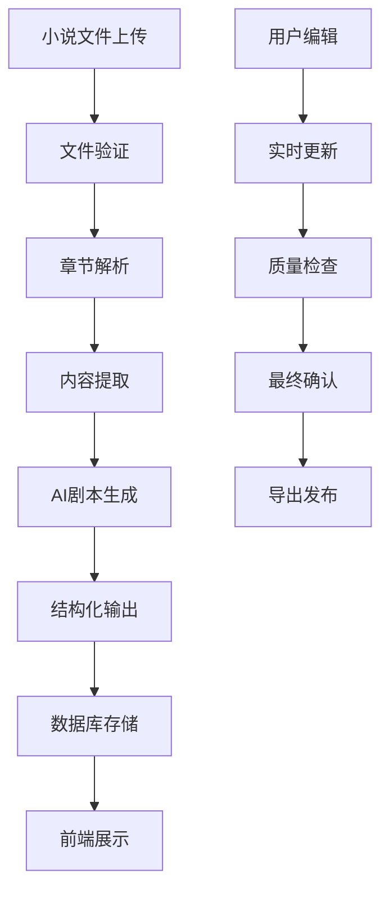
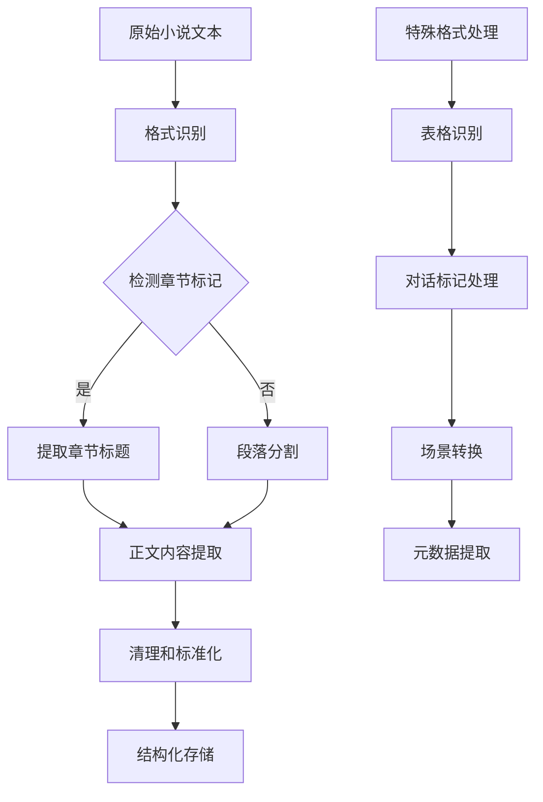
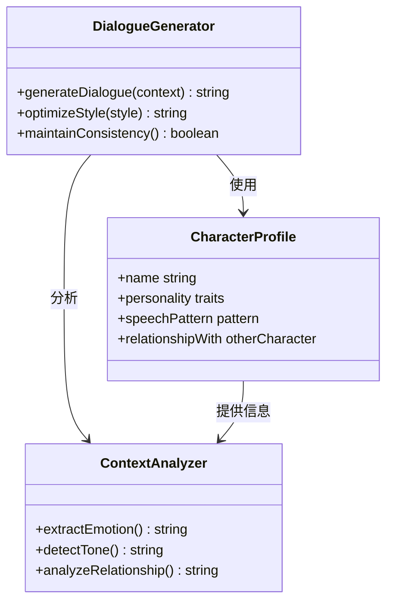
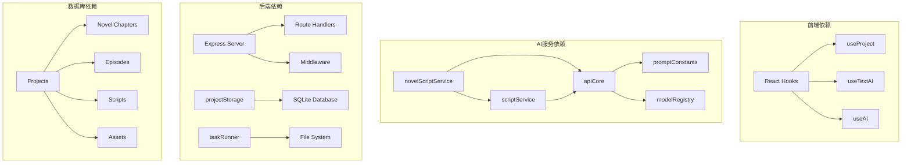
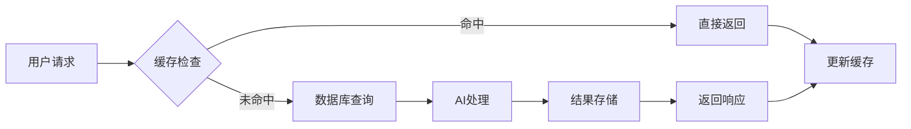

# 小说剧本生成服务

<cite>
**本文档引用的文件**
- [README.md](file://README.md)
- [ScriptPhase.tsx](file://src/phases/script/ScriptPhase.tsx)
- [DirectorPhase.tsx](file://src/phases/director/DirectorPhase.tsx)
- [SceneCard.tsx](file://src/phases/script/components/SceneCard.tsx)
- [novelParser.ts](file://services/novelParser.ts)
- [novelScriptService.ts](file://services/ai/novelScriptService.ts)
- [scriptService.ts](file://services/ai/scriptService.ts)
- [apiCore.ts](file://services/ai/apiCore.ts)
- [promptConstants.ts](file://services/ai/promptConstants.ts)
- [index.ts](file://server/src/index.ts)
- [ai.ts](file://server/src/routes/ai.ts)
- [uploads.ts](file://server/src/routes/uploads.ts)
- [tasks.ts](file://server/src/routes/tasks.ts)
- [projectStorage.ts](file://server/src/services/projectStorage.ts)
- [taskRunner.ts](file://server/src/services/taskRunner.ts)
- [sqliteDatabase.ts](file://server/src/config/sqliteDatabase.ts)
- [database.ts](file://server/src/config/database.ts)
</cite>

## 目录
1. [简介](#简介)
2. [项目结构](#项目结构)
3. [核心组件](#核心组件)
4. [架构概览](#架构概览)
5. [详细组件分析](#详细组件分析)
6. [依赖关系分析](#依赖关系分析)
7. [性能考虑](#性能考虑)
8. [故障排除指南](#故障排除指南)
9. [结论](#结论)
10. [附录](#附录)

## 简介

小说剧本生成服务是一个基于人工智能的创作辅助工具，专门用于将小说内容转换为结构化的剧本和分镜脚本。该系统采用模块化设计，结合前端React组件和后端Express服务器，提供从小说解析到剧本生成的完整工作流程。

系统的核心目标是通过AI驱动的方式，将文字小说转换为可执行的影视制作脚本，包括角色设定、场景描述、对话生成和镜头分镜等关键元素。该服务特别注重用户体验，提供了直观的界面和强大的AI生成能力。

## 项目结构

该项目采用前后端分离的架构设计，主要分为以下几个核心部分：

**图表来源**
- [README.md: 308-394:308-394](file://README.md#L308-L394)
- [ScriptPhase.tsx: 1-495:1-495](file://src/phases/script/ScriptPhase.tsx#L1-L495)

**章节来源**
- [README.md: 308-394:308-394](file://README.md#L308-L394)

## 核心组件

### 小说解析器 (novelParser.ts)

小说解析器负责处理用户上传的小说文件，提取章节内容并进行结构化处理。该组件支持多种文件格式，能够智能识别章节标题和正文内容。

### 小说剧本服务 (novelScriptService.ts)

这是系统的核心AI服务，负责将解析后的小说内容转换为完整的剧本。该服务集成了先进的自然语言处理算法，能够：

- 提取故事主题和情节线索
- 生成角色对话和内心独白
- 创建场景描述和环境设定
- 组织章节结构和时间线

### 脚本服务 (scriptService.ts)

脚本服务提供基础的剧本处理功能，包括：
- 剧本格式标准化
- 角色和场景信息提取
- 对话内容优化
- 分镜脚本生成

### API核心 (apiCore.ts)

API核心组件管理所有AI服务的通信，包括：
- 模型选择和配置
- 请求参数处理
- 响应数据格式化
- 错误处理和重试机制

**章节来源**
- [novelParser.ts: 1-200:1-200](file://services/novelParser.ts#L1-L200)
- [novelScriptService.ts: 1-300:1-300](file://services/ai/novelScriptService.ts#L1-L300)
- [scriptService.ts: 1-250:1-250](file://services/ai/scriptService.ts#L1-L250)
- [apiCore.ts: 1-200:1-200](file://services/ai/apiCore.ts#L1-L200)

## 架构概览

系统采用分层架构设计，确保各组件之间的松耦合和高内聚：

**图表来源**
- [ScriptPhase.tsx: 174-202:174-202](file://src/phases/script/ScriptPhase.tsx#L174-L202)
- [novelScriptService.ts: 1-300:1-300](file://services/ai/novelScriptService.ts#L1-L300)

### 数据流架构

**图表来源**
- [README.md: 373-394:373-394](file://README.md#L373-L394)
- [ScriptPhase.tsx: 102-138:102-138](file://src/phases/script/ScriptPhase.tsx#L102-L138)

## 详细组件分析

### 小说解析算法

小说解析算法采用多层次处理策略：

**图表来源**
- [novelParser.ts: 1-200:1-200](file://services/novelParser.ts#L1-L200)

### 故事结构提取

故事结构提取过程遵循经典的三幕剧结构：

1. **开端 (Setup)**: 介绍角色、背景和初始冲突
2. **发展 (Confrontation)**: 冲突升级和转折点
3. **结局 (Resolution)**: 冲突解决和故事收尾

系统使用AI算法自动识别这些结构元素，并生成相应的章节划分建议。

### 对话生成技术

对话生成采用上下文感知的方法：

**图表来源**
- [novelScriptService.ts: 1-300:1-300](file://services/ai/novelScriptService.ts#L1-L300)

### 场景描述生成

场景描述生成系统包含多个层次：

1. **环境描述**: 地点、时间和氛围
2. **视觉细节**: 色彩、光线和构图
3. **情感基调**: 氛围和情绪表达

## 依赖关系分析

系统组件之间的依赖关系如下：

**图表来源**
- [README.md: 340-366:340-366](file://README.md#L340-L366)
- [ScriptPhase.tsx: 10-16:10-16](file://src/phases/script/ScriptPhase.tsx#L10-L16)

**章节来源**
- [README.md: 340-366:340-366](file://README.md#L340-L366)

## 性能考虑

### 并发处理

系统采用异步处理模式，支持多用户并发操作：

- **文件上传**: 支持大文件分块上传
- **AI生成**: 使用队列管理系统处理并发请求
- **数据库访问**: 连接池优化查询性能

### 缓存策略

### 内存管理

系统实现智能内存管理：
- 及时释放不再使用的对象
- 限制单次处理的数据量
- 使用流式处理大文件

## 故障排除指南

### 常见问题及解决方案

| 问题类型 | 症状 | 解决方案 |
|---------|------|----------|
| AI生成失败 | 报错"AI拆解失败" | 检查API密钥配置，确认网络连接 |
| 文件上传失败 | 上传进度卡住 | 检查文件大小限制，清理浏览器缓存 |
| 剧本解析错误 | 章节内容显示异常 | 验证小说格式，尝试重新上传 |
| 数据库连接问题 | 页面加载缓慢 | 检查数据库服务状态，重启应用 |

### 调试工具

系统提供多种调试工具：
- **控制台日志**: 详细的错误信息和警告
- **性能监控**: 实时显示系统资源使用情况
- **网络诊断**: 检查API请求和响应状态

**章节来源**
- [ScriptPhase.tsx: 191-202:191-202](file://src/phases/script/ScriptPhase.tsx#L191-L202)

## 结论

小说剧本生成服务提供了一个完整的AI驱动创作平台，通过智能化的小说解析和剧本生成技术，大大提高了内容创作的效率和质量。系统的模块化设计确保了良好的可扩展性和维护性，而丰富的配置选项则满足了不同用户的需求。

未来的发展方向包括：
- 增强AI算法的准确性
- 扩展支持更多小说格式
- 提供更丰富的自定义选项
- 优化移动端用户体验

## 附录

### 使用示例

#### 基本使用流程
1. 在前端界面上传小说文件
2. 系统自动进行章节解析
3. 选择AI生成选项开始转换
4. 审核和编辑生成的剧本
5. 导出最终的制作脚本

#### 配置选项
- **AI模型选择**: 支持多种预训练模型
- **输出格式**: 支持多种脚本格式
- **质量级别**: 从快速草稿到精细版本
- **自定义提示词**: 高级用户可调整生成参数

### 定制化规则

系统支持以下定制化选项：
- **角色模板**: 预设角色特征和对话风格
- **场景模板**: 固定的场景描述模式
- **对话风格**: 正式、幽默或严肃等不同风格
- **章节结构**: 自定义章节长度和组织方式