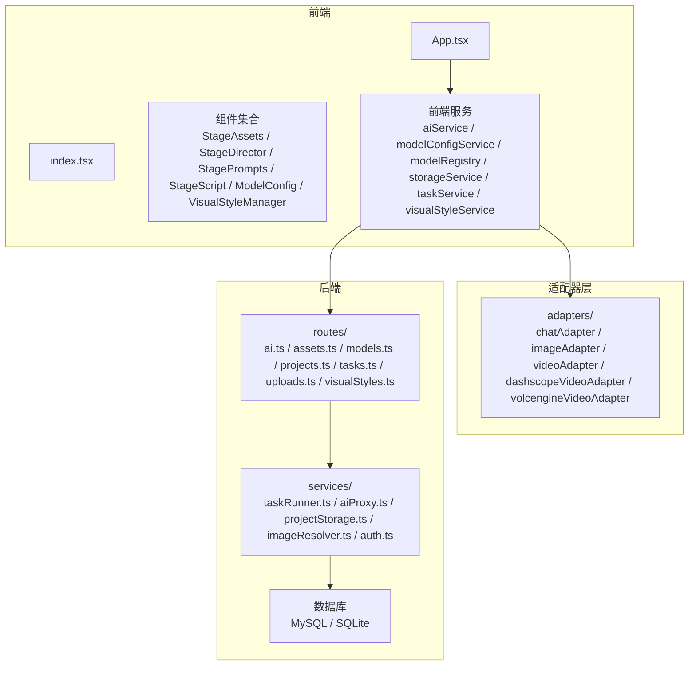
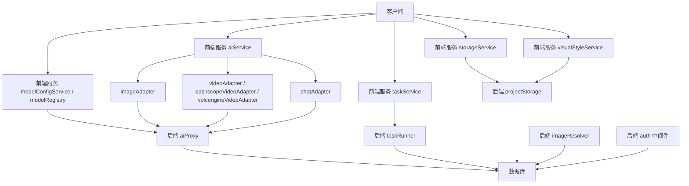
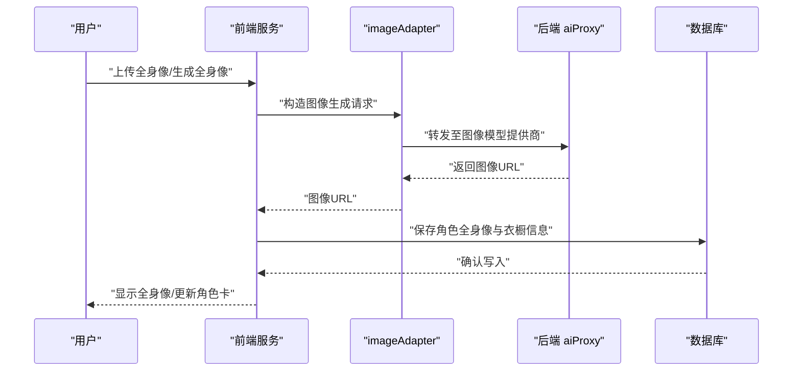
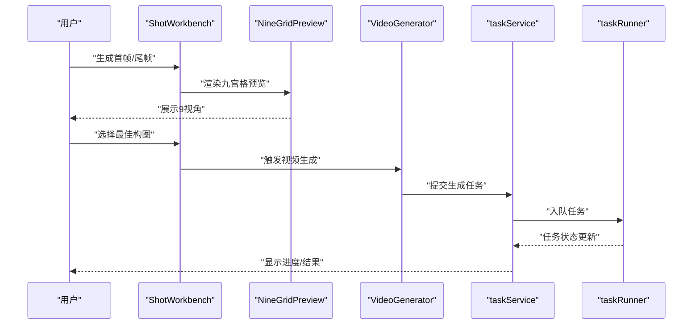
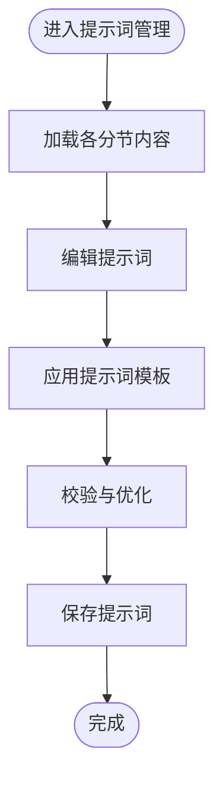
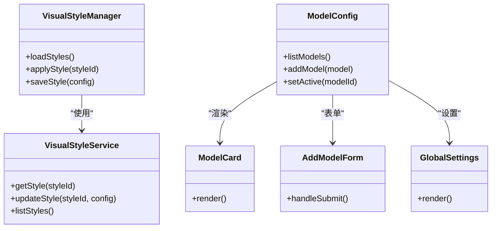
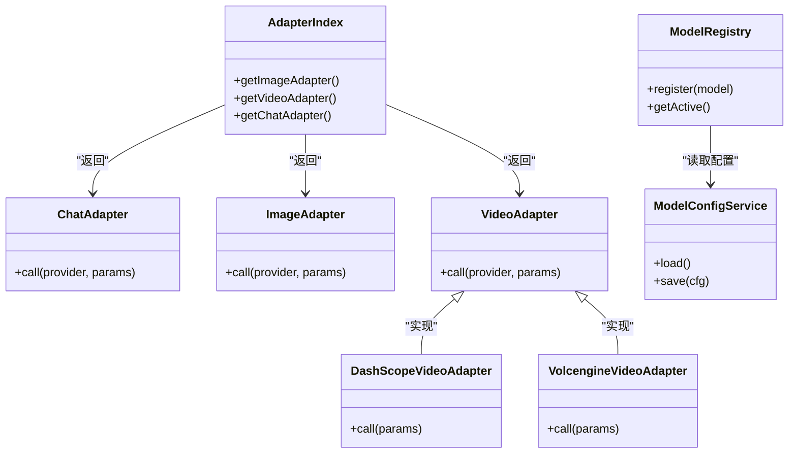
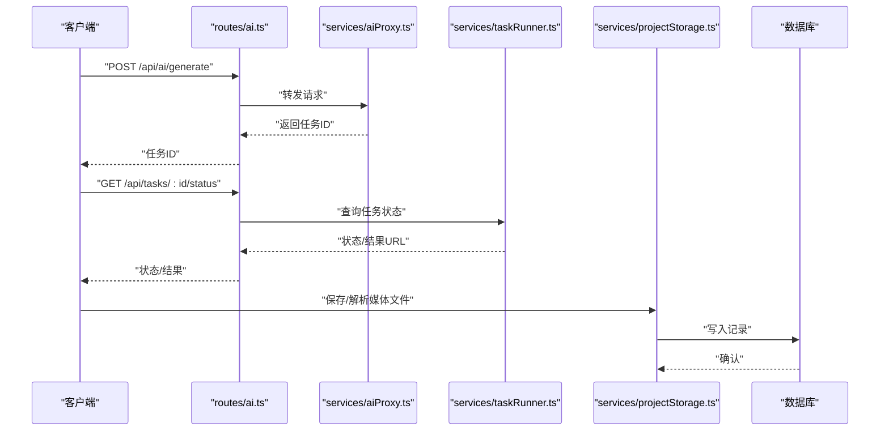
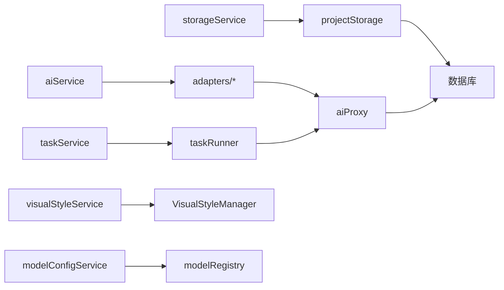

# 视觉资产生成服务

<cite>
**本文引用的文件**
- [README.md](file://README.md)
- [App.tsx](file://App.tsx)
- [index.tsx](file://index.tsx)
- [types.ts](file://types.ts)
- [types/model.ts](file://types/model.ts)
- [services/adapters/index.ts](file://services/adapters/index.ts)
- [services/adapters/chatAdapter.ts](file://services/adapters/chatAdapter.ts)
- [services/adapters/imageAdapter.ts](file://services/adapters/imageAdapter.ts)
- [services/adapters/videoAdapter.ts](file://services/adapters/videoAdapter.ts)
- [services/adapters/dashscopeVideoAdapter.ts](file://services/adapters/dashscopeVideoAdapter.ts)
- [services/adapters/volcengineVideoAdapter.ts](file://services/adapters/volcengineVideoAdapter.ts)
- [services/ai/apiCore.ts](file://services/ai/apiCore.ts)
- [services/ai/promptConstants.ts](file://services/ai/promptConstants.ts)
- [services/ai/scriptService.ts](file://services/ai/scriptService.ts)
- [services/ai/shotService.ts](file://services/ai/shotService.ts)
- [services/ai/videoService.ts](file://services/ai/videoService.ts)
- [services/aiService.ts](file://services/aiService.ts)
- [services/modelConfigService.ts](file://services/modelConfigService.ts)
- [services/modelRegistry.ts](file://services/modelRegistry.ts)
- [services/storageService.ts](file://services/storageService.ts)
- [services/taskService.ts](file://services/taskService.ts)
- [services/visualStyleService.ts](file://services/visualStyleService.ts)
- [components/StageAssets/index.tsx](file://components/StageAssets/index.tsx)
- [components/StageAssets/utils.ts](file://components/StageAssets/utils.ts)
- [components/StageAssets/CharacterCard.tsx](file://components/StageAssets/CharacterCard.tsx)
- [components/StageAssets/SceneCard.tsx](file://components/StageAssets/SceneCard.tsx)
- [components/StageAssets/PropCard.tsx](file://components/StageAssets/PropCard.tsx)
- [components/StageAssets/ImageUploadButton.tsx](file://components/StageAssets/ImageUploadButton.tsx)
- [components/StageAssets/TurnaroundModal.tsx](file://components/StageAssets/TurnaroundModal.tsx)
- [components/StageAssets/WardrobeModal.tsx](file://components/StageAssets/WardrobeModal.tsx)
- [components/StageAssets/ImagePreviewModal.tsx](file://components/StageAssets/ImagePreviewModal.tsx)
- [components/StageAssets/PromptEditor.tsx](file://components/StageAssets/PromptEditor.tsx)
- [components/StageDirector/index.tsx](file://components/StageDirector/index.tsx)
- [components/StageDirector/ShotWorkbench.tsx](file://components/StageDirector/ShotWorkbench.tsx)
- [components/StageDirector/VideoGenerator.tsx](file://components/StageDirector/VideoGenerator.tsx)
- [components/StageDirector/NineGridPreview.tsx](file://components/StageDirector/NineGridPreview.tsx)
- [components/StageDirector/ShotCard.tsx](file://components/StageDirector/ShotCard.tsx)
- [components/StageDirector/KeyframeEditor.tsx](file://components/StageDirector/KeyframeEditor.tsx)
- [components/StageDirector/EditModal.tsx](file://components/StageDirector/EditModal.tsx)
- [components/StageDirector/ImagePreviewModal.tsx](file://components/StageDirector/ImagePreviewModal.tsx)
- [components/StagePrompts/index.tsx](file://components/StagePrompts/index.tsx)
- [components/StagePrompts/CharacterSection.tsx](file://components/StagePrompts/CharacterSection.tsx)
- [components/StagePrompts/SceneSection.tsx](file://components/StagePrompts/SceneSection.tsx)
- [components/StagePrompts/PropSection.tsx](file://components/StagePrompts/PropSection.tsx)
- [components/StagePrompts/KeyframeSection.tsx](file://components/StagePrompts/KeyframeSection.tsx)
- [components/StagePrompts/PromptEditor.tsx](file://components/StagePrompts/PromptEditor.tsx)
- [components/StagePrompts/CollapsibleSection.tsx](file://components/StagePrompts/CollapsibleSection.tsx)
- [components/StagePrompts/StatusBadge.tsx](file://components/StagePrompts/StatusBadge.tsx)
- [components/VisualStyleManager.tsx](file://components/VisualStyleManager.tsx)
- [components/ModelConfig/index.tsx](file://components/ModelConfig/index.tsx)
- [components/ModelConfig/ModelList.tsx](file://components/ModelConfig/ModelList.tsx)
- [components/ModelConfig/ModelCard.tsx](file://components/ModelConfig/ModelCard.tsx)
- [components/ModelConfig/AddModelForm.tsx](file://components/ModelConfig/AddModelForm.tsx)
- [components/ModelConfig/GlobalSettings.tsx](file://components/ModelConfig/GlobalSettings.tsx)
- [contexts/AuthContext.tsx](file://contexts/AuthContext.tsx)
- [contexts/ThemeContext.tsx](file://contexts/ThemeContext.tsx)
- [server/src/routes/ai.ts](file://server/src/routes/ai.ts)
- [server/src/routes/assets.ts](file://server/src/routes/assets.ts)
- [server/src/routes/models.ts](file://server/src/routes/models.ts)
- [server/src/routes/projects.ts](file://server/src/routes/projects.ts)
- [server/src/routes/tasks.ts](file://server/src/routes/tasks.ts)
- [server/src/routes/uploads.ts](file://server/src/routes/uploads.ts)
- [server/src/routes/visualStyles.ts](file://server/src/routes/visualStyles.ts)
- [server/src/services/taskRunner.ts](file://server/src/services/taskRunner.ts)
- [server/src/services/aiProxy.ts](file://server/src/services/aiProxy.ts)
- [server/src/services/projectStorage.ts](file://server/src/services/projectStorage.ts)
- [server/src/services/imageResolver.ts](file://server/src/services/imageResolver.ts)
- [server/src/middleware/auth.ts](file://server/src/middleware/auth.ts)
- [server/src/index.ts](file://server/src/index.ts)
- [server/src/proxy.ts](file://server/src/proxy.ts)
</cite>

## 目录
1. [简介](#简介)
2. [项目结构](#项目结构)
3. [核心组件](#核心组件)
4. [架构总览](#架构总览)
5. [详细组件分析](#详细组件分析)
6. [依赖关系分析](#依赖关系分析)
7. [性能考虑](#性能考虑)
8. [故障排查指南](#故障排查指南)
9. [结论](#结论)
10. [附录](#附录)

## 简介
本项目是一个“小说 → 剧本 → 分镜 → 资产 → 关键帧 → 成片”的关键帧驱动型视觉资产生成平台。其核心能力包括：
- 艺术指导生成：将剧本描述转化为可执行的视觉提示词，确保角色、场景与风格一致。
- 角色提示词生成：为角色生成多套造型（衣橱）与全身像，支撑角色定妆与一致性。
- 视觉提示词生成：将分镜描述转换为图像/视频生成所需的提示词。
- 图像生成：对接多家图像模型提供商，支持高质量角色全身像与场景概念图生成。
- 高级功能：九宫格预览、角色3D环绕图（Turnaround）、批量处理与异步任务队列。
- 视觉风格控制：通过视觉风格模板与全局设置统一风格。
- 提示词优化：内置提示词常量与优化策略，提升生成质量与稳定性。
- 批量处理机制：通过任务队列与任务服务实现高效批处理。
- 新模型集成：通过适配器层与模型注册中心，快速接入新的视觉生成模型。

## 项目结构
系统采用前后端分离架构，前端基于 React/Vite，后端基于 Express，数据库支持 MySQL/SQLite，桌面端基于 Electron。核心模块分布如下：
- 前端组件：StageAssets（角色/场景/道具资产）、StageDirector（导演工作台与关键帧）、StagePrompts（提示词管理）、StageScript（剧本与分镜）、ModelConfig（模型配置）、VisualStyleManager（视觉风格管理）等。
- 前端服务：aiService、modelConfigService、modelRegistry、storageService、taskService、visualStyleService 等。
- 适配器层：chatAdapter、imageAdapter、videoAdapter 及 DashScope、火山引擎视频适配器，统一多厂商 API。
- 后端路由与服务：AI 代理、任务运行器、项目存储、图像解析器、鉴权中间件等。

图表来源
- [App.tsx](file://App.tsx)
- [index.tsx](file://index.tsx)
- [services/adapters/index.ts](file://services/adapters/index.ts)
- [server/src/routes/ai.ts](file://server/src/routes/ai.ts)
- [server/src/services/aiProxy.ts](file://server/src/services/aiProxy.ts)

章节来源
- [README.md:127-138](file://README.md#L127-L138)
- [README.md:308-370](file://README.md#L308-L370)

## 核心组件
- 艺术指导与提示词生成：由前端服务与适配器层协作，将剧本与分镜描述转化为图像/视频生成所需的提示词。
- 角色资产与全身像：角色卡、衣橱管理、全身像上传与预览，支撑角色定妆与一致性。
- 场景与道具资产：场景概念图与道具参考图，统一场景光照与风格。
- 导演工作台与关键帧：首帧/尾帧生成、九宫格预览、视频模式（I2V/插值）。
- 视觉风格管理：全局视觉风格模板与个性化配置。
- 模型配置与注册：多厂商模型配置、API Key 管理与当前激活模型选择。
- 任务与存储：异步任务队列、任务状态追踪、媒体文件存储与解析。

章节来源
- [README.md:60-124](file://README.md#L60-L124)
- [README.md:373-397](file://README.md#L373-L397)

## 架构总览
系统采用“前端服务 + 适配器层 + 后端路由/服务 + 数据库”的分层架构。前端服务通过适配器层调用多厂商图像/视频模型，后端提供任务调度、存储与鉴权。

图表来源
- [services/aiService.ts](file://services/aiService.ts)
- [services/adapters/imageAdapter.ts](file://services/adapters/imageAdapter.ts)
- [services/adapters/videoAdapter.ts](file://services/adapters/videoAdapter.ts)
- [services/adapters/dashscopeVideoAdapter.ts](file://services/adapters/dashscopeVideoAdapter.ts)
- [services/adapters/volcengineVideoAdapter.ts](file://services/adapters/volcengineVideoAdapter.ts)
- [services/adapters/chatAdapter.ts](file://services/adapters/chatAdapter.ts)
- [server/src/services/aiProxy.ts](file://server/src/services/aiProxy.ts)
- [server/src/services/taskRunner.ts](file://server/src/services/taskRunner.ts)
- [server/src/services/projectStorage.ts](file://server/src/services/projectStorage.ts)
- [server/src/services/imageResolver.ts](file://server/src/services/imageResolver.ts)
- [server/src/middleware/auth.ts](file://server/src/middleware/auth.ts)

## 详细组件分析

### 组件A：角色资产与全身像生成
- 功能要点
  - 角色卡：展示角色基础信息与参考图，支持全身像上传与预览。
  - 衣橱系统：为角色维护多套造型（日常、战斗等），保持面部一致。
  - 全身像生成：通过图像模型生成高质量全身像，支持提示词优化与风格控制。
  - 3D环绕图（Turnaround）：生成角色360度环绕参考图，辅助构图与一致性。
- 关键文件
  - 角色卡与全身像：[components/StageAssets/CharacterCard.tsx](file://components/StageAssets/CharacterCard.tsx)
  - 衣橱管理：[components/StageAssets/WardrobeModal.tsx](file://components/StageAssets/WardrobeModal.tsx)
  - 全身像上传与预览：[components/StageAssets/ImageUploadButton.tsx](file://components/StageAssets/ImageUploadButton.tsx)、[components/StageAssets/ImagePreviewModal.tsx](file://components/StageAssets/ImagePreviewModal.tsx)
  - 3D环绕图：[components/StageAssets/TurnaroundModal.tsx](file://components/StageAssets/TurnaroundModal.tsx)
  - 资产工具函数：[components/StageAssets/utils.ts](file://components/StageAssets/utils.ts)

图表来源
- [components/StageAssets/CharacterCard.tsx](file://components/StageAssets/CharacterCard.tsx)
- [components/StageAssets/ImageUploadButton.tsx](file://components/StageAssets/ImageUploadButton.tsx)
- [components/StageAssets/ImagePreviewModal.tsx](file://components/StageAssets/ImagePreviewModal.tsx)
- [components/StageAssets/WardrobeModal.tsx](file://components/StageAssets/WardrobeModal.tsx)
- [components/StageAssets/TurnaroundModal.tsx](file://components/StageAssets/TurnaroundModal.tsx)
- [services/adapters/imageAdapter.ts](file://services/adapters/imageAdapter.ts)
- [server/src/services/aiProxy.ts](file://server/src/services/aiProxy.ts)

章节来源
- [README.md:73-78](file://README.md#L73-L78)
- [components/StageAssets/CharacterCard.tsx](file://components/StageAssets/CharacterCard.tsx)
- [components/StageAssets/WardrobeModal.tsx](file://components/StageAssets/WardrobeModal.tsx)
- [components/StageAssets/ImageUploadButton.tsx](file://components/StageAssets/ImageUploadButton.tsx)
- [components/StageAssets/ImagePreviewModal.tsx](file://components/StageAssets/ImagePreviewModal.tsx)
- [components/StageAssets/TurnaroundModal.tsx](file://components/StageAssets/TurnaroundModal.tsx)

### 组件B：九宫格预览与关键帧生成
- 功能要点
  - 九宫格预览：同一镜头9个视角预览，便于选择最佳构图。
  - 首帧/尾帧：生成首帧与尾帧，支持视频插值与I2V。
  - 关键帧编辑：对首帧/尾帧进行提示词编辑与风格调整。
  - 视频生成：根据所选视频模型生成片段。
- 关键文件
  - 导演工作台入口：[components/StageDirector/index.tsx](file://components/StageDirector/index.tsx)
  - 工作台与视频生成：[components/StageDirector/ShotWorkbench.tsx](file://components/StageDirector/ShotWorkbench.tsx)、[components/StageDirector/VideoGenerator.tsx](file://components/StageDirector/VideoGenerator.tsx)
  - 九宫格预览：[components/StageDirector/NineGridPreview.tsx](file://components/StageDirector/NineGridPreview.tsx)
  - 镜头卡片与编辑：[components/StageDirector/ShotCard.tsx](file://components/StageDirector/ShotCard.tsx)、[components/StageDirector/KeyframeEditor.tsx](file://components/StageDirector/KeyframeEditor.tsx)
  - 编辑弹窗与预览：[components/StageDirector/EditModal.tsx](file://components/StageDirector/EditModal.tsx)、[components/StageDirector/ImagePreviewModal.tsx](file://components/StageDirector/ImagePreviewModal.tsx)

图表来源
- [components/StageDirector/ShotWorkbench.tsx](file://components/StageDirector/ShotWorkbench.tsx)
- [components/StageDirector/NineGridPreview.tsx](file://components/StageDirector/NineGridPreview.tsx)
- [components/StageDirector/VideoGenerator.tsx](file://components/StageDirector/VideoGenerator.tsx)
- [services/taskService.ts](file://services/taskService.ts)
- [server/src/services/taskRunner.ts](file://server/src/services/taskRunner.ts)

章节来源
- [README.md:79-86](file://README.md#L79-L86)
- [components/StageDirector/index.tsx](file://components/StageDirector/index.tsx)
- [components/StageDirector/ShotWorkbench.tsx](file://components/StageDirector/ShotWorkbench.tsx)
- [components/StageDirector/NineGridPreview.tsx](file://components/StageDirector/NineGridPreview.tsx)
- [components/StageDirector/VideoGenerator.tsx](file://components/StageDirector/VideoGenerator.tsx)
- [components/StageDirector/ShotCard.tsx](file://components/StageDirector/ShotCard.tsx)
- [components/StageDirector/KeyframeEditor.tsx](file://components/StageDirector/KeyframeEditor.tsx)
- [components/StageDirector/EditModal.tsx](file://components/StageDirector/EditModal.tsx)
- [components/StageDirector/ImagePreviewModal.tsx](file://components/StageDirector/ImagePreviewModal.tsx)

### 组件C：提示词管理与优化
- 功能要点
  - 角色/场景/道具/关键帧提示词分节管理。
  - 提示词编辑器与折叠面板，支持展开/收起。
  - 状态徽章：标识提示词生成状态（待生成/已生成/失败）。
  - 提示词常量与优化策略：内置提示词模板，提升生成质量。
- 关键文件
  - 提示词入口：[components/StagePrompts/index.tsx](file://components/StagePrompts/index.tsx)
  - 各分节组件：[components/StagePrompts/CharacterSection.tsx](file://components/StagePrompts/CharacterSection.tsx)、[components/StagePrompts/SceneSection.tsx](file://components/StagePrompts/SceneSection.tsx)、[components/StagePrompts/PropSection.tsx](file://components/StagePrompts/PropSection.tsx)、[components/StagePrompts/KeyframeSection.tsx](file://components/StagePrompts/KeyframeSection.tsx)
  - 提示词编辑器：[components/StagePrompts/PromptEditor.tsx](file://components/StagePrompts/PromptEditor.tsx)
  - 折叠面板与状态徽章：[components/StagePrompts/CollapsibleSection.tsx](file://components/StagePrompts/CollapsibleSection.tsx)、[components/StagePrompts/StatusBadge.tsx](file://components/StagePrompts/StatusBadge.tsx)
  - 提示词常量：[services/ai/promptConstants.ts](file://services/ai/promptConstants.ts)

图表来源
- [components/StagePrompts/index.tsx](file://components/StagePrompts/index.tsx)
- [components/StagePrompts/CharacterSection.tsx](file://components/StagePrompts/CharacterSection.tsx)
- [components/StagePrompts/SceneSection.tsx](file://components/StagePrompts/SceneSection.tsx)
- [components/StagePrompts/PropSection.tsx](file://components/StagePrompts/PropSection.tsx)
- [components/StagePrompts/KeyframeSection.tsx](file://components/StagePrompts/KeyframeSection.tsx)
- [components/StagePrompts/PromptEditor.tsx](file://components/StagePrompts/PromptEditor.tsx)
- [components/StagePrompts/CollapsibleSection.tsx](file://components/StagePrompts/CollapsibleSection.tsx)
- [components/StagePrompts/StatusBadge.tsx](file://components/StagePrompts/StatusBadge.tsx)
- [services/ai/promptConstants.ts](file://services/ai/promptConstants.ts)

章节来源
- [README.md:70-71](file://README.md#L70-L71)
- [components/StagePrompts/index.tsx](file://components/StagePrompts/index.tsx)
- [components/StagePrompts/CharacterSection.tsx](file://components/StagePrompts/CharacterSection.tsx)
- [components/StagePrompts/SceneSection.tsx](file://components/StagePrompts/SceneSection.tsx)
- [components/StagePrompts/PropSection.tsx](file://components/StagePrompts/PropSection.tsx)
- [components/StagePrompts/KeyframeSection.tsx](file://components/StagePrompts/KeyframeSection.tsx)
- [components/StagePrompts/PromptEditor.tsx](file://components/StagePrompts/PromptEditor.tsx)
- [components/StagePrompts/CollapsibleSection.tsx](file://components/StagePrompts/CollapsibleSection.tsx)
- [components/StagePrompts/StatusBadge.tsx](file://components/StagePrompts/StatusBadge.tsx)
- [services/ai/promptConstants.ts](file://services/ai/promptConstants.ts)

### 组件D：视觉风格控制与全局设置
- 功能要点
  - 视觉风格模板：统一角色、场景与视频的视觉风格。
  - 全局设置：主题、引导状态、偏好设置。
  - 与资产/提示词联动：生成时自动带入当前风格。
- 关键文件
  - 视觉风格管理器：[components/VisualStyleManager.tsx](file://components/VisualStyleManager.tsx)
  - 视觉风格服务：[services/visualStyleService.ts](file://services/visualStyleService.ts)
  - 模型配置入口：[components/ModelConfig/index.tsx](file://components/ModelConfig/index.tsx)
  - 模型列表与卡片：[components/ModelConfig/ModelList.tsx](file://components/ModelConfig/ModelList.tsx)、[components/ModelConfig/ModelCard.tsx](file://components/ModelConfig/ModelCard.tsx)
  - 添加模型表单与全局设置：[components/ModelConfig/AddModelForm.tsx](file://components/ModelConfig/AddModelForm.tsx)、[components/ModelConfig/GlobalSettings.tsx](file://components/ModelConfig/GlobalSettings.tsx)

图表来源
- [components/VisualStyleManager.tsx](file://components/VisualStyleManager.tsx)
- [services/visualStyleService.ts](file://services/visualStyleService.ts)
- [components/ModelConfig/index.tsx](file://components/ModelConfig/index.tsx)
- [components/ModelConfig/ModelList.tsx](file://components/ModelConfig/ModelList.tsx)
- [components/ModelConfig/ModelCard.tsx](file://components/ModelConfig/ModelCard.tsx)
- [components/ModelConfig/AddModelForm.tsx](file://components/ModelConfig/AddModelForm.tsx)
- [components/ModelConfig/GlobalSettings.tsx](file://components/ModelConfig/GlobalSettings.tsx)

章节来源
- [README.md:111-124](file://README.md#L111-L124)
- [components/VisualStyleManager.tsx](file://components/VisualStyleManager.tsx)
- [services/visualStyleService.ts](file://services/visualStyleService.ts)
- [components/ModelConfig/index.tsx](file://components/ModelConfig/index.tsx)
- [components/ModelConfig/ModelList.tsx](file://components/ModelConfig/ModelList.tsx)
- [components/ModelConfig/ModelCard.tsx](file://components/ModelConfig/ModelCard.tsx)
- [components/ModelConfig/AddModelForm.tsx](file://components/ModelConfig/AddModelForm.tsx)
- [components/ModelConfig/GlobalSettings.tsx](file://components/ModelConfig/GlobalSettings.tsx)

### 组件E：适配器层与模型集成
- 功能要点
  - 统一多厂商图像/视频/文本接口，屏蔽差异。
  - 支持 DashScope、火山引擎等视频模型适配。
  - 通过模型注册中心与配置服务管理当前激活模型。
- 关键文件
  - 适配器索引：[services/adapters/index.ts](file://services/adapters/index.ts)
  - 文本/图像/视频适配器：[services/adapters/chatAdapter.ts](file://services/adapters/chatAdapter.ts)、[services/adapters/imageAdapter.ts](file://services/adapters/imageAdapter.ts)、[services/adapters/videoAdapter.ts](file://services/adapters/videoAdapter.ts)
  - DashScope视频适配器：[services/adapters/dashscopeVideoAdapter.ts](file://services/adapters/dashscopeVideoAdapter.ts)
  - 火山引擎视频适配器：[services/adapters/volcengineVideoAdapter.ts](file://services/adapters/volcengineVideoAdapter.ts)
  - 模型注册中心：[services/modelRegistry.ts](file://services/modelRegistry.ts)
  - 模型配置服务：[services/modelConfigService.ts](file://services/modelConfigService.ts)

图表来源
- [services/adapters/index.ts](file://services/adapters/index.ts)
- [services/adapters/chatAdapter.ts](file://services/adapters/chatAdapter.ts)
- [services/adapters/imageAdapter.ts](file://services/adapters/imageAdapter.ts)
- [services/adapters/videoAdapter.ts](file://services/adapters/videoAdapter.ts)
- [services/adapters/dashscopeVideoAdapter.ts](file://services/adapters/dashscopeVideoAdapter.ts)
- [services/adapters/volcengineVideoAdapter.ts](file://services/adapters/volcengineVideoAdapter.ts)
- [services/modelRegistry.ts](file://services/modelRegistry.ts)
- [services/modelConfigService.ts](file://services/modelConfigService.ts)

章节来源
- [README.md:111-124](file://README.md#L111-L124)
- [services/adapters/index.ts](file://services/adapters/index.ts)
- [services/adapters/chatAdapter.ts](file://services/adapters/chatAdapter.ts)
- [services/adapters/imageAdapter.ts](file://services/adapters/imageAdapter.ts)
- [services/adapters/videoAdapter.ts](file://services/adapters/videoAdapter.ts)
- [services/adapters/dashscopeVideoAdapter.ts](file://services/adapters/dashscopeVideoAdapter.ts)
- [services/adapters/volcengineVideoAdapter.ts](file://services/adapters/volcengineVideoAdapter.ts)
- [services/modelRegistry.ts](file://services/modelRegistry.ts)
- [services/modelConfigService.ts](file://services/modelConfigService.ts)

### 组件F：API与任务处理
- 功能要点
  - AI路由：统一处理图像/视频/文本请求。
  - 任务路由：异步任务提交、查询与状态更新。
  - 任务运行器：后台执行图像/视频生成任务。
  - 存储与解析：项目文件与媒体资源的存储与解析。
- 关键文件
  - AI路由：[server/src/routes/ai.ts](file://server/src/routes/ai.ts)
  - 任务路由：[server/src/routes/tasks.ts](file://server/src/routes/tasks.ts)
  - 任务运行器：[server/src/services/taskRunner.ts](file://server/src/services/taskRunner.ts)
  - 项目存储：[server/src/services/projectStorage.ts](file://server/src/services/projectStorage.ts)
  - 图像解析器：[server/src/services/imageResolver.ts](file://server/src/services/imageResolver.ts)
  - 鉴权中间件：[server/src/middleware/auth.ts](file://server/src/middleware/auth.ts)

图表来源
- [server/src/routes/ai.ts](file://server/src/routes/ai.ts)
- [server/src/services/aiProxy.ts](file://server/src/services/aiProxy.ts)
- [server/src/services/taskRunner.ts](file://server/src/services/taskRunner.ts)
- [server/src/services/projectStorage.ts](file://server/src/services/projectStorage.ts)
- [server/src/services/imageResolver.ts](file://server/src/services/imageResolver.ts)
- [server/src/middleware/auth.ts](file://server/src/middleware/auth.ts)

章节来源
- [server/src/routes/ai.ts](file://server/src/routes/ai.ts)
- [server/src/routes/tasks.ts](file://server/src/routes/tasks.ts)
- [server/src/services/taskRunner.ts](file://server/src/services/taskRunner.ts)
- [server/src/services/projectStorage.ts](file://server/src/services/projectStorage.ts)
- [server/src/services/imageResolver.ts](file://server/src/services/imageResolver.ts)
- [server/src/middleware/auth.ts](file://server/src/middleware/auth.ts)

## 依赖关系分析
- 组件耦合
  - 前端服务与适配器层：高内聚、低耦合，适配器屏蔽多厂商差异。
  - 导演工作台与资产系统：强关联，关键帧生成依赖角色/场景/道具资产。
  - 任务系统与存储：任务运行器与项目存储紧密耦合，保证状态与资源一致。
- 外部依赖
  - 多厂商模型提供商：通过适配器层统一调用。
  - 数据库：MySQL/SQLite，用户与项目数据隔离。
- 循环依赖
  - 未发现明显循环依赖；适配器层与服务层职责清晰。

图表来源
- [services/aiService.ts](file://services/aiService.ts)
- [services/taskService.ts](file://services/taskService.ts)
- [services/storageService.ts](file://services/storageService.ts)
- [services/visualStyleService.ts](file://services/visualStyleService.ts)
- [services/modelConfigService.ts](file://services/modelConfigService.ts)
- [services/modelRegistry.ts](file://services/modelRegistry.ts)
- [services/adapters/index.ts](file://services/adapters/index.ts)
- [server/src/services/aiProxy.ts](file://server/src/services/aiProxy.ts)
- [server/src/services/taskRunner.ts](file://server/src/services/taskRunner.ts)
- [server/src/services/projectStorage.ts](file://server/src/services/projectStorage.ts)

## 性能考虑
- 异步任务与队列：通过任务队列避免阻塞前端，提高并发与吞吐。
- 适配器缓存：对频繁调用的模型请求进行合理缓存，减少重复调用。
- 媒体文件分发：使用CDN或本地静态服务加速图像/视频加载。
- 数据库索引：为常用查询字段建立索引，优化任务状态与资产检索。
- 批量处理：对相似提示词与风格的生成任务进行批处理，提升效率。
- 资源隔离：按用户/项目隔离存储，避免跨用户干扰与安全风险。

## 故障排查指南
- 模型配置问题
  - 确认模型提供商API Key正确，当前激活模型与请求类型匹配。
  - 检查模型注册中心与配置服务是否正常加载。
- 任务状态异常
  - 通过任务路由查询任务状态，核对任务运行器日志。
  - 检查后端存储与数据库连接状态。
- 图像/视频生成失败
  - 检查提示词是否符合模型要求，必要时启用提示词优化。
  - 确认图像解析器与存储服务可用。
- 权限与鉴权
  - 确认鉴权中间件生效，用户令牌有效。

章节来源
- [server/src/middleware/auth.ts](file://server/src/middleware/auth.ts)
- [server/src/routes/tasks.ts](file://server/src/routes/tasks.ts)
- [server/src/services/taskRunner.ts](file://server/src/services/taskRunner.ts)
- [server/src/services/imageResolver.ts](file://server/src/services/imageResolver.ts)

## 结论
本视觉资产生成服务以关键帧驱动为核心，结合多厂商模型适配与统一的任务处理机制，实现了从艺术指导到成片导出的完整工作流。通过角色资产、场景概念、提示词管理与视觉风格控制，系统能够稳定产出高质量的视觉资产与视频片段。建议在实际部署中重点关注模型配置、任务队列与存储性能，并持续优化提示词模板与风格控制策略。

## 附录
- 快速开始步骤
  - 登录后在“模型配置”中填写API Key并选择当前激活模型。
  - 在“资产”阶段生成角色全身像与场景概念图。
  - 在“导演工作台”生成首帧/尾帧，使用九宫格预览选择最佳构图。
  - 选择视频模型生成片段，最终在“导出”阶段进行视频剪辑与下载。
- 数据隔离与备份
  - 系统支持导出/导入ZIP归档，覆盖数据库与媒体文件，适用于跨服务器迁移与灾难恢复。

章节来源
- [README.md:401-411](file://README.md#L401-L411)
- [README.md:103-108](file://README.md#L103-L108)