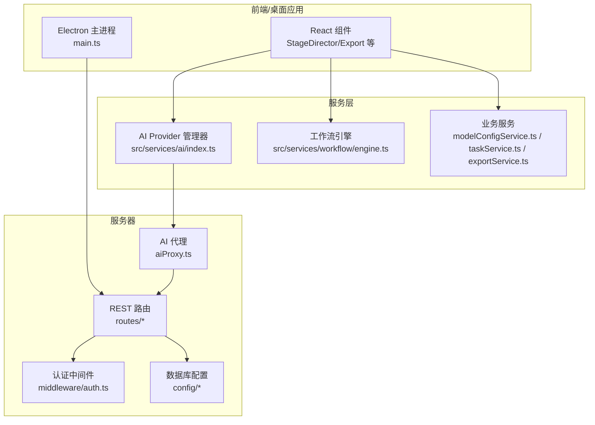
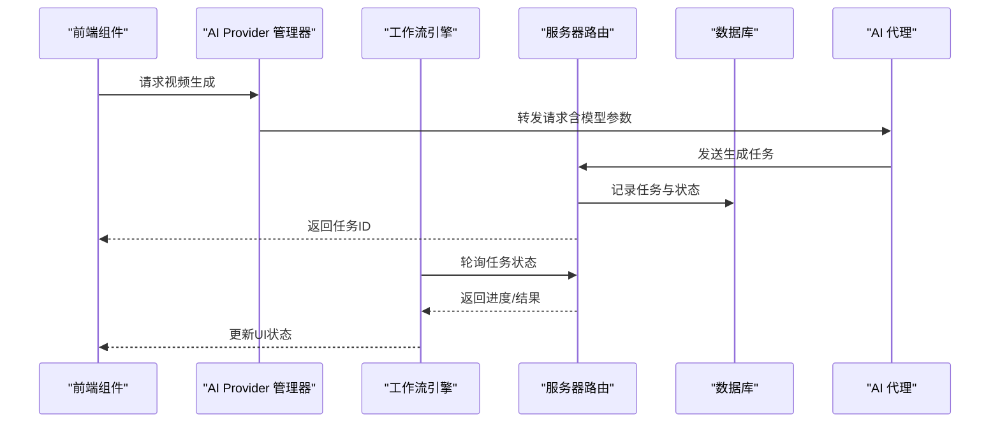
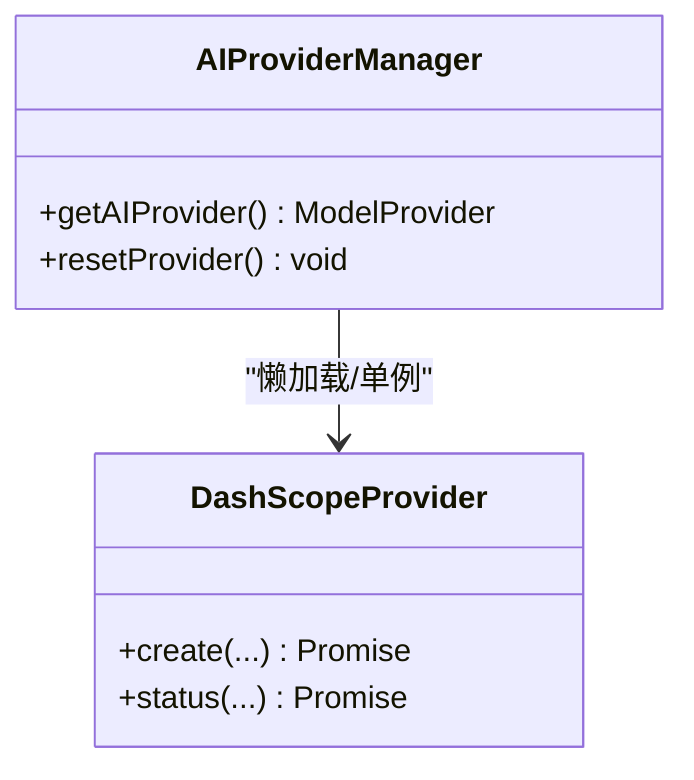
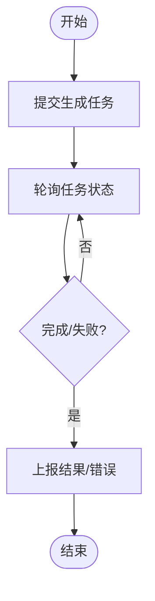
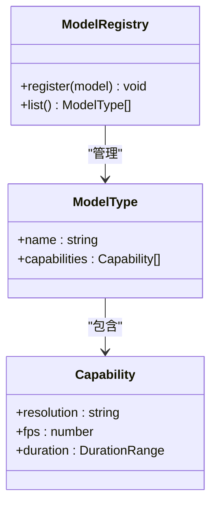
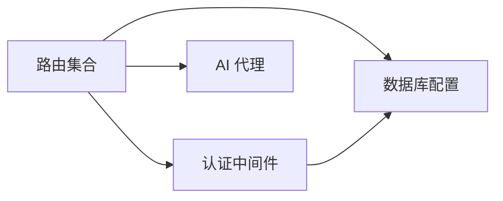
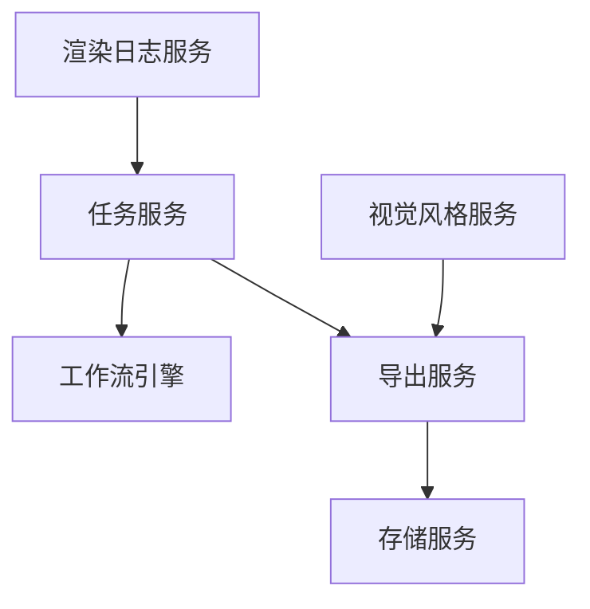
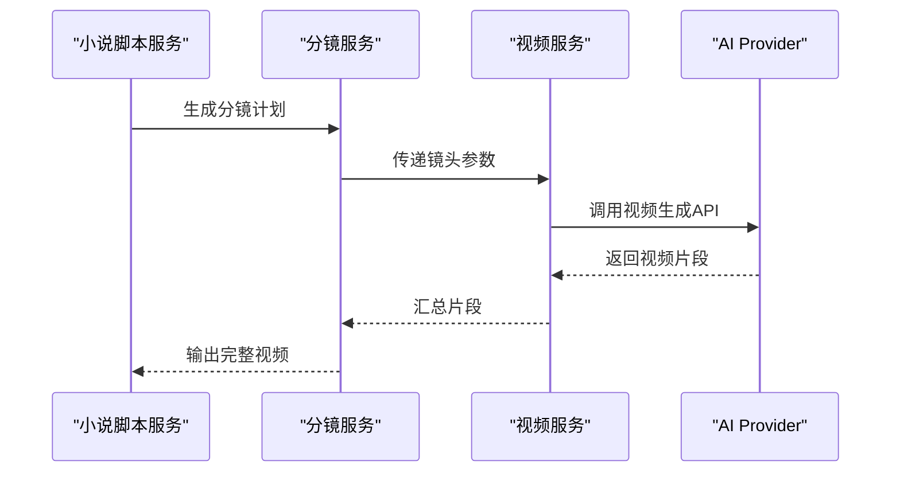
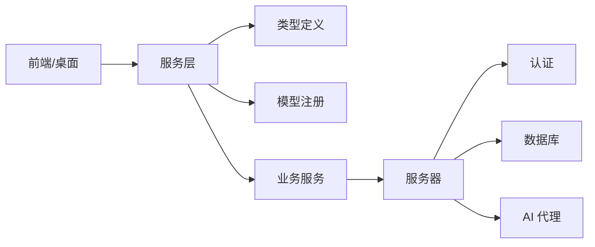
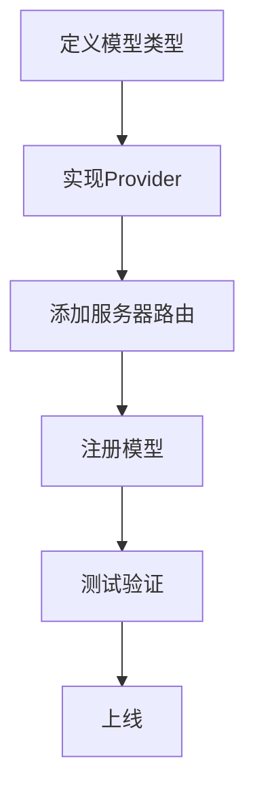

# 视频生成服务

<cite>
**本文引用的文件**
- [index.ts](file://src/services/ai/index.ts)
- [dashscope.ts](file://src/services/ai/dashscope.ts)
- [types.ts](file://src/services/ai/types.ts)
- [engine.ts](file://src/services/workflow/engine.ts)
- [model.ts](file://types/model.ts)
- [modelConfigService.ts](file://services/modelConfigService.ts)
- [modelRegistry.ts](file://services/modelRegistry.ts)
- [storageService.ts](file://services/storageService.ts)
- [taskService.ts](file://services/taskService.ts)
- [exportService.ts](file://services/exportService.ts)
- [renderLogService.ts](file://services/renderLogService.ts)
- [visualStyleService.ts](file://services/visualStyleService.ts)
- [imageResolver.ts](file://server/src/services/imageResolver.ts)
- [taskRunner.ts](file://server/src/services/taskRunner.ts)
- [auth.ts](file://server/src/middleware/auth.ts)
- [database.ts](file://server/src/config/database.ts)
- [sqliteDatabase.ts](file://server/src/config/sqliteDatabase.ts)
- [apiCore.ts](file://services/ai/apiCore.ts)
- [novelScriptService.ts](file://services/ai/novelScriptService.ts)
- [scriptService.ts](file://services/ai/scriptService.ts)
- [shotService.ts](file://services/ai/shotService.ts)
- [videoService.ts](file://services/ai/videoService.ts)
- [visualService.ts](file://services/ai/visualService.ts)
- [aiProxy.ts](file://server/src/services/aiProxy.ts)
- [models.ts](file://server/src/routes/models.ts)
- [tasks.ts](file://server/src/routes/tasks.ts)
- [projects.ts](file://server/src/routes/projects.ts)
- [uploads.ts](file://server/src/routes/uploads.ts)
- [dataTransfer.ts](file://server/src/routes/dataTransfer.ts)
- [preferences.ts](file://server/src/routes/preferences.ts)
- [visualStyles.ts](file://server/src/routes/visualStyles.ts)
- [auth.ts](file://server/src/routes/auth.ts)
- [ai.ts](file://server/src/routes/ai.ts)
- [main.ts](file://electron/main.ts)
</cite>

## 目录
1. [简介](#简介)
2. [项目结构](#项目结构)
3. [核心组件](#核心组件)
4. [架构总览](#架构总览)
5. [详细组件分析](#详细组件分析)
6. [依赖关系分析](#依赖关系分析)
7. [性能考虑](#性能考虑)
8. [故障排查指南](#故障排查指南)
9. [结论](#结论)
10. [附录](#附录)

## 简介
本文件面向视频生成服务的技术与非技术读者，系统性阐述视频生成的算法思想、模型选择与参数配置、输出控制机制（如视频长度、分辨率、帧率），以及与AI适配器层的集成方式、错误处理策略与性能优化方案。同时提供可扩展的新模型接入流程与最佳实践，帮助开发者快速上手并安全地扩展系统能力。

## 项目结构
该仓库采用前后端分离与模块化组织方式：
- 前端与桌面应用：位于根目录，包含React组件、样式与Electron入口
- 服务层：位于 services/ 与 src/services/ 下，封装AI服务、工作流引擎、任务与存储服务
- 服务器：位于 server/ 下，提供REST API、认证、数据库与代理服务
- 类型定义：位于 types/ 与 src/services/ai/types.ts 中

**图示来源**
- [index.ts:1-34](file://src/services/ai/index.ts#L1-L34)
- [engine.ts](file://src/services/workflow/engine.ts)
- [main.ts](file://electron/main.ts)

**章节来源**
- [index.ts:1-34](file://src/services/ai/index.ts#L1-L34)
- [engine.ts](file://src/services/workflow/engine.ts)
- [main.ts](file://electron/main.ts)

## 核心组件
- AI Provider 管理器：集中管理单一AI提供方（当前为DashScope），支持未来多Provider切换
- 工作流引擎：协调视频生成任务的执行与状态流转
- 业务服务：模型配置、任务调度、导出、渲染日志、存储等
- 服务器路由与中间件：提供REST接口、认证与数据库访问
- 模型类型与注册：统一模型参数与能力描述，便于扩展新模型

**章节来源**
- [index.ts:1-34](file://src/services/ai/index.ts#L1-L34)
- [types.ts](file://src/services/ai/types.ts)
- [model.ts](file://types/model.ts)
- [modelRegistry.ts](file://services/modelRegistry.ts)
- [modelConfigService.ts](file://services/modelConfigService.ts)

## 架构总览
视频生成从UI触发，经由AI Provider与工作流引擎，调用后端REST接口或本地代理，最终落盘或返回结果。关键路径如下：

**图示来源**
- [index.ts:24-29](file://src/services/ai/index.ts#L24-L29)
- [engine.ts](file://src/services/workflow/engine.ts)
- [aiProxy.ts](file://server/src/services/aiProxy.ts)
- [tasks.ts](file://server/src/routes/tasks.ts)
- [database.ts](file://server/src/config/database.ts)

## 详细组件分析

### AI Provider 管理器
- 单一Provider模式：当前仅初始化DashScope Provider，遵循“竞争-协同律”设计，便于未来扩展
- 提供统一接口：文本、图像、视频服务抽象，便于上层调用
- 重置机制：支持运行时切换Provider

**图示来源**
- [index.ts:24-29](file://src/services/ai/index.ts#L24-L29)
- [dashscope.ts](file://src/services/ai/dashscope.ts)

**章节来源**
- [index.ts:1-34](file://src/services/ai/index.ts#L1-L34)

### 工作流引擎
- 任务编排：接收视频生成请求，下发到AI Provider
- 状态轮询：定期查询任务状态，更新UI
- 错误恢复：异常时回退或重试，保证稳定性

**图示来源**
- [engine.ts](file://src/services/workflow/engine.ts)

**章节来源**
- [engine.ts](file://src/services/workflow/engine.ts)

### 模型类型与注册
- 统一模型参数：通过类型定义约束视频生成的关键参数（如分辨率、帧率、时长等）
- 注册中心：集中管理可用模型及其能力，便于动态启用/禁用
- 配置服务：读取/写入模型配置，支持用户自定义参数

**图示来源**
- [types.ts](file://src/services/ai/types.ts)
- [model.ts](file://types/model.ts)
- [modelRegistry.ts](file://services/modelRegistry.ts)
- [modelConfigService.ts](file://services/modelConfigService.ts)

**章节来源**
- [types.ts](file://src/services/ai/types.ts)
- [model.ts](file://types/model.ts)
- [modelRegistry.ts](file://services/modelRegistry.ts)
- [modelConfigService.ts](file://services/modelConfigService.ts)

### 服务器路由与中间件
- 认证中间件：保护敏感路由，校验令牌
- 路由集合：模型管理、任务调度、项目、上传、数据传输、偏好设置、视觉风格等
- 数据库：SQLite/MySQL配置，提供持久化能力
- AI 代理：统一转发AI请求，隐藏底层差异

**图示来源**
- [auth.ts](file://server/src/middleware/auth.ts)
- [models.ts](file://server/src/routes/models.ts)
- [tasks.ts](file://server/src/routes/tasks.ts)
- [projects.ts](file://server/src/routes/projects.ts)
- [uploads.ts](file://server/src/routes/uploads.ts)
- [dataTransfer.ts](file://server/src/routes/dataTransfer.ts)
- [preferences.ts](file://server/src/routes/preferences.ts)
- [visualStyles.ts](file://server/src/routes/visualStyles.ts)
- [ai.ts](file://server/src/routes/ai.ts)
- [database.ts](file://server/src/config/database.ts)
- [sqliteDatabase.ts](file://server/src/config/sqliteDatabase.ts)
- [aiProxy.ts](file://server/src/services/aiProxy.ts)

**章节来源**
- [auth.ts](file://server/src/middleware/auth.ts)
- [models.ts](file://server/src/routes/models.ts)
- [tasks.ts](file://server/src/routes/tasks.ts)
- [projects.ts](file://server/src/routes/projects.ts)
- [uploads.ts](file://server/src/routes/uploads.ts)
- [dataTransfer.ts](file://server/src/routes/dataTransfer.ts)
- [preferences.ts](file://server/src/routes/preferences.ts)
- [visualStyles.ts](file://server/src/routes/visualStyles.ts)
- [ai.ts](file://server/src/routes/ai.ts)
- [database.ts](file://server/src/config/database.ts)
- [sqliteDatabase.ts](file://server/src/config/sqliteDatabase.ts)
- [aiProxy.ts](file://server/src/services/aiProxy.ts)

### 业务服务与数据流
- 任务服务：创建、查询、取消任务；与工作流引擎协作
- 导出服务：生成最终视频文件，支持多种格式与质量选项
- 存储服务：本地/云端存储，支持资源索引与解析
- 渲染日志：记录渲染过程，便于追踪与排障
- 视觉风格服务：统一视觉风格参数，确保一致性

**图示来源**
- [taskService.ts](file://services/taskService.ts)
- [exportService.ts](file://services/exportService.ts)
- [storageService.ts](file://services/storageService.ts)
- [renderLogService.ts](file://services/renderLogService.ts)
- [visualStyleService.ts](file://services/visualStyleService.ts)

**章节来源**
- [taskService.ts](file://services/taskService.ts)
- [exportService.ts](file://services/exportService.ts)
- [storageService.ts](file://services/storageService.ts)
- [renderLogService.ts](file://services/renderLogService.ts)
- [visualStyleService.ts](file://services/visualStyleService.ts)

### AI 服务与脚本/分镜服务
- 小说脚本服务：解析与生成小说级脚本
- 分镜服务：将脚本拆解为镜头序列，生成关键帧与动作提示
- 视频服务：调用AI Provider生成视频片段
- 视觉服务：统一视觉风格与参数

**图示来源**
- [novelScriptService.ts](file://services/ai/novelScriptService.ts)
- [scriptService.ts](file://services/ai/scriptService.ts)
- [shotService.ts](file://services/ai/shotService.ts)
- [videoService.ts](file://services/ai/videoService.ts)
- [visualService.ts](file://services/ai/visualService.ts)
- [apiCore.ts](file://services/ai/apiCore.ts)

**章节来源**
- [novelScriptService.ts](file://services/ai/novelScriptService.ts)
- [scriptService.ts](file://services/ai/scriptService.ts)
- [shotService.ts](file://services/ai/shotService.ts)
- [videoService.ts](file://services/ai/videoService.ts)
- [visualService.ts](file://services/ai/visualService.ts)
- [apiCore.ts](file://services/ai/apiCore.ts)

## 依赖关系分析
- 前端/桌面应用依赖服务层与服务器
- 服务层依赖类型定义与模型注册
- 服务器依赖认证、数据库与AI代理
- AI Provider通过代理对接外部服务

**图示来源**
- [index.ts:1-34](file://src/services/ai/index.ts#L1-L34)
- [types.ts](file://src/services/ai/types.ts)
- [modelRegistry.ts](file://services/modelRegistry.ts)
- [main.ts](file://electron/main.ts)

**章节来源**
- [index.ts:1-34](file://src/services/ai/index.ts#L1-L34)
- [types.ts](file://src/services/ai/types.ts)
- [modelRegistry.ts](file://services/modelRegistry.ts)
- [main.ts](file://electron/main.ts)

## 性能考虑
- 异步任务与轮询：避免阻塞UI，提升响应性
- 缓存与复用：对已生成片段进行缓存，减少重复计算
- 分片与并发：按镜头分片并行生成，缩短总时长
- 参数裁剪：根据设备能力自动调整分辨率与帧率
- 存储优化：分块上传与增量备份，降低IO压力
- 日志分级：区分DEBUG/INFO/WARN/ERROR，避免冗余输出

[本节为通用指导，无需列出具体文件来源]

## 故障排查指南
- 认证失败：检查令牌有效性与中间件配置
- 任务超时：检查服务器路由与数据库连接
- 生成失败：查看渲染日志与AI代理返回码
- 存储异常：确认存储服务可用性与权限
- 模型不可用：核对模型注册表与配置服务

**章节来源**
- [auth.ts](file://server/src/middleware/auth.ts)
- [tasks.ts](file://server/src/routes/tasks.ts)
- [database.ts](file://server/src/config/database.ts)
- [renderLogService.ts](file://services/renderLogService.ts)
- [storageService.ts](file://services/storageService.ts)
- [modelRegistry.ts](file://services/modelRegistry.ts)

## 结论
该视频生成服务以“单一Provider + 多Provider扩展”的架构为核心，结合工作流引擎与服务器路由，形成从前端到后端的完整链路。通过统一的模型类型与注册机制，系统具备良好的可扩展性；借助任务服务、导出与存储服务，实现稳定高效的视频生成与交付。建议在生产环境中强化监控与日志分级，并持续完善模型注册与参数校验机制。

[本节为总结性内容，无需列出具体文件来源]

## 附录

### 视频生成参数与控制要点
- 视频长度控制：通过脚本服务拆解镜头时长，再由视频服务按镜头粒度生成
- 分辨率设置：在模型类型中声明支持的分辨率范围，服务层按设备能力选择
- 帧率管理：在模型能力中声明FPS，服务层在生成前进行匹配与降采样
- 输出控制：导出服务统一处理编码参数与容器格式

**章节来源**
- [types.ts](file://src/services/ai/types.ts)
- [model.ts](file://types/model.ts)
- [shotService.ts](file://services/ai/shotService.ts)
- [videoService.ts](file://services/ai/videoService.ts)
- [exportService.ts](file://services/exportService.ts)

### 与AI适配器层的集成方式
- Provider抽象：统一视频生成接口，屏蔽不同厂商差异
- 代理层：服务器侧AI代理负责转发与鉴权
- 类型约束：通过类型定义约束参数与返回值，确保兼容性

**章节来源**
- [index.ts:1-34](file://src/services/ai/index.ts#L1-L34)
- [aiProxy.ts](file://server/src/services/aiProxy.ts)
- [types.ts](file://src/services/ai/types.ts)

### 错误处理策略
- 任务失败回退：工作流引擎在失败时尝试重试或降级
- 日志追踪：渲染日志服务记录关键步骤与错误码
- 服务器错误码：路由层返回标准化HTTP状态码与错误信息

**章节来源**
- [engine.ts](file://src/services/workflow/engine.ts)
- [renderLogService.ts](file://services/renderLogService.ts)
- [tasks.ts](file://server/src/routes/tasks.ts)

### 性能优化方案
- 并行化：按镜头并行生成，缩短总时长
- 缓存：对重复片段与中间结果进行缓存
- 自适应：根据设备能力自动选择分辨率与帧率
- 存储：分块与增量备份，降低IO开销

**章节来源**
- [engine.ts](file://src/services/workflow/engine.ts)
- [exportService.ts](file://services/exportService.ts)
- [storageService.ts](file://services/storageService.ts)

### 使用示例（步骤化）
- 准备脚本：使用小说脚本服务生成分镜计划
- 选择模型：在模型注册表中选择合适视频模型
- 配置参数：设置分辨率、帧率、时长等
- 提交任务：通过任务服务提交生成请求
- 查看进度：轮询任务状态，实时更新UI
- 导出视频：完成后通过导出服务下载成品

**章节来源**
- [novelScriptService.ts](file://services/ai/novelScriptService.ts)
- [shotService.ts](file://services/ai/shotService.ts)
- [modelRegistry.ts](file://services/modelRegistry.ts)
- [taskService.ts](file://services/taskService.ts)
- [engine.ts](file://src/services/workflow/engine.ts)
- [exportService.ts](file://services/exportService.ts)

### 最佳实践
- 明确参数边界：在类型定义中严格约束输入参数
- 分层职责清晰：UI负责交互，服务层负责编排，服务器负责持久化与代理
- 可观测性优先：完善日志与监控，便于问题定位
- 安全优先：认证中间件与权限控制贯穿所有敏感路由

**章节来源**
- [types.ts](file://src/services/ai/types.ts)
- [auth.ts](file://server/src/middleware/auth.ts)
- [renderLogService.ts](file://services/renderLogService.ts)

### 扩展新视频生成模型的步骤
- 定义模型类型：在类型定义中新增能力字段
- 实现Provider：在AI Provider中注册新模型
- 集成路由：在服务器路由中添加对应接口
- 配置存储：在模型注册表中登记可用模型
- 测试验证：覆盖参数校验、生成流程与导出环节

**图示来源**
- [types.ts](file://src/services/ai/types.ts)
- [index.ts:1-34](file://src/services/ai/index.ts#L1-L34)
- [models.ts](file://server/src/routes/models.ts)
- [modelRegistry.ts](file://services/modelRegistry.ts)

**章节来源**
- [types.ts](file://src/services/ai/types.ts)
- [index.ts:1-34](file://src/services/ai/index.ts#L1-L34)
- [models.ts](file://server/src/routes/models.ts)
- [modelRegistry.ts](file://services/modelRegistry.ts)