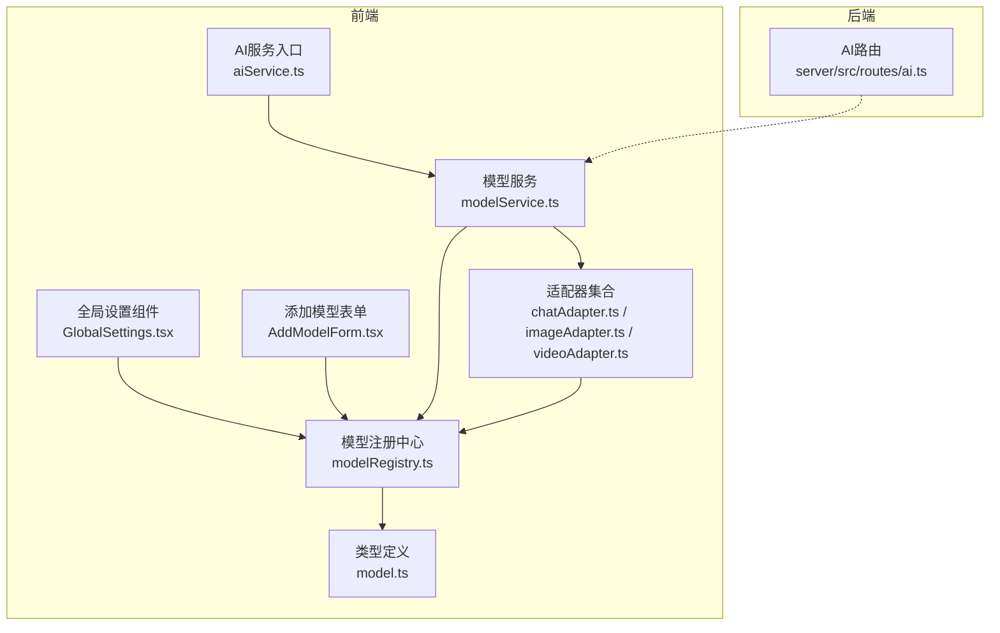
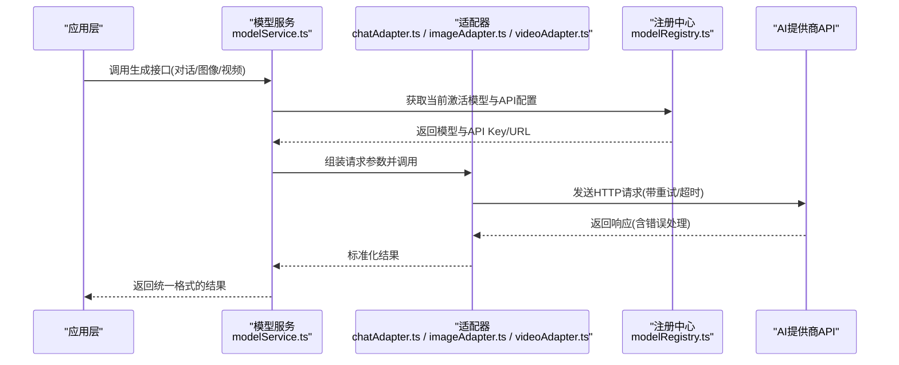
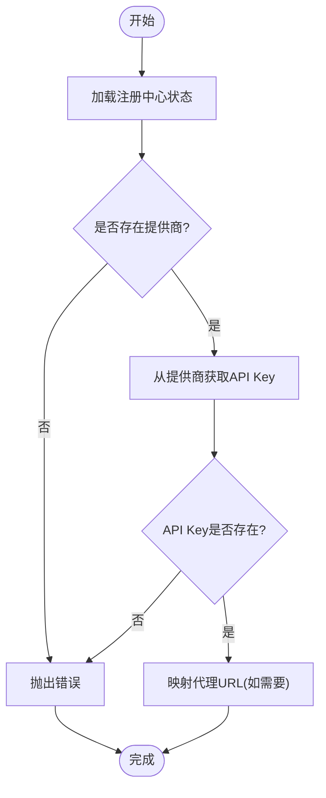
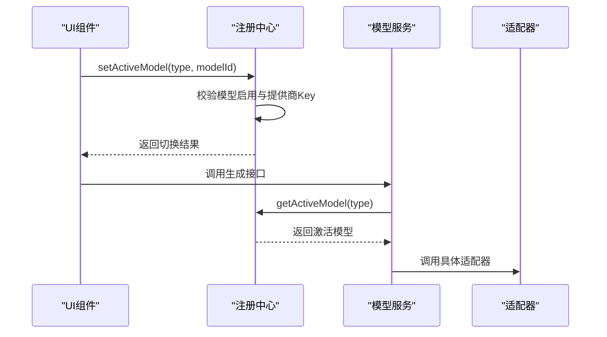
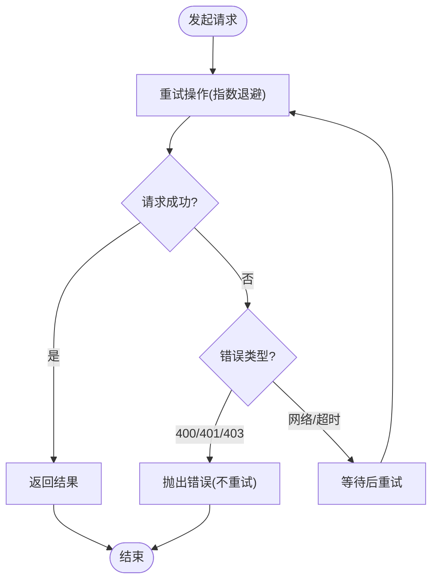
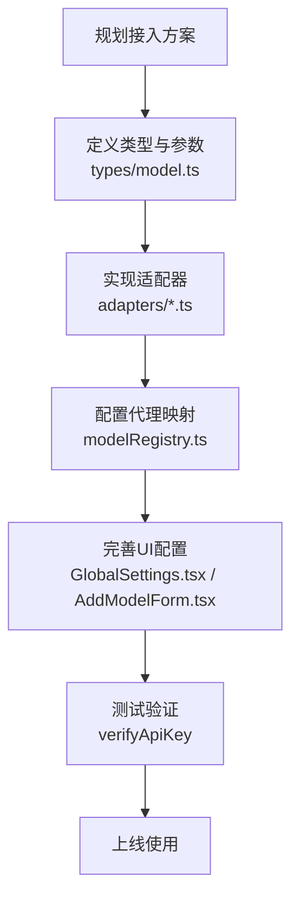
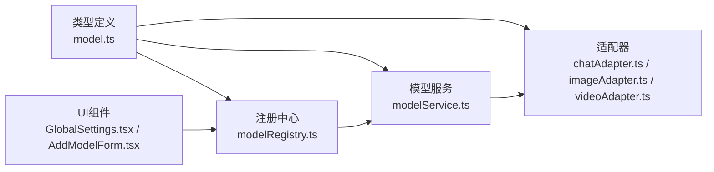

# AI服务集成

<cite>
**本文档引用的文件**
- [aiService.ts](file://services/aiService.ts)
- [modelService.ts](file://services/modelService.ts)
- [modelRegistry.ts](file://services/modelRegistry.ts)
- [modelConfigService.ts](file://services/modelConfigService.ts)
- [apiCore.ts](file://services/ai/apiCore.ts)
- [chatAdapter.ts](file://services/adapters/chatAdapter.ts)
- [imageAdapter.ts](file://services/adapters/imageAdapter.ts)
- [videoAdapter.ts](file://services/adapters/videoAdapter.ts)
- [dashscopeVideoAdapter.ts](file://services/adapters/dashscopeVideoAdapter.ts)
- [volcengineVideoAdapter.ts](file://services/adapters/volcengineVideoAdapter.ts)
- [model.ts](file://types/model.ts)
- [AddModelForm.tsx](file://components/ModelConfig/AddModelForm.tsx)
- [GlobalSettings.tsx](file://components/ModelConfig/GlobalSettings.tsx)
- [ai.ts](file://server/src/routes/ai.ts)
</cite>

## 目录
1. [简介](#简介)
2. [项目结构](#项目结构)
3. [核心组件](#核心组件)
4. [架构总览](#架构总览)
5. [详细组件分析](#详细组件分析)
6. [依赖关系分析](#依赖关系分析)
7. [性能考虑](#性能考虑)
8. [故障排除指南](#故障排除指南)
9. [结论](#结论)
10. [附录](#附录)

## 简介
本项目实现了统一的AI服务集成框架，采用适配器模式屏蔽不同AI厂商API的差异，提供对话、图像、视频等多模态能力的一致调用接口。系统通过模型注册中心管理提供商、模型配置与激活状态，支持多模型配置、动态切换与参数优化，并内置完善的错误处理、重试机制与代理适配。

## 项目结构
项目采用前后端分离与模块化设计：
- 适配器层：针对不同厂商API的适配器，负责协议转换与错误处理
- 服务层：面向业务的统一服务接口，封装提示词构建与业务流程
- 注册中心：集中管理提供商、模型、激活状态与持久化
- 类型定义：统一的数据结构与约束，确保跨模块一致性
- UI组件：模型配置与提供商管理界面
- 服务端路由：AI辅助功能（如TTS）的后端接口



**图表来源**
- [aiService.ts:1-17](file://services/aiService.ts#L1-L17)
- [modelService.ts:1-349](file://services/modelService.ts#L1-L349)
- [modelRegistry.ts:1-713](file://services/modelRegistry.ts#L1-L713)
- [chatAdapter.ts:1-217](file://services/adapters/chatAdapter.ts#L1-L217)
- [imageAdapter.ts:1-417](file://services/adapters/imageAdapter.ts#L1-L417)
- [videoAdapter.ts:1-624](file://services/adapters/videoAdapter.ts#L1-L624)
- [model.ts:1-875](file://types/model.ts#L1-L875)
- [GlobalSettings.tsx:1-520](file://components/ModelConfig/GlobalSettings.tsx#L1-L520)
- [AddModelForm.tsx:1-285](file://components/ModelConfig/AddModelForm.tsx#L1-L285)
- [ai.ts:1-35](file://server/src/routes/ai.ts#L1-L35)

**章节来源**
- [aiService.ts:1-17](file://services/aiService.ts#L1-L17)
- [modelService.ts:1-349](file://services/modelService.ts#L1-L349)
- [modelRegistry.ts:1-713](file://services/modelRegistry.ts#L1-L713)
- [model.ts:1-875](file://types/model.ts#L1-L875)

## 核心组件
- AI服务入口：统一导出所有AI服务功能，便于应用层按需引入
- 模型服务：提供对话、图像、视频生成与业务流程封装，统一参数与错误处理
- 模型注册中心：提供提供商、模型、激活状态的CRUD与持久化，支持迁移与代理映射
- 适配器层：针对不同厂商API的协议适配，内置重试与错误处理
- 类型系统：统一的模型、提供商、参数与调用参数定义
- UI组件：提供商与模型配置界面，支持API Key验证与代理设置

**章节来源**
- [aiService.ts:1-17](file://services/aiService.ts#L1-L17)
- [modelService.ts:1-349](file://services/modelService.ts#L1-L349)
- [modelRegistry.ts:1-713](file://services/modelRegistry.ts#L1-L713)
- [model.ts:1-875](file://types/model.ts#L1-L875)

## 架构总览
系统采用“服务层 + 适配器层 + 注册中心”的分层架构，服务层负责业务编排与参数组装，适配器层负责具体厂商API调用与协议转换，注册中心统一管理配置与状态。



**图表来源**
- [modelService.ts:1-349](file://services/modelService.ts#L1-L349)
- [chatAdapter.ts:1-217](file://services/adapters/chatAdapter.ts#L1-L217)
- [imageAdapter.ts:1-417](file://services/adapters/imageAdapter.ts#L1-L417)
- [videoAdapter.ts:1-624](file://services/adapters/videoAdapter.ts#L1-L624)
- [modelRegistry.ts:1-713](file://services/modelRegistry.ts#L1-L713)

## 详细组件分析

### 适配器模式与统一接口
- 设计理念：通过适配器屏蔽不同厂商API差异，统一请求参数、响应格式与错误处理
- 实现方式：每个适配器负责特定厂商/协议，服务层通过注册中心获取当前激活模型与API配置，再调用对应适配器
- 优势：易于扩展新厂商、统一错误处理与重试策略、支持动态切换模型

```mermaid
classDiagram
class ChatAdapter {
+callChatApi(options, model?) Promise<string>
+verifyApiKey(apiKey, baseUrl?) Promise<{success,message}>
}
class ImageAdapter {
+callImageApi(options, model?) Promise<string>
+isAspectRatioSupported(ratio, model?) boolean
}
class VideoAdapter {
+callVideoApi(options, model?) Promise<string>
+isAspectRatioSupported(ratio, model?) boolean
+isDurationSupported(duration, model?) boolean
}
class ModelRegistry {
+getActiveChatModel() ChatModelDefinition
+getActiveImageModel() ImageModelDefinition
+getActiveVideoModel() VideoModelDefinition
+getApiKeyForModel(id) string
+getApiBaseUrlForModel(id) string
}
class ModelService {
+chat(options) Promise<string>
+generateImage(options) Promise<string>
+generateVideo(options) Promise<string>
+verifyApiKey(apiKey, baseUrl?) Promise<{success,message}>
}
ModelService --> ModelRegistry : "查询激活模型与配置"
ModelService --> ChatAdapter : "调用对话API"
ModelService --> ImageAdapter : "调用图像API"
ModelService --> VideoAdapter : "调用视频API"
```

**图表来源**
- [chatAdapter.ts:1-217](file://services/adapters/chatAdapter.ts#L1-L217)
- [imageAdapter.ts:1-417](file://services/adapters/imageAdapter.ts#L1-L417)
- [videoAdapter.ts:1-624](file://services/adapters/videoAdapter.ts#L1-L624)
- [modelRegistry.ts:1-713](file://services/modelRegistry.ts#L1-L713)
- [modelService.ts:1-349](file://services/modelService.ts#L1-L349)

**章节来源**
- [chatAdapter.ts:1-217](file://services/adapters/chatAdapter.ts#L1-L217)
- [imageAdapter.ts:1-417](file://services/adapters/imageAdapter.ts#L1-L417)
- [videoAdapter.ts:1-624](file://services/adapters/videoAdapter.ts#L1-L624)
- [modelRegistry.ts:1-713](file://services/modelRegistry.ts#L1-L713)
- [modelService.ts:1-349](file://services/modelService.ts#L1-L349)

### 支持的AI提供商与模型分类
- 对话模型：OpenAI、Anthropic、DeepSeek、豆包、通义、智谱、Google Gemini、xAI等
- 图像模型：Google Gemini、豆包 Seedream、通义万相(Qwen-Image)、可灵等
- 视频模型：Google Veo、OpenAI Sora、豆包 Seedance、通义万象(Wan)、可灵等
- 模型类型：chat、image、video、audio，分别对应不同参数与行为

```mermaid
erDiagram
PROVIDER {
string id PK
string name
string baseUrl
string apiKey
string apiKeyUrl
boolean isBuiltIn
boolean isDefault
}
MODEL {
string id PK
string apiModel
string name
string type
string providerId FK
string endpoint
boolean isBuiltIn
boolean isEnabled
}
ACTIVE_MODELS {
string chat
string image
string video
string audio
}
PROVIDER ||--o{ MODEL : "拥有"
ACTIVE_MODELS --> MODEL : "指向当前激活模型"
```

**图表来源**
- [model.ts:148-179](file://types/model.ts#L148-L179)
- [model.ts:275-800](file://types/model.ts#L275-L800)

**章节来源**
- [model.ts:275-800](file://types/model.ts#L275-L800)

### API Key管理机制
- 集中式存储：提供商对象包含apiKey字段，模型通过所属提供商获取API Key
- 代理映射：针对不支持浏览器CORS的提供商，通过本地代理路径映射解决跨域
- 验证流程：提供API Key验证接口，支持在线测试连通性
- 安全提示：UI组件支持隐藏/显示API Key，避免泄露



**图表来源**
- [modelRegistry.ts:549-579](file://services/modelRegistry.ts#L549-L579)
- [chatAdapter.ts:178-216](file://services/adapters/chatAdapter.ts#L178-L216)

**章节来源**
- [modelRegistry.ts:549-579](file://services/modelRegistry.ts#L549-L579)
- [chatAdapter.ts:178-216](file://services/adapters/chatAdapter.ts#L178-L216)
- [GlobalSettings.tsx:1-520](file://components/ModelConfig/GlobalSettings.tsx#L1-L520)

### 多模型配置系统与模型切换逻辑
- 激活模型：注册中心维护ActiveModels，按类型记录当前激活的模型ID
- 动态切换：通过setActiveModel更新激活状态，同时校验模型启用状态与提供商API Key
- 参数继承：模型参数支持覆盖，适配器在调用时合并默认参数与覆盖参数
- 迁移与兼容：内置模型与提供商列表随版本演进，注册中心负责迁移与去重



**图表来源**
- [modelRegistry.ts:443-454](file://services/modelRegistry.ts#L443-L454)
- [modelService.ts:33-62](file://services/modelService.ts#L33-L62)

**章节来源**
- [modelRegistry.ts:443-454](file://services/modelRegistry.ts#L443-L454)
- [modelService.ts:33-62](file://services/modelService.ts#L33-L62)

### 错误处理、重试机制与超时控制
- 统一错误类：ApiKeyError用于API Key相关错误
- 指数退避重试：对429、超时、服务器错误等临时性错误进行重试
- 超时控制：对话默认10分钟，视频同步模式20分钟，异步模式支持轮询
- CORS处理：对浏览器CORS限制给出明确提示，引导使用代理



**图表来源**
- [chatAdapter.ts:22-47](file://services/adapters/chatAdapter.ts#L22-L47)
- [imageAdapter.ts:13-37](file://services/adapters/imageAdapter.ts#L13-L37)
- [videoAdapter.ts:15-47](file://services/adapters/videoAdapter.ts#L15-L47)

**章节来源**
- [chatAdapter.ts:22-47](file://services/adapters/chatAdapter.ts#L22-L47)
- [imageAdapter.ts:13-37](file://services/adapters/imageAdapter.ts#L13-L37)
- [videoAdapter.ts:15-47](file://services/adapters/videoAdapter.ts#L15-L47)

### 性能优化策略
- 代理转发：通过本地代理解决CORS，减少跨域失败与重试
- 轮询优化：异步任务轮询间隔与最大时长合理配置，避免资源浪费
- 图片/视频处理：支持直接URL传参与base64转码，减少不必要的数据传输
- 参数缓存：注册中心状态缓存与localStorage持久化，降低重复加载成本

**章节来源**
- [dashscopeVideoAdapter.ts:1-285](file://services/adapters/dashscopeVideoAdapter.ts#L1-L285)
- [volcengineVideoAdapter.ts:1-267](file://services/adapters/volcengineVideoAdapter.ts#L1-L267)
- [modelRegistry.ts:204-235](file://services/modelRegistry.ts#L204-L235)

### 适配器扩展指南与新厂商接入流程
- 新增适配器：在adapters目录下创建新文件，遵循现有适配器的错误处理与重试模式
- 注册内置模型：在types/model.ts中添加新提供商与模型定义
- 代理映射：如新厂商API不支持CORS，需在modelRegistry.ts中添加代理映射
- UI集成：在GlobalSettings与AddModelForm中完善配置界面
- 测试验证：使用verifyApiKey验证新厂商连通性



**图表来源**
- [model.ts:758-800](file://types/model.ts#L758-L800)
- [modelRegistry.ts:589-610](file://services/modelRegistry.ts#L589-L610)
- [GlobalSettings.tsx:1-520](file://components/ModelConfig/GlobalSettings.tsx#L1-L520)
- [AddModelForm.tsx:1-285](file://components/ModelConfig/AddModelForm.tsx#L1-L285)

**章节来源**
- [model.ts:758-800](file://types/model.ts#L758-L800)
- [modelRegistry.ts:589-610](file://services/modelRegistry.ts#L589-L610)
- [GlobalSettings.tsx:1-520](file://components/ModelConfig/GlobalSettings.tsx#L1-L520)
- [AddModelForm.tsx:1-285](file://components/ModelConfig/AddModelForm.tsx#L1-L285)

## 依赖关系分析
- 服务层依赖注册中心获取模型与配置，适配器依赖注册中心获取API Key与URL
- UI组件依赖注册中心进行提供商与模型的增删改查
- 适配器之间无直接依赖，通过服务层解耦
- 类型定义贯穿所有模块，保证数据一致性



**图表来源**
- [model.ts:1-875](file://types/model.ts#L1-L875)
- [modelRegistry.ts:1-713](file://services/modelRegistry.ts#L1-L713)
- [modelService.ts:1-349](file://services/modelService.ts#L1-L349)
- [chatAdapter.ts:1-217](file://services/adapters/chatAdapter.ts#L1-L217)
- [imageAdapter.ts:1-417](file://services/adapters/imageAdapter.ts#L1-L417)
- [videoAdapter.ts:1-624](file://services/adapters/videoAdapter.ts#L1-L624)
- [GlobalSettings.tsx:1-520](file://components/ModelConfig/GlobalSettings.tsx#L1-L520)
- [AddModelForm.tsx:1-285](file://components/ModelConfig/AddModelForm.tsx#L1-L285)

**章节来源**
- [model.ts:1-875](file://types/model.ts#L1-L875)
- [modelRegistry.ts:1-713](file://services/modelRegistry.ts#L1-L713)
- [modelService.ts:1-349](file://services/modelService.ts#L1-L349)

## 性能考虑
- 重试策略：指数退避避免雪崩效应，最大重试次数限制资源消耗
- 超时控制：合理设置超时时间，防止长时间占用连接
- 代理优化：统一代理路径减少DNS解析与TLS握手开销
- 数据处理：图片/视频尽量使用URL直传，减少base64编码与解码

## 故障排除指南
- API Key错误：检查提供商API Key是否正确配置，使用验证接口确认连通性
- CORS限制：确认使用代理路径或切换到支持CORS的提供商
- 模型不可用：检查模型是否启用、提供商是否配置API Key
- 超时问题：适当增加超时时间或优化提示词长度
- 代理失败：检查本地代理服务是否正常，必要时切换到内置代理

**章节来源**
- [chatAdapter.ts:178-216](file://services/adapters/chatAdapter.ts#L178-L216)
- [videoAdapter.ts:27-47](file://services/adapters/videoAdapter.ts#L27-L47)
- [GlobalSettings.tsx:92-105](file://components/ModelConfig/GlobalSettings.tsx#L92-L105)

## 结论
本项目通过适配器模式实现了对多家AI厂商API的统一接入，配合注册中心与UI组件提供了灵活的配置与管理能力。系统具备完善的错误处理、重试与代理机制，能够满足多场景下的AI服务集成需求。通过清晰的类型定义与模块划分，扩展新厂商与新模型变得简单可控。

## 附录
- 服务端AI路由：目前提供占位的TTS接口，后续可在此集成音频生成能力
- 版本兼容：注册中心支持内置模型与提供商的迁移，确保升级过程平滑

**章节来源**
- [ai.ts:1-35](file://server/src/routes/ai.ts#L1-L35)
- [modelRegistry.ts:47-199](file://services/modelRegistry.ts#L47-L199)