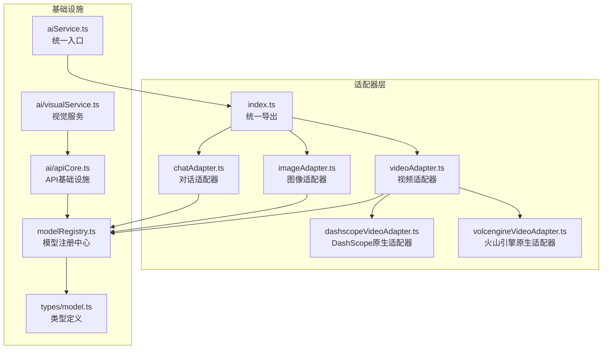
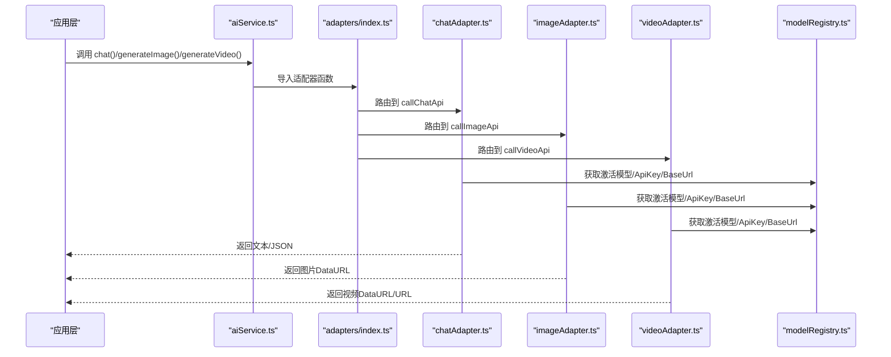
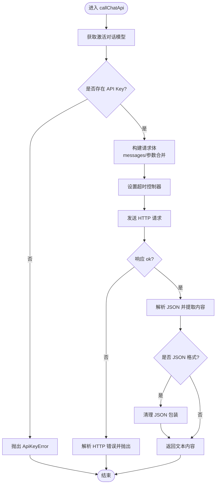
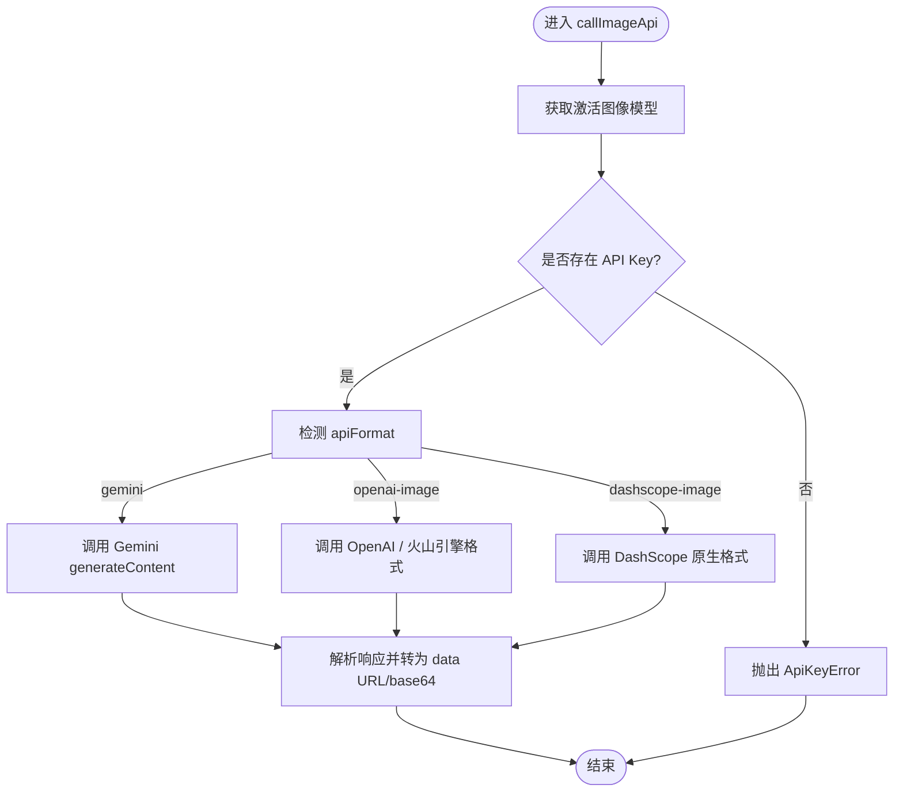
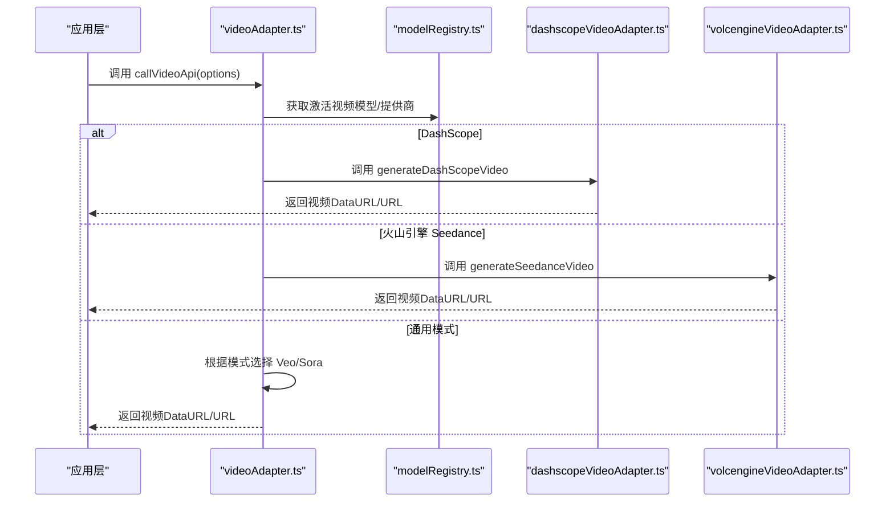
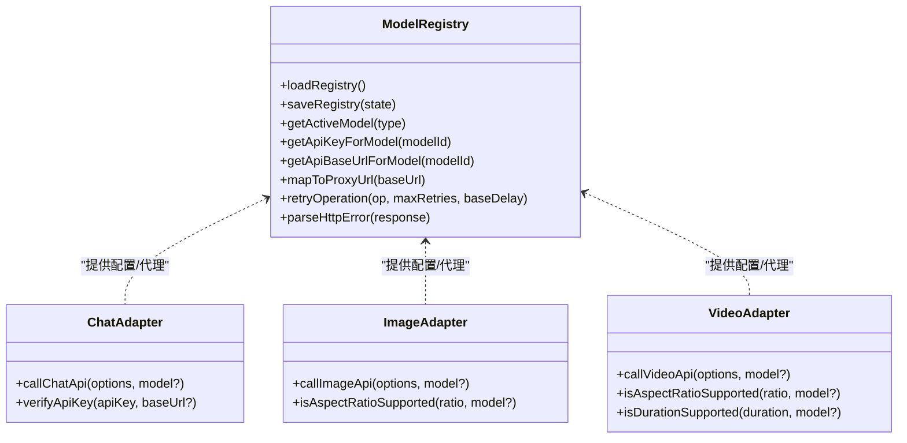
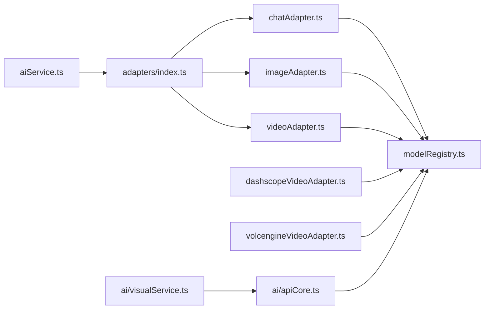

# AI适配器层

<cite>
**本文档引用的文件**
- [services/adapters/index.ts](file://services/adapters/index.ts)
- [services/adapters/chatAdapter.ts](file://services/adapters/chatAdapter.ts)
- [services/adapters/imageAdapter.ts](file://services/adapters/imageAdapter.ts)
- [services/adapters/videoAdapter.ts](file://services/adapters/videoAdapter.ts)
- [services/adapters/dashscopeVideoAdapter.ts](file://services/adapters/dashscopeVideoAdapter.ts)
- [services/adapters/volcengineVideoAdapter.ts](file://services/adapters/volcengineVideoAdapter.ts)
- [services/modelRegistry.ts](file://services/modelRegistry.ts)
- [types/model.ts](file://types/model.ts)
- [services/aiService.ts](file://services/aiService.ts)
- [services/ai/apiCore.ts](file://services/ai/apiCore.ts)
- [services/ai/visualService.ts](file://services/ai/visualService.ts)
</cite>

## 目录
1. [简介](#简介)
2. [项目结构](#项目结构)
3. [核心组件](#核心组件)
4. [架构总览](#架构总览)
5. [详细组件分析](#详细组件分析)
6. [依赖分析](#依赖分析)
7. [性能考虑](#性能考虑)
8. [故障排除指南](#故障排除指南)
9. [结论](#结论)
10. [附录](#附录)

## 简介
本文件系统性阐述 AI 适配器层的设计理念与实现原理，目标是通过统一的适配器模式屏蔽不同 AI 提供商（OpenAI、Anthropic、Google、阿里 DashScope、字节火山引擎等）的 API 差异，为上层业务提供一致的调用接口。适配器层涵盖三类能力：对话（Chat）、图像（Image）、视频（Video），并提供：
- 统一的工厂式导出与路由
- 动态模型选择与代理映射
- 参数转换与协议适配
- 错误分类与重试策略
- 原生适配器（DashScope、火山引擎）与通用适配器的协同
- 新厂商接入流程与扩展指南
- 性能优化与最佳实践

## 项目结构
适配器层位于 services/adapters 目录，配合模型注册中心（services/modelRegistry.ts）与类型定义（types/model.ts）工作，对外通过 services/aiService.ts 提供统一入口。

**图表来源**
- [services/adapters/index.ts:1-17](file://services/adapters/index.ts#L1-L17)
- [services/adapters/chatAdapter.ts:1-217](file://services/adapters/chatAdapter.ts#L1-L217)
- [services/adapters/imageAdapter.ts:1-417](file://services/adapters/imageAdapter.ts#L1-L417)
- [services/adapters/videoAdapter.ts:1-624](file://services/adapters/videoAdapter.ts#L1-L624)
- [services/adapters/dashscopeVideoAdapter.ts:1-285](file://services/adapters/dashscopeVideoAdapter.ts#L1-L285)
- [services/adapters/volcengineVideoAdapter.ts:1-267](file://services/adapters/volcengineVideoAdapter.ts#L1-L267)
- [services/modelRegistry.ts:1-713](file://services/modelRegistry.ts#L1-L713)
- [types/model.ts:1-875](file://types/model.ts#L1-L875)
- [services/aiService.ts:1-17](file://services/aiService.ts#L1-L17)
- [services/ai/apiCore.ts:1-565](file://services/ai/apiCore.ts#L1-L565)
- [services/ai/visualService.ts:1-1189](file://services/ai/visualService.ts#L1-L1189)

**章节来源**
- [services/adapters/index.ts:1-17](file://services/adapters/index.ts#L1-L17)
- [services/modelRegistry.ts:1-713](file://services/modelRegistry.ts#L1-L713)
- [types/model.ts:1-875](file://types/model.ts#L1-L875)

## 核心组件
- 适配器统一导出：通过 index.ts 将各适配器函数按需导出，避免命名冲突（如 isAspectRatioSupported 在图像与视频适配器中分别导出别名）。
- 模型注册中心：集中管理提供商、模型、激活模型，提供 API Key、基础 URL、代理映射、模型解析等功能。
- 类型系统：定义模型类型、参数、调用选项、默认值与内置模型清单，确保适配器与上层调用的一致性。
- 基础设施层：提供重试、错误解析、JSON 清理、媒体工具（图片/视频转换）等通用能力，供适配器与上层服务复用。

**章节来源**
- [services/adapters/index.ts:1-17](file://services/adapters/index.ts#L1-L17)
- [services/modelRegistry.ts:548-610](file://services/modelRegistry.ts#L548-L610)
- [types/model.ts:1-270](file://types/model.ts#L1-L270)
- [services/ai/apiCore.ts:153-234](file://services/ai/apiCore.ts#L153-L234)

## 架构总览
适配器层采用“协议适配 + 动态路由”的设计：
- 对话适配器：统一 OpenAI 兼容的 Chat Completions 接口，支持 JSON 响应、超时控制、重试与错误分类。
- 图像适配器：支持 Gemini generateContent、OpenAI / 火山引擎 images/generations、DashScope 原生格式三种协议，自动根据模型参数选择协议与端点。
- 视频适配器：统一 Veo（同步）与 Sora（异步）两种模式，同时内嵌 DashScope 与火山引擎原生适配器，自动识别提供商并路由至相应实现。
- 原生适配器：DashScope 万象与火山引擎 Seedance 通过本地代理直连官方 API，绕过浏览器 CORS 限制，提升稳定性与性能。
- 统一入口：aiService.ts 汇总导出，上层应用通过单一入口调用。

**图表来源**
- [services/aiService.ts:1-17](file://services/aiService.ts#L1-L17)
- [services/adapters/index.ts:1-17](file://services/adapters/index.ts#L1-L17)
- [services/adapters/chatAdapter.ts:62-173](file://services/adapters/chatAdapter.ts#L62-L173)
- [services/adapters/imageAdapter.ts:379-403](file://services/adapters/imageAdapter.ts#L379-L403)
- [services/adapters/videoAdapter.ts:528-597](file://services/adapters/videoAdapter.ts#L528-L597)
- [services/modelRegistry.ts:553-579](file://services/modelRegistry.ts#L553-L579)

## 详细组件分析

### 对话适配器（Chat Adapter）
- 设计要点
  - 统一 OpenAI 兼容的 Chat Completions 接口，支持 systemPrompt、temperature、max_tokens、top_p、频率/存在惩罚等参数合并。
  - JSON 响应格式：自动清理 Markdown 代码块标记，保证上层解析稳定。
  - 超时控制：基于 AbortController，支持毫秒级超时配置。
  - 错误分类与重试：对 4xx（400/401/403）不重试，对 429/5xx/超时等临时性错误采用指数退避重试。
  - API Key 校验：提供独立的 verifyApiKey 接口，便于前端快速验证。
- 数据流与处理逻辑

**图表来源**
- [services/adapters/chatAdapter.ts:62-173](file://services/adapters/chatAdapter.ts#L62-L173)

**章节来源**
- [services/adapters/chatAdapter.ts:1-217](file://services/adapters/chatAdapter.ts#L1-L217)

### 图像适配器（Image Adapter）
- 协议适配
  - Gemini generateContent：支持 contents/parts + inlineData，可直接传入 data URL 或 base64。
  - OpenAI / 火山引擎 images/generations：统一 /api/v3/images/generations 端点，支持参考图数组（URL/base64/data URL）。
  - DashScope 万象：使用原生 API，通过本地代理 /api/proxy/dashscope 转发，支持同步与异步任务，异步时内置轮询。
- 参数转换与兼容
  - 自动识别并规范化参考图（data URL、纯 base64、URL），避免 API 不兼容。
  - 依据模型参数 apiFormat 选择协议，支持 gemini、openai-image、dashscope-image。
  - 宽高比映射：DashScope 使用特定分辨率字符串，适配器内部映射。
- 错误处理
  - 400/500 等错误统一解析并抛出人类可读错误。
  - DashScope 异步任务失败时，支持轮询超时与任务状态检查。
- 数据流与处理逻辑

**图表来源**
- [services/adapters/imageAdapter.ts:379-403](file://services/adapters/imageAdapter.ts#L379-L403)
- [services/adapters/dashscopeVideoAdapter.ts:83-172](file://services/adapters/dashscopeVideoAdapter.ts#L83-L172)

**章节来源**
- [services/adapters/imageAdapter.ts:1-417](file://services/adapters/imageAdapter.ts#L1-L417)

### 视频适配器（Video Adapter）
- 模式识别
  - 同步模式（Veo）：通过 Chat Completions 返回视频 URL，随后下载并转为 base64。
  - 异步模式（Sora）：创建任务后轮询状态，完成后下载视频或直接返回 URL。
- 原生适配器
  - DashScope 万象：根据模型类型（t2v/i2v/kf2v）选择不同端点，支持首尾帧与文生视频。
  - 火山引擎 Seedance：统一 /api/v3/contents/generations/tasks 端点，支持 images 数组传参。
- 参数与约束
  - 宽高比与时长：根据模型支持范围进行校验，不支持的组合直接拒绝。
  - 参考图处理：自动下载 URL、缩放至目标尺寸、转换为 base64，规避 CORS 限制。
- 数据流与处理逻辑

**图表来源**
- [services/adapters/videoAdapter.ts:528-597](file://services/adapters/videoAdapter.ts#L528-L597)
- [services/adapters/dashscopeVideoAdapter.ts:270-284](file://services/adapters/dashscopeVideoAdapter.ts#L270-L284)
- [services/adapters/volcengineVideoAdapter.ts:252-266](file://services/adapters/volcengineVideoAdapter.ts#L252-L266)

**章节来源**
- [services/adapters/videoAdapter.ts:1-624](file://services/adapters/videoAdapter.ts#L1-L624)
- [services/adapters/dashscopeVideoAdapter.ts:1-285](file://services/adapters/dashscopeVideoAdapter.ts#L1-L285)
- [services/adapters/volcengineVideoAdapter.ts:1-267](file://services/adapters/volcengineVideoAdapter.ts#L1-L267)

### 模型注册中心与统一导出
- 统一导出：index.ts 将各适配器函数按需导出，避免重复函数名冲突（如 isAspectRatioSupported 在图像与视频适配器中导出别名）。
- 模型解析：根据模型类型与可选 modelId 解析实际使用的模型，支持 apiModel 名称映射。
- API Key 与代理映射：统一从提供商获取 API Key，并将原始 baseUrl 映射为本地代理路径，解决浏览器 CORS 限制。
- 重试与错误处理：提供 retryOperation 与 parseHttpError 等通用工具，供适配器与上层服务复用。

**图表来源**
- [services/modelRegistry.ts:553-610](file://services/modelRegistry.ts#L553-L610)
- [services/adapters/chatAdapter.ts:178-216](file://services/adapters/chatAdapter.ts#L178-L216)
- [services/adapters/imageAdapter.ts:408-416](file://services/adapters/imageAdapter.ts#L408-L416)
- [services/adapters/videoAdapter.ts:602-623](file://services/adapters/videoAdapter.ts#L602-L623)

**章节来源**
- [services/adapters/index.ts:1-17](file://services/adapters/index.ts#L1-L17)
- [services/modelRegistry.ts:1-713](file://services/modelRegistry.ts#L1-L713)
- [services/ai/apiCore.ts:153-234](file://services/ai/apiCore.ts#L153-L234)

## 依赖分析
- 低耦合高内聚：适配器之间相互独立，通过 modelRegistry 间接依赖，避免循环依赖。
- 外部依赖
  - 提供商 API：OpenAI、Anthropic、Google、阿里 DashScope、字节火山引擎等。
  - 本地代理：/api/proxy/* 用于绕过浏览器 CORS 限制。
- 循环依赖防护：apiCore.ts 与适配器互相引用，通过最小化导入与延迟解析避免循环。

**图表来源**
- [services/adapters/chatAdapter.ts:6-8](file://services/adapters/chatAdapter.ts#L6-L8)
- [services/adapters/imageAdapter.ts:6-8](file://services/adapters/imageAdapter.ts#L6-L8)
- [services/adapters/videoAdapter.ts:6-10](file://services/adapters/videoAdapter.ts#L6-L10)
- [services/adapters/dashscopeVideoAdapter.ts:16-18](file://services/adapters/dashscopeVideoAdapter.ts#L16-L18)
- [services/adapters/volcengineVideoAdapter.ts:13-15](file://services/adapters/volcengineVideoAdapter.ts#L13-L15)
- [services/ai/apiCore.ts:6-17](file://services/ai/apiCore.ts#L6-L17)
- [services/ai/visualService.ts:6-24](file://services/ai/visualService.ts#L6-L24)
- [services/aiService.ts:1-17](file://services/aiService.ts#L1-L17)
- [services/adapters/index.ts:1-17](file://services/adapters/index.ts#L1-L17)

**章节来源**
- [services/adapters/chatAdapter.ts:6-8](file://services/adapters/chatAdapter.ts#L6-L8)
- [services/adapters/imageAdapter.ts:6-8](file://services/adapters/imageAdapter.ts#L6-L8)
- [services/adapters/videoAdapter.ts:6-10](file://services/adapters/videoAdapter.ts#L6-L10)
- [services/ai/apiCore.ts:6-17](file://services/ai/apiCore.ts#L6-L17)

## 性能考虑
- 重试策略：指数退避（2^n），避免雪崩效应；对 429/5xx/超时等临时性错误重试，对 400/401/403 立即失败。
- 超时控制：对话与视频分别设置合理超时，防止长时间挂起。
- 代理映射：将原始提供商 URL 映射为本地代理，减少跨域失败与重试成本。
- 图片/视频处理：优先使用本地代理下载与 canvas 转换，降低第三方服务失败影响。
- 原生适配器：DashScope 与火山引擎通过本地代理直连官方 API，减少中间环节，提高成功率与速度。
- 缓存与指纹：图像 URL 缓存（base64 指纹 → TOS URL），避免重复上传与 API 限制。

[本节为通用性能建议，不直接分析具体文件]

## 故障排除指南
- API Key 缺失
  - 现象：抛出 ApiKeyError。
  - 处理：在模型配置中为对应提供商设置 API Key；使用 verifyApiKey 快速验证。
- 跨域限制（CORS）
  - 现象：浏览器报错“无法连接到 API（浏览器跨域限制）”。
  - 处理：将提供商切换为支持浏览器调用的代理服务（如 AiShotlive API），或使用原生适配器（DashScope/火山引擎）。
- 400/401/403 错误
  - 现象：提示词违规、鉴权失败、资源不可用。
  - 处理：检查提示词合规性与 API Key 权限；确认提供商限额与配额。
- 超时与限流
  - 现象：请求超时或 429 限流。
  - 处理：增加重试间隔或降低并发；检查提供商配额与速率限制。
- DashScope/火山引擎异步任务失败
  - 现象：任务状态异常或超时。
  - 处理：检查任务状态轮询与代理下载；必要时重新提交任务。

**章节来源**
- [services/adapters/chatAdapter.ts:178-216](file://services/adapters/chatAdapter.ts#L178-L216)
- [services/adapters/videoAdapter.ts:27-47](file://services/adapters/videoAdapter.ts#L27-L47)
- [services/ai/apiCore.ts:165-201](file://services/ai/apiCore.ts#L165-L201)

## 结论
AI 适配器层通过统一的适配器模式与基础设施层，有效屏蔽了多家提供商的 API 差异，提供了稳定的对话、图像与视频生成能力。其核心价值在于：
- 统一接口与参数语义，简化上层调用
- 动态模型与代理映射，提升兼容性与可用性
- 原生适配器与通用适配器并存，兼顾性能与扩展
- 完善的错误分类与重试策略，提升鲁棒性

## 附录

### 新厂商接入流程
- 定义模型
  - 在 types/model.ts 中扩展模型类型与参数，或复用现有类型。
  - 在内置模型清单中添加新模型条目，设置 providerId、endpoint、默认参数等。
- 实现适配器
  - 在 services/adapters 下新增适配器文件，遵循现有命名与导出规范。
  - 实现 callXxxApi 与 isXxxSupported 等函数，处理参数转换与错误分类。
- 注册与测试
  - 在 modelRegistry.ts 中确保提供商与模型可被正确解析与保存。
  - 使用 verifyApiKey 与示例调用验证连通性与稳定性。
- 性能优化
  - 评估是否可通过本地代理直连官方 API，减少中间环节。
  - 优化图片/视频处理流程，减少下载与转换开销。

**章节来源**
- [types/model.ts:1-270](file://types/model.ts#L1-L270)
- [services/modelRegistry.ts:553-610](file://services/modelRegistry.ts#L553-L610)

### 适配器扩展指南
- 对话适配器
  - 支持更多参数（如 response_format、tools、function_call 等）。
  - 增加流式响应支持（参考 apiCore.ts 的 chatCompletionStream）。
- 图像适配器
  - 扩展更多协议（如 Midjourney、Stable Diffusion WebUI）。
  - 优化参考图处理，支持多图拼接与风格迁移。
- 视频适配器
  - 支持更多提供商（如 Runway、Pika）。
  - 增强关键帧优化与动作生成能力。

**章节来源**
- [services/ai/apiCore.ts:311-419](file://services/ai/apiCore.ts#L311-L419)
- [services/adapters/imageAdapter.ts:1-417](file://services/adapters/imageAdapter.ts#L1-L417)
- [services/adapters/videoAdapter.ts:1-624](file://services/adapters/videoAdapter.ts#L1-L624)

### 最佳实践
- 统一错误处理：使用统一的错误类与错误解析函数，便于前端展示与日志追踪。
- 参数合并：优先使用模型默认参数，再叠加调用时的覆盖参数，避免硬编码。
- 超时与重试：为长耗时任务设置合理超时与重试策略，避免阻塞 UI。
- 代理映射：尽量使用本地代理，减少跨域失败与网络波动影响。
- 缓存与指纹：对频繁使用的资源（如参考图）建立缓存，提升二次生成效率。

[本节为通用最佳实践，不直接分析具体文件]