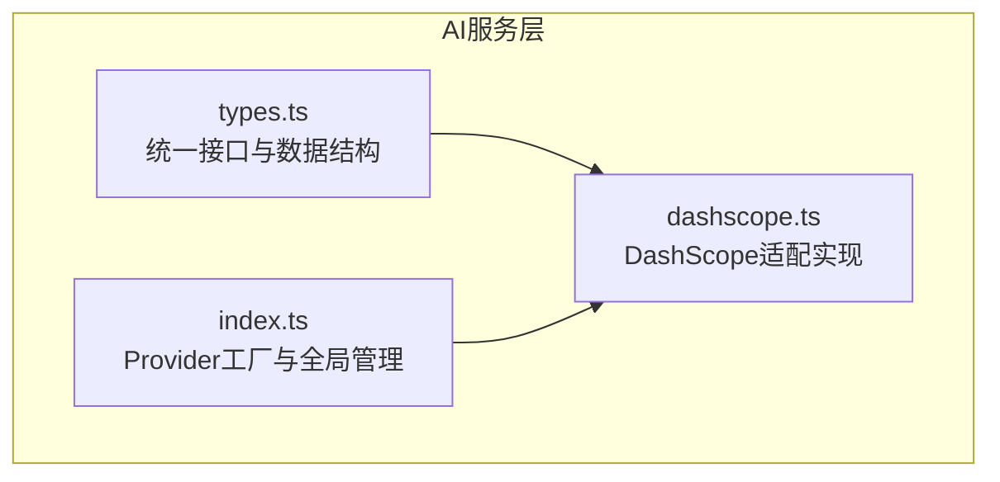
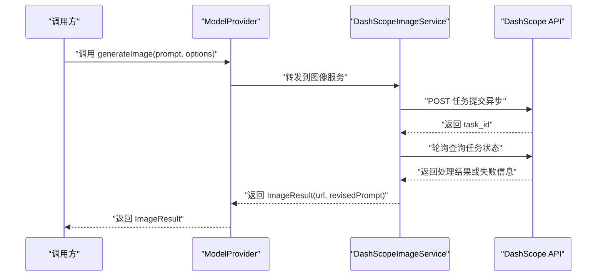
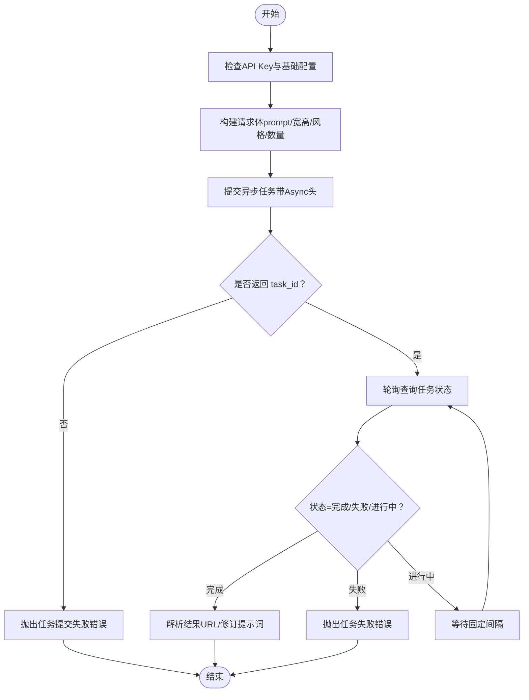
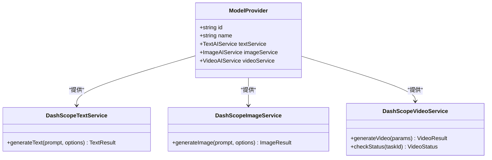
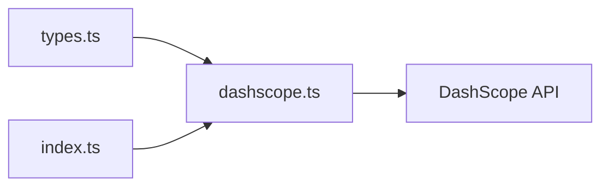

# 图像生成适配器

<cite>
**本文引用的文件**
- [src/services/ai/index.ts](file://src/services/ai/index.ts)
- [src/services/ai/dashscope.ts](file://src/services/ai/dashscope.ts)
- [src/services/ai/types.ts](file://src/services/ai/types.ts)
</cite>

## 目录
1. [简介](#简介)
2. [项目结构](#项目结构)
3. [核心组件](#核心组件)
4. [架构总览](#架构总览)
5. [详细组件分析](#详细组件分析)
6. [依赖分析](#依赖分析)
7. [性能考虑](#性能考虑)
8. [故障排除指南](#故障排除指南)
9. [结论](#结论)
10. [附录](#附录)

## 简介
本文件为“图像生成适配器”的技术文档，聚焦于如何通过统一接口屏蔽不同AI提供商的差异，实现跨厂商的图像生成能力。当前仓库采用“控制论开放系统设计”思想，以抽象接口与工厂模式为核心，将文本、图像、视频三大AI服务能力解耦，并以 DashScope（阿里云通义）作为首个适配实现。本文围绕以下主题展开：
- 统一接口设计与实现策略
- 图像生成核心功能：分辨率支持检测、提示词处理、图像质量控制
- 参数标准化、批量生成与进度监控
- 性能优化、内存管理与并发控制
- 扩展指南与故障排除

## 项目结构
本项目在前端侧通过 src/services/ai 提供统一的AI服务抽象与DashScope适配实现，关键文件如下：
- src/services/ai/types.ts：定义文本、图像、视频服务的统一接口与数据结构
- src/services/ai/dashscope.ts：DashScope提供商的具体实现，包含图像生成服务
- src/services/ai/index.ts：Provider工厂与全局Provider管理

图表来源
- [src/services/ai/types.ts:1-73](file://src/services/ai/types.ts#L1-L73)
- [src/services/ai/dashscope.ts:1-327](file://src/services/ai/dashscope.ts#L1-L327)
- [src/services/ai/index.ts:1-34](file://src/services/ai/index.ts#L1-L34)

章节来源
- [src/services/ai/types.ts:1-73](file://src/services/ai/types.ts#L1-L73)
- [src/services/ai/dashscope.ts:1-327](file://src/services/ai/dashscope.ts#L1-L327)
- [src/services/ai/index.ts:1-34](file://src/services/ai/index.ts#L1-L34)

## 核心组件
- 统一接口契约（types.ts）
  - 文本AI服务接口：generateText(prompt, options?) → TextResult
  - 图像AI服务接口：generateImage(prompt, options?) → ImageResult
  - 视频AI服务接口：generateVideo(params) → VideoResult；checkStatus(taskId) → VideoStatus
  - 数据结构：ImageOptions、ImageResult、VideoParams、VideoStatus等
- DashScope适配实现（dashscope.ts）
  - DashScopeImageService：基于异步任务+轮询的图像生成流程
  - DashScopeVideoService：视频生成的异步任务与状态查询
  - Provider工厂：createDashScopeProvider() 返回包含text/image/video服务的ModelProvider
- Provider管理（index.ts）
  - getAIProvider()：惰性初始化并缓存Provider
  - resetProvider()：重置Provider实例，便于切换或测试

章节来源
- [src/services/ai/types.ts:6-73](file://src/services/ai/types.ts#L6-L73)
- [src/services/ai/dashscope.ts:219-255](file://src/services/ai/dashscope.ts#L219-L255)
- [src/services/ai/dashscope.ts:318-326](file://src/services/ai/dashscope.ts#L318-L326)
- [src/services/ai/index.ts:22-33](file://src/services/ai/index.ts#L22-L33)

## 架构总览
下图展示了图像生成在统一接口下的调用链路与DashScope适配实现的关系。

图表来源
- [src/services/ai/types.ts:36-38](file://src/services/ai/types.ts#L36-L38)
- [src/services/ai/dashscope.ts:219-255](file://src/services/ai/dashscope.ts#L219-L255)
- [src/services/ai/dashscope.ts:155-216](file://src/services/ai/dashscope.ts#L155-L216)

## 详细组件分析

### 组件A：图像生成服务（DashScopeImageService）
- 功能职责
  - 接收统一的图像生成请求（prompt、可选宽高、风格、反向提示词、数量）
  - 将请求参数标准化为DashScope所需的模型名、输入与参数结构
  - 提交异步任务并轮询直到完成或失败
  - 返回最终结果（图片URL与修订后的提示词）
- 关键流程
  - 参数校验与默认值：若未指定宽高，默认尺寸为1024×1024
  - 任务提交：携带“X-DashScope-Async: enable”头，获取task_id
  - 轮询策略：固定间隔轮询，最长等待时间限制，映射任务状态
  - 结果解析：提取第一张图片URL与实际/原始提示词

图表来源
- [src/services/ai/dashscope.ts:219-255](file://src/services/ai/dashscope.ts#L219-L255)
- [src/services/ai/dashscope.ts:155-216](file://src/services/ai/dashscope.ts#L155-L216)

章节来源
- [src/services/ai/dashscope.ts:219-255](file://src/services/ai/dashscope.ts#L219-L255)
- [src/services/ai/dashscope.ts:223-237](file://src/services/ai/dashscope.ts#L223-L237)
- [src/services/ai/dashscope.ts:245-254](file://src/services/ai/dashscope.ts#L245-L254)

### 组件B：Provider工厂与全局管理
- Provider工厂
  - createDashScopeProvider()：返回包含text/image/video服务的ModelProvider对象
- 全局Provider管理
  - getAIProvider()：单例化Provider，避免重复初始化
  - resetProvider()：在需要切换或重置时清空缓存

图表来源
- [src/services/ai/types.ts:66-72](file://src/services/ai/types.ts#L66-L72)
- [src/services/ai/dashscope.ts:318-326](file://src/services/ai/dashscope.ts#L318-L326)

章节来源
- [src/services/ai/index.ts:22-33](file://src/services/ai/index.ts#L22-L33)
- [src/services/ai/dashscope.ts:318-326](file://src/services/ai/dashscope.ts#L318-L326)

### 组件C：统一接口与数据结构
- 图像选项（ImageOptions）
  - 宽度、高度、风格、反向提示词、生成数量
- 图像结果（ImageResult）
  - 返回图片URL与可能的修订提示词
- 视频参数与状态（VideoParams、VideoStatus）
  - 视频生成参数与状态枚举、进度与错误信息

章节来源
- [src/services/ai/types.ts:22-38](file://src/services/ai/types.ts#L22-L38)
- [src/services/ai/types.ts:40-63](file://src/services/ai/types.ts#L40-L63)

## 依赖分析
- 组件内聚与耦合
  - DashScopeImageService与DashScopeVideoService共享异步任务提交与轮询逻辑（工具函数），降低重复
  - Provider工厂将具体实现与调用方解耦，提升可替换性
- 外部依赖
  - DashScope API：兼容模式与原生API、异步任务、轮询查询
  - 配置读取：从全局配置中读取API Key与模型参数
- 可能的循环依赖
  - 当前结构清晰，无循环导入迹象

图表来源
- [src/services/ai/types.ts:1-73](file://src/services/ai/types.ts#L1-L73)
- [src/services/ai/dashscope.ts:1-327](file://src/services/ai/dashscope.ts#L1-L327)
- [src/services/ai/index.ts:1-34](file://src/services/ai/index.ts#L1-L34)

章节来源
- [src/services/ai/types.ts:1-73](file://src/services/ai/types.ts#L1-L73)
- [src/services/ai/dashscope.ts:1-327](file://src/services/ai/dashscope.ts#L1-L327)
- [src/services/ai/index.ts:1-34](file://src/services/ai/index.ts#L1-L34)

## 性能考虑
- 请求与重试
  - 对网络错误与5xx进行指数退避重试，减少瞬时故障影响
  - 对4xx错误直接抛错，避免无效重试
- 轮询策略
  - 固定轮询间隔与最大等待时间，防止长时间占用资源
  - 仅在任务处于“进行中”时返回中间进度，其他状态返回0或100
- 内存与并发
  - 单例Provider避免重复创建服务实例
  - 异步任务模式避免阻塞主线程，适合批量生成场景
- 参数优化建议
  - 合理设置生成数量与分辨率，平衡质量与耗时
  - 在UI层对用户输入进行预检，减少无效请求

章节来源
- [src/services/ai/dashscope.ts:58-93](file://src/services/ai/dashscope.ts#L58-L93)
- [src/services/ai/dashscope.ts:201-216](file://src/services/ai/dashscope.ts#L201-L216)
- [src/services/ai/index.ts:22-29](file://src/services/ai/index.ts#L22-L29)

## 故障排除指南
- 常见错误类型与定位
  - 认证类：API Key缺失或无效、配额超限
  - 服务端类：5xx错误触发重试，持续失败需检查服务可用性
  - 客户端类：4xx错误直接抛错，检查请求参数与权限
  - 任务类：任务提交失败、任务超时、任务完成后未返回URL
- 排查步骤
  - 检查全局配置中的API Key与基础URL
  - 查看DashScope返回的错误码与消息，结合日志定位
  - 对于异步任务，确认task_id存在且轮询未超时
  - 若出现“任务完成但未返回URL”，检查输出字段与网络稳定性
- 建议
  - 在调用层捕获DashScopeError并转换为用户友好的提示
  - 对批量生成增加去重与幂等控制，避免重复提交

章节来源
- [src/services/ai/dashscope.ts:39-52](file://src/services/ai/dashscope.ts#L39-L52)
- [src/services/ai/dashscope.ts:68-88](file://src/services/ai/dashscope.ts#L68-L88)
- [src/services/ai/dashscope.ts:167-172](file://src/services/ai/dashscope.ts#L167-L172)
- [src/services/ai/dashscope.ts:207-215](file://src/services/ai/dashscope.ts#L207-L215)
- [src/services/ai/dashscope.ts:247-249](file://src/services/ai/dashscope.ts#L247-L249)

## 结论
本图像生成适配器通过统一接口与Provider工厂，成功将DashScope的图像生成能力纳入统一调度体系。其核心优势在于：
- 参数标准化与异步任务轮询，确保跨厂商的一致体验
- 明确的错误分类与重试策略，提升鲁棒性
- 清晰的扩展点，便于接入更多AI提供商

后续可在以下方面持续演进：
- 增加更多Provider（如Volcengine、OpenAI等）并统一抽象
- 引入本地缓存与增量更新策略，减少重复生成
- 在UI层提供更丰富的参数可视化与质量评估

## 附录

### A. 图像生成参数标准化清单
- 输入参数
  - prompt：必填，图像生成提示词
  - width/height：可选，默认1024×1024
  - style：可选，风格标签
  - negativePrompt：可选，反向提示词
  - count：可选，生成数量
- 输出结果
  - url：图片URL
  - revisedPrompt：修订后的提示词（若有）

章节来源
- [src/services/ai/types.ts:23-34](file://src/services/ai/types.ts#L23-L34)
- [src/services/ai/dashscope.ts:223-237](file://src/services/ai/dashscope.ts#L223-L237)
- [src/services/ai/dashscope.ts:250-254](file://src/services/ai/dashscope.ts#L250-L254)

### B. 批量生成与进度监控
- 批量生成
  - 通过count参数控制单次任务生成数量
  - 建议在调用层按队列顺序提交多个任务，结合轮询统一管理
- 进度监控
  - 视频服务提供checkStatus(taskId)，返回state与progress
  - 图像服务采用一次性完成/失败模式，可通过上层队列统计整体进度

章节来源
- [src/services/ai/types.ts:48-63](file://src/services/ai/types.ts#L48-L63)
- [src/services/ai/dashscope.ts:289-314](file://src/services/ai/dashscope.ts#L289-L314)

### C. 扩展指南：新增AI提供商
- 步骤
  - 在src/services/ai中新增Provider实现文件（如volcengine.ts）
  - 实现TextAIService、ImageAIService、VideoAIService接口
  - 在index.ts中添加工厂函数createXProvider()并注册到getAIProvider()
- 注意事项
  - 统一错误类型与重试策略
  - 明确异步任务的提交与轮询规范
  - 保持ImageOptions/ImageResult等数据结构一致

章节来源
- [src/services/ai/index.ts:24-29](file://src/services/ai/index.ts#L24-L29)
- [src/services/ai/dashscope.ts:318-326](file://src/services/ai/dashscope.ts#L318-L326)