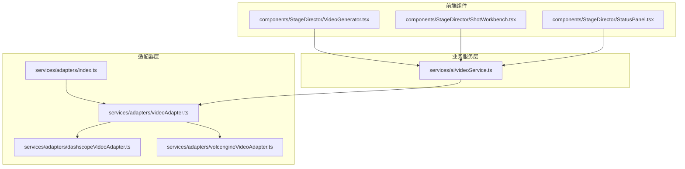
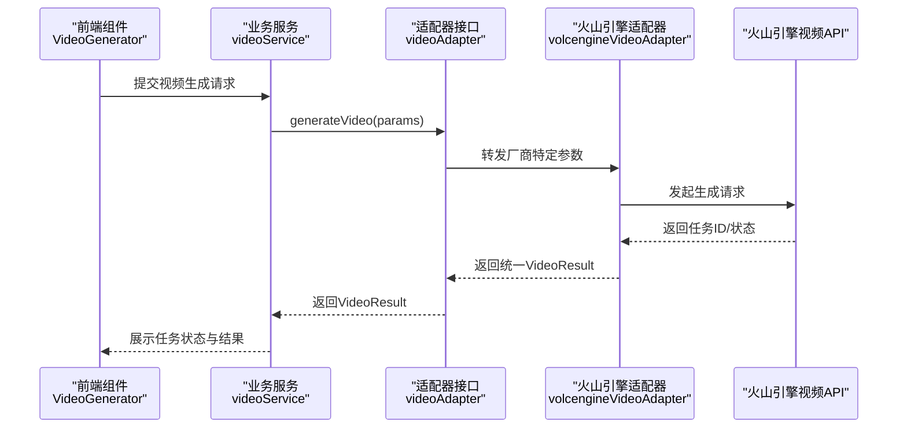
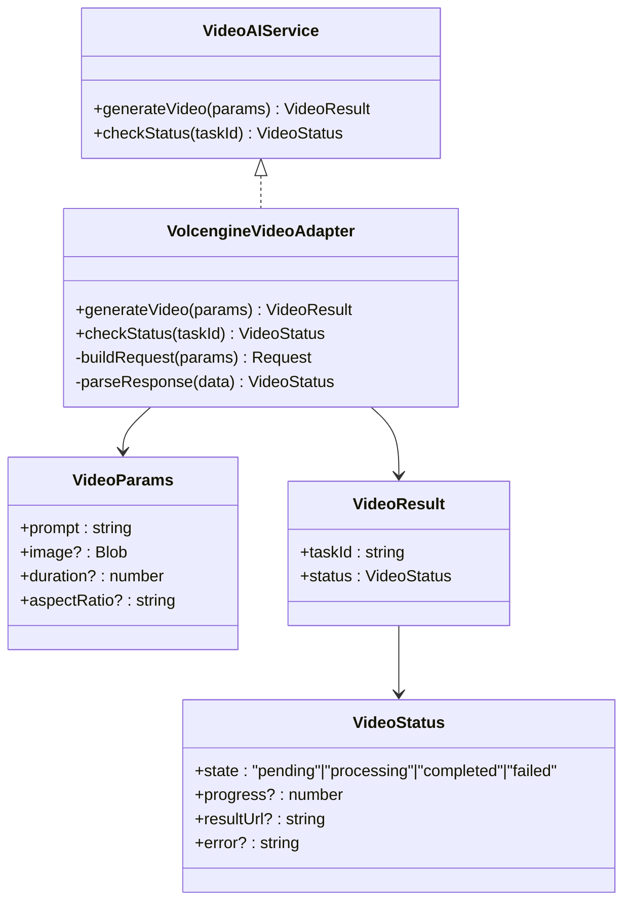
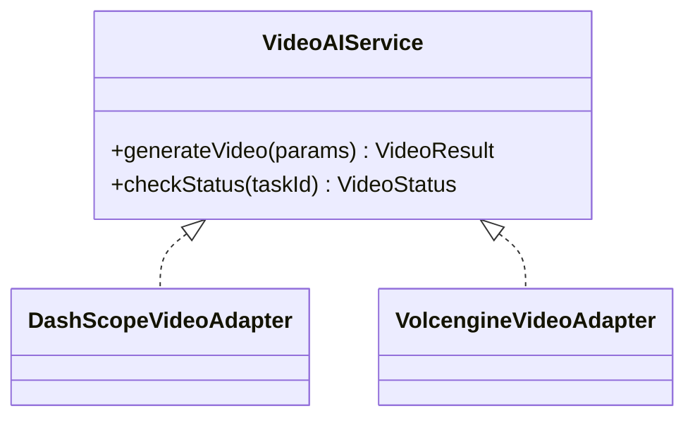
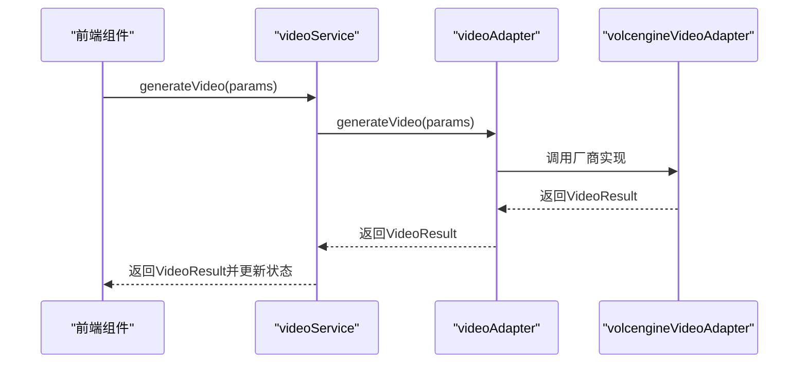
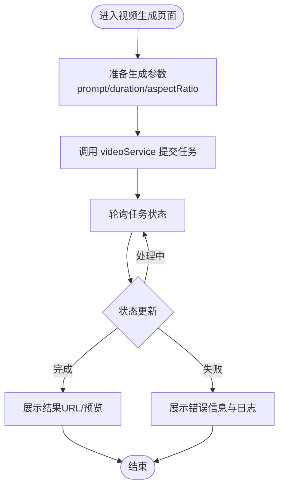
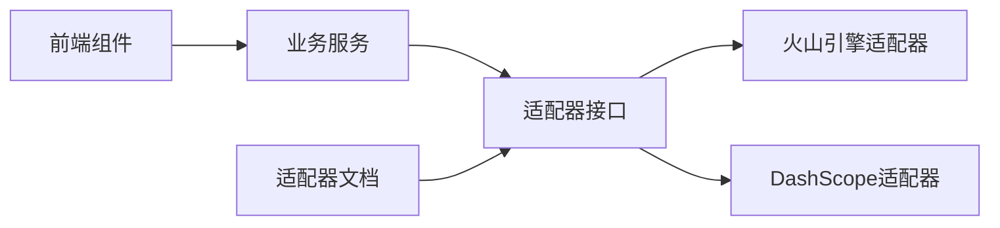

# 火山引擎视频适配器

<cite>
**本文引用的文件**
- [04-open-system-adapter.md](file://docs/refactor/04-open-system-adapter.md)
- [index.ts](file://services/adapters/index.ts)
- [dashscopeVideoAdapter.ts](file://services/adapters/dashscopeVideoAdapter.ts)
- [volcengineVideoAdapter.ts](file://services/adapters/volcengineVideoAdapter.ts)
- [videoAdapter.ts](file://services/adapters/videoAdapter.ts)
- [videoService.ts](file://services/ai/videoService.ts)
- [apiClient.ts](file://services/apiClient.ts)
- [StageDirector/VideoGenerator.tsx](file://components/StageDirector/VideoGenerator.tsx)
- [StageDirector/index.tsx](file://components/StageDirector/index.tsx)
- [StageDirector/utils.ts](file://components/StageDirector/utils.ts)
- [StageExport/utils.ts](file://components/StageExport/utils.ts)
- [StageExport/constants.ts](file://components/StageExport/constants.ts)
- [StageAssets/constants.ts](file://components/StageAssets/constants.ts)
- [StageAssets/utils.ts](file://components/StageAssets/utils.ts)
- [StagePrompts/constants.ts](file://components/StagePrompts/constants.ts)
- [StagePrompts/utils.ts](file://components/StagePrompts/utils.ts)
- [StageScript/constants.ts](file://components/StageScript/constants.ts)
- [StageScript/utils.ts](file://components/StageScript/utils.ts)
- [StageDirector/constants.ts](file://components/StageDirector/constants.ts)
- [StageDirector/ShotWorkbench.tsx](file://components/StageDirector/ShotWorkbench.tsx)
- [StageDirector/ShotCard.tsx](file://components/StageDirector/ShotCard.tsx)
- [StageDirector/KeyframeEditor.tsx](file://components/StageDirector/KeyframeEditor.tsx)
- [StageDirector/EditModal.tsx](file://components/StageDirector/EditModal.tsx)
- [StageDirector/ImagePreviewModal.tsx](file://components/StageDirector/ImagePreviewModal.tsx)
- [StageDirector/NineGridPreview.tsx](file://components/StageDirector/NineGridPreview.tsx)
- [StageDirector/TimelineVisualizer.tsx](file://components/StageDirector/TimelineVisualizer.tsx)
- [StageDirector/VideoPlayerModal.tsx](file://components/StageDirector/VideoPlayerModal.tsx)
- [StageDirector/RenderLogsModal.tsx](file://components/StageDirector/RenderLogsModal.tsx)
- [StageDirector/SecondaryOptions.tsx](file://components/StageDirector/SecondaryOptions.tsx)
- [StageDirector/StatusPanel.tsx](file://components/StageDirector/StatusPanel.tsx)
- [StageDirector/ActionButtons.tsx](file://components/StageDirector/ActionButtons.tsx)
- [StageDirector/WorkflowPage.tsx](file://components/Onboarding/WorkflowPage.tsx)
- [StageDirector/ApiKeyPage.tsx](file://components/Onboarding/ApiKeyPage.tsx)
- [StageDirector/WelcomePage.tsx](file://components/Onboarding/WelcomePage.tsx)
- [StageDirector/ProgressDots.tsx](file://components/Onboarding/ProgressDots.tsx)
- [StageDirector/HighlightPage.tsx](file://components/Onboarding/HighlightPage.tsx)
- [StageDirector/ActionPage.tsx](file://components/Onboarding/ActionPage.tsx)
- [StageDirector/constants.ts](file://components/Onboarding/constants.ts)
</cite>

## 目录
1. [简介](#简介)
2. [项目结构](#项目结构)
3. [核心组件](#核心组件)
4. [架构总览](#架构总览)
5. [详细组件分析](#详细组件分析)
6. [依赖关系分析](#依赖关系分析)
7. [性能考虑](#性能考虑)
8. [故障排除指南](#故障排除指南)
9. [结论](#结论)
10. [附录](#附录)

## 简介
本文件面向“火山引擎视频适配器”的集成与使用，目标是帮助开发者理解如何将火山引擎的视频生成功能适配到统一的适配器框架中，并掌握其特有的参数配置、质量选项与输出格式支持。文档同时阐述认证机制、请求限制与响应处理流程，提供配置指南、参数映射规则与性能优化技巧，并给出使用示例与故障排除方法。

## 项目结构
围绕视频适配器的关键目录与文件如下：
- 适配器层：位于 services/adapters，包含通用适配器接口与各厂商适配器实现
- 业务服务层：位于 services/ai，封装视频生成的业务逻辑
- 前端组件：位于 components/StageDirector 等，负责视频生成工作流与状态展示
- 适配器文档：位于 docs/refactor/04-open-system-adapter.md，定义统一接口与扩展机制

**图表来源**
- [index.ts](file://services/adapters/index.ts)
- [videoAdapter.ts](file://services/adapters/videoAdapter.ts)
- [dashscopeVideoAdapter.ts](file://services/adapters/dashscopeVideoAdapter.ts)
- [volcengineVideoAdapter.ts](file://services/adapters/volcengineVideoAdapter.ts)
- [videoService.ts](file://services/ai/videoService.ts)
- [VideoGenerator.tsx](file://components/StageDirector/VideoGenerator.tsx)
- [ShotWorkbench.tsx](file://components/StageDirector/ShotWorkbench.tsx)
- [StatusPanel.tsx](file://components/StageDirector/StatusPanel.tsx)

**章节来源**
- [index.ts](file://services/adapters/index.ts)
- [videoAdapter.ts](file://services/adapters/videoAdapter.ts)
- [dashscopeVideoAdapter.ts](file://services/adapters/dashscopeVideoAdapter.ts)
- [volcengineVideoAdapter.ts](file://services/adapters/volcengineVideoAdapter.ts)
- [videoService.ts](file://services/ai/videoService.ts)
- [VideoGenerator.tsx](file://components/StageDirector/VideoGenerator.tsx)
- [ShotWorkbench.tsx](file://components/StageDirector/ShotWorkbench.tsx)
- [StatusPanel.tsx](file://components/StageDirector/StatusPanel.tsx)

## 核心组件
- 统一视频适配器接口：定义 generateVideo 与 checkStatus 的最小化契约，屏蔽厂商差异
- 火山引擎适配器：实现火山引擎视频生成API的调用、参数映射、状态轮询与结果解析
- 业务服务 videoService：封装任务提交、状态查询、错误处理与日志记录
- 前端组件：提供视频生成工作流、状态面板与渲染日志展示

**章节来源**
- [04-open-system-adapter.md](file://docs/refactor/04-open-system-adapter.md)
- [videoAdapter.ts](file://services/adapters/videoAdapter.ts)
- [volcengineVideoAdapter.ts](file://services/adapters/volcengineVideoAdapter.ts)
- [videoService.ts](file://services/ai/videoService.ts)

## 架构总览
统一适配器框架通过“接口最小化 + 配置驱动 + 渐进暴露”实现对多家厂商的解耦。前端通过 ProviderManager 获取当前激活的视频服务，业务层调用统一接口，适配器层对接具体厂商API。

**图表来源**
- [videoService.ts](file://services/ai/videoService.ts)
- [videoAdapter.ts](file://services/adapters/videoAdapter.ts)
- [volcengineVideoAdapter.ts](file://services/adapters/volcengineVideoAdapter.ts)
- [VideoGenerator.tsx](file://components/StageDirector/VideoGenerator.tsx)

## 详细组件分析

### 火山引擎视频适配器（volcengineVideoAdapter）
- 职责
  - 将统一 VideoParams 映射为火山引擎API所需参数
  - 处理认证（API Key）、请求头与请求体构造
  - 实现异步任务状态轮询与结果解析
  - 支持进度上报与错误处理
- 关键实现要点
  - 参数映射：prompt、duration、aspectRatio、图像参考图（如需要）
  - 质量与输出：通过厂商参数控制分辨率、帧率、码率与输出格式
  - 认证：在请求头注入 API Key 或签名
  - 轮询：定期查询任务状态，直到完成或失败
- 错误处理
  - 对网络异常、超时、鉴权失败、参数错误等进行分类处理
  - 返回统一 VideoStatus，便于上层展示

**图表来源**
- [04-open-system-adapter.md](file://docs/refactor/04-open-system-adapter.md)
- [volcengineVideoAdapter.ts](file://services/adapters/volcengineVideoAdapter.ts)

**章节来源**
- [volcengineVideoAdapter.ts](file://services/adapters/volcengineVideoAdapter.ts)
- [04-open-system-adapter.md](file://docs/refactor/04-open-system-adapter.md)

### 统一视频适配器接口（videoAdapter）
- 职责
  - 定义 generateVideo 与 checkStatus 的统一签名
  - 作为适配器层的抽象边界，屏蔽厂商差异
- 作用
  - 使业务层与前端组件无需关心具体厂商实现
  - 便于新增其他厂商适配器（如 DashScope、火山引擎）

**图表来源**
- [04-open-system-adapter.md](file://docs/refactor/04-open-system-adapter.md)
- [videoAdapter.ts](file://services/adapters/videoAdapter.ts)
- [dashscopeVideoAdapter.ts](file://services/adapters/dashscopeVideoAdapter.ts)
- [volcengineVideoAdapter.ts](file://services/adapters/volcengineVideoAdapter.ts)

**章节来源**
- [videoAdapter.ts](file://services/adapters/videoAdapter.ts)
- [dashscopeVideoAdapter.ts](file://services/adapters/dashscopeVideoAdapter.ts)
- [volcengineVideoAdapter.ts](file://services/adapters/volcengineVideoAdapter.ts)
- [04-open-system-adapter.md](file://docs/refactor/04-open-system-adapter.md)

### 业务服务（videoService）
- 职责
  - 负责任务生命周期管理：提交、轮询、结果归档
  - 统一错误处理与日志记录
  - 与适配器层交互，向上返回 VideoResult
- 与前端的协作
  - 前端组件通过 videoService 发起生成与查询
  - videoService 将状态更新推送到 UI

**图表来源**
- [videoService.ts](file://services/ai/videoService.ts)
- [videoAdapter.ts](file://services/adapters/videoAdapter.ts)
- [volcengineVideoAdapter.ts](file://services/adapters/volcengineVideoAdapter.ts)

**章节来源**
- [videoService.ts](file://services/ai/videoService.ts)

### 前端组件（StageDirector）
- VideoGenerator：发起视频生成请求，展示生成按钮与状态
- ShotWorkbench：展示分镜与生成任务卡片
- StatusPanel：展示任务状态、进度与结果链接
- RenderLogsModal：展示渲染日志与错误详情
- 与业务服务的交互：通过 videoService 管理任务生命周期

**图表来源**
- [VideoGenerator.tsx](file://components/StageDirector/VideoGenerator.tsx)
- [ShotWorkbench.tsx](file://components/StageDirector/ShotWorkbench.tsx)
- [StatusPanel.tsx](file://components/StageDirector/StatusPanel.tsx)
- [RenderLogsModal.tsx](file://components/StageDirector/RenderLogsModal.tsx)

**章节来源**
- [VideoGenerator.tsx](file://components/StageDirector/VideoGenerator.tsx)
- [ShotWorkbench.tsx](file://components/StageDirector/ShotWorkbench.tsx)
- [StatusPanel.tsx](file://components/StageDirector/StatusPanel.tsx)
- [RenderLogsModal.tsx](file://components/StageDirector/RenderLogsModal.tsx)

## 依赖关系分析
- 适配器层依赖统一接口：videoAdapter.ts
- 业务服务依赖适配器接口：videoService.ts
- 前端组件依赖业务服务：VideoGenerator.tsx、ShotWorkbench.tsx、StatusPanel.tsx
- 适配器文档定义了统一接口与扩展机制：04-open-system-adapter.md

**图表来源**
- [index.ts](file://services/adapters/index.ts)
- [videoAdapter.ts](file://services/adapters/videoAdapter.ts)
- [dashscopeVideoAdapter.ts](file://services/adapters/dashscopeVideoAdapter.ts)
- [volcengineVideoAdapter.ts](file://services/adapters/volcengineVideoAdapter.ts)
- [videoService.ts](file://services/ai/videoService.ts)
- [04-open-system-adapter.md](file://docs/refactor/04-open-system-adapter.md)

**章节来源**
- [index.ts](file://services/adapters/index.ts)
- [videoAdapter.ts](file://services/adapters/videoAdapter.ts)
- [dashscopeVideoAdapter.ts](file://services/adapters/dashscopeVideoAdapter.ts)
- [volcengineVideoAdapter.ts](file://services/adapters/volcengineVideoAdapter.ts)
- [videoService.ts](file://services/ai/videoService.ts)
- [04-open-system-adapter.md](file://docs/refactor/04-open-system-adapter.md)

## 性能考虑
- 参数优化
  - 合理设置 duration 与 aspectRatio，避免过长时长与超高分辨率导致的等待时间
  - 在图像驱动场景下，确保参考图清晰且尺寸合适，减少二次处理开销
- 轮询策略
  - 控制轮询间隔，避免过于频繁的请求造成限流
  - 在完成态后及时停止轮询，释放资源
- 并发与缓存
  - 对相同输入的重复请求可做去重与缓存，减少重复生成
- 前端体验
  - 在生成过程中提供进度条与预览，提升用户感知
  - 对失败场景提供重试与回退策略

## 故障排除指南
- 常见问题与定位
  - 认证失败：检查 API Key 是否正确、是否过期或被禁用
  - 请求超时：检查网络状况与服务商限流策略，适当降低并发
  - 参数错误：核对 prompt、duration、aspectRatio 等参数范围
  - 状态异常：确认轮询逻辑与任务ID有效性
- 日志与诊断
  - 使用 RenderLogsModal 查看详细日志
  - 在 videoService 中记录关键事件与错误堆栈
- 快速修复步骤
  - 重新配置 API Key 并测试连接
  - 调整参数范围与生成时长
  - 检查网络代理与跨域策略（如需直连）

**章节来源**
- [RenderLogsModal.tsx](file://components/StageDirector/RenderLogsModal.tsx)
- [videoService.ts](file://services/ai/videoService.ts)

## 结论
通过统一的适配器接口与配置化扩展机制，火山引擎视频适配器得以无缝融入整体系统。该方案实现了对厂商差异的屏蔽、对参数与质量的灵活控制，以及对前端体验的持续优化。遵循本文的配置指南、参数映射规则与性能优化建议，可有效提升视频生成的稳定性与效率。

## 附录

### 火山引擎视频适配器配置指南
- 认证配置
  - 在 Provider 配置中填入火山引擎 API Key
  - 确保网络可直连火山引擎视频API端点
- 参数映射规则
  - prompt → 文本提示词
  - duration → 生成时长（秒）
  - aspectRatio → 宽高比（如 16:9、9:16、1:1）
  - image → 图像驱动（如需要）
- 输出格式支持
  - 支持主流视频格式（如 MP4/H.264），具体以厂商返回为准
- 请求限制与速率控制
  - 遵循火山引擎的 QPS 与并发限制
  - 合理设置轮询间隔，避免触发限流

**章节来源**
- [04-open-system-adapter.md](file://docs/refactor/04-open-system-adapter.md)
- [volcengineVideoAdapter.ts](file://services/adapters/volcengineVideoAdapter.ts)

### 使用示例（流程说明）
- 步骤
  - 在前端填写生成参数（prompt、时长、宽高比）
  - 调用 videoService 提交任务
  - 轮询任务状态直至完成
  - 展示结果链接并支持下载/预览
- 注意事项
  - 对失败任务提供重试与错误提示
  - 对长时间任务提供进度反馈

**章节来源**
- [VideoGenerator.tsx](file://components/StageDirector/VideoGenerator.tsx)
- [StatusPanel.tsx](file://components/StageDirector/StatusPanel.tsx)
- [videoService.ts](file://services/ai/videoService.ts)