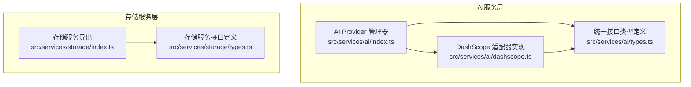
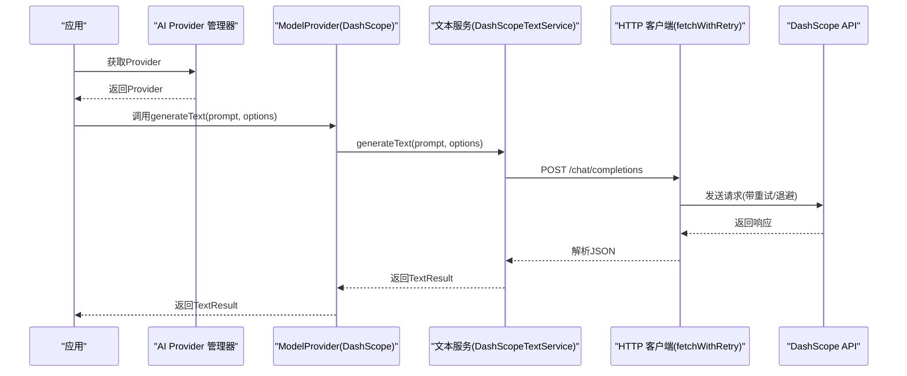
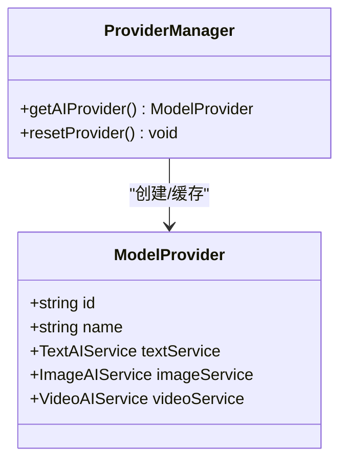
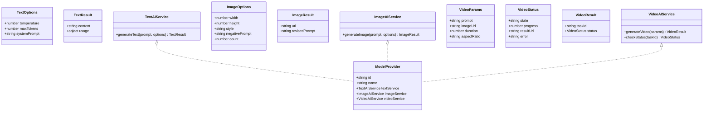
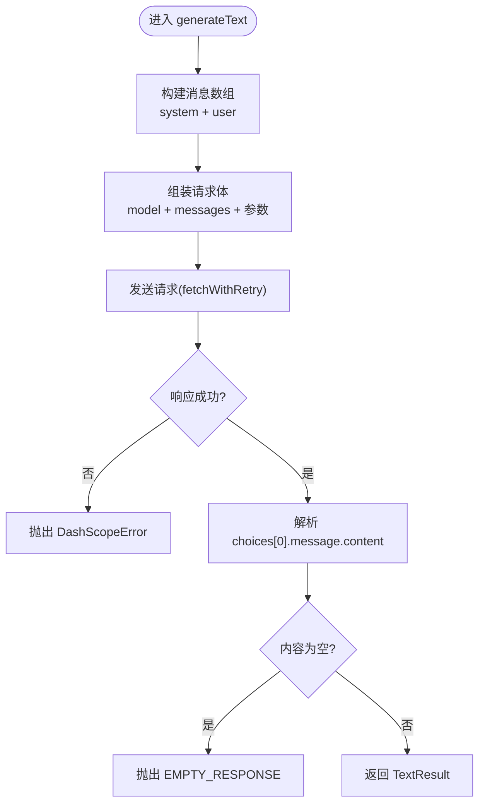
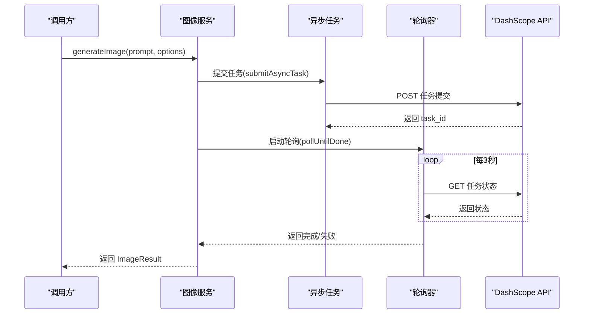
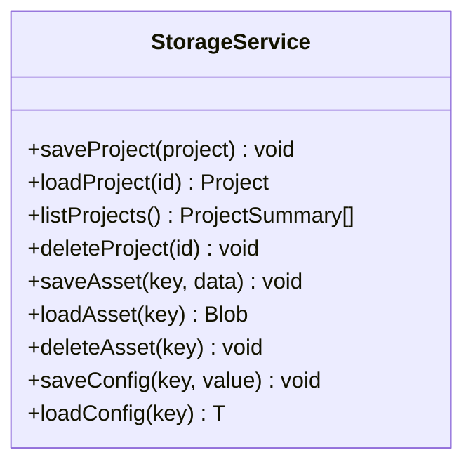
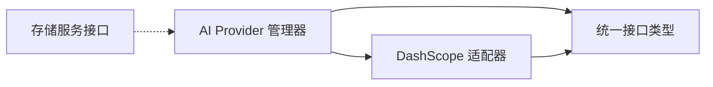

# 聊天对话适配器

<cite>
**本文引用的文件**
- [src/services/ai/index.ts](file://src/services/ai/index.ts)
- [src/services/ai/dashscope.ts](file://src/services/ai/dashscope.ts)
- [src/services/ai/types.ts](file://src/services/ai/types.ts)
- [src/services/storage/index.ts](file://src/services/storage/index.ts)
- [src/services/storage/types.ts](file://src/services/storage/types.ts)
</cite>

## 目录
1. [简介](#简介)
2. [项目结构](#项目结构)
3. [核心组件](#核心组件)
4. [架构总览](#架构总览)
5. [详细组件分析](#详细组件分析)
6. [依赖分析](#依赖分析)
7. [性能考虑](#性能考虑)
8. [故障排查指南](#故障排查指南)
9. [结论](#结论)
10. [附录](#附录)

## 简介
本文件围绕“聊天对话适配器”的设计与实现进行系统化说明，目标是统一不同AI提供商的对话接口，屏蔽厂商差异，提供一致的消息格式、上下文管理与流式响应处理能力。当前仓库中的AI服务以“DashScope（阿里云）”为例，实现了文本、图像与视频的统一接口，并通过Provider工厂模式对外暴露统一能力。尽管仓库中未直接提供“聊天对话适配器”的独立模块文件，但其核心思想与接口规范已在AI服务类型定义与DashScope适配器中得到体现。

## 项目结构
与聊天对话适配器相关的代码主要位于以下位置：
- AI服务与适配器：src/services/ai
- 存储服务接口：src/services/storage
- Provider工厂与类型定义：src/services/ai/index.ts、src/services/ai/types.ts
- DashScope适配器实现：src/services/ai/dashscope.ts
- 存储服务导出与类型：src/services/storage/index.ts、src/services/storage/types.ts

图表来源
- [src/services/ai/index.ts:1-34](file://src/services/ai/index.ts#L1-L34)
- [src/services/ai/types.ts:1-73](file://src/services/ai/types.ts#L1-L73)
- [src/services/ai/dashscope.ts:1-327](file://src/services/ai/dashscope.ts#L1-L327)
- [src/services/storage/index.ts:1-3](file://src/services/storage/index.ts#L1-L3)
- [src/services/storage/types.ts:1-31](file://src/services/storage/types.ts#L1-L31)

章节来源
- [src/services/ai/index.ts:1-34](file://src/services/ai/index.ts#L1-L34)
- [src/services/ai/types.ts:1-73](file://src/services/ai/types.ts#L1-L73)
- [src/services/ai/dashscope.ts:1-327](file://src/services/ai/dashscope.ts#L1-L327)
- [src/services/storage/index.ts:1-3](file://src/services/storage/index.ts#L1-L3)
- [src/services/storage/types.ts:1-31](file://src/services/storage/types.ts#L1-L31)

## 核心组件
- Provider管理器：负责创建与缓存ModelProvider实例，当前默认创建DashScope Provider，支持未来扩展其他Provider。
- 统一接口类型：定义文本、图像、视频三类AI服务的输入输出规范，确保跨厂商一致性。
- DashScope适配器：实现文本、图像、视频服务的具体调用与状态轮询，内置重试、超时与错误映射。
- 存储服务接口：为项目与资产数据提供统一的持久化能力，可作为对话历史与上下文的持久化基础。

章节来源
- [src/services/ai/index.ts:22-33](file://src/services/ai/index.ts#L22-L33)
- [src/services/ai/types.ts:6-72](file://src/services/ai/types.ts#L6-L72)
- [src/services/ai/dashscope.ts:96-139](file://src/services/ai/dashscope.ts#L96-L139)
- [src/services/ai/dashscope.ts:219-255](file://src/services/ai/dashscope.ts#L219-L255)
- [src/services/ai/dashscope.ts:258-315](file://src/services/ai/dashscope.ts#L258-L315)
- [src/services/storage/types.ts:15-30](file://src/services/storage/types.ts#L15-L30)

## 架构总览
下图展示了从应用到Provider再到DashScope服务的整体调用链，以及错误处理与重试机制：

图表来源
- [src/services/ai/index.ts:24-29](file://src/services/ai/index.ts#L24-L29)
- [src/services/ai/dashscope.ts:96-139](file://src/services/ai/dashscope.ts#L96-L139)
- [src/services/ai/dashscope.ts:58-93](file://src/services/ai/dashscope.ts#L58-L93)

## 详细组件分析

### 组件A：Provider管理器与工厂
- 设计目标：集中管理AI提供商实例，支持懒加载与重置，便于未来扩展多Provider切换。
- 关键点：
  - 单例缓存：首次调用时创建Provider，后续复用。
  - 重置机制：允许在配置变更后重建Provider。
  - 默认实现：当前默认创建DashScope Provider。

图表来源
- [src/services/ai/index.ts:22-33](file://src/services/ai/index.ts#L22-L33)
- [src/services/ai/types.ts:66-72](file://src/services/ai/types.ts#L66-L72)

章节来源
- [src/services/ai/index.ts:22-33](file://src/services/ai/index.ts#L22-L33)
- [src/services/ai/types.ts:66-72](file://src/services/ai/types.ts#L66-L72)

### 组件B：统一接口类型规范
- 文本服务：定义输入参数（温度、最大Token、system提示词）与输出结果（内容、用量）。
- 图像服务：定义尺寸、风格、负向提示词、数量等参数与输出结果（URL、修订提示词）。
- 视频服务：定义任务参数（提示词、可选图片、时长、宽高比）与状态结果（状态、进度、结果URL、错误信息）。
- Provider：聚合三类服务，形成统一入口。

图表来源
- [src/services/ai/types.ts:7-20](file://src/services/ai/types.ts#L7-L20)
- [src/services/ai/types.ts:23-38](file://src/services/ai/types.ts#L23-L38)
- [src/services/ai/types.ts:41-63](file://src/services/ai/types.ts#L41-L63)
- [src/services/ai/types.ts:66-72](file://src/services/ai/types.ts#L66-L72)

章节来源
- [src/services/ai/types.ts:7-72](file://src/services/ai/types.ts#L7-L72)

### 组件C：DashScope文本服务（聊天对话适配器核心）
- 消息格式标准化：将systemPrompt与用户输入统一封装为messages数组，遵循OpenAI兼容模式的字段约定。
- 参数映射：temperature、max_tokens等参数映射至DashScope请求体。
- 错误处理：空响应、鉴权失败、配额限制、网络异常等均转换为DashScopeError并携带语义化code。
- 可扩展性：当前实现为同步调用，若需流式响应，可在该层增加事件流解析与增量推送。

图表来源
- [src/services/ai/dashscope.ts:96-139](file://src/services/ai/dashscope.ts#L96-L139)
- [src/services/ai/dashscope.ts:58-93](file://src/services/ai/dashscope.ts#L58-L93)

章节来源
- [src/services/ai/dashscope.ts:96-139](file://src/services/ai/dashscope.ts#L96-L139)
- [src/services/ai/dashscope.ts:39-52](file://src/services/ai/dashscope.ts#L39-L52)
- [src/services/ai/dashscope.ts:58-93](file://src/services/ai/dashscope.ts#L58-L93)

### 组件D：DashScope图像/视频服务（异步任务与状态轮询）
- 异步任务提交：统一通过submitAsyncTask提交任务并提取task_id。
- 状态轮询：pollUntilDone按固定间隔查询任务状态，映射为统一VideoStatus。
- 错误恢复：超时、失败、URL缺失等场景均有明确错误码与友好提示。

图表来源
- [src/services/ai/dashscope.ts:219-255](file://src/services/ai/dashscope.ts#L219-L255)
- [src/services/ai/dashscope.ts:155-182](file://src/services/ai/dashscope.ts#L155-L182)
- [src/services/ai/dashscope.ts:201-216](file://src/services/ai/dashscope.ts#L201-L216)

章节来源
- [src/services/ai/dashscope.ts:219-255](file://src/services/ai/dashscope.ts#L219-L255)
- [src/services/ai/dashscope.ts:258-315](file://src/services/ai/dashscope.ts#L258-L315)
- [src/services/ai/dashscope.ts:155-182](file://src/services/ai/dashscope.ts#L155-L182)
- [src/services/ai/dashscope.ts:184-199](file://src/services/ai/dashscope.ts#L184-L199)
- [src/services/ai/dashscope.ts:201-216](file://src/services/ai/dashscope.ts#L201-L216)

### 组件E：存储服务（对话历史与上下文持久化）
- 能力范围：提供项目、资产与配置的增删查改能力，可作为对话历史与上下文的持久化载体。
- 使用建议：将历史消息序列化后保存为项目资产或配置项，读取时反序列化用于构造system/user消息。

图表来源
- [src/services/storage/types.ts:15-30](file://src/services/storage/types.ts#L15-L30)

章节来源
- [src/services/storage/types.ts:15-30](file://src/services/storage/types.ts#L15-L30)

## 依赖分析
- Provider管理器依赖统一类型定义与DashScope实现。
- DashScope适配器依赖统一类型定义与配置读取。
- 存储服务接口独立于AI服务，可被上层业务用于持久化对话历史。

图表来源
- [src/services/ai/index.ts:5-29](file://src/services/ai/index.ts#L5-L29)
- [src/services/ai/types.ts:66-72](file://src/services/ai/types.ts#L66-L72)
- [src/services/ai/dashscope.ts:11-24](file://src/services/ai/dashscope.ts#L11-L24)
- [src/services/storage/index.ts:1-3](file://src/services/storage/index.ts#L1-L3)

章节来源
- [src/services/ai/index.ts:5-29](file://src/services/ai/index.ts#L5-L29)
- [src/services/ai/types.ts:66-72](file://src/services/ai/types.ts#L66-L72)
- [src/services/ai/dashscope.ts:11-24](file://src/services/ai/dashscope.ts#L11-L24)
- [src/services/storage/index.ts:1-3](file://src/services/storage/index.ts#L1-L3)

## 性能考虑
- 请求重试与退避：fetchWithRetry对5xx错误采用指数退避，减少抖动对上游的压力。
- 轮询节流：异步任务轮询间隔固定，避免频繁请求；可根据实际任务耗时调整间隔。
- 超时控制：统一的最大等待时间防止长时间占用资源。
- 参数裁剪：合理设置temperature与maxTokens，平衡质量与成本。

## 故障排查指南
- 鉴权失败（401）：检查API Key是否正确配置与有效。
- 配额超限（429）：降低请求频率或提升配额。
- 服务端错误（5xx）：触发自动重试，必要时延长等待时间。
- 空响应/任务失败：检查输入参数与任务状态，确认返回字段完整性。
- 网络异常：确认网络连通性与代理设置。

章节来源
- [src/services/ai/dashscope.ts:39-52](file://src/services/ai/dashscope.ts#L39-L52)
- [src/services/ai/dashscope.ts:58-93](file://src/services/ai/dashscope.ts#L58-L93)
- [src/services/ai/dashscope.ts:201-216](file://src/services/ai/dashscope.ts#L201-L216)

## 结论
本仓库通过统一接口与Provider工厂模式，实现了对DashScope的标准化接入，为后续扩展其他AI提供商奠定了基础。文本服务已具备消息格式标准化与错误恢复能力，图像/视频服务提供了可靠的异步任务与状态轮询机制。结合存储服务，可进一步完善对话历史与上下文的持久化方案。若需要引入流式响应与多轮对话状态管理，可在现有类型与DashScope实现基础上进行扩展。

## 附录
- 配置项建议
  - API Key：在配置中设置DashScope API Key。
  - 基础URL：可选覆盖默认兼容/原生域名。
  - 模型选择：文本/图像/视频模型ID按需配置。
  - 参数映射：temperature、maxTokens、尺寸、风格、负向提示词、时长、宽高比等。
- 集成步骤
  - 获取Provider：调用Provider管理器获取实例。
  - 调用文本服务：传入prompt与可选options，获得标准化结果。
  - 处理异步任务：图像/视频服务返回task_id，按需自行轮询或使用内置方法。
  - 持久化历史：将历史消息序列化后通过存储服务保存。