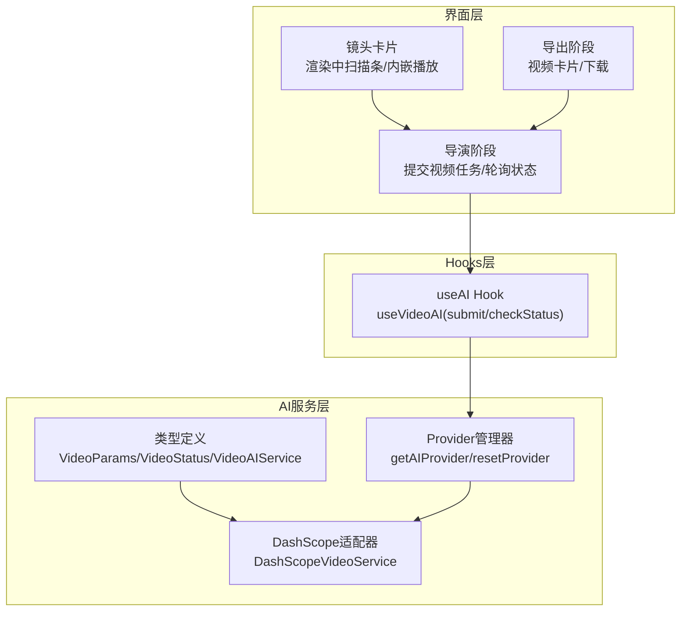
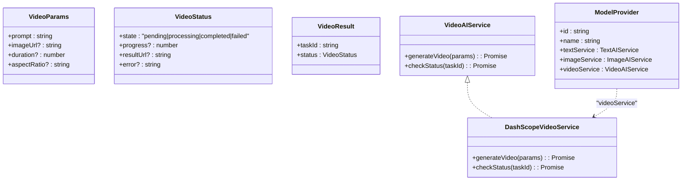
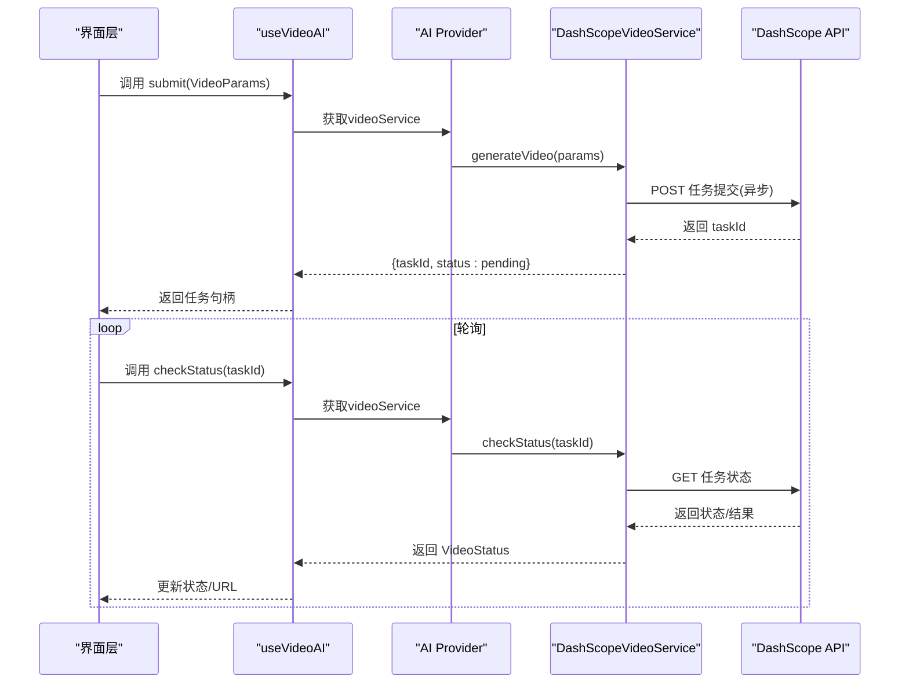
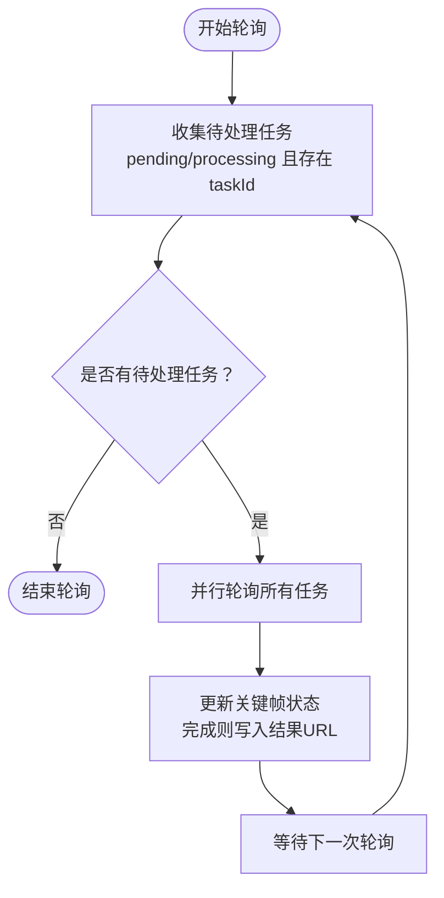
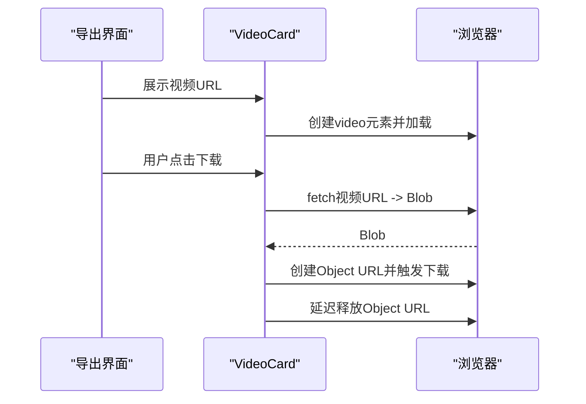
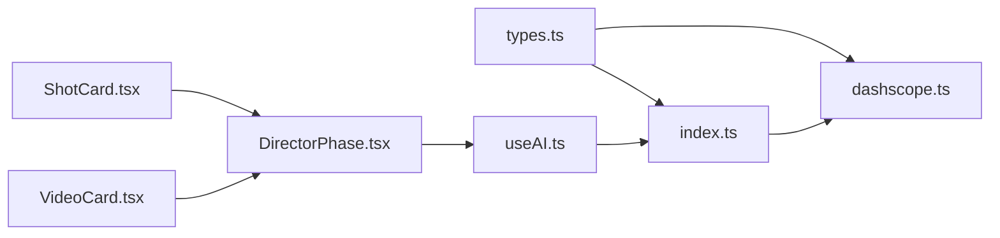

# 视频生成适配器

<cite>
**本文档引用的文件**
- [src/services/ai/types.ts](file://src/services/ai/types.ts)
- [src/services/ai/index.ts](file://src/services/ai/index.ts)
- [src/services/ai/dashscope.ts](file://src/services/ai/dashscope.ts)
- [src/shared/hooks/useAI.ts](file://src/shared/hooks/useAI.ts)
- [src/phases/director/DirectorPhase.tsx](file://src/phases/director/DirectorPhase.tsx)
- [src/phases/director/components/ShotCard.tsx](file://src/phases/director/components/ShotCard.tsx)
- [src/phases/director/components/VideoStatusBadge.tsx](file://src/phases/director/components/VideoStatusBadge.tsx)
- [src/phases/export/components/VideoCard.tsx](file://src/phases/export/components/VideoCard.tsx)
</cite>

## 目录
1. [简介](#简介)
2. [项目结构](#项目结构)
3. [核心组件](#核心组件)
4. [架构总览](#架构总览)
5. [详细组件分析](#详细组件分析)
6. [依赖关系分析](#依赖关系分析)
7. [性能考虑](#性能考虑)
8. [故障排查指南](#故障排查指南)
9. [结论](#结论)
10. [附录](#附录)

## 简介
本文件为“视频生成适配器”的技术文档，聚焦于统一不同AI提供商的视频生成接口，实现跨厂商的可插拔能力。文档涵盖以下主题：
- 设计思路与架构：统一接口契约、异步任务与轮询、状态管理与进度反馈
- 关键功能：视频时长支持检测、分辨率/宽高比兼容、关键帧处理
- 工作流程：提交任务、异步轮询、结果回传与UI更新
- 参数优化策略：时长、分辨率、轮询间隔与超时控制
- 资源管理：并发轮询、内存与对象URL释放
- 错误处理：鉴权、配额、网络与任务失败的分级处理
- 集成示例与性能调优：在导演阶段与导出阶段的使用方式

## 项目结构
视频生成适配器位于前端AI服务层，采用“接口抽象 + 适配器实现 + Provider工厂”的分层设计，便于未来接入更多厂商。

图表来源
- [src/services/ai/types.ts:1-73](file://src/services/ai/types.ts#L1-L73)
- [src/services/ai/index.ts:1-34](file://src/services/ai/index.ts#L1-L34)
- [src/services/ai/dashscope.ts:258-315](file://src/services/ai/dashscope.ts#L258-L315)
- [src/shared/hooks/useAI.ts:68-96](file://src/shared/hooks/useAI.ts#L68-L96)
- [src/phases/director/DirectorPhase.tsx:127-247](file://src/phases/director/DirectorPhase.tsx#L127-L247)
- [src/phases/director/components/ShotCard.tsx:151-191](file://src/phases/director/components/ShotCard.tsx#L151-L191)
- [src/phases/export/components/VideoCard.tsx:1-141](file://src/phases/export/components/VideoCard.tsx#L1-L141)

章节来源
- [src/services/ai/types.ts:1-73](file://src/services/ai/types.ts#L1-L73)
- [src/services/ai/index.ts:1-34](file://src/services/ai/index.ts#L1-L34)
- [src/services/ai/dashscope.ts:258-315](file://src/services/ai/dashscope.ts#L258-L315)
- [src/shared/hooks/useAI.ts:68-96](file://src/shared/hooks/useAI.ts#L68-L96)
- [src/phases/director/DirectorPhase.tsx:127-247](file://src/phases/director/DirectorPhase.tsx#L127-L247)
- [src/phases/director/components/ShotCard.tsx:151-191](file://src/phases/director/components/ShotCard.tsx#L151-L191)
- [src/phases/export/components/VideoCard.tsx:1-141](file://src/phases/export/components/VideoCard.tsx#L1-L141)

## 核心组件
- 统一接口契约
  - VideoParams：包含提示词、首帧图片URL、时长、宽高比等参数
  - VideoStatus：任务状态（排队/pending、处理中/processing、完成/completed、失败/failed）、进度百分比、结果URL、错误信息
  - VideoAIService：generateVideo(params) 提交任务；checkStatus(taskId) 查询状态
- DashScope适配器
  - DashScopeVideoService：构造请求体、提交异步任务、查询状态、映射状态码
- Provider管理器
  - getAIProvider：惰性创建Provider；resetProvider：重置Provider实例
- Hooks层
  - useVideoAI：封装提交与轮询，暴露submit与checkStatus，并统一loading/error
- 导演阶段
  - 提交视频任务、乐观标记状态、定时轮询、更新关键帧数据
- 导出阶段
  - 内嵌播放、下载（支持跨域回退）

章节来源
- [src/services/ai/types.ts:40-63](file://src/services/ai/types.ts#L40-L63)
- [src/services/ai/dashscope.ts:258-315](file://src/services/ai/dashscope.ts#L258-L315)
- [src/services/ai/index.ts:22-33](file://src/services/ai/index.ts#L22-L33)
- [src/shared/hooks/useAI.ts:68-96](file://src/shared/hooks/useAI.ts#L68-L96)
- [src/phases/director/DirectorPhase.tsx:127-247](file://src/phases/director/DirectorPhase.tsx#L127-L247)

## 架构总览
视频生成适配器遵循“统一接口 + 厂商适配 + Provider工厂”的架构，确保UI层无需感知具体厂商差异。

图表来源
- [src/services/ai/types.ts:40-72](file://src/services/ai/types.ts#L40-L72)
- [src/services/ai/dashscope.ts:258-315](file://src/services/ai/dashscope.ts#L258-L315)

## 详细组件分析

### 组件A：DashScope视频服务适配器
- 功能要点
  - 提交异步任务：向DashScope视频合成接口发送请求，启用异步模式，返回taskId
  - 查询状态：根据task_status映射为统一状态，完成时提取视频URL
  - 错误处理：对401/429/5xx进行差异化处理，超时与空响应进行明确报错
- 关键参数
  - 时长：duration（秒），按厂商支持范围传入
  - 宽高比：aspect_ratio（如“16:9”、“9:16”等），用于生成视频比例
  - 首帧：img_url（可选），作为视频起始帧参考
- 并发与轮询
  - 导演阶段对所有待处理任务并行轮询，容忍单次失败，避免阻塞其他任务

图表来源
- [src/shared/hooks/useAI.ts:68-96](file://src/shared/hooks/useAI.ts#L68-L96)
- [src/services/ai/dashscope.ts:258-315](file://src/services/ai/dashscope.ts#L258-L315)
- [src/phases/director/DirectorPhase.tsx:191-247](file://src/phases/director/DirectorPhase.tsx#L191-L247)

章节来源
- [src/services/ai/dashscope.ts:258-315](file://src/services/ai/dashscope.ts#L258-L315)
- [src/services/ai/types.ts:40-63](file://src/services/ai/types.ts#L40-L63)
- [src/shared/hooks/useAI.ts:68-96](file://src/shared/hooks/useAI.ts#L68-L96)
- [src/phases/director/DirectorPhase.tsx:127-247](file://src/phases/director/DirectorPhase.tsx#L127-L247)

### 组件B：导演阶段的任务调度与轮询
- 任务提交
  - 乐观地将关键帧状态标记为“排队”，随后真实提交任务并写入taskId与初始状态
- 轮询机制
  - 使用ref保存最新项目与checkStatus方法，避免闭包陷阱
  - 对所有处于“排队/处理中”的任务并行轮询，成功则更新状态与结果URL
  - 轮询间隔与超时控制由DashScope适配器内部常量决定
- UI反馈
  - 渲染中状态显示“扫描条”动画，完成后内嵌播放视频

图表来源
- [src/phases/director/DirectorPhase.tsx:191-247](file://src/phases/director/DirectorPhase.tsx#L191-L247)
- [src/phases/director/components/ShotCard.tsx:151-191](file://src/phases/director/components/ShotCard.tsx#L151-L191)

章节来源
- [src/phases/director/DirectorPhase.tsx:127-247](file://src/phases/director/DirectorPhase.tsx#L127-L247)
- [src/phases/director/components/ShotCard.tsx:151-191](file://src/phases/director/components/ShotCard.tsx#L151-L191)

### 组件C：导出阶段的视频播放与下载
- 播放
  - 支持内嵌video播放，带封面图与自动播放
- 下载
  - 优先通过fetch转Blob并触发下载；若跨域失败则回退到直接下载URL
  - 下载完成后异步释放Object URL，避免内存泄漏

图表来源
- [src/phases/export/components/VideoCard.tsx:58-92](file://src/phases/export/components/VideoCard.tsx#L58-L92)

章节来源
- [src/phases/export/components/VideoCard.tsx:1-141](file://src/phases/export/components/VideoCard.tsx#L1-L141)

## 依赖关系分析
- 接口契约
  - 所有视频服务实现必须满足VideoAIService接口，保证调用方一致
- 适配器实现
  - DashScopeVideoService依赖DashScope的异步任务接口与状态映射
- Provider工厂
  - getAIProvider负责创建Provider实例，resetProvider用于测试或切换场景
- UI层依赖
  - useVideoAI封装鉴权与loading/error，DirectorPhase与VideoCard消费状态

图表来源
- [src/services/ai/types.ts:1-73](file://src/services/ai/types.ts#L1-L73)
- [src/services/ai/index.ts:1-34](file://src/services/ai/index.ts#L1-L34)
- [src/services/ai/dashscope.ts:258-315](file://src/services/ai/dashscope.ts#L258-L315)
- [src/shared/hooks/useAI.ts:68-96](file://src/shared/hooks/useAI.ts#L68-L96)
- [src/phases/director/DirectorPhase.tsx:127-247](file://src/phases/director/DirectorPhase.tsx#L127-L247)
- [src/phases/director/components/ShotCard.tsx:151-191](file://src/phases/director/components/ShotCard.tsx#L151-L191)
- [src/phases/export/components/VideoCard.tsx:1-141](file://src/phases/export/components/VideoCard.tsx#L1-L141)

章节来源
- [src/services/ai/types.ts:1-73](file://src/services/ai/types.ts#L1-L73)
- [src/services/ai/index.ts:1-34](file://src/services/ai/index.ts#L1-L34)
- [src/services/ai/dashscope.ts:258-315](file://src/services/ai/dashscope.ts#L258-L315)
- [src/shared/hooks/useAI.ts:68-96](file://src/shared/hooks/useAI.ts#L68-L96)
- [src/phases/director/DirectorPhase.tsx:127-247](file://src/phases/director/DirectorPhase.tsx#L127-L247)
- [src/phases/director/components/ShotCard.tsx:151-191](file://src/phases/director/components/ShotCard.tsx#L151-L191)
- [src/phases/export/components/VideoCard.tsx:1-141](file://src/phases/export/components/VideoCard.tsx#L1-L141)

## 性能考虑
- 轮询策略
  - 并行轮询多个任务，减少整体等待时间；对失败任务容忍并重试
  - 轮询间隔与最大等待时间由适配器内部常量控制，避免过于频繁的请求
- 资源管理
  - 下载完成后及时释放Object URL，防止内存累积
  - 轮询使用ref缓存最新值，避免重复创建闭包导致的性能损耗
- 参数优化
  - 时长与宽高比应尽量符合厂商支持范围，避免因参数不合法导致失败重试
  - 首帧图片建议清晰且比例合适，提升生成质量与稳定性

## 故障排查指南
- 鉴权问题
  - 未配置API Key：抛出认证错误，需在“模型配置”中填写DashScope API Key
- 请求限制
  - 401：API Key无效或过期；429：请求过于频繁或配额超限；需降低频率或升级配额
- 网络异常
  - 5xx：服务端错误，按指数退避重试；其他错误：立即失败并返回友好提示
- 任务状态
  - 任务超时：超过最大等待时间仍未完成；任务失败：返回失败原因
  - 任务完成但无URL：检查输出字段是否正确返回

章节来源
- [src/services/ai/dashscope.ts:39-93](file://src/services/ai/dashscope.ts#L39-L93)
- [src/services/ai/dashscope.ts:155-216](file://src/services/ai/dashscope.ts#L155-L216)
- [src/services/ai/dashscope.ts:289-314](file://src/services/ai/dashscope.ts#L289-L314)

## 结论
视频生成适配器通过统一接口与适配器模式，实现了对DashScope视频服务的无缝接入。其异步任务与轮询机制、状态映射与错误处理策略，为导演阶段的批量渲染与导出阶段的播放下载提供了稳定支撑。未来可通过Provider工厂扩展至其他厂商，保持UI层的无感切换。

## 附录
- 集成示例（导演阶段）
  - 在导演阶段提交视频任务：传入提示词、首帧图片URL、时长；随后进入轮询，完成即内嵌播放
  - 参考路径：[src/phases/director/DirectorPhase.tsx:127-247](file://src/phases/director/DirectorPhase.tsx#L127-L247)
- 集成示例（导出阶段）
  - 在导出阶段展示视频卡片，支持内嵌播放与下载；下载失败时回退到直接下载
  - 参考路径：[src/phases/export/components/VideoCard.tsx:58-92](file://src/phases/export/components/VideoCard.tsx#L58-L92)
- 参数说明
  - VideoParams：prompt、imageUrl、duration、aspectRatio
  - VideoStatus：state、progress、resultUrl、error
  - 参考路径：[src/services/ai/types.ts:40-63](file://src/services/ai/types.ts#L40-L63)