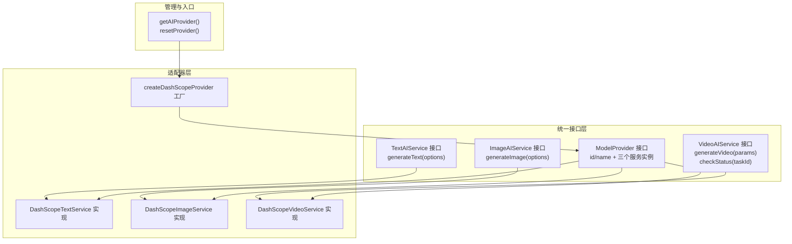
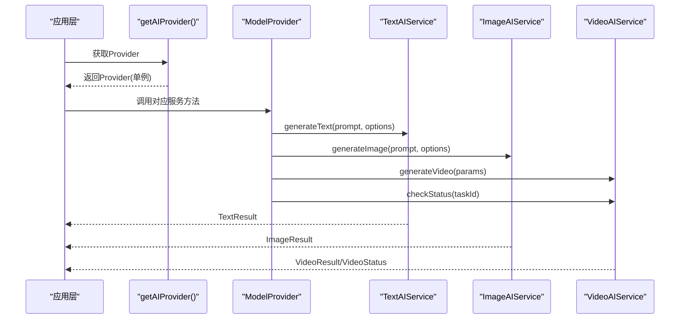
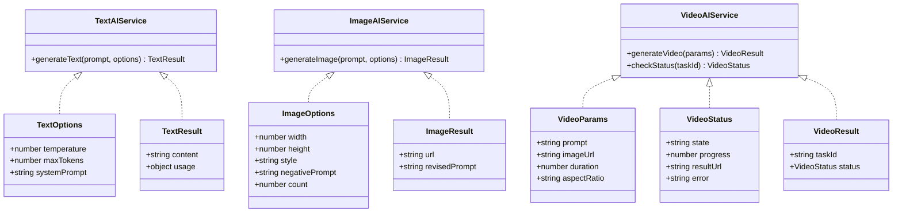
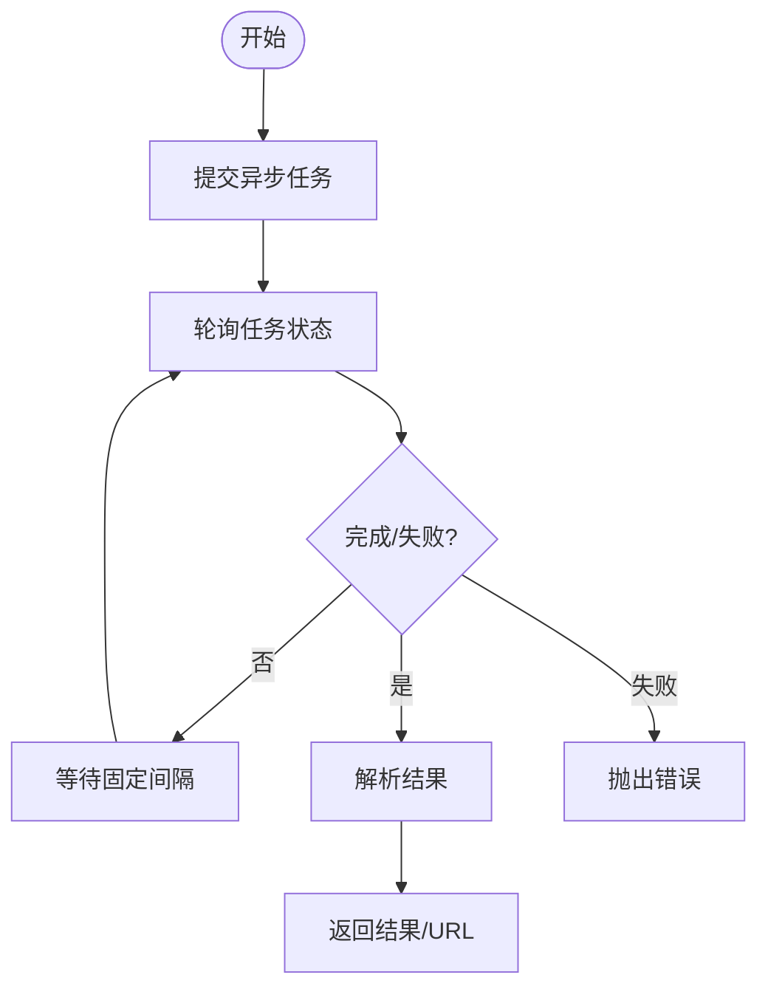
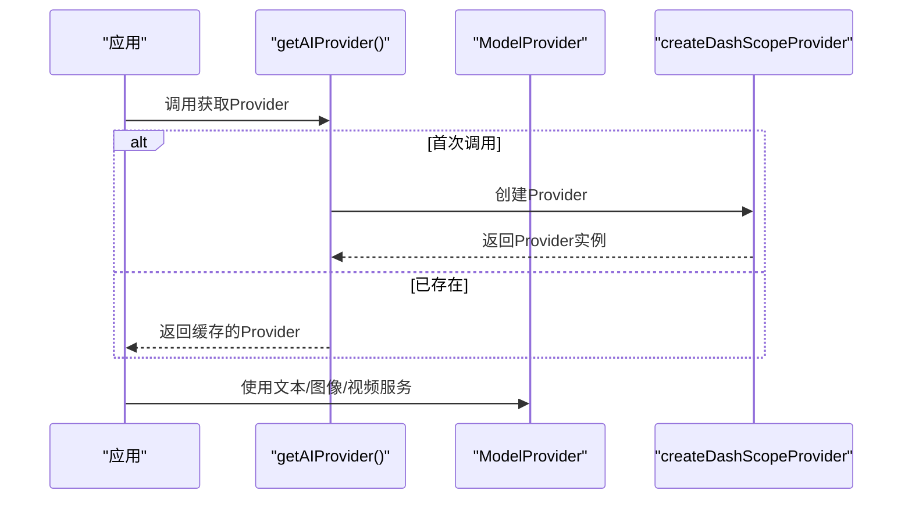
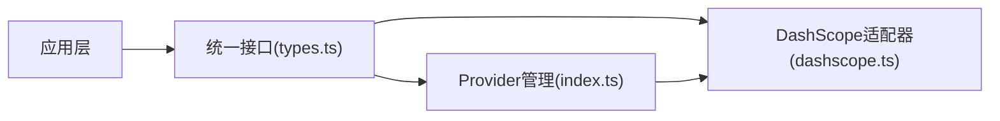

# 适配器工厂与统一接口

<cite>
**本文档引用的文件**
- [src/services/ai/index.ts](file://src/services/ai/index.ts)
- [src/services/ai/types.ts](file://src/services/ai/types.ts)
- [src/services/ai/dashscope.ts](file://src/services/ai/dashscope.ts)
</cite>

## 目录
1. [引言](#引言)
2. [项目结构](#项目结构)
3. [核心组件](#核心组件)
4. [架构总览](#架构总览)
5. [详细组件分析](#详细组件分析)
6. [依赖关系分析](#依赖关系分析)
7. [性能考量](#性能考量)
8. [故障排查指南](#故障排查指南)
9. [结论](#结论)
10. [附录](#附录)

## 引言
本文件围绕“适配器工厂与统一接口”主题，系统性阐述该代码库中AI服务的抽象与适配设计。目标是通过统一接口屏蔽不同AI提供商的差异，以工厂模式集中管理适配器实例，并提供参数标准化、返回值规范化、错误处理统一化等能力。同时覆盖动态加载策略、适配器选择算法、生命周期管理、缓存策略与性能监控建议，以及扩展指南与最佳实践。

## 项目结构
本项目采用“统一接口 + 适配器”的分层组织方式：
- 统一接口层：定义文本、图像、视频三类服务的统一契约与结果结构，确保上层业务无厂商耦合。
- 适配器层：以DashScope为例实现具体适配器，封装厂商API差异、异步任务轮询、重试与错误映射。
- 工厂与管理层：提供单例式AI Provider获取与重置能力，便于未来扩展多Provider切换。

图表来源
- [src/services/ai/types.ts:18-72](file://src/services/ai/types.ts#L18-L72)
- [src/services/ai/dashscope.ts:96-326](file://src/services/ai/dashscope.ts#L96-L326)
- [src/services/ai/index.ts:24-33](file://src/services/ai/index.ts#L24-L33)

章节来源
- [src/services/ai/index.ts:1-34](file://src/services/ai/index.ts#L1-L34)
- [src/services/ai/types.ts:1-73](file://src/services/ai/types.ts#L1-L73)
- [src/services/ai/dashscope.ts:1-327](file://src/services/ai/dashscope.ts#L1-L327)

## 核心组件
- 统一接口契约
  - 文本服务：统一输入参数与输出结构，支持温度、最大令牌数、系统提示词等。
  - 图像服务：统一尺寸、风格、负向提示词、数量等参数，输出URL与修订提示词。
  - 视频服务：统一输入参数与状态结构，支持任务ID、进度、结果URL与错误信息。
- 适配器实现
  - DashScope适配器：封装兼容模式与原生模式调用，统一异步任务提交、轮询与状态映射。
- 工厂与管理
  - 单例Provider：惰性初始化，支持重置以切换配置或测试环境。
  - 动态加载策略：按需获取Provider，避免启动时的外部依赖初始化开销。

章节来源
- [src/services/ai/types.ts:7-72](file://src/services/ai/types.ts#L7-L72)
- [src/services/ai/dashscope.ts:96-326](file://src/services/ai/dashscope.ts#L96-L326)
- [src/services/ai/index.ts:22-33](file://src/services/ai/index.ts#L22-L33)

## 架构总览
下图展示从应用到统一接口再到适配器工厂与具体实现的调用链路，体现“控制论开放系统设计”思想：面向抽象编程，不绑定特定厂商。

图表来源
- [src/services/ai/index.ts:24-29](file://src/services/ai/index.ts#L24-L29)
- [src/services/ai/types.ts:18-72](file://src/services/ai/types.ts#L18-L72)
- [src/services/ai/dashscope.ts:96-315](file://src/services/ai/dashscope.ts#L96-L315)

## 详细组件分析

### 统一接口设计
- 设计原则
  - 参数标准化：文本/图像/视频分别定义标准参数对象，约束可选字段与默认值。
  - 返回值规范化：统一结果结构，包含内容、URL、用量、状态与进度等。
  - 错误处理统一化：通过自定义错误类型与错误码，向上层抛出可识别的异常。
- 数据模型
  - 文本：输入包含温度、最大令牌数、系统提示词；输出包含内容与用量。
  - 图像：输入包含宽高、风格、负向提示词、数量；输出包含URL与修订提示词。
  - 视频：输入包含提示词、可选图片、时长、宽高比；输出包含任务ID与状态结构。

图表来源
- [src/services/ai/types.ts:7-72](file://src/services/ai/types.ts#L7-L72)

章节来源
- [src/services/ai/types.ts:7-72](file://src/services/ai/types.ts#L7-L72)

### DashScope适配器实现
- 文本服务
  - 支持兼容模式与原生模式，自动拼接基础URL与认证头。
  - 将系统提示词与用户提示词组合为消息数组，发送至模型并解析返回内容与用量。
- 图像服务
  - 提交异步任务，轮询直到完成或失败，返回首张图片URL与修订提示词。
  - 统一错误映射：空响应、任务超时、任务失败等。
- 视频服务
  - 提交异步任务并立即返回任务ID；调用方可自行轮询或使用内置等待方法。
  - 状态映射：待处理、处理中、已完成、失败；完成时返回视频URL与100%进度。
- 错误处理
  - 自定义DashScopeError，包含错误码与HTTP状态；区分客户端错误、服务端错误、配额限制、认证失效等场景。
  - 请求重试：对网络错误与5xx进行指数退避重试，4xx直接抛错。

图表来源
- [src/services/ai/dashscope.ts:155-216](file://src/services/ai/dashscope.ts#L155-L216)

章节来源
- [src/services/ai/dashscope.ts:96-326](file://src/services/ai/dashscope.ts#L96-L326)

### 工厂与Provider管理
- 工厂职责
  - 创建并组装统一接口的实现，形成完整的ModelProvider。
  - 保持Provider的唯一性，避免重复初始化带来的资源浪费。
- 动态加载策略
  - 惰性初始化：首次调用时才创建Provider，减少启动时的外部依赖初始化。
  - 可重置：在配置变更或测试场景下重置Provider，触发下次获取时重建。
- 适配器选择算法
  - 当前实现固定返回DashScope Provider；未来可扩展为根据配置选择不同Provider，实现“多Provider切换”。

图表来源
- [src/services/ai/index.ts:24-29](file://src/services/ai/index.ts#L24-L29)
- [src/services/ai/dashscope.ts:318-326](file://src/services/ai/dashscope.ts#L318-L326)

章节来源
- [src/services/ai/index.ts:22-33](file://src/services/ai/index.ts#L22-L33)
- [src/services/ai/dashscope.ts:318-326](file://src/services/ai/dashscope.ts#L318-L326)

### 生命周期管理与缓存策略
- 生命周期
  - Provider单例：进程内全局共享，避免重复创建与销毁。
  - 服务实例：随Provider创建，无需单独管理。
- 缓存策略
  - API Key与基础配置：通过配置模块读取，建议在Provider内部缓存必要配置项，避免频繁IO。
  - 结果缓存：文本/图像/视频结果通常不缓存，因涉及版权与时效性；可在上层业务按需缓存URL与元数据。
- 性能监控
  - 建议在适配器层记录请求耗时、重试次数、状态码分布等指标，用于评估稳定性与成本。

章节来源
- [src/services/ai/index.ts:22-29](file://src/services/ai/index.ts#L22-L29)
- [src/services/ai/dashscope.ts:58-93](file://src/services/ai/dashscope.ts#L58-L93)

### 扩展指南与最佳实践
- 新增Provider步骤
  - 定义新的适配器类，实现统一接口（文本/图像/视频）。
  - 在工厂中新增创建函数，组装ModelProvider。
  - 在入口处增加选择逻辑：根据配置返回对应Provider。
- 参数标准化最佳实践
  - 明确可选参数与默认值，避免厂商差异导致的调用失败。
  - 对于厂商特有参数，提供兼容层或转换逻辑。
- 错误处理最佳实践
  - 使用统一错误类型与错误码，便于上层统一处理。
  - 对4xx与5xx进行分类处理，避免将客户端错误与服务端错误混淆。
- 性能优化建议
  - 合理设置轮询间隔与最大等待时间，平衡响应速度与成本。
  - 对高频调用进行并发控制与队列化，避免触发限流。
  - 记录关键指标并建立告警，持续优化调用质量。

章节来源
- [src/services/ai/types.ts:18-72](file://src/services/ai/types.ts#L18-L72)
- [src/services/ai/dashscope.ts:318-326](file://src/services/ai/dashscope.ts#L318-L326)
- [src/services/ai/index.ts:24-33](file://src/services/ai/index.ts#L24-L33)

## 依赖关系分析
- 组件耦合
  - 应用层仅依赖统一接口，不感知具体厂商实现。
  - 工厂负责装配，降低上层对适配器细节的依赖。
- 外部依赖
  - 适配器依赖配置模块读取API Key与基础URL。
  - 适配器依赖fetch进行HTTP请求，并实现指数退避重试。
- 循环依赖
  - 统一接口与适配器之间为单向依赖，无循环风险。

图表来源
- [src/services/ai/types.ts:18-72](file://src/services/ai/types.ts#L18-L72)
- [src/services/ai/dashscope.ts:96-326](file://src/services/ai/dashscope.ts#L96-L326)
- [src/services/ai/index.ts:24-33](file://src/services/ai/index.ts#L24-L33)

章节来源
- [src/services/ai/types.ts:18-72](file://src/services/ai/types.ts#L18-L72)
- [src/services/ai/dashscope.ts:96-326](file://src/services/ai/dashscope.ts#L96-L326)
- [src/services/ai/index.ts:24-33](file://src/services/ai/index.ts#L24-L33)

## 性能考量
- 请求重试与退避
  - 对5xx与网络错误进行指数退避重试，减少瞬时故障影响。
- 轮询策略
  - 固定轮询间隔与最大等待时间，避免长时间占用资源。
- 并发与限流
  - 建议在上层业务对并发请求进行节流与队列化，防止触发厂商限流。
- 指标监控
  - 建议采集请求耗时、成功率、错误码分布、重试次数等指标，持续优化调用策略。

章节来源
- [src/services/ai/dashscope.ts:58-93](file://src/services/ai/dashscope.ts#L58-L93)
- [src/services/ai/dashscope.ts:201-216](file://src/services/ai/dashscope.ts#L201-L216)

## 故障排查指南
- 常见问题定位
  - API Key缺失或无效：检查配置模块中的密钥设置与权限范围。
  - 请求过于频繁或配额超限：关注错误码与HTTP状态，适当降低并发或延长等待。
  - 任务超时：确认轮询间隔与最大等待时间设置是否合理。
- 错误分类与处理
  - 客户端错误：通常为参数或认证问题，需修正调用参数或密钥。
  - 服务端错误：建议重试与退避，必要时联系厂商支持。
  - 任务失败：检查任务状态与返回消息，定位具体失败原因。
- 日志与监控
  - 记录请求ID、任务ID、状态码与错误信息，便于追踪与复盘。

章节来源
- [src/services/ai/dashscope.ts:47-93](file://src/services/ai/dashscope.ts#L47-L93)
- [src/services/ai/dashscope.ts:201-216](file://src/services/ai/dashscope.ts#L201-L216)

## 结论
该设计通过统一接口与适配器工厂，实现了对多AI提供商的解耦与可替换性。DashScope适配器展示了参数标准化、返回值规范化与错误处理统一化的完整实践。未来可通过配置驱动的Provider选择算法，进一步增强系统的可扩展性与可维护性。建议在生产环境中完善监控与告警体系，持续优化性能与成本。

## 附录
- 关键流程回顾
  - 获取Provider：惰性初始化，单例缓存。
  - 调用服务：统一接口屏蔽厂商差异。
  - 异步任务：统一提交、轮询与状态映射。
- 最佳实践清单
  - 明确参数与默认值，避免厂商差异。
  - 统一错误类型与错误码，便于上层处理。
  - 合理设置重试与轮询策略，平衡性能与成本。
  - 建立监控与告警，持续优化调用质量。