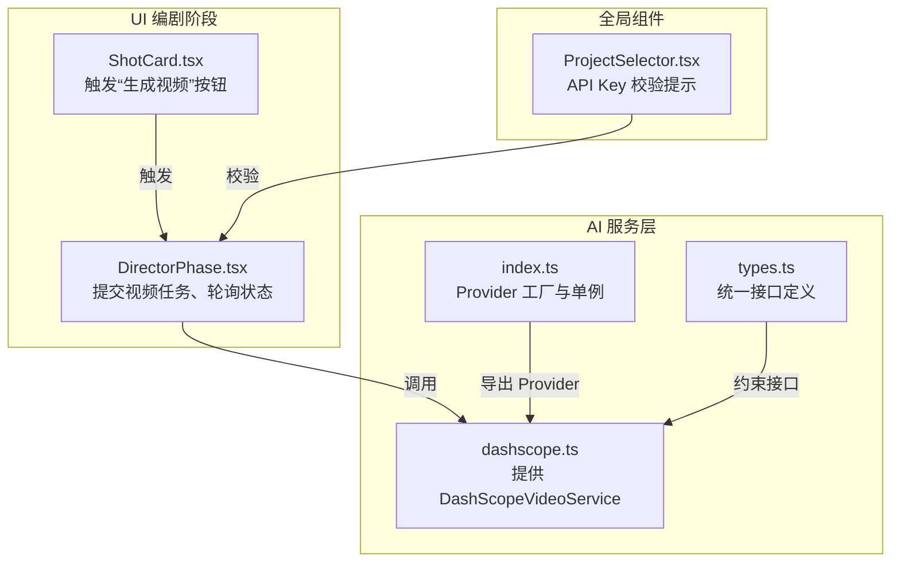
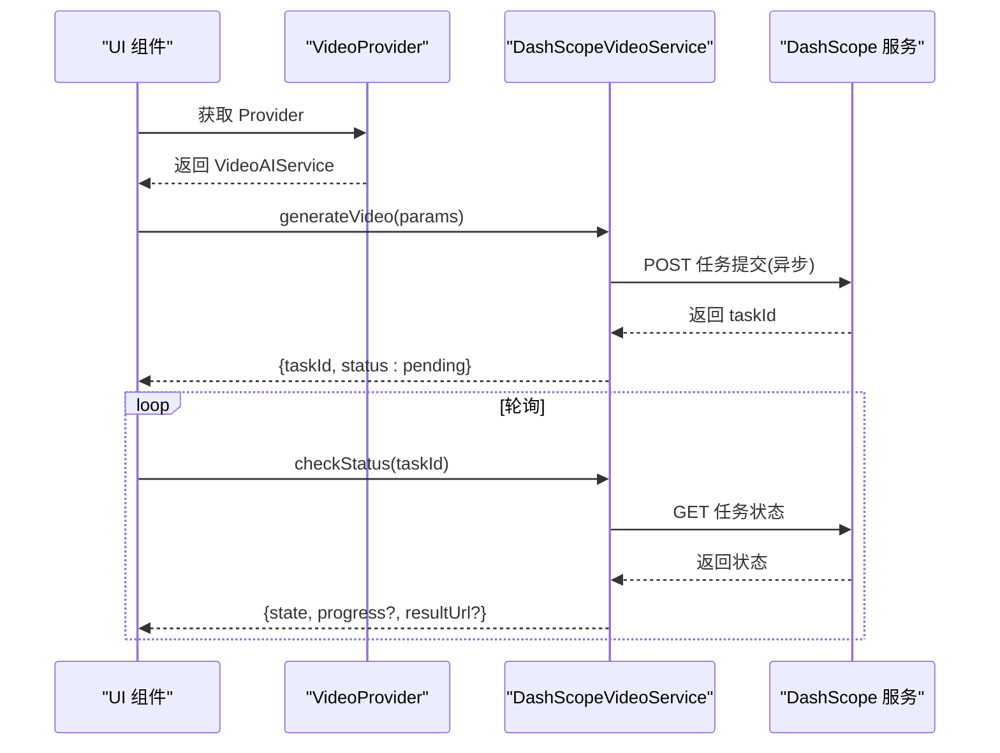
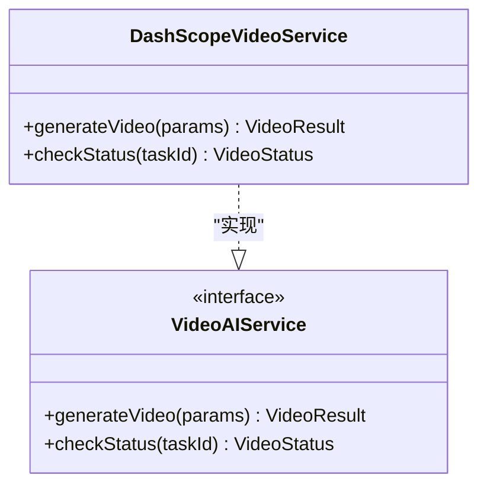
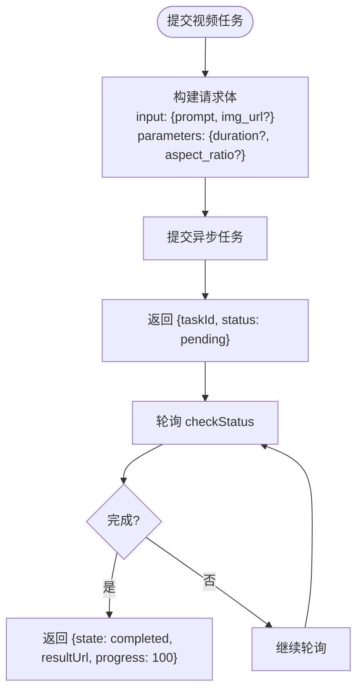
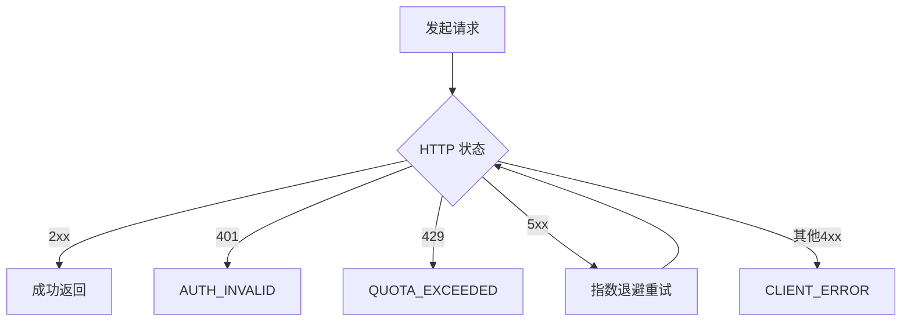
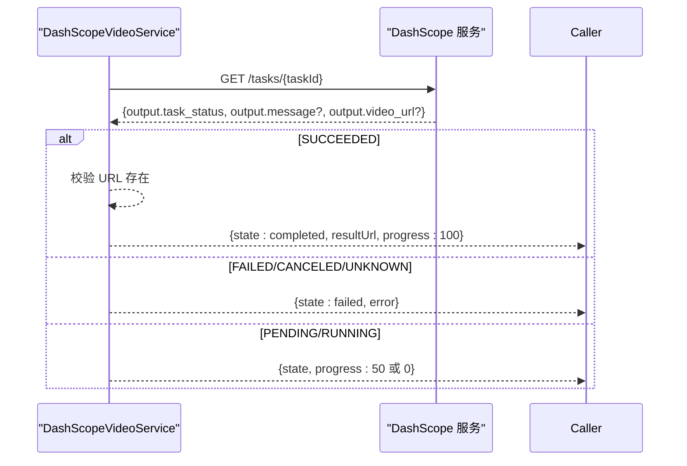
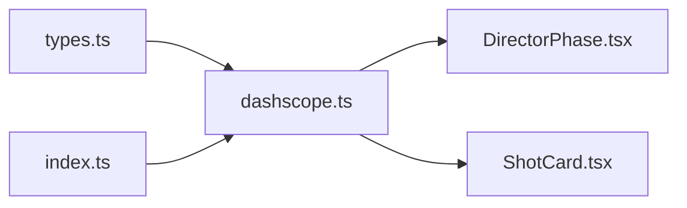

# 通义千问视频适配器

<cite>
**本文引用的文件**
- [dashscope.ts](file://src/services/ai/dashscope.ts)
- [index.ts](file://src/services/ai/index.ts)
- [types.ts](file://src/services/ai/types.ts)
- [DirectorPhase.tsx](file://src/phases/director/DirectorPhase.tsx)
- [ShotCard.tsx](file://src/phases/director/components/ShotCard.tsx)
- [ProjectSelector.tsx](file://src/shared/components/ProjectSelector.tsx)
</cite>

## 目录
1. [简介](#简介)
2. [项目结构](#项目结构)
3. [核心组件](#核心组件)
4. [架构总览](#架构总览)
5. [详细组件分析](#详细组件分析)
6. [依赖关系分析](#依赖关系分析)
7. [性能考虑](#性能考虑)
8. [故障排除指南](#故障排除指南)
9. [结论](#结论)
10. [附录](#附录)

## 简介
本文件为“通义千问视频适配器”的技术文档，聚焦于 DashScope 视频生成能力在统一适配器框架中的集成与使用。文档涵盖以下内容：
- DashScope 视频适配器的特有功能与参数映射
- 认证机制、请求限制与响应处理流程
- 配置指南、参数映射规则与性能优化建议
- 使用示例与常见问题排查

该适配器采用统一的 AI Provider 架构，将 DashScope 的文本、图像与视频服务能力以一致的接口暴露，便于前端与业务流程复用。

## 项目结构
DashScope 视频适配器位于 AI 服务层，与 UI 编剧阶段（Director Phase）协作，形成“参数提交 → 异步任务轮询 → 结果回填”的完整链路。

**图表来源**
- [dashscope.ts:258-315](file://src/services/ai/dashscope.ts#L258-L315)
- [types.ts:40-63](file://src/services/ai/types.ts#L40-L63)
- [index.ts:24-33](file://src/services/ai/index.ts#L24-L33)
- [DirectorPhase.tsx:128-158](file://src/phases/director/DirectorPhase.tsx#L128-L158)
- [ShotCard.tsx:232-265](file://src/phases/director/components/ShotCard.tsx#L232-L265)
- [ProjectSelector.tsx:114-137](file://src/shared/components/ProjectSelector.tsx#L114-L137)

**章节来源**
- [dashscope.ts:1-327](file://src/services/ai/dashscope.ts#L1-L327)
- [types.ts:1-73](file://src/services/ai/types.ts#L1-L73)
- [index.ts:1-34](file://src/services/ai/index.ts#L1-L34)
- [DirectorPhase.tsx:31-159](file://src/phases/director/DirectorPhase.tsx#L31-L159)
- [ShotCard.tsx:232-265](file://src/phases/director/components/ShotCard.tsx#L232-L265)
- [ProjectSelector.tsx:114-140](file://src/shared/components/ProjectSelector.tsx#L114-L140)

## 核心组件
- DashScopeVideoService：实现 VideoAIService 接口，负责视频生成任务提交与状态查询。
- Provider 工厂：createDashScopeProvider 返回包含 text/image/video 三类服务的 Provider 单例。
- 统一接口类型：VideoParams、VideoResult、VideoStatus 定义了视频生成的输入、输出与状态语义。

关键职责与行为：
- 提交视频生成任务：generateVideo 将参数映射为 DashScope 请求体，并开启异步任务，立即返回 taskId 与初始状态。
- 查询任务状态：checkStatus 通过 taskId 拉取任务状态，映射为统一状态枚举，并在完成时返回结果 URL。
- 错误与超时处理：内置重试、超时与状态映射，确保 UI 可靠感知。

**章节来源**
- [dashscope.ts:258-315](file://src/services/ai/dashscope.ts#L258-L315)
- [types.ts:40-63](file://src/services/ai/types.ts#L40-L63)
- [index.ts:24-33](file://src/services/ai/index.ts#L24-L33)

## 架构总览
DashScope 视频适配器遵循“统一接口 + 厂商适配”的设计，前端通过 Provider 获取 VideoAIService，无需关心底层厂商细节。

**图表来源**
- [dashscope.ts:258-315](file://src/services/ai/dashscope.ts#L258-L315)
- [index.ts:24-33](file://src/services/ai/index.ts#L24-L33)

## 详细组件分析

### DashScopeVideoService 组件
- 输入参数映射：prompt、imageUrl、duration、aspectRatio 映射至 DashScope 请求体的 input 与 parameters 字段。
- 输出结构：立即返回 taskId 与初始状态 pending；完成时通过 checkStatus 返回 resultUrl。
- 状态映射：PENDING/RUNNING/SUCCEEDED 映射为 pending/processing/completed；FAILED/CANCELED/UNKNOWN 映射为 failed。
- 超时与重试：轮询最大等待时间与间隔固定，网络错误与 5xx 自动指数退避重试。

**图表来源**
- [dashscope.ts:258-315](file://src/services/ai/dashscope.ts#L258-L315)
- [types.ts:60-63](file://src/services/ai/types.ts#L60-L63)

**章节来源**
- [dashscope.ts:258-315](file://src/services/ai/dashscope.ts#L258-L315)
- [types.ts:40-63](file://src/services/ai/types.ts#L40-L63)

### 参数映射与配置
- 视频生成参数
  - prompt：视频主题描述，必填。
  - imageUrl：首帧图像 URL，用于引导风格一致性。
  - duration：视频时长（秒），可选。
  - aspectRatio：画幅比例，可选。
- Provider 配置
  - Provider 工厂在首次访问时创建单例，内部包含 text/image/video 三类服务。
- UI 集成
  - 编剧阶段在点击“生成视频”后，乐观地将状态标记为 pending，并提交任务。
  - 任务完成后，将结果 URL 回填至对应镜头的关键帧记录。

**图表来源**
- [dashscope.ts:258-315](file://src/services/ai/dashscope.ts#L258-L315)
- [DirectorPhase.tsx:128-158](file://src/phases/director/DirectorPhase.tsx#L128-L158)

**章节来源**
- [dashscope.ts:258-315](file://src/services/ai/dashscope.ts#L258-L315)
- [DirectorPhase.tsx:128-158](file://src/phases/director/DirectorPhase.tsx#L128-L158)
- [ShotCard.tsx:232-265](file://src/phases/director/components/ShotCard.tsx#L232-L265)

### 认证机制与请求限制
- 认证方式：所有请求均携带 Bearer Token（API Key），通过 Authorization 头传递。
- 请求头：异步任务提交需包含 X-DashScope-Async: enable。
- 错误码映射：
  - 401：AUTH_INVALID（API Key 无效或过期）
  - 429：QUOTA_EXCEEDED（请求过于频繁或配额超限）
  - 5xx：SERVER_ERROR（服务端错误，自动重试）
  - 其他 4xx：CLIENT_ERROR（客户端错误）
- 重试策略：最多三次，指数退避（2^attempt），仅对 5xx 与网络异常进行重试。

**图表来源**
- [dashscope.ts:58-93](file://src/services/ai/dashscope.ts#L58-L93)

**章节来源**
- [dashscope.ts:39-52](file://src/services/ai/dashscope.ts#L39-L52)
- [dashscope.ts:58-93](file://src/services/ai/dashscope.ts#L58-L93)

### 响应处理流程
- 任务提交：返回 taskId；若未返回 taskId，抛出 TASK_SUBMIT_FAILED。
- 任务轮询：根据 task_status 映射状态；完成时提取 video_url 或 results[0].url。
- 完成条件：state 为 completed 且存在有效 URL。
- 失败条件：state 为 failed 或超时（超过最大等待时间）。

**图表来源**
- [dashscope.ts:176-199](file://src/services/ai/dashscope.ts#L176-L199)
- [dashscope.ts:289-314](file://src/services/ai/dashscope.ts#L289-L314)

**章节来源**
- [dashscope.ts:176-199](file://src/services/ai/dashscope.ts#L176-L199)
- [dashscope.ts:289-314](file://src/services/ai/dashscope.ts#L289-L314)

## 依赖关系分析
- 组件耦合
  - DashScopeVideoService 依赖统一接口类型（VideoParams/VideoResult/VideoStatus）与 Provider 工厂。
  - UI 层通过 Provider 获取 VideoAIService，降低对具体厂商的耦合。
- 外部依赖
  - DashScope Native API：任务提交与状态查询。
  - 浏览器/Node fetch：网络请求与重试包装。
- 循环依赖
  - 无直接循环依赖；Provider 单例在 index.ts 中创建，避免相互引用。

**图表来源**
- [types.ts:40-63](file://src/services/ai/types.ts#L40-L63)
- [index.ts:24-33](file://src/services/ai/index.ts#L24-L33)
- [dashscope.ts:258-315](file://src/services/ai/dashscope.ts#L258-L315)
- [DirectorPhase.tsx:128-158](file://src/phases/director/DirectorPhase.tsx#L128-L158)
- [ShotCard.tsx:232-265](file://src/phases/director/components/ShotCard.tsx#L232-L265)

**章节来源**
- [types.ts:40-63](file://src/services/ai/types.ts#L40-L63)
- [index.ts:24-33](file://src/services/ai/index.ts#L24-L33)
- [dashscope.ts:258-315](file://src/services/ai/dashscope.ts#L258-L315)
- [DirectorPhase.tsx:128-158](file://src/phases/director/DirectorPhase.tsx#L128-L158)
- [ShotCard.tsx:232-265](file://src/phases/director/components/ShotCard.tsx#L232-L265)

## 性能考虑
- 轮询策略
  - 固定轮询间隔与最大等待时间，避免过度拉取导致资源浪费。
- 重试策略
  - 仅对 5xx 与网络异常进行重试，减少无效请求。
- 并发控制
  - UI 层按需轮询，避免同时对大量 taskId 轮询；可结合节流与去重策略。
- 资源回填
  - 任务完成后尽快回填 URL，减少重复查询成本。

[本节为通用性能建议，不直接分析具体文件]

## 故障排除指南
- 缺少 API Key
  - 现象：初始化 Provider 时抛出认证错误。
  - 处理：在“模型配置”中填写 DashScope API Key。
- 任务提交失败
  - 现象：未返回 taskId，抛出 TASK_SUBMIT_FAILED。
  - 处理：检查请求体字段与网络连通性，确认模型与参数合法。
- 任务超时
  - 现象：超过最大等待时间仍未完成，抛出 TASK_TIMEOUT。
  - 处理：适当延长等待时间或调整参数（如缩短时长、降低分辨率）。
- 任务失败
  - 现象：checkStatus 返回 failed，附带错误信息。
  - 处理：根据错误信息调整 prompt、时长或比例等参数。
- 401/429 错误
  - 现象：AUTH_INVALID 或 QUOTA_EXCEEDED。
  - 处理：检查 API Key 有效性与配额情况，降低请求频率。

**章节来源**
- [dashscope.ts:39-52](file://src/services/ai/dashscope.ts#L39-L52)
- [dashscope.ts:167-173](file://src/services/ai/dashscope.ts#L167-L173)
- [dashscope.ts:201-216](file://src/services/ai/dashscope.ts#L201-L216)
- [dashscope.ts:289-314](file://src/services/ai/dashscope.ts#L289-L314)
- [ProjectSelector.tsx:114-137](file://src/shared/components/ProjectSelector.tsx#L114-L137)

## 结论
DashScope 视频适配器通过统一接口与稳定的异步任务轮询机制，实现了与 UI 编剧阶段的无缝衔接。其参数映射清晰、错误处理完备、重试与超时策略合理，适合在批量生成场景中使用。建议在生产环境中配合并发控制与缓存策略，进一步提升稳定性与性能。

[本节为总结性内容，不直接分析具体文件]

## 附录

### 配置指南
- 在“模型配置”中设置以下项：
  - apiKey：DashScope API Key
  - videoModel：视频模型名称（例如万象视频合成模型）
- 提交视频任务前，确保已生成首帧图像并传入 imageUrl，以提升风格一致性。

**章节来源**
- [dashscope.ts:39-45](file://src/services/ai/dashscope.ts#L39-L45)
- [DirectorPhase.tsx:128-158](file://src/phases/director/DirectorPhase.tsx#L128-L158)

### 参数映射规则
- 输入参数
  - prompt → input.prompt
  - imageUrl → input.img_url
  - duration → parameters.duration
  - aspectRatio → parameters.aspect_ratio
- 输出状态
  - completed：返回 resultUrl 与 progress=100
  - failed：返回 error
  - processing/pending：返回 progress≈50/0

**章节来源**
- [dashscope.ts:258-315](file://src/services/ai/dashscope.ts#L258-L315)
- [types.ts:40-63](file://src/services/ai/types.ts#L40-L63)

### 使用示例（步骤说明）
- 步骤 1：在 UI 中点击“生成视频”
- 步骤 2：提交任务并获得 taskId
- 步骤 3：定时轮询 checkStatus，直到完成
- 步骤 4：回填结果 URL 到项目数据

**章节来源**
- [DirectorPhase.tsx:128-158](file://src/phases/director/DirectorPhase.tsx#L128-L158)
- [ShotCard.tsx:232-265](file://src/phases/director/components/ShotCard.tsx#L232-L265)
- [dashscope.ts:289-314](file://src/services/ai/dashscope.ts#L289-L314)