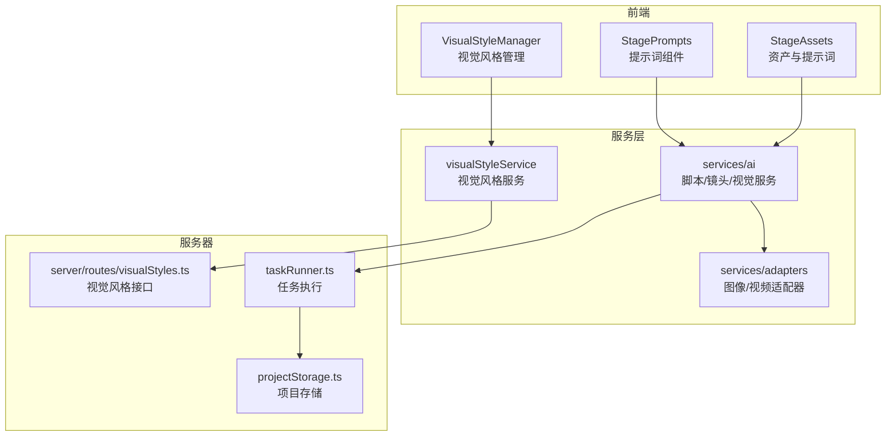
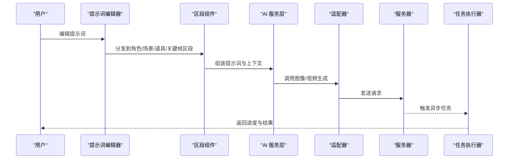
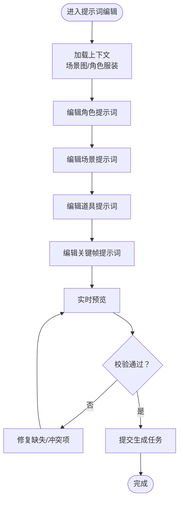
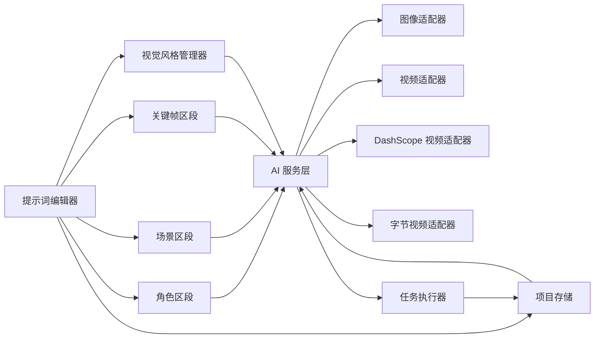

# 提示词工程

<cite>
**本文引用的文件**
- [README.md](file://README.md)
- [README_EN.md](file://README_EN.md)
- [StagePrompts 组件索引](file://components/StagePrompts/index.tsx)
- [提示词组件常量](file://components/StagePrompts/constants.ts)
- [提示词工具函数](file://components/StagePrompts/utils.ts)
- [提示词编辑器](file://components/StagePrompts/PromptEditor.tsx)
- [角色提示词区段](file://components/StagePrompts/CharacterSection.tsx)
- [场景提示词区段](file://components/StagePrompts/SceneSection.tsx)
- [道具提示词区段](file://components/StagePrompts/PropSection.tsx)
- [关键帧提示词区段](file://components/StagePrompts/KeyframeSection.tsx)
- [可折叠区段](file://components/StagePrompts/CollapsibleSection.tsx)
- [状态徽章](file://components/StagePrompts/StatusBadge.tsx)
- [视觉风格管理器](file://components/VisualStyleManager.tsx)
- [AI 服务入口](file://services/ai/index.ts)
- [脚本服务](file://services/ai/scriptService.ts)
- [镜头服务](file://services/ai/shotService.ts)
- [视觉服务](file://services/ai/visualService.ts)
- [AI 适配器集合](file://services/adapters/index.ts)
- [图像适配器](file://services/adapters/imageAdapter.ts)
- [视频适配器](file://services/adapters/videoAdapter.ts)
- [DashScope 视频适配器](file://services/adapters/dashscopeVideoAdapter.ts)
- [字节视频适配器](file://services/adapters/volcengineVideoAdapter.ts)
- [视觉风格服务](file://services/visualStyleService.ts)
- [服务器路由：视觉风格](file://server/src/routes/visualStyles.ts)
- [服务器服务：任务运行器](file://server/src/services/taskRunner.ts)
- [服务器服务：项目存储](file://server/src/services/projectStorage.ts)
</cite>

## 目录
1. [简介](#简介)
2. [项目结构](#项目结构)
3. [核心组件](#核心组件)
4. [架构总览](#架构总览)
5. [详细组件分析](#详细组件分析)
6. [依赖关系分析](#依赖关系分析)
7. [性能考量](#性能考量)
8. [故障排查指南](#故障排查指南)
9. [结论](#结论)
10. [附录](#附录)

## 简介
本文件面向提示词工程，系统性阐述提示词设计原则、提示词模板体系、优化策略与实践方法。结合项目中的“提示词管理”“角色/场景/道具/关键帧提示词区段”“视觉风格管理”“提示词编辑器”等模块，给出从设计到落地、从编辑到评估的完整流程说明，并提供调试与优化建议。

## 项目结构
提示词工程相关的核心模块主要分布在以下位置：
- 前端组件层：components/StagePrompts（提示词编辑与展示）、components/StageAssets（资产与提示词关联）、components/VisualStyleManager（视觉风格管理）
- 服务层：services/ai（脚本/镜头/视觉服务）、services/adapters（图像/视频适配器）、services/visualStyleService（视觉风格服务）
- 服务器层：server/src/routes/visualStyles.ts（视觉风格接口）、server/src/services/taskRunner.ts（任务执行）、server/src/services/projectStorage.ts（项目持久化）

图表来源
- [StagePrompts 组件索引](file://components/StagePrompts/index.tsx)
- [视觉风格管理器](file://components/VisualStyleManager.tsx)
- [AI 服务入口](file://services/ai/index.ts)
- [AI 适配器集合](file://services/adapters/index.ts)
- [视觉风格服务](file://services/visualStyleService.ts)
- [服务器路由：视觉风格](file://server/src/routes/visualStyles.ts)
- [服务器服务：任务运行器](file://server/src/services/taskRunner.ts)
- [服务器服务：项目存储](file://server/src/services/projectStorage.ts)

章节来源
- [README.md: 47-48:47-48](file://README.md#L47-L48)
- [README_EN.md: 35-36:35-36](file://README_EN.md#L35-L36)

## 核心组件
- 提示词编辑器：提供可视化编辑、分段管理、状态反馈与实时预览能力，支撑角色、场景、道具、关键帧等维度的提示词编写。
- 提示词区段组件：角色/场景/道具/关键帧四个区段，分别承载对应维度的提示词输入、校验与渲染。
- 可折叠区段与状态徽章：提升复杂提示词面板的可读性与可维护性。
- 视觉风格管理器：统一管理风格标签、风格权重与风格组合，确保生成一致性。
- 适配器层：封装图像/视频生成接口，屏蔽底层模型差异，便于扩展与替换。

章节来源
- [提示词编辑器](file://components/StagePrompts/PromptEditor.tsx)
- [角色提示词区段](file://components/StagePrompts/CharacterSection.tsx)
- [场景提示词区段](file://components/StagePrompts/SceneSection.tsx)
- [道具提示词区段](file://components/StagePrompts/PropSection.tsx)
- [关键帧提示词区段](file://components/StagePrompts/KeyframeSection.tsx)
- [可折叠区段](file://components/StagePrompts/CollapsibleSection.tsx)
- [状态徽章](file://components/StagePrompts/StatusBadge.tsx)
- [视觉风格管理器](file://components/VisualStyleManager.tsx)

## 架构总览
提示词工程采用“前端组件 + 服务层适配 + 后端接口”的分层架构。前端通过提示词编辑器与区段组件收集用户输入，服务层将提示词转换为模型可理解的格式并通过适配器调用具体模型，最终由任务执行器与项目存储完成生成与持久化。

图表来源
- [提示词编辑器](file://components/StagePrompts/PromptEditor.tsx)
- [角色提示词区段](file://components/StagePrompts/CharacterSection.tsx)
- [场景提示词区段](file://components/StagePrompts/SceneSection.tsx)
- [道具提示词区段](file://components/StagePrompts/PropSection.tsx)
- [关键帧提示词区段](file://components/StagePrompts/KeyframeSection.tsx)
- [AI 服务入口](file://services/ai/index.ts)
- [AI 适配器集合](file://services/adapters/index.ts)
- [服务器服务：任务运行器](file://server/src/services/taskRunner.ts)

## 详细组件分析

### 提示词编辑器
- 功能特性
  - 多区段协同：将角色、场景、道具、关键帧提示词分块管理，避免信息过载。
  - 实时预览：编辑过程中即时反映到生成预览，辅助快速迭代。
  - 状态反馈：通过状态徽章提示是否已配置、是否可生成等。
  - 批量处理：支持对多个区段进行批量启用/禁用、复制/粘贴、清空等操作。
- 设计原则
  - 结构化提示词：以“主语+属性+风格+约束”四要素组织提示词，确保可解释与可复用。
  - 上下文增强：自动注入当前场景图与角色特定服装图，提升生成一致性。
  - 权重与修饰：允许为风格、光照、情绪等添加权重，平衡关键词影响。
- 使用方法
  - 先填写角色与场景基础信息，再逐步细化道具与关键帧。
  - 使用可折叠区段隐藏次要细节，聚焦当前关注点。
  - 利用状态徽章快速定位未完成或异常的区段。

图表来源
- [提示词编辑器](file://components/StagePrompts/PromptEditor.tsx)
- [可折叠区段](file://components/StagePrompts/CollapsibleSection.tsx)
- [状态徽章](file://components/StagePrompts/StatusBadge.tsx)

章节来源
- [提示词编辑器](file://components/StagePrompts/PromptEditor.tsx)
- [可折叠区段](file://components/StagePrompts/CollapsibleSection.tsx)
- [状态徽章](file://components/StagePrompts/StatusBadge.tsx)

### 角色提示词区段
- 职责：管理角色外观、服装、动作与情绪等提示词。
- 关键点：与角色参考图联动，确保生成一致性；支持多套造型（如日常、战斗、受伤）的风格切换。
- 优化策略：将“身份特征”与“风格修饰”分离，优先稳定身份，再叠加风格。

章节来源
- [角色提示词区段](file://components/StagePrompts/CharacterSection.tsx)

### 场景提示词区段
- 职责：管理场景环境、光照、氛围与背景等提示词。
- 关键点：与场景概念图联动，保证跨镜头光照与构图一致。
- 优化策略：明确主光源方向与色温，避免生成中出现光污染或阴影不连贯。

章节来源
- [场景提示词区段](file://components/StagePrompts/SceneSection.tsx)

### 道具提示词区段
- 职责：管理道具的形态、材质、位置与交互等提示词。
- 关键点：与场景布局一致，避免漂浮或穿透。
- 优化策略：将“功能性”与“装饰性”道具分开描述，减少相互干扰。

章节来源
- [道具提示词区段](file://components/StagePrompts/PropSection.tsx)

### 关键帧提示词区段
- 职责：管理起始帧与结束帧的差异提示词，支持首尾帧插值生成。
- 关键点：明确“变化量”而非“全量描述”，减少冗余信息。
- 优化策略：以“小步快跑”的方式逐步推进变化，便于回溯与微调。

章节来源
- [关键帧提示词区段](file://components/StagePrompts/KeyframeSection.tsx)

### 视觉风格提示词
- 定义：用于统一画面风格、色调、质感与情绪表达的提示词集合。
- 分类与使用
  - 风格标签：如“赛博朋克”“水彩画风”“电影感”等，作为主风格锚点。
  - 风格权重：为不同风格元素分配强度，平衡整体观感。
  - 风格组合：支持多风格叠加，注意避免风格冲突。
- 管理方式：通过视觉风格管理器集中维护，支持导入/导出与版本对比。

章节来源
- [视觉风格管理器](file://components/VisualStyleManager.tsx)

### 负面提示词
- 定义：用于排除不期望元素的提示词，如“模糊、变形、低质量、文字”等。
- 使用原则
  - 与正面提示词形成互补，避免“过度否定”导致生成不稳定。
  - 在关键帧变化处谨慎使用，防止抑制必要的细节变化。
- 最佳实践：将负面提示词收敛为固定清单，按项目风格统一维护。

章节来源
- [提示词工具函数](file://components/StagePrompts/utils.ts)

### 场景描述提示词
- 定义：对场景环境、时间、天气与氛围的综合描述。
- 使用方法
  - 以“地点+时间+天气+氛围”四维结构组织，确保生成空间与时间感。
  - 与角色与道具提示词联动，避免时空错位。
- 优化策略：在关键帧边界处强调“过渡态”，帮助模型平滑插值。

章节来源
- [场景提示词区段](file://components/StagePrompts/SceneSection.tsx)

### 提示词库管理与模板系统
- 提示词库：集中存储常用提示词片段，支持按类别（角色、场景、道具、关键帧）检索与复用。
- 自定义模板：支持将常用提示词组合保存为模板，一键应用到新项目或新镜头。
- 版本与共享：模板支持版本管理与团队共享，避免重复劳动。

章节来源
- [提示词组件常量](file://components/StagePrompts/constants.ts)
- [提示词工具函数](file://components/StagePrompts/utils.ts)

### 提示词效果评估方法
- 定性评估：对比生成结果与预期描述的匹配度，记录常见偏差类型（如风格偏移、细节缺失）。
- 定量评估：建立评分维度（风格一致性、细节准确度、构图合理性），对多轮生成进行打分与排序。
- 回归测试：对关键镜头建立回归集，定期验证提示词稳定性与可复现性。

章节来源
- [提示词编辑器](file://components/StagePrompts/PromptEditor.tsx)
- [AI 服务入口](file://services/ai/index.ts)

### 提示词优化策略
- 结构化设计：遵循“主语+属性+风格+约束”的结构，提升可解释性与可复用性。
- 渐进式细化：先稳定主体，再叠加风格与细节；在关键帧处强调变化量。
- 上下文感知：充分利用场景图与角色服装图，减少生成歧义。
- 负面提示词收敛：统一负面清单，避免过度否定。
- 批量处理与模板化：通过模板与批量操作提升效率，降低重复劳动。

章节来源
- [提示词编辑器](file://components/StagePrompts/PromptEditor.tsx)
- [角色提示词区段](file://components/StagePrompts/CharacterSection.tsx)
- [场景提示词区段](file://components/StagePrompts/SceneSection.tsx)
- [道具提示词区段](file://components/StagePrompts/PropSection.tsx)
- [关键帧提示词区段](file://components/StagePrompts/KeyframeSection.tsx)

## 依赖关系分析
提示词工程的依赖关系围绕“提示词编辑器”展开，向上连接到“区段组件”“视觉风格管理器”，向下通过“AI 服务层”与“适配器层”对接具体模型，最终由“任务执行器”与“项目存储”完成生成与持久化。

图表来源
- [提示词编辑器](file://components/StagePrompts/PromptEditor.tsx)
- [角色提示词区段](file://components/StagePrompts/CharacterSection.tsx)
- [场景提示词区段](file://components/StagePrompts/SceneSection.tsx)
- [道具提示词区段](file://components/StagePrompts/PropSection.tsx)
- [关键帧提示词区段](file://components/StagePrompts/KeyframeSection.tsx)
- [视觉风格管理器](file://components/VisualStyleManager.tsx)
- [AI 服务入口](file://services/ai/index.ts)
- [AI 适配器集合](file://services/adapters/index.ts)
- [图像适配器](file://services/adapters/imageAdapter.ts)
- [视频适配器](file://services/adapters/videoAdapter.ts)
- [DashScope 视频适配器](file://services/adapters/dashscopeVideoAdapter.ts)
- [字节视频适配器](file://services/adapters/volcengineVideoAdapter.ts)
- [服务器服务：任务运行器](file://server/src/services/taskRunner.ts)
- [服务器服务：项目存储](file://server/src/services/projectStorage.ts)

章节来源
- [AI 服务入口](file://services/ai/index.ts)
- [AI 适配器集合](file://services/adapters/index.ts)
- [服务器服务：任务运行器](file://server/src/services/taskRunner.ts)
- [服务器服务：项目存储](file://server/src/services/projectStorage.ts)

## 性能考量
- 提示词长度与复杂度：过长或过于复杂的提示词会增加模型负担，建议拆分为多个短句并分段管理。
- 上下文大小限制：在关键帧插值场景中，尽量精简提示词，避免超出模型上下文上限。
- 批量生成策略：对相似镜头采用模板化与参数化，减少重复计算。
- 适配器选择：根据生成目标（图像/视频）与质量要求选择合适适配器，避免不必要的资源浪费。

## 故障排查指南
- 生成结果与预期不符
  - 检查提示词结构是否清晰，是否存在冲突描述。
  - 核对负面提示词是否过度否定。
  - 确认上下文（场景图/角色服装图）是否正确注入。
- 风格不一致
  - 统一视觉风格标签与权重，避免多风格叠加冲突。
  - 对关键帧边界处的风格过渡进行重点标注。
- 生成速度慢
  - 减少提示词长度与复杂度，优先使用模板化与参数化。
  - 选择合适的适配器与分辨率，平衡质量与性能。
- 任务未完成
  - 查看任务执行器日志，确认是否有错误码或超时。
  - 检查项目存储是否正常，避免数据损坏导致任务中断。

章节来源
- [提示词编辑器](file://components/StagePrompts/PromptEditor.tsx)
- [视觉风格管理器](file://components/VisualStyleManager.tsx)
- [服务器服务：任务运行器](file://server/src/services/taskRunner.ts)
- [服务器服务：项目存储](file://server/src/services/projectStorage.ts)

## 结论
提示词工程是实现高质量、可控生成的关键。通过结构化的提示词设计、模板化与批量处理、上下文感知与风格统一管理，可以显著提升生成一致性与效率。建议在项目中建立标准化的提示词规范与评估机制，持续迭代优化。

## 附录
- 快速上手步骤
  - 在提示词编辑器中依次填写角色、场景、道具与关键帧提示词。
  - 使用可折叠区段与状态徽章管理复杂提示词。
  - 应用视觉风格管理器统一风格标签与权重。
  - 通过模板与批量操作提升效率。
- 推荐阅读
  - [提示词编辑器](file://components/StagePrompts/PromptEditor.tsx)
  - [视觉风格管理器](file://components/VisualStyleManager.tsx)
  - [AI 服务入口](file://services/ai/index.ts)
  - [AI 适配器集合](file://services/adapters/index.ts)
  - [服务器路由：视觉风格](file://server/src/routes/visualStyles.ts)