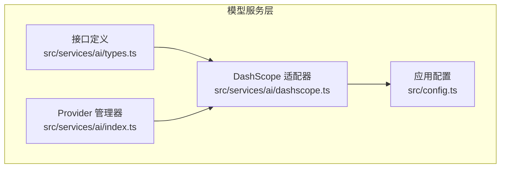
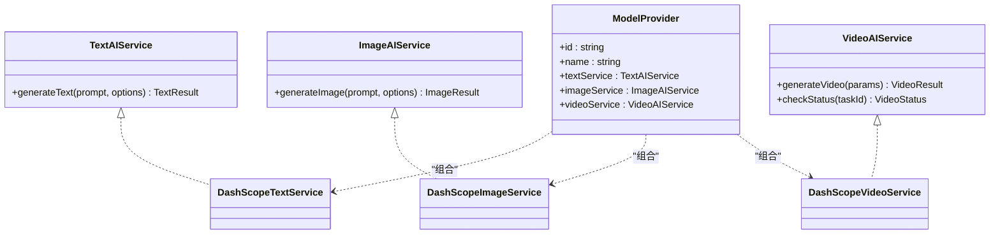
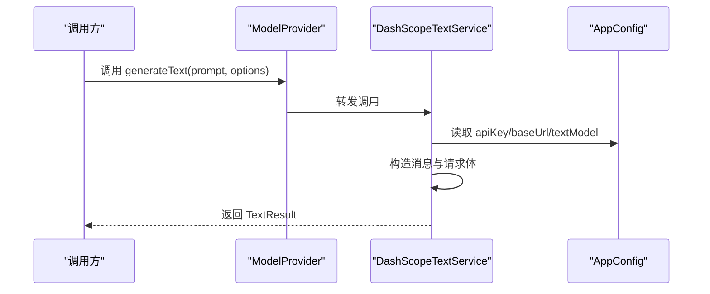
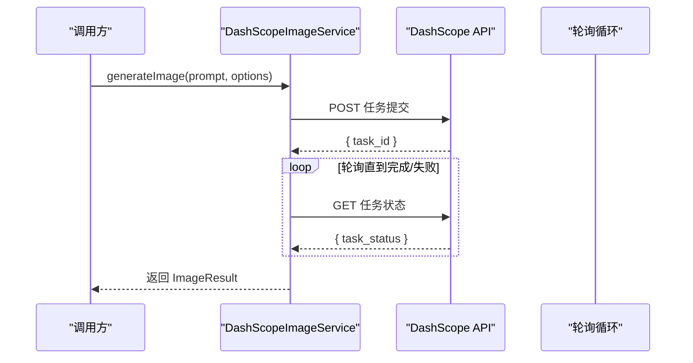
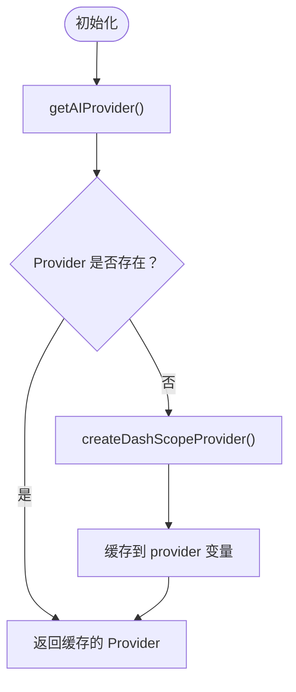
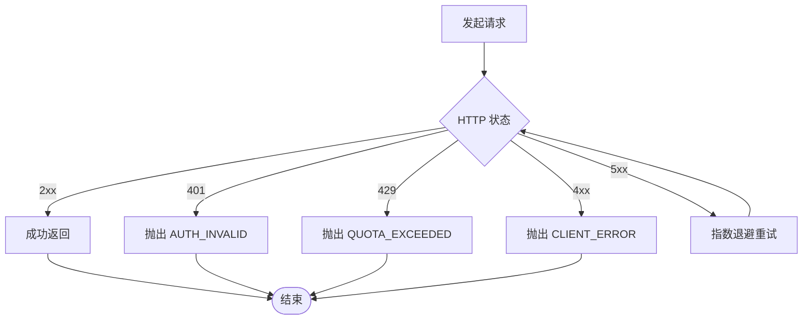
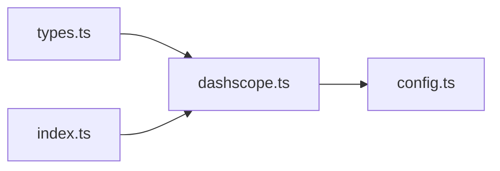

# 模型服务层

<cite>
**本文引用的文件**
- [src/services/ai/types.ts](file://src/services/ai/types.ts)
- [src/services/ai/dashscope.ts](file://src/services/ai/dashscope.ts)
- [src/services/ai/index.ts](file://src/services/ai/index.ts)
- [src/config.ts](file://src/config.ts)
- [README.md](file://README.md)
</cite>

## 目录
1. [简介](#简介)
2. [项目结构](#项目结构)
3. [核心组件](#核心组件)
4. [架构总览](#架构总览)
5. [详细组件分析](#详细组件分析)
6. [依赖关系分析](#依赖关系分析)
7. [性能考量](#性能考量)
8. [故障排除指南](#故障排除指南)
9. [结论](#结论)
10. [附录](#附录)

## 简介
本文件系统性梳理模型服务层的设计与实现，重点覆盖以下方面：
- 统一接口设计：文本、图像、视频三类AI能力的抽象与契约
- 适配器实现：以 DashScope（阿里云通义/万相/万象）为例的适配器层
- 配置管理：集中式配置与运行时更新
- 调用协调机制：同步与异步调用模式、轮询与状态查询、超时与重试策略
- 错误处理与可观测性：错误分类、日志与告警建议、性能监控要点
- 使用示例与最佳实践：如何在应用中集成与正确使用模型服务
- 故障排除：常见问题定位与修复路径

## 项目结构
模型服务层位于前端 src/services/ai 目录，采用“接口定义 + 适配器实现 + Provider 管理器”的分层组织方式：
- 接口定义：统一文本、图像、视频服务的输入输出与行为契约
- 适配器实现：以 DashScope 为例的具体厂商适配，包含同步与异步调用细节
- Provider 管理器：提供全局单例的模型提供商访问入口，支持重置与切换

**图表来源**
- [src/services/ai/types.ts:1-73](file://src/services/ai/types.ts#L1-L73)
- [src/services/ai/dashscope.ts:1-327](file://src/services/ai/dashscope.ts#L1-L327)
- [src/services/ai/index.ts:1-34](file://src/services/ai/index.ts#L1-L34)
- [src/config.ts:1-47](file://src/config.ts#L1-L47)

**章节来源**
- [src/services/ai/types.ts:1-73](file://src/services/ai/types.ts#L1-L73)
- [src/services/ai/dashscope.ts:1-327](file://src/services/ai/dashscope.ts#L1-L327)
- [src/services/ai/index.ts:1-34](file://src/services/ai/index.ts#L1-L34)
- [src/config.ts:1-47](file://src/config.ts#L1-L47)
- [README.md:111-140](file://README.md#L111-L140)

## 核心组件
- 统一接口契约
  - 文本服务：generateText(prompt, options?) -> TextResult
  - 图像服务：generateImage(prompt, options?) -> ImageResult
  - 视频服务：generateVideo(params?) -> VideoResult；checkStatus(taskId?) -> VideoStatus
- Provider 工厂与管理器
  - createDashScopeProvider() 返回包含 text/image/video 三类服务的 Provider
  - getAIProvider()/resetProvider() 提供全局单例与重置能力
- 配置中心
  - AppConfig.ai: apiKey、baseUrl、textModel、imageModel、videoModel
  - 提供 getConfig()/setConfig()/setApiKey()/hasApiKey()

**章节来源**
- [src/services/ai/types.ts:6-72](file://src/services/ai/types.ts#L6-L72)
- [src/services/ai/index.ts:5-33](file://src/services/ai/index.ts#L5-L33)
- [src/config.ts:6-46](file://src/config.ts#L6-L46)

## 架构总览
模型服务层遵循“开放系统设计”理念，通过统一接口屏蔽厂商差异，适配器层负责具体实现，Provider 管理器提供集中化的访问入口。

**图表来源**
- [src/services/ai/types.ts:18-72](file://src/services/ai/types.ts#L18-L72)
- [src/services/ai/dashscope.ts:96-315](file://src/services/ai/dashscope.ts#L96-L315)

## 详细组件分析

### 统一接口设计与职责边界
- 文本服务
  - 输入：prompt（必填）、systemPrompt（可选）、temperature、maxTokens
  - 输出：content（必填）、usage（可选）
- 图像服务
  - 输入：prompt（必填）、width/height、style、negativePrompt、count
  - 输出：url（必填）、revisedPrompt（可选）
- 视频服务
  - 输入：prompt（必填）、imageUrl（可选）、duration（可选）、aspectRatio（可选）
  - 输出：taskId（必填）、status.state/pending/processing/completed/failed
  - 状态查询：checkStatus(taskId) -> VideoStatus

**图表来源**
- [src/services/ai/types.ts:18-20](file://src/services/ai/types.ts#L18-L20)
- [src/services/ai/dashscope.ts:96-139](file://src/services/ai/dashscope.ts#L96-L139)
- [src/config.ts:28-38](file://src/config.ts#L28-L38)

**章节来源**
- [src/services/ai/types.ts:6-72](file://src/services/ai/types.ts#L6-L72)

### DashScope 适配器实现与调用协调
- 文本（同步）
  - 通过兼容模式 /chat/completions 同步返回结果
  - 内置 fetchWithRetry：对 5xx 与网络异常进行指数退避重试，4xx 直接抛错
- 图像（异步 + 轮询）
  - 提交任务后立即返回 taskId，随后轮询任务状态直至完成或失败
  - 轮询间隔与最大等待时间固定，超时抛出 DashScopeError
- 视频（异步 + 状态查询）
  - 提交任务后立即返回 taskId 与初始状态 pending
  - 调用方可自行轮询 checkStatus 或使用内部 waitFor（若需要）

**图表来源**
- [src/services/ai/dashscope.ts:219-255](file://src/services/ai/dashscope.ts#L219-L255)
- [src/services/ai/dashscope.ts:155-216](file://src/services/ai/dashscope.ts#L155-L216)

**章节来源**
- [src/services/ai/dashscope.ts:58-93](file://src/services/ai/dashscope.ts#L58-L93)
- [src/services/ai/dashscope.ts:155-216](file://src/services/ai/dashscope.ts#L155-L216)
- [src/services/ai/dashscope.ts:219-255](file://src/services/ai/dashscope.ts#L219-L255)
- [src/services/ai/dashscope.ts:258-315](file://src/services/ai/dashscope.ts#L258-L315)

### Provider 管理器与配置注入
- Provider 管理器
  - 单例缓存：首次调用 getAIProvider() 创建 DashScopeProvider 并缓存
  - resetProvider() 可清空缓存，便于切换或测试
- 配置注入
  - DashScope 适配器从 AppConfig.ai 读取 apiKey、baseUrl、模型名称
  - setConfig()/setApiKey() 支持运行时更新配置

**图表来源**
- [src/services/ai/index.ts:22-33](file://src/services/ai/index.ts#L22-L33)
- [src/services/ai/dashscope.ts:318-326](file://src/services/ai/dashscope.ts#L318-L326)

**章节来源**
- [src/services/ai/index.ts:22-33](file://src/services/ai/index.ts#L22-L33)
- [src/config.ts:28-46](file://src/config.ts#L28-L46)

### 错误处理机制
- 错误类型与分类
  - AUTH_MISSING/AUTH_INVALID：鉴权相关
  - QUOTA_EXCEEDED：配额/频率限制
  - SERVER_ERROR：服务端 5xx
  - CLIENT_ERROR：客户端 4xx（非 401/429）
  - NETWORK_ERROR：网络异常
  - EMPTY_RESPONSE：返回内容为空
  - TASK_SUBMIT_FAILED/TASK_FAILED/TASK_TIMEOUT：异步任务相关
- 重试策略
  - fetchWithRetry 对 5xx 与网络异常进行最多 N 次指数退避重试
  - 4xx 错误直接抛出 DashScopeError，不进行重试
- 超时与轮询
  - 异步任务最大等待时间固定，超时抛错
  - 轮询间隔固定，避免过度请求

**图表来源**
- [src/services/ai/dashscope.ts:58-93](file://src/services/ai/dashscope.ts#L58-L93)

**章节来源**
- [src/services/ai/dashscope.ts:47-93](file://src/services/ai/dashscope.ts#L47-L93)

### 日志记录与性能监控建议
- 日志记录
  - 请求级别：记录请求 URL、方法、耗时、状态码、请求体摘要
  - 结果级别：记录响应摘要、错误码与错误信息
  - 重试与超时：记录重试次数、退避间隔、最终失败原因
- 性能监控
  - 关键指标：P95/P99 延迟、成功率、重试率、超时率
  - 异步任务：任务提交耗时、轮询次数、平均轮询间隔
  - 成本估算：基于 usage 的 token 消耗统计

[本节为通用指导，无需源码引用]

## 依赖关系分析
- 组件耦合
  - DashScope 适配器依赖 AppConfig（只读配置）
  - Provider 管理器依赖工厂函数 createDashScopeProvider
- 外部依赖
  - fetch API（浏览器/Node 环境）
  - DashScope 兼容模式与原生 API（异步任务）
- 可扩展性
  - 新增 Provider：实现 ModelProvider 接口，注册到管理器
  - 新增服务类型：扩展接口定义与适配器实现

**图表来源**
- [src/services/ai/types.ts:1-73](file://src/services/ai/types.ts#L1-L73)
- [src/services/ai/dashscope.ts:11-24](file://src/services/ai/dashscope.ts#L11-L24)
- [src/services/ai/index.ts:5-6](file://src/services/ai/index.ts#L5-L6)
- [src/config.ts:11-11](file://src/config.ts#L11-L11)

**章节来源**
- [src/services/ai/types.ts:1-73](file://src/services/ai/types.ts#L1-L73)
- [src/services/ai/dashscope.ts:11-24](file://src/services/ai/dashscope.ts#L11-L24)
- [src/services/ai/index.ts:5-6](file://src/services/ai/index.ts#L5-L6)
- [src/config.ts:11-11](file://src/config.ts#L11-L11)

## 性能考量
- 同步 vs 异步
  - 文本：同步调用，延迟低，适合交互场景
  - 图像/视频：异步任务 + 轮询，适合大资源生成
- 轮询优化
  - 固定轮询间隔与最大等待时间，避免过度轮询
  - 调用方可自行控制轮询节奏，减少不必要的请求
- 重试策略
  - 仅对 5xx 与网络异常重试，避免对 4xx 重复触发
  - 指数退避降低雪崩风险
- 配置优化
  - 合理设置模型参数（温度、最大 token 数）以平衡质量与成本
  - 使用合适的图像尺寸与数量，避免不必要的资源浪费

[本节为通用指导，无需源码引用]

## 故障排除指南
- 无 API Key
  - 现象：抛出 AUTH_MISSING
  - 处理：在模型配置中设置 DashScope API Key
- 请求过于频繁/配额超限
  - 现象：抛出 QUOTA_EXCEEDED
  - 处理：降低请求频率、升级配额或更换供应商
- 4xx 客户端错误
  - 现象：抛出 CLIENT_ERROR
  - 处理：检查请求参数、鉴权头、URL 与模型名称
- 服务端 5xx
  - 现象：抛出 SERVER_ERROR
  - 处理：启用重试，观察网络与服务稳定性
- 任务提交失败
  - 现象：抛出 TASK_SUBMIT_FAILED
  - 处理：检查请求体与鉴权，重试或联系技术支持
- 任务超时
  - 现象：抛出 TASK_TIMEOUT
  - 处理：延长等待时间或调整任务参数，必要时重试
- 返回内容为空
  - 现象：抛出 EMPTY_RESPONSE
  - 处理：检查输入 prompt 与模型配置，重试或修正参数

**章节来源**
- [src/services/ai/dashscope.ts:39-45](file://src/services/ai/dashscope.ts#L39-L45)
- [src/services/ai/dashscope.ts:58-93](file://src/services/ai/dashscope.ts#L58-L93)
- [src/services/ai/dashscope.ts:167-172](file://src/services/ai/dashscope.ts#L167-L172)
- [src/services/ai/dashscope.ts:208-216](file://src/services/ai/dashscope.ts#L208-L216)
- [src/services/ai/dashscope.ts:126-128](file://src/services/ai/dashscope.ts#L126-L128)
- [src/services/ai/dashscope.ts:247-249](file://src/services/ai/dashscope.ts#L247-L249)

## 结论
模型服务层通过统一接口与适配器模式实现了对多厂商 AI 能力的抽象与封装，具备清晰的职责边界与良好的可扩展性。DashScope 适配器展示了同步与异步调用的典型处理流程，配合完善的错误分类与重试策略，能够满足大多数应用场景的需求。建议在生产环境中结合日志与监控体系，持续优化性能与稳定性。

[本节为总结性内容，无需源码引用]

## 附录

### 使用示例与最佳实践
- 获取 Provider
  - 通过 getAIProvider() 获取全局 Provider 实例
  - 如需切换或测试，调用 resetProvider() 清空缓存
- 文本生成
  - 准备 prompt 与可选 options（systemPrompt、temperature、maxTokens）
  - 调用 generateText，解析返回的 content 与 usage
- 图像生成
  - 准备 prompt 与可选 options（尺寸、风格、负向提示词、数量）
  - 调用 generateImage，解析返回的 url 与 revisedPrompt
- 视频生成
  - 准备 params（prompt、可选 imageUrl/duration/aspectRatio）
  - 调用 generateVideo，拿到 taskId 后使用 checkStatus 轮询状态
- 配置更新
  - 使用 setConfig()/setApiKey() 更新配置
  - 注意：配置变更不会影响已缓存的 Provider，需调用 resetProvider() 使新配置生效

**章节来源**
- [src/services/ai/index.ts:24-33](file://src/services/ai/index.ts#L24-L33)
- [src/services/ai/types.ts:18-63](file://src/services/ai/types.ts#L18-L63)
- [src/config.ts:32-46](file://src/config.ts#L32-L46)

### 多模型支持背景
项目支持多模型提供商，涵盖文本、图像、视频等多个类别，适配器层统一了调用方式，便于未来扩展其他厂商。

**章节来源**
- [README.md:111-140](file://README.md#L111-L140)