# 模型注册中心

<cite>
**本文引用的文件**
- [src/config.ts](file://src/config.ts)
- [src/shared/hooks/useAI.ts](file://src/shared/hooks/useAI.ts)
- [src/services/ai/types.ts](file://src/services/ai/types.ts)
- [src/services/ai/index.ts](file://src/services/ai/index.ts)
- [src/services/ai/dashscope.ts](file://src/services/ai/dashscope.ts)
- [src/services/storage/types.ts](file://src/services/storage/types.ts)
- [src/services/storage/index.ts](file://src/services/storage/index.ts)
- [src/services/storage/indexeddb.ts](file://src/services/storage/indexeddb.ts)
- [README.md](file://README.md)
</cite>

## 目录
1. [简介](#简介)
2. [项目结构](#项目结构)
3. [核心组件](#核心组件)
4. [架构总览](#架构总览)
5. [详细组件分析](#详细组件分析)
6. [依赖关系分析](#依赖关系分析)
7. [性能考虑](#性能考虑)
8. [故障排查指南](#故障排查指南)
9. [结论](#结论)
10. [附录](#附录)

## 简介
本文件围绕“模型注册中心”的职责与机制进行系统化说明，结合现有代码库中的配置、AI服务抽象、存储接口与UI交互，梳理模型发现、注册、注销的完整流程，明确模型状态管理（激活模型选择、优先级策略、动态切换）、缓存策略、性能监控指标与错误处理机制，并提供模型注册API的使用示例、状态查询方法与扩展新模型类型的步骤指南。

## 项目结构
模型注册中心在当前代码库中以“配置驱动 + 适配器层 + 存储层”协同的方式实现：
- 配置层：集中管理API Key、基础URL与当前激活模型（文本/图像/视频）。
- 适配器层：通过统一的AI服务接口抽象不同厂商能力，对外暴露文本、图像、视频三类服务。
- 存储层：提供项目、资产与配置的持久化能力，支撑模型配置的读写与迁移。
- UI层：通过Hook封装统一的AI调用入口，确保在调用前校验API Key并感知加载与错误状态。

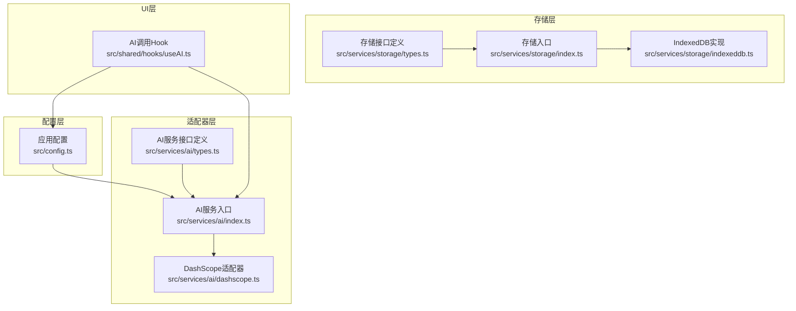

**图示来源**
- [src/config.ts:1-46](file://src/config.ts#L1-L46)
- [src/services/ai/types.ts:1-73](file://src/services/ai/types.ts#L1-L73)
- [src/services/ai/index.ts](file://src/services/ai/index.ts)
- [src/services/ai/dashscope.ts](file://src/services/ai/dashscope.ts)
- [src/services/storage/types.ts:1-30](file://src/services/storage/types.ts#L1-L30)
- [src/services/storage/index.ts](file://src/services/storage/index.ts)
- [src/services/storage/indexeddb.ts](file://src/services/storage/indexeddb.ts)
- [src/shared/hooks/useAI.ts:1-97](file://src/shared/hooks/useAI.ts#L1-L97)

**章节来源**
- [src/config.ts:1-46](file://src/config.ts#L1-L46)
- [src/services/ai/types.ts:1-73](file://src/services/ai/types.ts#L1-L73)
- [src/services/ai/index.ts](file://src/services/ai/index.ts)
- [src/services/ai/dashscope.ts](file://src/services/ai/dashscope.ts)
- [src/services/storage/types.ts:1-30](file://src/services/storage/types.ts#L1-L30)
- [src/services/storage/index.ts](file://src/services/storage/index.ts)
- [src/services/storage/indexeddb.ts](file://src/services/storage/indexeddb.ts)
- [src/shared/hooks/useAI.ts:1-97](file://src/shared/hooks/useAI.ts#L1-L97)

## 核心组件
- 应用配置模块：提供全局配置读取与更新能力，包含API Key、基础URL与当前激活模型标识。
- AI服务接口定义：统一文本、图像、视频三类服务的输入输出规范与状态模型。
- AI服务入口：根据当前配置选择具体模型提供商适配器，对外暴露统一调用接口。
- DashScope适配器：以DashScope为例实现具体厂商API对接，封装请求与响应处理。
- 存储接口与实现：定义通用存储能力，提供IndexedDB实现，支撑配置与项目数据持久化。
- UI Hook：封装AI调用流程，前置校验API Key，统一返回loading与error状态。

**章节来源**
- [src/config.ts:1-46](file://src/config.ts#L1-L46)
- [src/services/ai/types.ts:1-73](file://src/services/ai/types.ts#L1-L73)
- [src/services/ai/index.ts](file://src/services/ai/index.ts)
- [src/services/ai/dashscope.ts](file://src/services/ai/dashscope.ts)
- [src/services/storage/types.ts:1-30](file://src/services/storage/types.ts#L1-L30)
- [src/services/storage/index.ts](file://src/services/storage/index.ts)
- [src/services/storage/indexeddb.ts](file://src/services/storage/indexeddb.ts)
- [src/shared/hooks/useAI.ts:1-97](file://src/shared/hooks/useAI.ts#L1-L97)

## 架构总览
模型注册中心的运行时交互如下：
- 配置层决定当前使用的模型提供商与模型标识。
- UI层通过Hook获取当前激活的AI Provider。
- Provider内部根据配置选择具体适配器（如DashScope）。
- 适配器负责与第三方API通信，返回标准化结果。
- 存储层负责配置与项目数据的持久化与读取。

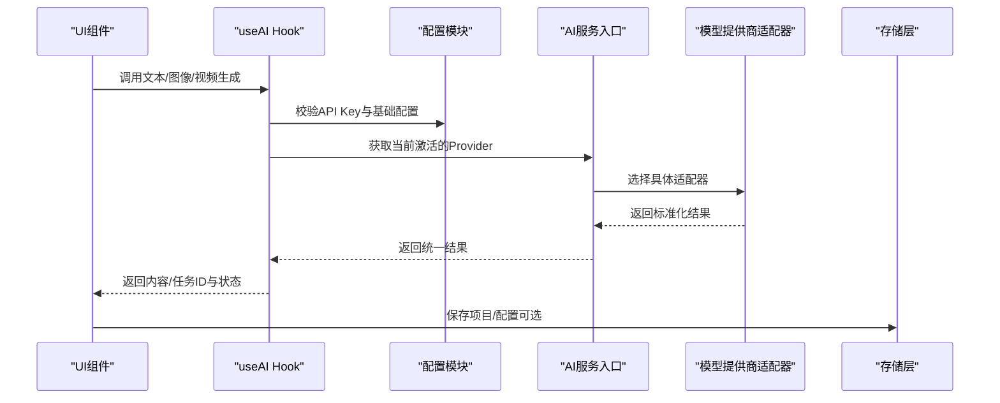

**图示来源**
- [src/shared/hooks/useAI.ts:1-97](file://src/shared/hooks/useAI.ts#L1-L97)
- [src/config.ts:1-46](file://src/config.ts#L1-L46)
- [src/services/ai/index.ts](file://src/services/ai/index.ts)
- [src/services/ai/dashscope.ts](file://src/services/ai/dashscope.ts)
- [src/services/storage/index.ts](file://src/services/storage/index.ts)

## 详细组件分析

### 组件一：配置与模型选择
- 职责：集中管理API Key、基础URL与当前激活模型（文本/图像/视频）。
- 关键点：
  - 提供读取与更新配置的方法，支持部分字段更新。
  - 提供API Key存在性检查，作为调用前置条件。
- 使用建议：
  - 在应用启动时加载持久化配置。
  - 在设置界面更新配置后立即生效。

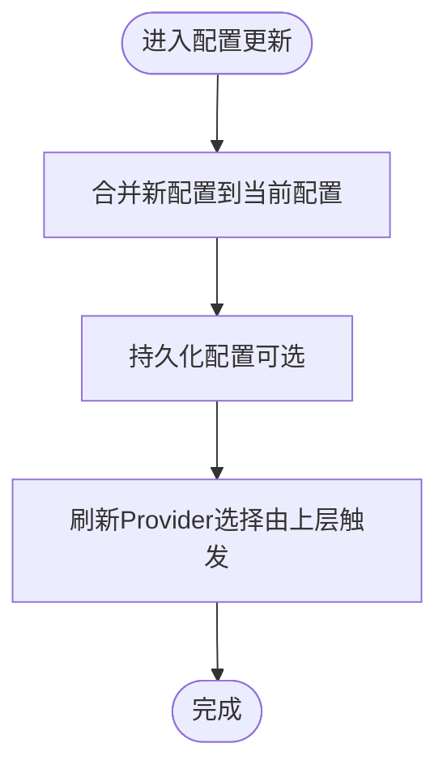

**图示来源**
- [src/config.ts:26-38](file://src/config.ts#L26-L38)

**章节来源**
- [src/config.ts:1-46](file://src/config.ts#L1-L46)

### 组件二：AI服务接口与Provider抽象
- 职责：定义文本、图像、视频三类服务的统一接口，屏蔽厂商差异。
- 关键点：
  - 统一输入参数与输出结构，便于上层无感切换。
  - 定义Provider接口，聚合三类服务。
- 扩展新模型类型：
  - 新增服务接口定义（如音频）。
  - 实现对应适配器，遵循统一接口。
  - 在入口处注册新Provider。

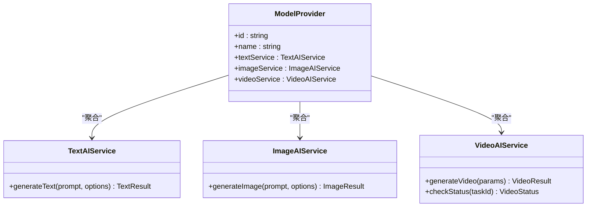

**图示来源**
- [src/services/ai/types.ts:65-72](file://src/services/ai/types.ts#L65-L72)

**章节来源**
- [src/services/ai/types.ts:1-73](file://src/services/ai/types.ts#L1-L73)

### 组件三：DashScope适配器
- 职责：以DashScope为例实现具体厂商API对接，封装请求与响应处理。
- 关键点：
  - 依据配置中的基础URL与API Key构造请求。
  - 将厂商响应映射为统一结果结构。
- 扩展新模型类型：
  - 参照现有适配器，新增服务方法与状态处理。

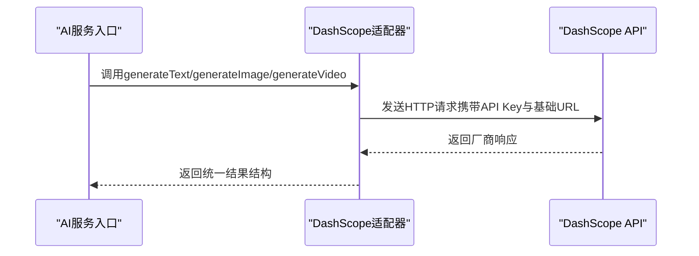

**图示来源**
- [src/services/ai/dashscope.ts](file://src/services/ai/dashscope.ts)
- [src/services/ai/types.ts:18-63](file://src/services/ai/types.ts#L18-L63)

**章节来源**
- [src/services/ai/dashscope.ts](file://src/services/ai/dashscope.ts)
- [src/services/ai/types.ts:1-73](file://src/services/ai/types.ts#L1-L73)

### 组件四：UI Hook与调用流程
- 职责：封装AI调用流程，前置校验API Key，统一返回loading与error状态。
- 关键点：
  - 在每次调用前检查API Key是否存在。
  - 统一捕获异常并设置错误状态。
  - 分别暴露文本、图像、视频的生成与状态查询方法。
- 使用示例（路径指引）：
  - 文本生成：[src/shared/hooks/useAI.ts:18-36](file://src/shared/hooks/useAI.ts#L18-L36)
  - 图像生成：[src/shared/hooks/useAI.ts:45-63](file://src/shared/hooks/useAI.ts#L45-L63)
  - 视频提交与状态查询：[src/shared/hooks/useAI.ts:72-96](file://src/shared/hooks/useAI.ts#L72-L96)

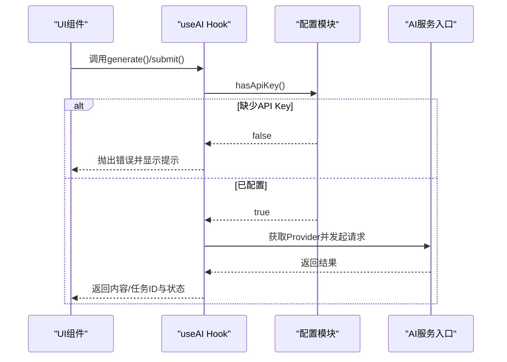

**图示来源**
- [src/shared/hooks/useAI.ts:10-12](file://src/shared/hooks/useAI.ts#L10-L12)
- [src/shared/hooks/useAI.ts:18-36](file://src/shared/hooks/useAI.ts#L18-L36)
- [src/shared/hooks/useAI.ts:45-63](file://src/shared/hooks/useAI.ts#L45-L63)
- [src/shared/hooks/useAI.ts:72-96](file://src/shared/hooks/useAI.ts#L72-L96)
- [src/config.ts:44-46](file://src/config.ts#L44-L46)

**章节来源**
- [src/shared/hooks/useAI.ts:1-97](file://src/shared/hooks/useAI.ts#L1-L97)
- [src/config.ts:1-46](file://src/config.ts#L1-L46)

### 组件五：存储与模型配置持久化
- 职责：提供项目、资产与配置的统一持久化接口，支撑模型配置的读写与迁移。
- 关键点：
  - 定义通用存储接口，包含配置读写方法。
  - 提供IndexedDB实现，满足浏览器端数据持久化需求。
- 使用建议：
  - 在设置界面更新配置后，调用保存方法持久化。
  - 导入/导出时通过存储层读写配置与项目数据。

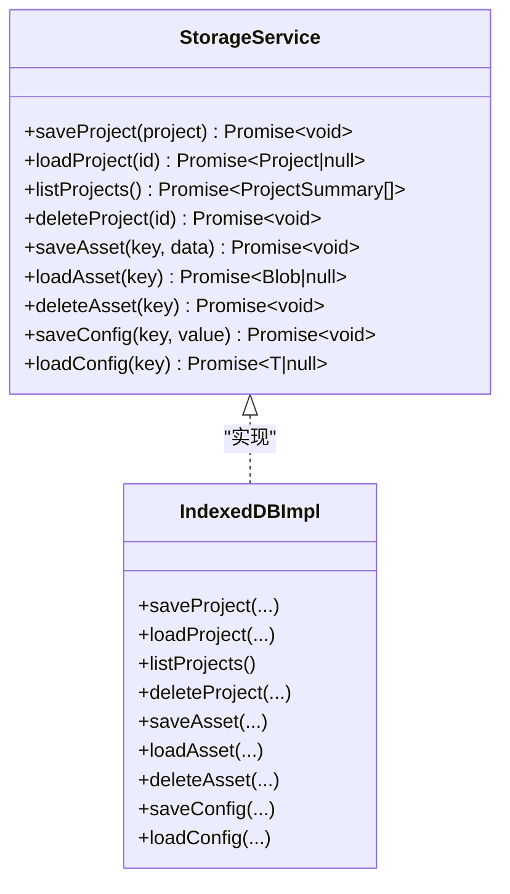

**图示来源**
- [src/services/storage/types.ts:15-30](file://src/services/storage/types.ts#L15-L30)
- [src/services/storage/indexeddb.ts](file://src/services/storage/indexeddb.ts)

**章节来源**
- [src/services/storage/types.ts:1-30](file://src/services/storage/types.ts#L1-L30)
- [src/services/storage/index.ts](file://src/services/storage/index.ts)
- [src/services/storage/indexeddb.ts](file://src/services/storage/indexeddb.ts)

### 组件六：模型发现、注册、注销流程
- 模型发现：通过配置层与存储层读取已配置的模型列表与当前激活模型。
- 模型注册：在设置界面填写API Key与基础URL，保存配置即完成注册。
- 模型注销：清空API Key或删除对应配置项，完成注销。
- 流程图（基于现有实现）：

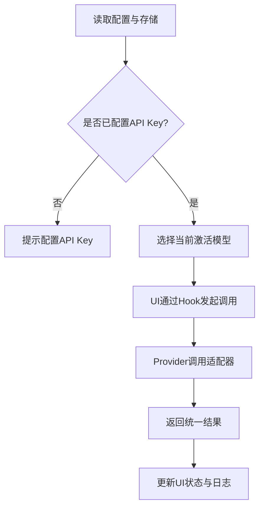

**图示来源**
- [src/shared/hooks/useAI.ts:10-12](file://src/shared/hooks/useAI.ts#L10-L12)
- [src/config.ts:44-46](file://src/config.ts#L44-L46)
- [src/services/ai/index.ts](file://src/services/ai/index.ts)
- [src/services/ai/dashscope.ts](file://src/services/ai/dashscope.ts)

**章节来源**
- [src/shared/hooks/useAI.ts:1-97](file://src/shared/hooks/useAI.ts#L1-L97)
- [src/config.ts:1-46](file://src/config.ts#L1-L46)
- [src/services/ai/index.ts](file://src/services/ai/index.ts)
- [src/services/ai/dashscope.ts](file://src/services/ai/dashscope.ts)

### 组件七：状态管理与动态切换
- 激活模型选择逻辑：由配置层维护当前激活模型标识，UI层通过Hook获取Provider。
- 优先级策略：当前实现未显式定义优先级规则，建议在入口层增加“可用性优先”策略（如按可用性、延迟、成本排序）。
- 动态切换机制：更新配置后，重新获取Provider即可完成切换。

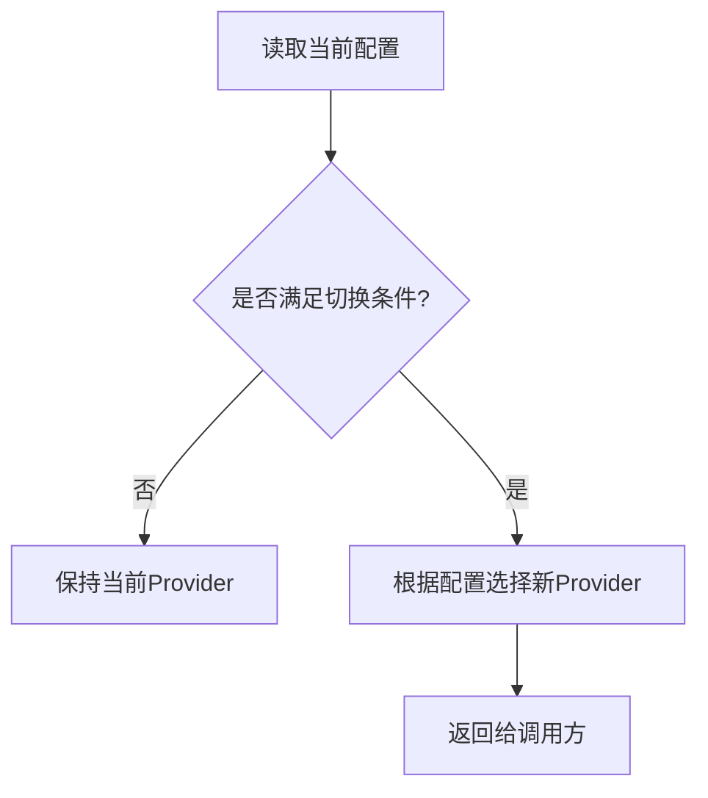

**图示来源**
- [src/config.ts:26-38](file://src/config.ts#L26-L38)
- [src/services/ai/index.ts](file://src/services/ai/index.ts)

**章节来源**
- [src/config.ts:1-46](file://src/config.ts#L1-L46)
- [src/services/ai/index.ts](file://src/services/ai/index.ts)

### 组件八：缓存策略与性能监控
- 缓存策略建议：
  - 请求结果缓存：对重复请求进行去重与短期缓存，避免频繁调用。
  - 模型元数据缓存：缓存模型列表与可用性状态，减少网络开销。
- 性能监控指标建议：
  - 响应时间分布（P50/P90/P95）。
  - 成功/失败率与错误分类统计。
  - Token用量与成本估算（按厂商返回）。
- 当前实现关注点：
  - UI层已提供loading与error状态，便于前端感知与展示。

**章节来源**
- [src/shared/hooks/useAI.ts:14-39](file://src/shared/hooks/useAI.ts#L14-L39)
- [src/shared/hooks/useAI.ts:41-66](file://src/shared/hooks/useAI.ts#L41-L66)
- [src/shared/hooks/useAI.ts:68-97](file://src/shared/hooks/useAI.ts#L68-L97)

### 组件九：错误处理机制
- 前置校验：在调用前检查API Key是否存在，不存在则直接抛错。
- 异常捕获：在Hook中统一捕获异常，设置错误状态并向上抛出。
- 错误分类：区分网络错误、参数错误、厂商限流等，便于UI展示与重试策略。

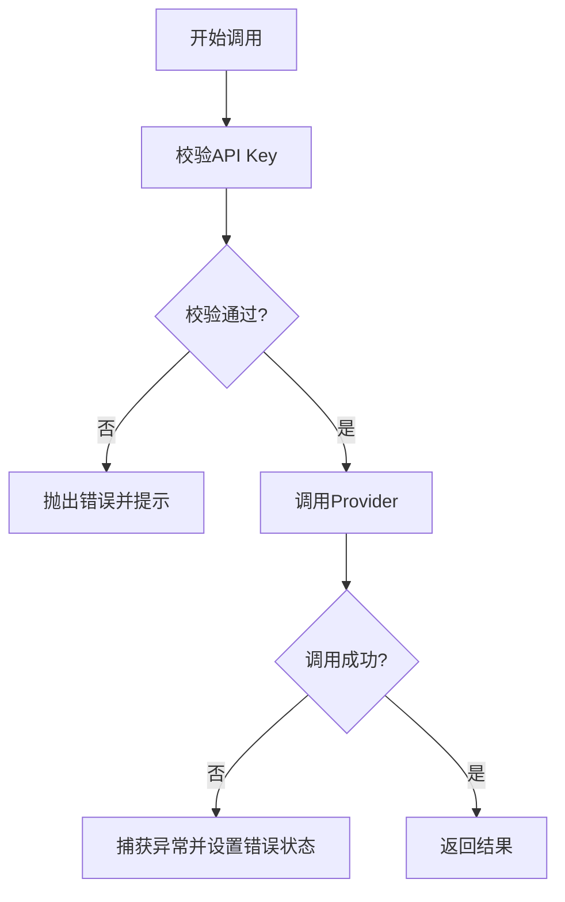

**图示来源**
- [src/shared/hooks/useAI.ts:10-12](file://src/shared/hooks/useAI.ts#L10-L12)
- [src/shared/hooks/useAI.ts:23-31](file://src/shared/hooks/useAI.ts#L23-L31)
- [src/shared/hooks/useAI.ts:54-58](file://src/shared/hooks/useAI.ts#L54-L58)
- [src/shared/hooks/useAI.ts:78-84](file://src/shared/hooks/useAI.ts#L78-L84)

**章节来源**
- [src/shared/hooks/useAI.ts:1-97](file://src/shared/hooks/useAI.ts#L1-L97)

## 依赖关系分析
- 配置层依赖存储层（可选）以持久化配置。
- UI层依赖配置层与AI服务入口，形成调用闭环。
- AI服务入口依赖Provider抽象，Provider再依赖具体适配器。
- 存储层提供统一接口，具体实现可替换（如IndexedDB）。

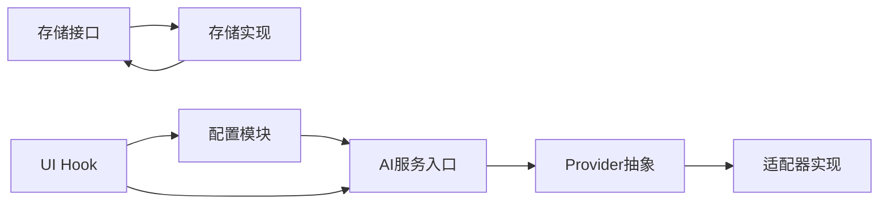

**图示来源**
- [src/config.ts:1-46](file://src/config.ts#L1-L46)
- [src/services/ai/types.ts:65-72](file://src/services/ai/types.ts#L65-L72)
- [src/services/ai/index.ts](file://src/services/ai/index.ts)
- [src/services/ai/dashscope.ts](file://src/services/ai/dashscope.ts)
- [src/services/storage/types.ts:15-30](file://src/services/storage/types.ts#L15-L30)
- [src/services/storage/index.ts](file://src/services/storage/index.ts)
- [src/services/storage/indexeddb.ts](file://src/services/storage/indexeddb.ts)
- [src/shared/hooks/useAI.ts:1-97](file://src/shared/hooks/useAI.ts#L1-L97)

**章节来源**
- [src/config.ts:1-46](file://src/config.ts#L1-L46)
- [src/services/ai/types.ts:1-73](file://src/services/ai/types.ts#L1-L73)
- [src/services/ai/index.ts](file://src/services/ai/index.ts)
- [src/services/ai/dashscope.ts](file://src/services/ai/dashscope.ts)
- [src/services/storage/types.ts:1-30](file://src/services/storage/types.ts#L1-L30)
- [src/services/storage/index.ts](file://src/services/storage/index.ts)
- [src/services/storage/indexeddb.ts](file://src/services/storage/indexeddb.ts)
- [src/shared/hooks/useAI.ts:1-97](file://src/shared/hooks/useAI.ts#L1-L97)

## 性能考虑
- 减少重复请求：对相同输入进行去重与短期缓存。
- 优化Provider选择：在入口层加入可用性检测与健康检查，避免无效调用。
- 异步与并发控制：限制并发数，避免触发厂商限流。
- 前端体验：利用loading与error状态，提供友好的用户反馈。

## 故障排查指南
- API Key缺失：检查配置模块的API Key存在性，确保在调用前已配置。
- 调用失败：查看Hook返回的错误信息，区分网络、参数与厂商限流问题。
- 结果异常：核对适配器对厂商响应的映射是否正确，必要时增加日志记录。
- 数据持久化：确认存储实现可用，配置与项目数据可正常读写。

**章节来源**
- [src/shared/hooks/useAI.ts:10-12](file://src/shared/hooks/useAI.ts#L10-L12)
- [src/shared/hooks/useAI.ts:23-31](file://src/shared/hooks/useAI.ts#L23-L31)
- [src/shared/hooks/useAI.ts:54-58](file://src/shared/hooks/useAI.ts#L54-L58)
- [src/shared/hooks/useAI.ts:78-84](file://src/shared/hooks/useAI.ts#L78-L84)
- [src/config.ts:44-46](file://src/config.ts#L44-L46)

## 结论
模型注册中心通过“配置驱动 + 接口抽象 + 适配器实现 + 存储持久化”的架构，在不绑定特定厂商的前提下实现了模型的灵活切换与统一调用。当前实现已覆盖模型发现、注册、注销与调用流程，建议后续增强优先级策略、缓存与性能监控指标，并完善错误分类与重试机制，以进一步提升稳定性与可观测性。

## 附录

### 模型注册API使用示例（路径指引）
- 更新API Key与基础URL：[src/config.ts:32-38](file://src/config.ts#L32-L38)
- 设置API Key：[src/config.ts:40-42](file://src/config.ts#L40-L42)
- 检查API Key是否存在：[src/config.ts:44-46](file://src/config.ts#L44-L46)
- 文本生成调用：[src/shared/hooks/useAI.ts:18-36](file://src/shared/hooks/useAI.ts#L18-L36)
- 图像生成调用：[src/shared/hooks/useAI.ts:45-63](file://src/shared/hooks/useAI.ts#L45-L63)
- 视频提交与状态查询：[src/shared/hooks/useAI.ts:72-96](file://src/shared/hooks/useAI.ts#L72-L96)

### 状态查询方法（路径指引）
- 文本生成状态：[src/shared/hooks/useAI.ts:14-39](file://src/shared/hooks/useAI.ts#L14-L39)
- 图像生成状态：[src/shared/hooks/useAI.ts:41-66](file://src/shared/hooks/useAI.ts#L41-L66)
- 视频状态查询：[src/shared/hooks/useAI.ts:89-93](file://src/shared/hooks/useAI.ts#L89-L93)

### 扩展新模型类型的步骤指南
- 定义新服务接口：参照现有接口，新增服务类型与参数结构。
- 实现适配器：按照统一接口实现具体厂商对接。
- 注册Provider：在入口层注册新Provider并纳入选择逻辑。
- 配置持久化：在存储层支持新配置项的读写。
- UI集成：在设置界面添加新模型的配置项与校验。

**章节来源**
- [src/services/ai/types.ts:1-73](file://src/services/ai/types.ts#L1-L73)
- [src/services/ai/dashscope.ts](file://src/services/ai/dashscope.ts)
- [src/services/ai/index.ts](file://src/services/ai/index.ts)
- [src/services/storage/types.ts:15-30](file://src/services/storage/types.ts#L15-L30)
- [src/shared/hooks/useAI.ts:1-97](file://src/shared/hooks/useAI.ts#L1-L97)