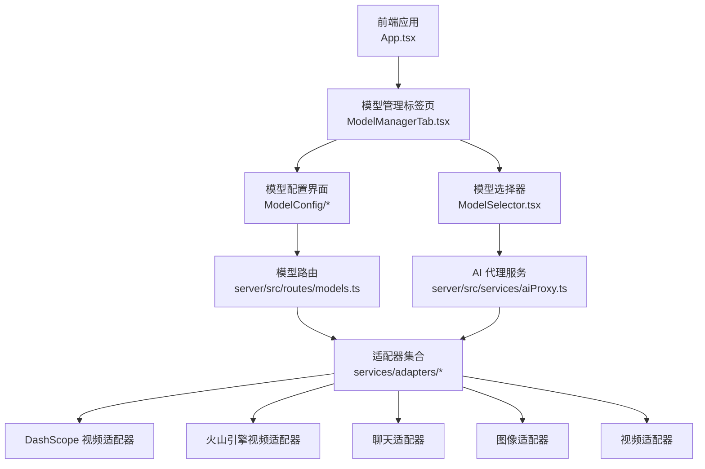
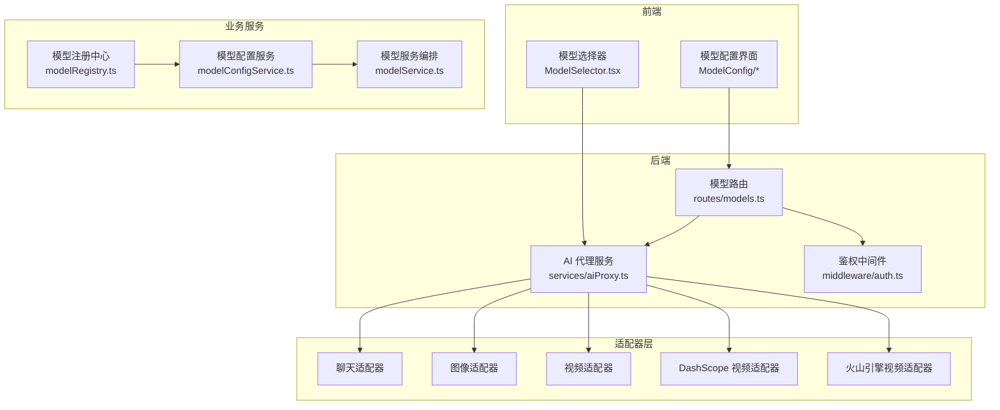
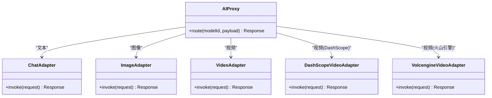
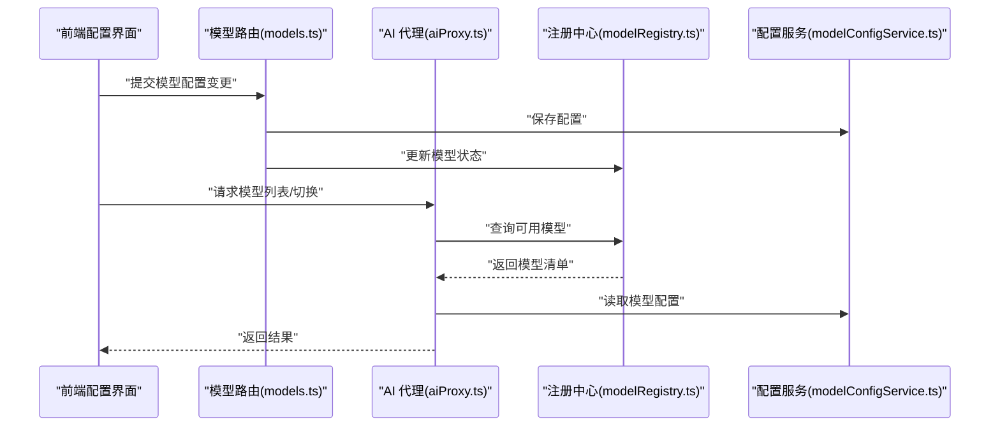
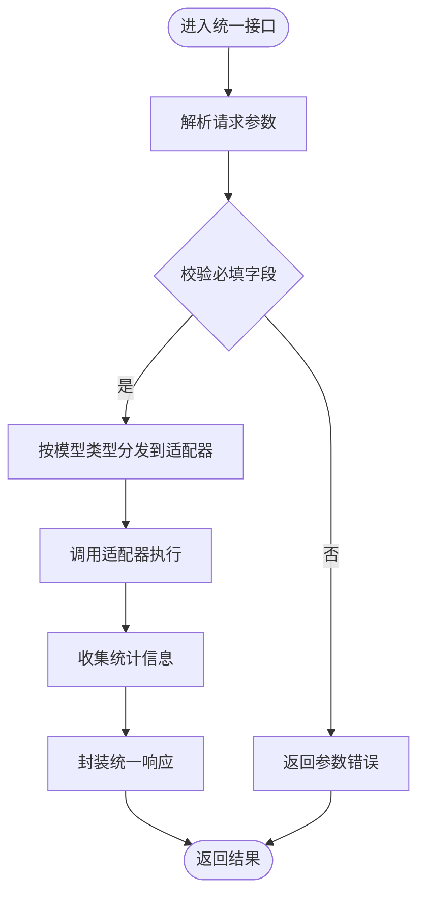
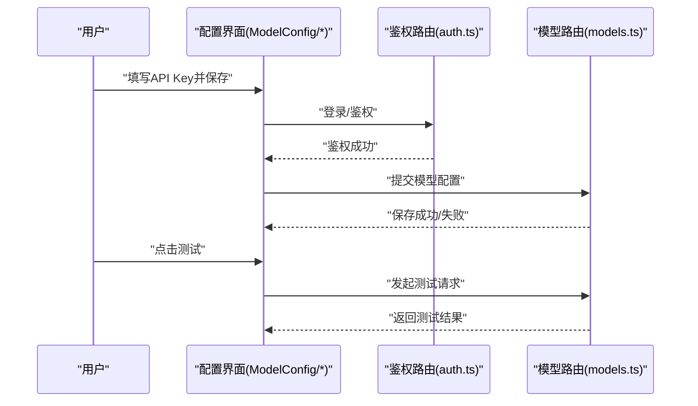
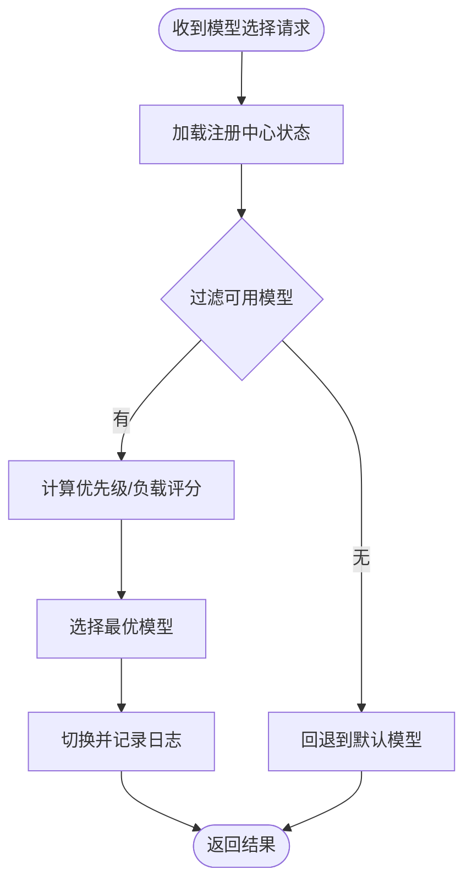
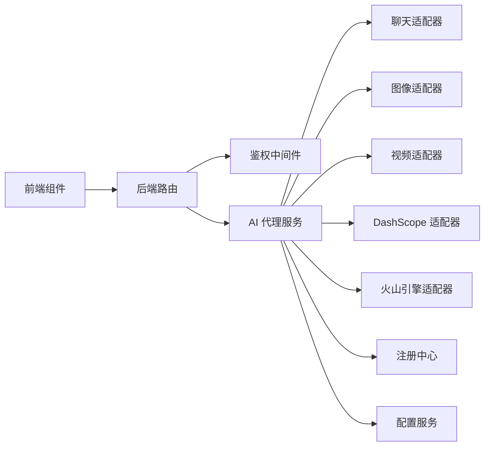

# 模型管理系统

<cite>
**本文引用的文件**
- [App.tsx](file://App.tsx)
- [ModelManagerTab.tsx](file://components/ModelManagerTab.tsx)
- [ModelSelector.tsx](file://components/ModelSelector.tsx)
- [AddModelForm.tsx](file://components/ModelConfig/AddModelForm.tsx)
- [GlobalSettings.tsx](file://components/ModelConfig/GlobalSettings.tsx)
- [ModelList.tsx](file://components/ModelConfig/ModelList.tsx)
- [ModelCard.tsx](file://components/ModelConfig/ModelCard.tsx)
- [index.tsx](file://components/ModelConfig/index.tsx)
- [models.ts](file://server/src/routes/models.ts)
- [aiProxy.ts](file://server/src/services/aiProxy.ts)
- [chatAdapter.ts](file://services/adapters/chatAdapter.ts)
- [imageAdapter.ts](file://services/adapters/imageAdapter.ts)
- [videoAdapter.ts](file://services/adapters/videoAdapter.ts)
- [dashscopeVideoAdapter.ts](file://services/adapters/dashscopeVideoAdapter.ts)
- [volcengineVideoAdapter.ts](file://services/adapters/volcengineVideoAdapter.ts)
- [apiCore.ts](file://services/ai/apiCore.ts)
- [model.ts](file://types/model.ts)
- [modelRegistry.ts](file://services/modelRegistry.ts)
- [modelConfigService.ts](file://services/modelConfigService.ts)
- [modelService.ts](file://services/modelService.ts)
- [index.ts](file://services/adapters/index.ts)
- [index.ts](file://services/ai/index.ts)
- [index.ts](file://services/index.ts)
- [auth.ts](file://server/src/middleware/auth.ts)
- [auth.ts](file://server/src/routes/auth.ts)
- [ApiKeyPage.tsx](file://components/Onboarding/ApiKeyPage.tsx)
- [constants.ts](file://components/Onboarding/constants.ts)
- [README.md](file://components/StageAssets/README.md)
- [README.md](file://components/StageDirector/README.md)
- [README.md](file://components/StageExport/README.md)
- [README.md](file://components/StagePrompts/README.md)
- [README.md](file://components/StageScript/README.md)
</cite>

## 目录
1. [简介](#简介)
2. [项目结构](#项目结构)
3. [核心组件](#核心组件)
4. [架构总览](#架构总览)
5. [详细组件分析](#详细组件分析)
6. [依赖关系分析](#依赖关系分析)
7. [性能考虑](#性能考虑)
8. [故障排除指南](#故障排除指南)
9. [结论](#结论)
10. [附录](#附录)

## 简介
本文件面向“模型管理系统”的设计与实现，聚焦以下目标：
- 解释模型抽象层的设计理念与统一接口规范
- 说明模型类型分类（文本、图像、视频）及适配器模式
- 介绍模型注册中心、配置管理与动态模型切换机制
- 阐述模型优先级策略、负载均衡与性能监控指标
- 提供模型配置界面、API Key 管理与模型测试工具的使用指南
- 给出模型扩展与自定义模型接入的流程

本系统采用前端组件与后端服务分层架构：前端通过路由与适配器调用后端 AI 代理服务；后端通过统一的模型路由与代理服务对接多家模型供应商。

## 项目结构
项目采用前后端分离与模块化组织方式：
- 前端组件位于 components 目录，包含模型配置界面、引导页、场景脚本等
- 后端服务位于 server/src，包含路由、中间件与服务层
- 适配器位于 services/adapters，封装不同供应商的 API 差异
- 业务服务位于 services，包含模型注册、配置与服务编排

图表来源
- [App.tsx](file://App.tsx)
- [ModelManagerTab.tsx](file://components/ModelManagerTab.tsx)
- [ModelSelector.tsx](file://components/ModelSelector.tsx)
- [AddModelForm.tsx](file://components/ModelConfig/AddModelForm.tsx)
- [GlobalSettings.tsx](file://components/ModelConfig/GlobalSettings.tsx)
- [ModelList.tsx](file://components/ModelConfig/ModelList.tsx)
- [ModelCard.tsx](file://components/ModelConfig/ModelCard.tsx)
- [models.ts](file://server/src/routes/models.ts)
- [aiProxy.ts](file://server/src/services/aiProxy.ts)
- [dashscopeVideoAdapter.ts](file://services/adapters/dashscopeVideoAdapter.ts)
- [volcengineVideoAdapter.ts](file://services/adapters/volcengineVideoAdapter.ts)
- [chatAdapter.ts](file://services/adapters/chatAdapter.ts)
- [imageAdapter.ts](file://services/adapters/imageAdapter.ts)
- [videoAdapter.ts](file://services/adapters/videoAdapter.ts)

章节来源
- [App.tsx](file://App.tsx)
- [ModelManagerTab.tsx](file://components/ModelManagerTab.tsx)
- [ModelSelector.tsx](file://components/ModelSelector.tsx)
- [AddModelForm.tsx](file://components/ModelConfig/AddModelForm.tsx)
- [GlobalSettings.tsx](file://components/ModelConfig/GlobalSettings.tsx)
- [ModelList.tsx](file://components/ModelConfig/ModelList.tsx)
- [ModelCard.tsx](file://components/ModelConfig/ModelCard.tsx)
- [models.ts](file://server/src/routes/models.ts)
- [aiProxy.ts](file://server/src/services/aiProxy.ts)
- [dashscopeVideoAdapter.ts](file://services/adapters/dashscopeVideoAdapter.ts)
- [volcengineVideoAdapter.ts](file://services/adapters/volcengineVideoAdapter.ts)
- [chatAdapter.ts](file://services/adapters/chatAdapter.ts)
- [imageAdapter.ts](file://services/adapters/imageAdapter.ts)
- [videoAdapter.ts](file://services/adapters/videoAdapter.ts)

## 核心组件
- 模型抽象层与适配器：通过适配器封装不同供应商的 API，统一请求参数与响应格式，便于扩展与替换
- 模型配置界面：提供模型添加、编辑、删除与全局设置入口
- 模型选择器：在运行时根据策略选择最优模型实例
- 模型路由与代理：后端统一入口，负责鉴权、路由与转发到具体适配器
- 注册中心与配置服务：集中管理模型元数据、优先级与可用性状态
- 业务服务：编排文本、图像、视频等任务流

章节来源
- [index.ts](file://services/adapters/index.ts)
- [index.ts](file://services/ai/index.ts)
- [index.ts](file://services/index.ts)

## 架构总览
系统采用“前端组件 + 后端路由 + 适配器层 + 业务服务”的分层架构。前端通过模型配置界面与选择器进行交互，后端通过模型路由与 AI 代理服务对接多家供应商适配器，实现跨平台模型能力的统一调度。

图表来源
- [models.ts](file://server/src/routes/models.ts)
- [aiProxy.ts](file://server/src/services/aiProxy.ts)
- [auth.ts](file://server/src/middleware/auth.ts)
- [chatAdapter.ts](file://services/adapters/chatAdapter.ts)
- [imageAdapter.ts](file://services/adapters/imageAdapter.ts)
- [videoAdapter.ts](file://services/adapters/videoAdapter.ts)
- [dashscopeVideoAdapter.ts](file://services/adapters/dashscopeVideoAdapter.ts)
- [volcengineVideoAdapter.ts](file://services/adapters/volcengineVideoAdapter.ts)
- [modelRegistry.ts](file://services/modelRegistry.ts)
- [modelConfigService.ts](file://services/modelConfigService.ts)
- [modelService.ts](file://services/modelService.ts)

## 详细组件分析

### 模型抽象层与适配器模式
- 设计理念：以适配器封装供应商差异，统一输入输出契约，降低耦合度，支持热插拔与多供应商并存
- 文本类：聊天适配器负责对话与推理类任务
- 图像类：图像适配器负责生成与编辑类任务
- 视频类：视频适配器与 DashScope、火山引擎视频适配器分别对接不同供应商
- 统一接口：所有适配器遵循一致的请求参数与响应结构，便于前端与后端统一处理

图表来源
- [aiProxy.ts](file://server/src/services/aiProxy.ts)
- [chatAdapter.ts](file://services/adapters/chatAdapter.ts)
- [imageAdapter.ts](file://services/adapters/imageAdapter.ts)
- [videoAdapter.ts](file://services/adapters/videoAdapter.ts)
- [dashscopeVideoAdapter.ts](file://services/adapters/dashscopeVideoAdapter.ts)
- [volcengineVideoAdapter.ts](file://services/adapters/volcengineVideoAdapter.ts)

章节来源
- [aiProxy.ts](file://server/src/services/aiProxy.ts)
- [chatAdapter.ts](file://services/adapters/chatAdapter.ts)
- [imageAdapter.ts](file://services/adapters/imageAdapter.ts)
- [videoAdapter.ts](file://services/adapters/videoAdapter.ts)
- [dashscopeVideoAdapter.ts](file://services/adapters/dashscopeVideoAdapter.ts)
- [volcengineVideoAdapter.ts](file://services/adapters/volcengineVideoAdapter.ts)

### 模型注册中心与配置管理
- 注册中心：集中登记模型元信息（名称、类型、供应商、可用性、权重等），提供查询与更新能力
- 配置服务：维护模型配置项（如 API Key、超时、并发限制等），支持全局与按模型覆盖
- 动态切换：基于注册中心状态与配置策略，在运行时选择最优模型实例

图表来源
- [models.ts](file://server/src/routes/models.ts)
- [aiProxy.ts](file://server/src/services/aiProxy.ts)
- [modelRegistry.ts](file://services/modelRegistry.ts)
- [modelConfigService.ts](file://services/modelConfigService.ts)

章节来源
- [models.ts](file://server/src/routes/models.ts)
- [modelRegistry.ts](file://services/modelRegistry.ts)
- [modelConfigService.ts](file://services/modelConfigService.ts)

### 模型类型分类与统一接口
- 文本模型：通过聊天适配器统一接口处理提示词、上下文与流式输出
- 图像模型：通过图像适配器统一接口处理分辨率、风格与质量参数
- 视频模型：通过视频适配器与供应商适配器统一接口处理帧率、时长与编码参数
- 统一接口规范：请求体包含模型标识、参数字典与元数据；响应体包含结果数据与统计信息

图表来源
- [apiCore.ts](file://services/ai/apiCore.ts)
- [chatAdapter.ts](file://services/adapters/chatAdapter.ts)
- [imageAdapter.ts](file://services/adapters/imageAdapter.ts)
- [videoAdapter.ts](file://services/adapters/videoAdapter.ts)

章节来源
- [apiCore.ts](file://services/ai/apiCore.ts)
- [chatAdapter.ts](file://services/adapters/chatAdapter.ts)
- [imageAdapter.ts](file://services/adapters/imageAdapter.ts)
- [videoAdapter.ts](file://services/adapters/videoAdapter.ts)

### 模型配置界面与 API Key 管理
- 配置界面：提供模型卡片展示、新增表单、全局设置与列表管理
- API Key 管理：在引导页中完成密钥录入与验证，后端路由负责鉴权与存储
- 测试工具：通过配置界面发起测试请求，验证模型连通性与参数有效性

图表来源
- [ApiKeyPage.tsx](file://components/Onboarding/ApiKeyPage.tsx)
- [auth.ts](file://server/src/middleware/auth.ts)
- [models.ts](file://server/src/routes/models.ts)
- [AddModelForm.tsx](file://components/ModelConfig/AddModelForm.tsx)
- [GlobalSettings.tsx](file://components/ModelConfig/GlobalSettings.tsx)
- [ModelList.tsx](file://components/ModelConfig/ModelList.tsx)
- [ModelCard.tsx](file://components/ModelConfig/ModelCard.tsx)

章节来源
- [ApiKeyPage.tsx](file://components/Onboarding/ApiKeyPage.tsx)
- [auth.ts](file://server/src/middleware/auth.ts)
- [models.ts](file://server/src/routes/models.ts)
- [AddModelForm.tsx](file://components/ModelConfig/AddModelForm.tsx)
- [GlobalSettings.tsx](file://components/ModelConfig/GlobalSettings.tsx)
- [ModelList.tsx](file://components/ModelConfig/ModelList.tsx)
- [ModelCard.tsx](file://components/ModelConfig/ModelCard.tsx)

### 动态模型切换机制
- 选择策略：依据优先级、可用性、负载与性能指标动态选择模型
- 负载均衡：对同一供应商多实例进行轮询或加权分配
- 故障转移：当某实例不可用时自动切换至备用实例
- 实时更新：注册中心状态变化后，前端与后端同步刷新模型列表

图表来源
- [modelRegistry.ts](file://services/modelRegistry.ts)
- [modelService.ts](file://services/modelService.ts)

章节来源
- [modelRegistry.ts](file://services/modelRegistry.ts)
- [modelService.ts](file://services/modelService.ts)

### 性能监控指标
- 关键指标：请求延迟、成功率、吞吐量、错误分布、重试次数
- 数据采集：在适配器与代理层埋点，聚合到统一监控面板
- 报警阈值：针对延迟与错误率设定阈值，触发告警与自动降级

章节来源
- [aiProxy.ts](file://server/src/services/aiProxy.ts)
- [apiCore.ts](file://services/ai/apiCore.ts)

## 依赖关系分析
- 前端组件依赖后端路由与服务，通过统一接口进行通信
- 适配器层对供应商 API 进行解耦，便于替换与扩展
- 注册中心与配置服务为运行时提供决策依据
- 鉴权中间件保障后端接口安全

图表来源
- [models.ts](file://server/src/routes/models.ts)
- [auth.ts](file://server/src/middleware/auth.ts)
- [aiProxy.ts](file://server/src/services/aiProxy.ts)
- [chatAdapter.ts](file://services/adapters/chatAdapter.ts)
- [imageAdapter.ts](file://services/adapters/imageAdapter.ts)
- [videoAdapter.ts](file://services/adapters/videoAdapter.ts)
- [dashscopeVideoAdapter.ts](file://services/adapters/dashscopeVideoAdapter.ts)
- [volcengineVideoAdapter.ts](file://services/adapters/volcengineVideoAdapter.ts)
- [modelRegistry.ts](file://services/modelRegistry.ts)
- [modelConfigService.ts](file://services/modelConfigService.ts)

章节来源
- [models.ts](file://server/src/routes/models.ts)
- [auth.ts](file://server/src/middleware/auth.ts)
- [aiProxy.ts](file://server/src/services/aiProxy.ts)
- [chatAdapter.ts](file://services/adapters/chatAdapter.ts)
- [imageAdapter.ts](file://services/adapters/imageAdapter.ts)
- [videoAdapter.ts](file://services/adapters/videoAdapter.ts)
- [dashscopeVideoAdapter.ts](file://services/adapters/dashscopeVideoAdapter.ts)
- [volcengineVideoAdapter.ts](file://services/adapters/volcengineVideoAdapter.ts)
- [modelRegistry.ts](file://services/modelRegistry.ts)
- [modelConfigService.ts](file://services/modelConfigService.ts)

## 性能考虑
- 请求超时与重试：为不同供应商设置合理的超时与重试策略，避免阻塞
- 并发控制：限制每个模型实例的最大并发数，防止过载
- 缓存与预热：对热点模型进行缓存与预热，降低首帧延迟
- 监控与告警：建立完善的指标体系，及时发现性能瓶颈

## 故障排除指南
- API Key 错误：检查密钥是否正确、权限是否足够、是否被禁用
- 模型不可用：确认注册中心状态、网络连通性与供应商服务状态
- 超时与失败：查看代理层日志与适配器错误码，定位问题根因
- 配置不生效：核对配置服务覆盖规则与优先级顺序

章节来源
- [auth.ts](file://server/src/middleware/auth.ts)
- [models.ts](file://server/src/routes/models.ts)
- [aiProxy.ts](file://server/src/services/aiProxy.ts)

## 结论
本模型管理系统通过抽象层与适配器模式实现了跨供应商的统一调度，结合注册中心与配置服务，提供了灵活的动态切换与扩展能力。前端配置界面与测试工具提升了易用性与可观测性。建议持续完善性能监控与自动化运维，确保在高并发场景下的稳定性与一致性。

## 附录
- 模型扩展流程
  1) 在适配器层新增供应商适配器，实现统一接口
  2) 在注册中心登记新模型元信息
  3) 在配置服务中添加模型配置项
  4) 在前端配置界面与选择器中集成新模型
  5) 发起测试请求验证连通性与参数有效性
- 自定义模型接入
  - 定义请求/响应契约
  - 实现适配器与错误处理
  - 更新注册中心与配置服务
  - 前端集成与测试

章节来源
- [index.ts](file://services/adapters/index.ts)
- [index.ts](file://services/ai/index.ts)
- [index.ts](file://services/index.ts)
- [modelRegistry.ts](file://services/modelRegistry.ts)
- [modelConfigService.ts](file://services/modelConfigService.ts)
- [modelService.ts](file://services/modelService.ts)