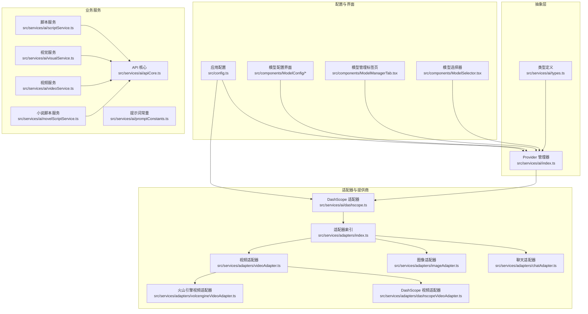
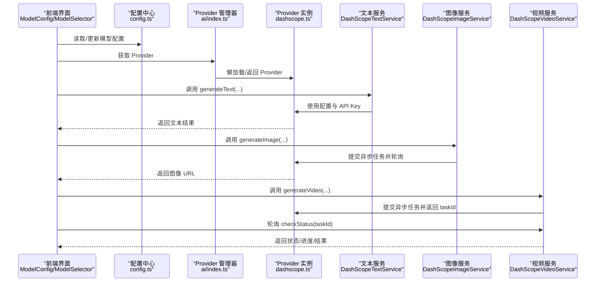
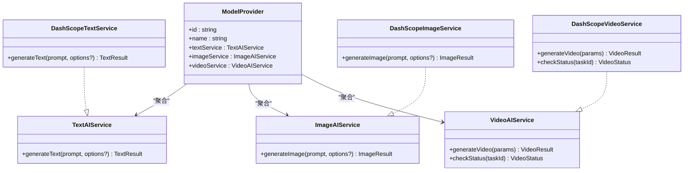
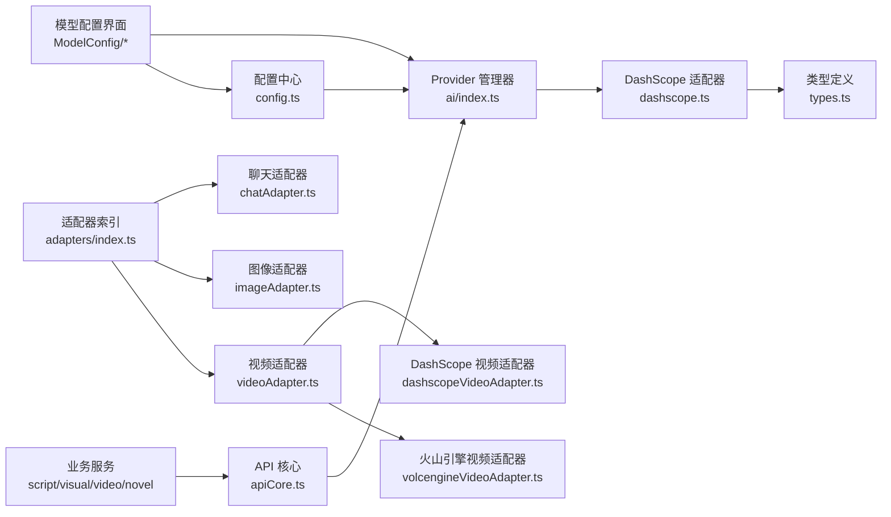

# 模型类型与定义

<cite>
**本文引用的文件**
- [src/services/ai/types.ts](file://src/services/ai/types.ts)
- [src/services/ai/index.ts](file://src/services/ai/index.ts)
- [src/services/ai/dashscope.ts](file://src/services/ai/dashscope.ts)
- [src/config.ts](file://src/config.ts)
- [src/services/ai/apiCore.ts](file://src/services/ai/apiCore.ts)
- [src/services/ai/promptConstants.ts](file://src/services/ai/promptConstants.ts)
- [src/services/ai/scriptService.ts](file://src/services/ai/scriptService.ts)
- [src/services/ai/visualService.ts](file://src/services/ai/visualService.ts)
- [src/services/ai/videoService.ts](file://src/services/ai/videoService.ts)
- [src/services/ai/novelScriptService.ts](file://src/services/ai/novelScriptService.ts)
- [src/services/adapters/chatAdapter.ts](file://src/services/adapters/chatAdapter.ts)
- [src/services/adapters/imageAdapter.ts](file://src/services/adapters/imageAdapter.ts)
- [src/services/adapters/videoAdapter.ts](file://src/services/adapters/videoAdapter.ts)
- [src/services/adapters/dashscopeVideoAdapter.ts](file://src/services/adapters/dashscopeVideoAdapter.ts)
- [src/services/adapters/volcengineVideoAdapter.ts](file://src/services/adapters/volcengineVideoAdapter.ts)
- [src/services/adapters/index.ts](file://src/services/adapters/index.ts)
- [src/components/ModelConfig/AddModelForm.tsx](file://src/components/ModelConfig/AddModelForm.tsx)
- [src/components/ModelConfig/GlobalSettings.tsx](file://src/components/ModelConfig/GlobalSettings.tsx)
- [src/components/ModelConfig/ModelCard.tsx](file://src/components/ModelConfig/ModelCard.tsx)
- [src/components/ModelConfig/ModelList.tsx](file://src/components/ModelConfig/ModelList.tsx)
- [src/components/ModelConfig/index.tsx](file://src/components/ModelConfig/index.tsx)
- [src/components/ModelManagerTab.tsx](file://src/components/ModelManagerTab.tsx)
- [src/components/ModelSelector.tsx](file://src/components/ModelSelector.tsx)
</cite>

## 目录
1. [引言](#引言)
2. [项目结构](#项目结构)
3. [核心组件](#核心组件)
4. [架构总览](#架构总览)
5. [详细组件分析](#详细组件分析)
6. [依赖分析](#依赖分析)
7. [性能考虑](#性能考虑)
8. [故障排查指南](#故障排查指南)
9. [结论](#结论)
10. [附录](#附录)

## 引言
本文件围绕“模型类型与定义”主题，系统性梳理项目中的模型抽象层设计理念、模型类型分类（文本/对话、图像、视频）、统一接口规范、类型守卫与类型安全实现方式，并给出内置模型常量、参数配置结构、类型转换与参数验证的实践路径。目标是帮助开发者快速理解并正确使用模型定义与适配器体系。

## 项目结构
模型相关能力主要分布在以下区域：
- 抽象接口与统一类型：位于 AI 服务层的类型定义文件
- 适配器与提供商：以 DashScope 为例的适配器实现，以及 Provider 管理器
- 配置中心：应用级配置，包含模型名称与基础地址
- 业务服务：脚本、视觉、视频等服务对模型的使用
- 前端模型配置界面：模型列表、新增、全局设置与选择器

图表来源
- [src/services/ai/types.ts:1-73](file://src/services/ai/types.ts#L1-L73)
- [src/services/ai/index.ts:1-34](file://src/services/ai/index.ts#L1-L34)
- [src/services/ai/dashscope.ts:1-327](file://src/services/ai/dashscope.ts#L1-L327)
- [src/services/adapters/index.ts:1-200](file://src/services/adapters/index.ts)
- [src/services/adapters/chatAdapter.ts:1-200](file://src/services/adapters/chatAdapter.ts)
- [src/services/adapters/imageAdapter.ts:1-200](file://src/services/adapters/imageAdapter.ts)
- [src/services/adapters/videoAdapter.ts:1-200](file://src/services/adapters/videoAdapter.ts)
- [src/services/adapters/dashscopeVideoAdapter.ts:1-200](file://src/services/adapters/dashscopeVideoAdapter.ts)
- [src/services/adapters/volcengineVideoAdapter.ts:1-200](file://src/services/adapters/volcengineVideoAdapter.ts)
- [src/config.ts:1-46](file://src/config.ts#L1-L46)
- [src/components/ModelConfig/index.tsx:1-200](file://src/components/ModelConfig/index.tsx)
- [src/components/ModelManagerTab.tsx:1-200](file://src/components/ModelManagerTab.tsx)
- [src/components/ModelSelector.tsx:1-200](file://src/components/ModelSelector.tsx)

章节来源
- [src/services/ai/types.ts:1-73](file://src/services/ai/types.ts#L1-L73)
- [src/services/ai/index.ts:1-34](file://src/services/ai/index.ts#L1-L34)
- [src/services/ai/dashscope.ts:1-327](file://src/services/ai/dashscope.ts#L1-L327)
- [src/config.ts:1-46](file://src/config.ts#L1-L46)

## 核心组件
- 统一接口规范：定义文本、图像、视频三类 AI 服务能力的输入输出契约，确保不同提供商实现遵循一致的调用协议。
- Provider 管理器：集中管理模型提供商实例，支持懒加载与重置，便于未来扩展多提供商切换。
- DashScope 适配器：以 DashScope 为例，实现文本、图像、视频服务的同步与异步任务封装，包含重试、轮询与状态映射。
- 配置中心：集中管理 API Key、基础地址与模型名称，提供读取与更新能力，避免硬编码。
- 适配器集合：按能力拆分聊天、图像、视频适配器，并提供针对具体提供商（如 DashScope、火山引擎）的视频适配器。
- 前端模型配置界面：提供模型列表、新增、全局设置与选择器，支撑用户对模型参数进行可视化配置与切换。

章节来源
- [src/services/ai/types.ts:6-72](file://src/services/ai/types.ts#L6-L72)
- [src/services/ai/index.ts:22-33](file://src/services/ai/index.ts#L22-L33)
- [src/services/ai/dashscope.ts:95-327](file://src/services/ai/dashscope.ts#L95-L327)
- [src/config.ts:6-46](file://src/config.ts#L6-L46)
- [src/services/adapters/index.ts:1-200](file://src/services/adapters/index.ts)
- [src/components/ModelConfig/index.tsx:1-200](file://src/components/ModelConfig/index.tsx)

## 架构总览
下图展示从“配置到服务”的调用链路，以及 Provider 与适配器的关系：

图表来源
- [src/config.ts:28-46](file://src/config.ts#L28-L46)
- [src/services/ai/index.ts:24-33](file://src/services/ai/index.ts#L24-L33)
- [src/services/ai/dashscope.ts:96-327](file://src/services/ai/dashscope.ts#L96-L327)

## 详细组件分析

### 统一接口规范与类型安全
- 文本服务：定义生成文本的输入选项（温度、最大 Token、系统提示）与输出结果（内容、用量），并以接口约束调用方行为。
- 图像服务：定义图像生成的输入选项（宽高、风格、反向提示、数量）与输出结果（URL、修正后的提示），保证跨提供商的一致性。
- 视频服务：定义视频生成参数（提示词、可选起始图、时长、宽高比）与异步结果（任务 ID、状态对象），状态对象包含挂起、处理中、已完成、失败等状态及进度与错误信息。
- Provider 接口：聚合文本/图像/视频三种服务，作为统一入口，便于上层业务无感知地切换不同提供商。

类型安全实现要点：
- 使用 TypeScript 接口严格限定输入输出字段，避免运行时字段缺失导致的异常。
- 对异步任务的状态进行字面量联合类型约束，防止状态值越界。
- 通过模块导出统一类型，避免重复定义与耦合。

章节来源
- [src/services/ai/types.ts:6-72](file://src/services/ai/types.ts#L6-L72)

### Provider 管理器与 DashScope 适配器
- Provider 管理器负责单例 Provider 的创建与复用，支持重置以切换配置或提供商。
- DashScope 适配器实现：
  - 文本服务：基于兼容模式的聊天补全接口，支持系统提示与参数透传。
  - 图像服务：提交异步任务，轮询直到完成，返回首张结果 URL 与修正提示。
  - 视频服务：提交异步任务，立即返回 taskId，checkStatus 支持轮询查询状态与结果 URL。

图表来源
- [src/services/ai/types.ts:18-72](file://src/services/ai/types.ts#L18-L72)
- [src/services/ai/dashscope.ts:96-327](file://src/services/ai/dashscope.ts#L96-L327)

章节来源
- [src/services/ai/index.ts:22-33](file://src/services/ai/index.ts#L22-L33)
- [src/services/ai/dashscope.ts:96-327](file://src/services/ai/dashscope.ts#L96-L327)

### 配置中心与内置模型常量
- 配置结构包含 AI 基础信息：API Key、基础 URL、文本模型、图像模型、视频模型。
- 内置默认值覆盖常见场景：默认基础 URL、默认文本/图像/视频模型名称。
- 提供读取与更新方法，支持动态切换提供商与模型。

章节来源
- [src/config.ts:6-46](file://src/config.ts#L6-L46)

### 适配器与类型守卫
- 适配器按能力拆分：聊天、图像、视频，便于按需引入与测试。
- 视频适配器进一步细分为 DashScope 与火山引擎等不同提供商实现，便于扩展与替换。
- 类型守卫可通过 Provider 的接口约束与字面量状态枚举实现，确保编译期与运行期的安全性。

章节来源
- [src/services/adapters/index.ts:1-200](file://src/services/adapters/index.ts)
- [src/services/adapters/chatAdapter.ts:1-200](file://src/services/adapters/chatAdapter.ts)
- [src/services/adapters/imageAdapter.ts:1-200](file://src/services/adapters/imageAdapter.ts)
- [src/services/adapters/videoAdapter.ts:1-200](file://src/services/adapters/videoAdapter.ts)
- [src/services/adapters/dashscopeVideoAdapter.ts:1-200](file://src/services/adapters/dashscopeVideoAdapter.ts)
- [src/services/adapters/volcengineVideoAdapter.ts:1-200](file://src/services/adapters/volcengineVideoAdapter.ts)

### 前端模型配置界面与选择器
- 模型列表与卡片：展示已配置的模型，支持查看与删除。
- 新增模型表单：提供表单项用于填写模型名称、基础 URL、API Key 等。
- 全局设置：集中管理应用配置，包括模型名称与基础地址。
- 模型选择器：在工作流中选择当前使用的模型，结合 Provider 管理器实现无缝切换。

章节来源
- [src/components/ModelConfig/index.tsx:1-200](file://src/components/ModelConfig/index.tsx)
- [src/components/ModelManagerTab.tsx:1-200](file://src/components/ModelManagerTab.tsx)
- [src/components/ModelSelector.tsx:1-200](file://src/components/ModelSelector.tsx)

### 业务服务中的模型使用
- 脚本服务、视觉服务、视频服务、小说脚本服务均通过统一的 API 核心与提示词常量协作，调用 Provider 的对应服务完成具体任务。
- 该设计确保业务逻辑与模型提供商解耦，便于替换与扩展。

章节来源
- [src/services/ai/apiCore.ts:1-200](file://src/services/ai/apiCore.ts)
- [src/services/ai/promptConstants.ts:1-200](file://src/services/ai/promptConstants.ts)
- [src/services/ai/scriptService.ts:1-200](file://src/services/ai/scriptService.ts)
- [src/services/ai/visualService.ts:1-200](file://src/services/ai/visualService.ts)
- [src/services/ai/videoService.ts:1-200](file://src/services/ai/videoService.ts)
- [src/services/ai/novelScriptService.ts:1-200](file://src/services/ai/novelScriptService.ts)

## 依赖分析
- Provider 管理器依赖类型定义与 DashScope 适配器；DashScope 适配器依赖配置中心与类型定义。
- 适配器集合与 Provider 解耦，便于按需引入与替换。
- 前端模型配置界面依赖 Provider 管理器与配置中心，实现可视化配置与切换。
- 业务服务通过 API 核心间接依赖 Provider，形成清晰的分层。

图表来源
- [src/config.ts:28-46](file://src/config.ts#L28-L46)
- [src/services/ai/index.ts:24-33](file://src/services/ai/index.ts#L24-L33)
- [src/services/ai/dashscope.ts:96-327](file://src/services/ai/dashscope.ts#L96-L327)
- [src/services/ai/types.ts:6-72](file://src/services/ai/types.ts#L6-L72)
- [src/services/adapters/index.ts:1-200](file://src/services/adapters/index.ts)
- [src/components/ModelConfig/index.tsx:1-200](file://src/components/ModelConfig/index.tsx)

章节来源
- [src/services/ai/index.ts:1-34](file://src/services/ai/index.ts#L1-L34)
- [src/services/ai/dashscope.ts:1-327](file://src/services/ai/dashscope.ts#L1-L327)
- [src/services/adapters/index.ts:1-200](file://src/services/adapters/index.ts)

## 性能考虑
- 异步任务轮询：图像与视频采用异步提交与轮询策略，合理设置轮询间隔与最大等待时间，避免阻塞主线程。
- 重试机制：对网络错误与 5xx 采用指数退避重试，减少瞬时故障对用户体验的影响。
- 参数裁剪：在业务层对输入参数进行范围校验与默认值填充，减少无效请求与错误处理成本。
- Provider 单例：避免重复初始化，降低资源消耗。

## 故障排查指南
- 缺少 API Key：DashScope 适配器在请求前检查 API Key，若未配置将抛出自定义错误，提示前往模型配置页面设置。
- 请求失败与配额超限：根据 HTTP 状态码映射不同错误码（认证无效、请求频繁、配额超限等），前端可根据错误码进行友好提示。
- 任务超时与失败：视频/图像异步任务在超时或失败时返回明确状态与错误信息，前端应显示具体原因并允许重试。
- 状态映射：视频任务状态从提供商原始状态映射为统一状态枚举，确保上层逻辑一致性。

章节来源
- [src/services/ai/dashscope.ts:39-93](file://src/services/ai/dashscope.ts#L39-L93)
- [src/services/ai/dashscope.ts:184-216](file://src/services/ai/dashscope.ts#L184-L216)

## 结论
本项目通过“统一接口 + Provider 管理 + 适配器实现 + 配置中心”的架构，实现了模型抽象层的高内聚低耦合。类型定义确保了跨提供商的一致性与类型安全，DashScope 适配器展示了异步任务与重试机制的最佳实践。前端模型配置界面与 Provider 管理器配合，使用户能够灵活切换与管理模型。建议在扩展新提供商时，遵循现有接口与适配器模式，保持统一的调用体验与错误处理策略。

## 附录

### 模型类型分类与参数配置结构
- 文本（对话）模型
  - 输入：提示词、温度、最大 Token、系统提示
  - 输出：内容、用量统计
- 图像模型
  - 输入：提示词、宽高、风格、反向提示、数量
  - 输出：图像 URL、修正后的提示
- 视频模型
  - 输入：提示词、可选起始图、时长、宽高比
  - 输出：任务 ID、状态对象（挂起/处理中/已完成/失败）

章节来源
- [src/services/ai/types.ts:7-63](file://src/services/ai/types.ts#L7-L63)

### 内置模型常量与默认配置
- 默认基础 URL：兼容模式与原生 API 基础地址
- 默认模型名称：文本模型、图像模型、视频模型
- 配置读取与更新：提供读取与合并更新方法，支持动态切换

章节来源
- [src/config.ts:16-46](file://src/config.ts#L16-L46)

### 类型转换、参数验证与类型推断示例（路径指引）
- 文本服务调用流程（参数透传与默认值填充）
  - 参考路径：[src/services/ai/dashscope.ts:96-139](file://src/services/ai/dashscope.ts#L96-L139)
- 图像服务异步任务提交与轮询
  - 参考路径：[src/services/ai/dashscope.ts:219-255](file://src/services/ai/dashscope.ts#L219-L255)
- 视频服务异步任务提交与状态查询
  - 参考路径：[src/services/ai/dashscope.ts:258-315](file://src/services/ai/dashscope.ts#L258-L315)
- Provider 获取与重置
  - 参考路径：[src/services/ai/index.ts:24-33](file://src/services/ai/index.ts#L24-L33)
- 配置读取与更新
  - 参考路径：[src/config.ts:28-46](file://src/config.ts#L28-L46)