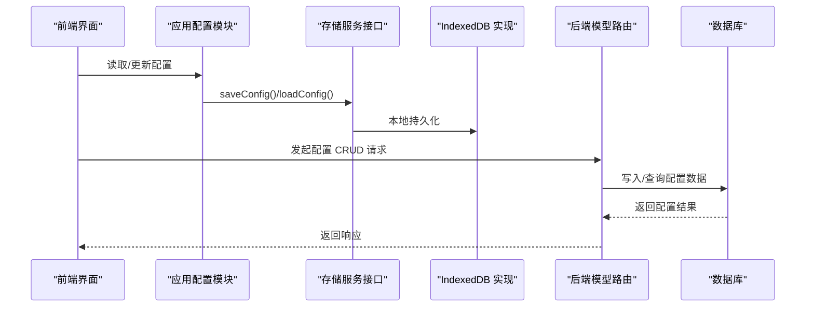
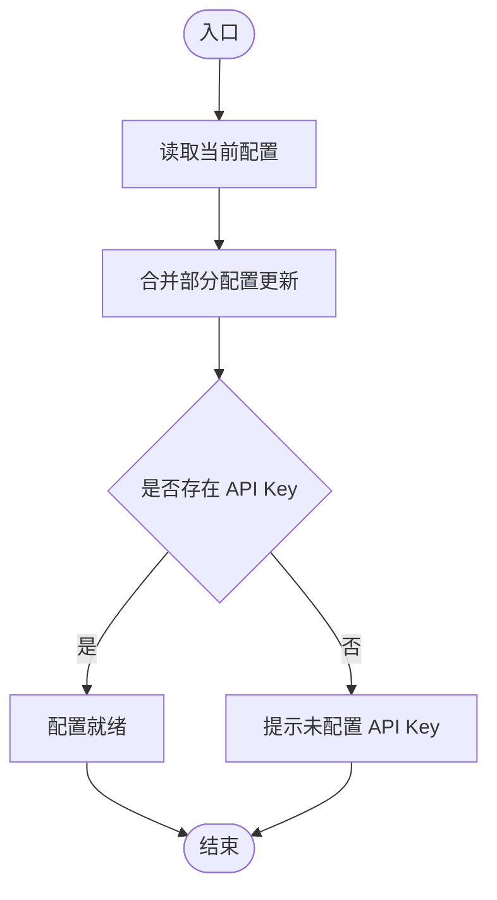
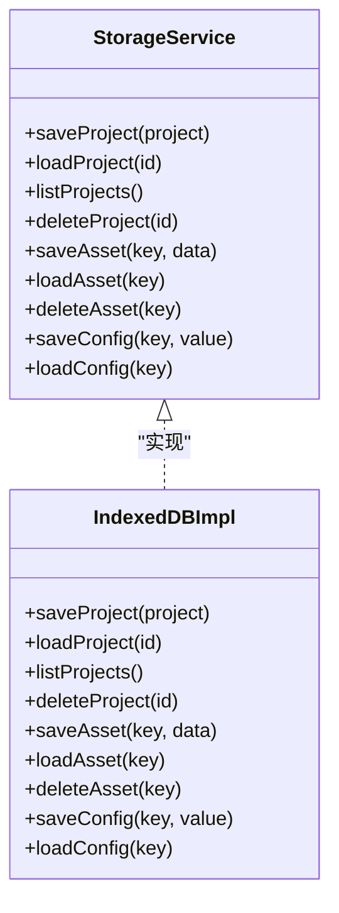
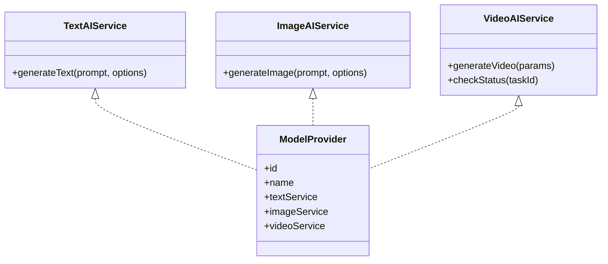
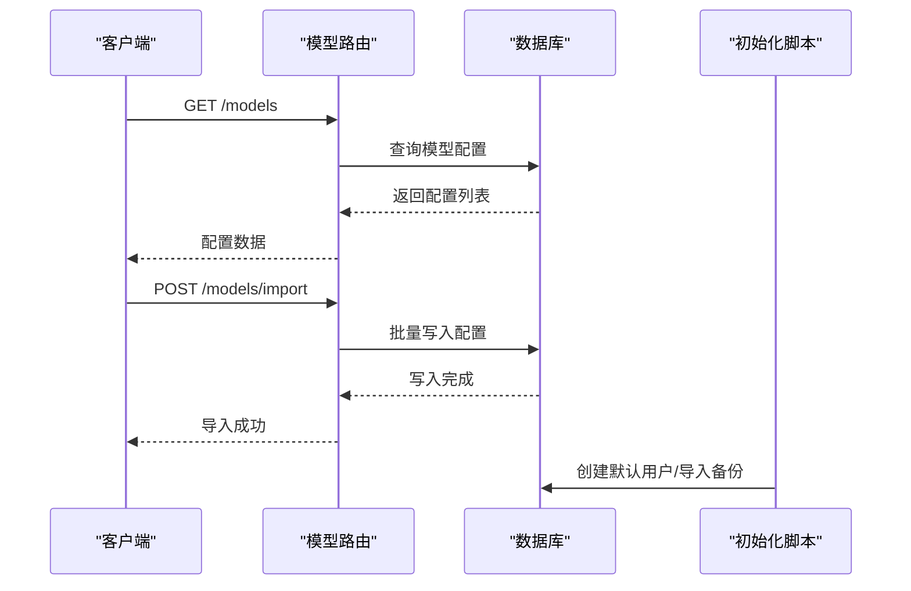
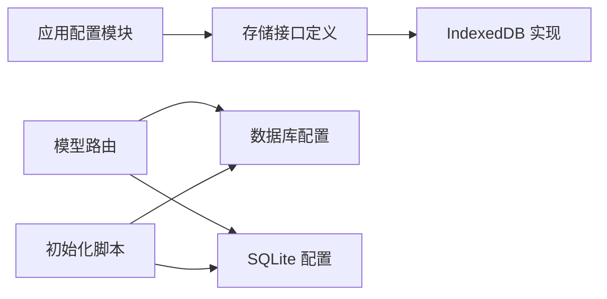

# 模型配置服务

<cite>
**本文档引用的文件**
- [src/config.ts](file://src/config.ts)
- [src/services/storage/types.ts](file://src/services/storage/types.ts)
- [src/services/storage/index.ts](file://src/services/storage/index.ts)
- [src/services/storage/indexeddb.ts](file://src/services/storage/indexeddb.ts)
- [src/services/ai/types.ts](file://src/services/ai/types.ts)
- [src/services/ai/dashscope.ts](file://src/services/ai/dashscope.ts)
- [src/services/ai/index.ts](file://src/services/ai/index.ts)
- [server/src/routes/models.ts](file://server/src/routes/models.ts)
- [server/src/config/database.ts](file://server/src/config/database.ts)
- [server/src/config/sqliteDatabase.ts](file://server/src/config/sqliteDatabase.ts)
- [server/src/scripts/seed.ts](file://server/src/scripts/seed.ts)
- [README.md](file://README.md)
</cite>

## 目录
1. [简介](#简介)
2. [项目结构](#项目结构)
3. [核心组件](#核心组件)
4. [架构总览](#架构总览)
5. [详细组件分析](#详细组件分析)
6. [依赖关系分析](#依赖关系分析)
7. [性能考虑](#性能考虑)
8. [故障排除指南](#故障排除指南)
9. [结论](#结论)
10. [附录](#附录)

## 简介
本文件围绕“模型配置服务”进行系统性技术文档整理，重点覆盖以下方面：
- 数据管理机制：配置持久化、配置验证、配置同步
- CRUD操作、配置导入导出、批量配置管理
- 配置变更通知机制、配置版本控制、配置备份恢复策略
- API使用示例、配置模板管理、配置迁移指南

在当前代码库中，模型配置服务由前端配置模块与后端存储层共同构成，前端通过应用配置模块管理运行时参数，后端通过存储服务接口抽象实现配置的持久化与读取。

## 项目结构
模型配置服务涉及的文件主要分布在以下位置：
- 前端配置与存储：src/config.ts、src/services/storage/*
- AI服务与模型提供方：src/services/ai/*
- 后端路由与数据库：server/src/routes/models.ts、server/src/config/*

```mermaid
graph TB
subgraph "前端"
CFG["应用配置<br/>src/config.ts"]
STI["存储接口定义<br/>src/services/storage/types.ts"]
STIDX["IndexedDB 实现<br/>src/services/storage/indexeddb.ts"]
STIDX --> STI
CFG --> STI
end
subgraph "后端"
RTMODELS["模型路由<br/>server/src/routes/models.ts"]
DB["数据库配置<br/>server/src/config/database.ts"]
SQLITE["SQLite 配置<br/>server/src/config/sqliteDatabase.ts"]
SEED["初始化脚本<br/>server/src/scripts/seed.ts"]
RTMODELS --> DB
RTMODELS --> SQLITE
SEED --> DB
SEED --> SQLITE
end
CFG <- --> RTMODELS
STI --> RTMODELS
```

**图表来源**
- [src/config.ts:1-46](file://src/config.ts#L1-L46)
- [src/services/storage/types.ts:15-30](file://src/services/storage/types.ts#L15-L30)
- [src/services/storage/indexeddb.ts](file://src/services/storage/indexeddb.ts)
- [server/src/routes/models.ts](file://server/src/routes/models.ts)
- [server/src/config/database.ts](file://server/src/config/database.ts)
- [server/src/config/sqliteDatabase.ts](file://server/src/config/sqliteDatabase.ts)
- [server/src/scripts/seed.ts](file://server/src/scripts/seed.ts)

**章节来源**
- [src/config.ts:1-46](file://src/config.ts#L1-L46)
- [src/services/storage/types.ts:15-30](file://src/services/storage/types.ts#L15-L30)
- [src/services/storage/indexeddb.ts](file://src/services/storage/indexeddb.ts)
- [server/src/routes/models.ts](file://server/src/routes/models.ts)
- [server/src/config/database.ts](file://server/src/config/database.ts)
- [server/src/config/sqliteDatabase.ts](file://server/src/config/sqliteDatabase.ts)
- [server/src/scripts/seed.ts](file://server/src/scripts/seed.ts)

## 核心组件
- 应用配置模块：提供全局配置读写能力，支持设置 API Key、基础地址、模型名称等。
- 存储服务接口：定义通用的配置存取契约，便于替换不同存储后端。
- IndexedDB 实现：在浏览器环境中提供本地持久化能力。
- AI 服务与模型提供方：定义文本、图像、视频生成服务及模型提供商抽象。
- 后端模型路由：负责模型配置的 CRUD、导入导出与批量管理。
- 数据库与初始化脚本：提供配置数据的持久化与种子数据导入能力。

**章节来源**
- [src/config.ts:26-46](file://src/config.ts#L26-L46)
- [src/services/storage/types.ts:15-30](file://src/services/storage/types.ts#L15-L30)
- [src/services/storage/indexeddb.ts](file://src/services/storage/indexeddb.ts)
- [src/services/ai/types.ts:66-72](file://src/services/ai/types.ts#L66-L72)
- [server/src/routes/models.ts](file://server/src/routes/models.ts)
- [server/src/config/database.ts](file://server/src/config/database.ts)
- [server/src/config/sqliteDatabase.ts](file://server/src/config/sqliteDatabase.ts)
- [server/src/scripts/seed.ts](file://server/src/scripts/seed.ts)

## 架构总览
模型配置服务采用“前端配置 + 后端存储”的分层架构：
- 前端通过应用配置模块管理运行时参数，并通过存储接口与后端交互。
- 后端通过模型路由处理配置的增删改查、导入导出与批量管理。
- 数据库层提供持久化能力，支持 MySQL 与 SQLite 两种模式。



**图表来源**
- [src/config.ts:28-46](file://src/config.ts#L28-L46)
- [src/services/storage/types.ts:27-30](file://src/services/storage/types.ts#L27-L30)
- [src/services/storage/indexeddb.ts](file://src/services/storage/indexeddb.ts)
- [server/src/routes/models.ts](file://server/src/routes/models.ts)
- [server/src/config/database.ts](file://server/src/config/database.ts)

## 详细组件分析

### 应用配置模块（前端）
- 功能职责
  - 提供全局配置读取与更新接口
  - 支持设置 API Key、基础地址、模型名称等
  - 提供是否已配置 API Key 的判断
- 关键行为
  - 深拷贝默认配置，避免直接修改原始默认值
  - 合并部分配置以支持逐项更新
- 性能与可靠性
  - 运行时内存中的配置对象，读写开销低
  - 与存储服务配合实现跨会话持久化



**图表来源**
- [src/config.ts:26-46](file://src/config.ts#L26-L46)

**章节来源**
- [src/config.ts:16-46](file://src/config.ts#L16-L46)

### 存储服务接口与 IndexedDB 实现
- 存储接口定义
  - 项目操作：保存、加载、列出、删除项目
  - 资产操作：保存、加载、删除二进制资产
  - 配置操作：保存、加载任意类型配置
- IndexedDB 实现要点
  - 作为浏览器端持久化方案，提供键值对存储
  - 与存储接口契约保持一致，便于替换为其他实现



**图表来源**
- [src/services/storage/types.ts:15-30](file://src/services/storage/types.ts#L15-L30)
- [src/services/storage/indexeddb.ts](file://src/services/storage/indexeddb.ts)

**章节来源**
- [src/services/storage/types.ts:15-30](file://src/services/storage/types.ts#L15-L30)
- [src/services/storage/indexeddb.ts](file://src/services/storage/indexeddb.ts)

### AI 服务与模型提供方抽象
- 文本、图像、视频服务接口定义
- 模型提供商抽象：包含文本、图像、视频三类服务实例
- DashScope 示例实现：展示如何对接具体厂商服务



**图表来源**
- [src/services/ai/types.ts:18-72](file://src/services/ai/types.ts#L18-L72)
- [src/services/ai/dashscope.ts](file://src/services/ai/dashscope.ts)

**章节来源**
- [src/services/ai/types.ts:6-72](file://src/services/ai/types.ts#L6-L72)
- [src/services/ai/dashscope.ts](file://src/services/ai/dashscope.ts)

### 后端模型路由与数据库
- 模型路由：提供模型配置的 CRUD、导入导出与批量管理接口
- 数据库配置：支持 MySQL 与 SQLite 两种模式
- 初始化脚本：用于创建默认管理员与导入备份数据



**图表来源**
- [server/src/routes/models.ts](file://server/src/routes/models.ts)
- [server/src/config/database.ts](file://server/src/config/database.ts)
- [server/src/config/sqliteDatabase.ts](file://server/src/config/sqliteDatabase.ts)
- [server/src/scripts/seed.ts](file://server/src/scripts/seed.ts)

**章节来源**
- [server/src/routes/models.ts](file://server/src/routes/models.ts)
- [server/src/config/database.ts](file://server/src/config/database.ts)
- [server/src/config/sqliteDatabase.ts](file://server/src/config/sqliteDatabase.ts)
- [server/src/scripts/seed.ts](file://server/src/scripts/seed.ts)

## 依赖关系分析
- 前端依赖
  - 应用配置模块依赖存储接口契约
  - 存储接口通过 IndexedDB 实现落地
- 后端依赖
  - 模型路由依赖数据库配置（MySQL 或 SQLite）
  - 初始化脚本依赖数据库配置进行种子数据导入



**图表来源**
- [src/config.ts:28-46](file://src/config.ts#L28-L46)
- [src/services/storage/types.ts:15-30](file://src/services/storage/types.ts#L15-L30)
- [src/services/storage/indexeddb.ts](file://src/services/storage/indexeddb.ts)
- [server/src/routes/models.ts](file://server/src/routes/models.ts)
- [server/src/config/database.ts](file://server/src/config/database.ts)
- [server/src/config/sqliteDatabase.ts](file://server/src/config/sqliteDatabase.ts)
- [server/src/scripts/seed.ts](file://server/src/scripts/seed.ts)

**章节来源**
- [src/config.ts:26-46](file://src/config.ts#L26-L46)
- [src/services/storage/types.ts:15-30](file://src/services/storage/types.ts#L15-L30)
- [src/services/storage/indexeddb.ts](file://src/services/storage/indexeddb.ts)
- [server/src/routes/models.ts](file://server/src/routes/models.ts)
- [server/src/config/database.ts](file://server/src/config/database.ts)
- [server/src/config/sqliteDatabase.ts](file://server/src/config/sqliteDatabase.ts)
- [server/src/scripts/seed.ts](file://server/src/scripts/seed.ts)

## 性能考虑
- 前端配置读写
  - 使用内存中的配置对象，读写延迟低
  - 通过存储接口实现持久化，避免刷新丢失
- 存储层优化
  - IndexedDB 适合小到中等规模配置数据
  - 对于大规模配置，建议评估分片或压缩策略
- 后端性能
  - 批量导入导出应分批处理，避免阻塞主线程
  - 数据库连接池与索引优化有助于提升查询性能

## 故障排除指南
- 未配置 API Key
  - 现象：无法调用 AI 服务
  - 处理：通过应用配置模块设置 API Key
- 存储异常
  - 现象：配置无法持久化或读取失败
  - 处理：检查 IndexedDB 可用性与权限
- 数据库连接问题
  - 现象：模型配置 CRUD 失败
  - 处理：确认数据库配置正确，初始化脚本执行成功
- 导入失败
  - 现象：导入备份数据后配置未生效
  - 处理：检查备份格式与字段一致性，重新执行初始化脚本

**章节来源**
- [src/config.ts:40-46](file://src/config.ts#L40-L46)
- [src/services/storage/indexeddb.ts](file://src/services/storage/indexeddb.ts)
- [server/src/config/database.ts](file://server/src/config/database.ts)
- [server/src/scripts/seed.ts](file://server/src/scripts/seed.ts)

## 结论
模型配置服务通过“前端配置 + 后端存储”的架构实现了配置的统一管理与持久化。前端提供灵活的配置读写能力，后端提供可靠的持久化与批量管理能力。结合初始化脚本与数据库配置，系统具备良好的可扩展性与可维护性。

## 附录

### API 使用示例（基于现有路由）
- 获取模型配置列表
  - 方法：GET
  - 路径：/models
  - 说明：返回当前所有模型配置
- 导入配置
  - 方法：POST
  - 路径：/models/import
  - 说明：批量导入配置数据
- 导出配置
  - 方法：GET
  - 路径：/models/export
  - 说明：导出当前配置数据
- 批量管理
  - 方法：PUT/PATCH/DELETE
  - 路径：/models/batch
  - 说明：支持批量更新或删除配置

**章节来源**
- [server/src/routes/models.ts](file://server/src/routes/models.ts)

### 配置模板管理
- 建议在导入前准备标准化的配置模板，确保字段一致性
- 模板应包含必填字段与可选字段说明，便于批量导入

### 配置迁移指南
- 迁移前备份
  - 使用导出接口导出现有配置
- 版本对照
  - 对照新旧配置字段映射关系
- 分批导入
  - 先导入少量样本验证，再进行全量导入
- 校验与回滚
  - 导入后校验配置完整性，必要时回滚至备份

**章节来源**
- [server/src/routes/models.ts](file://server/src/routes/models.ts)
- [server/src/scripts/seed.ts](file://server/src/scripts/seed.ts)