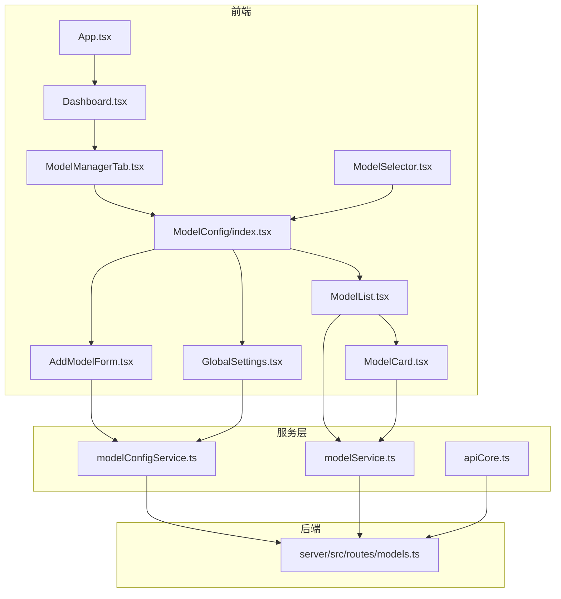
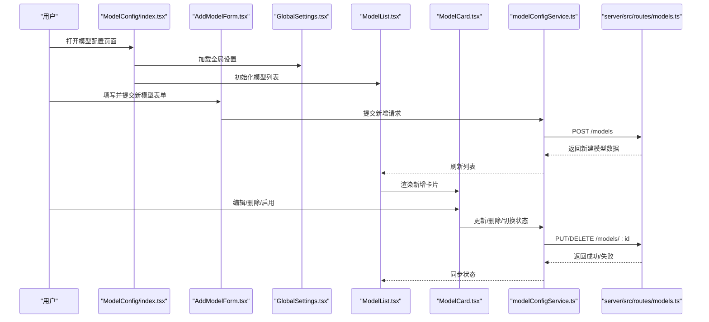
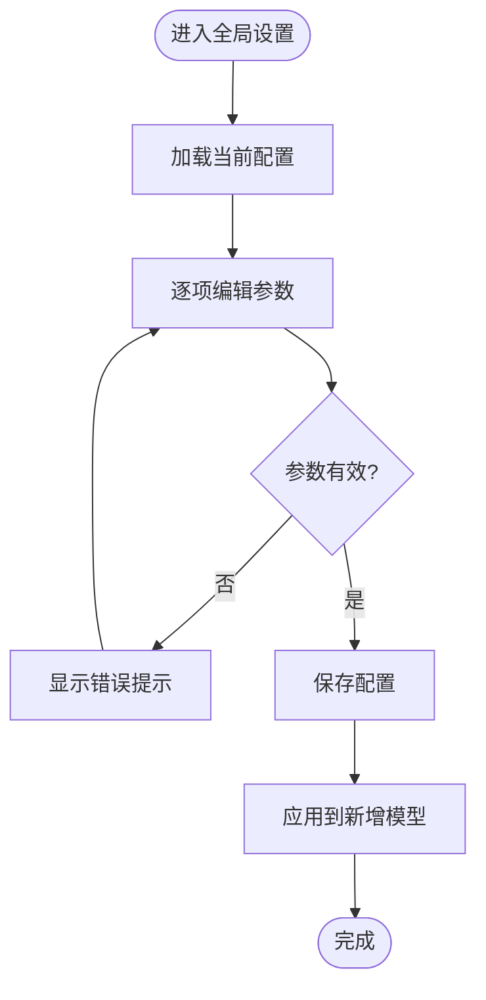
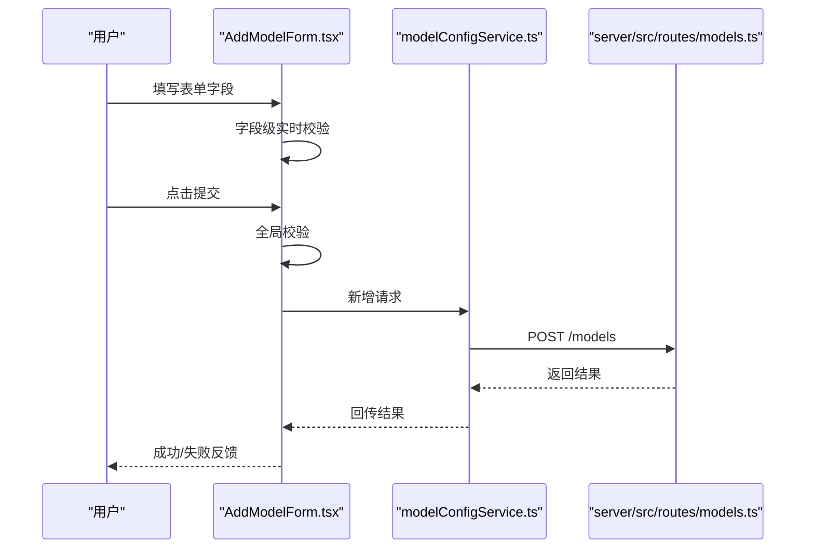
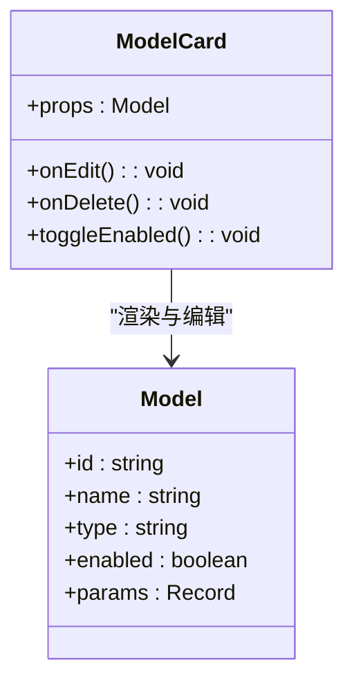
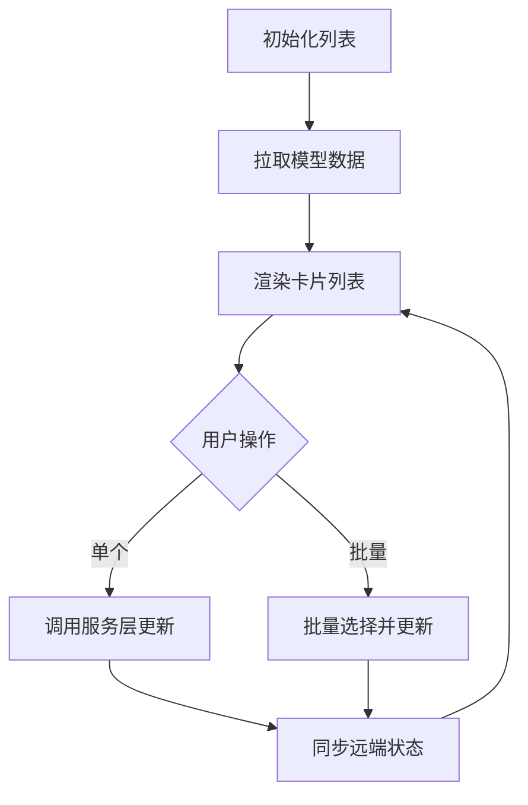
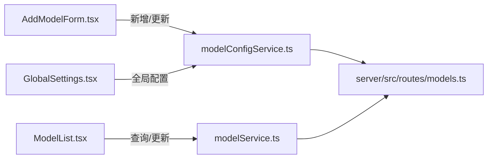
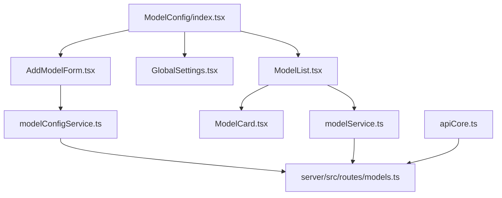

# 模型配置界面

<cite>
**本文档引用的文件**
- [App.tsx](file://App.tsx)
- [Dashboard.tsx](file://components/Dashboard.tsx)
- [ModelManagerTab.tsx](file://components/ModelManagerTab.tsx)
- [ModelSelector.tsx](file://components/ModelSelector.tsx)
- [ModelConfig/index.tsx](file://components/ModelConfig/index.tsx)
- [ModelConfig/AddModelForm.tsx](file://components/ModelConfig/AddModelForm.tsx)
- [ModelConfig/GlobalSettings.tsx](file://components/ModelConfig/GlobalSettings.tsx)
- [ModelConfig/ModelCard.tsx](file://components/ModelConfig/ModelCard.tsx)
- [ModelConfig/ModelList.tsx](file://components/ModelConfig/ModelList.tsx)
- [modelConfigService.ts](file://services/modelConfigService.ts)
- [modelService.ts](file://services/modelService.ts)
- [model.ts](file://types/model.ts)
- [apiCore.ts](file://services/ai/apiCore.ts)
- [models.ts](file://server/src/routes/models.ts)
</cite>

## 目录
1. [简介](#简介)
2. [项目结构](#项目结构)
3. [核心组件](#核心组件)
4. [架构总览](#架构总览)
5. [详细组件分析](#详细组件分析)
6. [依赖关系分析](#依赖关系分析)
7. [性能考虑](#性能考虑)
8. [故障排除指南](#故障排除指南)
9. [结论](#结论)
10. [附录](#附录)

## 简介
本文件面向“模型配置界面”的设计与实现，系统性阐述全局设置面板、模型添加表单、模型卡片展示、以及模型列表管理等核心模块的交互流程与数据绑定机制。文档重点说明组件间通信、状态同步策略、表单验证与实时预览能力，并提供可操作的使用示例、定制化选项与用户体验优化建议。

## 项目结构
模型配置界面位于前端组件目录 components/ModelConfig 下，配合服务层 services 与后端路由 server/src/routes/models.ts 实现完整的增删改查与持久化流程。整体采用分层架构：UI 层负责交互与展示；服务层封装数据访问与业务逻辑；后端路由提供 REST 接口。

**图表来源**
- [ModelConfig/index.tsx](file://components/ModelConfig/index.tsx)
- [ModelConfig/AddModelForm.tsx](file://components/ModelConfig/AddModelForm.tsx)
- [ModelConfig/GlobalSettings.tsx](file://components/ModelConfig/GlobalSettings.tsx)
- [ModelConfig/ModelCard.tsx](file://components/ModelConfig/ModelCard.tsx)
- [ModelConfig/ModelList.tsx](file://components/ModelConfig/ModelList.tsx)
- [ModelManagerTab.tsx](file://components/ModelManagerTab.tsx)
- [ModelSelector.tsx](file://components/ModelSelector.tsx)
- [Dashboard.tsx](file://components/Dashboard.tsx)
- [App.tsx](file://App.tsx)
- [modelConfigService.ts](file://services/modelConfigService.ts)
- [modelService.ts](file://services/modelService.ts)
- [apiCore.ts](file://services/ai/apiCore.ts)
- [models.ts](file://server/src/routes/models.ts)

**章节来源**
- [App.tsx](file://App.tsx)
- [Dashboard.tsx](file://components/Dashboard.tsx)
- [ModelManagerTab.tsx](file://components/ModelManagerTab.tsx)
- [ModelSelector.tsx](file://components/ModelSelector.tsx)
- [ModelConfig/index.tsx](file://components/ModelConfig/index.tsx)

## 核心组件
- 全局设置面板（GlobalSettings）
  - 职责：集中管理模型相关全局参数，如默认推理参数、可用模型列表、服务端点配置等。
  - 数据绑定：通过服务层读取/写入配置，支持实时预览与回滚。
  - 验证：对必填字段与数值范围进行校验，错误提示在面板内即时显示。
- 模型添加表单（AddModelForm）
  - 职责：提供新增模型的输入界面，包含模型名称、类型、参数、权重等字段。
  - 表单验证：字段级校验与联动校验（如权重总和限制），提交前统一校验。
  - 实时预览：参数变更时触发预览更新，避免无效提交。
- 模型卡片展示（ModelCard）
  - 职责：以卡片形式展示单个模型的摘要信息，支持编辑、启用/禁用、删除等操作。
  - 交互：点击进入详情页或弹出编辑对话框；批量操作支持多选。
- 模型列表管理（ModelList）
  - 职责：维护模型集合，支持排序、筛选、分页与批量操作。
  - 状态同步：与服务层保持双向同步，本地变更即时反映到远端。
- 组件入口与容器（ModelConfig/index.tsx）
  - 职责：聚合上述子组件，协调布局与路由，作为页面容器承载全局状态。

**章节来源**
- [ModelConfig/GlobalSettings.tsx](file://components/ModelConfig/GlobalSettings.tsx)
- [ModelConfig/AddModelForm.tsx](file://components/ModelConfig/AddModelForm.tsx)
- [ModelConfig/ModelCard.tsx](file://components/ModelConfig/ModelCard.tsx)
- [ModelConfig/ModelList.tsx](file://components/ModelConfig/ModelList.tsx)
- [ModelConfig/index.tsx](file://components/ModelConfig/index.tsx)

## 架构总览
模型配置界面遵循“视图-服务-路由”三层架构。UI 层通过服务层抽象与后端交互，服务层封装网络请求与缓存策略，后端提供标准 REST 接口。

**图表来源**
- [ModelConfig/index.tsx](file://components/ModelConfig/index.tsx)
- [ModelConfig/AddModelForm.tsx](file://components/ModelConfig/AddModelForm.tsx)
- [ModelConfig/GlobalSettings.tsx](file://components/ModelConfig/GlobalSettings.tsx)
- [ModelConfig/ModelList.tsx](file://components/ModelConfig/ModelList.tsx)
- [ModelConfig/ModelCard.tsx](file://components/ModelConfig/ModelCard.tsx)
- [modelConfigService.ts](file://services/modelConfigService.ts)
- [models.ts](file://server/src/routes/models.ts)

## 详细组件分析

### 全局设置面板（GlobalSettings）
- 设计理念
  - 将分散的模型参数收敛到统一入口，降低用户学习成本。
  - 支持快速切换默认模型、调整全局推理参数，便于批量配置。
- 交互流程
  - 加载：启动时从服务层拉取全局配置。
  - 编辑：逐项修改并即时保存，支持撤销。
  - 应用：保存后触发全局刷新，确保后续新增模型继承最新默认值。
- 数据绑定与验证
  - 使用受控组件绑定字段值，结合服务层进行格式与范围校验。
  - 错误信息在面板内就近提示，避免跨组件传播复杂度。
- 实时预览
  - 关键参数变更时触发预览回调，减少无效提交。

**图表来源**
- [ModelConfig/GlobalSettings.tsx](file://components/ModelConfig/GlobalSettings.tsx)
- [modelConfigService.ts](file://services/modelConfigService.ts)

**章节来源**
- [ModelConfig/GlobalSettings.tsx](file://components/ModelConfig/GlobalSettings.tsx)
- [modelConfigService.ts](file://services/modelConfigService.ts)

### 模型添加表单（AddModelForm）
- 设计理念
  - 结构化表单，按“基本信息-参数-高级选项”分段，提升可读性与可操作性。
  - 字段级与全局联动校验，减少无效提交。
- 交互流程
  - 输入：用户填写模型名称、类型、参数等。
  - 校验：实时校验与提交前校验双重保障。
  - 提交：调用服务层发起新增请求，等待后端响应。
  - 成功：刷新列表并重置表单；失败：展示错误并定位问题字段。
- 数据绑定与验证
  - 使用受控组件绑定字段，结合服务层进行必填、格式与范围校验。
  - 权重类参数支持联动校验（如总和限制）。
- 实时预览
  - 参数变更时触发预览回调，帮助用户理解参数影响。

**图表来源**
- [ModelConfig/AddModelForm.tsx](file://components/ModelConfig/AddModelForm.tsx)
- [modelConfigService.ts](file://services/modelConfigService.ts)
- [models.ts](file://server/src/routes/models.ts)

**章节来源**
- [ModelConfig/AddModelForm.tsx](file://components/ModelConfig/AddModelForm.tsx)
- [modelConfigService.ts](file://services/modelConfigService.ts)

### 模型卡片展示（ModelCard）
- 设计理念
  - 卡片内聚合关键信息与常用操作，减少跳转层级，提升操作效率。
  - 支持状态指示（启用/禁用）、快捷操作（编辑、删除、复制）。
- 交互流程
  - 查看：展示模型摘要与状态。
  - 编辑：打开编辑对话框，支持参数微调。
  - 删除：二次确认，防止误删。
  - 启用/禁用：一键切换，立即生效并同步至服务端。
- 数据绑定与状态同步
  - 卡片状态与服务层保持一致，本地变更即时反映到远端。
  - 多选模式支持批量操作，减少重复劳动。

**图表来源**
- [ModelConfig/ModelCard.tsx](file://components/ModelConfig/ModelCard.tsx)
- [types/model.ts](file://types/model.ts)

**章节来源**
- [ModelConfig/ModelCard.tsx](file://components/ModelConfig/ModelCard.tsx)
- [types/model.ts](file://types/model.ts)

### 模型列表管理（ModelList）
- 设计理念
  - 提供模型集合的统一视图，支持排序、筛选、分页与批量操作。
  - 与服务层保持双向同步，确保数据一致性。
- 交互流程
  - 初始化：拉取模型列表并渲染卡片。
  - 操作：单个卡片操作或批量操作（全选/反选）。
  - 同步：每次操作后触发服务层更新，随后刷新本地列表。
- 性能优化
  - 列表虚拟化与懒加载，避免大数据量时的卡顿。
  - 差量更新策略，仅刷新受影响的卡片。

**图表来源**
- [ModelConfig/ModelList.tsx](file://components/ModelConfig/ModelList.tsx)
- [modelService.ts](file://services/modelService.ts)

**章节来源**
- [ModelConfig/ModelList.tsx](file://components/ModelConfig/ModelList.tsx)
- [modelService.ts](file://services/modelService.ts)

### 组件通信与状态同步
- 通信机制
  - 父子组件：通过 props 传递数据与回调，保证单向数据流。
  - 兄弟组件：通过共同父组件或共享上下文进行事件广播。
  - 跨层级：通过服务层统一暴露方法，屏蔽底层细节。
- 状态同步
  - 本地状态：用于表单输入与UI交互反馈。
  - 远端状态：通过服务层与后端同步，确保一致性。
  - 冲突处理：采用乐观更新与回滚策略，提升交互流畅度。

**图表来源**
- [ModelConfig/AddModelForm.tsx](file://components/ModelConfig/AddModelForm.tsx)
- [ModelConfig/GlobalSettings.tsx](file://components/ModelConfig/GlobalSettings.tsx)
- [ModelConfig/ModelList.tsx](file://components/ModelConfig/ModelList.tsx)
- [modelConfigService.ts](file://services/modelConfigService.ts)
- [modelService.ts](file://services/modelService.ts)
- [models.ts](file://server/src/routes/models.ts)

**章节来源**
- [ModelConfig/AddModelForm.tsx](file://components/ModelConfig/AddModelForm.tsx)
- [ModelConfig/GlobalSettings.tsx](file://components/ModelConfig/GlobalSettings.tsx)
- [ModelConfig/ModelList.tsx](file://components/ModelConfig/ModelList.tsx)
- [modelConfigService.ts](file://services/modelConfigService.ts)
- [modelService.ts](file://services/modelService.ts)

## 依赖关系分析
- 组件耦合
  - ModelConfig/index.tsx 作为容器，聚合其他子组件，耦合度适中。
  - 子组件之间通过服务层解耦，避免直接互相依赖。
- 外部依赖
  - 服务层依赖后端路由提供数据接口。
  - AI 服务通过 apiCore.ts 与模型配置协同工作。
- 循环依赖
  - 当前结构未发现循环依赖，建议后续扩展时保持单向依赖。

**图表来源**
- [ModelConfig/index.tsx](file://components/ModelConfig/index.tsx)
- [ModelConfig/AddModelForm.tsx](file://components/ModelConfig/AddModelForm.tsx)
- [ModelConfig/GlobalSettings.tsx](file://components/ModelConfig/GlobalSettings.tsx)
- [ModelConfig/ModelList.tsx](file://components/ModelConfig/ModelList.tsx)
- [ModelConfig/ModelCard.tsx](file://components/ModelConfig/ModelCard.tsx)
- [modelConfigService.ts](file://services/modelConfigService.ts)
- [modelService.ts](file://services/modelService.ts)
- [apiCore.ts](file://services/ai/apiCore.ts)
- [models.ts](file://server/src/routes/models.ts)

**章节来源**
- [ModelConfig/index.tsx](file://components/ModelConfig/index.tsx)
- [modelConfigService.ts](file://services/modelConfigService.ts)
- [modelService.ts](file://services/modelService.ts)
- [models.ts](file://server/src/routes/models.ts)

## 性能考虑
- 列表渲染优化
  - 对大型列表启用虚拟滚动与分页，减少 DOM 节点数量。
  - 使用稳定 key 与不可变更新策略，避免不必要的重渲染。
- 请求与缓存
  - 合理设置请求节流与防抖，避免频繁刷新。
  - 在服务层引入缓存策略，优先返回本地缓存数据，异步刷新远端数据。
- 交互反馈
  - 对耗时操作显示加载状态与进度条，提升感知速度。
  - 提供取消与重试机制，增强可控性。

## 故障排除指南
- 常见问题
  - 表单提交失败：检查必填字段与格式校验，查看服务层返回的错误码与消息。
  - 列表不刷新：确认服务层是否正确触发刷新，检查网络请求状态与权限。
  - 卡片状态异常：核对本地状态与远端状态是否一致，必要时执行回滚。
- 调试建议
  - 使用浏览器开发者工具监控网络请求与响应。
  - 在服务层增加日志输出，记录关键操作的时间戳与参数。
  - 对关键路径添加单元测试，覆盖边界条件与异常分支。

**章节来源**
- [modelConfigService.ts](file://services/modelConfigService.ts)
- [modelService.ts](file://services/modelService.ts)

## 结论
模型配置界面通过清晰的分层架构与组件化设计，实现了全局设置、模型添加、卡片展示与列表管理的完整闭环。依托服务层与后端路由，系统具备良好的扩展性与稳定性。建议在后续迭代中进一步完善批量操作、导入导出与审计日志能力，持续优化用户体验与开发效率。

## 附录
- 使用示例
  - 新增模型：打开全局设置，填写基础信息与参数，点击提交；提交成功后在列表中可见。
  - 编辑模型：在模型卡片上点击编辑，修改参数后保存；保存成功后状态同步至远端。
  - 删除模型：在卡片上点击删除，确认后触发删除请求；删除成功后列表自动刷新。
- 定制化选项
  - 自定义字段：在表单中添加或隐藏特定字段，满足不同模型类型的差异化需求。
  - 主题适配：根据主题切换调整颜色与排版，确保在深色/浅色模式下均清晰易读。
- 用户体验优化建议
  - 增加“最近使用”与“收藏”功能，便于高频模型的快速访问。
  - 提供模板库与一键导入，降低首次配置成本。
  - 优化移动端交互，确保小屏设备上的可操作性与可读性。