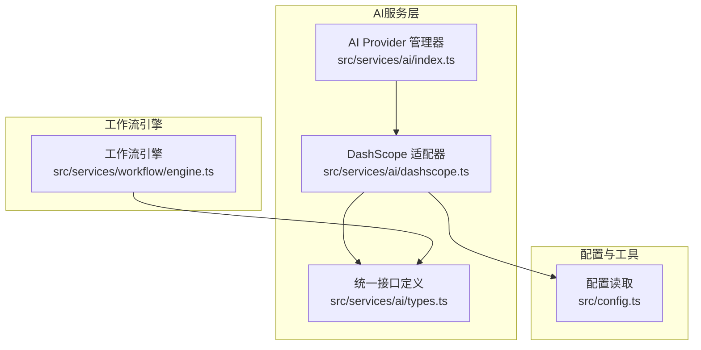
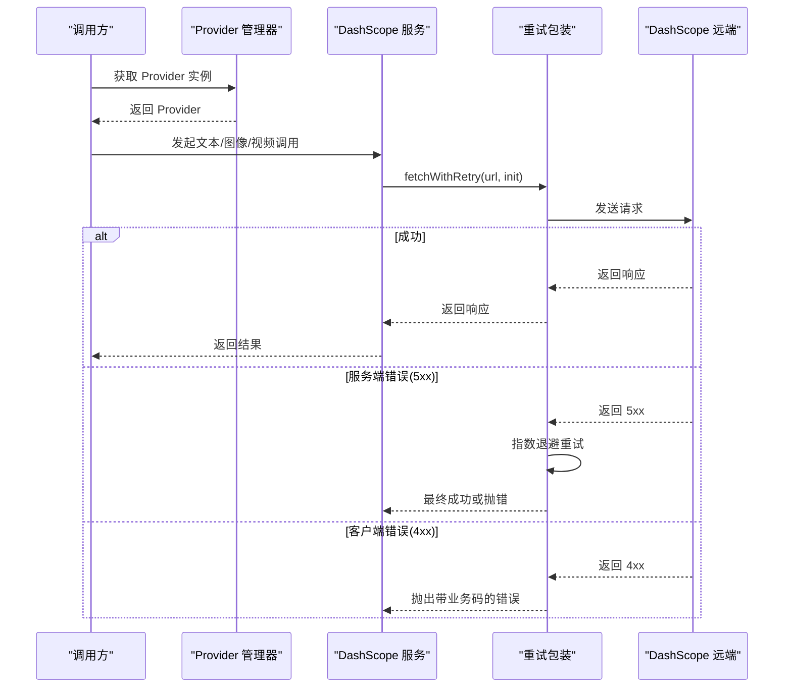
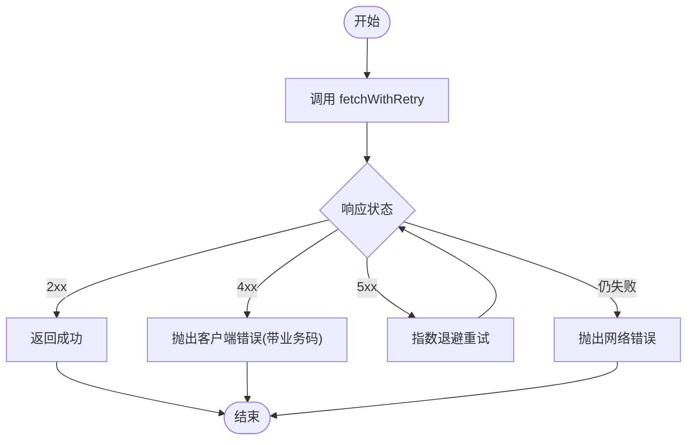
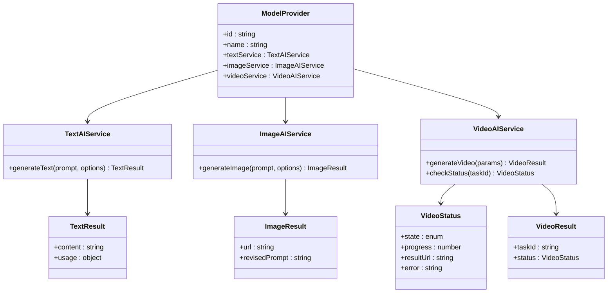
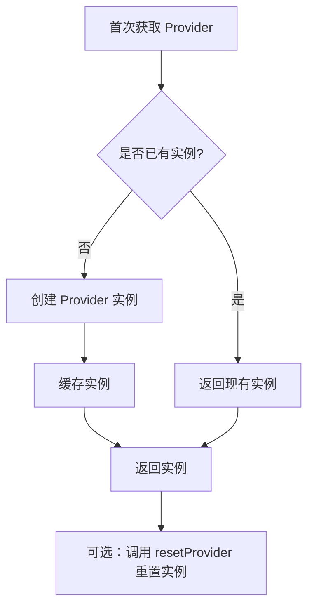
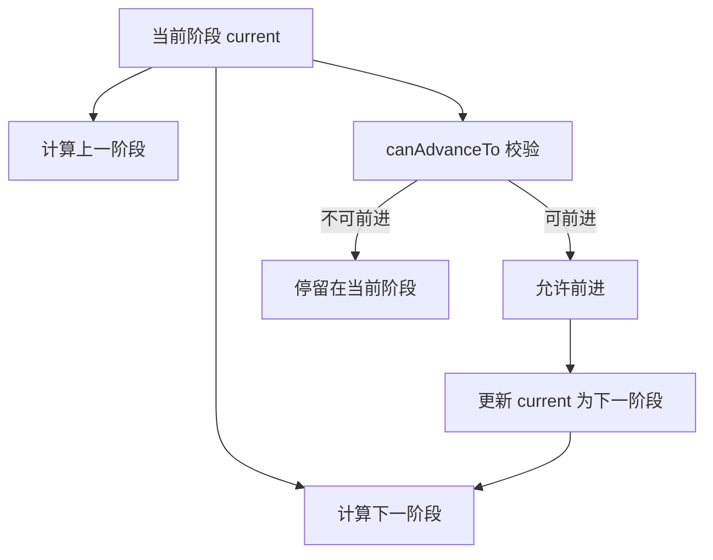
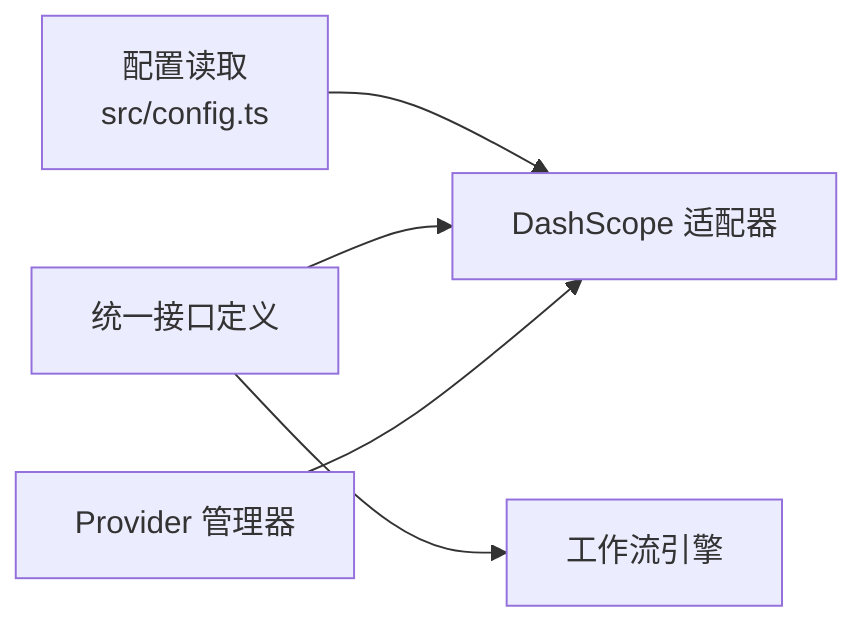

# 错误处理与监控

<cite>
**本文引用的文件**
- [src/services/ai/dashscope.ts](file://src/services/ai/dashscope.ts)
- [src/services/ai/types.ts](file://src/services/ai/types.ts)
- [src/services/ai/index.ts](file://src/services/ai/index.ts)
- [src/services/workflow/engine.ts](file://src/services/workflow/engine.ts)
- [src/config.ts](file://src/config.ts)
</cite>

## 目录
1. [引言](#引言)
2. [项目结构](#项目结构)
3. [核心组件](#核心组件)
4. [架构总览](#架构总览)
5. [详细组件分析](#详细组件分析)
6. [依赖关系分析](#依赖关系分析)
7. [性能考量](#性能考量)
8. [故障排查指南](#故障排查指南)
9. [结论](#结论)
10. [附录](#附录)

## 引言
本文件聚焦于AI服务中的错误处理与监控，覆盖常见错误类型、错误处理策略、重试机制设计、API调用失败与模型不可用、资源限制等异常场景，并结合工作流引擎的状态推进与进度追踪，给出可落地的错误恢复、日志记录、告警通知与性能监控建议。目标是帮助开发者与运维人员快速定位问题、稳定系统运行。

## 项目结构
本项目前端侧采用模块化服务设计，AI能力通过统一接口抽象，具体厂商适配以“适配器”形式实现。DashScope适配器负责封装文本、图像、视频三类AI服务的调用细节与错误处理。工作流引擎负责阶段推进与状态校验，为任务执行提供结构化的进度与完整性约束。

**图表来源**
- [src/services/ai/index.ts:1-34](file://src/services/ai/index.ts#L1-L34)
- [src/services/ai/dashscope.ts:1-327](file://src/services/ai/dashscope.ts#L1-L327)
- [src/services/ai/types.ts:1-73](file://src/services/ai/types.ts#L1-L73)
- [src/services/workflow/engine.ts:1-120](file://src/services/workflow/engine.ts#L1-L120)
- [src/config.ts](file://src/config.ts)

**章节来源**
- [src/services/ai/index.ts:1-34](file://src/services/ai/index.ts#L1-L34)
- [src/services/ai/dashscope.ts:1-327](file://src/services/ai/dashscope.ts#L1-L327)
- [src/services/ai/types.ts:1-73](file://src/services/ai/types.ts#L1-L73)
- [src/services/workflow/engine.ts:1-120](file://src/services/workflow/engine.ts#L1-L120)
- [src/config.ts](file://src/config.ts)

## 核心组件
- DashScope 适配器：封装文本、图像、视频三类AI服务，内置统一的错误类型、重试与轮询机制。
- 统一接口定义：定义文本、图像、视频服务的输入输出规范与状态枚举，确保跨厂商一致性。
- Provider 管理器：集中管理当前使用的AI提供商实例，支持重置与切换。
- 工作流引擎：基于阶段顺序推进与完整性校验，为任务执行提供进度与状态同步依据。

**章节来源**
- [src/services/ai/dashscope.ts:47-93](file://src/services/ai/dashscope.ts#L47-L93)
- [src/services/ai/types.ts:6-73](file://src/services/ai/types.ts#L6-L73)
- [src/services/ai/index.ts:22-33](file://src/services/ai/index.ts#L22-L33)
- [src/services/workflow/engine.ts:83-117](file://src/services/workflow/engine.ts#L83-L117)

## 架构总览
下图展示从调用方到DashScope适配器、再到远端服务的调用链路与错误处理位置。

**图表来源**
- [src/services/ai/dashscope.ts:58-93](file://src/services/ai/dashscope.ts#L58-L93)
- [src/services/ai/dashscope.ts:96-139](file://src/services/ai/dashscope.ts#L96-L139)
- [src/services/ai/dashscope.ts:219-255](file://src/services/ai/dashscope.ts#L219-L255)
- [src/services/ai/dashscope.ts:258-315](file://src/services/ai/dashscope.ts#L258-L315)

## 详细组件分析

### DashScope 适配器：错误类型与重试策略
- 错误类型
  - 认证类：缺少或无效API Key、认证失败。
  - 配额/频率类：请求过于频繁或配额超限。
  - 服务端类：远端服务内部错误。
  - 客户端类：请求参数错误等。
  - 任务类：任务提交失败、任务失败、任务超时、任务完成但无结果URL。
  - 网络类：网络不可达、连接超时等。
- 重试策略
  - 对5xx错误进行指数退避重试，最多重试固定次数。
  - 对4xx错误直接抛出带业务码的错误，避免无意义重试。
  - 网络错误统一归类为网络错误，便于上层识别与处理。
- 轮询与超时
  - 异步任务提交后，按固定间隔轮询任务状态，超过最大等待时间则判定超时。
  - 将远端状态映射为统一的本地状态，便于UI与工作流引擎消费。

**图表来源**
- [src/services/ai/dashscope.ts:58-93](file://src/services/ai/dashscope.ts#L58-L93)

**章节来源**
- [src/services/ai/dashscope.ts:47-93](file://src/services/ai/dashscope.ts#L47-L93)
- [src/services/ai/dashscope.ts:201-216](file://src/services/ai/dashscope.ts#L201-L216)

### 统一接口定义：状态与结果规范
- 文本服务：输入提示词与可选参数，输出内容与用量信息。
- 图像服务：输入提示词与尺寸/风格等参数，输出图片URL与修正后的提示词。
- 视频服务：输入提示词与可选参数，输出任务ID与初始状态；支持独立查询状态。
- 视频状态：统一的状态枚举与进度字段，便于UI与工作流引擎消费。

**图表来源**
- [src/services/ai/types.ts:6-73](file://src/services/ai/types.ts#L6-L73)

**章节来源**
- [src/services/ai/types.ts:6-73](file://src/services/ai/types.ts#L6-L73)

### Provider 管理器：实例化与重置
- 单例化Provider，避免重复初始化。
- 提供重置方法，便于在配置变更或认证失效时重建实例。

**图表来源**
- [src/services/ai/index.ts:22-33](file://src/services/ai/index.ts#L22-L33)

**章节来源**
- [src/services/ai/index.ts:22-33](file://src/services/ai/index.ts#L22-L33)

### 工作流引擎：阶段推进与状态校验
- 阶段顺序：脚本 → 资产 → 导演 → 导出。
- 推进规则：可自由回退；前进需满足前序阶段全部完成。
- 状态计算：根据各阶段完成度与缺失项，计算完成百分比与缺失要求列表。

**图表来源**
- [src/services/workflow/engine.ts:83-117](file://src/services/workflow/engine.ts#L83-L117)

**章节来源**
- [src/services/workflow/engine.ts:83-117](file://src/services/workflow/engine.ts#L83-L117)

## 依赖关系分析
- DashScope 适配器依赖统一接口定义，确保不同厂商的实现遵循同一契约。
- Provider 管理器集中持有 Provider 实例，降低耦合度，便于后续扩展其他厂商。
- 工作流引擎依赖统一接口定义中的状态与结果类型，用于阶段推进与进度展示。
- 配置读取模块为适配器提供API Key与基础URL等运行时参数。

**图表来源**
- [src/services/ai/dashscope.ts:11-24](file://src/services/ai/dashscope.ts#L11-L24)
- [src/services/ai/types.ts:6-73](file://src/services/ai/types.ts#L6-L73)
- [src/services/workflow/engine.ts:6-7](file://src/services/workflow/engine.ts#L6-L7)
- [src/services/ai/index.ts:5-29](file://src/services/ai/index.ts#L5-L29)

**章节来源**
- [src/services/ai/dashscope.ts:11-24](file://src/services/ai/dashscope.ts#L11-L24)
- [src/services/ai/types.ts:6-73](file://src/services/ai/types.ts#L6-L73)
- [src/services/workflow/engine.ts:6-7](file://src/services/workflow/engine.ts#L6-L7)
- [src/services/ai/index.ts:5-29](file://src/services/ai/index.ts#L5-L29)

## 性能考量
- 重试退避：指数退避可缓解瞬时抖动，但应结合熔断与超时上限，避免雪崩。
- 轮询间隔与超时：合理设置轮询间隔与最大等待时间，兼顾用户体验与资源占用。
- 并发控制：对外部API并发请求进行节流，避免触发配额限制。
- 缓存与降级：对热点数据与常用配置进行缓存；在下游不稳定时提供降级策略（如默认文案、示例图）。
- 监控指标：建议采集请求成功率、P95/P99延迟、重试次数、任务完成率、配额使用率等。

## 故障排查指南
- 认证失败
  - 现象：出现认证无效或配额超限错误。
  - 处理：检查配置中的API Key是否正确、是否过期；确认账户配额与频率限制。
  - 参考
    - [src/services/ai/dashscope.ts:39-45](file://src/services/ai/dashscope.ts#L39-L45)
    - [src/services/ai/dashscope.ts:68-78](file://src/services/ai/dashscope.ts#L68-L78)
- 服务端错误
  - 现象：远端返回5xx错误。
  - 处理：查看重试日志与退避间隔；必要时临时降低并发或启用熔断。
  - 参考
    - [src/services/ai/dashscope.ts:63-67](file://src/services/ai/dashscope.ts#L63-L67)
- 任务失败/超时
  - 现象：异步任务完成后无结果URL或长时间未完成。
  - 处理：检查任务ID与轮询逻辑；确认最大等待时间与轮询间隔设置；记录失败原因以便复盘。
  - 参考
    - [src/services/ai/dashscope.ts:207-215](file://src/services/ai/dashscope.ts#L207-L215)
    - [src/services/ai/dashscope.ts:294-311](file://src/services/ai/dashscope.ts#L294-L311)
- 配置缺失
  - 现象：启动时报错提示未配置API Key。
  - 处理：在模型配置页面补充API Key；重启应用使配置生效。
  - 参考
    - [src/services/ai/dashscope.ts:39-45](file://src/services/ai/dashscope.ts#L39-L45)
- 工作流卡住
  - 现象：无法前进到下一阶段。
  - 处理：检查当前阶段的完成度与缺失要求；补齐所需素材或内容后再前进。
  - 参考
    - [src/services/workflow/engine.ts:84-94](file://src/services/workflow/engine.ts#L84-L94)

**章节来源**
- [src/services/ai/dashscope.ts:39-45](file://src/services/ai/dashscope.ts#L39-L45)
- [src/services/ai/dashscope.ts:63-78](file://src/services/ai/dashscope.ts#L63-L78)
- [src/services/ai/dashscope.ts:207-215](file://src/services/ai/dashscope.ts#L207-L215)
- [src/services/ai/dashscope.ts:294-311](file://src/services/ai/dashscope.ts#L294-L311)
- [src/services/workflow/engine.ts:84-94](file://src/services/workflow/engine.ts#L84-L94)

## 结论
通过统一接口抽象与适配器模式，系统实现了跨厂商的一致体验与清晰的错误边界。DashScope适配器提供了完善的重试、轮询与状态映射机制，配合工作流引擎的阶段推进与状态校验，能够有效提升任务执行的稳定性与可观测性。建议在生产环境中进一步完善日志与告警体系，并持续优化重试与熔断策略以应对复杂网络环境。

## 附录
- 建议的日志字段
  - 请求ID、任务ID、阶段、服务类型、状态、错误码、错误消息、耗时、重试次数、重试间隔、上游状态码。
- 建议的告警维度
  - 连续失败次数、单点失败率、任务超时率、配额使用率、下游可用性。
- 建议的监控指标
  - QPS、成功率、P95/P99延迟、重试率、任务完成率、错误分布（按错误码分类）。