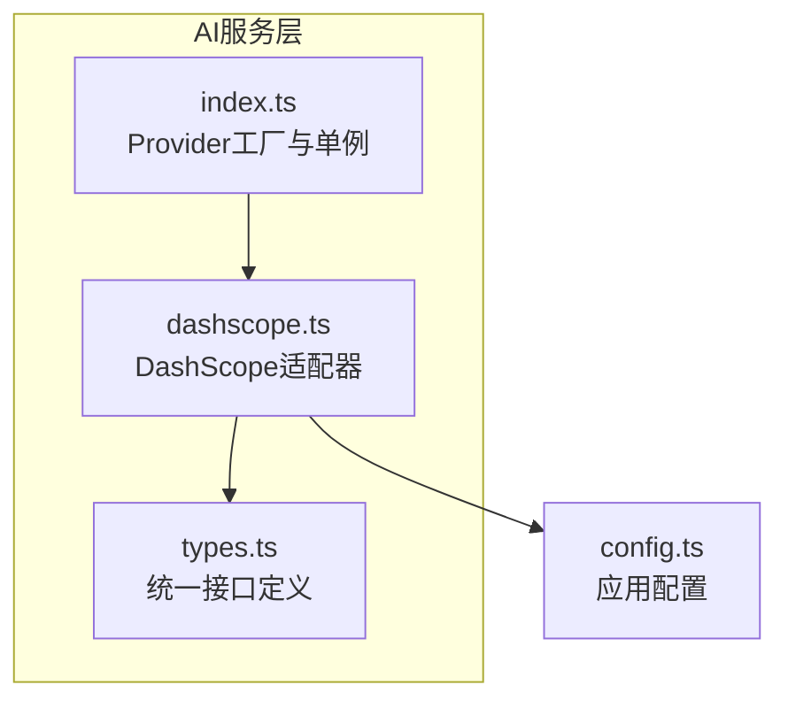
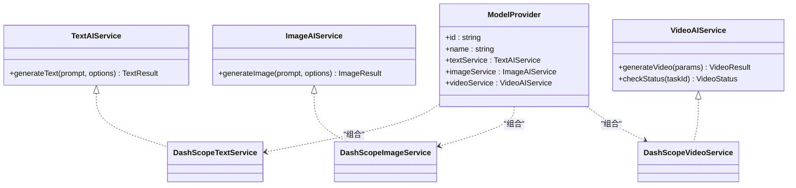
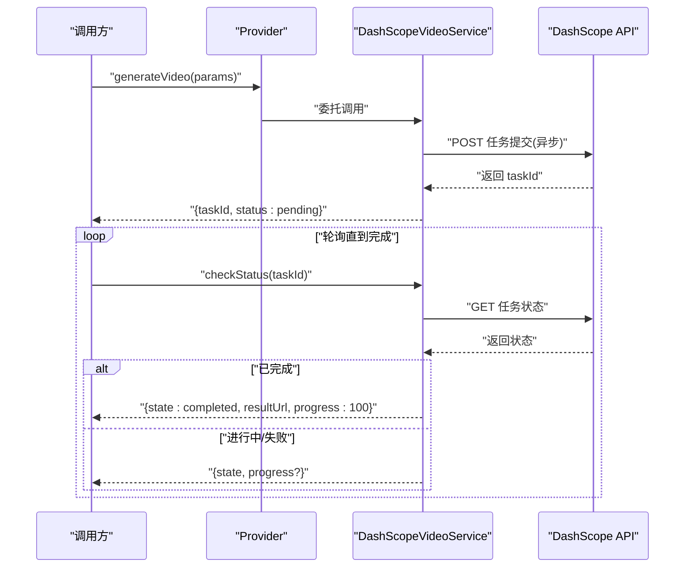
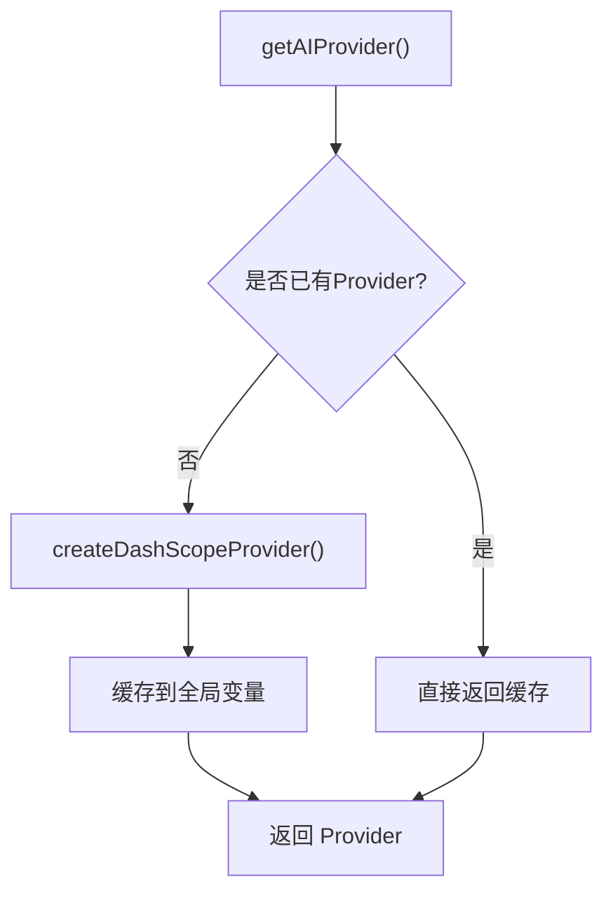
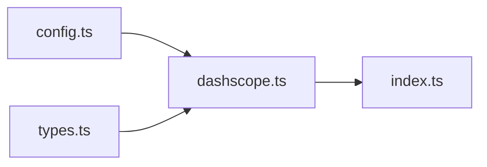

# AI服务API

<cite>
**本文引用的文件**
- [src/services/ai/index.ts](file://src/services/ai/index.ts)
- [src/services/ai/dashscope.ts](file://src/services/ai/dashscope.ts)
- [src/services/ai/types.ts](file://src/services/ai/types.ts)
- [src/config.ts](file://src/config.ts)
</cite>

## 目录
1. [简介](#简介)
2. [项目结构](#项目结构)
3. [核心组件](#核心组件)
4. [架构总览](#架构总览)
5. [详细组件分析](#详细组件分析)
6. [依赖关系分析](#依赖关系分析)
7. [性能考量](#性能考量)
8. [故障排查指南](#故障排查指南)
9. [结论](#结论)
10. [附录](#附录)

## 简介
本文件为 AI Shotlive 的 AI 服务 API 参考文档，聚焦以下能力：
- 文本对话（Chat Completions）
- 图像生成（Text-to-Image）
- 视频生成（Video Generation）

文档覆盖统一接口契约、请求参数、响应格式、异步任务处理与进度查询、错误重试机制，并给出多厂商适配的架构建议与性能优化实践。

## 项目结构
AI 服务位于前端 src/services/ai 目录下，采用“统一接口 + 适配器”的分层设计：
- 接口定义：统一抽象 TextAIService/ImageAIService/VideoAIService 与 ModelProvider
- 适配器实现：DashScope（阿里云）适配器，封装厂商差异
- 配置中心：集中管理 API Key、基础地址与模型名称

**图表来源**
- [src/services/ai/index.ts:1-34](file://src/services/ai/index.ts#L1-L34)
- [src/services/ai/dashscope.ts:1-327](file://src/services/ai/dashscope.ts#L1-L327)
- [src/services/ai/types.ts:1-73](file://src/services/ai/types.ts#L1-L73)
- [src/config.ts:1-46](file://src/config.ts#L1-L46)

**章节来源**
- [src/services/ai/index.ts:1-34](file://src/services/ai/index.ts#L1-L34)
- [src/services/ai/dashscope.ts:1-327](file://src/services/ai/dashscope.ts#L1-L327)
- [src/services/ai/types.ts:1-73](file://src/services/ai/types.ts#L1-L73)
- [src/config.ts:1-46](file://src/config.ts#L1-L46)

## 核心组件
- 统一接口契约：定义文本、图像、视频三类 AI 服务能力的输入输出规范
- DashScope 适配器：实现 OpenAI 兼容文本、异步图像与视频生成
- Provider 管理器：提供单例 Provider 获取与重置能力，便于未来扩展多厂商

关键职责与边界：
- 接口层（types.ts）：不依赖具体厂商，确保跨供应商可替换
- 适配层（dashscope.ts）：封装 DashScope API 的请求、重试、轮询与状态映射
- 管理层（index.ts）：集中创建与缓存 Provider，暴露统一入口
- 配置层（config.ts）：集中读取与更新 API Key、基础地址与模型名

**章节来源**
- [src/services/ai/types.ts:6-72](file://src/services/ai/types.ts#L6-L72)
- [src/services/ai/dashscope.ts:95-326](file://src/services/ai/dashscope.ts#L95-L326)
- [src/services/ai/index.ts:22-33](file://src/services/ai/index.ts#L22-L33)
- [src/config.ts:6-46](file://src/config.ts#L6-L46)

## 架构总览
统一接口 + 适配器 + 配置中心的三层架构，遵循“开放系统设计”与“控制论反馈律”，确保：
- 对外统一契约，对内屏蔽厂商差异
- 异步任务与轮询机制解耦，便于上层灵活调度
- 配置驱动，避免硬编码

**图表来源**
- [src/services/ai/types.ts:18-72](file://src/services/ai/types.ts#L18-L72)
- [src/services/ai/dashscope.ts:96-326](file://src/services/ai/dashscope.ts#L96-L326)

## 详细组件分析

### 统一接口契约（types.ts）
- 文本对话
  - 输入：prompt、temperature、maxTokens、systemPrompt
  - 输出：content、usage（promptTokens、completionTokens）
- 图像生成
  - 输入：prompt、width、height、style、negativePrompt、count
  - 输出：url、revisedPrompt
- 视频生成
  - 输入：prompt、imageUrl、duration、aspectRatio
  - 输出：taskId、status（state、progress、resultUrl、error）
- Provider
  - 组合 textService、imageService、videoService

复杂度与约束：
- 同步/异步：文本为同步，图像与视频为异步
- 参数校验：由各适配器负责（例如 DashScope 的必填项与模型限制）

**章节来源**
- [src/services/ai/types.ts:6-72](file://src/services/ai/types.ts#L6-L72)

### DashScope 适配器（dashscope.ts）
- 文本服务（OpenAI 兼容）
  - 基础地址：兼容模式或原生 API
  - 请求头：Authorization、Content-Type
  - 错误码：401（认证无效）、429（配额超限）、5xx（服务端错误）
- 图像服务（异步）
  - 提交任务：启用异步头，返回 taskId
  - 轮询策略：固定间隔、最大等待时间、指数退避重试
  - 状态映射：PENDING/RUNNING/SUCCEEDED/FAILED/CANCELED/UNKNOWN → pending/processing/completed/failed
- 视频服务（异步）
  - 提交任务立即返回 taskId，上层可自行轮询或使用内置检查
  - 完成态返回视频 URL，失败态返回错误信息

**图表来源**
- [src/services/ai/dashscope.ts:258-315](file://src/services/ai/dashscope.ts#L258-L315)

**章节来源**
- [src/services/ai/dashscope.ts:95-139](file://src/services/ai/dashscope.ts#L95-L139)
- [src/services/ai/dashscope.ts:218-255](file://src/services/ai/dashscope.ts#L218-L255)
- [src/services/ai/dashscope.ts:257-315](file://src/services/ai/dashscope.ts#L257-L315)

### Provider 管理器（index.ts）
- 单例 Provider：首次调用创建，后续复用
- 工厂方法：createDashScopeProvider 返回包含三类服务实例的 Provider
- 重置能力：resetProvider 支持重新初始化

**图表来源**
- [src/services/ai/index.ts:22-33](file://src/services/ai/index.ts#L22-L33)

**章节来源**
- [src/services/ai/index.ts:22-33](file://src/services/ai/index.ts#L22-L33)

### 配置中心（config.ts）
- 配置项：ai.apiKey、ai.baseUrl、ai.textModel、ai.imageModel、ai.videoModel
- 默认值：兼容模式基础地址、qwen-plus、wanx-v1、wanx-video-v1
- 动态更新：setConfig/setApiKey 支持运行时修改

**章节来源**
- [src/config.ts:6-46](file://src/config.ts#L6-L46)

## 依赖关系分析
- Provider 依赖适配器实例
- 适配器依赖配置中心与网络请求
- 统一接口定义被适配器与 Provider 组合使用

**图表来源**
- [src/config.ts:1-46](file://src/config.ts#L1-L46)
- [src/services/ai/dashscope.ts:1-327](file://src/services/ai/dashscope.ts#L1-L327)
- [src/services/ai/types.ts:1-73](file://src/services/ai/types.ts#L1-L73)
- [src/services/ai/index.ts:1-34](file://src/services/ai/index.ts#L1-L34)

**章节来源**
- [src/services/ai/index.ts:1-34](file://src/services/ai/index.ts#L1-L34)
- [src/services/ai/dashscope.ts:1-327](file://src/services/ai/dashscope.ts#L1-L327)
- [src/services/ai/types.ts:1-73](file://src/services/ai/types.ts#L1-L73)
- [src/config.ts:1-46](file://src/config.ts#L1-L46)

## 性能考量
- 异步任务与轮询
  - 固定轮询间隔与最大等待时间，避免长耗时阻塞 UI
  - 成功态优先返回结果 URL，失败态快速上报错误
- 重试策略
  - 仅对 5xx 与网络异常进行指数退避重试，4xx 直接失败
  - 最大重试次数与回退时间可调，平衡成功率与延迟
- 模型选择
  - 文本模型用于对话，图像/视频模型用于生成
  - 通过配置中心动态切换，减少硬编码带来的维护成本

[本节为通用性能建议，无需特定文件引用]

## 故障排查指南
常见错误与定位要点：
- 认证失败（401）
  - 检查 API Key 是否正确配置与有效
  - 确认请求头 Authorization 是否携带
- 配额超限（429）
  - 降低请求频率或提升配额
  - 观察重试策略是否触发
- 服务端错误（5xx）
  - 查看重试日志与退避间隔
  - 关注最大等待时间是否导致任务超时
- 任务失败/超时
  - 使用 checkStatus 获取最终状态与错误信息
  - 确认模型参数与输入格式符合要求

**章节来源**
- [src/services/ai/dashscope.ts:58-93](file://src/services/ai/dashscope.ts#L58-L93)
- [src/services/ai/dashscope.ts:201-216](file://src/services/ai/dashscope.ts#L201-L216)
- [src/services/ai/dashscope.ts:289-314](file://src/services/ai/dashscope.ts#L289-L314)

## 结论
该 AI 服务 API 通过统一接口与适配器模式，实现了对 DashScope 的稳定集成，并提供了：
- 明确的请求参数与响应格式
- 异步任务与进度查询机制
- 完备的错误分类与重试策略
- 配置驱动与可扩展的架构

建议在生产环境中结合业务场景进一步完善：
- 多厂商 Provider 并行与自动切换
- 任务队列与并发控制
- 缓存与预热策略
- 监控与告警体系

[本节为总结性内容，无需特定文件引用]

## 附录

### API 参考速览

- 文本对话（DashScope）
  - 方法：generateText
  - 请求参数：prompt、temperature、maxTokens、systemPrompt
  - 响应字段：content、usage（promptTokens、completionTokens）
  - 错误码：AUTH_INVALID、QUOTA_EXCEEDED、SERVER_ERROR、CLIENT_ERROR、NETWORK_ERROR、EMPTY_RESPONSE

- 图像生成（DashScope）
  - 方法：generateImage
  - 请求参数：prompt、width、height、style、negativePrompt、count
  - 响应字段：url、revisedPrompt
  - 异步流程：提交任务 → 轮询 → 返回结果 URL

- 视频生成（DashScope）
  - 方法：generateVideo、checkStatus
  - 请求参数：prompt、imageUrl、duration、aspectRatio
  - 响应字段：taskId、status（state、progress、resultUrl、error）
  - 异步流程：提交任务 → 上层轮询或内置检查 → 完成态返回 URL

- 配置项
  - ai.apiKey：API 密钥
  - ai.baseUrl：基础地址（兼容模式或原生）
  - ai.textModel、ai.imageModel、ai.videoModel：模型名称

**章节来源**
- [src/services/ai/types.ts:6-72](file://src/services/ai/types.ts#L6-L72)
- [src/services/ai/dashscope.ts:95-139](file://src/services/ai/dashscope.ts#L95-L139)
- [src/services/ai/dashscope.ts:218-255](file://src/services/ai/dashscope.ts#L218-L255)
- [src/services/ai/dashscope.ts:257-315](file://src/services/ai/dashscope.ts#L257-L315)
- [src/config.ts:6-46](file://src/config.ts#L6-L46)