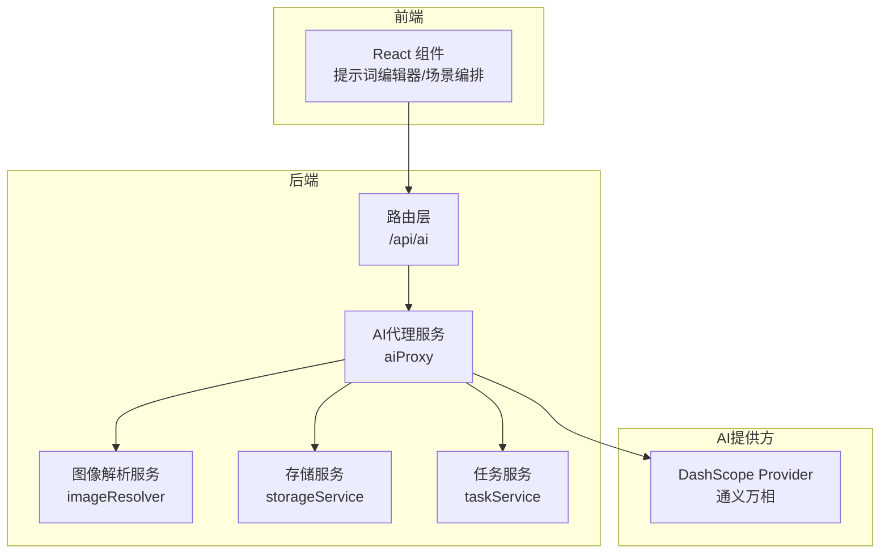
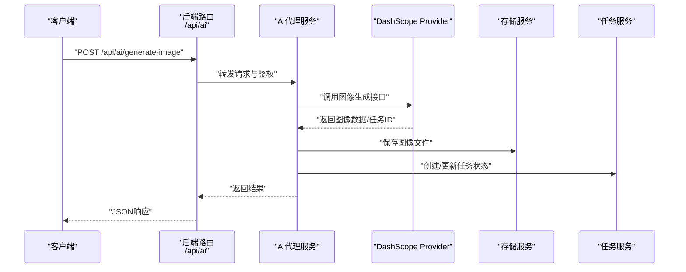
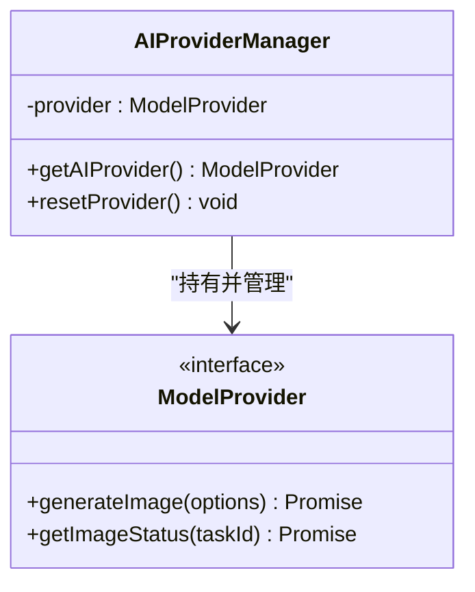
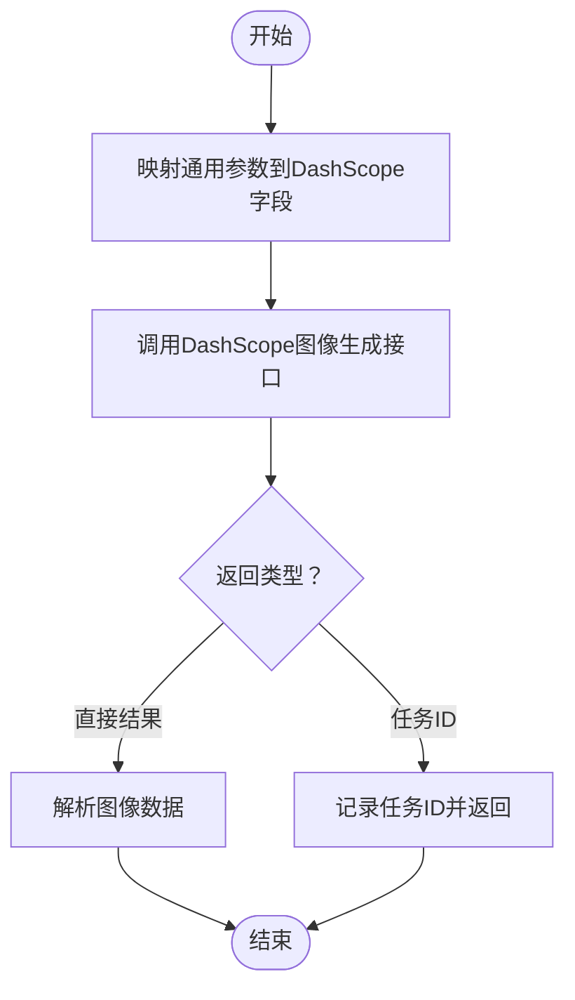
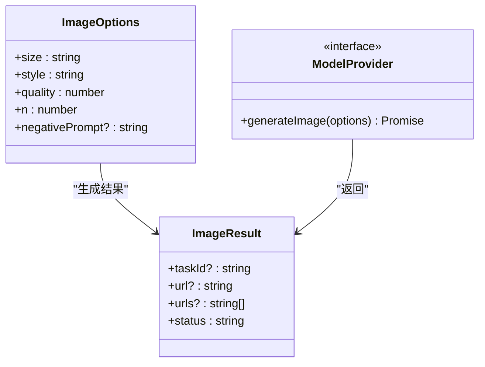
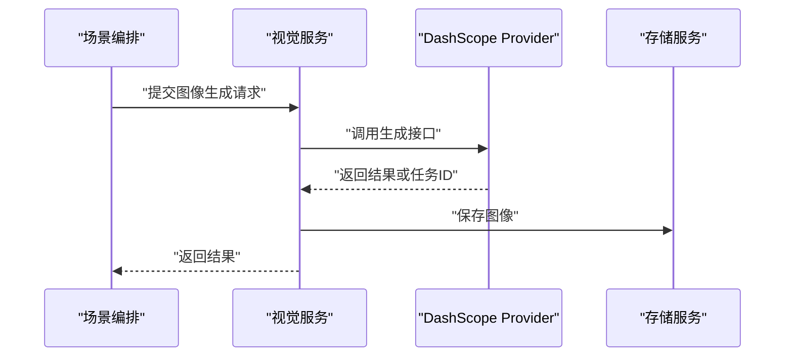
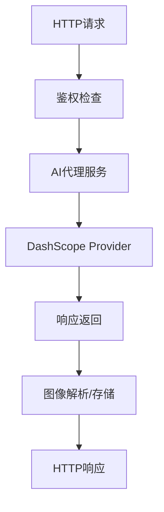
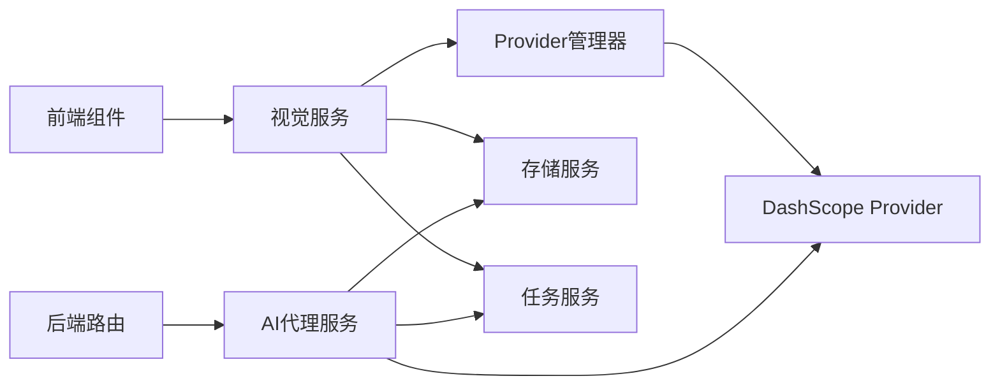

# 图像生成API

<cite>
**本文档引用的文件**
- [index.ts](file://src/services/ai/index.ts)
- [dashscope.ts](file://src/services/ai/dashscope.ts)
- [types.ts](file://src/services/ai/types.ts)
- [promptConstants.ts](file://src/services/ai/promptConstants.ts)
- [visualService.ts](file://src/services/ai/visualService.ts)
- [imageResolver.ts](file://server/src/services/imageResolver.ts)
- [routes/ai.ts](file://server/src/routes/ai.ts)
- [aiProxy.ts](file://server/src/services/aiProxy.ts)
- [storageService.ts](file://src/services/storageService.ts)
- [taskService.ts](file://src/services/taskService.ts)
- [StageAssets/PromptEditor.tsx](file://components/StageAssets/PromptEditor.tsx)
- [StageAssets/constants.ts](file://components/StageAssets/constants.ts)
- [StageDirector/ShotWorkbench.tsx](file://components/StageDirector/ShotWorkbench.tsx)
- [StageDirector/constants.ts](file://components/StageDirector/constants.ts)
- [StagePrompts/PromptEditor.tsx](file://components/StagePrompts/PromptEditor.tsx)
- [StagePrompts/constants.ts](file://components/StagePrompts/constants.ts)
</cite>

## 目录
1. [简介](#简介)
2. [项目结构](#项目结构)
3. [核心组件](#核心组件)
4. [架构总览](#架构总览)
5. [详细组件分析](#详细组件分析)
6. [依赖关系分析](#依赖关系分析)
7. [性能考虑](#性能考虑)
8. [故障排除指南](#故障排除指南)
9. [结论](#结论)
10. [附录](#附录)

## 简介
本文件为图像生成AI服务的API参考文档，面向开发者与集成方，系统性说明图像生成接口的请求参数、响应格式、提示词规范，以及不同AI提供商（当前以通义万相DashScope为主）的适配器实现差异。文档还涵盖图像尺寸、风格、质量等参数配置，提供提示词优化技巧、批量生成、进度查询等实用功能的使用示例与最佳实践。

## 项目结构
该服务采用前后端分离架构，前端使用React组件进行场景编排与提示词编辑，后端通过路由层统一接入AI服务与存储服务。图像生成能力由AI Provider管理器统一调度，当前默认使用DashScope Provider；同时保留扩展其他Provider的空间。

**图表来源**
- [index.ts:1-34](file://src/services/ai/index.ts#L1-L34)
- [routes/ai.ts](file://server/src/routes/ai.ts)
- [aiProxy.ts](file://server/src/services/aiProxy.ts)
- [imageResolver.ts](file://server/src/services/imageResolver.ts)
- [storageService.ts](file://src/services/storageService.ts)
- [taskService.ts](file://src/services/taskService.ts)

**章节来源**
- [index.ts:1-34](file://src/services/ai/index.ts#L1-L34)
- [dashscope.ts](file://src/services/ai/dashscope.ts)
- [types.ts](file://src/services/ai/types.ts)

## 核心组件
- AI Provider管理器：负责加载与复用当前AI提供方实例，默认加载DashScope Provider，支持未来多Provider切换。
- DashScope Provider：封装通义万相图像生成接口，处理请求参数映射、响应解析与错误转换。
- 类型定义：统一文本/图像/视频服务的输入输出类型、选项参数与状态枚举。
- 提示词常量：内置提示词模板与风格约束，辅助生成更稳定的图像结果。
- 视觉服务：整合提示词、风格、尺寸等参数，协调任务执行与结果返回。
- 后端路由与代理：统一对外API入口，转发请求至AI代理服务，处理鉴权与跨域。
- 存储与任务：负责图像文件的持久化、任务状态跟踪与进度查询。

**章节来源**
- [index.ts:1-34](file://src/services/ai/index.ts#L1-L34)
- [dashscope.ts](file://src/services/ai/dashscope.ts)
- [types.ts](file://src/services/ai/types.ts)
- [promptConstants.ts](file://src/services/ai/promptConstants.ts)
- [visualService.ts](file://src/services/ai/visualService.ts)

## 架构总览
下图展示从前端到后端再到AI提供方的整体调用链路，包括鉴权、参数校验、任务调度与结果回传。

**图表来源**
- [routes/ai.ts](file://server/src/routes/ai.ts)
- [aiProxy.ts](file://server/src/services/aiProxy.ts)
- [dashscope.ts](file://src/services/ai/dashscope.ts)
- [storageService.ts](file://src/services/storageService.ts)
- [taskService.ts](file://src/services/taskService.ts)

## 详细组件分析

### AI Provider管理器
- 职责：全局持有当前AI提供方实例，懒加载与重置逻辑确保资源复用与可替换性。
- 设计：遵循“竞争-协同律”，当前仅一个Provider，但架构支持未来多Provider切换与动态选择。

**图表来源**
- [index.ts:1-34](file://src/services/ai/index.ts#L1-L34)
- [types.ts](file://src/services/ai/types.ts)

**章节来源**
- [index.ts:1-34](file://src/services/ai/index.ts#L1-L34)

### DashScope Provider（通义万相）
- 请求参数映射：将通用图像生成选项映射为DashScope所需的尺寸、风格、质量等字段。
- 响应解析：解析生成结果或任务ID，统一返回格式。
- 错误处理：将底层异常转换为标准错误码与消息，便于上层统一处理。
- 扩展点：支持未来接入更多DashScope模型与参数变体。

**图表来源**
- [dashscope.ts](file://src/services/ai/dashscope.ts)

**章节来源**
- [dashscope.ts](file://src/services/ai/dashscope.ts)

### 类型定义与参数规范
- 通用类型：定义文本/图像/视频服务的输入输出类型、选项参数与状态枚举，确保前后端一致。
- 图像选项：包含尺寸、风格、质量、数量等关键参数，用于控制生成效果与性能。
- 状态枚举：统一任务状态（如排队、处理中、完成、失败），便于进度查询与前端反馈。

**图表来源**
- [types.ts](file://src/services/ai/types.ts)

**章节来源**
- [types.ts](file://src/services/ai/types.ts)

### 提示词规范与优化技巧
- 模板化提示词：通过提示词常量模块提供风格、细节、光线等模板，提升一致性与可控性。
- 结构化提示：建议按“主体+风格+环境+质量”组织提示词，避免歧义。
- 负向提示：使用负向提示词排除不想要的元素，提高结果相关性。
- 迭代优化：通过少量参数调整（如风格、质量）快速迭代，减少无效重跑。

**章节来源**
- [promptConstants.ts](file://src/services/ai/promptConstants.ts)

### 视觉服务与工作流
- 参数整合：视觉服务将提示词、风格、尺寸等参数整合，生成标准化请求。
- 任务编排：在场景编排与分镜生成中，统一调用图像生成接口，支持批量与串行执行。
- 结果处理：对接存储服务与任务服务，实现结果落盘与进度追踪。

**图表来源**
- [visualService.ts](file://src/services/ai/visualService.ts)
- [dashscope.ts](file://src/services/ai/dashscope.ts)
- [storageService.ts](file://src/services/storageService.ts)

**章节来源**
- [visualService.ts](file://src/services/ai/visualService.ts)

### 后端路由与代理
- 路由层：统一暴露图像生成API，处理鉴权与CORS。
- 代理服务：封装对AI提供方的调用，负责参数转换、错误转换与结果聚合。
- 图像解析：根据任务ID或URL解析最终图像资源，支持预览与下载。

**图表来源**
- [routes/ai.ts](file://server/src/routes/ai.ts)
- [aiProxy.ts](file://server/src/services/aiProxy.ts)
- [imageResolver.ts](file://server/src/services/imageResolver.ts)

**章节来源**
- [routes/ai.ts](file://server/src/routes/ai.ts)
- [aiProxy.ts](file://server/src/services/aiProxy.ts)
- [imageResolver.ts](file://server/src/services/imageResolver.ts)

## 依赖关系分析
- Provider管理器依赖具体Provider实现（当前DashScope）。
- 视觉服务依赖Provider与存储服务。
- 后端路由依赖代理服务，代理服务再依赖Provider与存储/任务服务。
- 前端组件依赖视觉服务与提示词编辑器，形成闭环的工作流。

**图表来源**
- [index.ts:1-34](file://src/services/ai/index.ts#L1-L34)
- [visualService.ts](file://src/services/ai/visualService.ts)
- [storageService.ts](file://src/services/storageService.ts)
- [taskService.ts](file://src/services/taskService.ts)
- [routes/ai.ts](file://server/src/routes/ai.ts)
- [aiProxy.ts](file://server/src/services/aiProxy.ts)

**章节来源**
- [index.ts:1-34](file://src/services/ai/index.ts#L1-L34)
- [visualService.ts](file://src/services/ai/visualService.ts)

## 性能考虑
- 批量生成：通过增加数量参数与队列化处理，合理分配并发，避免触发限流。
- 尺寸与质量：优先选择适中的尺寸与质量，平衡生成速度与清晰度。
- 缓存策略：对重复提示词与风格组合进行缓存，减少无效请求。
- 异步任务：使用任务ID进行异步查询，降低长耗时阻塞风险。
- 资源清理：定期清理临时文件与过期任务，保持系统稳定。

## 故障排除指南
- 鉴权失败：确认API密钥与权限范围是否正确配置。
- 参数错误：检查尺寸、风格、质量等参数是否符合Provider要求。
- 任务超时：通过任务ID轮询进度，设置合理的重试间隔与上限。
- 存储异常：检查存储路径权限与磁盘空间，确保文件写入成功。
- 网络问题：在网络不稳定时启用重试与断点续传机制。

## 结论
本API以Provider管理器为核心，统一调度DashScope图像生成能力，结合提示词模板、参数规范与任务系统，形成完整的图像生成工作流。通过标准化的类型定义与后端代理层，实现了良好的扩展性与稳定性，便于后续接入更多AI提供方与增强功能。

## 附录

### API参考：图像生成接口
- 接口路径：/api/ai/generate-image
- 方法：POST
- 请求头：
  - Content-Type: application/json
  - Authorization: Bearer <your-api-key>
- 请求体参数（示例字段）：
  - prompt: 提示词字符串
  - negative_prompt: 负向提示词（可选）
  - size: 图像尺寸（如 "1024x1024"）
  - style: 风格标识（如 "photographic", "anime"）
  - quality: 质量等级（数值）
  - n: 生成数量（整数）
- 响应体字段：
  - task_id: 任务ID（异步时存在）
  - url: 单图URL（同步时存在）
  - urls: 多图URL数组（批量时存在）
  - status: 任务状态（如 "completed", "failed"）

### 提示词优化技巧
- 使用明确的主体描述与风格关键词，避免模糊表达。
- 通过负向提示排除不需要的元素，提升相关性。
- 参考提示词常量模板，统一风格与细节描述。
- 对于复杂场景，分步骤细化提示词，逐步收敛结果。

### 批量生成与进度查询
- 批量生成：通过增加数量参数与队列化处理，实现高效批量产出。
- 进度查询：使用任务ID轮询状态，结合前端进度条反馈用户。
- 场景编排：在场景与分镜生成中，统一调度图像生成任务，支持串行与并行组合。