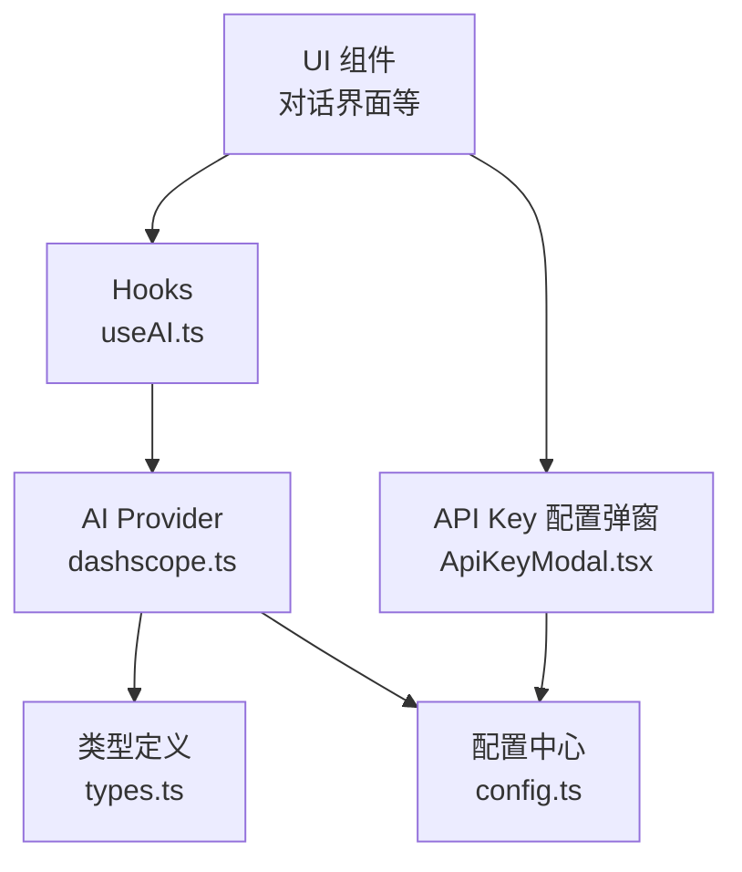
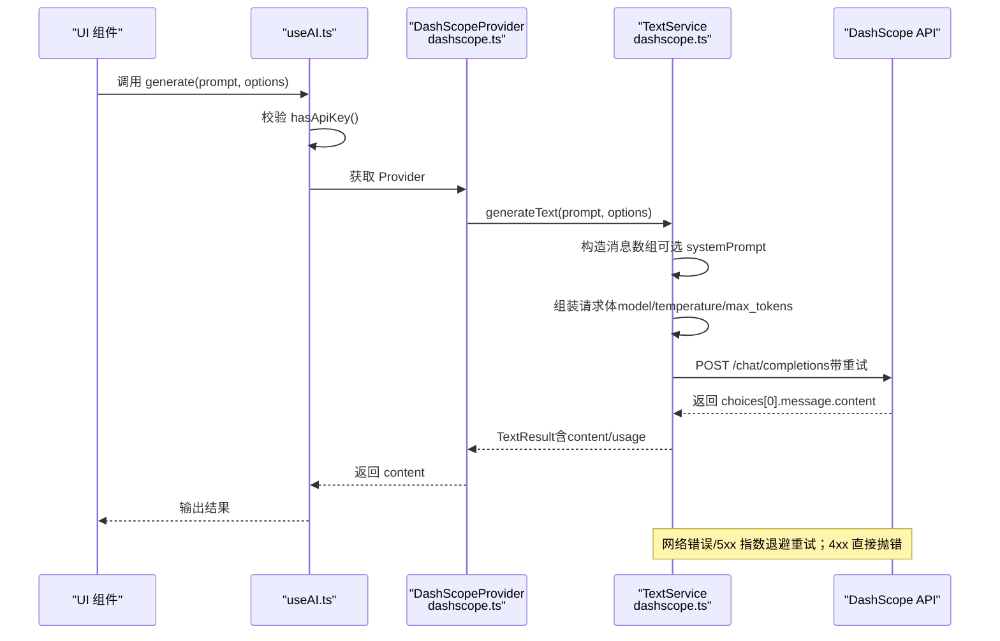
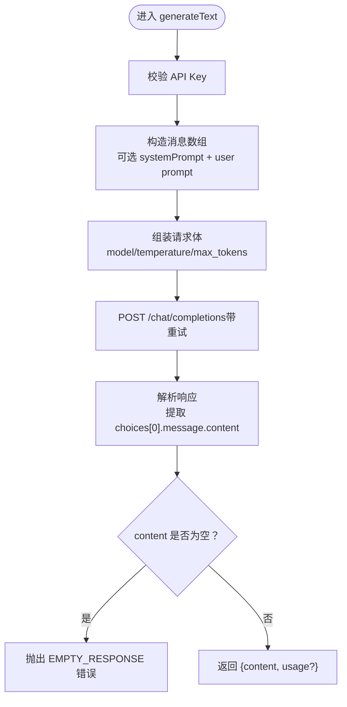
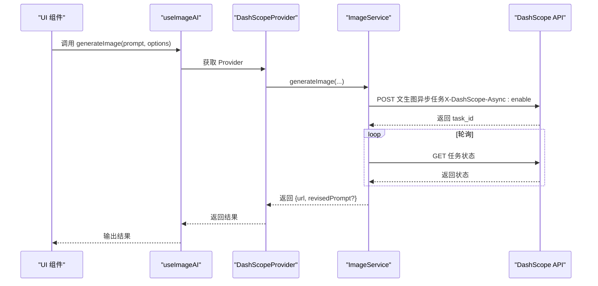
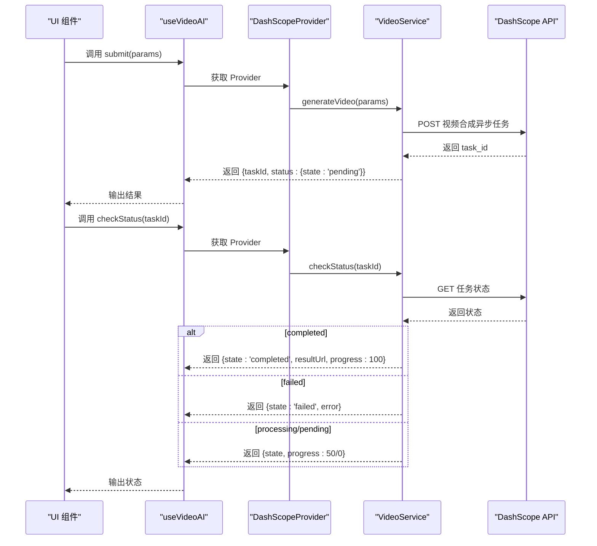
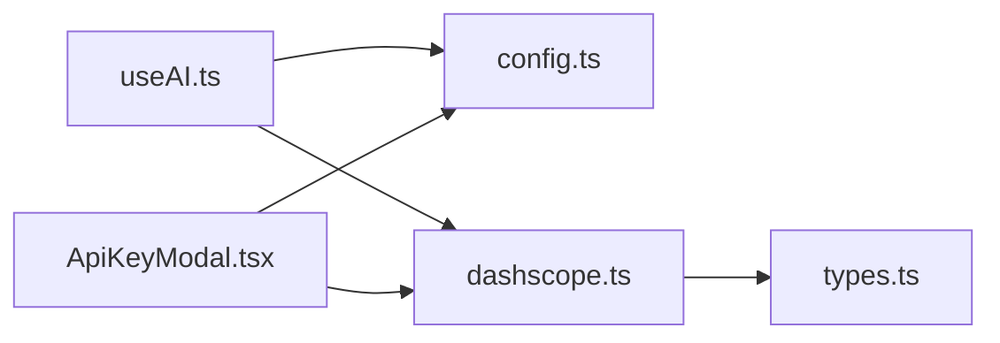

# 对话聊天API

<cite>
**本文档引用的文件**
- [src/services/ai/dashscope.ts](file://src/services/ai/dashscope.ts)
- [src/services/ai/types.ts](file://src/services/ai/types.ts)
- [src/config.ts](file://src/config.ts)
- [src/shared/hooks/useAI.ts](file://src/shared/hooks/useAI.ts)
- [src/shared/components/ApiKeyModal.tsx](file://src/shared/components/ApiKeyModal.tsx)
- [package-lock.json](file://package-lock.json)
</cite>

## 目录
1. [简介](#简介)
2. [项目结构](#项目结构)
3. [核心组件](#核心组件)
4. [架构总览](#架构总览)
5. [详细组件分析](#详细组件分析)
6. [依赖关系分析](#依赖关系分析)
7. [性能考量](#性能考量)
8. [故障排查指南](#故障排查指南)
9. [结论](#结论)
10. [附录](#附录)

## 简介
本文件为“对话聊天AI服务”的API参考文档，聚焦文本对话接口的请求参数、响应格式与上下文管理机制，同时说明当前适配器对通义千问（DashScope/Qwen）的实现细节。文档还涵盖温度参数、最大token数、系统提示词等配置项，以及异步任务轮询、错误重试、并发控制等高级特性。由于当前仓库默认适配器为DashScope，关于其他模型提供商（如GPT系列、Gemini等）的适配差异将以“扩展性”和“接口契约”形式说明，便于后续接入。

## 项目结构
该服务采用前端React + TypeScript架构，AI能力通过统一的Provider与适配器实现解耦。关键模块包括：
- 配置中心：集中管理API Key、基础URL与模型名称
- 类型定义：统一抽象文本/图像/视频AI服务接口
- DashScope适配器：实现文本、图像、视频服务的具体调用
- Hooks：对外暴露统一的useTextAI/useImageAI/useVideoAI调用入口
- 设置界面：提供API Key输入与持久化

图表来源
- [src/shared/hooks/useAI.ts:1-97](file://src/shared/hooks/useAI.ts#L1-L97)
- [src/services/ai/dashscope.ts:1-327](file://src/services/ai/dashscope.ts#L1-L327)
- [src/services/ai/types.ts:1-73](file://src/services/ai/types.ts#L1-L73)
- [src/config.ts:1-47](file://src/config.ts#L1-L47)
- [src/shared/components/ApiKeyModal.tsx:1-47](file://src/shared/components/ApiKeyModal.tsx#L1-L47)

章节来源
- [src/shared/hooks/useAI.ts:1-97](file://src/shared/hooks/useAI.ts#L1-L97)
- [src/services/ai/dashscope.ts:1-327](file://src/services/ai/dashscope.ts#L1-L327)
- [src/services/ai/types.ts:1-73](file://src/services/ai/types.ts#L1-L73)
- [src/config.ts:1-47](file://src/config.ts#L1-L47)
- [src/shared/components/ApiKeyModal.tsx:1-47](file://src/shared/components/ApiKeyModal.tsx#L1-L47)

## 核心组件
- 配置中心（config.ts）
  - 提供全局应用配置读取与更新，包含AI相关字段：apiKey、baseUrl、textModel、imageModel、videoModel
  - 支持动态设置API Key与检测是否已配置
- 类型定义（types.ts）
  - 定义文本、图像、视频三类AI服务的统一接口与数据结构
  - 文本服务：generateText(prompt, options?) → TextResult
  - 图像服务：generateImage(prompt, options?) → ImageResult
  - 视频服务：generateVideo(params) → VideoResult；checkStatus(taskId) → VideoStatus
- DashScope适配器（dashscope.ts）
  - 实现TextAIService/ImageAIService/VideoAIService
  - 封装OpenAI兼容模式文本接口、异步图像/视频任务提交与轮询
  - 内置指数退避重试、错误码映射与超时控制
- Hooks（useAI.ts）
  - 对外暴露useTextAI/useImageAI/useVideoAI，统一loading/error状态
  - 调用前校验API Key，异常时捕获并回传友好错误信息
- API Key配置弹窗（ApiKeyModal.tsx）
  - 提供输入框、显示/隐藏密钥、本地存储与Provider重置

章节来源
- [src/config.ts:1-47](file://src/config.ts#L1-L47)
- [src/services/ai/types.ts:1-73](file://src/services/ai/types.ts#L1-L73)
- [src/services/ai/dashscope.ts:95-139](file://src/services/ai/dashscope.ts#L95-L139)
- [src/services/ai/dashscope.ts:218-255](file://src/services/ai/dashscope.ts#L218-L255)
- [src/services/ai/dashscope.ts:257-315](file://src/services/ai/dashscope.ts#L257-L315)
- [src/shared/hooks/useAI.ts:14-39](file://src/shared/hooks/useAI.ts#L14-L39)
- [src/shared/hooks/useAI.ts:41-66](file://src/shared/hooks/useAI.ts#L41-L66)
- [src/shared/hooks/useAI.ts:68-96](file://src/shared/hooks/useAI.ts#L68-L96)
- [src/shared/components/ApiKeyModal.tsx:17-47](file://src/shared/components/ApiKeyModal.tsx#L17-L47)

## 架构总览
下图展示从UI到Provider再到DashScope服务的整体调用链路，以及错误处理与重试策略：

图表来源
- [src/shared/hooks/useAI.ts:18-36](file://src/shared/hooks/useAI.ts#L18-L36)
- [src/services/ai/dashscope.ts:96-139](file://src/services/ai/dashscope.ts#L96-L139)
- [src/services/ai/dashscope.ts:58-93](file://src/services/ai/dashscope.ts#L58-L93)

章节来源
- [src/shared/hooks/useAI.ts:14-39](file://src/shared/hooks/useAI.ts#L14-L39)
- [src/services/ai/dashscope.ts:95-139](file://src/services/ai/dashscope.ts#L95-L139)
- [src/services/ai/dashscope.ts:54-93](file://src/services/ai/dashscope.ts#L54-L93)

## 详细组件分析

### 文本对话接口（Text）
- 请求参数
  - prompt: 用户输入文本
  - options.temperature: 采样温度，默认值见实现
  - options.maxTokens: 最大生成token数，默认值见实现
  - options.systemPrompt: 系统提示词（可选），用于设定角色或上下文
- 响应格式
  - content: 生成的回复文本
  - usage: 可选，包含promptTokens与completionTokens
- 上下文管理机制
  - 通过messages数组承载上下文，当前实现将systemPrompt作为system角色消息，prompt作为user角色消息
- 错误处理
  - 当返回内容为空时抛出错误
  - fetchWithRetry对5xx进行指数退避重试，4xx直接抛错并映射为具体错误码
- 并发控制
  - 当前实现未内置队列/并发限制，建议上层按需串行或节流

图表来源
- [src/services/ai/dashscope.ts:96-139](file://src/services/ai/dashscope.ts#L96-L139)
- [src/services/ai/dashscope.ts:58-93](file://src/services/ai/dashscope.ts#L58-L93)

章节来源
- [src/services/ai/types.ts:7-20](file://src/services/ai/types.ts#L7-L20)
- [src/services/ai/dashscope.ts:96-139](file://src/services/ai/dashscope.ts#L96-L139)
- [src/services/ai/dashscope.ts:58-93](file://src/services/ai/dashscope.ts#L58-L93)

### 图像生成接口（Image）
- 请求参数
  - prompt: 文本提示
  - options.width/height: 图像尺寸，默认1024
  - options.style: 风格标签（可选）
  - options.negativePrompt: 反向提示词（可选）
  - options.count: 生成数量，默认1
- 响应格式
  - url: 生成图像地址
  - revisedPrompt: 修订后的提示词（若存在）
- 异步流程
  - 先提交异步任务，再轮询直到完成或失败
  - 超时阈值与轮询间隔内置
- 错误处理
  - 任务完成后未返回URL视为错误
  - 超时、失败均抛出DashScopeError

图表来源
- [src/services/ai/dashscope.ts:218-255](file://src/services/ai/dashscope.ts#L218-L255)
- [src/services/ai/dashscope.ts:155-182](file://src/services/ai/dashscope.ts#L155-L182)
- [src/services/ai/dashscope.ts:201-216](file://src/services/ai/dashscope.ts#L201-L216)

章节来源
- [src/services/ai/types.ts:23-38](file://src/services/ai/types.ts#L23-L38)
- [src/services/ai/dashscope.ts:218-255](file://src/services/ai/dashscope.ts#L218-L255)
- [src/services/ai/dashscope.ts:141-182](file://src/services/ai/dashscope.ts#L141-L182)
- [src/services/ai/dashscope.ts:201-216](file://src/services/ai/dashscope.ts#L201-L216)

### 视频生成接口（Video）
- 请求参数
  - params.prompt: 文本提示
  - params.imageUrl: 可选，图像引导
  - params.duration: 可选，时长
  - params.aspectRatio: 可选，宽高比
- 响应格式
  - taskId: 任务ID
  - status.state: pending/processing/completed/failed
  - status.progress: 进度百分比（处理中为50）
  - status.resultUrl: 完成后返回视频地址
  - status.error: 失败原因
- 异步流程
  - 提交异步任务立即返回taskId
  - 调用方自行轮询checkStatus，或等待内部轮询完成
- 错误处理
  - 任务完成但无URL视为失败
  - 超时、失败均抛出DashScopeError

图表来源
- [src/services/ai/dashscope.ts:257-315](file://src/services/ai/dashscope.ts#L257-L315)
- [src/services/ai/types.ts:41-63](file://src/services/ai/types.ts#L41-L63)

章节来源
- [src/services/ai/types.ts:41-63](file://src/services/ai/types.ts#L41-L63)
- [src/services/ai/dashscope.ts:257-315](file://src/services/ai/dashscope.ts#L257-L315)

### 配置与上下文管理
- 配置项
  - apiKey：必填，用于鉴权
  - baseUrl：可选，兼容模式基础URL
  - textModel/imageModel/videoModel：模型名称
- 上下文管理
  - 文本服务通过messages数组承载上下文，支持systemPrompt设定角色
- API Key管理
  - 通过ApiKeyModal输入并持久化，保存后重置Provider以使新Key生效

章节来源
- [src/config.ts:6-24](file://src/config.ts#L6-L24)
- [src/services/ai/dashscope.ts:102-113](file://src/services/ai/dashscope.ts#L102-L113)
- [src/shared/components/ApiKeyModal.tsx:17-47](file://src/shared/components/ApiKeyModal.tsx#L17-L47)

### 错误重试与并发控制
- 错误重试
  - fetchWithRetry对5xx进行指数退避重试，最多重试固定次数
  - 4xx直接抛错并映射为具体错误码（如AUTH_INVALID、QUOTA_EXCEEDED）
- 并发控制
  - 当前未内置并发队列；建议上层在UI侧进行串行化或节流
- 超时控制
  - 异步任务轮询有最大等待时间限制

章节来源
- [src/services/ai/dashscope.ts:58-93](file://src/services/ai/dashscope.ts#L58-L93)
- [src/services/ai/dashscope.ts:201-216](file://src/services/ai/dashscope.ts#L201-L216)

## 依赖关系分析
- 外部依赖
  - @ai-sdk/openai：用于OpenAI兼容模式的SDK能力（版本信息来自package-lock）
- 内部依赖
  - hooks依赖config与ai服务
  - dashscope适配器依赖types与config
  - ApiKeyModal依赖storage与config

图表来源
- [src/shared/hooks/useAI.ts:1-97](file://src/shared/hooks/useAI.ts#L1-L97)
- [src/services/ai/dashscope.ts:1-327](file://src/services/ai/dashscope.ts#L1-L327)
- [src/services/ai/types.ts:1-73](file://src/services/ai/types.ts#L1-L73)
- [src/config.ts:1-47](file://src/config.ts#L1-L47)
- [src/shared/components/ApiKeyModal.tsx:1-47](file://src/shared/components/ApiKeyModal.tsx#L1-L47)
- [package-lock.json:87-101](file://package-lock.json#L87-L101)

章节来源
- [src/shared/hooks/useAI.ts:1-97](file://src/shared/hooks/useAI.ts#L1-L97)
- [src/services/ai/dashscope.ts:1-327](file://src/services/ai/dashscope.ts#L1-L327)
- [src/services/ai/types.ts:1-73](file://src/services/ai/types.ts#L1-L73)
- [src/config.ts:1-47](file://src/config.ts#L1-L47)
- [src/shared/components/ApiKeyModal.tsx:1-47](file://src/shared/components/ApiKeyModal.tsx#L1-L47)
- [package-lock.json:87-101](file://package-lock.json#L87-L101)

## 性能考量
- 文本生成
  - 使用OpenAI兼容模式，延迟主要受网络与模型响应影响
  - 建议合理设置maxTokens与temperature，避免过长上下文导致延迟增加
- 异步任务
  - 图像/视频生成采用异步任务+轮询，注意控制轮询频率与并发
  - 建议UI侧对同一用户会话进行去重与串行化，避免重复提交
- 重试策略
  - fetchWithRetry对5xx进行指数退避，减少抖动；4xx直接失败，避免无效重试

## 故障排查指南
- 未配置API Key
  - 现象：调用前校验失败，抛出“请先配置 API Key”
  - 处理：打开ApiKeyModal输入并保存
- 认证失败（401）
  - 现象：AUTH_INVALID，提示API Key无效或过期
  - 处理：检查Key有效性与有效期
- 配额超限（429）
  - 现象：QUOTA_EXCEEDED，提示请求过于频繁或配额不足
  - 处理：降低请求频率或提升配额
- 服务端错误（5xx）
  - 现象：SERVER_ERROR，自动指数退避重试
  - 处理：稍后重试或检查服务商状态
- 空响应/任务完成但无结果
  - 现象：EMPTY_RESPONSE或任务完成但未返回URL
  - 处理：检查输入参数与模型可用性
- 任务超时
  - 现象：TASK_TIMEOUT，超过最大等待时间
  - 处理：延长等待或调整参数

章节来源
- [src/shared/hooks/useAI.ts:10-12](file://src/shared/hooks/useAI.ts#L10-L12)
- [src/services/ai/dashscope.ts:58-93](file://src/services/ai/dashscope.ts#L58-L93)
- [src/services/ai/dashscope.ts:201-216](file://src/services/ai/dashscope.ts#L201-L216)

## 结论
本项目通过统一的Provider与适配器模式，将DashScope（通义千问/万相/万象）的能力抽象为一致的接口，便于后续扩展至其他模型提供商。当前实现覆盖文本对话、图像与视频生成的主流场景，并内置了错误重试、异步轮询与配置管理等关键能力。对于流式响应、多轮上下文、并发控制等高级特性，可在现有接口契约基础上逐步增强。

## 附录

### API参数与响应汇总
- 文本对话（generateText）
  - 输入：prompt, options.temperature, options.maxTokens, options.systemPrompt
  - 输出：content, usage（可选）
- 图像生成（generateImage）
  - 输入：prompt, options.width, options.height, options.style, options.negativePrompt, options.count
  - 输出：url, revisedPrompt（可选）
- 视频生成（generateVideo/checkStatus）
  - 输入：params.prompt, params.imageUrl?, params.duration?, params.aspectRatio?
  - 输出：taskId, status.state/progress/resultUrl/error

章节来源
- [src/services/ai/types.ts:7-63](file://src/services/ai/types.ts#L7-L63)
- [src/services/ai/dashscope.ts:96-139](file://src/services/ai/dashscope.ts#L96-L139)
- [src/services/ai/dashscope.ts:218-255](file://src/services/ai/dashscope.ts#L218-L255)
- [src/services/ai/dashscope.ts:257-315](file://src/services/ai/dashscope.ts#L257-L315)