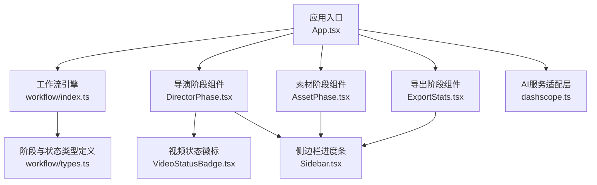
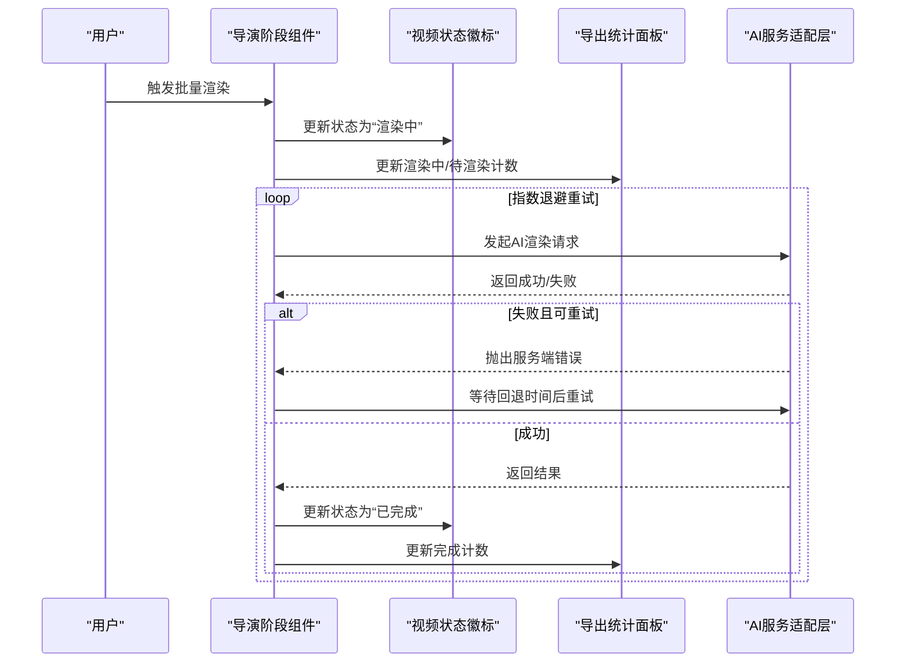
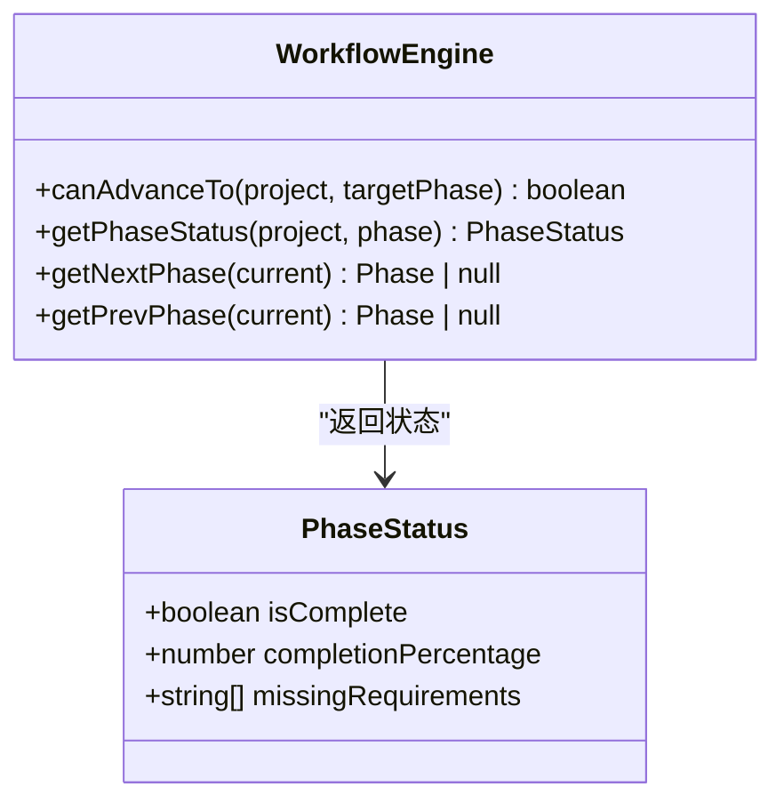
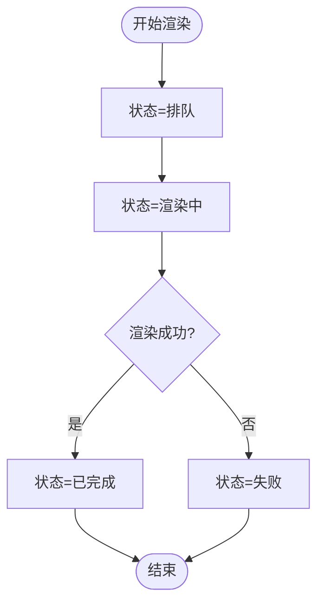
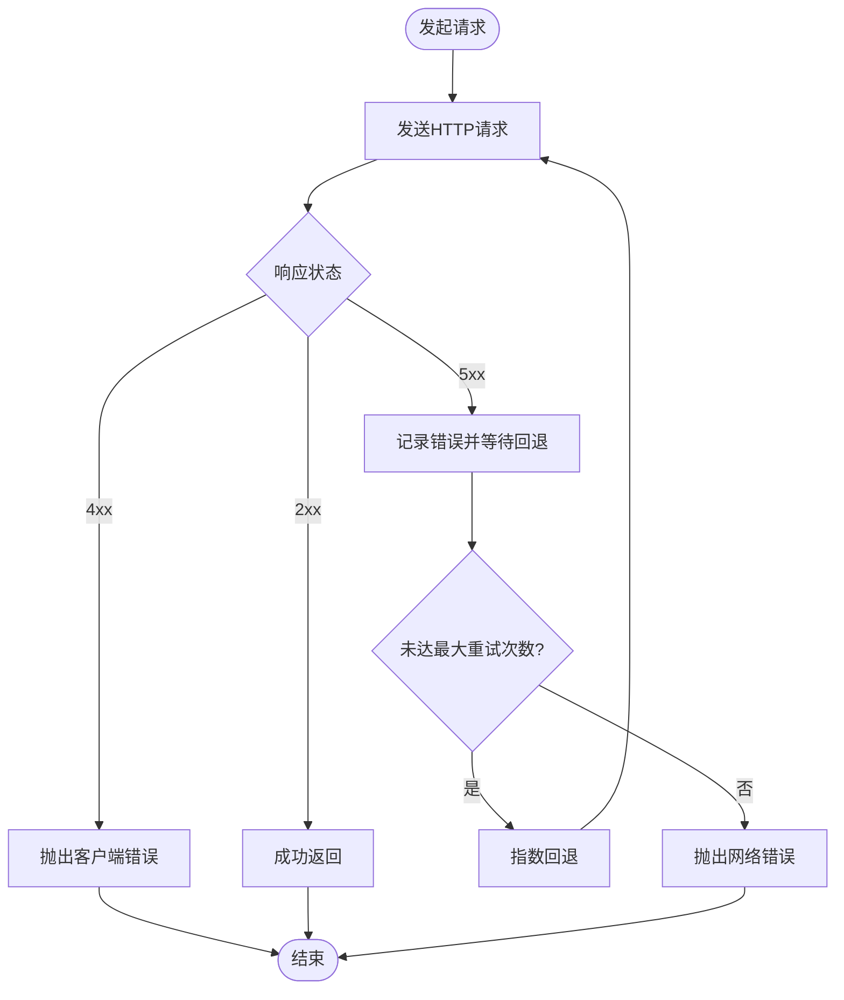
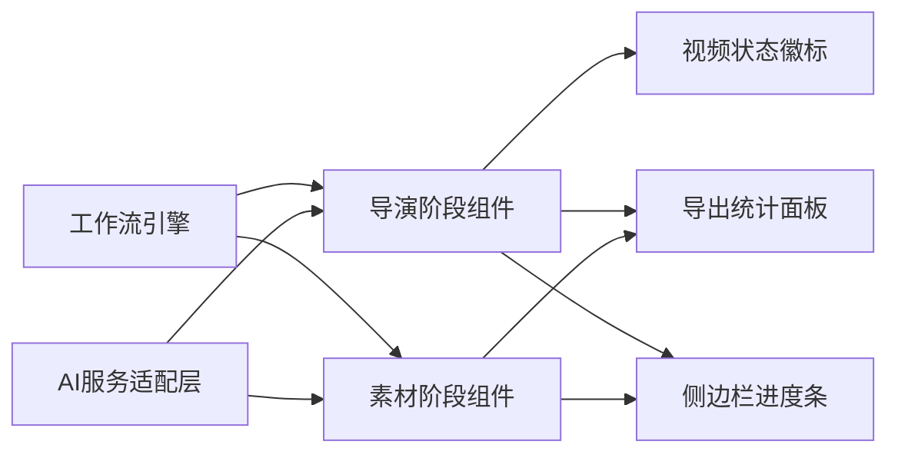

# 异步任务管理

<cite>
**本文引用的文件**
- [App.tsx](file://src/App.tsx)
- [workflow/index.ts](file://src/services/workflow/index.ts)
- [workflow/types.ts](file://src/services/workflow/types.ts)
- [DirectorPhase.tsx](file://src/phases/director/DirectorPhase.tsx)
- [VideoStatusBadge.tsx](file://src/phases/director/components/VideoStatusBadge.tsx)
- [ExportStats.tsx](file://src/phases/export/components/ExportStats.tsx)
- [AssetPhase.tsx](file://src/phases/assets/AssetPhase.tsx)
- [Sidebar.tsx](file://src/shared/components/Sidebar.tsx)
- [dashscope.ts](file://src/services/ai/dashscope.ts)
</cite>

## 目录
1. [简介](#简介)
2. [项目结构](#项目结构)
3. [核心组件](#核心组件)
4. [架构总览](#架构总览)
5. [详细组件分析](#详细组件分析)
6. [依赖关系分析](#依赖关系分析)
7. [性能考量](#性能考量)
8. [故障排查指南](#故障排查指南)
9. [结论](#结论)
10. [附录](#附录)

## 简介
本技术文档围绕“AI异步任务管理系统”进行深入解析，重点覆盖任务队列管理、进度跟踪、错误重试机制、任务状态流转、优先级调度与并发控制策略、渲染日志管理、任务取消与超时处理等能力。同时提供任务监控、性能优化与故障排查的实用指南与最佳实践，帮助开发者与运维人员快速理解并高效维护系统。

## 项目结构
该系统采用前端与工作流引擎协同的分层架构：
- 应用入口与路由：应用入口负责页面与功能模块的组织与导航。
- 工作流引擎：以阶段化驱动为核心，定义阶段推进规则与状态计算逻辑。
- 业务阶段组件：导演阶段、素材阶段、导出阶段等，负责具体任务的可视化与交互。
- AI服务适配层：封装第三方模型服务调用与重试策略。
- UI状态展示：通过状态徽标、进度条、统计面板等直观呈现任务状态与进度。

图示来源
- [App.tsx](file://src/App.tsx)
- [workflow/index.ts](file://src/services/workflow/index.ts)
- [workflow/types.ts](file://src/services/workflow/types.ts)
- [DirectorPhase.tsx](file://src/phases/director/DirectorPhase.tsx)
- [AssetPhase.tsx](file://src/phases/assets/AssetPhase.tsx)
- [ExportStats.tsx](file://src/phases/export/components/ExportStats.tsx)
- [VideoStatusBadge.tsx](file://src/phases/director/components/VideoStatusBadge.tsx)
- [Sidebar.tsx](file://src/shared/components/Sidebar.tsx)
- [dashscope.ts](file://src/services/ai/dashscope.ts)

章节来源
- [App.tsx](file://src/App.tsx)
- [workflow/index.ts](file://src/services/workflow/index.ts)
- [workflow/types.ts](file://src/services/workflow/types.ts)

## 核心组件
- 工作流引擎与阶段状态
  - 定义阶段推进条件、当前阶段状态（是否完成、完成百分比、缺失需求）、前后阶段切换。
  - 用于统一约束各阶段的执行顺序与前置条件，确保任务按序推进。
- 任务状态与进度展示
  - 视频状态徽标：对“排队/渲染中/已完成/失败”四态进行可视化编码。
  - 批量进度条：在导演与素材阶段以渐变进度条展示批量任务的完成情况。
  - 导出统计面板：汇总镜头总数、已成片、渲染中、预估总时长等指标。
  - 侧边栏进度条：全局任务状态与完成度的可视化反馈。
- AI服务重试机制
  - 对网络错误与服务端错误进行指数退避重试；对客户端错误（如鉴权失败、配额超限）直接抛错并提示。
  - 提供可配置的最大重试次数与回退时间常数。

章节来源
- [workflow/types.ts](file://src/services/workflow/types.ts)
- [VideoStatusBadge.tsx](file://src/phases/director/components/VideoStatusBadge.tsx)
- [DirectorPhase.tsx](file://src/phases/director/DirectorPhase.tsx)
- [AssetPhase.tsx](file://src/phases/assets/AssetPhase.tsx)
- [ExportStats.tsx](file://src/phases/export/components/ExportStats.tsx)
- [Sidebar.tsx](file://src/shared/components/Sidebar.tsx)
- [dashscope.ts](file://src/services/ai/dashscope.ts)

## 架构总览
系统以“阶段驱动 + 可视化反馈 + 适配层重试”的方式组织异步任务生命周期：
- 阶段驱动：工作流引擎决定何时进入下一阶段，避免盲目推进。
- 任务状态：通过UI组件实时反映排队、渲染中、完成、失败等状态。
- 并发与重试：AI服务层对网络与服务端异常进行指数退避重试，提升稳定性。
- 统计与监控：导出统计与侧边栏进度提供宏观视角的任务完成度与资源占用情况。

图示来源
- [DirectorPhase.tsx](file://src/phases/director/DirectorPhase.tsx)
- [VideoStatusBadge.tsx](file://src/phases/director/components/VideoStatusBadge.tsx)
- [ExportStats.tsx](file://src/phases/export/components/ExportStats.tsx)
- [dashscope.ts](file://src/services/ai/dashscope.ts)

## 详细组件分析

### 工作流引擎与阶段状态
- 职责
  - 判断是否可推进到目标阶段。
  - 计算阶段状态：完成度、是否完成、缺失需求。
  - 提供前后阶段切换接口。
- 设计要点
  - 将“阶段推进”从用户手动操作转化为基于客观条件的自动推进，降低人工干预成本。
  - 通过缺失需求列表指导用户补齐前置条件，提升任务成功率。
- 数据结构复杂度
  - 状态计算与推进判断通常为 O(1) 或 O(n)（n 为阶段内任务数量），整体开销可控。

图示来源
- [workflow/types.ts](file://src/services/workflow/types.ts)

章节来源
- [workflow/types.ts](file://src/services/workflow/types.ts)
- [workflow/index.ts](file://src/services/workflow/index.ts)

### 任务状态与进度展示
- 视频状态徽标
  - 四态编码：排队、渲染中（带脉冲动画）、已完成、失败。
  - 通过颜色与图标传达任务节奏与健康状况。
- 批量进度条
  - 在导演与素材阶段以渐变条展示批量任务完成比例，增强可视反馈。
- 导出统计面板
  - 展示镜头总数、已成片、渲染中、预估总时长等关键指标，便于宏观评估。
- 侧边栏进度条
  - 全局任务完成度与状态指示，辅助用户把握整体进度。

图示来源
- [VideoStatusBadge.tsx](file://src/phases/director/components/VideoStatusBadge.tsx)
- [DirectorPhase.tsx](file://src/phases/director/DirectorPhase.tsx)
- [AssetPhase.tsx](file://src/phases/assets/AssetPhase.tsx)
- [ExportStats.tsx](file://src/phases/export/components/ExportStats.tsx)
- [Sidebar.tsx](file://src/shared/components/Sidebar.tsx)

章节来源
- [VideoStatusBadge.tsx](file://src/phases/director/components/VideoStatusBadge.tsx)
- [DirectorPhase.tsx](file://src/phases/director/DirectorPhase.tsx)
- [AssetPhase.tsx](file://src/phases/assets/AssetPhase.tsx)
- [ExportStats.tsx](file://src/phases/export/components/ExportStats.tsx)
- [Sidebar.tsx](file://src/shared/components/Sidebar.tsx)

### AI服务重试机制
- 重试策略
  - 对服务端错误（5xx）与网络错误进行指数退避重试。
  - 对客户端错误（如鉴权失败、配额超限）直接抛错并提示友好信息。
- 参数与行为
  - 最大重试次数与回退时间常数可配置，平衡稳定性与用户体验。
  - 重试过程中区分错误类型，避免对不可恢复错误进行无意义重试。

图示来源
- [dashscope.ts](file://src/services/ai/dashscope.ts)

章节来源
- [dashscope.ts](file://src/services/ai/dashscope.ts)

## 依赖关系分析
- 组件耦合
  - 阶段组件依赖工作流引擎提供的状态与推进规则，保证执行顺序正确。
  - UI组件（状态徽标、进度条、统计面板）相互独立，通过数据驱动更新，降低耦合度。
- 外部依赖
  - AI服务适配层对外部服务进行统一封装，隐藏重试与错误处理细节。
- 潜在风险
  - 若工作流推进条件过于严格，可能导致任务停滞；需结合业务场景动态调整。
  - 重试策略可能放大外部服务压力，建议配合限流与熔断策略。

图示来源
- [workflow/index.ts](file://src/services/workflow/index.ts)
- [DirectorPhase.tsx](file://src/phases/director/DirectorPhase.tsx)
- [AssetPhase.tsx](file://src/phases/assets/AssetPhase.tsx)
- [VideoStatusBadge.tsx](file://src/phases/director/components/VideoStatusBadge.tsx)
- [ExportStats.tsx](file://src/phases/export/components/ExportStats.tsx)
- [Sidebar.tsx](file://src/shared/components/Sidebar.tsx)
- [dashscope.ts](file://src/services/ai/dashscope.ts)

章节来源
- [workflow/index.ts](file://src/services/workflow/index.ts)
- [dashscope.ts](file://src/services/ai/dashscope.ts)

## 性能考量
- 并发控制
  - 在批量渲染场景下，建议限制并发数以避免外部服务过载与本地资源争用。
  - 可根据外部服务的配额与延迟特征动态调整并发上限。
- 重试与回退
  - 指数回退可缓解瞬时抖动，但应设置上限与抖动因子，防止雪崩效应。
  - 对于可预测的客户端错误（如配额超限），提前降级与提示可减少无效重试。
- 进度与统计
  - 使用渐变进度条与统计面板减少用户等待焦虑，同时避免频繁刷新导致的性能损耗。
- 缓存与去重
  - 对重复任务进行去重与缓存，避免重复提交与重复渲染。

## 故障排查指南
- 常见问题定位
  - 状态长期停留在“排队”：检查前置条件是否满足、工作流推进逻辑是否允许进入下一阶段。
  - “渲染中”长时间无进展：关注外部服务可用性与配额情况，查看重试日志与回退间隔。
  - “失败”状态频繁出现：区分客户端错误（鉴权、配额）与服务端错误，分别采取对应措施。
- 日志与监控
  - 在AI服务层记录每次请求的状态码、耗时与重试次数，便于定位异常模式。
  - 在UI侧记录关键状态切换事件（如从排队到渲染中），形成端到端的可观测链路。
- 优化建议
  - 对高频失败的阶段增加熔断与降级策略，避免连锁反应。
  - 结合导出统计面板与侧边栏进度条，快速识别瓶颈阶段与资源占用高峰。

章节来源
- [dashscope.ts](file://src/services/ai/dashscope.ts)
- [ExportStats.tsx](file://src/phases/export/components/ExportStats.tsx)
- [Sidebar.tsx](file://src/shared/components/Sidebar.tsx)

## 结论
本系统通过“阶段驱动 + 可视化反馈 + 适配层重试”的设计，实现了稳定、可观察、易扩展的异步任务管理能力。工作流引擎确保任务有序推进，UI组件提供直观的进度与状态反馈，AI服务层通过指数回退重试提升可靠性。结合并发控制、监控与故障排查实践，可在实际生产环境中获得良好的稳定性与用户体验。

## 附录
- 最佳实践清单
  - 明确阶段推进条件，定期复核以适应业务变化。
  - 合理设置并发上限与重试参数，避免过度重试与资源枯竭。
  - 在关键节点埋点日志与指标，建立端到端可观测体系。
  - 对失败类型进行分类治理，区分可重试与不可重试错误。
  - 定期回顾导出统计与侧边栏进度，识别性能瓶颈与资源热点。