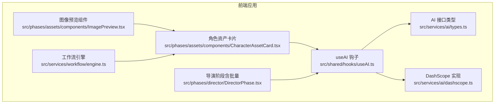
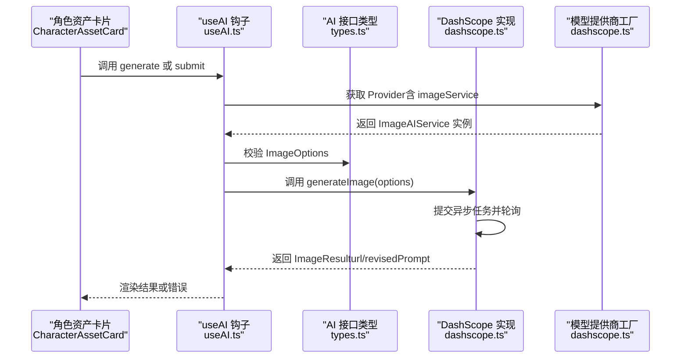
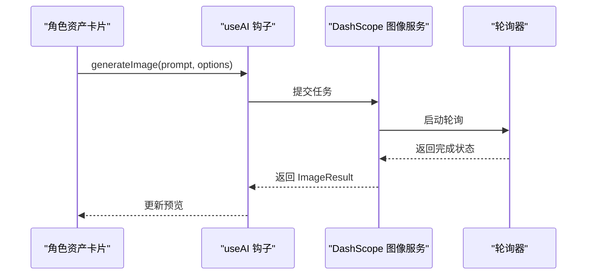
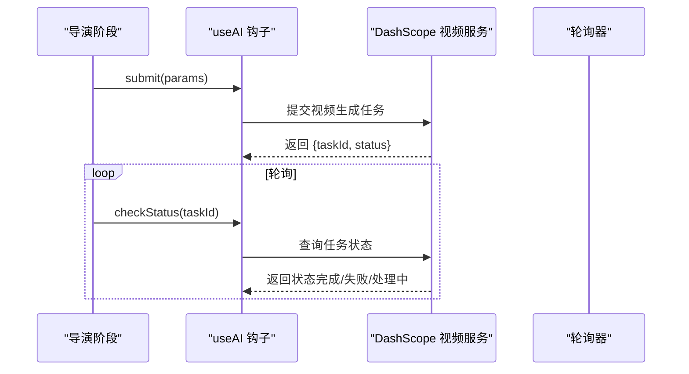
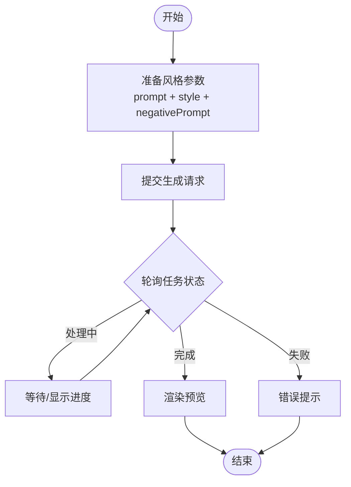
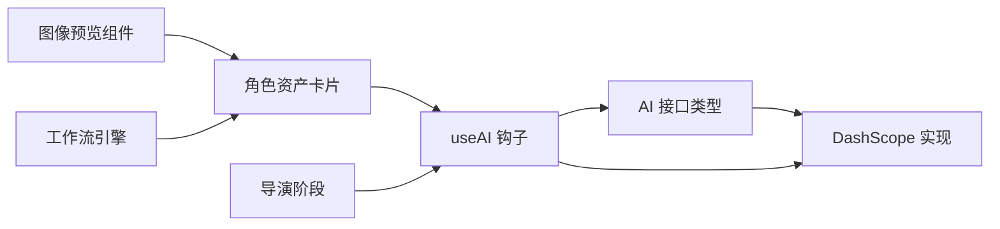

# 视觉风格API

<cite>
**本文档引用的文件**
- [package.json](file://package.json)
- [src/services/ai/types.ts](file://src/services/ai/types.ts)
- [src/services/ai/dashscope.ts](file://src/services/ai/dashscope.ts)
- [src/shared/hooks/useAI.ts](file://src/shared/hooks/useAI.ts)
- [src/phases/assets/components/CharacterAssetCard.tsx](file://src/phases/assets/components/CharacterAssetCard.tsx)
- [src/phases/assets/components/ImagePreview.tsx](file://src/phases/assets/components/ImagePreview.tsx)
- [src/phases/director/DirectorPhase.tsx](file://src/phases/director/DirectorPhase.tsx)
- [src/services/workflow/engine.ts](file://src/services/workflow/engine.ts)
</cite>

## 目录
1. [简介](#简介)
2. [项目结构](#项目结构)
3. [核心组件](#核心组件)
4. [架构总览](#架构总览)
5. [详细组件分析](#详细组件分析)
6. [依赖关系分析](#依赖关系分析)
7. [性能考虑](#性能考虑)
8. [故障排除指南](#故障排除指南)
9. [结论](#结论)
10. [附录](#附录)

## 简介
本文件为“视觉风格AI服务”的API参考文档，聚焦于风格迁移、图像增强与视觉效果处理能力。当前代码库以“角色定妆”和“镜头生成”为主线，通过统一的AI服务接口对接多家模型提供商，支持图像生成、视频生成与异步状态查询。文档将基于现有源码梳理API形态、数据结构、调用流程与最佳实践，并给出风格参数配置、效果预览与批量处理的使用指南。

## 项目结构
该前端项目采用React单页应用架构，围绕“创作工作流”分为多个阶段（资产、导演、导出等）。与视觉风格相关的关键模块包括：
- AI服务接口与适配器：定义统一的文本/图像/视频服务接口，并提供具体提供商实现（如DashScope）。
- 钩子函数：封装加载状态、错误处理与API调用逻辑。
- UI组件：负责风格化预览、批量操作与进度展示。
- 工作流引擎：用于阶段完成度与资源状态统计。

图表来源
- [src/shared/hooks/useAI.ts:41-96](file://src/shared/hooks/useAI.ts#L41-L96)
- [src/services/ai/types.ts:1-72](file://src/services/ai/types.ts#L1-L72)
- [src/services/ai/dashscope.ts:219-326](file://src/services/ai/dashscope.ts#L219-L326)
- [src/phases/assets/components/CharacterAssetCard.tsx:162-207](file://src/phases/assets/components/CharacterAssetCard.tsx#L162-L207)
- [src/phases/assets/components/ImagePreview.tsx:91-133](file://src/phases/assets/components/ImagePreview.tsx#L91-L133)
- [src/phases/director/DirectorPhase.tsx:31-69](file://src/phases/director/DirectorPhase.tsx#L31-L69)
- [src/services/workflow/engine.ts:35-72](file://src/services/workflow/engine.ts#L35-L72)

章节来源
- [package.json:1-26](file://package.json#L1-L26)

## 核心组件
- 统一AI服务接口：定义文本、图像、视频三类服务的输入输出规范，便于替换不同提供商。
- DashScope提供商实现：提供图像生成与视频生成的具体实现，支持异步任务与轮询查询。
- useAI钩子：封装鉴权、加载状态、错误处理与调用流程，供UI组件直接使用。
- 角色资产卡片：触发风格化生成与重新生成，支持风格参数透传。
- 导演阶段：集中展示批量生成与进度条，体现风格一致性控制与批量处理能力。
- 工作流引擎：统计角色定妆完成度，为风格一致性提供基础数据。

章节来源
- [src/services/ai/types.ts:1-72](file://src/services/ai/types.ts#L1-L72)
- [src/services/ai/dashscope.ts:219-326](file://src/services/ai/dashscope.ts#L219-L326)
- [src/shared/hooks/useAI.ts:41-96](file://src/shared/hooks/useAI.ts#L41-L96)
- [src/phases/assets/components/CharacterAssetCard.tsx:162-207](file://src/phases/assets/components/CharacterAssetCard.tsx#L162-L207)
- [src/phases/director/DirectorPhase.tsx:31-69](file://src/phases/director/DirectorPhase.tsx#L31-L69)
- [src/services/workflow/engine.ts:35-72](file://src/services/workflow/engine.ts#L35-L72)

## 架构总览
下图展示了从UI到AI服务再到提供商的调用链路，以及异步任务的状态流转。

图表来源
- [src/phases/assets/components/CharacterAssetCard.tsx:162-207](file://src/phases/assets/components/CharacterAssetCard.tsx#L162-L207)
- [src/shared/hooks/useAI.ts:41-96](file://src/shared/hooks/useAI.ts#L41-L96)
- [src/services/ai/types.ts:22-38](file://src/services/ai/types.ts#L22-L38)
- [src/services/ai/dashscope.ts:219-255](file://src/services/ai/dashscope.ts#L219-L255)

## 详细组件分析

### 组件A：图像生成服务（风格迁移与增强）
- 功能概述
  - 支持按提示词生成图像，可选尺寸、风格标签、负向提示词与数量。
  - 通过异步任务提交与轮询，最终返回图片URL与修正后的提示词。
- 关键数据结构
  - 输入选项：宽度、高度、风格、负向提示词、数量。
  - 输出结果：图片URL、修正提示词。
- 典型调用流程
  - UI组件准备参数并调用钩子。
  - 钩子选择提供商并调用图像服务。
  - 服务提交任务并轮询，完成后返回结果。
- 风格参数与应用场景
  - 可通过风格字段传递风格标签（如“动漫风格”），结合场景描述与角色外观生成一致的风格化图像。
  - 负向提示词可用于抑制不期望元素，提升风格一致性。
- 效果预览
  - 生成完成后，使用图像预览组件进行展示与对比。

图表来源
- [src/shared/hooks/useAI.ts:41-66](file://src/shared/hooks/useAI.ts#L41-L66)
- [src/services/ai/dashscope.ts:219-255](file://src/services/ai/dashscope.ts#L219-L255)
- [src/phases/assets/components/ImagePreview.tsx:91-133](file://src/phases/assets/components/ImagePreview.tsx#L91-L133)

章节来源
- [src/services/ai/types.ts:22-38](file://src/services/ai/types.ts#L22-L38)
- [src/services/ai/dashscope.ts:219-255](file://src/services/ai/dashscope.ts#L219-L255)
- [src/shared/hooks/useAI.ts:41-66](file://src/shared/hooks/useAI.ts#L41-L66)
- [src/phases/assets/components/CharacterAssetCard.tsx:162-207](file://src/phases/assets/components/CharacterAssetCard.tsx#L162-L207)
- [src/phases/assets/components/ImagePreview.tsx:91-133](file://src/phases/assets/components/ImagePreview.tsx#L91-L133)

### 组件B：视频生成服务（风格一致性与批量处理）
- 功能概述
  - 支持根据提示词与可选图片输入生成视频，可设置时长与宽高比。
  - 采用异步任务模式，返回任务ID与初始状态；调用方可自行轮询或使用内置等待方法。
- 关键数据结构
  - 输入参数：提示词、图片URL、时长、宽高比。
  - 输出结果：任务ID与初始状态；轮询后可能返回视频URL或错误信息。
- 批量处理
  - 导演阶段提供批量运行与进度条，适合对多镜头进行风格化生成与一致性控制。
- 风格参数与应用场景
  - 在提示词中加入风格标签（如“动漫风格”、“水彩风格”）与场景描述，确保批量生成的视频风格统一。
- 状态映射
  - 任务状态包括待处理、处理中、已完成、失败；失败时返回错误信息。

图表来源
- [src/phases/director/DirectorPhase.tsx:31-69](file://src/phases/director/DirectorPhase.tsx#L31-L69)
- [src/shared/hooks/useAI.ts:68-96](file://src/shared/hooks/useAI.ts#L68-L96)
- [src/services/ai/dashscope.ts:258-315](file://src/services/ai/dashscope.ts#L258-L315)

章节来源
- [src/services/ai/types.ts:40-63](file://src/services/ai/types.ts#L40-L63)
- [src/services/ai/dashscope.ts:258-315](file://src/services/ai/dashscope.ts#L258-L315)
- [src/phases/director/DirectorPhase.tsx:31-69](file://src/phases/director/DirectorPhase.tsx#L31-L69)

### 组件C：风格参数配置与效果预览
- 风格参数
  - 图像生成：通过风格字段传递风格标签；负向提示词用于抑制不期望元素。
  - 视频生成：在提示词中嵌入风格描述，结合场景与角色信息提升一致性。
- 效果预览
  - 使用图像预览组件展示生成结果，支持点击放大与对比查看。
- 批量处理
  - 角色资产阶段提供批量生成按钮与进度条，便于快速产出风格一致的参考图。

图表来源
- [src/services/ai/types.ts:22-38](file://src/services/ai/types.ts#L22-L38)
- [src/services/ai/dashscope.ts:219-255](file://src/services/ai/dashscope.ts#L219-L255)
- [src/phases/assets/components/ImagePreview.tsx:91-133](file://src/phases/assets/components/ImagePreview.tsx#L91-L133)

章节来源
- [src/services/ai/types.ts:22-38](file://src/services/ai/types.ts#L22-L38)
- [src/services/ai/dashscope.ts:219-255](file://src/services/ai/dashscope.ts#L219-L255)
- [src/phases/assets/components/ImagePreview.tsx:91-133](file://src/phases/assets/components/ImagePreview.tsx#L91-L133)

## 依赖关系分析
- 组件耦合
  - UI组件仅依赖钩子函数，钩子函数再依赖统一接口类型与具体提供商实现，保持良好的分层与解耦。
- 外部依赖
  - 通过模型提供商工厂注入具体实现，便于扩展其他提供商。
- 潜在循环依赖
  - 当前结构清晰，无明显循环依赖迹象。

图表来源
- [src/services/ai/types.ts:1-72](file://src/services/ai/types.ts#L1-L72)
- [src/services/ai/dashscope.ts:318-326](file://src/services/ai/dashscope.ts#L318-L326)
- [src/shared/hooks/useAI.ts:41-96](file://src/shared/hooks/useAI.ts#L41-L96)
- [src/phases/assets/components/CharacterAssetCard.tsx:162-207](file://src/phases/assets/components/CharacterAssetCard.tsx#L162-L207)
- [src/phases/assets/components/ImagePreview.tsx:91-133](file://src/phases/assets/components/ImagePreview.tsx#L91-L133)
- [src/phases/director/DirectorPhase.tsx:31-69](file://src/phases/director/DirectorPhase.tsx#L31-L69)
- [src/services/workflow/engine.ts:35-72](file://src/services/workflow/engine.ts#L35-L72)

章节来源
- [src/services/ai/types.ts:1-72](file://src/services/ai/types.ts#L1-L72)
- [src/services/ai/dashscope.ts:318-326](file://src/services/ai/dashscope.ts#L318-L326)
- [src/shared/hooks/useAI.ts:41-96](file://src/shared/hooks/useAI.ts#L41-L96)

## 性能考虑
- 异步任务与轮询
  - 图像与视频均采用异步任务与轮询机制，避免阻塞UI线程。
- 批量处理
  - 导演阶段提供批量运行与进度条，建议合理设置并发度与重试策略，避免触发限流。
- 风格一致性
  - 在提示词中固定风格标签与场景描述，减少重复修正成本。
- 资源预览
  - 图像预览组件支持缩放与对比，有助于快速评估风格迁移效果。

## 故障排除指南
- 常见错误
  - 任务超时：检查网络与提供商可用性，适当延长等待时间。
  - 任务失败：查看错误信息，确认提示词与风格参数是否符合提供商要求。
  - 未返回URL：确认任务状态与返回体结构，必要时重试。
- 定位步骤
  - 通过钩子函数捕获错误并上报。
  - 在DashScope实现中检查任务状态映射与轮询逻辑。
- 建议
  - 对外暴露统一的错误码与消息格式，便于前端统一处理。
  - 在UI中提供重试按钮与错误详情弹窗。

章节来源
- [src/services/ai/dashscope.ts:184-216](file://src/services/ai/dashscope.ts#L184-L216)
- [src/services/ai/dashscope.ts:201-216](file://src/services/ai/dashscope.ts#L201-L216)
- [src/shared/hooks/useAI.ts:54-58](file://src/shared/hooks/useAI.ts#L54-L58)

## 结论
本项目通过统一的AI服务接口与DashScope实现，提供了风格化的图像与视频生成功能。结合角色资产与导演阶段的批量处理与进度展示，能够有效支撑风格一致性控制与批量生产。建议在实际部署中完善错误处理与日志记录，并持续优化提示词工程与风格参数配置，以获得更稳定、可预期的视觉风格效果。

## 附录
- API清单（基于现有实现）
  - 图像生成：generateImage(prompt, options)
  - 视频生成：generateVideo(params)
  - 状态查询：checkStatus(taskId)
- 数据结构要点
  - ImageOptions：width、height、style、negativePrompt、count
  - ImageResult：url、revisedPrompt
  - VideoParams：prompt、imageUrl、duration、aspectRatio
  - VideoStatus：state、progress、resultUrl、error
- 最佳实践
  - 在提示词中明确风格标签与场景描述。
  - 使用负向提示词抑制不期望元素。
  - 通过批量处理与进度条提升效率。
  - 使用图像预览组件进行效果评估与对比。