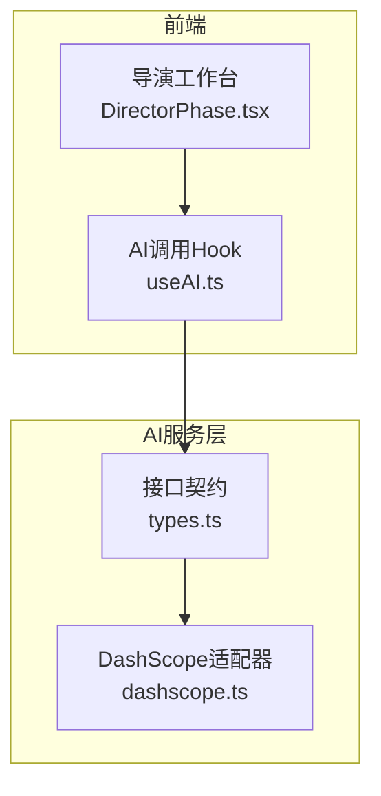
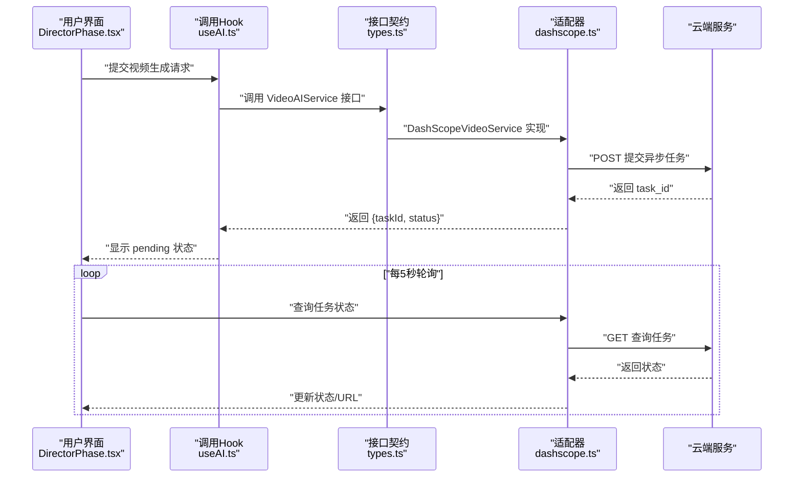
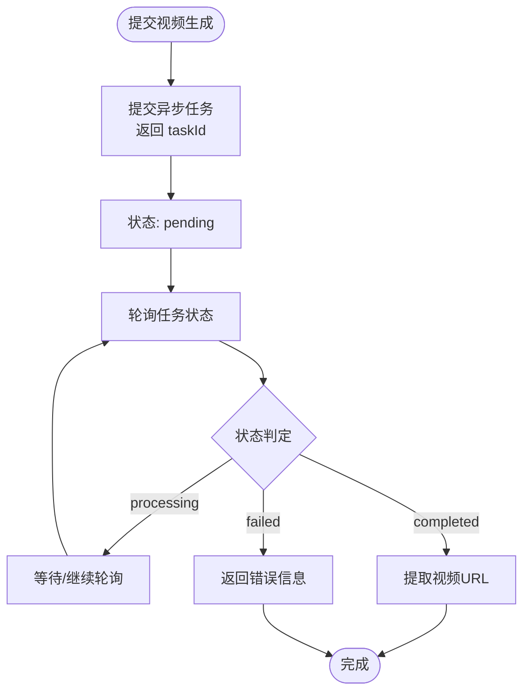
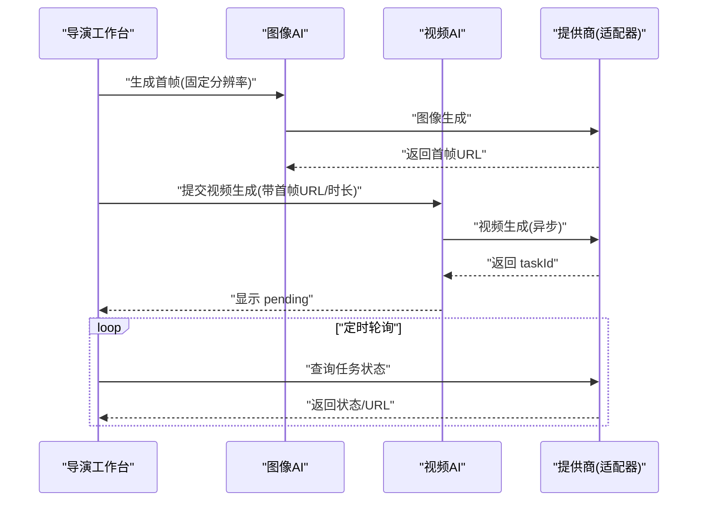
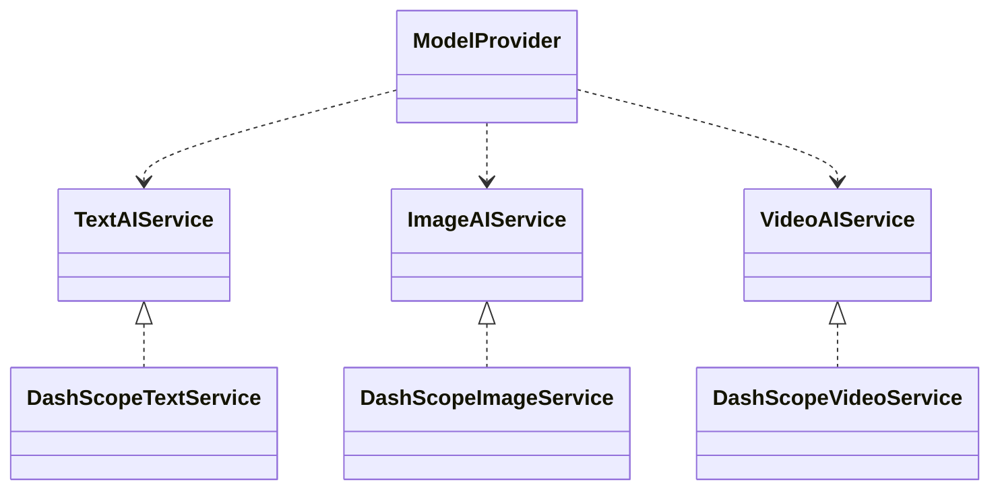

# 视频生成API

<cite>
**本文引用的文件**
- [dashscope.ts](file://src/services/ai/dashscope.ts)
- [types.ts](file://src/services/ai/types.ts)
- [useAI.ts](file://src/shared/hooks/useAI.ts)
- [DirectorPhase.tsx](file://src/phases/director/DirectorPhase.tsx)
</cite>

## 目录
1. [简介](#简介)
2. [项目结构](#项目结构)
3. [核心组件](#核心组件)
4. [架构总览](#架构总览)
5. [详细组件分析](#详细组件分析)
6. [依赖关系分析](#依赖关系分析)
7. [性能考量](#性能考量)
8. [故障排查指南](#故障排查指南)
9. [结论](#结论)
10. [附录](#附录)

## 简介
本文件为视频生成AI服务的API参考文档，聚焦“关键帧驱动的视频合成”流程，覆盖以下内容：
- 视频生成接口的请求参数与响应格式
- 关键帧序列生成、视频异步任务轮询与状态管理
- DashScope（阿里云）视频生成服务适配器实现
- 视频长度、分辨率、帧率等配置项的可用范围与使用建议
- 视频拼接与质量控制的实践指南

该系统采用“统一接口 + 适配器”的设计，当前默认提供DashScope视频生成能力，并预留扩展至其他提供商的接口。

## 项目结构
围绕视频生成的关键代码分布于以下模块：
- 适配器与类型定义：src/services/ai/dashscope.ts、src/services/ai/types.ts
- UI与业务编排：src/phases/director/DirectorPhase.tsx
- Hooks封装：src/shared/hooks/useAI.ts

图表来源
- [DirectorPhase.tsx:1-624](file://src/phases/director/DirectorPhase.tsx#L1-L624)
- [useAI.ts:1-97](file://src/shared/hooks/useAI.ts#L1-L97)
- [types.ts:1-73](file://src/services/ai/types.ts#L1-L73)
- [dashscope.ts:1-327](file://src/services/ai/dashscope.ts#L1-L327)

章节来源
- [DirectorPhase.tsx:1-624](file://src/phases/director/DirectorPhase.tsx#L1-L624)
- [useAI.ts:1-97](file://src/shared/hooks/useAI.ts#L1-L97)
- [types.ts:1-73](file://src/services/ai/types.ts#L1-L73)
- [dashscope.ts:1-327](file://src/services/ai/dashscope.ts#L1-L327)

## 核心组件
- 统一接口契约：定义文本、图像、视频三类AI服务的抽象接口与参数/结果结构，确保不同提供商可互换替换。
- DashScope适配器：实现文本、图像、视频服务的具体调用逻辑，包括异步任务提交、轮询与状态映射。
- UI编排：导演工作台负责关键帧生成与视频任务提交，并周期性轮询任务状态，更新UI反馈。
- Hooks封装：对外暴露统一的调用入口，屏蔽提供商细节，提供加载与错误状态。

章节来源
- [types.ts:40-72](file://src/services/ai/types.ts#L40-L72)
- [dashscope.ts:258-315](file://src/services/ai/dashscope.ts#L258-L315)
- [DirectorPhase.tsx:127-159](file://src/phases/director/DirectorPhase.tsx#L127-L159)
- [useAI.ts:68-96](file://src/shared/hooks/useAI.ts#L68-L96)

## 架构总览
下图展示从UI到适配器再到云端服务的调用链路与状态流转。

图表来源
- [DirectorPhase.tsx:191-247](file://src/phases/director/DirectorPhase.tsx#L191-L247)
- [useAI.ts:72-93](file://src/shared/hooks/useAI.ts#L72-L93)
- [types.ts:60-63](file://src/services/ai/types.ts#L60-L63)
- [dashscope.ts:258-315](file://src/services/ai/dashscope.ts#L258-L315)

## 详细组件分析

### 视频生成接口与参数
- 请求参数
  - prompt: 必填，视频生成提示词
  - imageUrl: 可选，作为关键帧驱动的起始图像URL
  - duration: 可选，视频时长（秒），用于控制生成片段长度
  - aspectRatio: 可选，视频宽高比（例如 "16:9" 或 "9:16"），用于约束输出比例
- 响应结构
  - taskId: 云端异步任务ID
  - status: 当前状态对象，包含 state、progress、resultUrl、error 等字段

章节来源
- [types.ts:41-58](file://src/services/ai/types.ts#L41-L58)

### DashScope视频适配器实现
- 任务提交
  - 使用异步模式提交任务，返回 task_id
  - 返回结构包含 taskId 与初始状态 pending
- 状态轮询与映射
  - 支持 pending/processing/completed/failed 四种状态
  - completed 成功后提取 video_url 或 results[0].url
  - 失败时返回错误信息
- 错误处理
  - 认证缺失/无效、配额限制、网络异常、服务端错误等均有明确错误码与友好提示
  - 超时控制与指数退避重试机制

图表来源
- [dashscope.ts:258-315](file://src/services/ai/dashscope.ts#L258-L315)
- [dashscope.ts:184-199](file://src/services/ai/dashscope.ts#L184-L199)

章节来源
- [dashscope.ts:258-315](file://src/services/ai/dashscope.ts#L258-L315)
- [dashscope.ts:155-182](file://src/services/ai/dashscope.ts#L155-L182)
- [dashscope.ts:47-52](file://src/services/ai/dashscope.ts#L47-L52)

### 关键帧驱动的视频合成流程
- 首帧生成：使用图像服务生成固定分辨率的关键帧（导演工作台默认尺寸）
- 视频生成：以首帧图像作为驱动，结合提示词与时长参数提交视频任务
- 状态回传：UI周期性轮询任务状态，成功后写入视频URL，进入下一阶段

图表来源
- [DirectorPhase.tsx:111-159](file://src/phases/director/DirectorPhase.tsx#L111-L159)
- [DirectorPhase.tsx:191-247](file://src/phases/director/DirectorPhase.tsx#L191-L247)
- [dashscope.ts:258-315](file://src/services/ai/dashscope.ts#L258-L315)

章节来源
- [DirectorPhase.tsx:111-159](file://src/phases/director/DirectorPhase.tsx#L111-L159)
- [DirectorPhase.tsx:191-247](file://src/phases/director/DirectorPhase.tsx#L191-L247)

### UI与状态管理
- 乐观更新：提交视频任务后立即标记为 pending，提升交互体验
- 并发轮询：对所有进行中的任务并行查询，容忍单个失败不影响整体
- 错误聚合：批量任务中累积错误信息，避免中断整体流程

章节来源
- [DirectorPhase.tsx:138-157](file://src/phases/director/DirectorPhase.tsx#L138-L157)
- [DirectorPhase.tsx:220-237](file://src/phases/director/DirectorPhase.tsx#L220-L237)

### Hooks封装与调用
- useVideoAI：对外暴露 submit/checkStatus，统一处理加载与错误状态
- getAIProvider：按当前配置选择具体提供商（当前默认DashScope）

章节来源
- [useAI.ts:68-96](file://src/shared/hooks/useAI.ts#L68-L96)

## 依赖关系分析
- 类型依赖：UI与业务层只依赖接口契约，不直接耦合具体提供商
- 适配器依赖：DashScope适配器依赖统一的异步任务提交/查询工具与状态映射
- 外部依赖：云端服务的HTTP接口与错误码

图表来源
- [types.ts:18-72](file://src/services/ai/types.ts#L18-L72)
- [dashscope.ts:96-326](file://src/services/ai/dashscope.ts#L96-L326)

章节来源
- [types.ts:18-72](file://src/services/ai/types.ts#L18-L72)
- [dashscope.ts:96-326](file://src/services/ai/dashscope.ts#L96-L326)

## 性能考量
- 轮询频率：默认每5秒轮询一次，兼顾实时性与成本控制
- 并发策略：对多个任务并行轮询，提高吞吐
- 超时与重试：内置最大等待时间与指数退避重试，避免长时间占用资源
- 建议
  - 合理设置视频时长，避免过长导致超时或资源消耗过大
  - 在批量生成场景中，分批提交任务，避免瞬时压力
  - 使用稳定的网络环境，减少轮询失败带来的抖动

章节来源
- [DirectorPhase.tsx:29](file://src/phases/director/DirectorPhase.tsx#L29)
- [DirectorPhase.tsx:220-237](file://src/phases/director/DirectorPhase.tsx#L220-L237)
- [dashscope.ts:30-32](file://src/services/ai/dashscope.ts#L30-L32)
- [dashscope.ts:58-93](file://src/services/ai/dashscope.ts#L58-L93)

## 故障排查指南
- 缺少API Key
  - 现象：提交任务时报认证错误
  - 处理：在“模型配置”中正确填写DashScope API Key
- 任务超时
  - 现象：超过最大等待时间仍未完成
  - 处理：检查提示词与参数是否合理，适当缩短时长或调整分辨率
- 任务失败
  - 现象：状态为failed并返回错误信息
  - 处理：根据错误码定位问题（如配额不足、参数非法等），修正后重试
- 网络波动
  - 现象：轮询期间出现短暂失败
  - 处理：系统会自动重试，保持稳定网络即可

章节来源
- [dashscope.ts:39-45](file://src/services/ai/dashscope.ts#L39-L45)
- [dashscope.ts:201-216](file://src/services/ai/dashscope.ts#L201-L216)
- [dashscope.ts:68-88](file://src/services/ai/dashscope.ts#L68-L88)

## 结论
本系统通过统一接口与适配器模式，实现了关键帧驱动的视频合成流程。当前默认集成DashScope视频生成能力，具备完善的异步任务管理、状态轮询与错误处理机制。建议在生产环境中结合业务需求合理配置视频时长与分辨率，并通过批量任务与并发轮询提升效率。

## 附录

### API定义与使用要点
- 视频生成接口
  - 请求参数：prompt（必填）、imageUrl（可选）、duration（可选）、aspectRatio（可选）
  - 响应：taskId + 初始状态；后续通过checkStatus轮询获取最终URL
- 关键帧生成
  - 建议固定分辨率（如1280x720）以保证驱动稳定性
- 视频拼接与质量控制
  - 拼接：在获得各镜头视频URL后，可在导出阶段进行顺序拼接
  - 质量：优先保证首帧质量与提示词清晰度，有助于提升后续视频生成的一致性

章节来源
- [types.ts:41-58](file://src/services/ai/types.ts#L41-L58)
- [DirectorPhase.tsx:117-122](file://src/phases/director/DirectorPhase.tsx#L117-L122)
- [dashscope.ts:258-315](file://src/services/ai/dashscope.ts#L258-L315)