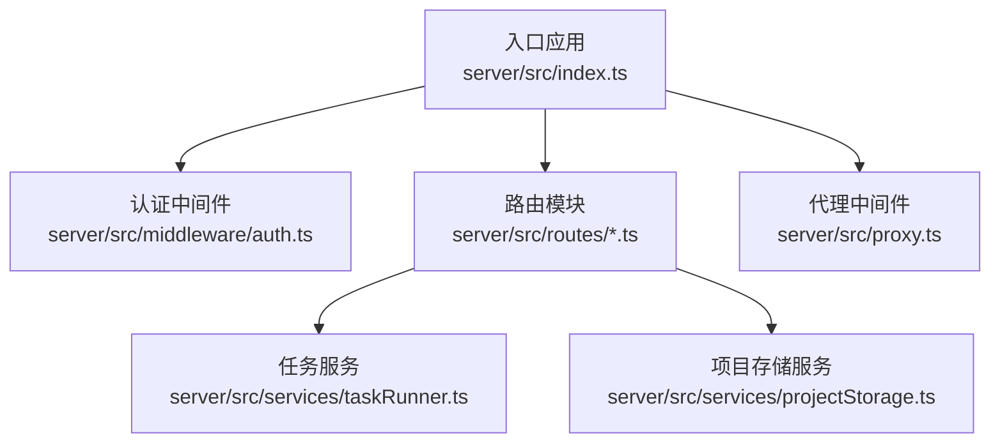
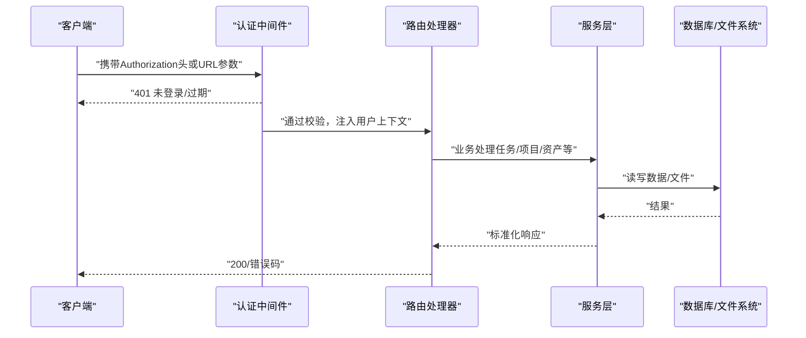
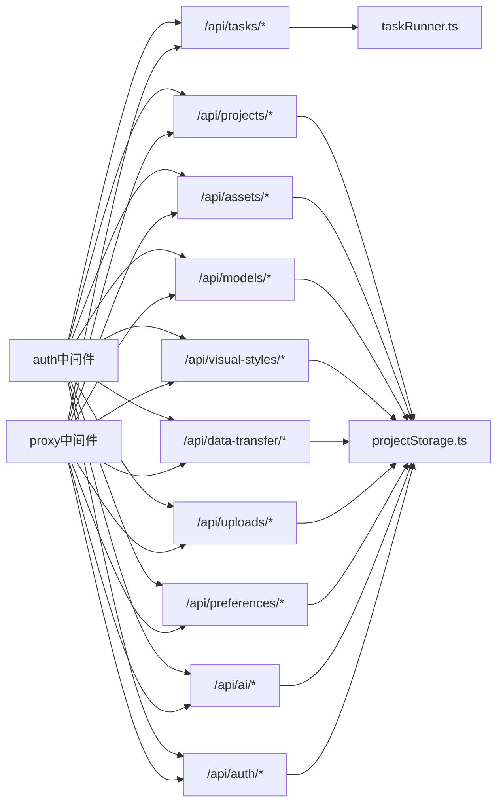

# API参考文档

<cite>
**本文档引用的文件**
- [server/src/index.ts](file://server/src/index.ts)
- [server/src/proxy.ts](file://server/src/proxy.ts)
- [server/src/middleware/auth.ts](file://server/src/middleware/auth.ts)
- [server/src/routes/auth.ts](file://server/src/routes/auth.ts)
- [server/src/routes/projects.ts](file://server/src/routes/projects.ts)
- [server/src/routes/assets.ts](file://server/src/routes/assets.ts)
- [server/src/routes/models.ts](file://server/src/routes/models.ts)
- [server/src/routes/tasks.ts](file://server/src/routes/tasks.ts)
- [server/src/routes/ai.ts](file://server/src/routes/ai.ts)
- [server/src/routes/uploads.ts](file://server/src/routes/uploads.ts)
- [server/src/routes/preferences.ts](file://server/src/routes/preferences.ts)
- [server/src/routes/visualStyles.ts](file://server/src/routes/visualStyles.ts)
- [server/src/routes/dataTransfer.ts](file://server/src/routes/dataTransfer.ts)
- [server/src/services/taskRunner.ts](file://server/src/services/taskRunner.ts)
- [server/src/services/projectStorage.ts](file://server/src/services/projectStorage.ts)
</cite>

## 目录
1. [简介](#简介)
2. [项目结构](#项目结构)
3. [核心组件](#核心组件)
4. [架构总览](#架构总览)
5. [详细组件分析](#详细组件分析)
6. [依赖关系分析](#依赖关系分析)
7. [性能考量](#性能考量)
8. [故障排查指南](#故障排查指南)
9. [结论](#结论)
10. [附录](#附录)

## 简介
本API参考文档面向AI Shotlive平台的后端REST API，覆盖用户认证、项目管理、资产操作、AI服务调用、任务管理、上传与下载、偏好设置、视觉风格、数据迁移等模块。文档提供每个端点的HTTP方法、URL模式、请求参数、响应格式、错误码说明、使用限制，并给出安全与性能建议及调试指南。

## 项目结构
后端基于Express框架，采用模块化路由组织，统一在入口文件挂载中间件与路由，并通过代理中间件转发第三方AI服务请求。

**图表来源**
- [server/src/index.ts:48-78](file://server/src/index.ts#L48-L78)
- [server/src/proxy.ts:38-50](file://server/src/proxy.ts#L38-L50)
- [server/src/middleware/auth.ts:35-58](file://server/src/middleware/auth.ts#L35-L58)

**章节来源**
- [server/src/index.ts:48-113](file://server/src/index.ts#L48-L113)
- [server/src/proxy.ts:17-36](file://server/src/proxy.ts#L17-L36)

## 核心组件
- 认证中间件：提供JWT生成、校验与路由保护。
- 路由模块：按功能域划分，统一使用认证中间件保护。
- 代理中间件：统一转发第三方AI服务请求，避免CORS问题。
- 服务层：任务调度、项目数据规范化存储等。

**章节来源**
- [server/src/middleware/auth.ts:19-28](file://server/src/middleware/auth.ts#L19-L28)
- [server/src/middleware/auth.ts:35-58](file://server/src/middleware/auth.ts#L35-L58)
- [server/src/index.ts:67-77](file://server/src/index.ts#L67-L77)

## 架构总览
以下序列图展示典型API调用链路：客户端发起请求→认证中间件校验→路由处理→服务层执行→数据库/文件系统交互。

**图表来源**
- [server/src/middleware/auth.ts:35-58](file://server/src/middleware/auth.ts#L35-L58)
- [server/src/routes/tasks.ts:33-71](file://server/src/routes/tasks.ts#L33-L71)
- [server/src/routes/projects.ts:64-78](file://server/src/routes/projects.ts#L64-L78)
- [server/src/routes/assets.ts:103-125](file://server/src/routes/assets.ts#L103-L125)

## 详细组件分析

### 认证与用户管理
- 注册
  - 方法与路径：POST /api/auth/register
  - 请求体：{ username, password }
  - 成功响应：{ token, user: { id, username } }
  - 错误码：400 参数缺失/非法；409 用户名已存在；500 服务器错误
- 登录
  - 方法与路径：POST /api/auth/login
  - 请求体：{ username, password }
  - 成功响应：{ token, user: { id, username } }
  - 错误码：400/401 用户名或密码错误；500 服务器错误
- 当前用户信息
  - 方法与路径：GET /api/auth/me
  - 成功响应：{ user: { id, username } }
  - 错误码：401 未登录；500 服务器错误
- 修改资料
  - 方法与路径：PUT /api/auth/profile
  - 请求体：{ currentPassword, newUsername, newPassword }
  - 成功响应：{ token, user: { id, username } }
  - 错误码：400 参数缺失；401 当前密码错误；404 用户不存在；409 用户名被占用；500 服务器错误

**章节来源**
- [server/src/routes/auth.ts:18-73](file://server/src/routes/auth.ts#L18-L73)
- [server/src/routes/auth.ts:78-120](file://server/src/routes/auth.ts#L78-L120)
- [server/src/routes/auth.ts:125-129](file://server/src/routes/auth.ts#L125-L129)
- [server/src/routes/auth.ts:134-210](file://server/src/routes/auth.ts#L134-L210)

### 项目管理
- 获取项目列表
  - 方法与路径：GET /api/projects
  - 成功响应：数组（轻量元数据）
  - 错误码：500 服务器错误
- 获取单个项目
  - 方法与路径：GET /api/projects/:id
  - 成功响应：完整项目数据（规范化组装）
  - 错误码：404 项目不存在；500 服务器错误
- 保存/更新项目
  - 方法与路径：PUT /api/projects/:id
  - 请求体：ProjectState（规范化对象）
  - 成功响应：{ success: true }
  - 错误码：500 服务器错误
- 删除项目
  - 方法与路径：DELETE /api/projects/:id
  - 成功响应：{ success: true }
  - 错误码：404 项目不存在；500 服务器错误
- 获取图片
  - 方法与路径：GET /api/projects/:id/image/:entityType/:entityId?episode=...
  - 支持entityType：character、scene、prop、variation、keyframe、turnaround、ninegrid
  - 成功响应：二进制图片或重定向URL
  - 错误码：400 缺少episode；400/404 不支持的entityType/图片不存在；500 服务器错误
- 获取视频
  - 方法与路径：GET /api/projects/:id/video/:videoId?episode=...
  - 成功响应：二进制视频或重定向URL
  - 错误码：400 缺少episode；404 视频不存在/格式不支持；500 服务器错误
- 导出项目
  - 方法与路径：POST /api/projects/export
  - 成功响应：包含schemaVersion、exportedAt、stores等的导出对象
  - 错误码：500 服务器错误
- 导入项目
  - 方法与路径：POST /api/projects/import
  - 请求体：{ mode?, stores: { projects[], assetLibrary[] } }
  - 成功响应：{ projects, assets }
  - 错误码：400 导入文件格式不正确；500 服务器错误

**章节来源**
- [server/src/routes/projects.ts:25-53](file://server/src/routes/projects.ts#L25-L53)
- [server/src/routes/projects.ts:64-78](file://server/src/routes/projects.ts#L64-L78)
- [server/src/routes/projects.ts:131-148](file://server/src/routes/projects.ts#L131-L148)
- [server/src/routes/projects.ts:159-264](file://server/src/routes/projects.ts#L159-L264)
- [server/src/routes/projects.ts:273-328](file://server/src/routes/projects.ts#L273-L328)
- [server/src/routes/projects.ts:335-362](file://server/src/routes/projects.ts#L335-L362)
- [server/src/routes/projects.ts:370-422](file://server/src/routes/projects.ts#L370-L422)

### 资产库
- 获取资产库
  - 方法与路径：GET /api/assets
  - 查询参数：page、pageSize、type、projectId
  - 成功响应：不分页返回数组；分页返回{ items, total, page, pageSize, projectOptions }
  - 错误码：500 服务器错误
- 保存/更新资产
  - 方法与路径：PUT /api/assets/:id
  - 请求体：资产对象（含name、type、data、projectId、projectName）
  - 成功响应：{ success: true }
  - 错误码：500 服务器错误
- 删除资产
  - 方法与路径：DELETE /api/assets/:id
  - 成功响应：{ success: true }
  - 错误码：404 资产不存在；500 服务器错误

**章节来源**
- [server/src/routes/assets.ts:32-97](file://server/src/routes/assets.ts#L32-L97)
- [server/src/routes/assets.ts:103-125](file://server/src/routes/assets.ts#L103-L125)
- [server/src/routes/assets.ts:130-150](file://server/src/routes/assets.ts#L130-L150)

### 模型配置
- 获取模型注册表
  - 方法与路径：GET /api/models/registry
  - 成功响应：注册表JSON或null
  - 错误码：500 服务器错误
- 保存/更新模型注册表
  - 方法与路径：PUT /api/models/registry
  - 请求体：注册表JSON
  - 成功响应：{ success: true }
  - 错误码：500 服务器错误

**章节来源**
- [server/src/routes/models.ts:17-36](file://server/src/routes/models.ts#L17-L36)
- [server/src/routes/models.ts:41-57](file://server/src/routes/models.ts#L41-L57)

### 任务管理
- 创建任务
  - 方法与路径：POST /api/tasks
  - 请求体：TaskCreateParams（type、projectId、modelId、prompt等）
  - 成功响应：{ task: 精简任务信息 }
  - 错误码：400 参数缺失/非法；500 服务器错误
- 查询活跃任务
  - 方法与路径：GET /api/tasks
  - 查询参数：project_id、all（是否包含已完成）
  - 成功响应：{ tasks: 精简任务列表 }
  - 错误码：500 服务器错误
- 查询单个任务
  - 方法与路径：GET /api/tasks/:id
  - 查询参数：include_result（是否包含结果）
  - 成功响应：{ task: 详细信息，可选result }
  - 错误码：404 任务不存在；500 服务器错误
- 获取任务结果
  - 方法与路径：GET /api/tasks/:id/result
  - 成功响应：{ result, resultUrl? }
  - 错误码：400 任务未完成/结果为空；404 任务不存在；500 服务器错误
- 取消任务
  - 方法与路径：DELETE /api/tasks/:id
  - 成功响应：{ success: true }
  - 错误码：400 无法取消；404 任务不存在；500 服务器错误

**章节来源**
- [server/src/routes/tasks.ts:33-71](file://server/src/routes/tasks.ts#L33-L71)
- [server/src/routes/tasks.ts:79-116](file://server/src/routes/tasks.ts#L79-L116)
- [server/src/routes/tasks.ts:123-161](file://server/src/routes/tasks.ts#L123-L161)
- [server/src/routes/tasks.ts:168-203](file://server/src/routes/tasks.ts#L168-L203)
- [server/src/routes/tasks.ts:208-220](file://server/src/routes/tasks.ts#L208-L220)

### AI辅助服务
- 文本转语音
  - 方法与路径：POST /api/ai/tts
  - 请求体：{ text }
  - 当前实现：占位返回501，提示需配置音频模型
  - 错误码：400 缺少text；501 开发中；500 服务器错误

**章节来源**
- [server/src/routes/ai.ts:16-32](file://server/src/routes/ai.ts#L16-L32)

### 上传与下载
- 上传小说
  - 方法与路径：POST /api/uploads/novel
  - 表单字段：file（仅.txt）
  - 成功响应：{ success, filename, savedAs, path, size, content }
  - 错误码：400 未选择文件/格式不支持；500 服务器错误
- 获取小说列表
  - 方法与路径：GET /api/uploads/novels
  - 成功响应：按上传时间倒序的文件列表
  - 错误码：500 服务器错误
- 删除小说
  - 方法与路径：DELETE /api/uploads/novel/:filename
  - 成功响应：{ success: true }
  - 错误码：403 无权访问；404 文件不存在；500 服务器错误

**章节来源**
- [server/src/routes/uploads.ts:70-92](file://server/src/routes/uploads.ts#L70-L92)
- [server/src/routes/uploads.ts:97-116](file://server/src/routes/uploads.ts#L97-L116)
- [server/src/routes/uploads.ts:121-144](file://server/src/routes/uploads.ts#L121-L144)

### 偏好设置
- 获取偏好
  - 方法与路径：GET /api/preferences
  - 成功响应：{ theme, onboarding_completed }
  - 错误码：500 服务器错误
- 更新偏好
  - 方法与路径：PUT /api/preferences
  - 请求体：{ theme, onboarding_completed }
  - 成功响应：{ success: true }
  - 错误码：500 服务器错误

**章节来源**
- [server/src/routes/preferences.ts:33-54](file://server/src/routes/preferences.ts#L33-L54)
- [server/src/routes/preferences.ts:60-85](file://server/src/routes/preferences.ts#L60-L85)

### 视觉风格
- 获取风格
  - 方法与路径：GET /api/visual-styles
  - 成功响应：风格列表（首次访问自动播种默认风格）
  - 错误码：500 服务器错误
- 创建风格
  - 方法与路径：POST /api/visual-styles
  - 请求体：{ value, label, desc?, prompt?, promptCn?, negativePrompt?, sceneNegativePrompt?, sortOrder? }
  - 成功响应：{ success: true, id }
  - 错误码：400 缺少必填；409 键值重复；500 服务器错误
- 更新风格
  - 方法与路径：PATCH /api/visual-styles/:id
  - 请求体：允许字段（value、label、desc、prompt、promptCn、negativePrompt、sceneNegativePrompt、sortOrder）
  - 成功响应：{ success: true }
  - 错误码：400 无更新字段；404 风格不存在；409 键值重复；500 服务器错误
- 删除风格
  - 方法与路径：DELETE /api/visual-styles/:id
  - 成功响应：{ success: true }
  - 错误码：404 风格不存在；500 服务器错误

**章节来源**
- [server/src/routes/visualStyles.ts:100-127](file://server/src/routes/visualStyles.ts#L100-L127)
- [server/src/routes/visualStyles.ts:132-157](file://server/src/routes/visualStyles.ts#L132-L157)
- [server/src/routes/visualStyles.ts:162-213](file://server/src/routes/visualStyles.ts#L162-L213)
- [server/src/routes/visualStyles.ts:218-238](file://server/src/routes/visualStyles.ts#L218-L238)

### 数据迁移
- 导出当前用户数据
  - 方法与路径：GET /api/data-transfer/export
  - 成功响应：ZIP文件（包含db.json与data/项目资源）
  - 错误码：500 服务器错误
- 导入数据（新建用户）
  - 方法与路径：POST /api/data-transfer/import
  - 表单字段：file（ZIP）
  - 成功响应：{ success: true, newUser, stats }
  - 错误码：400 缺少文件/格式不正确；500 服务器错误

**章节来源**
- [server/src/routes/dataTransfer.ts:50-137](file://server/src/routes/dataTransfer.ts#L50-L137)
- [server/src/routes/dataTransfer.ts:141-306](file://server/src/routes/dataTransfer.ts#L141-L306)

### 健康检查
- 健康检查
  - 方法与路径：GET /api/health
  - 成功响应：{ status, timestamp, database }
  - 降级响应：{ status: "degraded", databaseError }

**章节来源**
- [server/src/index.ts:79-98](file://server/src/index.ts#L79-L98)

### 第三方API代理
- 代理路径与目标
  - /api/proxy/dashscope → https://dashscope.aliyuncs.com
  - /api/proxy/volcengine-tos → https://ark-content-generation-v2-cn-beijing.tos-cn-beijing.volces.com
  - /api/proxy/volcengine → https://ark.cn-beijing.volces.com
  - /api/proxy/openai → https://api.openai.com
  - /api/proxy/anthropic → https://api.anthropic.com
  - /api/proxy/deepseek → https://api.deepseek.com
  - /api/proxy/zhipu → https://open.bigmodel.cn
  - /api/proxy/google → https://generativelanguage.googleapis.com
  - /api/proxy/xai → https://api.x.ai
  - /api/proxy/siliconflow → https://api.siliconflow.cn
  - /api/proxy/moonshot → https://api.moonshot.cn
  - /api/proxy/openrouter → https://openrouter.ai（路径重写为/api）

**章节来源**
- [server/src/proxy.ts:18-36](file://server/src/proxy.ts#L18-L36)

## 依赖关系分析
- 路由到服务层
  - 任务相关：tasks路由依赖taskRunner服务进行任务创建、查询、取消与结果获取。
  - 项目相关：projects路由依赖projectStorage服务进行规范化存储与读取。
- 中间件依赖
  - 所有受保护路由均依赖auth中间件进行JWT校验。
- 代理依赖
  - 通过proxy中间件统一转发第三方AI服务请求，避免CORS问题。

**图表来源**
- [server/src/routes/tasks.ts:23-25](file://server/src/routes/tasks.ts#L23-L25)
- [server/src/routes/projects.ts:11-14](file://server/src/routes/projects.ts#L11-L14)
- [server/src/middleware/auth.ts:35-58](file://server/src/middleware/auth.ts#L35-L58)
- [server/src/proxy.ts:38-50](file://server/src/proxy.ts#L38-L50)

**章节来源**
- [server/src/routes/tasks.ts:23-25](file://server/src/routes/tasks.ts#L23-L25)
- [server/src/routes/projects.ts:11-14](file://server/src/routes/projects.ts#L11-L14)
- [server/src/middleware/auth.ts:35-58](file://server/src/middleware/auth.ts#L35-L58)
- [server/src/proxy.ts:38-50](file://server/src/proxy.ts#L38-L50)

## 性能考量
- 项目存储规范化：将大型ProjectState拆分至多表，减少单条记录体积，提升读写效率。
- 事务与重试：保存项目时使用带指数退避的重试机制，缓解MySQL锁等待。
- 并发保护：按项目粒度加锁，避免并发保存导致的锁冲突。
- 代理超时：第三方代理设置不同超时阈值，平衡稳定性与响应时间。
- 响应缓存：图片/视频接口设置Cache-Control，降低重复请求开销。

**章节来源**
- [server/src/routes/projects.ts:83-123](file://server/src/routes/projects.ts#L83-L123)
- [server/src/proxy.ts:24-35](file://server/src/proxy.ts#L24-L35)

## 故障排查指南
- 认证失败
  - 现象：401 未登录/登录已过期
  - 排查：确认Authorization头或URL参数token有效；检查JWT_SECRET配置
- 任务状态异常
  - 现象：任务长时间pending/running
  - 排查：检查任务参数合法性；查看任务结果URL优先策略；确认第三方模型配置
- 图片/视频获取失败
  - 现象：404 图片/视频不存在/格式不支持
  - 排查：确认episode参数；检查存储路径或base64格式；验证文件是否存在
- 导入/导出失败
  - 现象：400 格式不正确；500 服务器错误
  - 排查：核对ZIP结构与db.json完整性；检查数据库连接与权限

**章节来源**
- [server/src/middleware/auth.ts:45-57](file://server/src/middleware/auth.ts#L45-L57)
- [server/src/routes/tasks.ts:168-203](file://server/src/routes/tasks.ts#L168-L203)
- [server/src/routes/projects.ts:159-264](file://server/src/routes/projects.ts#L159-L264)
- [server/src/routes/dataTransfer.ts:141-306](file://server/src/routes/dataTransfer.ts#L141-L306)

## 结论
本API体系围绕“规范化存储”“任务驱动”“代理中间件”三大支柱构建，既保证了项目数据的可维护性，又提供了灵活的任务执行与第三方AI集成能力。建议在生产环境中严格配置JWT_SECRET与限流策略，并结合日志与监控持续优化性能与稳定性。

## 附录

### 安全与合规
- JWT安全：生产环境必须配置JWT_SECRET，避免使用默认密钥。
- CORS与代理：通过代理中间件统一转发第三方请求，避免浏览器CORS限制。
- 文件上传：限制文件类型与大小，确保路径安全与内容校验。

**章节来源**
- [server/src/index.ts:125-137](file://server/src/index.ts#L125-L137)
- [server/src/proxy.ts:38-50](file://server/src/proxy.ts#L38-L50)
- [server/src/routes/uploads.ts:45-65](file://server/src/routes/uploads.ts#L45-L65)

### API版本管理与速率限制
- 版本管理：当前API未显式版本号，建议在路由前缀引入版本号（如/api/v1/...）以便演进。
- 速率限制：当前未内置速率限制中间件，建议在网关或应用层添加限流策略。

[本节为通用建议，不直接分析具体文件]

### 使用限制与最佳实践
- 请求体大小：服务端已设置JSON与URL编码最大500MB，注意控制请求体尺寸。
- 图片/视频：优先使用URL而非base64，减少传输体积。
- 任务结果：大体量结果通过独立结果接口获取，避免主任务响应过大。

**章节来源**
- [server/src/index.ts:62-64](file://server/src/index.ts#L62-L64)
- [server/src/routes/tasks.ts:168-203](file://server/src/routes/tasks.ts#L168-L203)

### API测试工具与调试
- 测试工具：推荐使用curl或Postman进行端到端测试。
- 调试步骤：
  - 使用注册/登录获取token
  - 在后续请求中设置Authorization: Bearer <token>
  - 通过GET /api/health检查服务健康状态
  - 使用任务接口观察状态流转与结果URL

**章节来源**
- [server/src/routes/auth.ts:18-120](file://server/src/routes/auth.ts#L18-L120)
- [server/src/index.ts:79-98](file://server/src/index.ts#L79-L98)