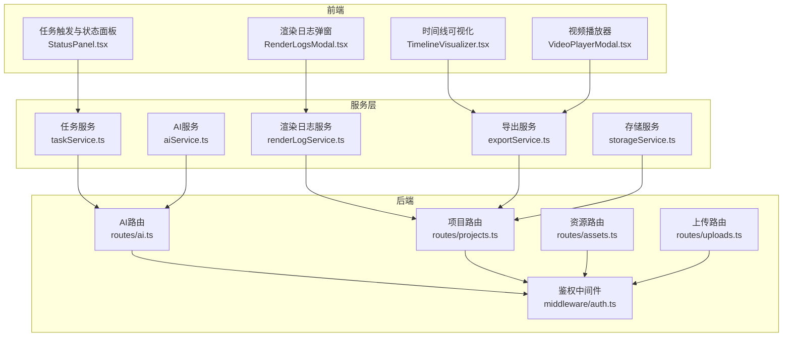
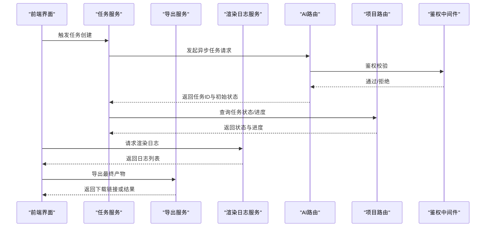
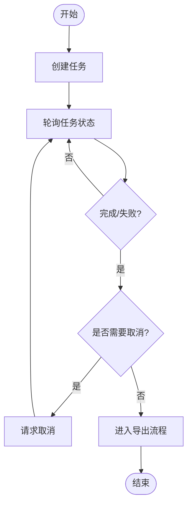
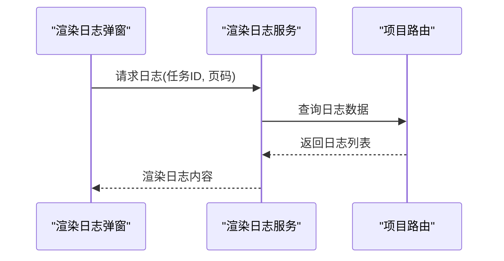
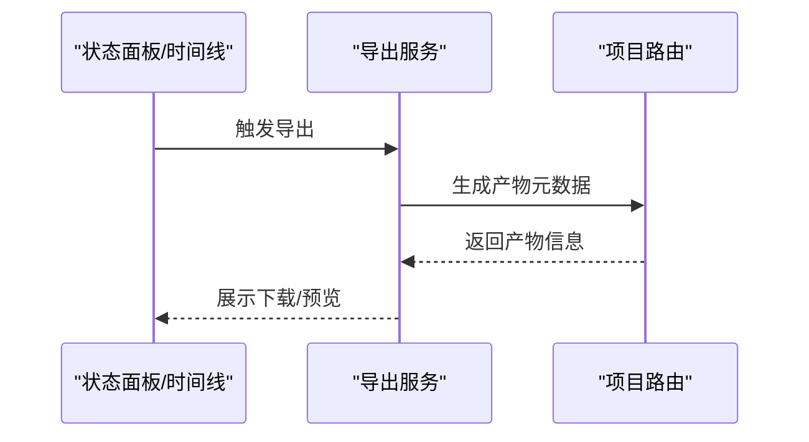
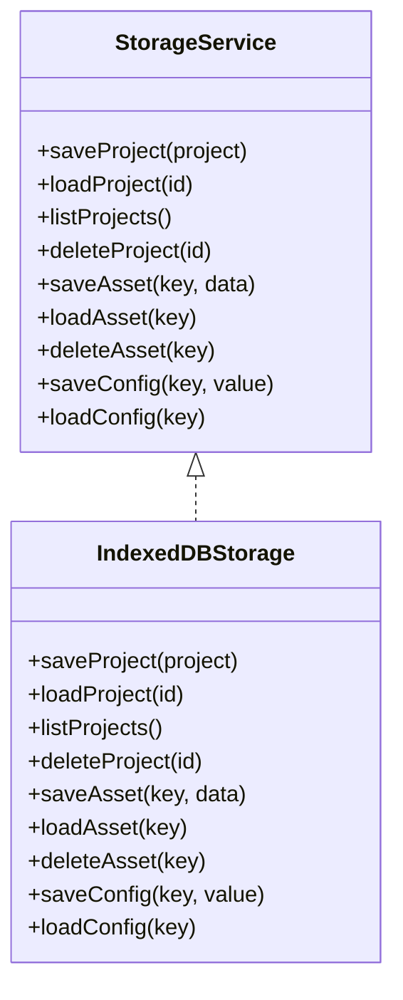
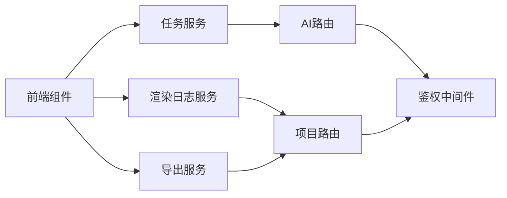

# 任务管理API

<cite>
**本文引用的文件**
- [server/src/routes/ai.ts](file://server/src/routes/ai.ts)
- [server/src/routes/projects.ts](file://server/src/routes/projects.ts)
- [server/src/routes/assets.ts](file://server/src/routes/assets.ts)
- [server/src/routes/uploads.ts](file://server/src/routes/uploads.ts)
- [server/src/middleware/auth.ts](file://server/src/middleware/auth.ts)
- [server/src/services/aiProxy.ts](file://server/src/services/aiProxy.ts)
- [server/src/services/projectStorage.ts](file://server/src/services/projectStorage.ts)
- [server/src/services/imageResolver.ts](file://server/src/services/imageResolver.ts)
- [server/src/utils/projectMutex.ts](file://server/src/utils/projectMutex.ts)
- [services/taskService.ts](file://services/taskService.ts)
- [services/renderLogService.ts](file://services/renderLogService.ts)
- [services/aiService.ts](file://services/aiService.ts)
- [services/exportService.ts](file://services/exportService.ts)
- [services/storageService.ts](file://services/storageService.ts)
- [src/services/storage/indexeddb.ts](file://src/services/storage/indexeddb.ts)
- [src/services/storage/types.ts](file://src/services/storage/types.ts)
- [src/services/workflow/types.ts](file://src/services/workflow/types.ts)
- [src/services/workflow/engine.ts](file://src/services/workflow/engine.ts)
- [components/StageExport/RenderLogsModal.tsx](file://components/StageExport/RenderLogsModal.tsx)
- [components/StageExport/StatusPanel.tsx](file://components/StageExport/StatusPanel.tsx)
- [components/StageExport/TimelineVisualizer.tsx](file://components/StageExport/TimelineVisualizer.tsx)
- [components/StageExport/VideoPlayerModal.tsx](file://components/StageExport/VideoPlayerModal.tsx)
- [components/StageDirector/VideoGenerator.tsx](file://components/StageDirector/VideoGenerator.tsx)
- [components/StageAssets/ImageUploadButton.tsx](file://components/StageAssets/ImageUploadButton.tsx)
- [components/StageAssets/PromptEditor.tsx](file://components/StageAssets/PromptEditor.tsx)
- [components/StagePrompts/PromptEditor.tsx](file://components/StagePrompts/PromptEditor.tsx)
- [components/StageScript/ScriptEditor.tsx](file://components/StageScript/ScriptEditor.tsx)
- [components/StageScript/SceneList.tsx](file://components/StageScript/SceneList.tsx)
- [components/StageScript/ShotRow.tsx](file://components/StageScript/ShotRow.tsx)
- [components/StageDirector/ShotWorkbench.tsx](file://components/StageDirector/ShotWorkbench.tsx)
- [components/StageDirector/ShotCard.tsx](file://components/StageDirector/ShotCard.tsx)
- [components/StageDirector/KeyframeEditor.tsx](file://components/StageDirector/KeyframeEditor.tsx)
- [components/StageDirector/EditModal.tsx](file://components/StageDirector/EditModal.tsx)
- [components/StageDirector/SceneContext.tsx](file://components/StageDirector/SceneContext.tsx)
- [components/StageAssets/CharacterCard.tsx](file://components/StageAssets/CharacterCard.tsx)
- [components/StageAssets/PropCard.tsx](file://components/StageAssets/PropCard.tsx)
- [components/StageAssets/SceneCard.tsx](file://components/StageAssets/SceneCard.tsx)
- [components/StageAssets/ImagePreviewModal.tsx](file://components/StageAssets/ImagePreviewModal.tsx)
- [components/StageAssets/TurnaroundModal.tsx](file://components/StageAssets/TurnaroundModal.tsx)
- [components/StageAssets/WardrobeModal.tsx](file://components/StageAssets/WardrobeModal.tsx)
- [components/StageAssets/constants.ts](file://components/StageAssets/constants.ts)
- [components/StageDirector/constants.ts](file://components/StageDirector/constants.ts)
- [components/StagePrompts/constants.ts](file://components/StagePrompts/constants.ts)
- [components/StageScript/constants.ts](file://components/StageScript/constants.ts)
- [components/StageExport/constants.ts](file://components/StageExport/constants.ts)
- [types/model.ts](file://types/model.ts)
- [types.ts](file://types.ts)
</cite>

## 目录
1. [简介](#简介)
2. [项目结构](#项目结构)
3. [核心组件](#核心组件)
4. [架构总览](#架构总览)
5. [详细组件分析](#详细组件分析)
6. [依赖关系分析](#依赖关系分析)
7. [性能考虑](#性能考虑)
8. [故障排查指南](#故障排查指南)
9. [结论](#结论)
10. [附录](#附录)

## 简介
本文件为 AI Shotlive 的任务管理API参考文档，聚焦于异步任务的创建、查询、取消与状态跟踪，以及渲染日志查询、任务队列管理、调度策略与性能监控的实践指南。文档以仓库现有实现为依据，梳理前后端交互、服务层封装与前端展示组件之间的协作关系，并通过图示帮助读者快速理解系统行为。

## 项目结构
AI Shotlive 的任务管理涉及三层：
- 前端组件层：负责任务触发、状态展示、日志查看与交互控制
- 服务层：封装任务执行、代理调用、存储与导出逻辑
- 后端路由层：提供REST接口，配合鉴权中间件进行访问控制

图表来源
- [server/src/routes/ai.ts](file://server/src/routes/ai.ts)
- [server/src/routes/projects.ts](file://server/src/routes/projects.ts)
- [server/src/routes/assets.ts](file://server/src/routes/assets.ts)
- [server/src/routes/uploads.ts](file://server/src/routes/uploads.ts)
- [server/src/middleware/auth.ts](file://server/src/middleware/auth.ts)
- [services/taskService.ts](file://services/taskService.ts)
- [services/renderLogService.ts](file://services/renderLogService.ts)
- [services/exportService.ts](file://services/exportService.ts)
- [services/storageService.ts](file://services/storageService.ts)
- [services/aiService.ts](file://services/aiService.ts)

章节来源
- [server/src/routes/ai.ts](file://server/src/routes/ai.ts)
- [server/src/routes/projects.ts](file://server/src/routes/projects.ts)
- [server/src/routes/assets.ts](file://server/src/routes/assets.ts)
- [server/src/routes/uploads.ts](file://server/src/routes/uploads.ts)
- [server/src/middleware/auth.ts](file://server/src/middleware/auth.ts)

## 核心组件
- 任务服务：封装任务生命周期管理（创建、查询、取消），并与后端路由对接
- 渲染日志服务：提供渲染过程日志的查询与聚合能力
- 导出服务：负责最终产物的生成与交付
- 存储服务：统一项目与资产的读写接口
- AI服务：封装第三方模型调用与代理逻辑
- 前端状态面板与日志弹窗：展示任务状态、进度与渲染日志

章节来源
- [services/taskService.ts](file://services/taskService.ts)
- [services/renderLogService.ts](file://services/renderLogService.ts)
- [services/exportService.ts](file://services/exportService.ts)
- [services/storageService.ts](file://services/storageService.ts)
- [services/aiService.ts](file://services/aiService.ts)
- [components/StageExport/StatusPanel.tsx](file://components/StageExport/StatusPanel.tsx)
- [components/StageExport/RenderLogsModal.tsx](file://components/StageExport/RenderLogsModal.tsx)

## 架构总览
下图展示了从前端到后端的关键调用链与职责划分：

图表来源
- [server/src/routes/ai.ts](file://server/src/routes/ai.ts)
- [server/src/routes/projects.ts](file://server/src/routes/projects.ts)
- [server/src/middleware/auth.ts](file://server/src/middleware/auth.ts)
- [services/taskService.ts](file://services/taskService.ts)
- [services/renderLogService.ts](file://services/renderLogService.ts)
- [services/exportService.ts](file://services/exportService.ts)

## 详细组件分析

### 任务服务（taskService.ts）
- 职责
  - 将前端请求转换为后端可识别的任务参数
  - 维护任务状态轮询与进度更新
  - 提供任务取消与重试的入口
- 关键流程
  - 创建任务：向AI路由提交任务参数，接收任务ID与初始状态
  - 查询任务：周期性拉取任务状态与进度
  - 取消任务：向后端发送取消指令并更新本地状态
- 错误处理
  - 对网络异常、超时、后端错误进行分类处理
  - 在UI层提示用户并允许重试或回退

图表来源
- [services/taskService.ts](file://services/taskService.ts)

章节来源
- [services/taskService.ts](file://services/taskService.ts)

### 渲染日志服务（renderLogService.ts）
- 职责
  - 拉取并聚合渲染过程中的日志条目
  - 支持按任务ID过滤与分页加载
- 使用场景
  - 用户在“渲染日志”弹窗中查看详细输出
  - 辅助定位渲染卡顿、报错或性能瓶颈
- 性能建议
  - 分页加载与增量刷新，避免一次性渲染过多日志

图表来源
- [services/renderLogService.ts](file://services/renderLogService.ts)
- [server/src/routes/projects.ts](file://server/src/routes/projects.ts)
- [components/StageExport/RenderLogsModal.tsx](file://components/StageExport/RenderLogsModal.tsx)

章节来源
- [services/renderLogService.ts](file://services/renderLogService.ts)
- [components/StageExport/RenderLogsModal.tsx](file://components/StageExport/RenderLogsModal.tsx)

### 导出服务（exportService.ts）
- 职责
  - 协调最终产物生成（如视频、图片等）
  - 提供下载链接或直接播放预览
- 与任务状态联动
  - 仅在任务完成后触发导出
  - 导出过程中保持UI状态同步

图表来源
- [services/exportService.ts](file://services/exportService.ts)
- [server/src/routes/projects.ts](file://server/src/routes/projects.ts)
- [components/StageExport/TimelineVisualizer.tsx](file://components/StageExport/TimelineVisualizer.tsx)
- [components/StageExport/VideoPlayerModal.tsx](file://components/StageExport/VideoPlayerModal.tsx)

章节来源
- [services/exportService.ts](file://services/exportService.ts)
- [components/StageExport/TimelineVisualizer.tsx](file://components/StageExport/TimelineVisualizer.tsx)
- [components/StageExport/VideoPlayerModal.tsx](file://components/StageExport/VideoPlayerModal.tsx)

### 存储服务（storageService.ts 与 indexeddb.ts）
- 职责
  - 统一项目与资产的持久化接口
  - 支持项目摘要列表、资产存取与配置读写
- 与任务的关系
  - 任务状态与中间产物通常保存在项目上下文中
  - 日志与导出产物也依赖存储能力

图表来源
- [services/storageService.ts](file://services/storageService.ts)
- [src/services/storage/indexeddb.ts](file://src/services/storage/indexeddb.ts)
- [src/services/storage/types.ts](file://src/services/storage/types.ts)

章节来源
- [services/storageService.ts](file://services/storageService.ts)
- [src/services/storage/indexeddb.ts](file://src/services/storage/indexeddb.ts)
- [src/services/storage/types.ts](file://src/services/storage/types.ts)

### AI服务与代理（aiService.ts 与 aiProxy.ts）
- 职责
  - 封装第三方模型调用细节
  - 提供统一的请求/响应格式与错误映射
- 与任务的关系
  - 任务创建与进度查询常依赖AI服务的异步能力
  - 代理层负责超时、重试与限流策略

章节来源
- [services/aiService.ts](file://services/aiService.ts)
- [server/src/services/aiProxy.ts](file://server/src/services/aiProxy.ts)

### 前端状态面板与日志弹窗
- 状态面板（StatusPanel.tsx）
  - 展示任务状态、进度百分比、剩余时间估算
  - 提供取消按钮与重试入口
- 渲染日志弹窗（RenderLogsModal.tsx）
  - 列表式展示日志，支持滚动加载与筛选
- 时间线可视化（TimelineVisualizer.tsx）与视频播放器（VideoPlayerModal.tsx）
  - 用于直观呈现任务执行轨迹与最终产物

章节来源
- [components/StageExport/StatusPanel.tsx](file://components/StageExport/StatusPanel.tsx)
- [components/StageExport/RenderLogsModal.tsx](file://components/StageExport/RenderLogsModal.tsx)
- [components/StageExport/TimelineVisualizer.tsx](file://components/StageExport/TimelineVisualizer.tsx)
- [components/StageExport/VideoPlayerModal.tsx](file://components/StageExport/VideoPlayerModal.tsx)

## 依赖关系分析
- 前端组件依赖服务层；服务层依赖后端路由；后端路由依赖鉴权中间件
- 任务服务与渲染日志服务共同消费项目路由提供的状态与日志数据
- AI服务与导出服务分别通过AI路由与项目路由获取能力

图表来源
- [server/src/routes/ai.ts](file://server/src/routes/ai.ts)
- [server/src/routes/projects.ts](file://server/src/routes/projects.ts)
- [server/src/middleware/auth.ts](file://server/src/middleware/auth.ts)
- [services/taskService.ts](file://services/taskService.ts)
- [services/renderLogService.ts](file://services/renderLogService.ts)
- [services/exportService.ts](file://services/exportService.ts)

章节来源
- [server/src/routes/ai.ts](file://server/src/routes/ai.ts)
- [server/src/routes/projects.ts](file://server/src/routes/projects.ts)
- [server/src/middleware/auth.ts](file://server/src/middleware/auth.ts)

## 性能考虑
- 任务轮询策略
  - 采用指数退避与最大间隔限制，避免频繁请求
  - 在任务接近完成时缩短轮询间隔以提升体验
- 日志加载
  - 分页与虚拟滚动，减少DOM压力
  - 按需加载，仅在弹窗打开时发起请求
- 导出优化
  - 并行处理多个片段或帧，完成后合并
  - 使用流式下载降低内存峰值
- 存储与缓存
  - 项目摘要列表仅携带必要字段，避免大对象传输
  - 本地IndexedDB用于离线缓存与快速恢复

## 故障排查指南
- 任务长时间无进度
  - 检查AI服务可用性与代理配置
  - 查看渲染日志中是否有错误堆栈
- 无法取消任务
  - 确认后端路由已实现取消接口并返回正确状态
  - 检查鉴权中间件是否拦截了取消请求
- 日志为空或不更新
  - 确认任务ID正确且日志已写入存储
  - 检查分页参数与过滤条件
- 导出失败
  - 核对项目路由返回的产物元数据
  - 检查文件权限与存储配额

章节来源
- [server/src/middleware/auth.ts](file://server/src/middleware/auth.ts)
- [server/src/routes/ai.ts](file://server/src/routes/ai.ts)
- [server/src/routes/projects.ts](file://server/src/routes/projects.ts)
- [services/renderLogService.ts](file://services/renderLogService.ts)

## 结论
AI Shotlive 的任务管理API通过清晰的服务分层与前后端协作，实现了从任务创建、状态跟踪、日志查询到导出交付的全链路闭环。遵循本文档的接口使用与性能建议，可在保证稳定性的同时获得良好的用户体验。

## 附录
- 类型与常量
  - 项目与阶段类型定义位于 types.ts 与 types/model.ts
  - 各功能模块常量位于对应组件目录的 constants.ts
- 工作流与阶段状态
  - 工作流引擎与阶段状态定义位于 src/services/workflow/types.ts 与 engine.ts
  - 用于指导任务推进与阶段切换

章节来源
- [types.ts](file://types.ts)
- [types/model.ts](file://types/model.ts)
- [src/services/workflow/types.ts](file://src/services/workflow/types.ts)
- [src/services/workflow/engine.ts](file://src/services/workflow/engine.ts)
- [components/StageAssets/constants.ts](file://components/StageAssets/constants.ts)
- [components/StageDirector/constants.ts](file://components/StageDirector/constants.ts)
- [components/StagePrompts/constants.ts](file://components/StagePrompts/constants.ts)
- [components/StageScript/constants.ts](file://components/StageScript/constants.ts)
- [components/StageExport/constants.ts](file://components/StageExport/constants.ts)