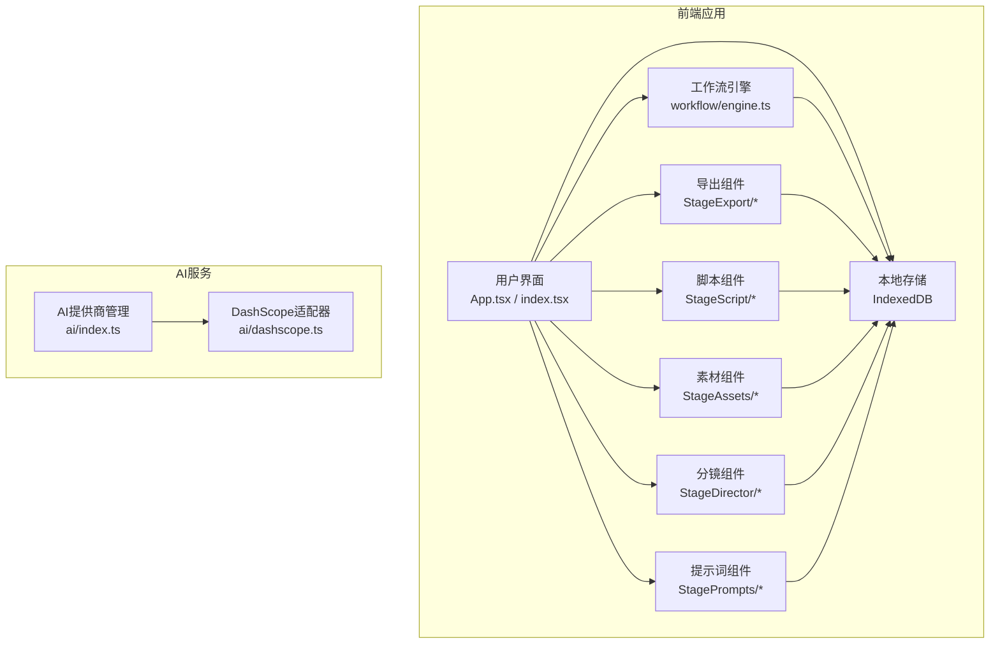
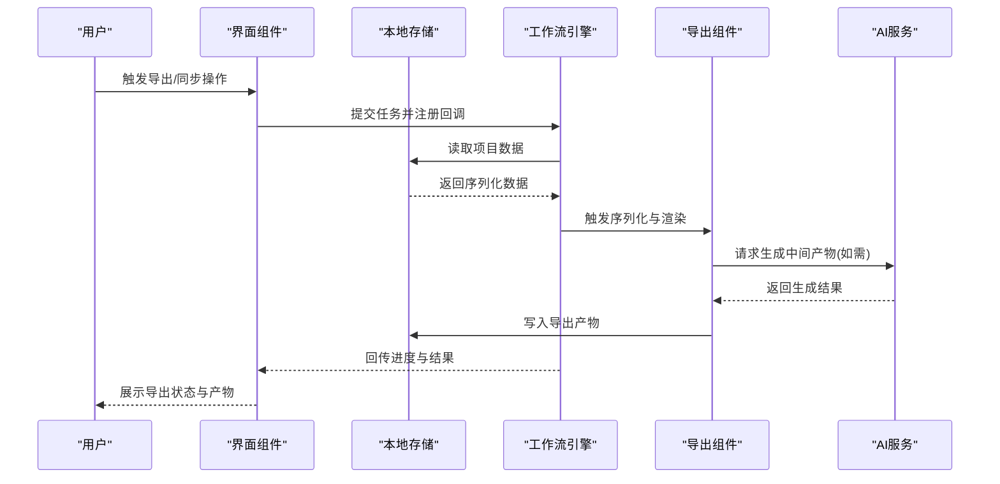
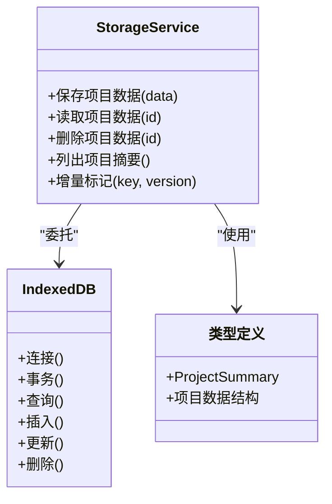
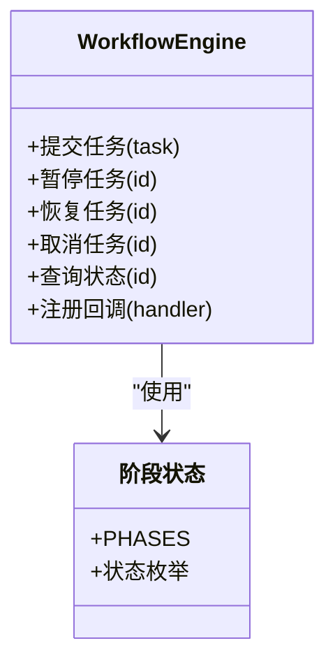
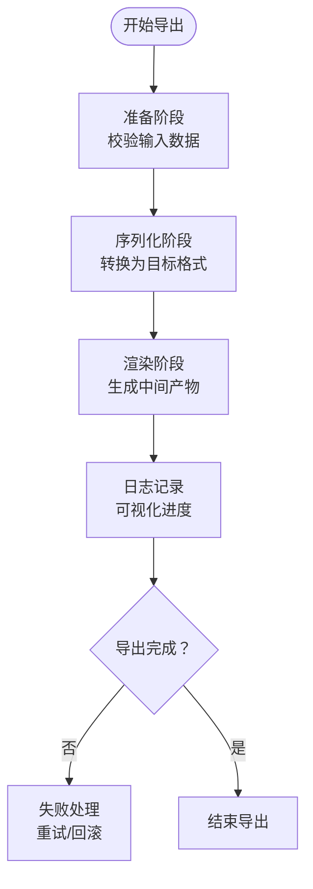
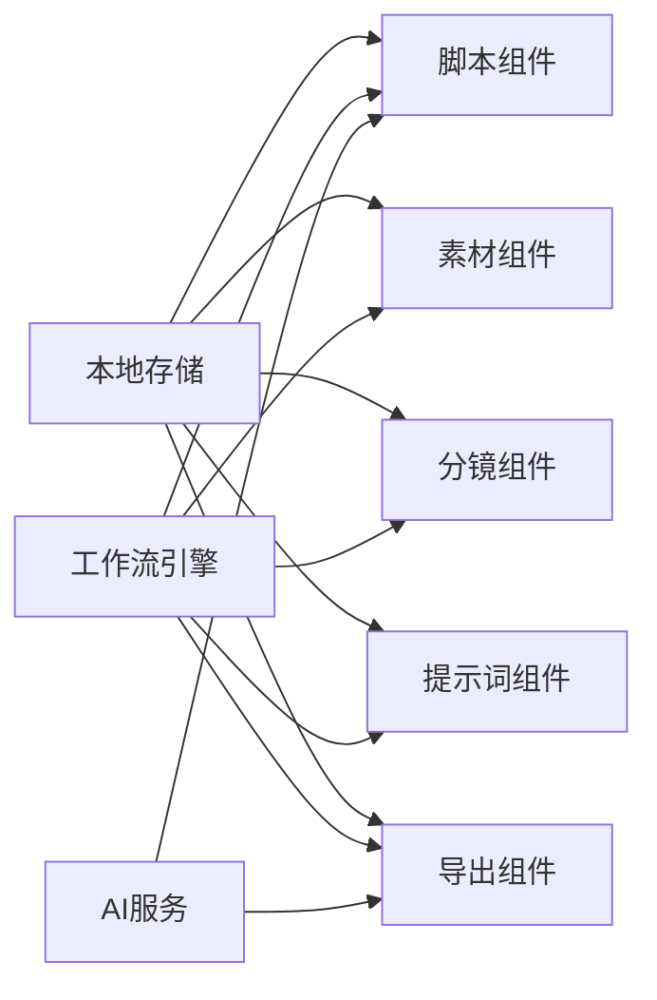

# 数据传输API

<cite>
**本文档引用的文件**
- [index.ts](file://index.tsx)
- [App.tsx](file://App.tsx)
- [storage/index.ts](file://src/services/storage/index.ts)
- [storage/types.ts](file://src/services/storage/types.ts)
- [storage/indexeddb.ts](file://src/services/storage/indexeddb.ts)
- [workflow/index.ts](file://src/services/workflow/index.ts)
- [workflow/types.ts](file://src/services/workflow/types.ts)
- [workflow/engine.ts](file://src/services/workflow/engine.ts)
- [ai/index.ts](file://src/services/ai/index.ts)
- [ai/types.ts](file://src/services/ai/types.ts)
- [ai/dashscope.ts](file://src/services/ai/dashscope.ts)
- [StageExport/index.tsx](file://components/StageExport/index.tsx)
- [StageExport/utils.ts](file://components/StageExport/utils.ts)
- [StageExport/constants.ts](file://components/StageExport/constants.ts)
- [StageExport/README.md](file://components/StageExport/README.md)
- [StageScript/index.tsx](file://components/StageScript/index.tsx)
- [StageScript/utils.ts](file://components/StageScript/utils.ts)
- [StageScript/constants.ts](file://components/StageScript/constants.ts)
- [StageAssets/index.tsx](file://components/StageAssets/index.tsx)
- [StageAssets/utils.ts](file://components/StageAssets/utils.ts)
- [StageAssets/constants.ts](file://components/StageAssets/constants.ts)
- [StageDirector/index.tsx](file://components/StageDirector/index.tsx)
- [StageDirector/utils.ts](file://components/StageDirector/utils.ts)
- [StageDirector/constants.ts](file://components/StageDirector/constants.ts)
- [StagePrompts/index.tsx](file://components/StagePrompts/index.tsx)
- [StagePrompts/utils.ts](file://components/StagePrompts/utils.ts)
- [StagePrompts/constants.ts](file://components/StagePrompts/constants.ts)
- [StageAssets/README.md](file://components/StageAssets/README.md)
- [StageDirector/README.md](file://components/StageDirector/README.md)
- [StagePrompts/README.md](file://components/StagePrompts/README.md)
- [StageScript/README.md](file://components/StageScript/README.md)
- [StageExport/README.md](file://components/StageExport/README.md)
- [README.md](file://README.md)
</cite>

## 目录
1. [简介](#简介)
2. [项目结构](#项目结构)
3. [核心组件](#核心组件)
4. [架构总览](#架构总览)
5. [详细组件分析](#详细组件分析)
6. [依赖关系分析](#依赖关系分析)
7. [性能考虑](#性能考虑)
8. [故障排除指南](#故障排除指南)
9. [结论](#结论)
10. [附录](#附录)

## 简介
本文件为 AI Shotlive 的数据传输API参考文档，聚焦于项目数据的导入、导出、同步与迁移能力，涵盖数据格式转换、增量更新、冲突解决、备份恢复以及跨项目迁移等高级特性，并提供数据安全与完整性保障的使用指南。由于仓库中未发现服务端路由层的“dataTransfer”或“projectPatch”等明确文件，本文在现有代码基础上进行系统性梳理与架构化说明，帮助开发者与使用者正确理解与使用数据传输相关能力。

## 项目结构
AI Shotlive 前后端采用混合架构：前端使用 React/Vite 构建，后端服务位于 server 目录（当前未完全实现），核心数据传输能力主要通过前端存储与工作流引擎实现，辅以导出组件与脚本组件完成数据的可视化与序列化输出。

图表来源
- [index.tsx](file://index.tsx)
- [App.tsx](file://App.tsx)
- [storage/indexeddb.ts](file://src/services/storage/indexeddb.ts)
- [workflow/engine.ts](file://src/services/workflow/engine.ts)
- [StageExport/index.tsx](file://components/StageExport/index.tsx)
- [StageScript/index.tsx](file://components/StageScript/index.tsx)
- [StageAssets/index.tsx](file://components/StageAssets/index.tsx)
- [StageDirector/index.tsx](file://components/StageDirector/index.tsx)
- [StagePrompts/index.tsx](file://components/StagePrompts/index.tsx)
- [ai/index.ts](file://src/services/ai/index.ts)
- [ai/dashscope.ts](file://src/services/ai/dashscope.ts)

章节来源
- [index.tsx](file://index.tsx)
- [App.tsx](file://App.tsx)
- [README.md](file://README.md)

## 核心组件
- 本地存储服务：基于 IndexedDB 的存储抽象，负责项目数据的持久化与检索，是数据传输的基础载体。
- 工作流引擎：统一的任务执行与状态管理，支持阶段化处理与并发控制，为数据同步与迁移提供流程保障。
- 导出组件：提供视频渲染、日志可视化、二次选项配置等能力，用于将项目数据序列化为可交付产物。
- 脚本与素材组件：负责场景、角色、道具等结构化数据的编辑与序列化，支撑项目内容的完整导出。
- AI 服务：提供文本、图像、视频等生成能力，作为数据源或中间产物参与数据传输链路。

章节来源
- [storage/index.ts](file://src/services/storage/index.ts)
- [storage/types.ts](file://src/services/storage/types.ts)
- [storage/indexeddb.ts](file://src/services/storage/indexeddb.ts)
- [workflow/index.ts](file://src/services/workflow/index.ts)
- [workflow/types.ts](file://src/services/workflow/types.ts)
- [workflow/engine.ts](file://src/services/workflow/engine.ts)
- [StageExport/index.tsx](file://components/StageExport/index.tsx)
- [StageScript/index.tsx](file://components/StageScript/index.tsx)
- [StageAssets/index.tsx](file://components/StageAssets/index.tsx)
- [StageDirector/index.tsx](file://components/StageDirector/index.tsx)
- [StagePrompts/index.tsx](file://components/StagePrompts/index.tsx)
- [ai/index.ts](file://src/services/ai/index.ts)

## 架构总览
数据传输API围绕“本地存储 + 工作流引擎 + 组件序列化”的架构展开，前端负责数据采集、转换与导出，AI服务作为外部数据源或中间产物提供者参与流程。下图展示了典型的数据导出与同步流程：

图表来源
- [workflow/engine.ts](file://src/services/workflow/engine.ts)
- [storage/indexeddb.ts](file://src/services/storage/indexeddb.ts)
- [StageExport/utils.ts](file://components/StageExport/utils.ts)
- [ai/index.ts](file://src/services/ai/index.ts)

## 详细组件分析

### 本地存储服务（IndexedDB）
- 职责：封装 IndexedDB 访问，提供统一的项目数据存取接口；支持项目摘要、版本信息、增量键值等元数据管理。
- 关键点：
  - 数据模型抽象：通过类型定义约束项目结构与字段。
  - 并发控制：结合工作流引擎的锁机制，避免并发写入冲突。
  - 增量更新：通过时间戳或版本号实现增量同步标记。
- 使用建议：
  - 在导出前先进行一致性校验，确保数据完整性。
  - 对大体量数据采用分块写入策略，降低内存压力。

图表来源
- [storage/index.ts](file://src/services/storage/index.ts)
- [storage/types.ts](file://src/services/storage/types.ts)
- [storage/indexeddb.ts](file://src/services/storage/indexeddb.ts)

章节来源
- [storage/index.ts](file://src/services/storage/index.ts)
- [storage/types.ts](file://src/services/storage/types.ts)
- [storage/indexeddb.ts](file://src/services/storage/indexeddb.ts)

### 工作流引擎（Workflow Engine）
- 职责：统一管理任务生命周期，支持阶段化执行、并发控制、错误重试与回滚。
- 关键点：
  - 阶段状态：定义清晰的阶段枚举与状态流转。
  - 并发策略：限制同时执行的任务数量，避免资源争用。
  - 回调机制：为导出、同步等长耗时操作提供进度反馈。
- 使用建议：
  - 将数据传输拆分为多个阶段（准备、校验、导出、验证、提交），便于监控与重试。
  - 对失败任务自动重试，超过阈值后转人工介入。

图表来源
- [workflow/index.ts](file://src/services/workflow/index.ts)
- [workflow/types.ts](file://src/services/workflow/types.ts)
- [workflow/engine.ts](file://src/services/workflow/engine.ts)

章节来源
- [workflow/index.ts](file://src/services/workflow/index.ts)
- [workflow/types.ts](file://src/services/workflow/types.ts)
- [workflow/engine.ts](file://src/services/workflow/engine.ts)

### 导出组件（StageExport）
- 职责：将项目数据序列化为可交付产物，支持渲染日志、二次选项、时间轴可视化等。
- 关键点：
  - 序列化工具：提供数据到文件或二进制的转换逻辑。
  - 可视化面板：展示渲染进度与日志，便于用户追踪。
  - 二次选项：允许用户自定义导出参数（分辨率、帧率、编码等）。
- 使用建议：
  - 在导出前对数据进行格式校验，避免无效字段导致失败。
  - 支持断点续传与增量导出，提升大项目处理效率。

图表来源
- [StageExport/index.tsx](file://components/StageExport/index.tsx)
- [StageExport/utils.ts](file://components/StageExport/utils.ts)
- [StageExport/constants.ts](file://components/StageExport/constants.ts)

章节来源
- [StageExport/index.tsx](file://components/StageExport/index.tsx)
- [StageExport/utils.ts](file://components/StageExport/utils.ts)
- [StageExport/constants.ts](file://components/StageExport/constants.ts)
- [StageExport/README.md](file://components/StageExport/README.md)

### 脚本组件（StageScript）
- 职责：管理剧本、场景分解、镜头列表等结构化数据，支持导入/导出与版本对比。
- 关键点：
  - 场景分解：将长剧本拆分为可执行的场景与镜头单元。
  - 片段对比：识别差异字段，支持增量更新。
  - 导入导出：支持标准格式（如 JSON/CSV）的导入与导出。
- 使用建议：
  - 在导入前进行字段映射与兼容性检查，避免版本不一致导致的解析错误。
  - 对历史版本进行归档，便于回溯与恢复。

章节来源
- [StageScript/index.tsx](file://components/StageScript/index.tsx)
- [StageScript/utils.ts](file://components/StageScript/utils.ts)
- [StageScript/constants.ts](file://components/StageScript/constants.ts)
- [StageScript/README.md](file://components/StageScript/README.md)

### 素材组件（StageAssets）
- 职责：管理角色、道具、场景等静态资源，支持上传、预览、替换与版本管理。
- 关键点：
  - 资源上传：支持图片、视频等多媒体资源的上传与索引。
  - 预览与替换：提供资源预览与替换功能，便于快速迭代。
  - 版本管理：记录资源版本与变更历史，支持回滚。
- 使用建议：
  - 对大文件采用分片上传与断点续传，提升稳定性。
  - 在跨项目迁移时，优先迁移资源索引而非资源本身，减少重复传输。

章节来源
- [StageAssets/index.tsx](file://components/StageAssets/index.tsx)
- [StageAssets/utils.ts](file://components/StageAssets/utils.ts)
- [StageAssets/constants.ts](file://components/StageAssets/constants.ts)
- [StageAssets/README.md](file://components/StageAssets/README.md)

### 分镜组件（StageDirector）
- 职责：管理镜头与拍摄方案，支持关键帧编辑、相机运动指导与渲染预览。
- 关键点：
  - 关键帧编辑：支持位置、角度、焦距等参数的关键帧设置。
  - 相机运动：提供运动指导与九宫格预览，辅助创作。
  - 渲染预览：生成短时预览，便于快速确认方案。
- 使用建议：
  - 在导出前进行渲染预览校验，确保镜头方案符合预期。
  - 对复杂镜头采用分步渲染策略，降低失败概率。

章节来源
- [StageDirector/index.tsx](file://components/StageDirector/index.tsx)
- [StageDirector/utils.ts](file://components/StageDirector/utils.ts)
- [StageDirector/constants.ts](file://components/StageDirector/constants.ts)
- [StageDirector/README.md](file://components/StageDirector/README.md)

### 提示词组件（StagePrompts）
- 职责：管理角色、场景、道具等提示词模板，支持折叠式编辑与状态标记。
- 关键点：
  - 模板管理：按类别组织提示词，支持批量编辑与状态切换。
  - 折叠编辑：提供折叠面板，提升复杂提示词的可维护性。
  - 状态标记：标识提示词的使用状态与版本。
- 使用建议：
  - 在跨项目迁移时，同步提示词模板与使用状态，保持创作一致性。

章节来源
- [StagePrompts/index.tsx](file://components/StagePrompts/index.tsx)
- [StagePrompts/utils.ts](file://components/StagePrompts/utils.ts)
- [StagePrompts/constants.ts](file://components/StagePrompts/constants.ts)
- [StagePrompts/README.md](file://components/StagePrompts/README.md)

### AI 服务（AI Provider）
- 职责：统一管理 AI 提供商（当前实现为 DashScope），支持文本、图像、视频等生成能力。
- 关键点：
  - 单一提供商：当前仅启用一个提供商，便于统一管理与计费。
  - 扩展性：架构支持未来多提供商切换与负载均衡。
- 使用建议：
  - 在数据传输链路中，将 AI 生成作为可选步骤，避免阻塞主流程。
  - 对生成结果进行缓存与复用，减少重复调用成本。

章节来源
- [ai/index.ts](file://src/services/ai/index.ts)
- [ai/types.ts](file://src/services/ai/types.ts)
- [ai/dashscope.ts](file://src/services/ai/dashscope.ts)

## 依赖关系分析
- 组件耦合：各业务组件（脚本、素材、分镜、提示词、导出）均依赖本地存储服务与工作流引擎，形成高内聚、低耦合的架构。
- 外部依赖：AI 服务作为外部数据源，通过统一接口接入，便于替换与扩展。
- 并发与锁：工作流引擎与存储服务共同承担并发控制职责，避免数据竞争。

图表来源
- [storage/indexeddb.ts](file://src/services/storage/indexeddb.ts)
- [workflow/engine.ts](file://src/services/workflow/engine.ts)
- [StageScript/index.tsx](file://components/StageScript/index.tsx)
- [StageAssets/index.tsx](file://components/StageAssets/index.tsx)
- [StageDirector/index.tsx](file://components/StageDirector/index.tsx)
- [StagePrompts/index.tsx](file://components/StagePrompts/index.tsx)
- [StageExport/index.tsx](file://components/StageExport/index.tsx)
- [ai/index.ts](file://src/services/ai/index.ts)

## 性能考虑
- 分块处理：对大体量数据采用分块读取与写入，降低内存峰值。
- 并发控制：通过工作流引擎限制并发任务数，避免资源争用。
- 缓存策略：对频繁访问的数据与生成结果进行缓存，减少重复计算与网络请求。
- 断点续传：在上传与导出过程中支持断点续传，提升可靠性。
- 增量更新：通过版本号与时间戳实现增量标记，减少全量传输。

## 故障排除指南
- 导出失败：
  - 检查数据完整性：确保项目数据已通过校验，无缺失字段。
  - 查看导出日志：通过可视化面板定位失败阶段与错误原因。
  - 重试机制：对临时性错误自动重试，超过阈值后转人工处理。
- 同步异常：
  - 校验版本号：确认本地与远端版本号一致，避免冲突覆盖。
  - 锁定策略：在同步期间锁定相关数据，防止并发写入。
- 资源上传失败：
  - 分片重传：对失败分片进行单独重传，避免整包重传。
  - 校验校验和：上传完成后进行校验和比对，确保数据一致。
- AI 生成异常：
  - 降级策略：当 AI 服务不可用时，使用缓存或默认模板继续流程。
  - 超时处理：设置合理的超时与重试策略，避免长时间阻塞。

## 结论
AI Shotlive 的数据传输API以本地存储为核心，配合工作流引擎与组件化设计，实现了从数据采集、转换到导出与同步的完整闭环。尽管当前服务端路由层尚未完全实现，但前端已具备完善的导出、脚本、素材、分镜与提示词组件，足以支撑大多数数据传输与迁移场景。建议在后续版本中完善服务端路由与数据库层，以进一步增强跨设备、跨平台的一致性与可靠性。

## 附录
- 快速上手：
  - 导出项目：在导出组件中选择目标格式与参数，启动导出任务并跟踪进度。
  - 跨项目迁移：先导出源项目，再在目标项目中导入，注意字段映射与版本兼容。
  - 增量更新：利用版本号与时间戳标记增量，仅传输变化部分。
- 最佳实践：
  - 在每次导出前进行数据校验，确保完整性。
  - 对大文件采用分片与断点续传，提升成功率。
  - 对生成类数据进行缓存，减少重复调用。
  - 在同步过程中保持锁机制，避免并发冲突。