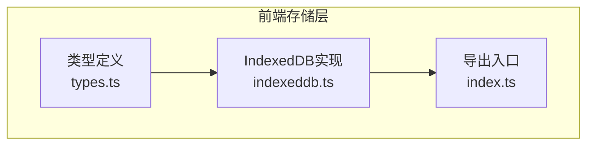
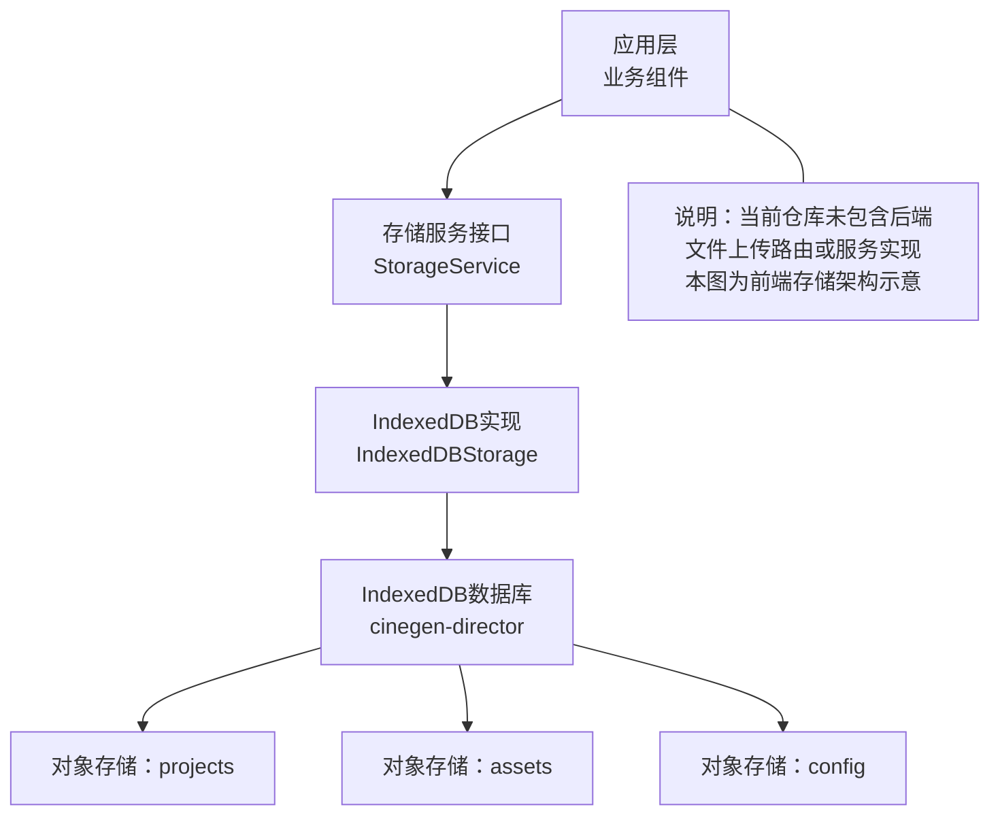
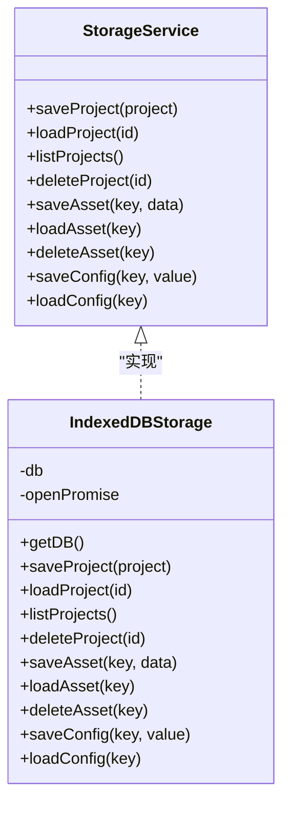
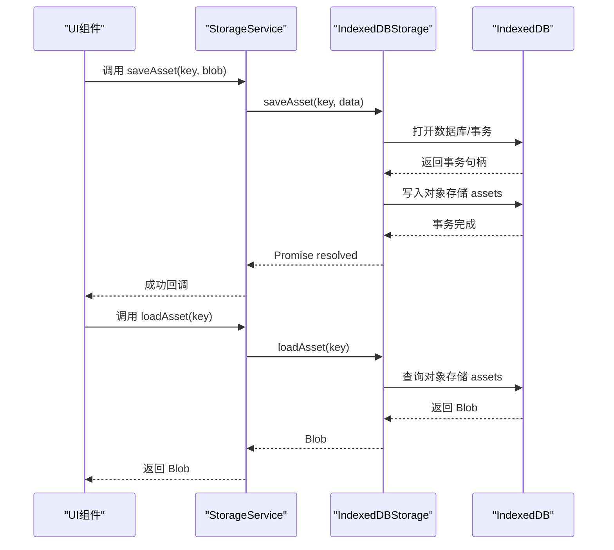
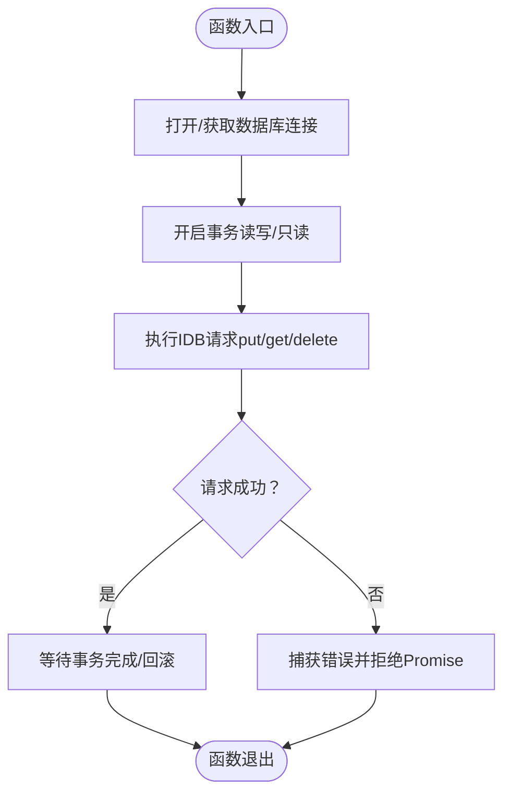
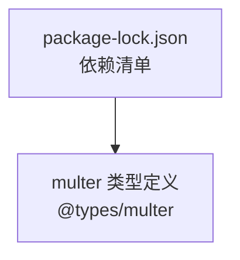

# 文件上传API

<cite>
**本文档引用的文件**
- [indexeddb.ts](file://src/services/storage/indexeddb.ts)
- [types.ts](file://src/services/storage/types.ts)
- [index.ts](file://src/services/storage/index.ts)
- [package-lock.json](file://package-lock.json)
</cite>

## 目录
1. [简介](#简介)
2. [项目结构](#项目结构)
3. [核心组件](#核心组件)
4. [架构总览](#架构总览)
5. [详细组件分析](#详细组件分析)
6. [依赖分析](#依赖分析)
7. [性能考虑](#性能考虑)
8. [故障排除指南](#故障排除指南)
9. [结论](#结论)

## 简介
本文件上传API参考文档面向AI Shotlive项目中的前端与后端集成场景，聚焦于浏览器端IndexedDB本地存储能力与后端文件服务之间的协作模式。当前仓库中未发现直接的后端文件上传路由或服务实现，但前端提供了基于IndexedDB的二进制资产存取接口，可用于本地离线处理与演示。本文档将结合现有代码，给出可扩展到后端文件服务的接口设计建议、安全验证机制、文件类型与大小限制策略，以及分片上传、断点续传、批量上传等高级功能的实现思路。

## 项目结构
与文件上传API相关的核心前端存储模块位于src/services/storage目录，包含以下关键文件：
- 类型定义：定义统一的存储服务接口与项目摘要结构
- 实现：IndexedDB存储的具体实现，支持项目、资产、配置三类数据的增删改查
- 导出：对外暴露StorageService接口与单例storage实例

**图表来源**
- [types.ts:1-30](file://src/services/storage/types.ts#L1-L30)
- [indexeddb.ts:1-190](file://src/services/storage/indexeddb.ts#L1-L190)
- [index.ts:1-2](file://src/services/storage/index.ts#L1-L2)

**章节来源**
- [types.ts:1-30](file://src/services/storage/types.ts#L1-L30)
- [indexeddb.ts:1-190](file://src/services/storage/indexeddb.ts#L1-L190)
- [index.ts:1-2](file://src/services/storage/index.ts#L1-L2)

## 核心组件
- 存储服务接口（StorageService）：定义了项目、资产、配置三类数据的统一操作契约，包括保存、加载、删除与列表查询等方法。
- IndexedDB存储实现：基于浏览器原生IndexedDB，提供事务封装、请求Promise化、数据库版本管理与对象存储初始化。
- 单例存储实例：对外导出storage实例，供上层业务直接调用。

关键职责与行为：
- 项目数据：以JSON形式持久化，主键为id，适合小体量结构化数据。
- 资产数据：以Blob形式存储，适合图片、视频等二进制资源。
- 配置数据：以键值对形式存储，适合用户偏好、临时状态等。

**章节来源**
- [types.ts:15-30](file://src/services/storage/types.ts#L15-L30)
- [indexeddb.ts:23-186](file://src/services/storage/indexeddb.ts#L23-L186)

## 架构总览
下图展示了前端存储层的整体架构与数据流：

**图表来源**
- [indexeddb.ts:13-21](file://src/services/storage/indexeddb.ts#L13-L21)
- [indexeddb.ts:44-61](file://src/services/storage/indexeddb.ts#L44-L61)
- [types.ts:15-30](file://src/services/storage/types.ts#L15-L30)

## 详细组件分析

### 组件A：IndexedDB存储实现（IndexedDBStorage）
该类实现了StorageService接口，负责：
- 数据库打开与版本升级：在首次访问时创建对象存储（projects、assets、config），并在版本变更时主动关闭数据库以避免锁库。
- 事务封装：提供通用的Promise化事务与请求处理，确保写操作的原子性与一致性。
- 项目操作：保存、加载、列出（仅摘要字段）、删除。
- 资产操作：保存Blob、加载Blob、删除。
- 配置操作：保存任意类型值、加载指定类型的值。

**图表来源**
- [types.ts:15-30](file://src/services/storage/types.ts#L15-L30)
- [indexeddb.ts:23-186](file://src/services/storage/indexeddb.ts#L23-L186)

**章节来源**
- [indexeddb.ts:27-78](file://src/services/storage/indexeddb.ts#L27-L78)
- [indexeddb.ts:83-99](file://src/services/storage/indexeddb.ts#L83-L99)
- [indexeddb.ts:103-141](file://src/services/storage/indexeddb.ts#L103-L141)
- [indexeddb.ts:145-167](file://src/services/storage/indexeddb.ts#L145-L167)
- [indexeddb.ts:171-185](file://src/services/storage/indexeddb.ts#L171-L185)

### 组件B：API工作流（前端视角）
以下序列图展示了前端通过StorageService进行资产读写的典型流程，适用于本地离线场景与后端对接的抽象模型：

**图表来源**
- [types.ts:22-25](file://src/services/storage/types.ts#L22-L25)
- [indexeddb.ts:145-159](file://src/services/storage/indexeddb.ts#L145-L159)

**章节来源**
- [types.ts:22-25](file://src/services/storage/types.ts#L22-L25)
- [indexeddb.ts:145-159](file://src/services/storage/indexeddb.ts#L145-L159)

### 组件C：复杂逻辑流程（事务与错误处理）
以下流程图展示了IndexedDB事务与请求的通用处理逻辑，体现错误捕获与事务完成状态管理：

**图表来源**
- [indexeddb.ts:83-99](file://src/services/storage/indexeddb.ts#L83-L99)
- [indexeddb.ts:31-78](file://src/services/storage/indexeddb.ts#L31-L78)

**章节来源**
- [indexeddb.ts:83-99](file://src/services/storage/indexeddb.ts#L83-L99)
- [indexeddb.ts:31-78](file://src/services/storage/indexeddb.ts#L31-L78)

## 依赖分析
- 前端存储依赖：浏览器原生IndexedDB API，无需第三方依赖。
- 第三方依赖：项目中存在multer（后端文件上传中间件）的类型定义，但当前仓库未包含其具体实现文件，因此无法直接用于后端文件上传API。

**图表来源**
- [package-lock.json:9051-9069](file://package-lock.json#L9051-L9069)

**章节来源**
- [package-lock.json:9051-9069](file://package-lock.json#L9051-L9069)

## 性能考虑
- IndexedDB事务批处理：将多个写操作合并到同一事务中，减少事务开销与磁盘写入次数。
- 数据裁剪：列表查询仅返回必要字段，避免传输大体量JSON导致的内存与网络压力。
- Blob复用：在UI层尽量复用已加载的Blob，避免重复读取与转换。
- 版本变更处理：监听versionchange事件并主动关闭数据库，防止并发升级导致的锁库问题。
- 建议（后端扩展）：若接入后端文件服务，可采用分片上传与断点续传，结合进度条与重试机制提升大文件上传体验。

## 故障排除指南
常见问题与排查要点：
- 数据库打开失败：检查IndexedDB是否被浏览器禁用、存储空间是否不足、跨标签页升级是否阻塞。
- 事务失败或中止：确认事务范围内的所有请求均成功，注意onerror与onabort回调。
- Blob读取为空：确认key是否正确、对象存储是否存在对应记录。
- 类型不匹配：确保loadConfig时的泛型类型与保存时一致。

定位参考：
- 数据库打开与版本升级：[indexeddb.ts:31-78](file://src/services/storage/indexeddb.ts#L31-L78)
- 事务Promise化：[indexeddb.ts:93-99](file://src/services/storage/indexeddb.ts#L93-L99)
- 资产读写：[indexeddb.ts:145-159](file://src/services/storage/indexeddb.ts#L145-L159)

**章节来源**
- [indexeddb.ts:31-78](file://src/services/storage/indexeddb.ts#L31-L78)
- [indexeddb.ts:93-99](file://src/services/storage/indexeddb.ts#L93-L99)
- [indexeddb.ts:145-159](file://src/services/storage/indexeddb.ts#L145-L159)

## 结论
当前仓库的文件上传API主要体现在前端IndexedDB存储能力，能够满足本地离线场景下的二进制资产存取需求。对于需要后端文件服务的场景，可在现有StorageService接口之上扩展HTTP上传实现，并结合分片上传、断点续传、批量上传等机制，配合严格的文件类型与大小限制、安全验证与鉴权策略，构建完整的云端文件管理方案。