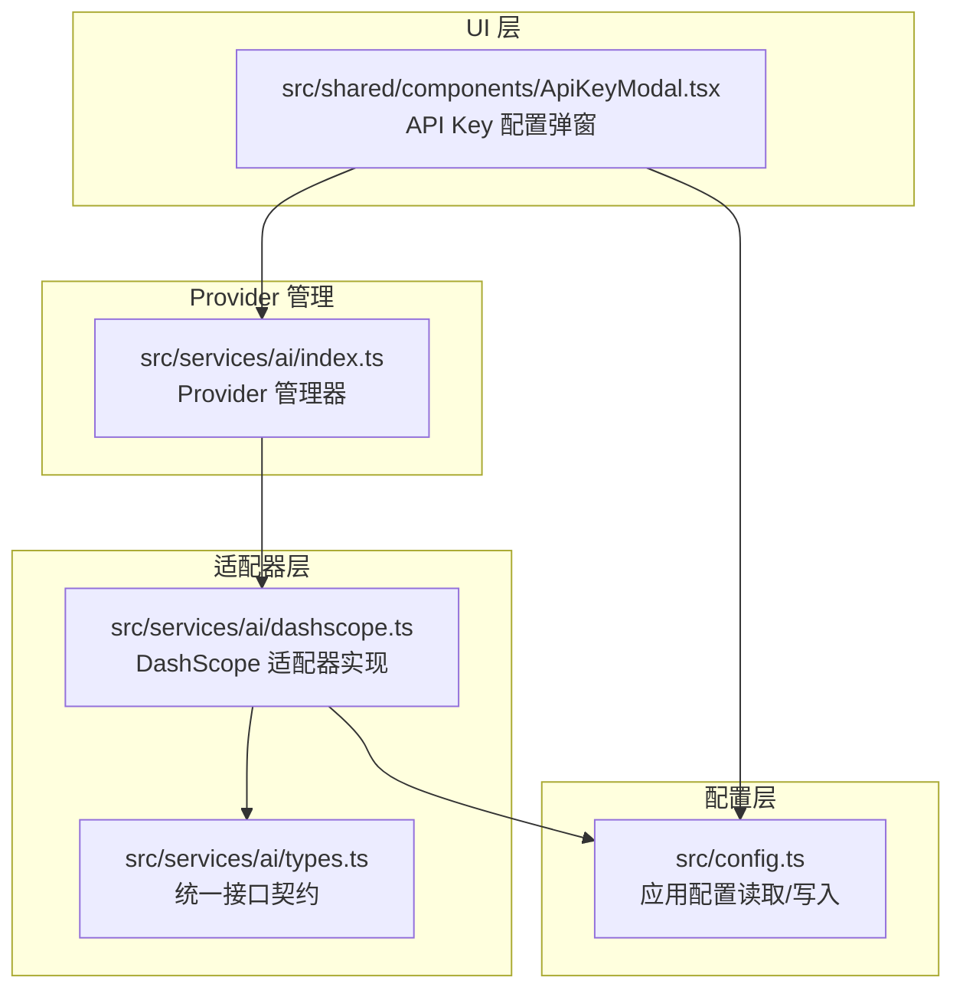
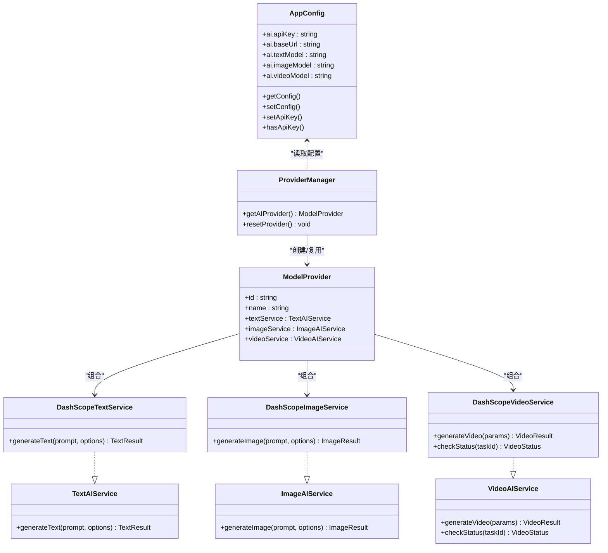
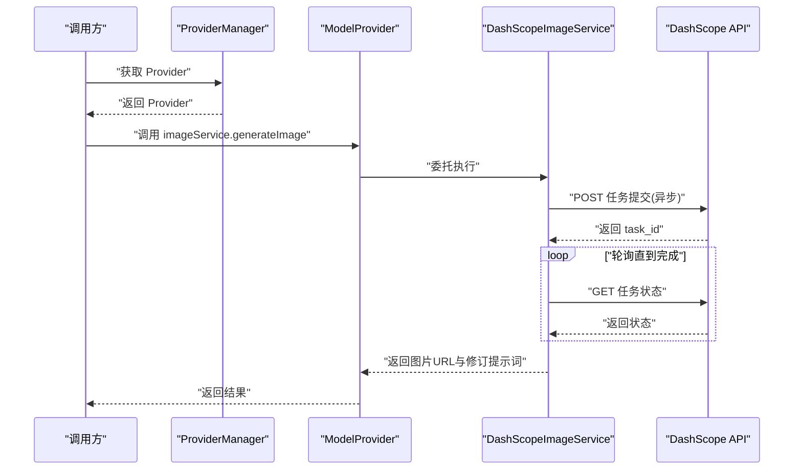
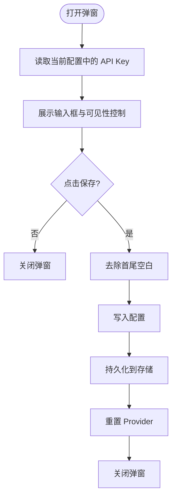
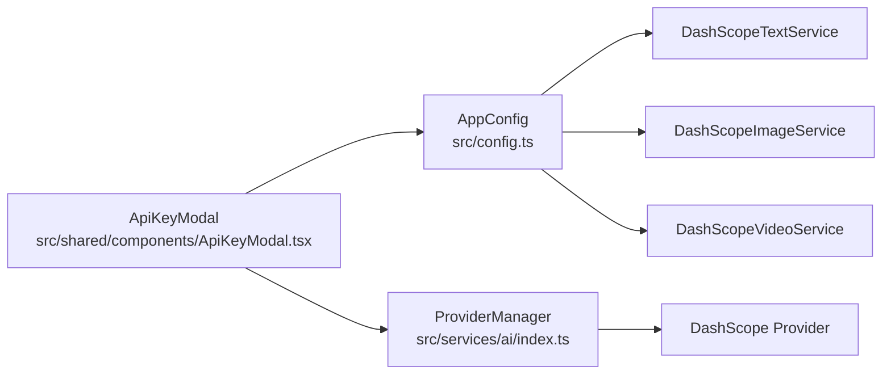

# 模型配置API

<cite>
**本文引用的文件**
- [src/config.ts](file://src/config.ts)
- [src/services/ai/index.ts](file://src/services/ai/index.ts)
- [src/services/ai/types.ts](file://src/services/ai/types.ts)
- [src/services/ai/dashscope.ts](file://src/services/ai/dashscope.ts)
- [src/shared/components/ApiKeyModal.tsx](file://src/shared/components/ApiKeyModal.tsx)
</cite>

## 目录
1. [简介](#简介)
2. [项目结构](#项目结构)
3. [核心组件](#核心组件)
4. [架构总览](#架构总览)
5. [详细组件分析](#详细组件分析)
6. [依赖关系分析](#依赖关系分析)
7. [性能考量](#性能考量)
8. [故障排除指南](#故障排除指南)
9. [结论](#结论)
10. [附录](#附录)

## 简介
本文件为 AI Shotlive 的“模型配置API”提供权威参考，覆盖以下主题：
- 模型提供商与适配器架构
- API Key 配置与持久化
- 文本/图像/视频模型的统一接口与调用流程
- 模型参数设置与可用性检查
- 性能监控与重试策略
- 最佳实践与故障排除

该系统采用“抽象接口 + 厂商适配器”的设计，当前默认集成 DashScope（阿里云），并通过 Provider 管理器集中对外暴露统一能力。

## 项目结构
围绕模型配置与调用的关键文件组织如下：
- 配置层：应用配置读取与写入，包含 API Key、基础地址与各模型名称
- 适配器层：统一接口契约定义，DashScope 适配器实现
- Provider 管理：Provider 单例工厂与重置机制
- UI 层：API Key 配置弹窗，负责输入、保存与 Provider 重置

**图示来源**
- [src/config.ts:1-46](file://src/config.ts#L1-L46)
- [src/services/ai/types.ts:1-72](file://src/services/ai/types.ts#L1-L72)
- [src/services/ai/dashscope.ts:1-327](file://src/services/ai/dashscope.ts#L1-L327)
- [src/services/ai/index.ts:1-33](file://src/services/ai/index.ts#L1-L33)
- [src/shared/components/ApiKeyModal.tsx:1-47](file://src/shared/components/ApiKeyModal.tsx#L1-L47)

**章节来源**
- [src/config.ts:1-46](file://src/config.ts#L1-L46)
- [src/services/ai/types.ts:1-72](file://src/services/ai/types.ts#L1-L72)
- [src/services/ai/dashscope.ts:1-327](file://src/services/ai/dashscope.ts#L1-L327)
- [src/services/ai/index.ts:1-33](file://src/services/ai/index.ts#L1-L33)
- [src/shared/components/ApiKeyModal.tsx:1-47](file://src/shared/components/ApiKeyModal.tsx#L1-L47)

## 核心组件
- 应用配置（AppConfig）
  - 字段：ai.apiKey、ai.baseUrl、ai.textModel、ai.imageModel、ai.videoModel
  - 默认值：baseUrl 指向 DashScope 兼容模式；各模型名指向对应默认模型
  - 提供：getConfig、setConfig、setApiKey、hasApiKey
- 统一接口契约（Text/Image/Video + Provider）
  - 定义文本、图像、视频三类服务的统一接口与结果结构
  - 定义 Provider 结构：id、name、textService、imageService、videoService
- DashScope 适配器
  - 实现 TextAIService、ImageAIService、VideoAIService
  - 支持同步文本、异步图像/视频任务与轮询
  - 内建重试、超时、状态映射与错误码
- Provider 管理器
  - 提供 getAIProvider 获取单例 Provider
  - 提供 resetProvider 清空缓存以应用新配置
- API Key 配置弹窗
  - 负责输入、校验、持久化存储与 Provider 重置

**章节来源**
- [src/config.ts:6-46](file://src/config.ts#L6-L46)
- [src/services/ai/types.ts:6-72](file://src/services/ai/types.ts#L6-L72)
- [src/services/ai/dashscope.ts:96-327](file://src/services/ai/dashscope.ts#L96-L327)
- [src/services/ai/index.ts:22-33](file://src/services/ai/index.ts#L22-L33)
- [src/shared/components/ApiKeyModal.tsx:17-47](file://src/shared/components/ApiKeyModal.tsx#L17-L47)

## 架构总览
系统采用“配置驱动 + 抽象接口 + 厂商适配器”的分层架构：
- 配置层：集中管理 API Key、基础地址与模型名称
- 接口层：定义跨厂商一致的调用协议
- 适配层：针对具体厂商实现接口，屏蔽差异
- 管理层：Provider 单例与重置，确保配置变更生效
- 表现层：UI 组件负责配置输入与持久化

**图示来源**
- [src/config.ts:6-46](file://src/config.ts#L6-L46)
- [src/services/ai/types.ts:6-72](file://src/services/ai/types.ts#L6-L72)
- [src/services/ai/dashscope.ts:96-327](file://src/services/ai/dashscope.ts#L96-L327)
- [src/services/ai/index.ts:22-33](file://src/services/ai/index.ts#L22-L33)

## 详细组件分析

### 配置管理（AppConfig）
- 作用：集中管理 AI 服务所需的基础信息与模型名称
- 关键点：
  - 默认 baseUrl 指向 DashScope 兼容模式
  - 各模型名称指向默认模型，便于快速上手
  - setApiKey 与 hasApiKey 提供便捷的密钥管理
  - setConfig 支持部分字段更新，避免全量替换

**章节来源**
- [src/config.ts:16-46](file://src/config.ts#L16-L46)

### Provider 管理器（getAIProvider/resetProvider）
- 作用：提供 Provider 单例，确保全局共享同一套适配器实例
- 关键点：
  - getAIProvider 首次创建 DashScope Provider，后续直接返回
  - resetProvider 清空缓存，使后续调用重新加载最新配置

**章节来源**
- [src/services/ai/index.ts:22-33](file://src/services/ai/index.ts#L22-L33)

### DashScope 适配器（Text/Image/Video）
- 文本服务（同步）
  - 使用兼容模式 chat/completions
  - 支持 systemPrompt、temperature、maxTokens 等参数
  - 返回内容与用量统计
- 图像服务（异步）
  - 通过 X-DashScope-Async enable 提交异步任务
  - 轮询任务状态，超时与失败有明确错误码
  - 返回图片 URL 与修订后的提示词
- 视频服务（异步）
  - 提交任务后立即返回 taskId
  - 外部可调用 checkStatus 轮询，或在服务内自行等待
  - 完成后返回视频 URL，失败返回错误信息

**图示来源**
- [src/services/ai/index.ts:22-33](file://src/services/ai/index.ts#L22-L33)
- [src/services/ai/dashscope.ts:219-255](file://src/services/ai/dashscope.ts#L219-L255)

**章节来源**
- [src/services/ai/dashscope.ts:96-139](file://src/services/ai/dashscope.ts#L96-L139)
- [src/services/ai/dashscope.ts:219-255](file://src/services/ai/dashscope.ts#L219-L255)
- [src/services/ai/dashscope.ts:258-315](file://src/services/ai/dashscope.ts#L258-L315)

### API Key 配置弹窗（ApiKeyModal）
- 功能：输入 API Key、显示/隐藏、保存到本地存储、触发 Provider 重置
- 流程：打开时读取当前配置；保存时去空白、写入配置、持久化、重置 Provider、关闭弹窗

**图示来源**
- [src/shared/components/ApiKeyModal.tsx:22-47](file://src/shared/components/ApiKeyModal.tsx#L22-L47)
- [src/config.ts:40-46](file://src/config.ts#L40-L46)
- [src/services/ai/index.ts:31-33](file://src/services/ai/index.ts#L31-L33)

**章节来源**
- [src/shared/components/ApiKeyModal.tsx:17-47](file://src/shared/components/ApiKeyModal.tsx#L17-L47)

## 依赖关系分析
- 配置依赖：DashScope 适配器依赖 AppConfig 中的 apiKey、baseUrl、模型名
- Provider 依赖：Provider 管理器依赖 DashScope Provider 工厂
- UI 依赖：ApiKeyModal 依赖配置与 Provider 管理器，用于保存与重置

**图示来源**
- [src/config.ts:6-46](file://src/config.ts#L6-L46)
- [src/services/ai/dashscope.ts:96-327](file://src/services/ai/dashscope.ts#L96-L327)
- [src/services/ai/index.ts:22-33](file://src/services/ai/index.ts#L22-L33)
- [src/shared/components/ApiKeyModal.tsx:17-47](file://src/shared/components/ApiKeyModal.tsx#L17-L47)

**章节来源**
- [src/config.ts:6-46](file://src/config.ts#L6-L46)
- [src/services/ai/dashscope.ts:96-327](file://src/services/ai/dashscope.ts#L96-L327)
- [src/services/ai/index.ts:22-33](file://src/services/ai/index.ts#L22-L33)
- [src/shared/components/ApiKeyModal.tsx:17-47](file://src/shared/components/ApiKeyModal.tsx#L17-L47)

## 性能考量
- 异步任务与轮询
  - 图像/视频采用异步任务 + 轮询，降低阻塞风险
  - 轮询间隔与最大等待时间可调，平衡响应速度与资源占用
- 重试策略
  - 对 5xx 错误进行指数退避重试，4xx 直接报错
  - 最大重试次数与回退时间可配置，避免雪崩
- 超时与失败处理
  - 任务超时与失败有明确错误码，便于前端展示与用户引导
- 参数优化
  - 文本模型支持 temperature、maxTokens 等参数，按需调整以平衡质量与成本

**章节来源**
- [src/services/ai/dashscope.ts:58-93](file://src/services/ai/dashscope.ts#L58-L93)
- [src/services/ai/dashscope.ts:201-216](file://src/services/ai/dashscope.ts#L201-L216)

## 故障排除指南
- 未配置 API Key
  - 现象：调用时抛出认证错误
  - 处理：通过 API Key 配置弹窗填写并保存，触发 Provider 重置
  - 参考：[src/shared/components/ApiKeyModal.tsx:36-47](file://src/shared/components/ApiKeyModal.tsx#L36-L47)
- API Key 无效或过期
  - 现象：401 认证失败
  - 处理：更换有效 Key，确认服务端返回的友好提示
  - 参考：[src/services/ai/dashscope.ts:68-78](file://src/services/ai/dashscope.ts#L68-L78)
- 请求过于频繁或配额超限
  - 现象：429 限流
  - 处理：降低请求频率或提升配额；观察重试策略是否生效
  - 参考：[src/services/ai/dashscope.ts:68-78](file://src/services/ai/dashscope.ts#L68-L78)
- 任务超时
  - 现象：超过最大等待时间仍未完成
  - 处理：检查网络与服务端状态，适当延长等待时间或减少并发
  - 参考：[src/services/ai/dashscope.ts:201-216](file://src/services/ai/dashscope.ts#L201-L216)
- 任务失败
  - 现象：任务状态为 failed
  - 处理：读取失败原因，修正输入参数或提示词后重试
  - 参考：[src/services/ai/dashscope.ts:207-212](file://src/services/ai/dashscope.ts#L207-L212)
- 文本生成返回为空
  - 现象：返回内容为空
  - 处理：检查模型参数与提示词，必要时启用系统提示
  - 参考：[src/services/ai/dashscope.ts:126-128](file://src/services/ai/dashscope.ts#L126-L128)

**章节来源**
- [src/shared/components/ApiKeyModal.tsx:36-47](file://src/shared/components/ApiKeyModal.tsx#L36-L47)
- [src/services/ai/dashscope.ts:47-93](file://src/services/ai/dashscope.ts#L47-L93)
- [src/services/ai/dashscope.ts:201-216](file://src/services/ai/dashscope.ts#L201-L216)

## 结论
本模型配置API以“配置驱动 + 抽象接口 + 厂商适配器”为核心，实现了：
- 统一的文本/图像/视频调用接口
- 易于扩展的 Provider 架构
- 完备的错误处理与重试策略
- 用户友好的 API Key 配置体验

建议在生产环境中：
- 将 API Key 存储在安全位置，避免明文泄露
- 根据业务场景调整轮询间隔与超时时间
- 对高频调用增加本地缓存与节流策略
- 在 UI 中提供更丰富的状态反馈与重试按钮

## 附录

### API Key 配置流程（步骤说明）
- 打开“模型配置”页面
- 输入 DashScope API Key
- 点击保存，系统自动持久化并重置 Provider
- 重新发起调用即可生效

**章节来源**
- [src/shared/components/ApiKeyModal.tsx:22-47](file://src/shared/components/ApiKeyModal.tsx#L22-L47)
- [src/services/ai/index.ts:31-33](file://src/services/ai/index.ts#L31-L33)