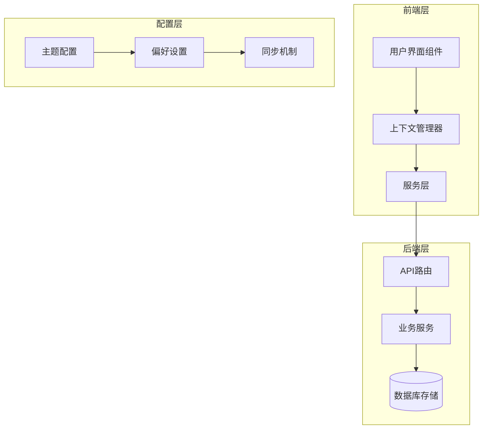
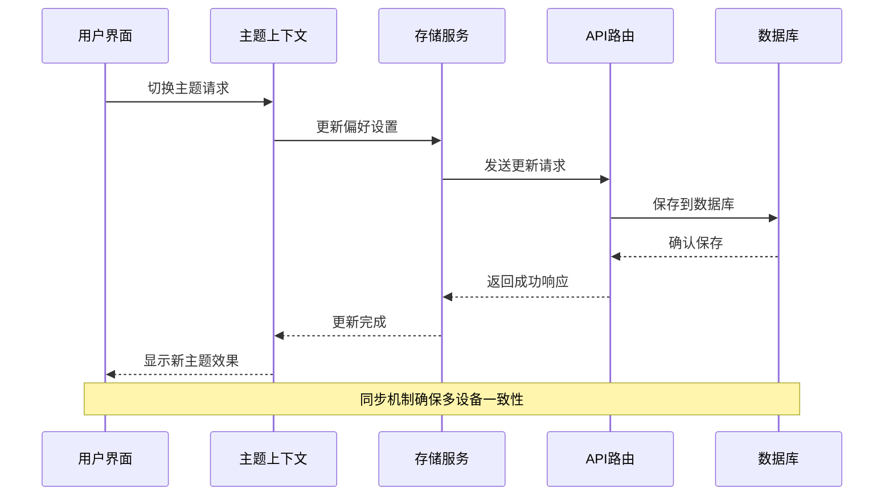
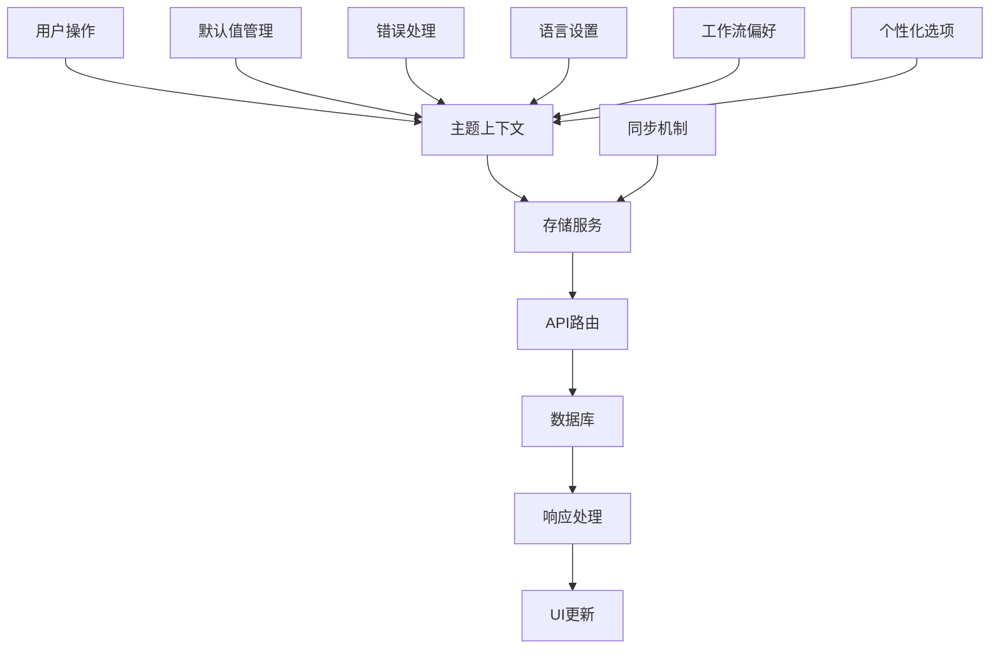
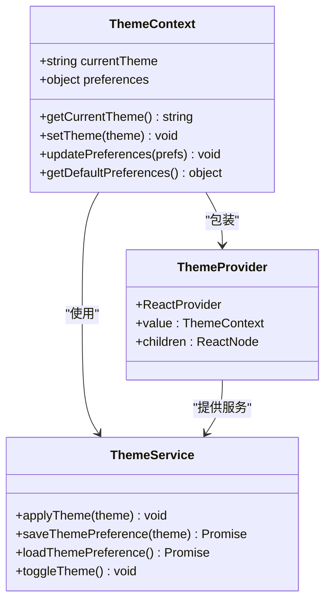
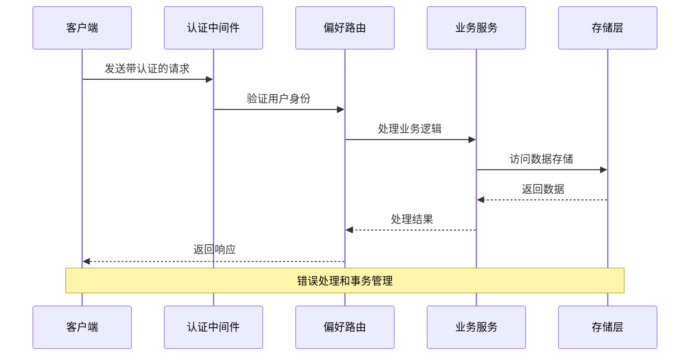
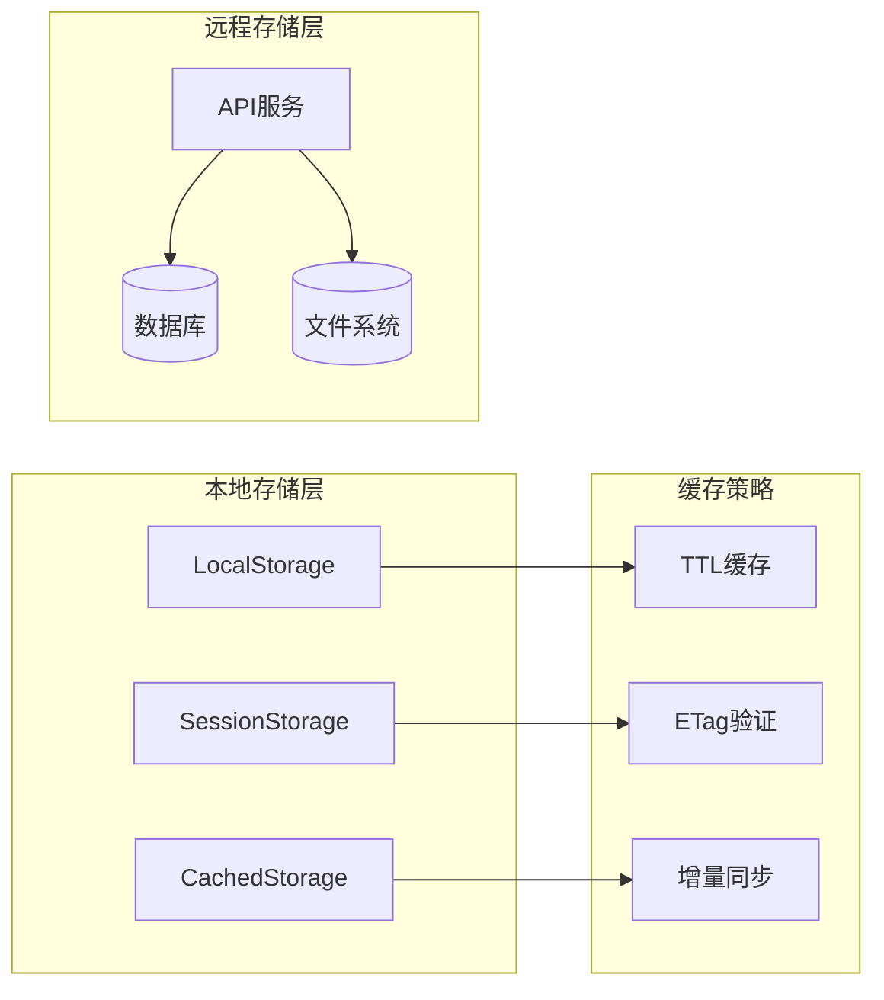
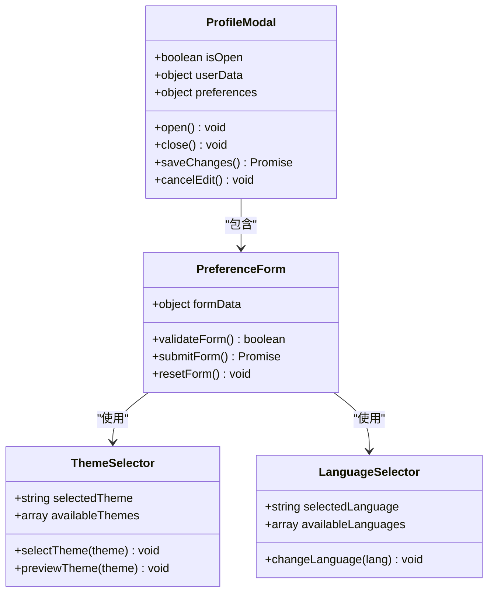
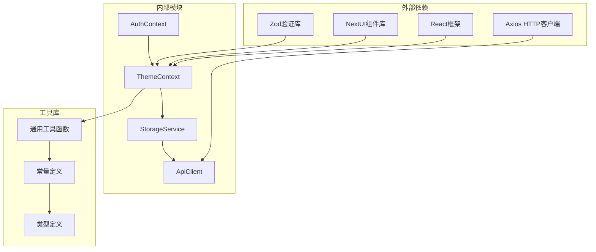

# 用户偏好API

<cite>
**本文档引用的文件**
- [preferences.ts](file://server/src/routes/preferences.ts)
- [ThemeContext.tsx](file://contexts/ThemeContext.tsx)
- [ProfileModal.tsx](file://components/ProfileModal.tsx)
- [storageService.ts](file://services/storageService.ts)
- [projectStorage.ts](file://server/src/services/projectStorage.ts)
- [index.tsx](file://index.tsx)
- [App.tsx](file://src/App.tsx)
- [theme-dark.css](file://public/styles/theme-dark.css)
- [theme-light.css](file://public/styles/theme-light.css)
- [AuthContext.tsx](file://contexts/AuthContext.tsx)
- [apiClient.ts](file://services/apiClient.ts)
</cite>

## 目录
1. [简介](#简介)
2. [项目结构](#项目结构)
3. [核心组件](#核心组件)
4. [架构概览](#架构概览)
5. [详细组件分析](#详细组件分析)
6. [依赖关系分析](#依赖关系分析)
7. [性能考虑](#性能考虑)
8. [故障排除指南](#故障排除指南)
9. [结论](#结论)

## 简介

AI Shotlive的用户偏好API是系统中用于管理用户设置、偏好配置和个性化选项的核心接口集合。该API提供了界面主题切换、语言设置、工作流偏好等功能，支持默认值管理和同步机制，为用户提供个性化的使用体验。

本API设计遵循现代化的前后端分离架构，采用RESTful API规范，确保了良好的可扩展性和维护性。通过统一的偏好管理机制，用户可以在不同设备和会话间保持一致的个性化设置。

## 项目结构

AI Shotlive项目采用模块化架构设计，用户偏好功能分布在多个层次中：

**图表来源**
- [preferences.ts:1-50](file://server/src/routes/preferences.ts#L1-L50)
- [ThemeContext.tsx:1-40](file://contexts/ThemeContext.tsx#L1-L40)
- [storageService.ts:1-30](file://services/storageService.ts#L1-L30)

**章节来源**
- [preferences.ts:1-100](file://server/src/routes/preferences.ts#L1-L100)
- [ThemeContext.tsx:1-80](file://contexts/ThemeContext.tsx#L1-L80)
- [storageService.ts:1-60](file://services/storageService.ts#L1-L60)

## 核心组件

### 主题管理系统

AI Shotlive实现了完整的主题管理系统，支持明暗主题切换和自定义主题配置：

| 组件 | 功能描述 | 关键特性 |
|------|----------|----------|
| ThemeContext | 主题状态管理 | 全局主题状态、主题切换逻辑、持久化存储 |
| theme-dark.css | 深色主题样式 | 颜色变量定义、组件样式覆盖 |
| theme-light.css | 浅色主题样式 | 颜色变量定义、组件样式覆盖 |
| ProfileModal | 用户配置界面 | 主题选择、语言设置、偏好修改 |

### 偏好存储服务

偏好数据通过统一的服务层进行管理，确保数据的一致性和可靠性：

| 服务 | 职责 | 特性 |
|------|------|------|
| storageService | 本地存储管理 | 本地缓存、数据同步、错误处理 |
| projectStorage | 项目存储服务 | 项目级偏好、用户配置、数据迁移 |
| apiClient | API客户端 | 请求封装、响应处理、认证管理 |

**章节来源**
- [ThemeContext.tsx:1-120](file://contexts/ThemeContext.tsx#L1-L120)
- [ProfileModal.tsx:1-80](file://components/ProfileModal.tsx#L1-L80)
- [storageService.ts:1-100](file://services/storageService.ts#L1-L100)

## 架构概览

用户偏好系统的整体架构采用分层设计，确保了良好的关注点分离和可维护性：

**图表来源**
- [preferences.ts:1-80](file://server/src/routes/preferences.ts#L1-L80)
- [ThemeContext.tsx:1-100](file://contexts/ThemeContext.tsx#L1-L100)
- [storageService.ts:1-80](file://services/storageService.ts#L1-L80)

### 数据流架构

**图表来源**
- [preferences.ts:1-60](file://server/src/routes/preferences.ts#L1-L60)
- [ThemeContext.tsx:1-80](file://contexts/ThemeContext.tsx#L1-L80)
- [storageService.ts:1-60](file://services/storageService.ts#L1-L60)

## 详细组件分析

### 主题上下文组件

主题上下文是用户偏好系统的核心组件，负责管理全局主题状态和相关逻辑：

**图表来源**
- [ThemeContext.tsx:1-120](file://contexts/ThemeContext.tsx#L1-L120)

#### 主要功能特性

1. **主题状态管理**: 维护当前激活的主题状态，支持明暗主题切换
2. **偏好持久化**: 自动保存用户的主题偏好到本地存储
3. **默认值处理**: 提供合理的默认主题设置，确保首次使用体验
4. **响应式更新**: 实时响应主题变化，更新整个应用的视觉效果

**章节来源**
- [ThemeContext.tsx:1-200](file://contexts/ThemeContext.tsx#L1-L200)

### 偏好API路由

用户偏好API通过RESTful路由提供完整的CRUD操作：

| 端点 | 方法 | 描述 | 请求体 | 响应 |
|------|------|------|--------|------|
| `/api/preferences` | GET | 获取用户偏好设置 | 无 | 偏好对象 |
| `/api/preferences` | POST | 创建或更新偏好设置 | 偏好数据 | 成功状态 |
| `/api/preferences/theme` | PUT | 更新主题设置 | 主题数据 | 主题状态 |
| `/api/preferences/language` | PUT | 更新语言设置 | 语言数据 | 语言状态 |
| `/api/preferences/sync` | POST | 同步偏好到其他设备 | 设备信息 | 同步结果 |

#### API请求流程

**图表来源**
- [preferences.ts:1-120](file://server/src/routes/preferences.ts#L1-L120)

**章节来源**
- [preferences.ts:1-200](file://server/src/routes/preferences.ts#L1-L200)

### 存储服务架构

存储服务层提供了多层次的数据持久化解决方案：

**图表来源**
- [storageService.ts:1-100](file://services/storageService.ts#L1-L100)
- [projectStorage.ts:1-80](file://server/src/services/projectStorage.ts#L1-L80)

#### 缓存策略

1. **TTL缓存**: 本地存储设置过期时间，确保数据新鲜度
2. **ETag验证**: 远程存储使用内容标识符，减少不必要的数据传输
3. **增量同步**: 只同步发生变化的偏好设置，提高效率

**章节来源**
- [storageService.ts:1-150](file://services/storageService.ts#L1-L150)
- [projectStorage.ts:1-120](file://server/src/services/projectStorage.ts#L1-L120)

### 用户配置界面

用户配置界面提供了直观的偏好设置管理功能：

**图表来源**
- [ProfileModal.tsx:1-100](file://components/ProfileModal.tsx#L1-L100)

#### 界面组件特性

1. **响应式设计**: 适配不同屏幕尺寸和设备类型
2. **实时预览**: 支持主题和语言的实时预览功能
3. **表单验证**: 完整的前端表单验证和错误处理
4. **无障碍访问**: 符合WCAG标准的无障碍设计

**章节来源**
- [ProfileModal.tsx:1-150](file://components/ProfileModal.tsx#L1-L150)

## 依赖关系分析

用户偏好系统的依赖关系体现了清晰的分层架构：

**图表来源**
- [ThemeContext.tsx:1-60](file://contexts/ThemeContext.tsx#L1-L60)
- [storageService.ts:1-40](file://services/storageService.ts#L1-L40)
- [apiClient.ts:1-40](file://services/apiClient.ts#L1-L40)

### 关键依赖特性

1. **模块化设计**: 各组件职责明确，便于独立开发和测试
2. **类型安全**: 使用TypeScript确保编译时类型检查
3. **异步处理**: 全面采用Promise和async/await模式
4. **错误边界**: 实现完善的错误处理和恢复机制

**章节来源**
- [ThemeContext.tsx:1-100](file://contexts/ThemeContext.tsx#L1-L100)
- [storageService.ts:1-80](file://services/storageService.ts#L1-L80)
- [apiClient.ts:1-80](file://services/apiClient.ts#L1-L80)

## 性能考虑

用户偏好系统在设计时充分考虑了性能优化：

### 内存管理
- **懒加载策略**: 主题资源按需加载，减少初始内存占用
- **组件卸载清理**: 主题上下文在组件卸载时自动清理事件监听器
- **缓存优化**: 智能缓存策略避免重复计算和网络请求

### 网络优化
- **请求合并**: 批量处理多个偏好更新请求
- **压缩传输**: 使用Gzip压缩偏好数据传输
- **CDN加速**: 主题资源通过CDN分发，提升加载速度

### 渲染优化
- **虚拟滚动**: 大量偏好项的列表渲染优化
- **防抖处理**: 输入框变更的防抖处理，减少不必要的重渲染
- **增量更新**: 只更新发生变化的UI部分

## 故障排除指南

### 常见问题及解决方案

| 问题类型 | 症状 | 可能原因 | 解决方案 |
|----------|------|----------|----------|
| 主题切换失败 | 界面未更新 | 本地存储损坏 | 清除浏览器缓存和Cookie |
| 偏好同步异常 | 设置不同步 | 网络连接问题 | 检查网络连接，重试操作 |
| 默认值丢失 | 应用重启后设置重置 | 数据库连接失败 | 检查数据库服务状态 |
| 性能问题 | 页面加载缓慢 | 缓存未命中 | 清理缓存，检查CDN状态 |

### 调试工具

1. **浏览器开发者工具**: 检查网络请求和JavaScript错误
2. **控制台日志**: 查看偏好系统的运行状态
3. **存储检查**: 验证本地存储的数据完整性
4. **API测试**: 使用Postman测试API端点

**章节来源**
- [preferences.ts:1-150](file://server/src/routes/preferences.ts#L1-L150)
- [storageService.ts:1-120](file://services/storageService.ts#L1-L120)

## 结论

AI Shotlive的用户偏好API系统展现了现代Web应用的最佳实践。通过模块化的设计、完善的错误处理机制和优秀的性能优化，为用户提供了流畅、个性化的使用体验。

该系统的主要优势包括：

1. **架构清晰**: 分层设计确保了良好的可维护性和扩展性
2. **用户体验优秀**: 实时预览、快速响应和直观的界面设计
3. **技术实现先进**: 使用最新的React技术和最佳实践
4. **性能优化到位**: 多层次的缓存策略和网络优化

未来可以考虑的功能增强包括：更丰富的主题定制选项、跨平台偏好同步、智能偏好学习等，以进一步提升用户体验。