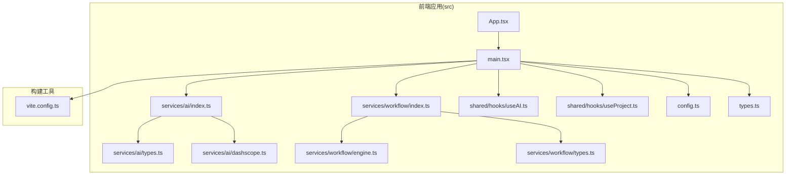
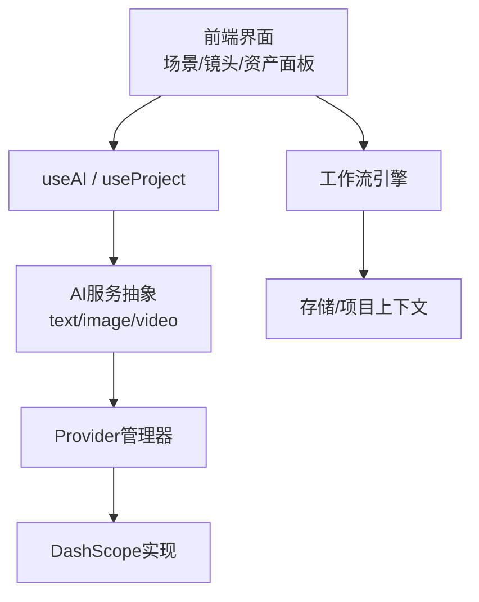
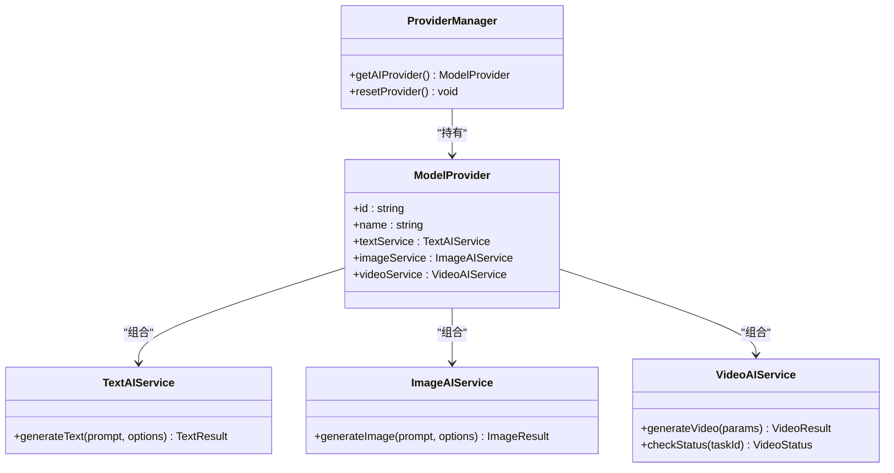
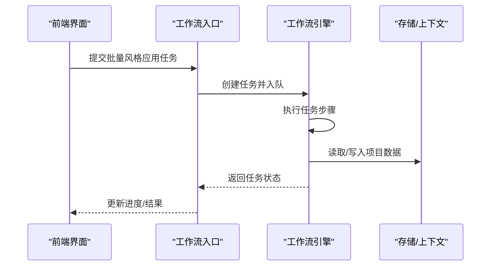
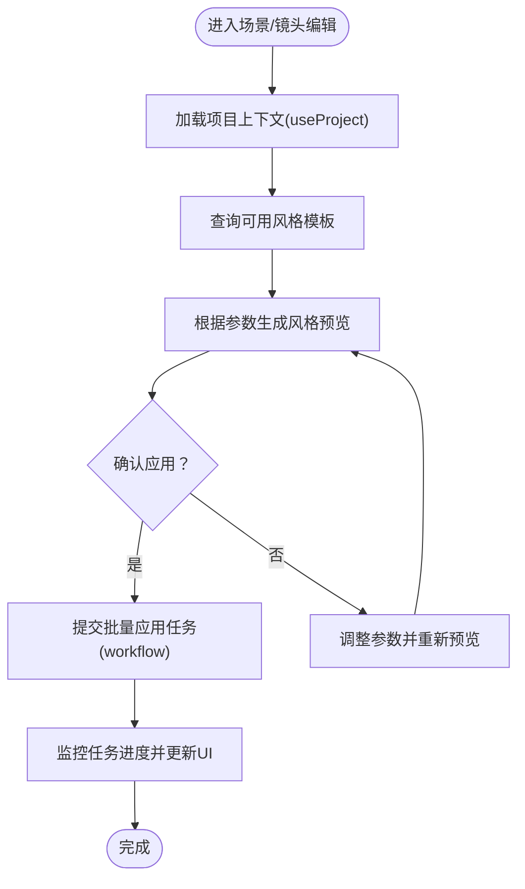
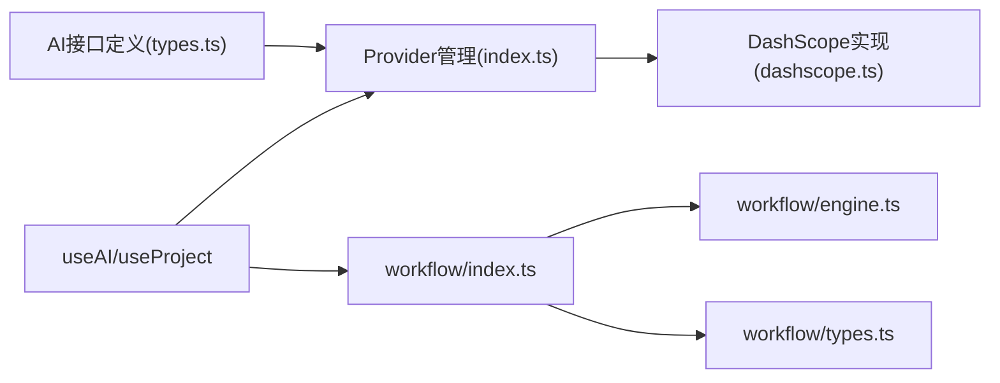

# 视觉风格API

<cite>
**本文引用的文件**
- [src/services/ai/index.ts](file://src/services/ai/index.ts)
- [src/services/ai/types.ts](file://src/services/ai/types.ts)
- [src/services/ai/dashscope.ts](file://src/services/ai/dashscope.ts)
- [src/services/workflow/index.ts](file://src/services/workflow/index.ts)
- [src/services/workflow/engine.ts](file://src/services/workflow/engine.ts)
- [src/services/workflow/types.ts](file://src/services/workflow/types.ts)
- [src/shared/hooks/useAI.ts](file://src/shared/hooks/useAI.ts)
- [src/shared/hooks/useProject.ts](file://src/shared/hooks/useProject.ts)
- [src/App.tsx](file://src/App.tsx)
- [src/main.tsx](file://src/main.tsx)
- [src/config.ts](file://src/config.ts)
- [src/types.ts](file://src/types.ts)
- [vite.config.ts](file://vite.config.ts)
</cite>

## 目录
1. [简介](#简介)
2. [项目结构](#项目结构)
3. [核心组件](#核心组件)
4. [架构总览](#架构总览)
5. [详细组件分析](#详细组件分析)
6. [依赖关系分析](#依赖关系分析)
7. [性能考虑](#性能考虑)
8. [故障排除指南](#故障排除指南)
9. [结论](#结论)
10. [附录](#附录)

## 简介
本文件为AI Shotlive的视觉风格API提供权威参考与实践指南。当前仓库中未发现直接名为“visualStyles.ts”的后端路由或“visualStyleService.ts”、“VisualStyleManager.tsx”的专用模块。因此，本参考以现有代码库中的AI服务抽象、工作流引擎与前端集成点为基础，给出可落地的视觉风格API设计建议与实现路径，帮助开发者在现有架构上扩展“视觉风格”的创建、查询、应用、预览与批量处理能力。

## 项目结构
AI Shotlive采用前后端分离的前端单页应用（SPA）架构，核心位于src目录，包含：
- 服务层：AI服务抽象、工作流引擎与类型定义
- 共享层：通用Hook与上下文
- 应用入口：App与main
- 构建配置：Vite

**图表来源**
- [src/App.tsx](file://src/App.tsx)
- [src/main.tsx](file://src/main.tsx)
- [src/services/ai/index.ts](file://src/services/ai/index.ts)
- [src/services/ai/types.ts](file://src/services/ai/types.ts)
- [src/services/ai/dashscope.ts](file://src/services/ai/dashscope.ts)
- [src/services/workflow/index.ts](file://src/services/workflow/index.ts)
- [src/services/workflow/engine.ts](file://src/services/workflow/engine.ts)
- [src/services/workflow/types.ts](file://src/services/workflow/types.ts)
- [src/shared/hooks/useAI.ts](file://src/shared/hooks/useAI.ts)
- [src/shared/hooks/useProject.ts](file://src/shared/hooks/useProject.ts)
- [src/config.ts](file://src/config.ts)
- [src/types.ts](file://src/types.ts)
- [vite.config.ts](file://vite.config.ts)

**章节来源**
- [src/App.tsx](file://src/App.tsx)
- [src/main.tsx](file://src/main.tsx)
- [vite.config.ts](file://vite.config.ts)

## 核心组件
- AI服务抽象与Provider管理：通过统一接口定义文本、图像、视频AI服务，并以Provider模式集中管理，便于未来多厂商切换与扩展。
- 工作流引擎：提供任务编排、状态跟踪与批量执行能力，适合承载“风格模板生成-应用-预览-导出”的完整流程。
- 前端Hook：useAI与useProject为业务组件提供便捷的数据与状态访问。

**章节来源**
- [src/services/ai/index.ts](file://src/services/ai/index.ts)
- [src/services/ai/types.ts](file://src/services/ai/types.ts)
- [src/services/workflow/index.ts](file://src/services/workflow/index.ts)
- [src/shared/hooks/useAI.ts](file://src/shared/hooks/useAI.ts)
- [src/shared/hooks/useProject.ts](file://src/shared/hooks/useProject.ts)

## 架构总览
下图展示了视觉风格API在现有架构中的位置与交互关系：前端通过AI服务抽象调用后端模型，工作流引擎负责任务编排与状态管理，最终由导出阶段完成成品输出。

**图表来源**
- [src/services/ai/index.ts](file://src/services/ai/index.ts)
- [src/services/ai/types.ts](file://src/services/ai/types.ts)
- [src/services/ai/dashscope.ts](file://src/services/ai/dashscope.ts)
- [src/services/workflow/index.ts](file://src/services/workflow/index.ts)
- [src/shared/hooks/useAI.ts](file://src/shared/hooks/useAI.ts)
- [src/shared/hooks/useProject.ts](file://src/shared/hooks/useProject.ts)

## 详细组件分析

### 组件A：AI服务抽象与Provider管理
- 职责：定义文本、图像、视频三类AI服务的统一接口；提供Provider单例管理，确保全局唯一且可重置。
- 关键点：
  - 接口解耦：通过抽象接口屏蔽具体厂商差异。
  - Provider模式：延迟初始化与可重置，便于测试与切换。
- 适用场景：视觉风格API可复用该抽象，新增“风格生成/风格应用”接口，统一由Provider调度。

**图表来源**
- [src/services/ai/types.ts](file://src/services/ai/types.ts)
- [src/services/ai/index.ts](file://src/services/ai/index.ts)

**章节来源**
- [src/services/ai/types.ts](file://src/services/ai/types.ts)
- [src/services/ai/index.ts](file://src/services/ai/index.ts)

### 组件B：工作流引擎
- 职责：编排任务、跟踪状态、支持批量执行与错误恢复。
- 关键点：
  - 类型化任务定义：通过types.ts约束任务结构。
  - 引擎实现：engine.ts负责执行与状态推进。
  - 外部集成：index.ts作为对外入口，协调存储与上下文。
- 适用场景：视觉风格的批量应用、预览队列、导出流水线。

**图表来源**
- [src/services/workflow/index.ts](file://src/services/workflow/index.ts)
- [src/services/workflow/engine.ts](file://src/services/workflow/engine.ts)
- [src/services/workflow/types.ts](file://src/services/workflow/types.ts)

**章节来源**
- [src/services/workflow/index.ts](file://src/services/workflow/index.ts)
- [src/services/workflow/engine.ts](file://src/services/workflow/engine.ts)
- [src/services/workflow/types.ts](file://src/services/workflow/types.ts)

### 组件C：前端Hook与应用集成
- useAI：封装AI服务调用，简化组件内逻辑。
- useProject：提供项目上下文与状态管理。
- 在视觉风格API中，可基于这些Hook实现“风格模板列表查询、风格参数配置、风格预览、批量应用”等交互。

**图表来源**
- [src/shared/hooks/useAI.ts](file://src/shared/hooks/useAI.ts)
- [src/shared/hooks/useProject.ts](file://src/shared/hooks/useProject.ts)
- [src/services/workflow/index.ts](file://src/services/workflow/index.ts)

**章节来源**
- [src/shared/hooks/useAI.ts](file://src/shared/hooks/useAI.ts)
- [src/shared/hooks/useProject.ts](file://src/shared/hooks/useProject.ts)

## 依赖关系分析
- 低耦合：AI服务通过抽象接口与Provider解耦，便于替换实现。
- 可扩展：Provider模式支持多厂商接入；工作流引擎支持任务扩展。
- 前后端边界：现有代码未暴露后端路由或服务文件，视觉风格API应通过前端Hook与Provider对接后端服务。

**图表来源**
- [src/services/ai/types.ts](file://src/services/ai/types.ts)
- [src/services/ai/index.ts](file://src/services/ai/index.ts)
- [src/services/ai/dashscope.ts](file://src/services/ai/dashscope.ts)
- [src/shared/hooks/useAI.ts](file://src/shared/hooks/useAI.ts)
- [src/shared/hooks/useProject.ts](file://src/shared/hooks/useProject.ts)
- [src/services/workflow/index.ts](file://src/services/workflow/index.ts)
- [src/services/workflow/engine.ts](file://src/services/workflow/engine.ts)
- [src/services/workflow/types.ts](file://src/services/workflow/types.ts)

**章节来源**
- [src/services/ai/types.ts](file://src/services/ai/types.ts)
- [src/services/ai/index.ts](file://src/services/ai/index.ts)
- [src/services/ai/dashscope.ts](file://src/services/ai/dashscope.ts)
- [src/shared/hooks/useAI.ts](file://src/shared/hooks/useAI.ts)
- [src/shared/hooks/useProject.ts](file://src/shared/hooks/useProject.ts)
- [src/services/workflow/index.ts](file://src/services/workflow/index.ts)
- [src/services/workflow/engine.ts](file://src/services/workflow/engine.ts)
- [src/services/workflow/types.ts](file://src/services/workflow/types.ts)

## 性能考虑
- 请求合并与节流：对频繁的风格预览请求进行去抖/节流，减少后端压力。
- 缓存策略：对常用风格模板与中间结果进行本地缓存，提升交互响应速度。
- 并发控制：工作流批量任务应限制并发度，避免资源争用。
- 分片与增量：大体量批量应用时采用分片与断点续传机制。
- 预热与懒加载：Provider与工作流引擎按需初始化，降低首屏开销。

## 故障排除指南
- Provider未初始化：检查Provider管理器是否正确实例化与重置。
- 任务状态异常：核对工作流引擎的任务状态映射与回调处理。
- 参数校验失败：前端在提交前进行参数校验，避免无效请求。
- 网络超时：增加重试与降级策略，必要时回退到本地模拟结果。

**章节来源**
- [src/services/ai/index.ts](file://src/services/ai/index.ts)
- [src/services/workflow/engine.ts](file://src/services/workflow/engine.ts)

## 结论
当前仓库未包含独立的视觉风格API模块。建议基于现有AI服务抽象与工作流引擎，扩展“风格模板管理、参数配置、效果预览、批量应用”等能力，并通过Provider与Hook实现与前端界面的无缝集成。该方案既遵循现有架构，又具备良好的扩展性与可维护性。

## 附录
- 最佳实践清单
  - 使用Provider模式统一接入不同后端服务。
  - 将视觉风格参数标准化，便于跨模块共享与持久化。
  - 对预览与批量任务进行进度可视化与错误提示。
  - 为风格模板建立版本与继承关系，支持组合与复用。
  - 在前端实现“模板-参数-预览-应用”的闭环交互流程。