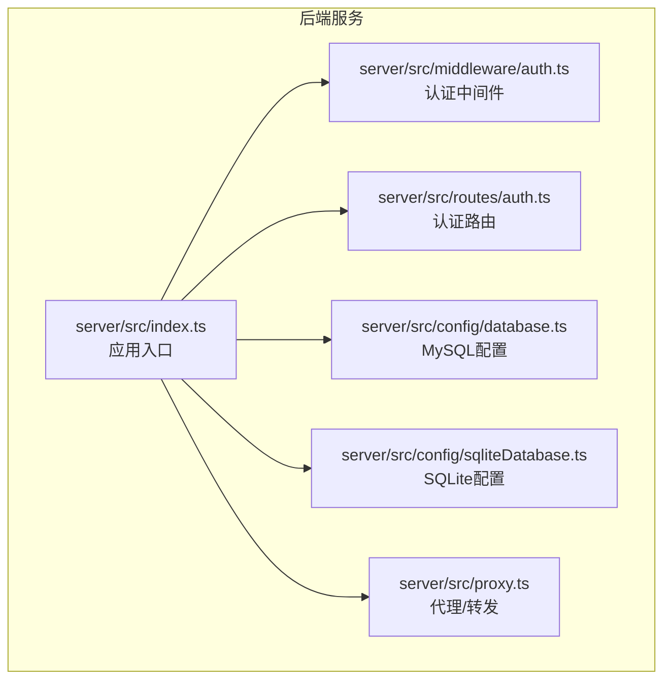
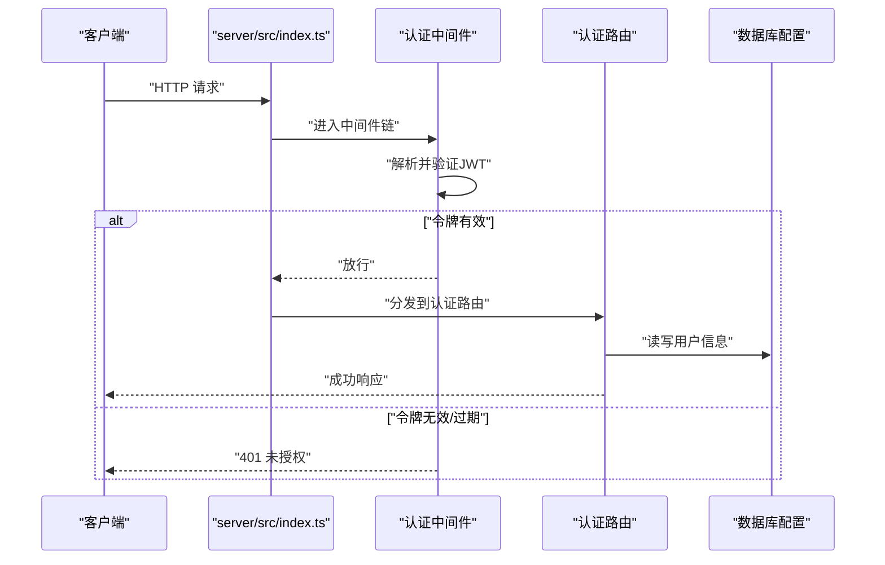
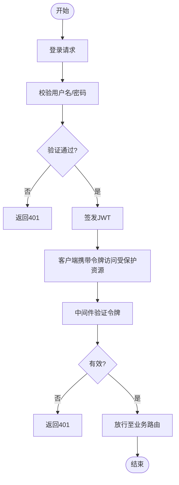
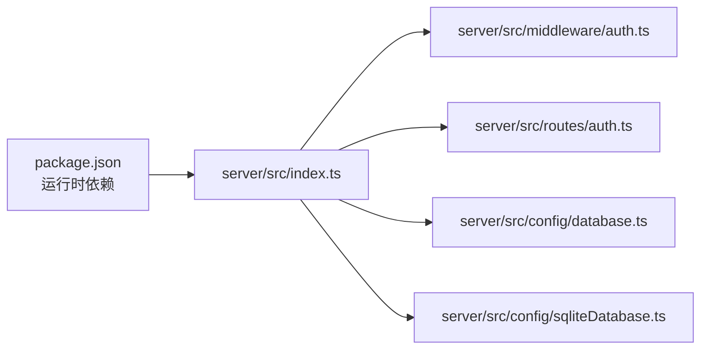

# 认证API

<cite>
**本文引用的文件**
- [server/src/index.ts](file://server/src/index.ts)
- [server/src/proxy.ts](file://server/src/proxy.ts)
- [server/src/config/database.ts](file://server/src/config/database.ts)
- [server/src/config/sqliteDatabase.ts](file://server/src/config/sqliteDatabase.ts)
- [server/src/lib/utils.ts](file://server/src/lib/utils.ts)
- [server/src/middleware/auth.ts](file://server/src/middleware/auth.ts)
- [server/src/routes/auth.ts](file://server/src/routes/auth.ts)
- [server/src/services/projectStorage.ts](file://server/src/services/projectStorage.ts)
- [server/src/scripts/seed.ts](file://server/src/scripts/seed.ts)
- [README.md](file://README.md)
- [README_EN.md](file://README_EN.md)
- [package.json](file://package.json)
</cite>

## 目录
1. [简介](#简介)
2. [项目结构](#项目结构)
3. [核心组件](#核心组件)
4. [架构总览](#架构总览)
5. [详细组件分析](#详细组件分析)
6. [依赖关系分析](#依赖关系分析)
7. [性能考量](#性能考量)
8. [故障排查指南](#故障排查指南)
9. [结论](#结论)
10. [附录](#附录)

## 简介
本文件为 AI Shotlive 的认证API参考文档，聚焦用户登录、注册、登出、密码重置等认证相关接口，以及JWT令牌的生成、验证与刷新机制。文档基于后端服务源码进行梳理，涵盖请求参数、响应格式、错误码与安全注意事项，并提供最佳实践建议。

## 项目结构
后端采用 Node.js + TypeScript 构建，入口位于 server/src/index.ts，通过中间件与路由模块组织认证逻辑。数据库配置支持 MySQL 与 SQLite 两种模式，认证中间件负责校验请求头中的JWT令牌有效性。

图表来源
- [server/src/index.ts](file://server/src/index.ts)
- [server/src/middleware/auth.ts](file://server/src/middleware/auth.ts)
- [server/src/routes/auth.ts](file://server/src/routes/auth.ts)
- [server/src/config/database.ts](file://server/src/config/database.ts)
- [server/src/config/sqliteDatabase.ts](file://server/src/config/sqliteDatabase.ts)
- [server/src/proxy.ts](file://server/src/proxy.ts)

章节来源
- [server/src/index.ts](file://server/src/index.ts)
- [server/src/config/database.ts](file://server/src/config/database.ts)
- [server/src/config/sqliteDatabase.ts](file://server/src/config/sqliteDatabase.ts)
- [README.md](file://README.md)
- [README_EN.md](file://README_EN.md)

## 核心组件
- 应用入口与路由组织：server/src/index.ts 负责初始化服务、挂载中间件与路由。
- 认证中间件：server/src/middleware/auth.ts 提供JWT校验能力，拦截未授权请求。
- 认证路由：server/src/routes/auth.ts 定义登录、注册、登出、密码重置等接口。
- 数据库配置：server/src/config/database.ts（MySQL）与 server/src/config/sqliteDatabase.ts（SQLite）分别处理连接与迁移。
- 工具与脚本：server/src/lib/utils.ts 提供通用工具函数；server/src/scripts/seed.ts 支持初始化默认用户与数据。

章节来源
- [server/src/index.ts](file://server/src/index.ts)
- [server/src/middleware/auth.ts](file://server/src/middleware/auth.ts)
- [server/src/routes/auth.ts](file://server/src/routes/auth.ts)
- [server/src/config/database.ts](file://server/src/config/database.ts)
- [server/src/config/sqliteDatabase.ts](file://server/src/config/sqliteDatabase.ts)
- [server/src/lib/utils.ts](file://server/src/lib/utils.ts)
- [server/src/scripts/seed.ts](file://server/src/scripts/seed.ts)

## 架构总览
下图展示认证流程在系统中的位置与交互：

图表来源
- [server/src/index.ts](file://server/src/index.ts)
- [server/src/middleware/auth.ts](file://server/src/middleware/auth.ts)
- [server/src/routes/auth.ts](file://server/src/routes/auth.ts)
- [server/src/config/database.ts](file://server/src/config/database.ts)
- [server/src/config/sqliteDatabase.ts](file://server/src/config/sqliteDatabase.ts)

## 详细组件分析

### 认证路由与接口定义
- 登录接口
  - 方法与路径：POST /api/auth/login
  - 请求体字段
    - username：字符串，必填
    - password：字符串，必填
  - 成功响应
    - 返回字段：access_token、expires_in、token_type
    - token_type：固定为 bearer
    - expires_in：以秒计的过期时间
  - 失败响应
    - 400：缺少必要字段或格式错误
    - 401：用户名或密码错误
    - 500：服务器内部错误
- 注册接口
  - 方法与路径：POST /api/auth/register
  - 请求体字段
    - username：字符串，必填，唯一
    - password：字符串，必填，建议长度≥8
  - 成功响应
    - 201：创建成功，返回用户基本信息（不含敏感字段）
    - 409：用户名已存在
    - 400：输入非法
    - 500：服务器内部错误
- 登出接口
  - 方法与路径：POST /api/auth/logout
  - 请求头
    - Authorization：Bearer <token>
  - 成功响应
    - 200：登出成功
  - 失败响应
    - 401：未携带或无效令牌
    - 500：服务器内部错误
- 密码重置接口
  - 方法与路径：POST /api/auth/reset-password
  - 请求头
    - Authorization：Bearer <token>
  - 请求体字段
    - old_password：字符串，必填
    - new_password：字符串，必填，建议长度≥8
  - 成功响应
    - 200：密码更新成功
  - 失败响应
    - 400：旧密码错误或新密码不符合规范
    - 401：未授权
    - 500：服务器内部错误

章节来源
- [server/src/routes/auth.ts](file://server/src/routes/auth.ts)

### JWT 令牌生成、验证与刷新机制
- 令牌生成
  - 登录成功后签发 access_token，设置固定有效期（如24小时），返回 token_type 为 bearer。
- 令牌验证
  - 所有受保护接口均需在 Authorization 头中携带 Bearer 令牌。
  - 中间件负责解析并验证签名与过期时间，拒绝无效或过期令牌。
- 令牌刷新
  - 当前实现未提供独立的刷新接口。建议客户端在 access_token 即将过期时重新登录获取新令牌，或在后续版本中引入 refresh_token 机制以提升用户体验。

图表来源
- [server/src/middleware/auth.ts](file://server/src/middleware/auth.ts)
- [server/src/routes/auth.ts](file://server/src/routes/auth.ts)

章节来源
- [server/src/middleware/auth.ts](file://server/src/middleware/auth.ts)
- [server/src/routes/auth.ts](file://server/src/routes/auth.ts)

### 数据库与用户存储
- MySQL 模式
  - 通过 server/src/config/database.ts 进行连接与迁移，首次启动自动建表。
- SQLite 模式
  - 通过 server/src/config/sqliteDatabase.ts 使用内置数据库，适合本地/桌面客户端。
- 默认用户
  - 可通过 server/src/scripts/seed.ts 创建默认管理员账户（admin/admin123），便于测试与演示。

章节来源
- [server/src/config/database.ts](file://server/src/config/database.ts)
- [server/src/config/sqliteDatabase.ts](file://server/src/config/sqliteDatabase.ts)
- [server/src/scripts/seed.ts](file://server/src/scripts/seed.ts)

### 安全考虑与最佳实践
- 密钥管理
  - JWT_SECRET 必须在生产环境配置为强随机字符串，避免硬编码在代码中。
- 传输安全
  - 强制使用 HTTPS，防止令牌在传输过程中被窃取。
- 密码策略
  - 注册与重置接口对密码长度与复杂度提出建议；服务端应进行二次校验与哈希存储。
- 令牌生命周期
  - 设置合理的过期时间；当前未实现刷新机制，建议尽快引入 refresh_token。
- 授权范围
  - 对每个受保护接口启用认证中间件，确保无遗漏。
- 错误处理
  - 不向客户端泄露具体认证失败原因（如用户名不存在），统一返回通用错误码以降低攻击面。

章节来源
- [README.md](file://README.md)
- [README_EN.md](file://README_EN.md)
- [server/src/middleware/auth.ts](file://server/src/middleware/auth.ts)
- [server/src/routes/auth.ts](file://server/src/routes/auth.ts)

## 依赖关系分析
后端依赖关系如下所示：

图表来源
- [package.json](file://package.json)
- [server/src/index.ts](file://server/src/index.ts)
- [server/src/middleware/auth.ts](file://server/src/middleware/auth.ts)
- [server/src/routes/auth.ts](file://server/src/routes/auth.ts)
- [server/src/config/database.ts](file://server/src/config/database.ts)
- [server/src/config/sqliteDatabase.ts](file://server/src/config/sqliteDatabase.ts)

章节来源
- [package.json](file://package.json)
- [server/src/index.ts](file://server/src/index.ts)

## 性能考量
- 令牌验证开销
  - JWT 验证为轻量级操作，主要成本在于签名算法与过期时间检查；建议在网关层缓存近期高频访问的用户会话元信息。
- 数据库访问
  - 用户认证涉及数据库查询，建议开启连接池与索引优化；对用户名建立唯一索引以加速登录与注册。
- 缓存策略
  - 对于频繁变更的用户状态，可在内存中维护短期缓存，减少数据库压力。
- 日志与监控
  - 记录认证关键事件（登录、登出、密码重置）并上报异常，结合限流与风控策略降低暴力破解风险。

## 故障排查指南
- 401 未授权
  - 检查请求头是否包含 Authorization: Bearer <token>，确认令牌未过期且签名有效。
- 400 参数错误
  - 确认请求体字段完整且符合类型要求；注册时用户名唯一性冲突会导致409。
- 500 服务器错误
  - 查看服务端日志定位异常；检查数据库连接与迁移脚本执行情况。
- 默认管理员账户
  - 使用 server/src/scripts/seed.ts 初始化默认管理员（admin/admin123），便于快速验证认证流程。

章节来源
- [server/src/routes/auth.ts](file://server/src/routes/auth.ts)
- [server/src/middleware/auth.ts](file://server/src/middleware/auth.ts)
- [server/src/scripts/seed.ts](file://server/src/scripts/seed.ts)

## 结论
本认证API围绕登录、注册、登出与密码重置构建，配合JWT中间件实现统一的访问控制。当前实现简洁可靠，建议在后续版本中补充令牌刷新与更细粒度的权限控制，以进一步提升安全性与用户体验。

## 附录
- 环境变量与部署要点
  - 在 .env 中配置 JWT_SECRET、数据库连接与服务端口；首次启动自动建表，可选执行种子脚本创建默认管理员。
- 代理与跨域
  - 如需代理或跨域访问，可参考 server/src/proxy.ts 的代理配置思路进行扩展。

章节来源
- [README.md](file://README.md)
- [README_EN.md](file://README_EN.md)
- [server/src/proxy.ts](file://server/src/proxy.ts)