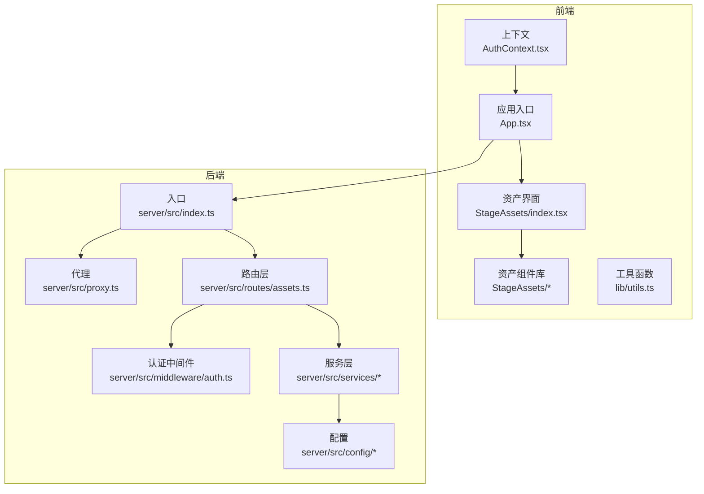
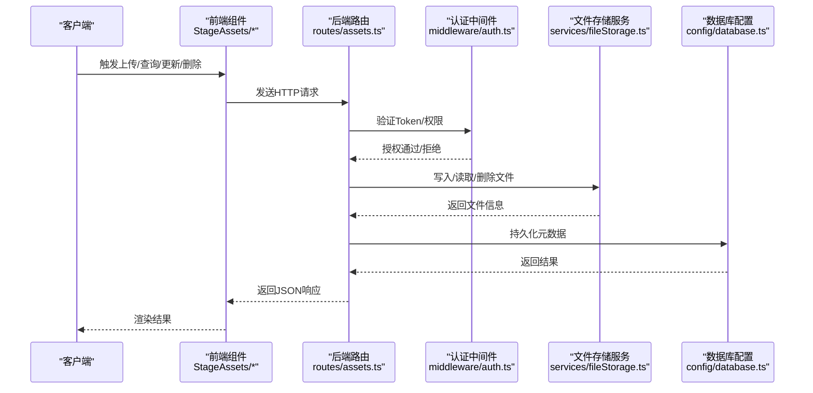
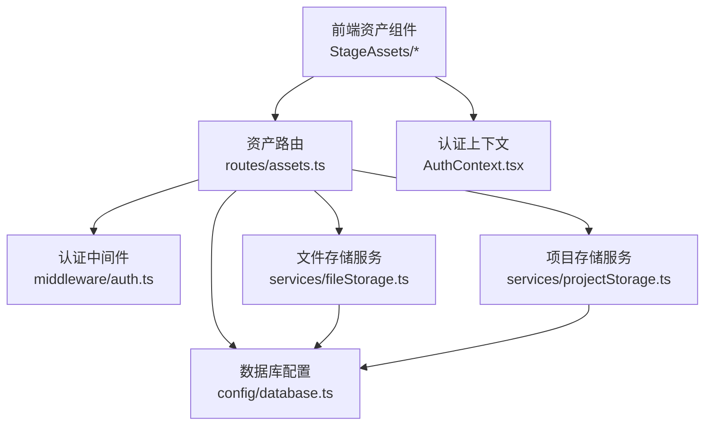

# 资产管理系统API

<cite>
**本文档引用的文件**
- [server/src/index.ts](file://server/src/index.ts)
- [server/src/proxy.ts](file://server/src/proxy.ts)
- [server/src/middleware/auth.ts](file://server/src/middleware/auth.ts)
- [server/src/routes/assets.ts](file://server/src/routes/assets.ts)
- [server/src/services/fileStorage.ts](file://server/src/services/fileStorage.ts)
- [server/src/services/projectStorage.ts](file://server/src/services/projectStorage.ts)
- [server/src/config/database.ts](file://server/src/config/database.ts)
- [server/src/config/sqliteDatabase.ts](file://server/src/config/sqliteDatabase.ts)
- [services/assetLibraryService.ts](file://services/assetLibraryService.ts)
- [services/storageService.ts](file://services/storageService.ts)
- [components/StageAssets/index.tsx](file://components/StageAssets/index.tsx)
- [components/StageAssets/utils.ts](file://components/StageAssets/utils.ts)
- [components/StageAssets/constants.ts](file://components/StageAssets/constants.ts)
- [components/StageAssets/ImageUploadButton.tsx](file://components/StageAssets/ImageUploadButton.tsx)
- [components/StageAssets/ImagePreviewModal.tsx](file://components/StageAssets/ImagePreviewModal.tsx)
- [components/StageAssets/CharacterCard.tsx](file://components/StageAssets/CharacterCard.tsx)
- [components/StageAssets/SceneCard.tsx](file://components/StageAssets/SceneCard.tsx)
- [components/StageAssets/PropCard.tsx](file://components/StageAssets/PropCard.tsx)
- [components/StageAssets/TurnaroundModal.tsx](file://components/StageAssets/TurnaroundModal.tsx)
- [components/StageAssets/WardrobeModal.tsx](file://components/StageAssets/WardrobeModal.tsx)
- [components/StageAssets/PromptEditor.tsx](file://components/StageAssets/PromptEditor.tsx)
- [components/StageAssets/README.md](file://components/StageAssets/README.md)
- [contexts/AuthContext.tsx](file://contexts/AuthContext.tsx)
- [lib/utils.ts](file://lib/utils.ts)
</cite>

## 目录
1. [简介](#简介)
2. [项目结构](#项目结构)
3. [核心组件](#核心组件)
4. [架构总览](#架构总览)
5. [详细组件分析](#详细组件分析)
6. [依赖关系分析](#依赖关系分析)
7. [性能考虑](#性能考虑)
8. [故障排除指南](#故障排除指南)
9. [结论](#结论)
10. [附录](#附录)

## 简介
本文件为AI Shotlive资产管理系统API的详细参考文档，覆盖角色、场景、道具等资产的上传、查询、更新、删除接口；资产文件处理与元数据管理；权限控制；资产分类与标签管理；以及批量操作等能力。文档同时提供请求/响应示例与文件上传规范，并通过图示展示系统架构与关键流程。

## 项目结构
AI Shotlive采用前后端分离架构：前端基于React/Vite构建，后端基于Node.js（Express/Koa风格）在server/src中实现REST路由与服务层；数据库配置位于server/src/config；中间件负责认证授权；assets模块位于components/StageAssets中，提供资产卡片、上传按钮、预览模态框等UI组件。

图表来源
- [server/src/index.ts](file://server/src/index.ts)
- [server/src/routes/assets.ts](file://server/src/routes/assets.ts)
- [server/src/middleware/auth.ts](file://server/src/middleware/auth.ts)
- [server/src/services/fileStorage.ts](file://server/src/services/fileStorage.ts)
- [server/src/services/projectStorage.ts](file://server/src/services/projectStorage.ts)
- [server/src/config/database.ts](file://server/src/config/database.ts)
- [server/src/config/sqliteDatabase.ts](file://server/src/config/sqliteDatabase.ts)
- [components/StageAssets/index.tsx](file://components/StageAssets/index.tsx)

章节来源
- [server/src/index.ts](file://server/src/index.ts)
- [components/StageAssets/index.tsx](file://components/StageAssets/index.tsx)

## 核心组件
- 资产路由层：提供资产的增删改查、文件上传、元数据管理、分类与标签、批量操作等接口定义与参数校验。
- 文件存储服务：封装本地/云存储抽象，支持文件写入、读取、删除与URL生成。
- 项目存储服务：管理项目级资源路径与命名空间，确保多项目隔离与一致性。
- 认证中间件：统一鉴权逻辑，保护受控接口。
- 前端资产组件：提供资产卡片、上传按钮、预览模态框、Turnaround/Wardrobe编辑器等交互组件。
- 数据库配置：SQLite/MySQL配置，用于持久化资产元数据与索引。

章节来源
- [server/src/routes/assets.ts](file://server/src/routes/assets.ts)
- [server/src/services/fileStorage.ts](file://server/src/services/fileStorage.ts)
- [server/src/services/projectStorage.ts](file://server/src/services/projectStorage.ts)
- [server/src/middleware/auth.ts](file://server/src/middleware/auth.ts)
- [server/src/config/database.ts](file://server/src/config/database.ts)
- [server/src/config/sqliteDatabase.ts](file://server/src/config/sqliteDatabase.ts)

## 架构总览
下图展示了从客户端到后端路由、中间件、服务层与存储的完整调用链路。

图表来源
- [server/src/routes/assets.ts](file://server/src/routes/assets.ts)
- [server/src/middleware/auth.ts](file://server/src/middleware/auth.ts)
- [server/src/services/fileStorage.ts](file://server/src/services/fileStorage.ts)
- [server/src/config/database.ts](file://server/src/config/database.ts)

## 详细组件分析

### 资产路由层（assets）
- 资产上传
  - 支持multipart/form-data上传，字段包括文件、资产类型（角色/场景/道具）、分类、标签、描述、可见性等。
  - 上传完成后返回资产ID、文件URL、元数据摘要。
- 资产查询
  - 支持按ID、类型、分类、标签、关键词、时间范围、分页等条件过滤。
  - 支持批量查询与导出。
- 资产更新
  - 允许修改名称、描述、分类、标签、可见性、封面等。
  - 支持部分字段更新。
- 资产删除
  - 支持单个与批量删除；软删除或物理删除策略可配置。
- 元数据管理
  - 自动提取与存储文件哈希、尺寸、格式、分辨率等基础信息。
  - 支持自定义元数据键值对扩展。
- 权限控制
  - 需要登录用户；管理员可全量访问；普通用户仅能访问公开或本人创建的资产。
- 批量操作
  - 支持批量更新分类/标签、批量删除、批量导出。

请求/响应示例（示意）
- 上传资产
  - 请求：POST /api/assets/upload
  - 表单字段：file（必填）、type（角色/场景/道具）、category、tags（数组）、description、visibility
  - 成功响应：{ id, url, metadata:{size, hash, format} }
- 查询资产
  - 请求：GET /api/assets?keyword=xxx&type=character&category=hero&page=1&limit=20
  - 成功响应：{ items:[{id,name,url,mtime,metadata}], total, page, limit }
- 更新资产
  - 请求：PATCH /api/assets/:id
  - JSON字段：name, description, category, tags[], visibility
  - 成功响应：{ ok:true }
- 删除资产
  - 请求：DELETE /api/assets/:id 或 DELETE /api/assets/batch
  - 成功响应：{ ok:true }

章节来源
- [server/src/routes/assets.ts](file://server/src/routes/assets.ts)

### 文件存储服务（fileStorage）
- 功能
  - 统一文件写入、读取、删除与URL生成。
  - 支持本地文件系统与云存储适配器（抽象层）。
  - 自动生成安全的文件名与路径，避免冲突。
- 性能
  - 大文件分块上传/断点续传（可选）。
  - 缓存策略减少重复读取。
- 错误处理
  - IO异常、权限不足、磁盘空间不足等错误统一捕获并返回标准错误码。

章节来源
- [server/src/services/fileStorage.ts](file://server/src/services/fileStorage.ts)

### 项目存储服务（projectStorage）
- 功能
  - 为每个项目提供独立的资源命名空间与路径前缀。
  - 确保跨项目资源隔离与一致性。
- 使用场景
  - 将资产文件归档至项目目录，便于备份与迁移。
- 注意事项
  - 路径拼接与相对/绝对路径转换需保持一致。

章节来源
- [server/src/services/projectStorage.ts](file://server/src/services/projectStorage.ts)

### 认证中间件（auth）
- 功能
  - 解析请求头中的Token，验证有效性与过期时间。
  - 注入当前用户信息到请求上下文，供路由层使用。
- 权限策略
  - 管理员可绕过部分限制。
  - 普通用户仅能操作本人创建的资产。
- 安全建议
  - Token应使用HTTPS传输，设置合理过期时间。

章节来源
- [server/src/middleware/auth.ts](file://server/src/middleware/auth.ts)

### 前端资产组件（StageAssets）
- 组件职责
  - 资产卡片：展示缩略图、名称、标签、操作按钮。
  - 图片上传按钮：封装上传流程与进度反馈。
  - 预览模态框：支持图片/视频/模型预览。
  - Turnaround/Wardrobe编辑器：角色资产的多角度/换装编辑。
  - Prompt编辑器：为资产生成提示词。
- 交互流程
  - 用户选择文件 -> 组件触发上传 -> 后端返回资产信息 -> 组件刷新列表。

章节来源
- [components/StageAssets/index.tsx](file://components/StageAssets/index.tsx)
- [components/StageAssets/utils.ts](file://components/StageAssets/utils.ts)
- [components/StageAssets/constants.ts](file://components/StageAssets/constants.ts)
- [components/StageAssets/ImageUploadButton.tsx](file://components/StageAssets/ImageUploadButton.tsx)
- [components/StageAssets/ImagePreviewModal.tsx](file://components/StageAssets/ImagePreviewModal.tsx)
- [components/StageAssets/CharacterCard.tsx](file://components/StageAssets/CharacterCard.tsx)
- [components/StageAssets/SceneCard.tsx](file://components/StageAssets/SceneCard.tsx)
- [components/StageAssets/PropCard.tsx](file://components/StageAssets/PropCard.tsx)
- [components/StageAssets/TurnaroundModal.tsx](file://components/StageAssets/TurnaroundModal.tsx)
- [components/StageAssets/WardrobeModal.tsx](file://components/StageAssets/WardrobeModal.tsx)
- [components/StageAssets/PromptEditor.tsx](file://components/StageAssets/PromptEditor.tsx)

### 数据库配置（database/sqliteDatabase）
- 功能
  - 提供SQLite/MySQL连接配置与初始化脚本。
  - 资产元数据表结构：包含资产ID、类型、分类、标签、创建者、创建时间、更新时间、可见性、文件路径/URL等。
- 迁移与种子
  - 提供迁移脚本与种子数据，便于开发环境快速搭建。

章节来源
- [server/src/config/database.ts](file://server/src/config/database.ts)
- [server/src/config/sqliteDatabase.ts](file://server/src/config/sqliteDatabase.ts)

## 依赖关系分析

图表来源
- [server/src/routes/assets.ts](file://server/src/routes/assets.ts)
- [server/src/middleware/auth.ts](file://server/src/middleware/auth.ts)
- [server/src/services/fileStorage.ts](file://server/src/services/fileStorage.ts)
- [server/src/services/projectStorage.ts](file://server/src/services/projectStorage.ts)
- [server/src/config/database.ts](file://server/src/config/database.ts)
- [components/StageAssets/index.tsx](file://components/StageAssets/index.tsx)
- [contexts/AuthContext.tsx](file://contexts/AuthContext.tsx)

章节来源
- [server/src/routes/assets.ts](file://server/src/routes/assets.ts)
- [server/src/middleware/auth.ts](file://server/src/middleware/auth.ts)
- [server/src/services/fileStorage.ts](file://server/src/services/fileStorage.ts)
- [server/src/services/projectStorage.ts](file://server/src/services/projectStorage.ts)
- [server/src/config/database.ts](file://server/src/config/database.ts)
- [components/StageAssets/index.tsx](file://components/StageAssets/index.tsx)
- [contexts/AuthContext.tsx](file://contexts/AuthContext.tsx)

## 性能考虑
- 文件上传
  - 大文件建议分块上传与断点续传，减少网络波动影响。
  - 并发上传时注意磁盘IO与带宽上限，必要时引入队列与限速。
- 查询优化
  - 对关键词、分类、标签建立索引，提升过滤性能。
  - 分页查询使用游标或LIMIT/OFFSET，避免超大数据集全量扫描。
- 缓存策略
  - 常用资产列表与热门文件可缓存，设置合理TTL。
- 存储策略
  - 热数据走SSD，冷数据归档至对象存储，降低IO成本。

## 故障排除指南
- 上传失败
  - 检查文件大小限制、MIME类型白名单、磁盘空间。
  - 查看后端日志与文件存储服务返回的错误码。
- 权限错误
  - 确认Token有效且未过期；检查用户角色与资产可见性。
- 查询无结果
  - 校验过滤条件是否正确；确认索引是否生效。
- 预览异常
  - 检查文件URL是否可访问；确认CORS与静态资源服务配置。

章节来源
- [server/src/middleware/auth.ts](file://server/src/middleware/auth.ts)
- [server/src/services/fileStorage.ts](file://server/src/services/fileStorage.ts)
- [server/src/config/database.ts](file://server/src/config/database.ts)

## 结论
AI Shotlive资产管理系统API通过清晰的路由层、统一的文件存储与项目存储服务、完善的认证中间件以及丰富的前端资产组件，实现了角色、场景、道具等资产的全生命周期管理。建议在生产环境中进一步完善大文件处理、查询索引与缓存策略，并持续优化权限与审计日志能力。

## 附录

### 文件上传规范
- Content-Type：multipart/form-data
- 必填字段：file
- 可选字段：type、category、tags、description、visibility
- 文件大小限制：根据部署环境配置
- 支持格式：图片、视频、3D模型等（具体以后端配置为准）

章节来源
- [server/src/routes/assets.ts](file://server/src/routes/assets.ts)
- [server/src/services/fileStorage.ts](file://server/src/services/fileStorage.ts)