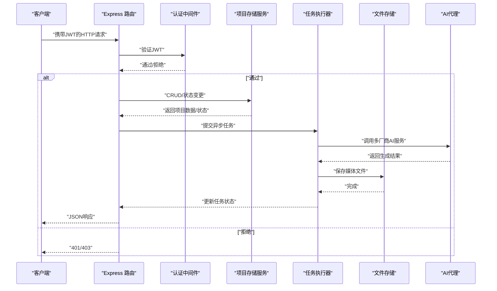
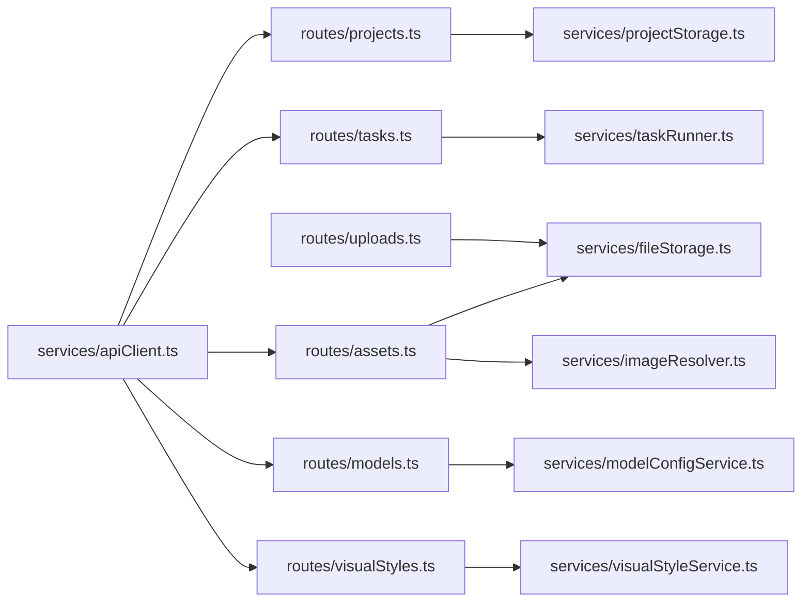

# 项目管理API

<cite>
**本文引用的文件**
- [README.md](file://README.md)
- [README_EN.md](file://README_EN.md)
- [server/src/index.ts](file://server/src/index.ts)
- [server/src/config/database.ts](file://server/src/config/database.ts)
- [server/src/config/sqliteDatabase.ts](file://server/src/config/sqliteDatabase.ts)
- [server/src/middleware/auth.ts](file://server/src/middleware/auth.ts)
- [server/src/routes/auth.ts](file://server/src/routes/auth.ts)
- [server/src/routes/projects.ts](file://server/src/routes/projects.ts)
- [server/src/routes/assets.ts](file://server/src/routes/assets.ts)
- [server/src/routes/models.ts](file://server/src/routes/models.ts)
- [server/src/routes/tasks.ts](file://server/src/routes/tasks.ts)
- [server/src/routes/uploads.ts](file://server/src/routes/uploads.ts)
- [server/src/routes/dataTransfer.ts](file://server/src/routes/dataTransfer.ts)
- [server/src/routes/projectPatch.ts](file://server/src/routes/projectPatch.ts)
- [server/src/routes/visualStyles.ts](file://server/src/routes/visualStyles.ts)
- [server/src/routes/preferences.ts](file://server/src/routes/preferences.ts)
- [server/src/services/projectStorage.ts](file://server/src/services/projectStorage.ts)
- [server/src/services/taskRunner.ts](file://server/src/services/taskRunner.ts)
- [server/src/services/aiProxy.ts](file://server/src/services/aiProxy.ts)
- [server/src/services/fileStorage.ts](file://server/src/services/fileStorage.ts)
- [server/src/services/imageResolver.ts](file://server/src/services/imageResolver.ts)
- [server/src/services/scriptParser.ts](file://server/src/services/scriptParser.ts)
- [server/src/lib/](file://server/src/lib/)
- [server/src/utils/projectMutex.ts](file://server/src/utils/projectMutex.ts)
- [server/src/proxy.ts](file://server/src/proxy.ts)
- [types/model.ts](file://types/model.ts)
- [services/apiClient.ts](file://services/apiClient.ts)
- [services/storageService.ts](file://services/storageService.ts)
- [services/projectPatchService.ts](file://services/projectPatchService.ts)
- [services/renderLogService.ts](file://services/renderLogService.ts)
- [services/taskService.ts](file://services/taskService.ts)
- [services/exportService.ts](file://services/exportService.ts)
- [services/modelConfigService.ts](file://services/modelConfigService.ts)
- [services/modelService.ts](file://services/modelService.ts)
- [services/visualStyleService.ts](file://services/visualStyleService.ts)
- [services/novelParser.ts](file://services/novelParser.ts)
- [services/adapters/index.ts](file://services/adapters/index.ts)
- [services/adapters/chatAdapter.ts](file://services/adapters/chatAdapter.ts)
- [services/adapters/imageAdapter.ts](file://services/adapters/imageAdapter.ts)
- [services/adapters/videoAdapter.ts](file://services/adapters/videoAdapter.ts)
- [services/adapters/dashscopeVideoAdapter.ts](file://services/adapters/dashscopeVideoAdapter.ts)
- [services/adapters/volcengineVideoAdapter.ts](file://services/adapters/volcengineVideoAdapter.ts)
- [electron/main.ts](file://electron/main.ts)
- [electron/preload.ts](file://electron/preload.ts)
</cite>

## 目录
1. [简介](#简介)
2. [项目结构](#项目结构)
3. [核心组件](#核心组件)
4. [架构总览](#架构总览)
5. [详细组件分析](#详细组件分析)
6. [依赖关系分析](#依赖关系分析)
7. [性能考虑](#性能考虑)
8. [故障排除指南](#故障排除指南)
9. [结论](#结论)
10. [附录](#附录)

## 简介
本文件为 AI Shotlive 的“项目管理API”提供权威参考，覆盖项目创建、读取、更新、删除等CRUD接口，以及项目状态管理、用户数据隔离、项目配置、元数据与进度跟踪、权限控制等能力。API基于 Express.js 实现，采用 JWT 进行认证，数据持久化支持 MySQL 与 SQLite（本地/桌面客户端模式）。项目数据按 user_id 隔离，确保多租户安全。

## 项目结构
后端服务位于 server/src，路由集中在 routes 目录，业务逻辑分布在 services 与 utils。前端通过 services/apiClient.ts 调用后端API，桌面客户端 Electron 通过 preload 脚本与主进程交互。

```mermaid
graph TB
subgraph "后端服务"
IDX["index.ts<br/>应用入口"]
CFG_DB["config/database.ts<br/>MySQL连接"]
CFG_SQL["config/sqliteDatabase.ts<br/>SQLite连接"]
MW["middleware/auth.ts<br/>JWT认证中间件"]
RT_AUTH["routes/auth.ts<br/>登录/注册/资料"]
RT_PROJ["routes/projects.ts<br/>项目CRUD"]
RT_ASSETS["routes/assets.ts<br/>资产"]
RT_MODELS["routes/models.ts<br/>模型配置"]
RT_TASKS["routes/tasks.ts<br/>异步任务"]
RT_UPLOADS["routes/uploads.ts<br/>文件上传"]
RT_PATCH["routes/projectPatch.ts<br/>项目补丁"]
RT_XFER["routes/dataTransfer.ts<br/>数据导出/导入"]
RT_VISUAL["routes/visualStyles.ts<br/>视觉风格"]
RT_PREF["routes/preferences.ts<br/>用户偏好"]
SVC_PS["services/projectStorage.ts<br/>项目存储"]
SVC_TR["services/taskRunner.ts<br/>任务执行器"]
SVC_AI["services/aiProxy.ts<br/>AI代理"]
SVC_FS["services/fileStorage.ts<br/>文件存储"]
SVC_IMG["services/imageResolver.ts<br/>图片解析"]
SVC_SCRIPT["services/scriptParser.ts<br/>脚本解析"]
UTIL_MUTEX["utils/projectMutex.ts<br/>项目互斥锁"]
end
subgraph "前端"
FE_API["services/apiClient.ts"]
FE_STORE["services/storageService.ts"]
FE_PATCH["services/projectPatchService.ts"]
FE_RENDER["services/renderLogService.ts"]
FE_TASK["services/taskService.ts"]
FE_EXPORT["services/exportService.ts"]
FE_MODEL["services/modelConfigService.ts"]
FE_STYLE["services/visualStyleService.ts"]
FE_NOVEL["services/novelParser.ts"]
FE_ADAPT["services/adapters/index.ts"]
end
subgraph "桌面客户端"
ELEC_MAIN["electron/main.ts"]
ELEC_PRELOAD["electron/preload.ts"]
end
IDX --> CFG_DB
IDX --> CFG_SQL
IDX --> MW
IDX --> RT_AUTH
IDX --> RT_PROJ
IDX --> RT_ASSETS
IDX --> RT_MODELS
IDX --> RT_TASKS
IDX --> RT_UPLOADS
IDX --> RT_PATCH
IDX --> RT_XFER
IDX --> RT_VISUAL
IDX --> RT_PREF
RT_PROJ --> SVC_PS
RT_TASKS --> SVC_TR
RT_ASSETS --> SVC_FS
RT_ASSETS --> SVC_IMG
RT_UPLOADS --> SVC_FS
RT_MODELS --> FE_MODEL
RT_VISUAL --> FE_STYLE
RT_PREF --> FE_MODEL
FE_API --> IDX
FE_STORE --> SVC_FS
FE_PATCH --> SVC_PS
FE_RENDER --> SVC_TR
FE_TASK --> SVC_TR
FE_EXPORT --> SVC_FS
FE_MODEL --> SVC_AI
FE_STYLE --> SVC_AI
FE_NOVEL --> SVC_SCRIPT
ELEC_MAIN --> IDX
ELEC_PRELOAD --> FE_API
```

图表来源
- [server/src/index.ts](file://server/src/index.ts)
- [server/src/config/database.ts](file://server/src/config/database.ts)
- [server/src/config/sqliteDatabase.ts](file://server/src/config/sqliteDatabase.ts)
- [server/src/middleware/auth.ts](file://server/src/middleware/auth.ts)
- [server/src/routes/auth.ts](file://server/src/routes/auth.ts)
- [server/src/routes/projects.ts](file://server/src/routes/projects.ts)
- [server/src/routes/assets.ts](file://server/src/routes/assets.ts)
- [server/src/routes/models.ts](file://server/src/routes/models.ts)
- [server/src/routes/tasks.ts](file://server/src/routes/tasks.ts)
- [server/src/routes/uploads.ts](file://server/src/routes/uploads.ts)
- [server/src/routes/projectPatch.ts](file://server/src/routes/projectPatch.ts)
- [server/src/routes/dataTransfer.ts](file://server/src/routes/dataTransfer.ts)
- [server/src/routes/visualStyles.ts](file://server/src/routes/visualStyles.ts)
- [server/src/routes/preferences.ts](file://server/src/routes/preferences.ts)
- [server/src/services/projectStorage.ts](file://server/src/services/projectStorage.ts)
- [server/src/services/taskRunner.ts](file://server/src/services/taskRunner.ts)
- [server/src/services/aiProxy.ts](file://server/src/services/aiProxy.ts)
- [server/src/services/fileStorage.ts](file://server/src/services/fileStorage.ts)
- [server/src/services/imageResolver.ts](file://server/src/services/imageResolver.ts)
- [server/src/services/scriptParser.ts](file://server/src/services/scriptParser.ts)
- [server/src/utils/projectMutex.ts](file://server/src/utils/projectMutex.ts)
- [services/apiClient.ts](file://services/apiClient.ts)
- [services/storageService.ts](file://services/storageService.ts)
- [services/projectPatchService.ts](file://services/projectPatchService.ts)
- [services/renderLogService.ts](file://services/renderLogService.ts)
- [services/taskService.ts](file://services/taskService.ts)
- [services/exportService.ts](file://services/exportService.ts)
- [services/modelConfigService.ts](file://services/modelConfigService.ts)
- [services/visualStyleService.ts](file://services/visualStyleService.ts)
- [services/novelParser.ts](file://services/novelParser.ts)
- [services/adapters/index.ts](file://services/adapters/index.ts)
- [electron/main.ts](file://electron/main.ts)
- [electron/preload.ts](file://electron/preload.ts)

章节来源
- [README.md:308-394](file://README.md#L308-L394)
- [README_EN.md:188-259](file://README_EN.md#L188-L259)

## 核心组件
- 认证与授权：JWT 中间件负责校验请求头中的令牌，确保用户身份有效。
- 项目存储服务：封装项目元数据、章节、剧集、分镜、关键帧、视频片段等的持久化与查询。
- 任务执行器：管理图像/视频生成等异步任务的调度、状态更新与结果回写。
- 文件存储与图片解析：负责媒体文件（图片/视频）的上传、归档与URL解析。
- AI 代理：统一路由多厂商文本/图像/视频服务，屏蔽底层差异。
- 项目补丁与数据迁移：支持增量更新与备份导入导出。
- 模型与视觉风格：集中管理多提供商模型配置与视觉风格模板。
- 前端API客户端：封装HTTP请求、错误处理与重试策略。

章节来源
- [server/src/middleware/auth.ts](file://server/src/middleware/auth.ts)
- [server/src/services/projectStorage.ts](file://server/src/services/projectStorage.ts)
- [server/src/services/taskRunner.ts](file://server/src/services/taskRunner.ts)
- [server/src/services/fileStorage.ts](file://server/src/services/fileStorage.ts)
- [server/src/services/imageResolver.ts](file://server/src/services/imageResolver.ts)
- [server/src/services/aiProxy.ts](file://server/src/services/aiProxy.ts)
- [server/src/routes/projectPatch.ts](file://server/src/routes/projectPatch.ts)
- [server/src/routes/dataTransfer.ts](file://server/src/routes/dataTransfer.ts)
- [server/src/routes/models.ts](file://server/src/routes/models.ts)
- [server/src/routes/visualStyles.ts](file://server/src/routes/visualStyles.ts)
- [services/apiClient.ts](file://services/apiClient.ts)

## 架构总览
下图展示从客户端到后端API、数据库与AI服务的整体流程，突出认证、项目CRUD、任务执行与文件存储的关键路径。

图表来源
- [server/src/middleware/auth.ts](file://server/src/middleware/auth.ts)
- [server/src/routes/projects.ts](file://server/src/routes/projects.ts)
- [server/src/services/projectStorage.ts](file://server/src/services/projectStorage.ts)
- [server/src/services/taskRunner.ts](file://server/src/services/taskRunner.ts)
- [server/src/services/aiProxy.ts](file://server/src/services/aiProxy.ts)
- [server/src/services/fileStorage.ts](file://server/src/services/fileStorage.ts)

## 详细组件分析

### 项目CRUD接口
- 接口概览
  - 创建项目：POST /api/projects
  - 读取项目：GET /api/projects/{id}
  - 更新项目：PUT /api/projects/{id}
  - 删除项目：DELETE /api/projects/{id}
  - 列表项目：GET /api/projects
- 请求参数
  - 创建/更新时需提供项目元数据（如标题、阶段、风格、小说配置等），具体字段以项目存储服务的数据模型为准。
- 响应格式
  - 成功返回标准JSON对象，包含项目标识、元数据与状态；失败返回错误码与消息。
- 权限与隔离
  - 所有操作受JWT保护，仅允许访问当前用户所属项目。
- 错误处理
  - 参数校验失败返回400；
  - 未授权/令牌无效返回401；
  - 资源不存在返回404；
  - 服务器内部错误返回500。

章节来源
- [server/src/routes/projects.ts](file://server/src/routes/projects.ts)
- [server/src/services/projectStorage.ts](file://server/src/services/projectStorage.ts)
- [server/src/middleware/auth.ts](file://server/src/middleware/auth.ts)

### 项目状态管理
- 状态流转
  - 项目在不同阶段（如小说解析、剧集生成、分镜导演、导出渲染）之间流转，状态变更通过更新接口或专用PATCH端点触发。
- 进度跟踪
  - 与异步任务系统联动，关键帧生成、视频片段合成等进度实时更新至任务表与项目状态。
- 一致性保证
  - 使用项目互斥锁避免并发写冲突。

章节来源
- [server/src/routes/projectPatch.ts](file://server/src/routes/projectPatch.ts)
- [server/src/services/taskRunner.ts](file://server/src/services/taskRunner.ts)
- [server/src/utils/projectMutex.ts](file://server/src/utils/projectMutex.ts)

### 用户数据隔离
- 隔离机制
  - 所有数据库表均按 user_id 进行隔离，确保多租户数据安全。
- 认证关联
  - JWT中包含用户标识，中间件在每个请求中提取并限制数据访问范围。
- 存储隔离
  - 文件系统层面也按用户/项目进行目录隔离。

章节来源
- [README.md:373-394](file://README.md#L373-L394)
- [server/src/middleware/auth.ts](file://server/src/middleware/auth.ts)

### 项目配置与模型管理
- 配置项
  - 文本/图像/视频/音频模型提供商、API Key、当前激活模型等。
- 接口
  - GET/POST/PUT /api/models
- 安全
  - API Key 不直接暴露给前端，后端代理统一管理。

章节来源
- [server/src/routes/models.ts](file://server/src/routes/models.ts)
- [server/src/services/aiProxy.ts](file://server/src/services/aiProxy.ts)
- [services/modelConfigService.ts](file://services/modelConfigService.ts)

### 视觉风格与提示词
- 接口
  - GET/POST/PUT /api/visual-styles
- 用途
  - 统一管理视觉风格模板与提示词集合，供项目复用。

章节来源
- [server/src/routes/visualStyles.ts](file://server/src/routes/visualStyles.ts)
- [server/src/routes/preferences.ts](file://server/src/routes/preferences.ts)
- [services/visualStyleService.ts](file://services/visualStyleService.ts)

### 资产与文件管理
- 接口
  - GET/POST /api/assets
  - 上传：POST /api/uploads
- 功能
  - 资产库管理、图片/视频上传、归档与URL解析。

章节来源
- [server/src/routes/assets.ts](file://server/src/routes/assets.ts)
- [server/src/routes/uploads.ts](file://server/src/routes/uploads.ts)
- [server/src/services/fileStorage.ts](file://server/src/services/fileStorage.ts)
- [server/src/services/imageResolver.ts](file://server/src/services/imageResolver.ts)

### 异步任务与进度
- 接口
  - GET/POST /api/tasks
- 流程
  - 提交任务 -> AI服务生成 -> 结果回写 -> 任务完成通知。

章节来源
- [server/src/routes/tasks.ts](file://server/src/routes/tasks.ts)
- [server/src/services/taskRunner.ts](file://server/src/services/taskRunner.ts)
- [services/taskService.ts](file://services/taskService.ts)

### 数据导出/导入与备份
- 接口
  - POST /api/data-transfer/export
  - POST /api/data-transfer/import
- 用途
  - ZIP 归档导出/导入，包含数据库与媒体文件，导入时自动创建新用户。

章节来源
- [server/src/routes/dataTransfer.ts](file://server/src/routes/dataTransfer.ts)
- [services/exportService.ts](file://services/exportService.ts)

### 登录与用户资料
- 接口
  - POST /api/auth/login
  - POST /api/auth/register
  - PUT /api/auth/profile
- 安全
  - 密码加密存储，JWT签发与刷新。

章节来源
- [server/src/routes/auth.ts](file://server/src/routes/auth.ts)

### 前端调用与桌面客户端
- 前端
  - 通过 apiClient.ts 发起请求，storageService.ts 管理本地缓存与同步。
- 桌面客户端
  - Electron 主进程启动后端，preload 脚本注入API客户端，实现跨进程通信。

章节来源
- [services/apiClient.ts](file://services/apiClient.ts)
- [services/storageService.ts](file://services/storageService.ts)
- [electron/main.ts](file://electron/main.ts)
- [electron/preload.ts](file://electron/preload.ts)

## 依赖关系分析
- 路由到服务
  - 项目相关路由依赖项目存储服务；任务路由依赖任务执行器；资产/上传路由依赖文件存储与图片解析。
- 服务到外部
  - AI代理依赖多厂商适配器；任务执行器依赖AI代理；文件存储依赖本地/远端存储。
- 前端到后端
  - 前端服务通过API客户端调用后端路由，部分功能（如导出/导入）通过后端脚本实现。

图表来源
- [server/src/routes/projects.ts](file://server/src/routes/projects.ts)
- [server/src/routes/tasks.ts](file://server/src/routes/tasks.ts)
- [server/src/routes/assets.ts](file://server/src/routes/assets.ts)
- [server/src/routes/uploads.ts](file://server/src/routes/uploads.ts)
- [server/src/routes/models.ts](file://server/src/routes/models.ts)
- [server/src/routes/visualStyles.ts](file://server/src/routes/visualStyles.ts)
- [server/src/services/projectStorage.ts](file://server/src/services/projectStorage.ts)
- [server/src/services/taskRunner.ts](file://server/src/services/taskRunner.ts)
- [server/src/services/fileStorage.ts](file://server/src/services/fileStorage.ts)
- [server/src/services/imageResolver.ts](file://server/src/services/imageResolver.ts)
- [services/apiClient.ts](file://services/apiClient.ts)
- [services/modelConfigService.ts](file://services/modelConfigService.ts)
- [services/visualStyleService.ts](file://services/visualStyleService.ts)

## 性能考虑
- 数据库连接池：生产环境建议使用MySQL，合理配置连接池大小与超时。
- 任务队列：异步任务批量提交，避免阻塞主线程；对高耗时任务设置重试与超时。
- 文件存储：媒体文件采用分块上传与断点续传，减少网络波动影响。
- 缓存策略：前端对常用配置与项目列表进行缓存，降低重复请求。
- 并发控制：项目互斥锁避免竞态条件，提升一致性。

## 故障排除指南
- 401 未授权
  - 检查请求头是否包含有效的JWT；确认令牌未过期。
- 403 禁止访问
  - 确认当前用户对目标资源具有访问权限（按 user_id 隔离）。
- 404 资源不存在
  - 核对项目ID或资源路径是否正确。
- 500 服务器错误
  - 查看后端日志与Sentry（可选）错误监控；检查数据库连接与AI服务可用性。
- 导入失败
  - 确认导入文件格式为ZIP且包含完整结构；检查导入脚本执行日志。

章节来源
- [server/src/middleware/auth.ts](file://server/src/middleware/auth.ts)
- [server/src/routes/dataTransfer.ts](file://server/src/routes/dataTransfer.ts)

## 结论
AI Shotlive 的项目管理API以清晰的分层架构实现，结合JWT认证、用户数据隔离与多厂商AI适配，满足从项目创建到导出的全流程需求。通过任务系统与文件存储的解耦，系统具备良好的扩展性与稳定性。建议在生产环境中完善监控与告警，并根据业务规模调整数据库与任务队列配置。

## 附录
- 端点一览（示例）
  - 项目：POST /api/projects, GET /api/projects/{id}, PUT /api/projects/{id}, DELETE /api/projects/{id}, GET /api/projects
  - 任务：POST /api/tasks, GET /api/tasks/{id}
  - 资产：POST /api/assets, GET /api/assets
  - 上传：POST /api/uploads
  - 模型：GET/POST/PUT /api/models
  - 视觉风格：GET/POST/PUT /api/visual-styles
  - 数据传输：POST /api/data-transfer/export, POST /api/data-transfer/import
  - 登录/注册/资料：POST /api/auth/login, POST /api/auth/register, PUT /api/auth/profile
- 请求头
  - Authorization: Bearer <JWT_TOKEN>
- 响应
  - 成功：2xx + JSON
  - 失败：4xx/5xx + 错误码与消息