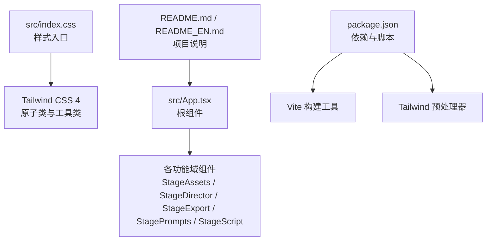
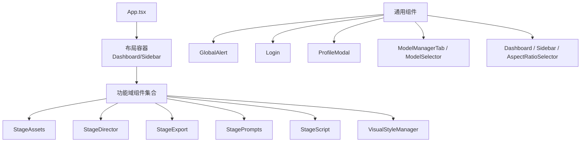
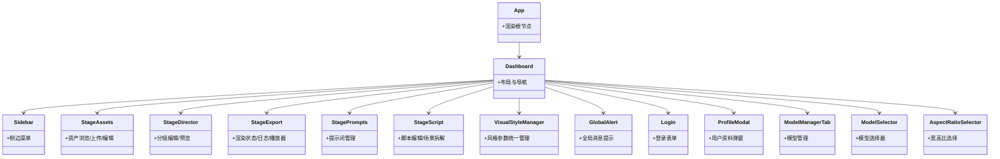
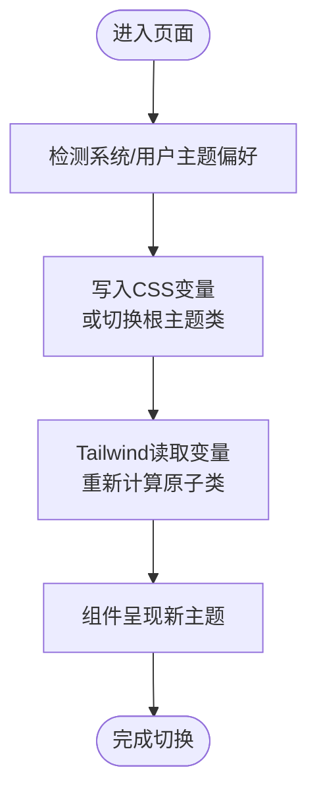
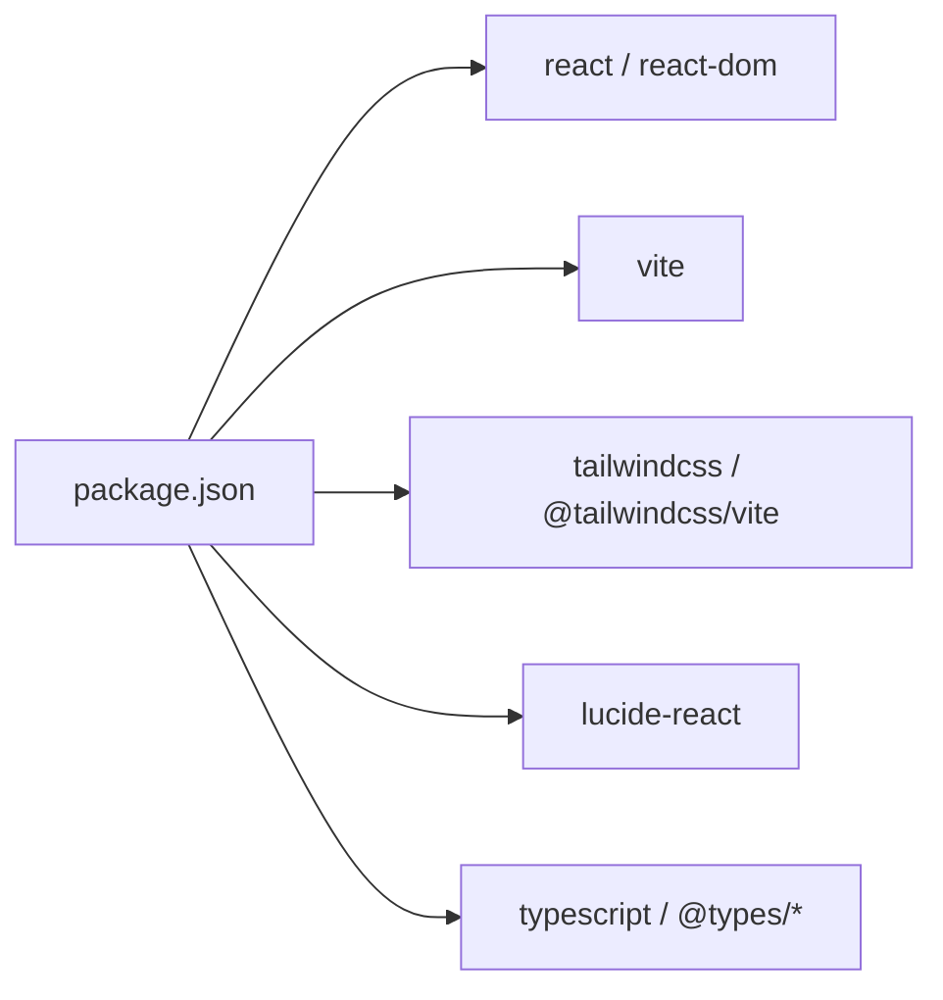

# UI设计系统

<cite>
**本文引用的文件**
- [index.css](file://src/index.css)
- [App.tsx](file://src/App.tsx)
- [package.json](file://package.json)
- [README.md](file://README.md)
- [README_EN.md](file://README_EN.md)
- [StageAssets.tsx](file://src/components/StageAssets.tsx)
- [StageDirector.tsx](file://src/components/StageDirector.tsx)
- [StageExport.tsx](file://src/components/StageExport.tsx)
- [StagePrompts.tsx](file://src/components/StagePrompts.tsx)
- [StageScript.tsx](file://src/components/StageScript.tsx)
- [VisualStyleManager.tsx](file://src/components/VisualStyleManager.tsx)
- [GlobalAlert.tsx](file://src/components/GlobalAlert.tsx)
- [Login.tsx](file://src/components/Login.tsx)
- [ProfileModal.tsx](file://src/components/ProfileModal.tsx)
- [ModelManagerTab.tsx](file://src/components/ModelManagerTab.tsx)
- [ModelSelector.tsx](file://src/components/ModelSelector.tsx)
- [Dashboard.tsx](file://src/components/Dashboard.tsx)
- [Sidebar.tsx](file://src/components/Sidebar.tsx)
- [AspectRatioSelector.tsx](file://src/components/AspectRatioSelector.tsx)
- [ModelConfig/index.tsx](file://src/components/ModelConfig/index.tsx)
- [Onboarding/index.tsx](file://src/components/Onboarding/index.tsx)
- [StageAssets/index.tsx](file://src/components/StageAssets/index.tsx)
- [StageDirector/index.tsx](file://src/components/StageDirector/index.tsx)
- [StageExport/index.tsx](file://src/components/StageExport/index.tsx)
- [StagePrompts/index.tsx](file://src/components/StagePrompts/index.tsx)
- [StageScript/index.tsx](file://src/components/StageScript/index.tsx)
</cite>

## 目录
1. [简介](#简介)
2. [项目结构](#项目结构)
3. [核心组件](#核心组件)
4. [架构总览](#架构总览)
5. [详细组件分析](#详细组件分析)
6. [依赖分析](#依赖分析)
7. [性能考虑](#性能考虑)
8. [故障排除指南](#故障排除指南)
9. [结论](#结论)
10. [附录](#附录)

## 简介
本设计系统服务于“AI漫剧导演”（CineGen Director）前端界面，围绕统一的颜色体系、字体规范、间距标准与组件设计原则构建。当前代码库采用React + Vite + Tailwind CSS 4作为基础技术栈，并通过模块化组件组织功能域（如场景资产、分镜指导、导出渲染等）。设计系统强调一致性、可扩展性与可维护性，支持深色/浅色主题切换与响应式布局。

## 项目结构
前端源码位于src目录，组件按功能域划分在components子目录中；公共样式入口为src/index.css；包管理与脚手架由package.json定义；国际化文档位于README与README_EN。

图表来源
- [index.css:1-2](file://src/index.css#L1-L2)
- [App.tsx:1-6](file://src/App.tsx#L1-L6)
- [package.json:1-26](file://package.json#L1-L26)

章节来源
- [index.css:1-2](file://src/index.css#L1-L2)
- [App.tsx:1-6](file://src/App.tsx#L1-L6)
- [package.json:1-26](file://package.json#L1-L26)
- [README.md](file://README.md)
- [README_EN.md](file://README_EN.md)

## 核心组件
- 功能域组件：负责具体业务能力展示与交互，如场景资产浏览与编辑、分镜指导与预览、导出与渲染状态面板、提示词管理、脚本编辑等。
- 通用组件：全局告警、登录、用户资料弹窗、模型管理与选择、仪表盘、侧边栏、宽高比选择器等。
- 设计系统支撑：颜色、字体、间距通过Tailwind原子类与自定义样式结合实现；主题切换通过CSS变量与运行时样式注入实现。

章节来源
- [StageAssets.tsx](file://src/components/StageAssets.tsx)
- [StageDirector.tsx](file://src/components/StageDirector.tsx)
- [StageExport.tsx](file://src/components/StageExport.tsx)
- [StagePrompts.tsx](file://src/components/StagePrompts.tsx)
- [StageScript.tsx](file://src/components/StageScript.tsx)
- [GlobalAlert.tsx](file://src/components/GlobalAlert.tsx)
- [Login.tsx](file://src/components/Login.tsx)
- [ProfileModal.tsx](file://src/components/ProfileModal.tsx)
- [ModelManagerTab.tsx](file://src/components/ModelManagerTab.tsx)
- [ModelSelector.tsx](file://src/components/ModelSelector.tsx)
- [Dashboard.tsx](file://src/components/Dashboard.tsx)
- [Sidebar.tsx](file://src/components/Sidebar.tsx)
- [AspectRatioSelector.tsx](file://src/components/AspectRatioSelector.tsx)

## 架构总览
整体采用“功能域组件 + 通用组件”的分层架构，根组件App负责挂载与顶层布局，Tailwind提供一致的视觉语言与响应式能力。组件间通过props与上下文进行解耦协作。

图表来源
- [App.tsx:1-6](file://src/App.tsx#L1-L6)
- [StageAssets.tsx](file://src/components/StageAssets.tsx)
- [StageDirector.tsx](file://src/components/StageDirector.tsx)
- [StageExport.tsx](file://src/components/StageExport.tsx)
- [StagePrompts.tsx](file://src/components/StagePrompts.tsx)
- [StageScript.tsx](file://src/components/StageScript.tsx)
- [VisualStyleManager.tsx](file://src/components/VisualStyleManager.tsx)
- [GlobalAlert.tsx](file://src/components/GlobalAlert.tsx)
- [Login.tsx](file://src/components/Login.tsx)
- [ProfileModal.tsx](file://src/components/ProfileModal.tsx)
- [ModelManagerTab.tsx](file://src/components/ModelManagerTab.tsx)
- [ModelSelector.tsx](file://src/components/ModelSelector.tsx)
- [Dashboard.tsx](file://src/components/Dashboard.tsx)
- [Sidebar.tsx](file://src/components/Sidebar.tsx)
- [AspectRatioSelector.tsx](file://src/components/AspectRatioSelector.tsx)

## 详细组件分析

### 组件关系与职责
- 功能域组件：围绕各自业务闭环提供编辑、预览、生成、导出等功能，内部可能包含子组件与工具函数。
- 通用组件：提供跨页面复用的交互元素，如登录态管理、全局提示、用户信息弹窗等。
- 视觉风格管理：通过可视化风格管理器统一风格参数，驱动组件呈现一致性。

图表来源
- [App.tsx:1-6](file://src/App.tsx#L1-L6)
- [Dashboard.tsx](file://src/components/Dashboard.tsx)
- [Sidebar.tsx](file://src/components/Sidebar.tsx)
- [StageAssets.tsx](file://src/components/StageAssets.tsx)
- [StageDirector.tsx](file://src/components/StageDirector.tsx)
- [StageExport.tsx](file://src/components/StageExport.tsx)
- [StagePrompts.tsx](file://src/components/StagePrompts.tsx)
- [StageScript.tsx](file://src/components/StageScript.tsx)
- [VisualStyleManager.tsx](file://src/components/VisualStyleManager.tsx)
- [GlobalAlert.tsx](file://src/components/GlobalAlert.tsx)
- [Login.tsx](file://src/components/Login.tsx)
- [ProfileModal.tsx](file://src/components/ProfileModal.tsx)
- [ModelManagerTab.tsx](file://src/components/ModelManagerTab.tsx)
- [ModelSelector.tsx](file://src/components/ModelSelector.tsx)
- [AspectRatioSelector.tsx](file://src/components/AspectRatioSelector.tsx)

章节来源
- [StageAssets.tsx](file://src/components/StageAssets.tsx)
- [StageDirector.tsx](file://src/components/StageDirector.tsx)
- [StageExport.tsx](file://src/components/StageExport.tsx)
- [StagePrompts.tsx](file://src/components/StagePrompts.tsx)
- [StageScript.tsx](file://src/components/StageScript.tsx)
- [VisualStyleManager.tsx](file://src/components/VisualStyleManager.tsx)
- [GlobalAlert.tsx](file://src/components/GlobalAlert.tsx)
- [Login.tsx](file://src/components/Login.tsx)
- [ProfileModal.tsx](file://src/components/ProfileModal.tsx)
- [ModelManagerTab.tsx](file://src/components/ModelManagerTab.tsx)
- [ModelSelector.tsx](file://src/components/ModelSelector.tsx)
- [Dashboard.tsx](file://src/components/Dashboard.tsx)
- [Sidebar.tsx](file://src/components/Sidebar.tsx)
- [AspectRatioSelector.tsx](file://src/components/AspectRatioSelector.tsx)

### 主题切换机制与CSS变量系统
- 技术选型：基于Tailwind CSS 4与原子类，结合CSS变量实现深色/浅色主题的动态切换。
- 实现思路：
  - 在样式入口引入Tailwind后，通过CSS变量定义主题色板与语义色值。
  - 运行时根据用户偏好或设置切换根元素或特定容器的主题类，从而改变CSS变量取值。
  - 组件通过Tailwind工具类读取变量，确保颜色、边框、背景等随主题变化。
- 优势：变量集中管理、切换成本低、与Tailwind原子类无缝衔接。

图表来源
- [index.css:1-2](file://src/index.css#L1-L2)

章节来源
- [index.css:1-2](file://src/index.css#L1-L2)

### 响应式设计与移动端适配
- 响应式策略：以Tailwind的断点工具类为基础，针对小屏、平板、桌面端分别配置布局与间距。
- 移动端适配建议：
  - 使用紧凑的内边距与字号，避免横向滚动。
  - 将密集操作区域改为触摸友好的尺寸与间距。
  - 对复杂表格/列表采用折叠视图或虚拟滚动。
- 跨浏览器兼容：通过Vite与现代浏览器目标配置，结合PostCSS/Tailwind预处理，确保主流浏览器一致表现。

章节来源
- [package.json:1-26](file://package.json#L1-L26)

### 组件设计原则
- 单一职责：每个组件聚焦一个功能边界，便于测试与复用。
- 可组合性：通过props传递数据与回调，减少全局状态耦合。
- 一致性：颜色、字体、间距遵循设计系统，保持视觉与交互统一。
- 可访问性：为按钮、输入、模态等提供键盘可达与ARIA属性。

章节来源
- [StageAssets.tsx](file://src/components/StageAssets.tsx)
- [StageDirector.tsx](file://src/components/StageDirector.tsx)
- [StageExport.tsx](file://src/components/StageExport.tsx)
- [StagePrompts.tsx](file://src/components/StagePrompts.tsx)
- [StageScript.tsx](file://src/components/StageScript.tsx)
- [GlobalAlert.tsx](file://src/components/GlobalAlert.tsx)
- [Login.tsx](file://src/components/Login.tsx)
- [ProfileModal.tsx](file://src/components/ProfileModal.tsx)
- [ModelManagerTab.tsx](file://src/components/ModelManagerTab.tsx)
- [ModelSelector.tsx](file://src/components/ModelSelector.tsx)
- [Dashboard.tsx](file://src/components/Dashboard.tsx)
- [Sidebar.tsx](file://src/components/Sidebar.tsx)
- [AspectRatioSelector.tsx](file://src/components/AspectRatioSelector.tsx)

### 设计系统使用指南与样式定制
- 使用指南
  - 颜色：通过Tailwind工具类引用语义色名，避免硬编码十六进制值。
  - 字体：使用文本大小与字重工具类，确保层级清晰。
  - 间距：使用m/p与空间相关工具类，保持网格对齐。
- 定制方法
  - 在样式入口中新增或覆盖CSS变量，影响全站主题。
  - 通过Tailwind配置扩展颜色、字体、间距映射，保证命名一致性。
- 维护规范
  - 新增组件前先评估是否已有相似组件，避免重复。
  - 所有颜色与间距变更需同步更新变量与文档。
  - 提供组件使用示例与反例，便于团队遵循。

章节来源
- [index.css:1-2](file://src/index.css#L1-L2)
- [package.json:1-26](file://package.json#L1-L26)

## 依赖分析
- React与生态：React 19、React DOM 19提供核心渲染能力。
- 构建与样式：Vite提供开发与生产构建；Tailwind CSS 4与Tailwind Vite插件负责样式生成。
- 图标库：Lucide React提供图标资源。
- 类型支持：TypeScript与React类型声明保障开发体验。

图表来源
- [package.json:1-26](file://package.json#L1-L26)

章节来源
- [package.json:1-26](file://package.json#L1-L26)

## 性能考虑
- 按需加载：将大型功能域组件拆分为独立模块，配合路由懒加载降低首屏体积。
- 样式优化：仅引入必要工具类，避免无用类导致的CSS膨胀。
- 渲染优化：对长列表使用虚拟化；对频繁重渲染的区域使用memo或useMemo/useCallback。
- 资源压缩：生产构建启用压缩与Tree Shaking，确保最小可用包。

## 故障排除指南
- 样式未生效
  - 检查Tailwind导入顺序与版本兼容性。
  - 确认CSS变量是否正确写入DOM根元素或容器。
- 主题切换无效
  - 确认切换逻辑是否更新了主题类或CSS变量。
  - 检查是否存在局部覆盖导致变量未被读取。
- 组件显示异常
  - 使用浏览器开发者工具检查工具类冲突与布局问题。
  - 核对组件props与上下文状态是否正确传递。

## 结论
本设计系统以Tailwind CSS 4为核心，结合React组件化与模块化工程实践，形成了一套可扩展、可维护的前端视觉与交互框架。通过CSS变量与主题切换机制，实现深色/浅色主题的灵活切换；通过功能域组件划分与通用组件复用，提升开发效率与一致性。建议在后续迭代中完善主题变量文档、补充组件库示例与最佳实践指南，持续优化性能与可访问性。

## 附录
- 快速开始
  - 安装依赖：使用包管理器安装项目依赖。
  - 启动开发：执行开发脚本启动本地服务。
  - 构建产物：执行构建脚本生成生产包。
- 设计系统维护清单
  - 变更颜色/字体/间距时同步更新变量与文档。
  - 新增组件时提供使用示例与反例。
  - 定期审查Tailwind配置与构建产物体积。

章节来源
- [package.json:1-26](file://package.json#L1-L26)
- [README.md](file://README.md)
- [README_EN.md](file://README_EN.md)