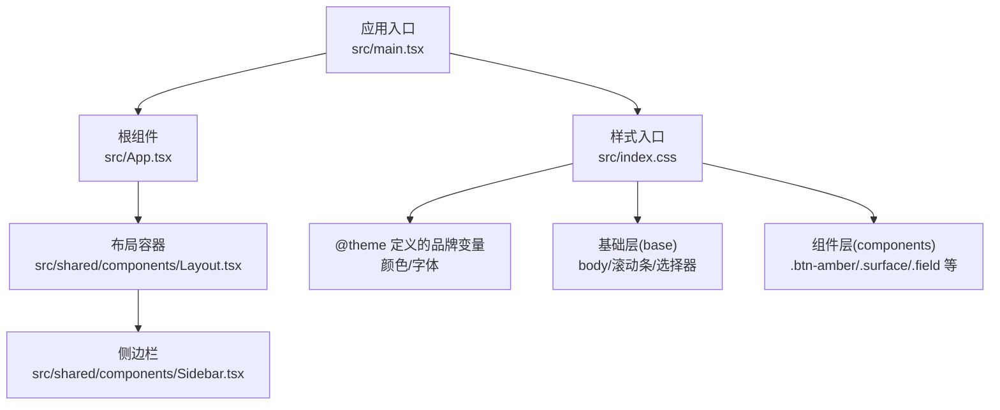
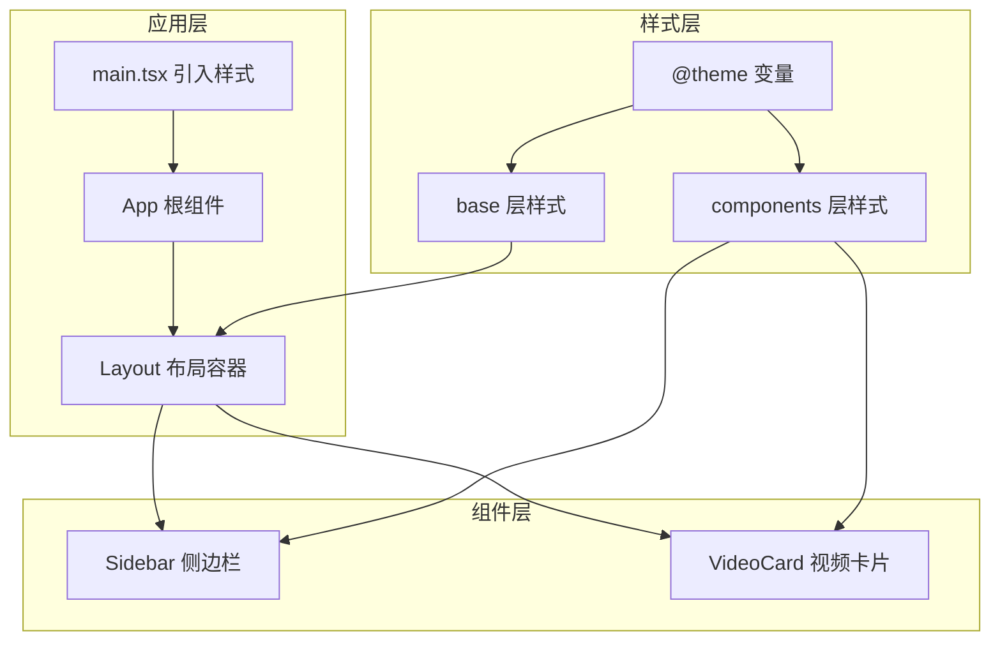
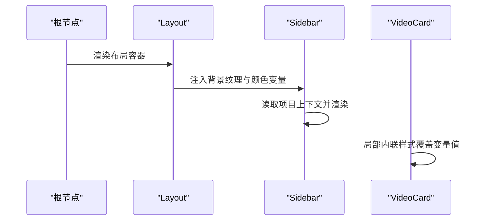
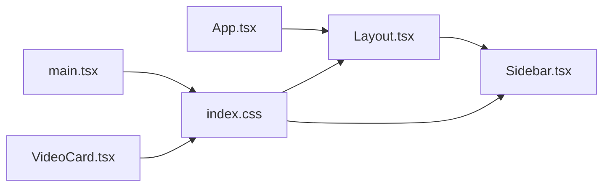

# 主题系统

<cite>
**本文引用的文件**
- [src/index.css](file://src/index.css)
- [src/main.tsx](file://src/main.tsx)
- [src/App.tsx](file://src/App.tsx)
- [src/shared/components/Layout.tsx](file://src/shared/components/Layout.tsx)
- [src/shared/components/Sidebar.tsx](file://src/shared/components/Sidebar.tsx)
- [src/shared/contexts/ProjectContext.tsx](file://src/shared/contexts/ProjectContext.tsx)
- [src/phases/export/components/VideoCard.tsx](file://src/phases/export/components/VideoCard.tsx)
</cite>

## 目录
1. [简介](#简介)
2. [项目结构](#项目结构)
3. [核心组件](#核心组件)
4. [架构总览](#架构总览)
5. [详细组件分析](#详细组件分析)
6. [依赖分析](#依赖分析)
7. [性能考虑](#性能考虑)
8. [故障排查指南](#故障排查指南)
9. [结论](#结论)
10. [附录](#附录)

## 简介
本文件面向 AI Shotlive 的主题系统，聚焦于深色/浅色主题的实现机制与扩展实践。当前仓库采用基于 CSS 变量与 Tailwind CSS 的组合方案：通过 @theme 定义品牌色阶与字体变量，在基础层(base)与组件层(components)中统一使用这些变量；同时在应用入口引入样式文件，确保全局生效。尽管未发现独立的主题上下文或主题切换逻辑文件，但本指南将从现有代码出发，给出主题变量命名规范、颜色值计算规则、主题继承关系、与 Tailwind 集成方式，并提供可直接落地的主题定制与调试建议。

## 项目结构
主题系统相关的关键文件分布如下：
- 样式入口与主题变量定义：src/index.css
- 应用入口：src/main.tsx
- 根组件与布局：src/App.tsx、src/shared/components/Layout.tsx
- 导航侧边栏：src/shared/components/Sidebar.tsx
- 全局项目上下文：src/shared/contexts/ProjectContext.tsx
- 视频卡片中的内联样式示例：src/phases/export/components/VideoCard.tsx

图表来源
- [src/main.tsx:1-11](file://src/main.tsx#L1-L11)
- [src/App.tsx:1-44](file://src/App.tsx#L1-L44)
- [src/shared/components/Layout.tsx:1-22](file://src/shared/components/Layout.tsx#L1-L22)
- [src/shared/components/Sidebar.tsx:1-47](file://src/shared/components/Sidebar.tsx#L1-L47)
- [src/index.css:1-209](file://src/index.css#L1-L209)

章节来源
- [src/main.tsx:1-11](file://src/main.tsx#L1-L11)
- [src/App.tsx:1-44](file://src/App.tsx#L1-L44)
- [src/shared/components/Layout.tsx:1-22](file://src/shared/components/Layout.tsx#L1-L22)
- [src/shared/components/Sidebar.tsx:1-47](file://src/shared/components/Sidebar.tsx#L1-L47)
- [src/index.css:1-209](file://src/index.css#L1-L209)

## 核心组件
- 样式入口与主题变量
  - 使用 @theme 定义品牌色阶与字体变量，作为全局主题基线。
  - 在 base 层设置 body 字体、背景、文本颜色等基础样式。
  - 在 components 层定义按钮、卡片、输入框、标签等通用组件样式，全部通过 CSS 变量引用。
- 应用入口
  - 在 main.tsx 中引入样式入口，确保样式在应用启动时即加载。
- 根组件与布局
  - Layout 将全局背景纹理类与颜色变量注入到根节点，保证子树继承一致的视觉语义。
- 导航侧边栏
  - 通过项目上下文读取当前阶段与保存状态，配合样式层的变量实现一致的视觉风格。
- 全局项目上下文
  - 提供项目状态管理与持久化能力，为主题系统提供运行时环境支撑。
- 视频卡片中的内联样式示例
  - 展示了在局部区域使用内联样式覆盖变量值的场景，便于理解主题变量的优先级与覆盖策略。

章节来源
- [src/index.css:1-209](file://src/index.css#L1-L209)
- [src/main.tsx:1-11](file://src/main.tsx#L1-L11)
- [src/shared/components/Layout.tsx:1-22](file://src/shared/components/Layout.tsx#L1-L22)
- [src/shared/components/Sidebar.tsx:1-47](file://src/shared/components/Sidebar.tsx#L1-L47)
- [src/shared/contexts/ProjectContext.tsx:1-51](file://src/shared/contexts/ProjectContext.tsx#L1-L51)
- [src/phases/export/components/VideoCard.tsx:143-175](file://src/phases/export/components/VideoCard.tsx#L143-L175)

## 架构总览
主题系统采用“变量驱动 + Tailwind 组合”的架构：
- 变量层：@theme 定义品牌色阶与字体变量，形成主题基线。
- 样式层：base 与 components 两层分别承担基础与组件级样式，统一通过 CSS 变量引用。
- 应用层：main.tsx 引入样式，App 与 Layout 确保变量在根节点生效，子组件按需继承。
- 扩展层：可通过新增 @theme 变量或在局部区域使用内联样式进行覆盖，实现浅色/深色或其他品牌主题的渐进增强。

图表来源
- [src/index.css:1-209](file://src/index.css#L1-L209)
- [src/main.tsx:1-11](file://src/main.tsx#L1-L11)
- [src/App.tsx:1-44](file://src/App.tsx#L1-L44)
- [src/shared/components/Layout.tsx:1-22](file://src/shared/components/Layout.tsx#L1-L22)
- [src/shared/components/Sidebar.tsx:1-47](file://src/shared/components/Sidebar.tsx#L1-L47)
- [src/phases/export/components/VideoCard.tsx:143-175](file://src/phases/export/components/VideoCard.tsx#L143-L175)

## 详细组件分析

### 主题变量与命名规范
- 命名规范
  - 颜色变量：以 --color-{category}-{level} 命名，如 --color-ink-*、--color-paper-*、--color-amber-*、--color-crimson-*。
  - 字体变量：--font-display、--font-sans、--font-mono。
- 颜色值计算规则
  - 同类别颜色按明度递减排列，例如 ink 与 paper 的不同等级用于构建背景、文本、边框、阴影等层级关系。
  - 暖色调（amber）与警示色（crimson）作为强调与状态指示的补充色。
- 主题继承关系
  - base 层通过 var(--color-*) 设置全局字体、背景、文本与滚动条等。
  - components 层通过 var(--color-*) 与 var(--font-*) 组合，形成按钮、卡片、输入框等组件的统一风格。
  - 局部区域可通过内联样式覆盖变量值，实现浅色/高对比度等变体。

章节来源
- [src/index.css:11-37](file://src/index.css#L11-L37)
- [src/index.css:39-68](file://src/index.css#L39-L68)
- [src/index.css:70-209](file://src/index.css#L70-L209)
- [src/phases/export/components/VideoCard.tsx:143-175](file://src/phases/export/components/VideoCard.tsx#L143-L175)

### Tailwind CSS 集成方式
- 变量覆盖规则
  - 在 base 与 components 层中，优先使用 CSS 变量，避免硬编码颜色值。
  - 当需要在特定组件上覆盖主题变量时，可在该元素上使用内联样式临时覆盖变量值，从而实现局部浅色/高对比度等变体。
- 主题特定样式编写方法
  - 在 components 层中，通过类名组合（如 .btn-amber、.surface、.field）统一引用变量，确保一致性。
  - 对于需要强调的区域，可结合内联样式与变量覆盖，实现“主题不变、局部变”的效果。

章节来源
- [src/index.css:11-37](file://src/index.css#L11-L37)
- [src/index.css:70-209](file://src/index.css#L70-L209)
- [src/shared/components/Layout.tsx:11-21](file://src/shared/components/Layout.tsx#L11-L21)
- [src/phases/export/components/VideoCard.tsx:143-175](file://src/phases/export/components/VideoCard.tsx#L143-L175)

### 主题切换的触发逻辑与动态应用
- 当前现状
  - 仓库中未发现独立的主题上下文或主题切换逻辑文件。
  - 主题变量在样式入口中集中定义，应用启动时由 main.tsx 引入，全局生效。
- 实现建议
  - 新增主题上下文：在 contexts 目录下创建 ThemeContext，提供当前主题模式（如 dark/light）、切换函数与持久化存储。
  - 动态样式切换：通过在根节点上切换 class 或属性，配合 CSS 变量映射，实现深浅主题的动态切换。
  - 过渡与动画：在切换过程中使用透明度与滤镜的渐变，减少闪烁；对关键组件（如按钮、卡片）增加过渡时间，提升体验。
  - 用户偏好记忆：使用本地存储或配置中心记录用户偏好的主题模式，并在应用启动时恢复。

章节来源
- [src/main.tsx:1-11](file://src/main.tsx#L1-L11)
- [src/App.tsx:1-44](file://src/App.tsx#L1-L44)
- [src/shared/contexts/ProjectContext.tsx:1-51](file://src/shared/contexts/ProjectContext.tsx#L1-L51)

### 用户体验设计
- 切换动画与过渡
  - 在主题切换时，对背景、文本与边框颜色使用平滑过渡，避免突变带来的不适感。
  - 对强调色（如 amber/crimson）在 hover/active 状态下的阴影与位移进行微调，保持一致性。
- 用户偏好记忆
  - 在主题上下文中集成偏好存储，启动时读取并应用，确保跨会话的一致性。
  - 提供快捷键或菜单项快速切换，便于用户操作。

章节来源
- [src/index.css:106-178](file://src/index.css#L106-L178)
- [src/shared/contexts/ProjectContext.tsx:1-51](file://src/shared/contexts/ProjectContext.tsx#L1-L51)

### 主题系统与组件的关系
- Layout 将全局背景纹理类与颜色变量注入到根节点，保证子树继承一致的视觉语义。
- Sidebar 通过项目上下文读取当前阶段与保存状态，配合样式层的变量实现一致的视觉风格。
- VideoCard 展示了在局部区域使用内联样式覆盖变量值的场景，体现变量覆盖与优先级。

图表来源
- [src/shared/components/Layout.tsx:11-21](file://src/shared/components/Layout.tsx#L11-L21)
- [src/shared/components/Sidebar.tsx:1-47](file://src/shared/components/Sidebar.tsx#L1-L47)
- [src/phases/export/components/VideoCard.tsx:143-175](file://src/phases/export/components/VideoCard.tsx#L143-L175)

## 依赖分析
- 样式入口依赖
  - main.tsx 依赖 src/index.css，确保样式在应用启动时加载。
- 组件依赖
  - App 依赖 Layout，Layout 依赖 Sidebar。
  - 各组件通过 CSS 变量引用样式层定义的颜色与字体。
- 变量覆盖依赖
  - 局部区域可通过内联样式覆盖变量值，实现主题变体。

图表来源
- [src/main.tsx:1-11](file://src/main.tsx#L1-L11)
- [src/App.tsx:1-44](file://src/App.tsx#L1-L44)
- [src/shared/components/Layout.tsx:1-22](file://src/shared/components/Layout.tsx#L1-L22)
- [src/shared/components/Sidebar.tsx:1-47](file://src/shared/components/Sidebar.tsx#L1-L47)
- [src/index.css:1-209](file://src/index.css#L1-L209)
- [src/phases/export/components/VideoCard.tsx:143-175](file://src/phases/export/components/VideoCard.tsx#L143-L175)

章节来源
- [src/main.tsx:1-11](file://src/main.tsx#L1-L11)
- [src/App.tsx:1-44](file://src/App.tsx#L1-L44)
- [src/shared/components/Layout.tsx:1-22](file://src/shared/components/Layout.tsx#L1-L22)
- [src/shared/components/Sidebar.tsx:1-47](file://src/shared/components/Sidebar.tsx#L1-L47)
- [src/index.css:1-209](file://src/index.css#L1-L209)
- [src/phases/export/components/VideoCard.tsx:143-175](file://src/phases/export/components/VideoCard.tsx#L143-L175)

## 性能考虑
- 变量复用：通过 CSS 变量统一管理颜色与字体，减少重复定义，降低维护成本。
- 局部覆盖：仅在必要区域使用内联样式覆盖变量值，避免全局重绘。
- 渐变过渡：对主题切换与交互状态使用 CSS 过渡，减少 JavaScript 动画开销。
- 样式分层：base 与 components 分层组织，避免样式冲突，提升渲染效率。

## 故障排查指南
- 样式未生效
  - 检查 main.tsx 是否正确引入样式入口。
  - 确认 @theme 变量是否在 base 与 components 层被正确引用。
- 局部覆盖无效
  - 检查内联样式的优先级是否高于 CSS 变量。
  - 确认变量名称拼写与 @theme 定义一致。
- 切换逻辑缺失
  - 若计划实现深浅主题切换，需新增 ThemeContext 并在根节点上绑定切换逻辑与持久化存储。

章节来源
- [src/main.tsx:1-11](file://src/main.tsx#L1-L11)
- [src/index.css:11-37](file://src/index.css#L11-L37)
- [src/index.css:39-68](file://src/index.css#L39-L68)
- [src/index.css:70-209](file://src/index.css#L70-L209)
- [src/phases/export/components/VideoCard.tsx:143-175](file://src/phases/export/components/VideoCard.tsx#L143-L175)

## 结论
AI Shotlive 的主题系统以 CSS 变量为核心，结合 Tailwind CSS 的类名体系，实现了统一且可扩展的视觉语言。当前仓库通过 @theme 定义品牌色阶与字体变量，并在 base 与 components 层中统一引用，确保全局一致性。若需实现深浅主题切换与用户偏好记忆，建议新增 ThemeContext 与持久化逻辑，并在根节点上实现动态样式切换与过渡动画。通过遵循本文的命名规范与覆盖规则，可安全地扩展新主题与品牌主题。

## 附录
- 主题定制实用指南
  - 添加新主题变量：在 @theme 中新增变量，随后在 base 与 components 层中逐步替换硬编码颜色值。
  - 创建品牌主题：通过在根节点切换 class 或属性，配合 CSS 变量映射，实现品牌色系的统一应用。
  - 处理主题相关调试问题：检查变量名称、覆盖优先级与过渡动画，确保跨组件一致性与性能表现。