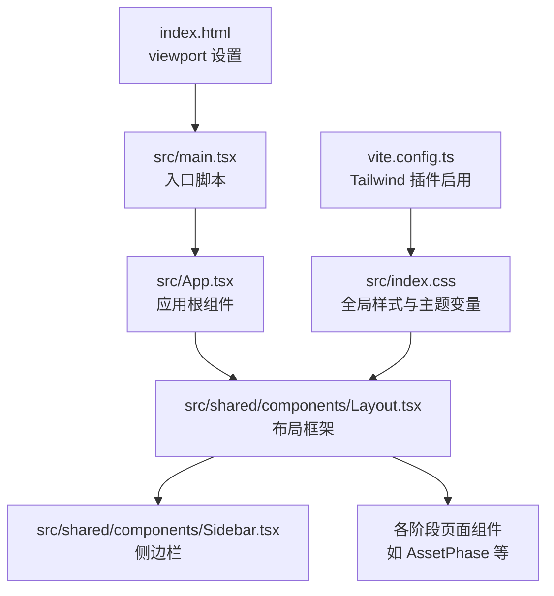
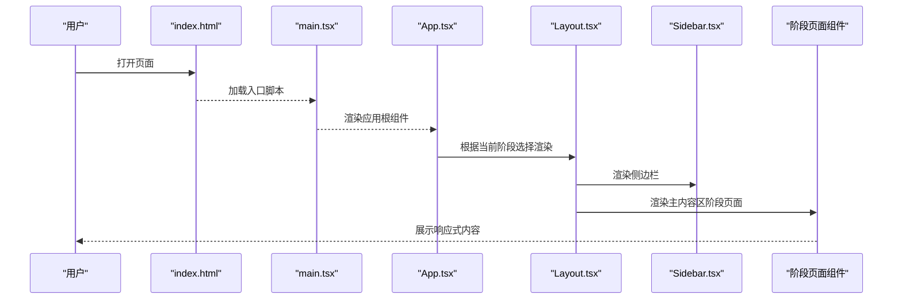
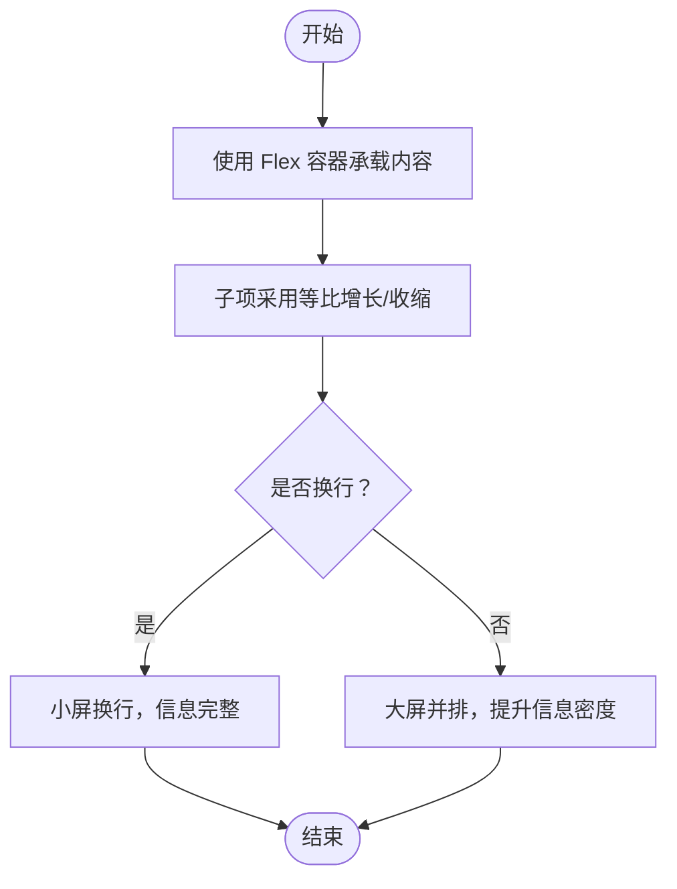
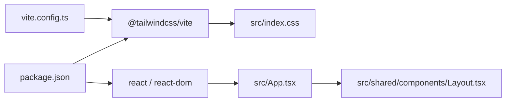

# 响应式设计

<cite>
**本文引用的文件**
- [index.html](file://index.html)
- [index.css](file://src/index.css)
- [vite.config.ts](file://vite.config.ts)
- [package.json](file://package.json)
- [App.tsx](file://src/App.tsx)
- [Layout.tsx](file://src/shared/components/Layout.tsx)
- [ImagePreview.tsx](file://src/phases/assets/components/ImagePreview.tsx)
- [AssetPhase.tsx](file://src/phases/assets/AssetPhase.tsx)
- [LoadingSpinner.tsx](file://src/shared/components/LoadingSpinner.tsx)
- [CharacterAssetCard.tsx](file://src/phases/assets/components/CharacterAssetCard.tsx)
</cite>

## 目录
1. [简介](#简介)
2. [项目结构](#项目结构)
3. [核心组件](#核心组件)
4. [架构总览](#架构总览)
5. [详细组件分析](#详细组件分析)
6. [依赖关系分析](#依赖关系分析)
7. [性能考量](#性能考量)
8. [故障排查指南](#故障排查指南)
9. [结论](#结论)
10. [附录](#附录)

## 简介
本文件面向“AI Shotlive”项目的响应式设计，聚焦以下目标：
- 解释移动端优先理念与断点策略（移动端、平板端、桌面端），以及布局适配思路
- 说明 Flexbox 与 CSS Grid 在项目中的实际应用方式（含自适应网格、弹性容器、复杂布局）
- 阐述触摸友好交互、移动端特有 UI 模式及性能优化策略
- 提供跨设备兼容性处理建议（CSS 前缀、渐进增强、降级方案）
- 给出响应式测试方法与工具建议（模拟器、真机测试、自动化策略）

需要特别说明的是：当前仓库中未发现明确的媒体查询断点或 Tailwind 响应式断点配置；项目采用以 Tailwind 4 为核心的原子化样式体系，并通过类名组合实现响应式布局。因此，本文件将基于现有代码与工具链，给出可落地的响应式实践建议与最佳实践。

## 项目结构
本项目前端基于 Vite + React + Tailwind 4，全局样式集中于 src/index.css，入口 HTML 中包含 viewport 元标签，确保移动端缩放控制。应用根组件负责按阶段切换内容区域，整体布局由 Layout 组件承载。

图表来源
- [index.html:6-6](file://index.html#L6-L6)
- [App.tsx:15-28](file://src/App.tsx#L15-L28)
- [Layout.tsx:9-22](file://src/shared/components/Layout.tsx#L9-L22)
- [index.css:11-37](file://src/index.css#L11-L37)
- [vite.config.ts:3-3](file://vite.config.ts#L3-L3)

章节来源
- [index.html:1-14](file://index.html#L1-L14)
- [vite.config.ts:1-13](file://vite.config.ts#L1-L13)
- [package.json:1-26](file://package.json#L1-L26)
- [App.tsx:1-44](file://src/App.tsx#L1-L44)
- [Layout.tsx:1-22](file://src/shared/components/Layout.tsx#L1-L22)
- [index.css:1-209](file://src/index.css#L1-L209)

## 核心组件
- 视口与基础样式
  - HTML 中设置 viewport，保证移动端初始缩放与宽度正确
  - 全局 CSS 定义主题变量、字体、滚动条、焦点环等基础样式
- 布局框架
  - Layout 使用 Flex 布局承载左右分栏（侧边栏 + 主内容区），并应用背景纹理
- 阶段页面
  - 各阶段页面通过 Flex 或 Grid 实现信息密度与对齐，例如资产页标题区使用 Flex 包裹多列信息
- 图像预览
  - 图像容器与画廊采用 Flex 布局，配合最大宽高限制与对象填充策略，保证在不同设备上稳定显示
- 加载动画
  - LoadingSpinner 使用相对定位与动画，适配不同尺寸并在小屏上保持可读性

章节来源
- [index.html:6-6](file://index.html#L6-L6)
- [index.css:39-68](file://src/index.css#L39-L68)
- [Layout.tsx:9-22](file://src/shared/components/Layout.tsx#L9-L22)
- [AssetPhase.tsx:542-607](file://src/phases/assets/AssetPhase.tsx#L542-L607)
- [ImagePreview.tsx:91-160](file://src/phases/assets/components/ImagePreview.tsx#L91-L160)
- [LoadingSpinner.tsx:1-41](file://src/shared/components/LoadingSpinner.tsx#L1-L41)

## 架构总览
下图展示从入口到布局再到阶段页面的整体流程，体现响应式布局在组件层级上的协作方式。

图表来源
- [index.html:10-11](file://index.html#L10-L11)
- [App.tsx:15-28](file://src/App.tsx#L15-L28)
- [Layout.tsx:9-22](file://src/shared/components/Layout.tsx#L9-L22)

## 详细组件分析

### 布局与断点策略（基于 Tailwind 4 的原子化响应式）
- 断点与栅格
  - 当前仓库未显式定义自定义断点；Tailwind 4 默认断点与类名组合用于响应式布局
  - 建议在现有基础上，结合业务场景使用 Tailwind 的响应式前缀（如 sm:/md:/lg:/xl:/2xl:）进行分层适配
- 移动端优先
  - 小屏优先：默认使用紧凑布局、较小字体与内边距，避免大间距导致滚动与阅读困难
  - 密集信息区：使用 Flex 的换行与对齐属性，保证在窄屏下仍能完整呈现
- 平板与桌面
  - 通过列数与间距类名组合，实现从单列到多列的平滑过渡
  - 大屏下可增加最大宽度限制与居中策略，提升视觉稳定感

章节来源
- [index.css:11-37](file://src/index.css#L11-L37)
- [AssetPhase.tsx:542-607](file://src/phases/assets/AssetPhase.tsx#L542-L607)
- [ImagePreview.tsx:91-160](file://src/phases/assets/components/ImagePreview.tsx#L91-L160)

### Flexbox 在响应式中的应用
- 弹性容器
  - 侧边栏与主内容区采用 Flex 布局，主区自动占满剩余空间，保证在不同宽度下保持一致的视觉比例
- 复杂布局
  - 资产页标题区使用 Flex 包裹多个信息块，配合换行与对齐，使标题、副标题、描述在小屏上自然换行，在大屏上并排展示
- 自适应网格
  - 通过 Flex 的换行与等分策略，实现类似网格的效果（如若干卡片在一行内等比分布）

图表来源
- [Layout.tsx:9-22](file://src/shared/components/Layout.tsx#L9-L22)
- [AssetPhase.tsx:542-607](file://src/phases/assets/AssetPhase.tsx#L542-L607)

章节来源
- [Layout.tsx:9-22](file://src/shared/components/Layout.tsx#L9-L22)
- [AssetPhase.tsx:542-607](file://src/phases/assets/AssetPhase.tsx#L542-L607)

### CSS Grid 在响应式中的应用
- 适用场景
  - 当需要严格的行列对齐、复杂对齐关系或固定骨架时，Grid 更适合
  - 对于当前项目，若存在需要严格对齐的表单、仪表盘或卡片网格，可考虑引入 Grid
- 与 Flex 的取舍
  - 简单的线性排列优先使用 Flex
  - 需要二维布局与对齐时再引入 Grid

章节来源
- [index.css:11-37](file://src/index.css#L11-L37)

### 触摸友好与移动端特性
- 触摸目标尺寸
  - 按钮与交互元素应保证最小点击面积，避免过小导致误触
- 滚动与滚动条
  - 使用自定义滚动条样式，提升深色主题下的可读性与一致性
- 交互反馈
  - 使用动画与阴影强调状态变化，提升移动端反馈体验

章节来源
- [index.css:50-59](file://src/index.css#L50-L59)
- [LoadingSpinner.tsx:1-41](file://src/shared/components/LoadingSpinner.tsx#L1-L41)

### 性能优化策略
- 原子化样式与构建优化
  - Tailwind 4 与 Vite 结合，利用按需生成与 Tree-shaking，减少无效样式体积
- 图像与媒体
  - 使用对象填充与最大宽高限制，避免重排与过度绘制
- 动画与过渡
  - 仅对必要元素使用动画，避免在低端设备上造成卡顿

章节来源
- [vite.config.ts:1-13](file://vite.config.ts#L1-L13)
- [package.json:16-24](file://package.json#L16-L24)
- [ImagePreview.tsx:91-160](file://src/phases/assets/components/ImagePreview.tsx#L91-L160)

## 依赖关系分析
- 工具链
  - Vite + @tailwindcss/vite：启用 Tailwind 4，支持原子化样式与按需生成
  - React：组件化渲染，便于在不同断点下组合布局
- 样式依赖
  - 全局样式集中管理，主题变量统一，利于在不同设备上保持一致的视觉语言

图表来源
- [vite.config.ts:3-3](file://vite.config.ts#L3-L3)
- [package.json:11-24](file://package.json#L11-L24)
- [index.css:1-10](file://src/index.css#L1-L10)
- [App.tsx:15-28](file://src/App.tsx#L15-L28)
- [Layout.tsx:9-22](file://src/shared/components/Layout.tsx#L9-L22)

章节来源
- [vite.config.ts:1-13](file://vite.config.ts#L1-L13)
- [package.json:1-26](file://package.json#L1-L26)

## 性能考量
- 构建与打包
  - 使用 Vite 的快速冷启动与热更新，开发体验更佳
  - Tailwind 4 的按需扫描与构建优化，减少运行时样式体积
- 运行时性能
  - 避免在滚动过程中触发昂贵的重排/重绘
  - 合理使用 CSS 动画与 GPU 加速属性（如 transform、opacity），降低主线程压力
- 移动端专项
  - 控制图片尺寸与格式，避免超大资源在移动端加载
  - 减少阴影与模糊效果的滥用，防止在低端设备上掉帧

## 故障排查指南
- 视口问题
  - 若页面在移动设备上缩放异常，请检查 HTML 中的 viewport 设置
- 样式不生效
  - 确认 Tailwind 插件已正确启用，且全局样式文件被正确导入
- 布局错位
  - 检查 Flex/Grid 类名组合是否与断点前缀匹配，避免在小屏上出现溢出或换行异常
- 交互异常
  - 检查触摸目标尺寸与点击区域，确保满足移动端可用性要求

章节来源
- [index.html:6-6](file://index.html#L6-L6)
- [vite.config.ts:3-3](file://vite.config.ts#L3-L3)
- [index.css:1-10](file://src/index.css#L1-L10)

## 结论
本项目以 Tailwind 4 为核心，采用原子化样式与 Flex 布局实现响应式体验。由于未显式配置媒体查询断点，建议在现有基础上引入合理的响应式前缀与断点策略，结合移动端优先理念与触摸友好设计，持续优化跨设备兼容性与性能表现。

## 附录

### 响应式测试方法与工具
- 浏览器开发者工具
  - 使用设备模拟器（手机/平板/桌面）验证布局与交互
- 真机测试
  - 在主流机型上验证触摸交互、滚动行为与图像加载
- 自动化测试
  - 使用端到端测试工具（如 Playwright/Cypress）录制关键交互流程，定期回归
- 性能监测
  - 关注关键渲染路径与内存占用，确保低端设备流畅运行