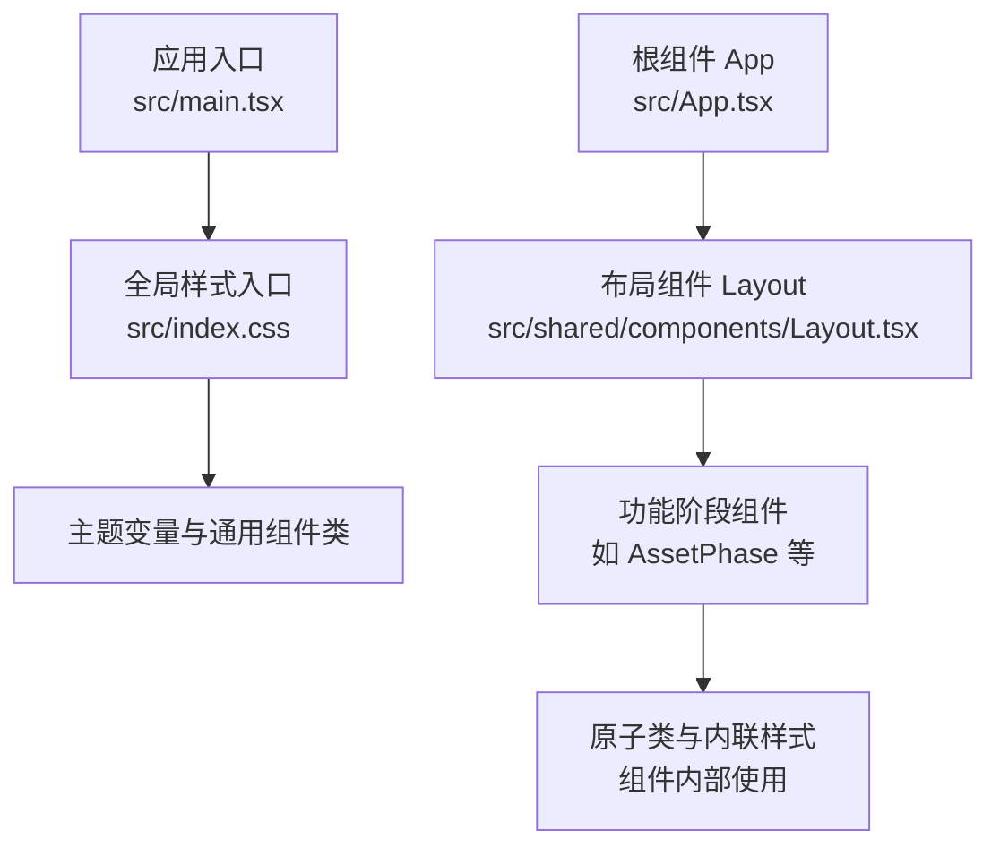
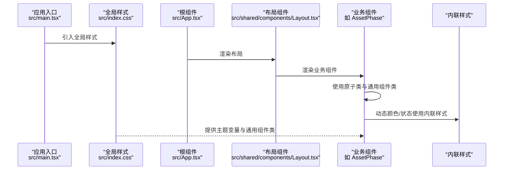
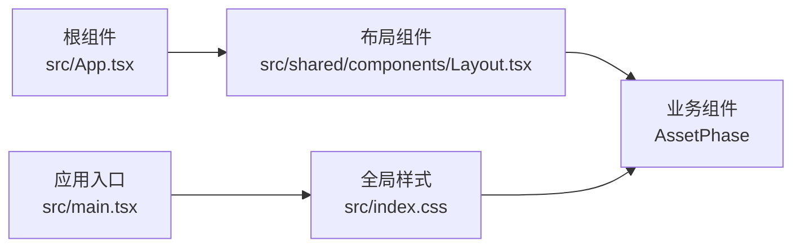

# 组件样式规范

<cite>
**本文引用的文件**
- [src/index.css](file://src/index.css)
- [src/main.tsx](file://src/main.tsx)
- [src/App.tsx](file://src/App.tsx)
- [src/phases/export/components/ExportStats.tsx](file://src/phases/export/components/ExportStats.tsx)
- [src/shared/components/Layout.tsx](file://src/shared/components/Layout.tsx)
- [src/shared/components/ProjectSelector.tsx](file://src/shared/components/ProjectSelector.tsx)
- [src/phases/assets/AssetPhase.tsx](file://src/phases/assets/AssetPhase.tsx)
</cite>

## 目录
1. [简介](#简介)
2. [项目结构](#项目结构)
3. [核心组件](#核心组件)
4. [架构总览](#架构总览)
5. [详细组件分析](#详细组件分析)
6. [依赖分析](#依赖分析)
7. [性能考虑](#性能考虑)
8. [故障排查指南](#故障排查指南)
9. [结论](#结论)
10. [附录](#附录)

## 简介
本规范面向 AI Shotlive 的组件样式体系，目标是建立统一的样式组织结构、命名约定、封装方法与冲突预防策略；阐明 CSS 模块化与作用域样式在本项目中的实践（含 CSS-in-JS 使用场景与样式隔离最佳实践）；明确样式的可维护性设计（复用机制、继承规则、调试技巧）；给出与第三方 UI 库的集成策略（覆盖、主题定制、冲突解决）；并提供完整的样式开发工作流程（开发规范、代码审查要点、性能优化建议）。  
本项目采用 Tailwind CSS 作为基础工具，结合自定义主题变量与原子类组合，形成“主题变量 + 原子类 + 局部内联样式”的混合样式方案。

## 项目结构
- 样式入口与主题
  - 全局样式入口通过应用入口引入，集中定义主题变量、字体、全局层叠与通用组件样式。
  - 主题变量以 CSS 自定义属性形式集中管理，便于跨组件共享与动态切换。
- 组件样式组织
  - 通用样式类（如按钮、卡片、输入框等）定义于全局样式层，供全站复用。
  - 组件内部使用原子类进行布局与排版，必要时配合局部内联样式实现细粒度颜色控制。
- 样式加载链路
  - 应用启动时加载全局样式，随后按需渲染各功能阶段组件，组件样式与全局样式协同生效。

图表来源
- [src/main.tsx:1-44](file://src/main.tsx#L1-L44)
- [src/index.css:1-209](file://src/index.css#L1-L209)
- [src/App.tsx:1-44](file://src/App.tsx#L1-L44)

章节来源
- [src/main.tsx:1-44](file://src/main.tsx#L1-L44)
- [src/index.css:1-209](file://src/index.css#L1-L209)
- [src/App.tsx:1-44](file://src/App.tsx#L1-L44)

## 核心组件
- 主题与全局样式
  - 通过 CSS 自定义属性集中管理色彩、字体与字号等设计令牌，确保全局一致性与可维护性。
  - 在基础层（base）中重置与统一页面基础样式，在组件层（components）中定义通用组件类（如按钮、卡片、输入框、标签等），提升复用率。
- 原子类与内联样式的协作
  - 大部分布局与排版使用原子类，保证样式声明的简洁与可读性。
  - 对于需要动态或细粒度的颜色控制，采用内联样式绑定主题变量，避免污染全局类名空间。
- 动画与过渡
  - 在组件层定义常用动画（如上升、淡入、分割），通过类名组合实现一致的动效体验。

章节来源
- [src/index.css:11-209](file://src/index.css#L11-L209)

## 架构总览
下图展示从应用入口到组件渲染的样式加载与使用路径，体现“主题变量 → 通用组件类 → 原子类/内联样式”的分层组织与协同关系。

图表来源
- [src/main.tsx:1-44](file://src/main.tsx#L1-L44)
- [src/index.css:1-209](file://src/index.css#L1-L209)
- [src/App.tsx:1-44](file://src/App.tsx#L1-L44)

## 详细组件分析

### 样式组织与命名约定
- 主题变量命名
  - 使用语义化前缀（如色彩、字体、字号）与层级（如深浅等级），确保变量含义清晰且易于替换。
- 通用组件类命名
  - 采用描述性短词（如按钮、卡片、字段、标签、指示器等），避免过长或抽象缩写。
- 原子类使用
  - 遵循 Tailwind 原子类命名习惯，优先使用现有类，减少新增类名。
- 内联样式使用
  - 仅用于动态颜色或与状态强关联的细粒度控制，避免滥用导致样式分散。

章节来源
- [src/index.css:11-37](file://src/index.css#L11-L37)
- [src/index.css:70-208](file://src/index.css#L70-L208)

### 样式封装与作用域
- 全局样式封装
  - 将通用组件类与主题变量置于全局样式入口，确保所有组件可直接访问。
- 组件内样式封装
  - 组件内部优先使用原子类与通用组件类，必要时通过内联样式绑定主题变量，避免污染全局类名。
- 样式隔离实践
  - 通过原子类的“最小权限”原则与内联样式的局部性，降低样式泄漏风险。
  - 通用组件类尽量保持无副作用，避免对父容器产生意外影响。

章节来源
- [src/index.css:70-208](file://src/index.css#L70-L208)
- [src/phases/assets/AssetPhase.tsx:112-144](file://src/phases/assets/AssetPhase.tsx#L112-L144)

### 样式冲突预防策略
- 变量驱动的色彩系统
  - 所有颜色均通过主题变量引用，统一变更只需修改一处。
- 通用组件类的“无副作用”设计
  - 通用类不依赖外部容器状态，减少因上下文差异引发的冲突。
- 原子类与内联样式的边界
  - 原子类负责布局与通用视觉，内联样式仅处理动态状态，避免重复覆盖。
- 动画与过渡的集中管理
  - 将动画定义集中在通用层，组件只负责类名组合，避免重复定义导致的冲突。

章节来源
- [src/index.css:11-37](file://src/index.css#L11-L37)
- [src/index.css:70-208](file://src/index.css#L70-L208)

### CSS 模块化与作用域样式
- 模块化组织
  - 全局样式文件集中管理主题与通用组件类，组件内部样式通过原子类与内联样式实现模块化。
- 作用域样式
  - 通过原子类的作用域特性与内联样式的局部性，天然实现样式作用域隔离。
- BEM 命名法的应用
  - 本项目主要使用原子类与通用组件类，未见显式 BEM 类名；若未来扩展自定义类，建议采用 BEM 规范以增强可读性与可维护性。

章节来源
- [src/index.css:70-208](file://src/index.css#L70-L208)

### CSS-in-JS 使用场景
- 适用场景
  - 动态颜色（如根据状态选择不同色值）、运行时主题切换、条件样式。
- 实践示例
  - 组件内部使用内联样式绑定主题变量，实现状态驱动的颜色变化。
- 注意事项
  - 仅用于必要场景，避免与原子类/通用类混用造成维护成本上升。

章节来源
- [src/phases/export/components/ExportStats.tsx:106-144](file://src/phases/export/components/ExportStats.tsx#L106-L144)

### 样式可维护性设计
- 复用机制
  - 通用组件类集中复用，减少重复定义；原子类复用布局与排版能力。
- 继承规则
  - 通过主题变量统一继承色彩与字号，保证跨组件一致性。
- 调试技巧
  - 利用原子类的直观性快速定位布局问题；内联样式便于验证状态逻辑。
  - 在浏览器开发者工具中检查主题变量是否正确解析，确认颜色与字体是否符合预期。

章节来源
- [src/index.css:11-37](file://src/index.css#L11-L37)
- [src/index.css:70-208](file://src/index.css#L70-L208)

### 与第三方 UI 库的集成
- 样式覆盖策略
  - 通过原子类与通用组件类覆盖第三方库的默认样式，保持整体风格一致。
- 主题定制方法
  - 使用主题变量统一第三方组件的颜色与边框，避免硬编码。
- 冲突解决方案
  - 优先使用原子类与通用类进行覆盖；对于复杂组件，采用内联样式进行细粒度控制。
  - 若第三方库强制使用全局类名，建议在组件外层包裹作用域容器，限制其影响范围。

章节来源
- [src/index.css:70-208](file://src/index.css#L70-L208)

### 组件样式开发工作流程
- 开发规范
  - 优先使用原子类与通用组件类；仅在必要时使用内联样式。
  - 所有颜色必须通过主题变量引用，禁止硬编码。
- 代码审查要点
  - 是否存在重复定义的样式类；是否滥用内联样式；主题变量使用是否一致。
- 性能优化建议
  - 合理拆分原子类，避免生成冗余类；减少内联样式的频繁更新；利用 CSS 变量减少重绘。

章节来源
- [src/index.css:11-37](file://src/index.css#L11-L37)
- [src/index.css:70-208](file://src/index.css#L70-L208)

## 依赖分析
- 样式依赖关系
  - 应用入口依赖全局样式；根组件依赖布局组件；布局组件渲染业务组件；业务组件消费通用组件类与主题变量。
- 样式耦合点
  - 通用组件类与主题变量是跨组件共享的耦合点，应保持稳定与清晰的命名与职责划分。

图表来源
- [src/main.tsx:1-44](file://src/main.tsx#L1-L44)
- [src/App.tsx:1-44](file://src/App.tsx#L1-L44)
- [src/index.css:1-209](file://src/index.css#L1-L209)

章节来源
- [src/main.tsx:1-44](file://src/main.tsx#L1-L44)
- [src/App.tsx:1-44](file://src/App.tsx#L1-L44)
- [src/index.css:1-209](file://src/index.css#L1-L209)

## 性能考虑
- 原子类体积控制
  - 仅引入实际使用的原子类，避免生成不必要的类。
- 主题变量与内联样式的权衡
  - 频繁变更的颜色使用内联样式；静态颜色尽量使用原子类与通用组件类。
- 动画与过渡
  - 将动画定义集中在通用层，减少重复定义带来的体积与解析开销。

## 故障排查指南
- 主题变量未生效
  - 检查全局样式是否正确引入；确认变量名称拼写与层级是否一致。
- 颜色不一致
  - 检查是否直接使用了硬编码颜色；确保通过主题变量引用。
- 动画效果异常
  - 检查动画类名是否正确拼接；确认动画定义存在于通用层。
- 第三方组件样式冲突
  - 使用原子类或内联样式进行覆盖；必要时在外层容器设置作用域。

章节来源
- [src/index.css:11-37](file://src/index.css#L11-L37)
- [src/index.css:70-208](file://src/index.css#L70-L208)

## 结论
本项目通过“主题变量 + 原子类 + 通用组件类 + 局部内联样式”的混合方案，实现了样式的一致性、可维护性与可扩展性。遵循本文规范可在保证开发效率的同时，有效预防样式冲突并提升团队协作质量。

## 附录
- 示例参考
  - 通用组件类与主题变量的使用：[src/index.css:70-208](file://src/index.css#L70-L208)
  - 动态颜色与状态控制的内联样式实践：[src/phases/export/components/ExportStats.tsx:106-144](file://src/phases/export/components/ExportStats.tsx#L106-L144)
  - 原子类与通用类在业务组件中的组合使用：[src/phases/assets/AssetPhase.tsx:112-144](file://src/phases/assets/AssetPhase.tsx#L112-L144)