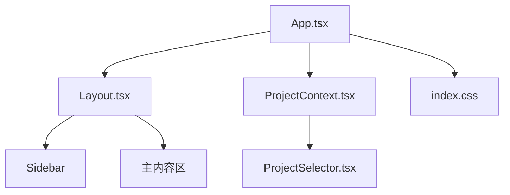
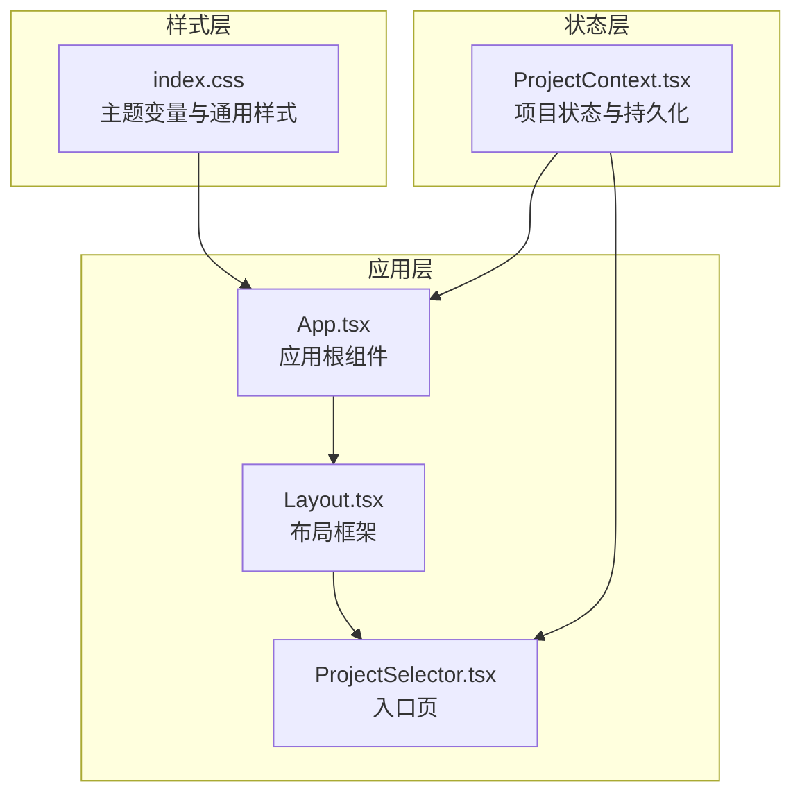
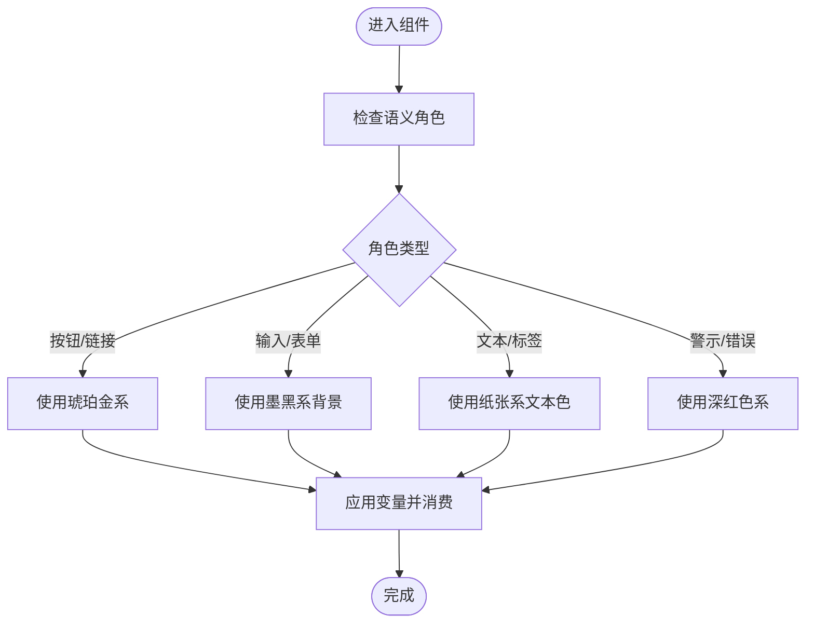
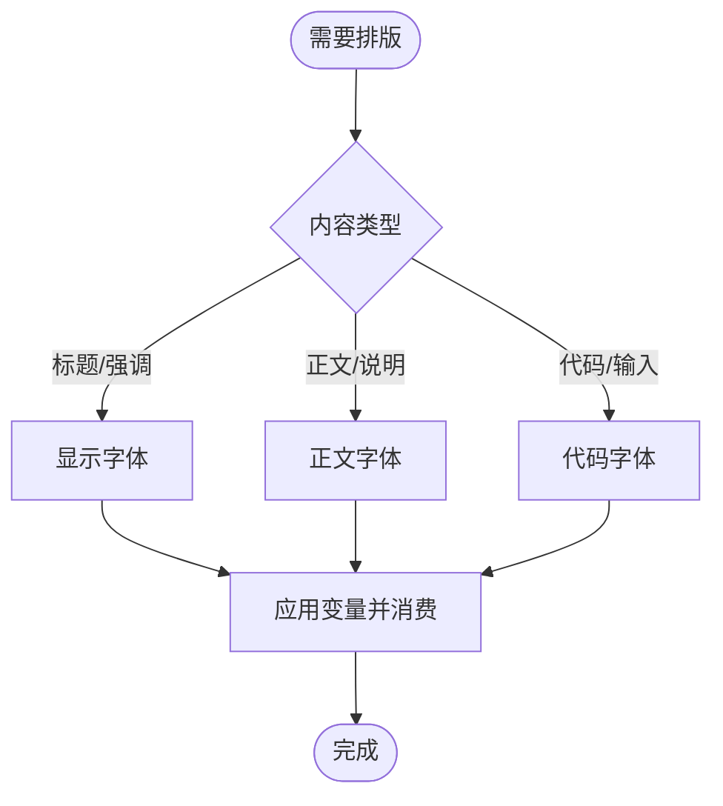
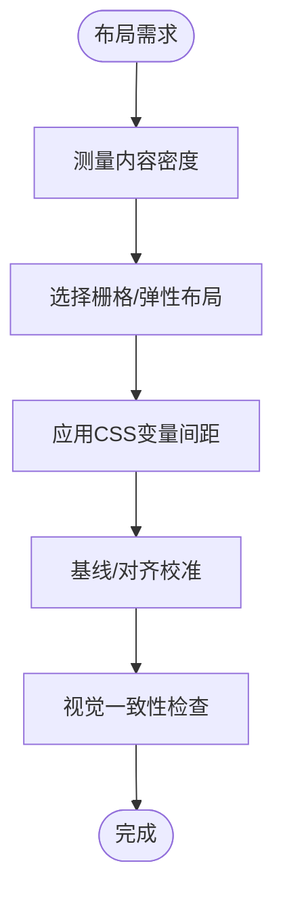
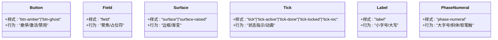
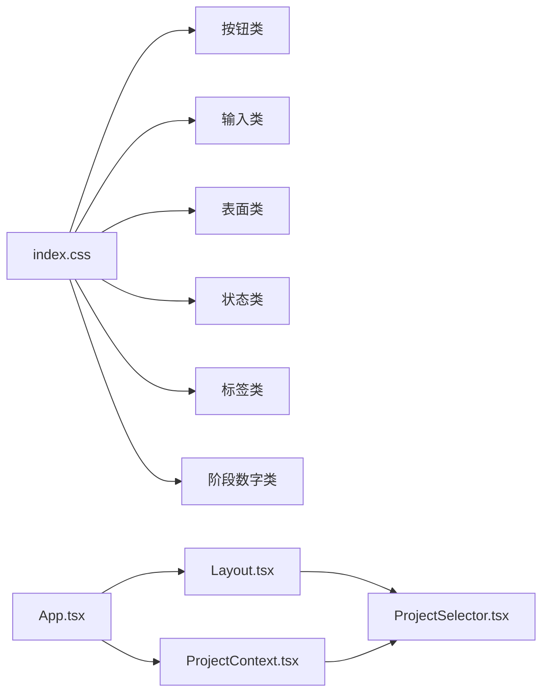

# 设计原则与规范

<cite>
**本文引用的文件**
- [index.css](file://src/index.css)
- [App.tsx](file://src/App.tsx)
- [ProjectContext.tsx](file://src/shared/contexts/ProjectContext.tsx)
- [ProjectSelector.tsx](file://src/shared/components/ProjectSelector.tsx)
- [Layout.tsx](file://src/shared/components/Layout.tsx)
</cite>

## 目录
1. [引言](#引言)
2. [项目结构](#项目结构)
3. [核心组件](#核心组件)
4. [架构总览](#架构总览)
5. [详细组件分析](#详细组件分析)
6. [依赖分析](#依赖分析)
7. [性能考量](#性能考量)
8. [故障排查指南](#故障排查指南)
9. [结论](#结论)
10. [附录](#附录)

## 引言
本文件面向AI Shotlive的设计系统，系统性阐述设计原则与规范，涵盖以下方面：
- 设计理念：简洁性、一致性、可用性
- 色彩体系：主色调、辅助色、中性色的应用规则
- 字体规范：标题字体、正文字体、代码字体的选择与使用场景
- 间距系统：网格系统、留白规则、对齐标准
- 组件设计：可复用性、可扩展性、无障碍设计
- 设计决策背景：帮助开发者理解设计系统的深层逻辑

本规范以实际CSS变量、类名与组件实现为依据，确保设计与工程落地一致。

## 项目结构
AI Shotlive采用前端单页应用结构，设计系统通过全局样式与通用组件共同实现：
- 全局样式集中于CSS文件，定义主题变量、基础排版与通用组件样式
- 布局框架通过顶层组件组合，统一页面骨架与视觉基调
- 项目选择器作为入口页，承载品牌叙事与交互引导

图表来源
- [App.tsx:1-44](file://src/App.tsx#L1-L44)
- [Layout.tsx:1-23](file://src/shared/components/Layout.tsx#L1-L23)
- [ProjectContext.tsx:1-187](file://src/shared/contexts/ProjectContext.tsx#L1-L187)
- [ProjectSelector.tsx:1-303](file://src/shared/components/ProjectSelector.tsx#L1-L303)
- [index.css:1-209](file://src/index.css#L1-L209)

章节来源
- [App.tsx:1-44](file://src/App.tsx#L1-L44)
- [Layout.tsx:1-23](file://src/shared/components/Layout.tsx#L1-L23)
- [ProjectContext.tsx:1-187](file://src/shared/contexts/ProjectContext.tsx#L1-L187)
- [ProjectSelector.tsx:1-303](file://src/shared/components/ProjectSelector.tsx#L1-L303)
- [index.css:1-209](file://src/index.css#L1-L209)

## 核心组件
- 品牌与基调
  - 主色调：琥珀金（film leader amber），用于强调、按钮、选中态与装饰元素
  - 辅助色：深红（crimson deep），用于重要警示与强调
  - 中性色：墨黑系列与纸张系列，形成深色暗房氛围与高对比文本
- 字体系统
  - 显示字体：用于标题与强调文本，具备光学尺寸与软笔触变化
  - 正文字体：用于正文与界面文本，保证易读性
  - 代码字体：用于技术性文本与输入框，强调等宽与可读性
- 间距与网格
  - 使用CSS变量控制尺寸与留白，配合栅格系统实现响应式布局
  - 对齐遵循视觉层级与对齐基准线，确保信息密度与阅读节奏

章节来源
- [index.css:11-37](file://src/index.css#L11-L37)
- [index.css:39-209](file://src/index.css#L39-L209)

## 架构总览
设计系统在全局样式层定义主题变量，在组件层通过类名与变量消费实现一致性。入口页负责品牌叙事与API配置引导，布局组件统一页面骨架，上下文提供项目状态与持久化策略。

图表来源
- [index.css:1-209](file://src/index.css#L1-L209)
- [App.tsx:1-44](file://src/App.tsx#L1-L44)
- [Layout.tsx:1-23](file://src/shared/components/Layout.tsx#L1-L23)
- [ProjectSelector.tsx:1-303](file://src/shared/components/ProjectSelector.tsx#L1-L303)
- [ProjectContext.tsx:1-187](file://src/shared/contexts/ProjectContext.tsx#L1-L187)

## 详细组件分析

### 色彩体系与应用规则
- 主色调（琥珀金）
  - 用途：按钮、链接、选中态、装饰元素
  - 行为：悬停提升亮度，激活时轻微位移与阴影增强层次
- 辅助色（深红）
  - 用途：错误状态、重要警示、录制指示
  - 行为：与琥珀金形成对比，用于强调危险或重要动作
- 中性色（墨黑与纸张）
  - 墨黑：用于背景、边框与遮罩，营造暗房氛围
  - 纸张：用于文本与占位符，保证高对比度与可读性
- 色彩消费模式
  - 所有组件通过CSS变量消费颜色，避免硬编码，便于主题切换与一致性维护

图表来源
- [index.css:107-163](file://src/index.css#L107-L163)
- [index.css:180-198](file://src/index.css#L180-L198)

章节来源
- [index.css:11-37](file://src/index.css#L11-L37)
- [index.css:107-163](file://src/index.css#L107-L163)
- [index.css:180-198](file://src/index.css#L180-L198)

### 字体规范与使用场景
- 显示字体（标题与强调）
  - 特点：具备光学尺寸与软笔触变化，适合大字号标题
  - 场景：主标题、阶段编号、品牌标识
- 正文字体（正文与界面文本）
  - 特点：现代无衬线，易读性优先
  - 场景：段落、菜单项、列表描述
- 代码字体（技术性文本与输入）
  - 特点：等宽，强调可读性与一致性
  - 场景：输入框、代码片段、技术标签

图表来源
- [index.css:34-36](file://src/index.css#L34-L36)
- [index.css:90-91](file://src/index.css#L90-L91)
- [index.css:184](file://src/index.css#L184)

章节来源
- [index.css:34-36](file://src/index.css#L34-L36)
- [index.css:90-91](file://src/index.css#L90-L91)
- [index.css:184](file://src/index.css#L184)

### 间距系统与网格规则
- 网格与留白
  - 使用CSS变量控制尺寸与间距，保证跨组件一致性
  - 响应式断点通过CSS clamp与相对单位实现，适配不同屏幕
- 对齐标准
  - 文字基线对齐，确保多行文本的视觉平衡
  - 栅格系统通过CSS Grid与Flex实现，保证布局稳定

图表来源
- [index.css:40-48](file://src/index.css#L40-L48)
- [index.css:144-151](file://src/index.css#L144-L151)
- [ProjectSelector.tsx:55-112](file://src/shared/components/ProjectSelector.tsx#L55-L112)

章节来源
- [index.css:40-48](file://src/index.css#L40-L48)
- [index.css:144-151](file://src/index.css#L144-L151)
- [ProjectSelector.tsx:55-112](file://src/shared/components/ProjectSelector.tsx#L55-L112)

### 组件设计原则
- 可复用性
  - 通过CSS变量与通用类名抽象公共样式，减少重复实现
- 可扩展性
  - 类名模块化，支持按需组合与覆盖
- 无障碍设计
  - 全局禁用默认焦点环，自定义焦点样式，确保键盘可达性
  - 高对比度文本与清晰的视觉层次，降低认知负担

图表来源
- [index.css:107-163](file://src/index.css#L107-L163)
- [index.css:180-208](file://src/index.css#L180-L208)

章节来源
- [index.css:107-163](file://src/index.css#L107-L163)
- [index.css:180-208](file://src/index.css#L180-L208)

### 设计决策背景与考虑因素
- 品牌与氛围
  - 以“暗房”为核心意象，通过墨黑背景与琥珀金强调营造专业电影感
- 可用性优先
  - 通过高对比度与明确的视觉层级，降低用户认知负荷
- 技术一致性
  - 以CSS变量为中心的样式管理，确保跨组件风格统一与易于维护
- 交互反馈
  - 通过微妙动画与状态指示，提供即时反馈与流程引导

章节来源
- [index.css:3-7](file://src/index.css#L3-L7)
- [index.css:11-37](file://src/index.css#L11-L37)
- [index.css:62-68](file://src/index.css#L62-L68)

## 依赖分析
- 样式依赖
  - 组件通过类名消费CSS变量，形成低耦合高内聚的样式体系
- 组件依赖
  - 入口页依赖项目上下文进行API状态与项目列表管理
  - 布局组件依赖侧边栏与主内容区，统一页面骨架

图表来源
- [index.css:107-208](file://src/index.css#L107-L208)
- [App.tsx:1-44](file://src/App.tsx#L1-L44)
- [Layout.tsx:1-23](file://src/shared/components/Layout.tsx#L1-L23)
- [ProjectSelector.tsx:1-303](file://src/shared/components/ProjectSelector.tsx#L1-L303)
- [ProjectContext.tsx:1-187](file://src/shared/contexts/ProjectContext.tsx#L1-L187)

章节来源
- [index.css:107-208](file://src/index.css#L107-L208)
- [App.tsx:1-44](file://src/App.tsx#L1-L44)
- [Layout.tsx:1-23](file://src/shared/components/Layout.tsx#L1-L23)
- [ProjectSelector.tsx:1-303](file://src/shared/components/ProjectSelector.tsx#L1-L303)
- [ProjectContext.tsx:1-187](file://src/shared/contexts/ProjectContext.tsx#L1-L187)

## 性能考量
- 样式体积
  - 通过CSS变量与通用类名减少重复样式，降低CSS体积
- 渲染优化
  - 使用硬件加速动画（如位移与阴影），避免重排与重绘
- 交互反馈
  - 悬停与激活过渡时间短，确保流畅体验

## 故障排查指南
- API密钥缺失
  - 现象：入口页出现警示条，按钮禁用
  - 处理：打开密钥配置弹窗，保存后刷新页面
- 焦点样式异常
  - 现象：默认焦点环未显示
  - 说明：系统禁用默认焦点环，使用自定义焦点样式
- 滚动条与选区
  - 现象：滚动条与选区颜色符合主题
  - 说明：通过CSS变量统一风格，确保一致性

章节来源
- [ProjectSelector.tsx:115-137](file://src/shared/components/ProjectSelector.tsx#L115-L137)
- [index.css:62-68](file://src/index.css#L62-L68)
- [index.css:50-61](file://src/index.css#L50-L61)

## 结论
AI Shotlive的设计系统以“暗房电影感”为基调，通过明确的色彩体系、字体规范与间距规则，结合可复用与可扩展的组件设计，实现一致且高效的用户体验。CSS变量与通用类名确保工程落地与设计意图的高度契合，为后续迭代与扩展奠定坚实基础。

## 附录
- 关键变量与类名
  - 主题变量：见全局样式文件中的颜色与字体变量定义
  - 通用类名：按钮、输入、表面、状态指示、标签、阶段数字等
- 使用建议
  - 优先使用通用类名与变量，避免直接硬编码
  - 在新增组件时，遵循现有命名与层级，保持一致性