# 前端组件架构

<cite>
**本文档引用的文件**
- [App.tsx](file://App.tsx)
- [index.tsx](file://index.tsx)
- [AuthContext.tsx](file://contexts/AuthContext.tsx)
- [ThemeContext.tsx](file://contexts/ThemeContext.tsx)
- [Dashboard.tsx](file://components/Dashboard.tsx)
- [Sidebar.tsx](file://components/Sidebar.tsx)
- [GlobalAlert.tsx](file://components/GlobalAlert.tsx)
- [StageScript/index.tsx](file://components/StageScript/index.tsx)
- [StageAssets/index.tsx](file://components/StageAssets/index.tsx)
- [StageDirector/index.tsx](file://components/StageDirector/index.tsx)
- [StageExport/index.tsx](file://components/StageExport/index.tsx)
- [StagePrompts/index.tsx](file://components/StagePrompts/index.tsx)
- [model.ts](file://types/model.ts)
- [apiClient.ts](file://services/apiClient.ts)
- [theme-dark.css](file://public/styles/theme-dark.css)
</cite>

## 目录
1. [简介](#简介)
2. [项目结构](#项目结构)
3. [核心组件](#核心组件)
4. [架构总览](#架构总览)
5. [详细组件分析](#详细组件分析)
6. [依赖关系分析](#依赖关系分析)
7. [性能考虑](#性能考虑)
8. [故障排除指南](#故障排除指南)
9. [结论](#结论)
10. [附录](#附录)

## 简介
本文件为 AI Shotlive 前端组件架构的权威技术文档，面向开发者与架构师，系统性阐述组件层次结构、状态管理模式、路由系统实现、Context 上下文使用策略、全局状态管理、组件间通信机制、UI 设计系统与主题切换、响应式设计实现、组件复用策略、性能优化技巧与开发最佳实践，并提供组件开发指南与样式规范。

## 项目结构
项目采用以功能域驱动的目录组织方式，核心模块包括：
- 应用入口与根组件：App.tsx、index.tsx
- 上下文层：AuthContext、ThemeContext
- 页面与功能组件：Dashboard、Sidebar、StageScript、StageAssets、StageDirector、StageExport、StagePrompts
- 类型定义：types/model.ts
- 服务层：apiClient.ts、storageService、taskService、exportService 等
- 样式与主题：public/styles/theme-dark.css

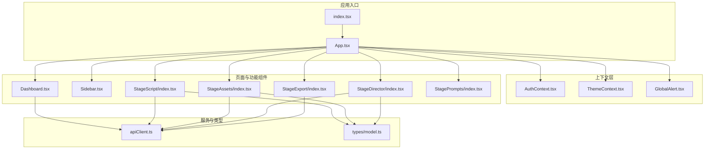

**图表来源**
- [index.tsx:1-76](file://index.tsx#L1-L76)
- [App.tsx:1-380](file://App.tsx#L1-L380)
- [AuthContext.tsx:1-189](file://AuthContext.tsx#L1-L189)
- [ThemeContext.tsx:1-63](file://ThemeContext.tsx#L1-L63)
- [GlobalAlert.tsx:1-218](file://components/GlobalAlert.tsx#L1-L218)
- [Dashboard.tsx:1-744](file://components/Dashboard.tsx#L1-L744)
- [Sidebar.tsx:1-177](file://components/Sidebar.tsx#L1-L177)
- [StageScript/index.tsx:1-906](file://components/StageScript/index.tsx#L1-L906)
- [StageAssets/index.tsx:1-1740](file://components/StageAssets/index.tsx#L1-L1740)
- [StageDirector/index.tsx:1-1413](file://components/StageDirector/index.tsx#L1-L1413)
- [StageExport/index.tsx:1-336](file://components/StageExport/index.tsx#L1-L336)
- [StagePrompts/index.tsx:1-227](file://components/StagePrompts/index.tsx#L1-L227)
- [apiClient.ts:1-168](file://services/apiClient.ts#L1-L168)
- [model.ts:1-875](file://types/model.ts#L1-L875)

**章节来源**
- [index.tsx:1-76](file://index.tsx#L1-L76)
- [App.tsx:1-380](file://App.tsx#L1-L380)

## 核心组件
- 应用根组件 App：负责全局状态、页面路由、移动端检测、引导流程、错误拦截与渲染日志回调绑定。
- 上下文层：
  - AuthContext：统一认证状态、用户信息、偏好同步、Token 过期处理。
  - ThemeContext：主题状态、主题切换、偏好持久化与服务器同步。
  - GlobalAlert：全局通知与确认对话框，支持气泡提示与模态对话框两种形态。
- 页面组件：
  - Dashboard：项目管理、资产库、系统设置、数据导入导出。
  - Sidebar：导航、项目状态、主题切换、用户操作。
  - StageScript：剧本解析、续写、改写、分镜生成与编辑。
  - StageAssets：角色/场景资产生成、批量生成、资产库导入导出。
  - StageDirector：关键帧生成、视频生成、九宫格、镜头拆分与优化。
  - StageExport：渲染进度、主片下载、源资源下载、渲染日志查看。
  - StagePrompts：提示词集中管理与编辑。

**章节来源**
- [App.tsx:21-380](file://App.tsx#L21-L380)
- [AuthContext.tsx:75-189](file://AuthContext.tsx#L75-L189)
- [ThemeContext.tsx:15-63](file://ThemeContext.tsx#L15-L63)
- [GlobalAlert.tsx:47-218](file://components/GlobalAlert.tsx#L47-L218)
- [Dashboard.tsx:18-744](file://components/Dashboard.tsx#L18-L744)
- [Sidebar.tsx:19-177](file://components/Sidebar.tsx#L19-L177)
- [StageScript/index.tsx:27-906](file://components/StageScript/index.tsx#L27-L906)
- [StageAssets/index.tsx:71-1740](file://components/StageAssets/index.tsx#L71-L1740)
- [StageDirector/index.tsx:42-1413](file://components/StageDirector/index.tsx#L42-L1413)
- [StageExport/index.tsx:27-336](file://components/StageExport/index.tsx#L27-L336)
- [StagePrompts/index.tsx:23-227](file://components/StagePrompts/index.tsx#L23-L227)

## 架构总览
整体采用“根组件 + 上下文 + 功能域组件”的分层架构：
- 根组件负责全局状态与路由，子组件通过 Context 获取认证与主题状态，通过 Props 接收项目数据与回调。
- 服务层通过 apiClient 统一处理鉴权与错误，各功能域组件通过服务层与后端交互。
- UI 设计系统基于 CSS 变量的主题令牌，支持暗/亮双主题。

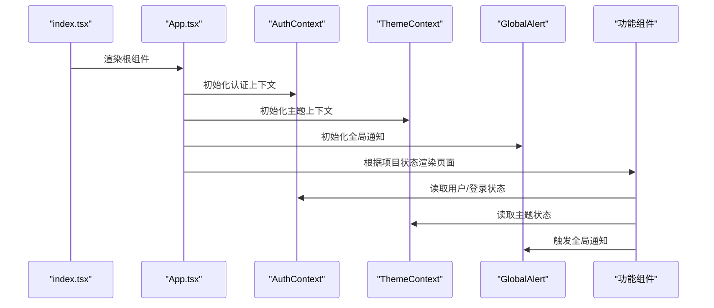

**图表来源**
- [index.tsx:66-76](file://index.tsx#L66-L76)
- [App.tsx:21-380](file://App.tsx#L21-L380)
- [AuthContext.tsx:75-189](file://AuthContext.tsx#L75-L189)
- [ThemeContext.tsx:15-63](file://ThemeContext.tsx#L15-L63)
- [GlobalAlert.tsx:47-218](file://components/GlobalAlert.tsx#L47-L218)

## 详细组件分析

### App 根组件与路由系统
- 全局状态：项目状态、移动端检测、引导流程、模型配置弹窗、生成中状态、渲染日志回调。
- 路由与页面切换：根据 project.stage 渲染对应功能组件；支持剧集选择门禁；处理页面切换时的生成任务保护。
- 错误拦截：捕获 API Key 相关错误，自动弹出模型配置窗口。
- 渲染日志：订阅渲染日志回调，实时更新项目状态。

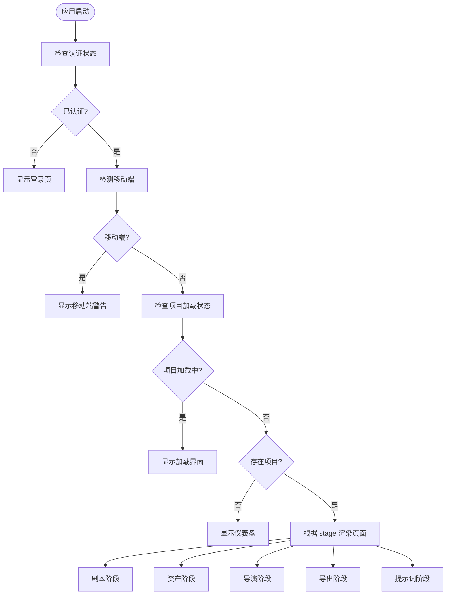

**图表来源**
- [App.tsx:21-380](file://App.tsx#L21-L380)

**章节来源**
- [App.tsx:21-380](file://App.tsx#L21-L380)

### 上下文层：认证与主题
- AuthContext：
  - 管理用户登录/注册/登出、Token 过期回调、用户偏好同步（主题、引导状态）、模型注册表同步。
  - 与 apiClient 协作，自动附加 Authorization 头，处理 401 并触发登出。
- ThemeContext：
  - 主题状态持久化到 localStorage，切换时同步到服务器（已登录时）。
  - 通过 data-theme 属性应用 CSS 变量主题。

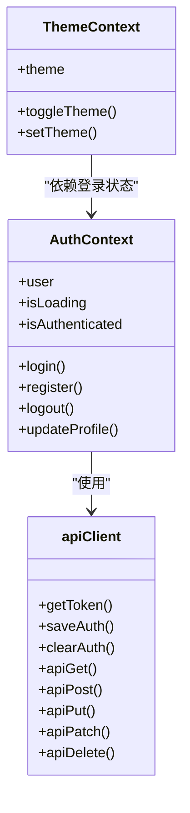

**图表来源**
- [AuthContext.tsx:19-189](file://AuthContext.tsx#L19-L189)
- [ThemeContext.tsx:7-63](file://ThemeContext.tsx#L7-L63)
- [apiClient.ts:19-168](file://services/apiClient.ts#L19-L168)

**章节来源**
- [AuthContext.tsx:75-189](file://AuthContext.tsx#L75-L189)
- [ThemeContext.tsx:15-63](file://ThemeContext.tsx#L15-L63)
- [apiClient.ts:19-168](file://services/apiClient.ts#L19-L168)

### 全局通知与确认对话框
- 支持四种类型：info/success/error/warning。
- 自动消失的气泡提示与带确认/取消的模态对话框。
- 通过回调 ref 管理 onConfirm/onCancel，支持自动计时器清理。

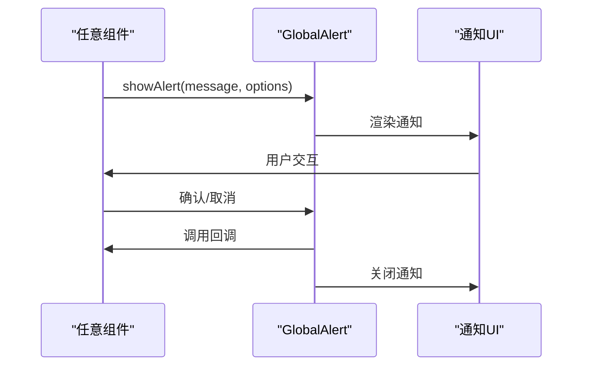

**图表来源**
- [GlobalAlert.tsx:47-218](file://components/GlobalAlert.tsx#L47-L218)

**章节来源**
- [GlobalAlert.tsx:47-218](file://components/GlobalAlert.tsx#L47-L218)

### Dashboard：项目管理与系统设置
- 项目列表、创建、删除、导入导出。
- 资产库浏览与导入、数据备份与恢复。
- 系统设置：模型配置、视觉风格管理、主题切换。

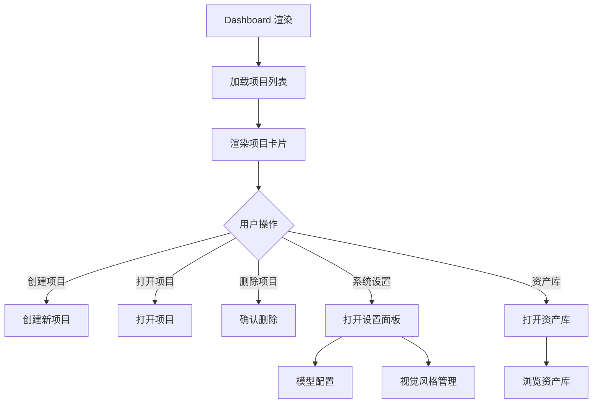

**图表来源**
- [Dashboard.tsx:44-744](file://components/Dashboard.tsx#L44-L744)

**章节来源**
- [Dashboard.tsx:18-744](file://components/Dashboard.tsx#L18-L744)

### Sidebar：导航与项目状态
- 顶部返回按钮与项目状态展示。
- 五阶段导航：剧本、资产、导演、导出、提示词。
- 生成中状态锁定导航，防止数据丢失。

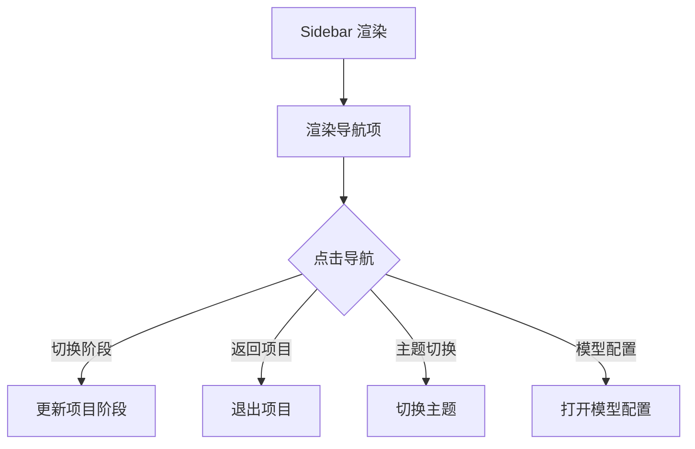

**图表来源**
- [Sidebar.tsx:19-177](file://components/Sidebar.tsx#L19-L177)

**章节来源**
- [Sidebar.tsx:19-177](file://components/Sidebar.tsx#L19-L177)

### StageScript：剧本解析与分镜生成
- 配置面板：语言、目标时长、模型、视觉风格。
- 剧本解析：后台任务恢复、进度回调、日志收集。
- 续写与改写：流式与非流式回退策略。
- 分镜编辑：角色、动作、对话、关键帧提示词编辑。

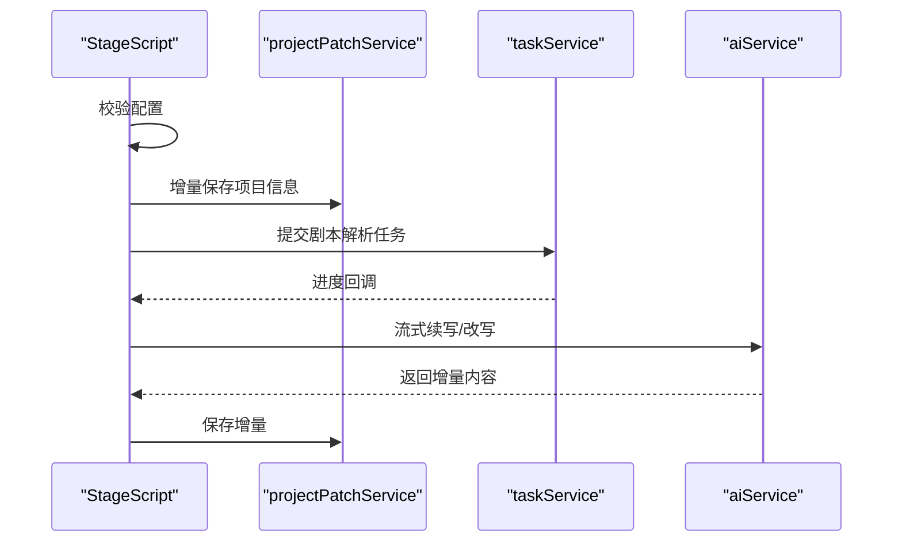

**图表来源**
- [StageScript/index.tsx:106-296](file://components/StageScript/index.tsx#L106-L296)
- [StageScript/index.tsx:298-407](file://components/StageScript/index.tsx#L298-L407)

**章节来源**
- [StageScript/index.tsx:27-906](file://components/StageScript/index.tsx#L27-L906)

### StageAssets：角色与场景资产生成
- 单项与批量生成，支持上传图片与生成提示词。
- 资产库导入导出、跨项目复用。
- 横竖屏比例持久化与模型配置联动。

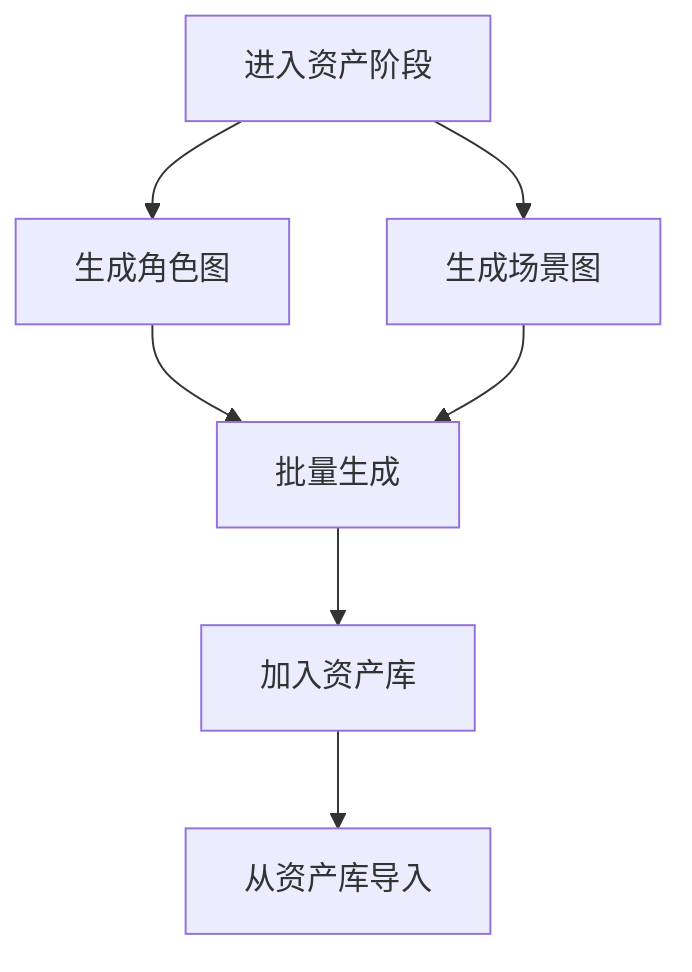

**图表来源**
- [StageAssets/index.tsx:264-401](file://components/StageAssets/index.tsx#L264-L401)
- [StageAssets/index.tsx:501-542](file://components/StageAssets/index.tsx#L501-L542)

**章节来源**
- [StageAssets/index.tsx:71-1740](file://components/StageAssets/index.tsx#L71-L1740)

### StageDirector：关键帧与视频生成
- 关键帧生成：首帧/尾帧、上传图片、复制前后帧。
- 视频生成：多模型支持、时长与比例配置。
- AI 优化：提示词优化、动作建议、九宫格生成。

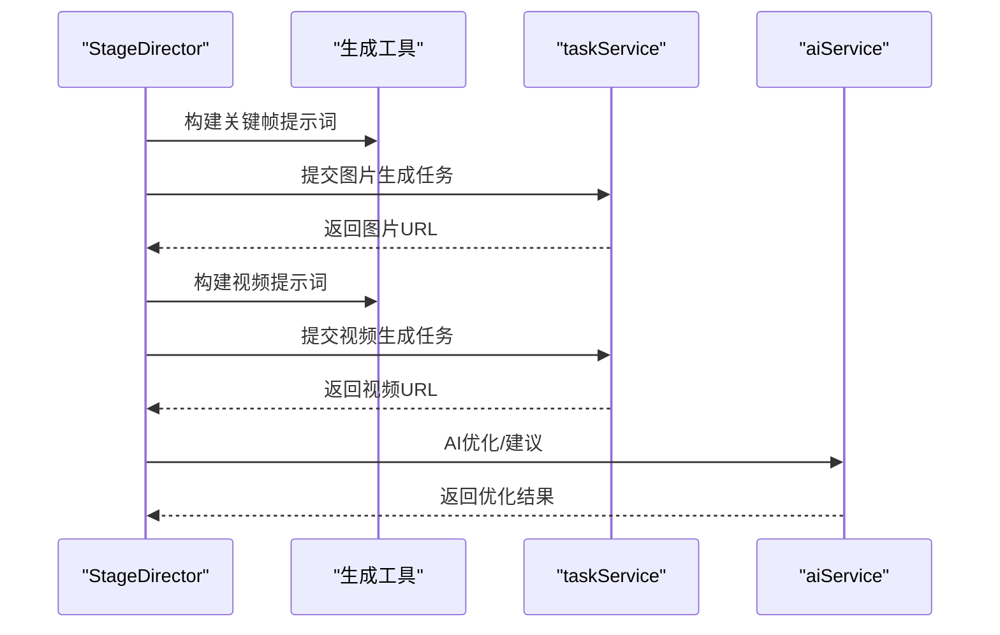

**图表来源**
- [StageDirector/index.tsx:233-474](file://components/StageDirector/index.tsx#L233-L474)
- [StageDirector/index.tsx:668-798](file://components/StageDirector/index.tsx#L668-L798)

**章节来源**
- [StageDirector/index.tsx:42-1413](file://components/StageDirector/index.tsx#L42-L1413)

### StageExport：渲染与导出
- 渲染进度计算、预估时长、主片下载、源资源打包下载。
- 渲染日志查看、视频播放器、数据导入导出。

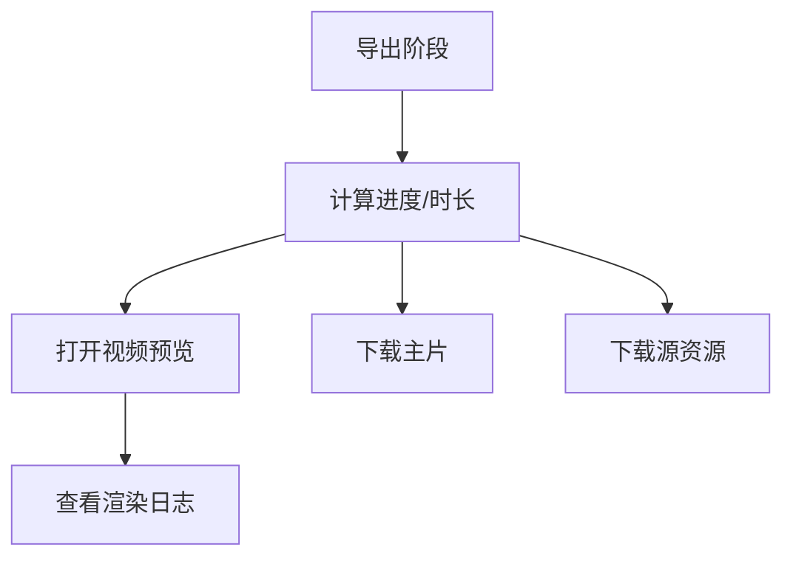

**图表来源**
- [StageExport/index.tsx:27-336](file://components/StageExport/index.tsx#L27-L336)

**章节来源**
- [StageExport/index.tsx:27-336](file://components/StageExport/index.tsx#L27-L336)

### StagePrompts：提示词集中管理
- 角色、场景、道具、关键帧、视频提示词的统一编辑与保存。
- 搜索过滤、分组展开/折叠。

**章节来源**
- [StagePrompts/index.tsx:23-227](file://components/StagePrompts/index.tsx#L23-L227)

## 依赖关系分析
- 组件依赖：功能组件通过 Context 获取认证与主题，通过 Props 接收项目数据与回调。
- 服务依赖：统一通过 apiClient 发起请求，自动附加 Token 并处理 401。
- 类型依赖：model.ts 定义模型与提供商类型，贯穿各功能域组件。

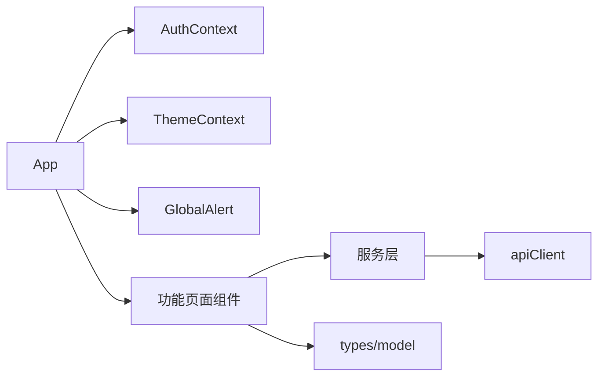

**图表来源**
- [App.tsx:21-380](file://App.tsx#L21-L380)
- [AuthContext.tsx:75-189](file://AuthContext.tsx#L75-L189)
- [ThemeContext.tsx:15-63](file://ThemeContext.tsx#L15-L63)
- [GlobalAlert.tsx:47-218](file://components/GlobalAlert.tsx#L47-L218)
- [apiClient.ts:19-168](file://services/apiClient.ts#L19-L168)
- [model.ts:1-875](file://types/model.ts#L1-L875)

**章节来源**
- [App.tsx:21-380](file://App.tsx#L21-L380)
- [apiClient.ts:19-168](file://services/apiClient.ts#L19-L168)
- [model.ts:1-875](file://types/model.ts#L1-L875)

## 性能考虑
- 增量保存：各组件在用户编辑时直接调用 projectPatchService 进行增量保存，减少全量写入。
- 后台任务：剧本解析、图片/视频生成均通过服务端任务执行，避免前端阻塞与刷新中断。
- 状态最小化：通过局部状态与 Context 共享，避免深层传递 Props。
- 资源加载优化：图片 URL 增加/替换 token 时保留业务参数，避免重复鉴权与缓存失效。
- 生成状态监控：通过 onGeneratingChange 与导航锁定，避免用户误操作导致数据丢失。

[本节为通用指导，无需具体文件分析]

## 故障排除指南
- API Key 错误：应用全局监听 window.error 与 unhandledrejection，检测到 API Key 相关错误时自动弹出模型配置窗口。
- 生成卡住：组件加载时检测“生成中但无结果”的状态并重置为失败，确保可重新生成。
- 认证过期：apiClient 捕获 401，清空本地 Token 并触发 AuthContext 的过期回调。

**章节来源**
- [App.tsx:75-106](file://App.tsx#L75-L106)
- [StageAssets/index.tsx:147-186](file://components/StageAssets/index.tsx#L147-L186)
- [StageDirector/index.tsx:80-108](file://components/StageDirector/index.tsx#L80-L108)
- [apiClient.ts:86-96](file://services/apiClient.ts#L86-L96)

## 结论
本架构以清晰的分层与上下文解耦为核心，结合服务层统一鉴权与后台任务，实现了复杂创作流程的稳定与高效。通过增量保存、生成状态监控与主题系统，提升了用户体验与开发效率。建议在后续迭代中持续完善组件复用与性能监控体系。

[本节为总结，无需具体文件分析]

## 附录

### 组件开发指南
- 状态管理
  - 全局状态：通过 Context 管理认证与主题；局部状态在组件内维护。
  - 增量保存：使用 projectPatchService 在用户编辑时即时保存，避免全量写入。
- 组件通信
  - 父子通信：通过 Props 传递数据与回调；使用函数式更新避免直接修改状态。
  - 全局通知：通过 GlobalAlert 提供一致的通知与确认体验。
- 错误处理
  - 统一使用 apiClient 发起请求，自动处理 401；在组件内捕获并提示。
  - 全局错误拦截：监听 window.error 与 unhandledrejection，自动弹出模型配置。
- 性能优化
  - 后台任务：将耗时任务交给服务端执行，前端只负责状态更新。
  - 状态最小化：避免深层 Props 传递，使用 Context 共享。
  - 资源加载：对图片 URL 进行 token 处理，保留业务参数。

### 样式规范
- 主题系统：通过 data-theme 属性与 CSS 变量主题令牌实现暗/亮主题切换。
- 颜色令牌：主题文件定义了背景、边框、文本、强调色、状态色等语义化令牌。
- 响应式设计：移动端检测与警告，桌面端最佳体验。

**章节来源**
- [theme-dark.css:1-80](file://public/styles/theme-dark.css#L1-L80)