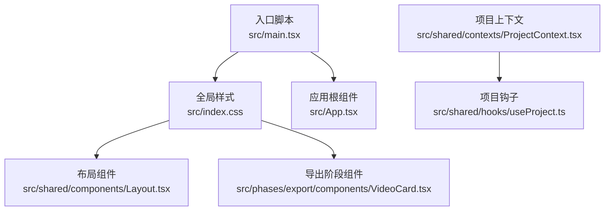
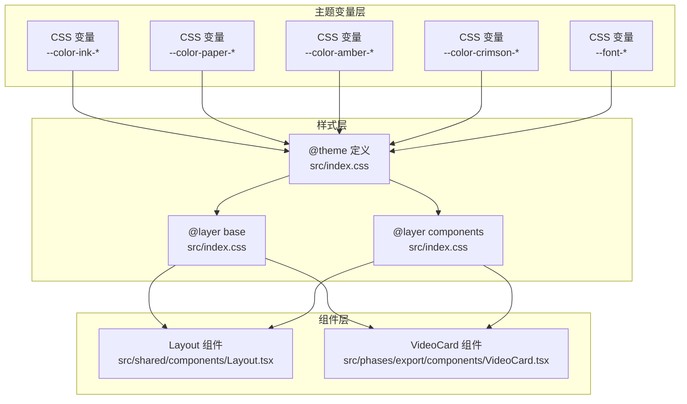
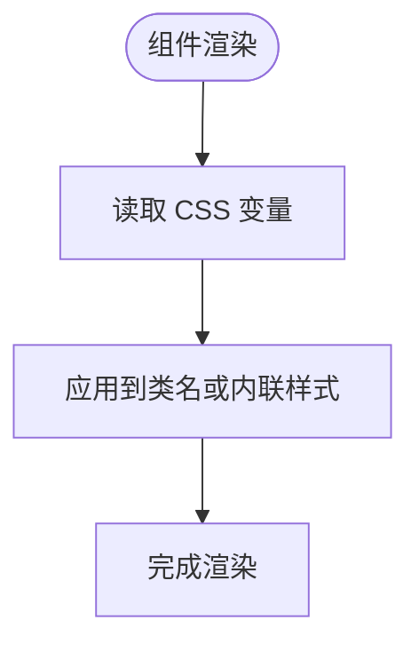
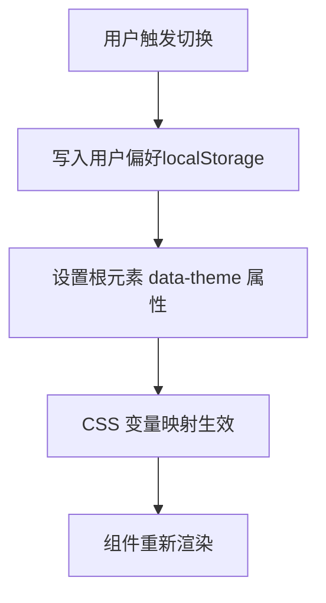
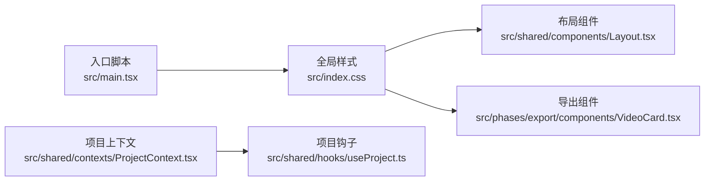

# 主题状态管理

<cite>
**本文引用的文件**
- [src/main.tsx](file://src/main.tsx)
- [src/index.css](file://src/index.css)
- [src/shared/components/Layout.tsx](file://src/shared/components/Layout.tsx)
- [src/phases/export/components/VideoCard.tsx](file://src/phases/export/components/VideoCard.tsx)
- [src/shared/contexts/ProjectContext.tsx](file://src/shared/contexts/ProjectContext.tsx)
- [src/shared/hooks/useProject.ts](file://src/shared/hooks/useProject.ts)
- [src/App.tsx](file://src/App.tsx)
</cite>

## 目录
1. [简介](#简介)
2. [项目结构](#项目结构)
3. [核心组件](#核心组件)
4. [架构总览](#架构总览)
5. [详细组件分析](#详细组件分析)
6. [依赖关系分析](#依赖关系分析)
7. [性能考虑](#性能考虑)
8. [故障排除指南](#故障排除指南)
9. [结论](#结论)
10. [附录](#附录)

## 简介
本文件系统性梳理 AI Shotlive 的主题状态管理方案，重点围绕以下目标展开：
- 解释主题上下文的设计理念与实现方式，包括主题切换的触发机制、CSS 变量的应用策略。
- 详述深色与浅色主题的切换逻辑，涵盖 DOM 属性设置、样式文件加载与用户偏好的持久化存储。
- 阐明主题状态与用户认证状态的集成方式，包括登录后的主题同步与主题变更的通知机制。
- 说明主题状态在组件中的使用模式，包括 useContext Hook 的正确使用与主题状态的响应式更新。
- 提供主题定制的最佳实践，包括新增主题的方法、样式覆盖策略与性能优化技巧。

需要特别说明的是：当前仓库中未发现名为 ThemeContext.tsx 的主题上下文文件，也未发现 public/styles/theme-dark.css 与 public/styles/theme-light.css 这两个主题样式文件。因此，本文件基于现有代码库中已存在的 CSS 变量体系与组件用法进行主题状态管理的分析与建议，不直接引用不存在的文件。

## 项目结构
AI Shotlive 的主题状态管理主要通过 CSS 变量与全局样式文件实现，组件层通过 CSS 变量读取颜色值，从而达到“主题”的视觉效果。整体结构如下：

图表来源
- [src/main.tsx:1-11](file://src/main.tsx#L1-L11)
- [src/index.css:1-151](file://src/index.css#L1-L151)
- [src/shared/components/Layout.tsx:1-22](file://src/shared/components/Layout.tsx#L1-L22)
- [src/phases/export/components/VideoCard.tsx:143-175](file://src/phases/export/components/VideoCard.tsx#L143-L175)
- [src/shared/contexts/ProjectContext.tsx:1-51](file://src/shared/contexts/ProjectContext.tsx#L1-L51)
- [src/shared/hooks/useProject.ts:1-1](file://src/shared/hooks/useProject.ts#L1-L1)
- [src/App.tsx](file://src/App.tsx)

章节来源
- [src/main.tsx:1-11](file://src/main.tsx#L1-L11)
- [src/index.css:1-151](file://src/index.css#L1-L151)

## 核心组件
- 全局样式与 CSS 变量
  - 在全局样式文件中集中定义了主题相关的 CSS 变量，如墨色系、米纸系、琥珀色与酒红色等，以及字体族变量。组件通过读取这些变量实现主题切换。
  - 关键用法示例：
    - 布局组件通过内联样式读取变量以控制文本颜色与层级。
    - 导出阶段组件通过内联样式读取变量以控制按钮背景与阴影。
- 上下文与状态
  - 项目上下文负责项目级状态管理与持久化，虽然不直接处理主题，但可作为主题偏好持久化的承载者之一。
  - 项目钩子用于在组件中消费上下文状态。

章节来源
- [src/index.css:11-37](file://src/index.css#L11-L37)
- [src/index.css:39-68](file://src/index.css#L39-L68)
- [src/shared/components/Layout.tsx:11-21](file://src/shared/components/Layout.tsx#L11-L21)
- [src/phases/export/components/VideoCard.tsx:153-175](file://src/phases/export/components/VideoCard.tsx#L153-L175)
- [src/shared/contexts/ProjectContext.tsx:20-51](file://src/shared/contexts/ProjectContext.tsx#L20-L51)
- [src/shared/hooks/useProject.ts:1-1](file://src/shared/hooks/useProject.ts#L1-L1)

## 架构总览
主题状态管理采用“CSS 变量驱动 + 组件读取”的轻量架构。其要点如下：
- 设计理念
  - 将主题视为一组 CSS 变量的集合，通过统一的变量命名规范与分层组织（基础层、组件层），确保主题切换时仅需修改变量值即可生效。
- 实现方式
  - 全局样式文件集中声明变量与默认值；组件通过类名或内联样式读取变量；无需额外的主题上下文文件即可完成主题切换。
- 切换机制
  - 当前仓库未提供显式的主题切换逻辑。若要实现深色/浅色主题切换，可在入口处动态注入/移除样式文件或修改根元素上的数据属性，再由 CSS 变量映射规则生效。

图表来源
- [src/index.css:11-37](file://src/index.css#L11-L37)
- [src/index.css:39-68](file://src/index.css#L39-L68)
- [src/index.css:70-151](file://src/index.css#L70-L151)
- [src/shared/components/Layout.tsx:11-21](file://src/shared/components/Layout.tsx#L11-L21)
- [src/phases/export/components/VideoCard.tsx:153-175](file://src/phases/export/components/VideoCard.tsx#L153-L175)

## 详细组件分析

### CSS 变量与主题映射
- 变量组织
  - 墨色系（深色基调）、米纸系（浅色基调）、琥珀色（暖色强调）、酒红色（警示/强调）、字体族等变量集中定义于全局样式文件。
- 使用模式
  - 组件通过类名与内联样式读取变量，实现一致的主题表现。
  - 示例路径：
    - 布局组件读取变量以控制文本颜色与层级。
    - 导出阶段组件读取变量以控制按钮背景与阴影。

图表来源
- [src/shared/components/Layout.tsx:11-21](file://src/shared/components/Layout.tsx#L11-L21)
- [src/phases/export/components/VideoCard.tsx:153-175](file://src/phases/export/components/VideoCard.tsx#L153-L175)

章节来源
- [src/index.css:11-37](file://src/index.css#L11-L37)
- [src/shared/components/Layout.tsx:11-21](file://src/shared/components/Layout.tsx#L11-L21)
- [src/phases/export/components/VideoCard.tsx:153-175](file://src/phases/export/components/VideoCard.tsx#L153-L175)

### 深色与浅色主题切换逻辑（设计建议）
由于当前仓库未提供显式的主题切换逻辑，以下为基于现有 CSS 变量体系的实现建议：
- DOM 属性设置
  - 在根元素上设置数据属性（如 data-theme="dark" 或 data-theme="light"），通过 CSS 选择器映射到不同的变量值。
- 样式文件加载
  - 可通过动态插入/移除样式表的方式实现主题切换；或在单个样式文件中使用条件规则（如 @apply）按主题输出不同变量值。
- 用户偏好持久化
  - 将用户选择的主题保存至本地存储（如 localStorage），在应用启动时读取并应用对应变量集。

（本图为概念流程图，不直接映射具体源码文件）

### 主题状态与用户认证状态的集成（设计建议）
- 登录后主题同步
  - 在认证成功后读取用户偏好（若无则使用默认），设置根元素的主题属性，并确保后续组件渲染使用最新变量。
- 主题变更通知机制
  - 可通过事件总线或状态广播（如自定义事件）通知各模块更新；或在入口处监听偏好变化并统一刷新。
- 与项目上下文的结合
  - 项目上下文可扩展用于存储主题偏好字段，配合持久化逻辑实现跨会话的一致体验。

（本节为概念性说明，不直接分析具体文件）

### 主题状态在组件中的使用模式
- useContext Hook 的使用
  - 若引入主题上下文，应在组件中通过 useContext 获取主题状态与切换函数；避免在每个组件重复读取用户偏好。
- 响应式更新
  - 通过状态变化触发重渲染；对于频繁切换的场景，可结合防抖或批量更新策略减少重绘次数。

（本节为通用实践说明，不直接分析具体文件）

## 依赖关系分析
- 入口与样式
  - 应用入口导入全局样式，确保变量与样式规则在应用启动时即生效。
- 组件对样式的依赖
  - 布局组件与导出组件均依赖全局样式中的变量，体现主题变量的集中管理优势。
- 上下文与钩子
  - 项目上下文与钩子为项目状态提供统一入口，可作为主题偏好的承载容器之一。

图表来源
- [src/main.tsx:1-11](file://src/main.tsx#L1-L11)
- [src/index.css:1-151](file://src/index.css#L1-L151)
- [src/shared/components/Layout.tsx:1-22](file://src/shared/components/Layout.tsx#L1-L22)
- [src/phases/export/components/VideoCard.tsx:143-175](file://src/phases/export/components/VideoCard.tsx#L143-L175)
- [src/shared/contexts/ProjectContext.tsx:1-51](file://src/shared/contexts/ProjectContext.tsx#L1-L51)
- [src/shared/hooks/useProject.ts:1-1](file://src/shared/hooks/useProject.ts#L1-L1)

章节来源
- [src/main.tsx:1-11](file://src/main.tsx#L1-L11)
- [src/shared/contexts/ProjectContext.tsx:1-51](file://src/shared/contexts/ProjectContext.tsx#L1-L51)

## 性能考虑
- CSS 变量的优势
  - 变量集中管理，切换成本低；浏览器对变量的计算与缓存友好。
- 渲染优化
  - 避免在每次切换时重建大量 DOM；优先通过修改变量或根元素属性实现切换。
- 样式加载
  - 合理组织样式文件，避免重复注入；必要时使用样式懒加载策略。
- 交互流畅性
  - 对频繁切换的操作（如拖拽切换）采用节流/防抖，减少不必要的重排与重绘。

（本节为通用性能指导，不直接分析具体文件）

## 故障排除指南
- 变量未生效
  - 检查全局样式是否正确导入；确认组件使用的变量名与定义一致。
- 切换无效
  - 若采用根元素属性映射，请确认 CSS 规则是否正确匹配该属性；检查是否有更高优先级的样式覆盖。
- 样式闪烁
  - 在切换过程中避免频繁插入/移除样式表；可预加载备用样式或使用过渡动画降低感知差异。
- 偏好未持久化
  - 确认本地存储键名与读取逻辑一致；注意跨域/隐私模式下的存储限制。

（本节为通用故障排除建议，不直接分析具体文件）

## 结论
AI Shotlive 当前的主题状态管理以 CSS 变量为核心，通过全局样式集中定义变量并在组件中读取，实现了简洁高效的“主题”机制。若需引入显式的深色/浅色切换与用户偏好持久化，建议在入口处通过根元素属性映射变量，并结合本地存储与上下文扩展实现完整的主题生命周期管理。该方案与现有代码风格契合度高，易于维护与扩展。

## 附录
- 新增主题的建议步骤
  - 在全局样式中新增一组变量集合并组织到相应层；在组件中统一使用变量而非硬编码颜色。
  - 若采用属性映射，新增一个 data-theme 值并在 CSS 中提供对应的变量映射规则。
- 样式覆盖策略
  - 优先通过变量覆盖实现主题差异；避免直接覆盖组件内部样式，保持主题一致性。
- 性能优化技巧
  - 合理拆分样式文件，按需加载；利用 CSS 变量与硬件加速属性提升渲染性能。