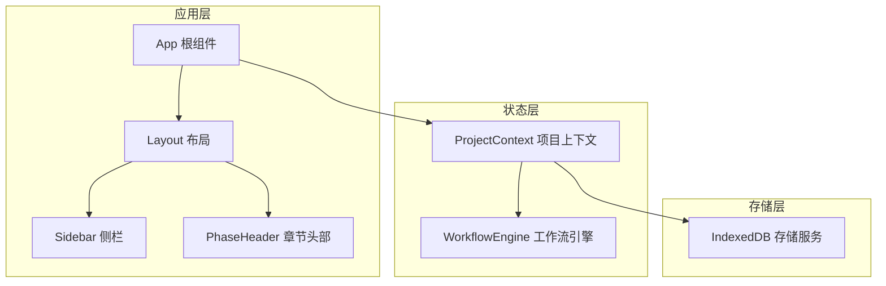
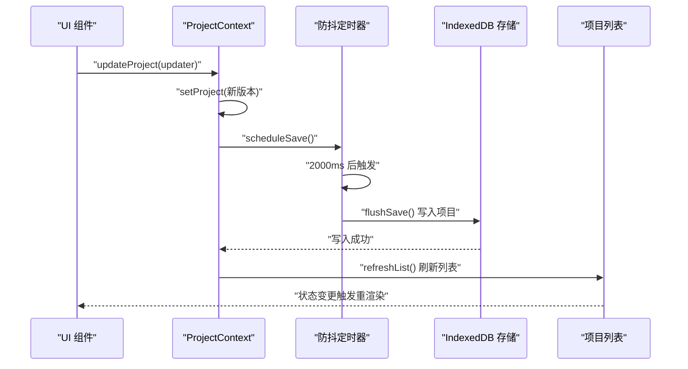
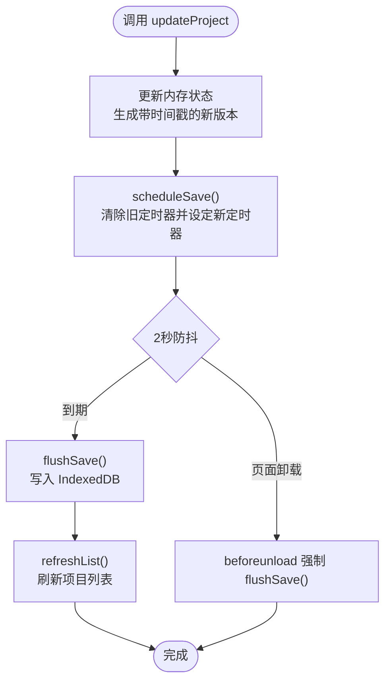
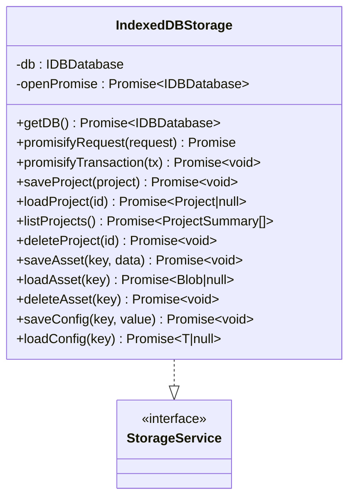
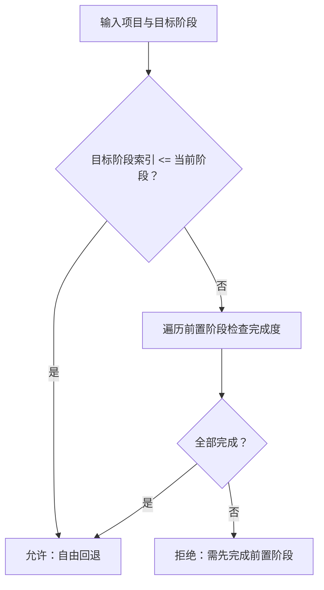
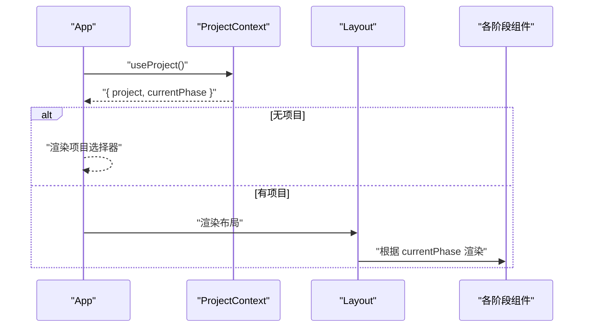
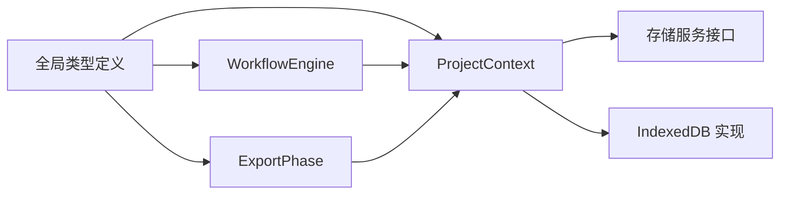

# 全局状态同步机制

<cite>
**本文档引用的文件**
- [src/shared/contexts/ProjectContext.tsx](file://src/shared/contexts/ProjectContext.tsx)
- [src/App.tsx](file://src/App.tsx)
- [src/services/storage/indexeddb.ts](file://src/services/storage/indexeddb.ts)
- [src/services/storage/types.ts](file://src/services/storage/types.ts)
- [src/services/workflow/engine.ts](file://src/services/workflow/engine.ts)
- [src/shared/components/ApiKeyModal.tsx](file://src/shared/components/ApiKeyModal.tsx)
- [src/shared/components/Layout.tsx](file://src/shared/components/Layout.tsx)
- [src/shared/components/Sidebar.tsx](file://src/shared/components/Sidebar.tsx)
- [src/shared/components/PhaseHeader.tsx](file://src/shared/components/PhaseHeader.tsx)
- [src/phases/export/ExportPhase.tsx](file://src/phases/export/ExportPhase.tsx)
- [src/types.ts](file://src/types.ts)
</cite>

## 目录
1. [简介](#简介)
2. [项目结构](#项目结构)
3. [核心组件](#核心组件)
4. [架构总览](#架构总览)
5. [详细组件分析](#详细组件分析)
6. [依赖关系分析](#依赖关系分析)
7. [性能考量](#性能考量)
8. [故障排查指南](#故障排查指南)
9. [结论](#结论)
10. [附录](#附录)

## 简介
本文件系统性阐述 AI Shotlive 的全局状态同步机制，重点覆盖以下方面：
- 多个 Context 之间的协调：以项目状态为核心，结合工作流引擎与 UI 组件的联动。
- 认证状态、主题状态与项目状态的同步策略：通过单一可信数据源与本地持久化保障一致性。
- 状态持久化：IndexedDB 自动持久化、防抖策略、页面卸载时强制落盘。
- 状态冲突与并发更新：基于单源数据与防抖写入的简单一致性模型；无分布式锁场景下的回滚与一致性建议。
- 状态监听与通知：React Context 的订阅传播、组件重渲染优化与性能监控思路。
- 设计模式与最佳实践：状态提升、封装原则、跨组件通信。
- 调试工具与常见问题排查。

## 项目结构
AI Shotlive 采用“上下文驱动 + 本地持久化”的前端状态管理方案：
- 根组件负责注入全局 Provider，依据当前项目与阶段选择渲染分支。
- 项目状态通过 Context 提供，配合本地 IndexedDB 实现自动持久化。
- 工作流引擎根据项目数据计算各阶段完成度，驱动 UI 行为与导航。
- 部分用户凭据（如 API Key）采用本地存储，不上传至服务器。

**图表来源**
- [src/App.tsx:15-28](file://src/App.tsx#L15-L28)
- [src/shared/contexts/ProjectContext.tsx:47-186](file://src/shared/contexts/ProjectContext.tsx#L47-L186)
- [src/services/workflow/engine.ts:83-119](file://src/services/workflow/engine.ts#L83-L119)
- [src/services/storage/indexeddb.ts:103-141](file://src/services/storage/indexeddb.ts#L103-L141)

**章节来源**
- [src/App.tsx:15-28](file://src/App.tsx#L15-L28)
- [src/shared/contexts/ProjectContext.tsx:47-186](file://src/shared/contexts/ProjectContext.tsx#L47-L186)

## 核心组件
- 项目上下文（ProjectContext）：提供项目 CRUD、相位切换、加载/保存状态、列表刷新等能力；内部维护防抖写入与页面卸载落盘逻辑。
- 存储服务（IndexedDBStorage）：封装 IndexedDB 事务与请求 Promise 化，提供项目、资产、配置三类操作。
- 工作流引擎（WorkflowEngine）：根据项目数据计算各阶段完成度与可前进条件，驱动 UI 行为。
- 根组件（App）：根据项目与当前阶段选择渲染分支，初始化 API Key 加载。

**章节来源**
- [src/shared/contexts/ProjectContext.tsx:20-37](file://src/shared/contexts/ProjectContext.tsx#L20-L37)
- [src/services/storage/indexeddb.ts:23-189](file://src/services/storage/indexeddb.ts#L23-L189)
- [src/services/workflow/engine.ts:83-119](file://src/services/workflow/engine.ts#L83-L119)
- [src/App.tsx:30-43](file://src/App.tsx#L30-L43)

## 架构总览
全局状态同步围绕“单一可信数据源 + 本地持久化 + 防抖写入”展开，形成闭环：
- 数据入口：项目上下文接收更新请求，生成带时间戳的新版本。
- 数据处理：防抖定时器聚合多次更新，减少写入频率。
- 数据落盘：定时触发写入 IndexedDB，完成后刷新项目列表。
- 数据退出：页面卸载或关闭时强制执行一次落盘，确保数据不丢失。
- UI 渲染：根组件依据项目与阶段进行分支渲染，工作流引擎驱动导航与状态徽标。

**图表来源**
- [src/shared/contexts/ProjectContext.tsx:150-161](file://src/shared/contexts/ProjectContext.tsx#L150-L161)
- [src/shared/contexts/ProjectContext.tsx:85-90](file://src/shared/contexts/ProjectContext.tsx#L85-L90)
- [src/shared/contexts/ProjectContext.tsx:71-83](file://src/shared/contexts/ProjectContext.tsx#L71-L83)
- [src/services/storage/indexeddb.ts:103-109](file://src/services/storage/indexeddb.ts#L103-L109)

## 详细组件分析

### 项目上下文（ProjectContext）
- 角色定位：提供项目生命周期管理与状态读取，作为单一可信数据源。
- 关键能力：
  - 项目 CRUD：创建、加载、删除、关闭。
  - 更新机制：接受“函数式更新器”，生成带更新时间戳的新版本。
  - 相位控制：设置当前阶段，内部委托更新器完成。
  - 加载/保存状态：暴露 isLoading/isSaving 以驱动 UI。
  - 列表刷新：从存储读取项目摘要列表并排序。
- 持久化策略：
  - 防抖写入：默认 2 秒防抖，合并多次更新。
  - 强制落盘：页面卸载事件触发，确保最终一致性。
- 错误处理：写入失败记录日志，保持 UI 可用性。

**图表来源**
- [src/shared/contexts/ProjectContext.tsx:150-161](file://src/shared/contexts/ProjectContext.tsx#L150-L161)
- [src/shared/contexts/ProjectContext.tsx:85-106](file://src/shared/contexts/ProjectContext.tsx#L85-L106)
- [src/services/storage/indexeddb.ts:103-109](file://src/services/storage/indexeddb.ts#L103-L109)

**章节来源**
- [src/shared/contexts/ProjectContext.tsx:47-186](file://src/shared/contexts/ProjectContext.tsx#L47-L186)

### 存储服务（IndexedDBStorage）
- 数据库与对象存储：
  - 数据库名：cinegen-director
  - 对象存储：
    - projects：项目数据（JSON），keyPath 为 id
    - assets：二进制资产（Blob）
    - config：应用配置（key-value）
- 事务与错误处理：
  - 请求 Promise 化，事务完成/中止/错误统一处理。
  - 版本变更时主动关闭数据库，避免锁库。
- 接口职责：
  - 项目：保存、加载、列出、删除
  - 资产：保存、加载、删除
  - 配置：保存、加载

**图表来源**
- [src/services/storage/indexeddb.ts:23-189](file://src/services/storage/indexeddb.ts#L23-L189)
- [src/services/storage/types.ts:15-30](file://src/services/storage/types.ts#L15-L30)

**章节来源**
- [src/services/storage/indexeddb.ts:23-189](file://src/services/storage/indexeddb.ts#L23-L189)
- [src/services/storage/types.ts:15-30](file://src/services/storage/types.ts#L15-L30)

### 工作流引擎（WorkflowEngine）
- 功能职责：
  - 计算阶段完成度：统计各阶段完成百分比与缺失要求。
  - 判断前进条件：必须按顺序完成前置阶段，支持自由回退。
  - 获取相邻阶段：提供上一阶段与下一阶段。
- 与 UI 的协作：
  - UI 通过 PhaseHeader 读取阶段状态，决定是否可进入下一阶段。
  - Sidebar 展示阶段进度条与状态徽标，反映完成度与可达性。

**图表来源**
- [src/services/workflow/engine.ts:83-119](file://src/services/workflow/engine.ts#L83-L119)
- [src/shared/components/PhaseHeader.tsx:17-25](file://src/shared/components/PhaseHeader.tsx#L17-L25)
- [src/shared/components/Sidebar.tsx:144-176](file://src/shared/components/Sidebar.tsx#L144-L176)

**章节来源**
- [src/services/workflow/engine.ts:35-119](file://src/services/workflow/engine.ts#L35-L119)
- [src/shared/components/PhaseHeader.tsx:17-25](file://src/shared/components/PhaseHeader.tsx#L17-L25)
- [src/shared/components/Sidebar.tsx:144-176](file://src/shared/components/Sidebar.tsx#L144-L176)

### 根组件与渲染分支（App）
- 渲染策略：若无项目则显示项目选择器；否则根据 currentPhase 分支渲染不同阶段组件。
- 初始化行为：应用启动时尝试从本地恢复 API Key，避免每次登录。

**图表来源**
- [src/App.tsx:15-28](file://src/App.tsx#L15-L28)
- [src/shared/components/Layout.tsx:9-22](file://src/shared/components/Layout.tsx#L9-L22)

**章节来源**
- [src/App.tsx:15-28](file://src/App.tsx#L15-L28)
- [src/shared/components/Layout.tsx:9-22](file://src/shared/components/Layout.tsx#L9-L22)

### 认证状态与本地凭据
- API Key 存储：凭据仅保存于本地 IndexedDB，不上传至服务器，降低泄露风险。
- 加载时机：应用启动时一次性从存储恢复，避免重复请求。

**章节来源**
- [src/shared/components/ApiKeyModal.tsx:49-79](file://src/shared/components/ApiKeyModal.tsx#L49-L79)
- [src/App.tsx:30-36](file://src/App.tsx#L30-L36)

### 导出阶段的数据处理
- 导出策略：导出时剥离内嵌二进制（dataURL），仅保留可恢复的引用，减小导出体积。
- 数据结构：保留项目元数据与各阶段文本内容，便于后续导入与恢复。

**章节来源**
- [src/phases/export/ExportPhase.tsx:49-80](file://src/phases/export/ExportPhase.tsx#L49-L80)

## 依赖关系分析
- 上下文对存储的依赖：项目上下文直接依赖存储服务进行持久化。
- 上下文对工作流的依赖：UI 组件通过工作流引擎获取阶段状态，驱动交互。
- 类型系统：全局类型定义贯穿上下文、存储、工作流与导出阶段，确保数据结构一致。

**图表来源**
- [src/types.ts:10-95](file://src/types.ts#L10-L95)
- [src/shared/contexts/ProjectContext.tsx:16-18](file://src/shared/contexts/ProjectContext.tsx#L16-L18)
- [src/services/storage/types.ts:15-30](file://src/services/storage/types.ts#L15-L30)
- [src/services/storage/indexeddb.ts:103-141](file://src/services/storage/indexeddb.ts#L103-L141)
- [src/services/workflow/engine.ts:83-119](file://src/services/workflow/engine.ts#L83-L119)
- [src/phases/export/ExportPhase.tsx:49-80](file://src/phases/export/ExportPhase.tsx#L49-L80)

**章节来源**
- [src/types.ts:10-95](file://src/types.ts#L10-L95)
- [src/shared/contexts/ProjectContext.tsx:16-18](file://src/shared/contexts/ProjectContext.tsx#L16-L18)
- [src/services/storage/types.ts:15-30](file://src/services/storage/types.ts#L15-L30)
- [src/services/storage/indexeddb.ts:103-141](file://src/services/storage/indexeddb.ts#L103-L141)
- [src/services/workflow/engine.ts:83-119](file://src/services/workflow/engine.ts#L83-L119)
- [src/phases/export/ExportPhase.tsx:49-80](file://src/phases/export/ExportPhase.tsx#L49-L80)

## 性能考量
- 防抖写入：2 秒防抖显著降低频繁写入带来的 I/O 压力，适合编辑密集场景。
- 事务批量：写入使用只读/读写事务，确保原子性与一致性。
- 列表裁剪：列表仅返回摘要字段，避免传输完整项目对象，降低网络与序列化开销。
- 页面卸载落盘：防止意外关闭导致数据丢失，提高可靠性。
- UI 渲染优化：React Context 的订阅传播天然具备细粒度更新能力，结合防抖可进一步减少重渲染次数。

[本节为通用性能讨论，无需具体文件分析]

## 故障排查指南
- 写入失败：
  - 现象：控制台出现保存失败日志，保存状态持续为 true。
  - 排查：检查 IndexedDB 是否被阻止打开、事务是否异常中止。
  - 参考路径：[写入与事务处理:103-109](file://src/services/storage/indexeddb.ts#L103-L109)，[flushSave 调用:71-83](file://src/shared/contexts/ProjectContext.tsx#L71-L83)
- 列表为空或排序异常：
  - 现象：项目列表为空或更新时间排序异常。
  - 排查：确认 listProjects 返回的摘要字段是否正确映射。
  - 参考路径：[列表读取与摘要映射:119-133](file://src/services/storage/indexeddb.ts#L119-L133)，[列表刷新:61-69](file://src/shared/contexts/ProjectContext.tsx#L61-L69)
- 页面卸载未落盘：
  - 现象：关闭标签页后数据未保存。
  - 排查：确认 beforeunload 事件绑定与清理逻辑。
  - 参考路径：[页面卸载处理:92-106](file://src/shared/contexts/ProjectContext.tsx#L92-L106)
- 阶段不可前进：
  - 现象：下一阶段按钮不可用。
  - 排查：检查工作流引擎的完成度计算与前置阶段校验。
  - 参考路径：[工作流引擎:83-119](file://src/services/workflow/engine.ts#L83-119)，[阶段头部状态:17-25](file://src/shared/components/PhaseHeader.tsx#L17-L25)
- 凭据未恢复：
  - 现象：应用启动后需重新输入 API Key。
  - 排查：确认本地存储键是否存在，加载函数是否被调用。
  - 参考路径：[API Key 加载提示:49-79](file://src/shared/components/ApiKeyModal.tsx#L49-L79)，[应用启动加载:30-36](file://src/App.tsx#L30-L36)

**章节来源**
- [src/services/storage/indexeddb.ts:103-109](file://src/services/storage/indexeddb.ts#L103-L109)
- [src/shared/contexts/ProjectContext.tsx:61-69](file://src/shared/contexts/ProjectContext.tsx#L61-L69)
- [src/shared/contexts/ProjectContext.tsx:71-83](file://src/shared/contexts/ProjectContext.tsx#L71-L83)
- [src/shared/contexts/ProjectContext.tsx:92-106](file://src/shared/contexts/ProjectContext.tsx#L92-L106)
- [src/services/workflow/engine.ts:83-119](file://src/services/workflow/engine.ts#L83-L119)
- [src/shared/components/PhaseHeader.tsx:17-25](file://src/shared/components/PhaseHeader.tsx#L17-L25)
- [src/shared/components/ApiKeyModal.tsx:49-79](file://src/shared/components/ApiKeyModal.tsx#L49-L79)
- [src/App.tsx:30-36](file://src/App.tsx#L30-L36)

## 结论
AI Shotlive 的全局状态同步以“单一可信数据源 + 本地 IndexedDB + 防抖写入”为核心，实现了稳定、可预测且易于调试的状态管理。通过工作流引擎与 UI 的紧密耦合，系统在复杂创作流程中提供了清晰的阶段推进与可视化反馈。对于并发与一致性需求更高的场景，可在现有基础上引入版本号/时间戳比较与冲突解决策略，以进一步增强可靠性。

[本节为总结性内容，无需具体文件分析]

## 附录

### 全局状态设计模式与最佳实践
- 状态提升策略：将共享状态置于根组件的 Provider 中，按需向下传递。
- 状态封装原则：通过 Context 暴露受控的更新接口，避免子组件直接修改底层数据。
- 跨组件通信：利用 Context 的订阅传播实现松耦合通信，必要时结合事件总线或回调链。
- 性能监控：在关键路径（写入、刷新、渲染）埋点，观察防抖效果与重渲染频率。

[本节为概念性内容，无需具体文件分析]