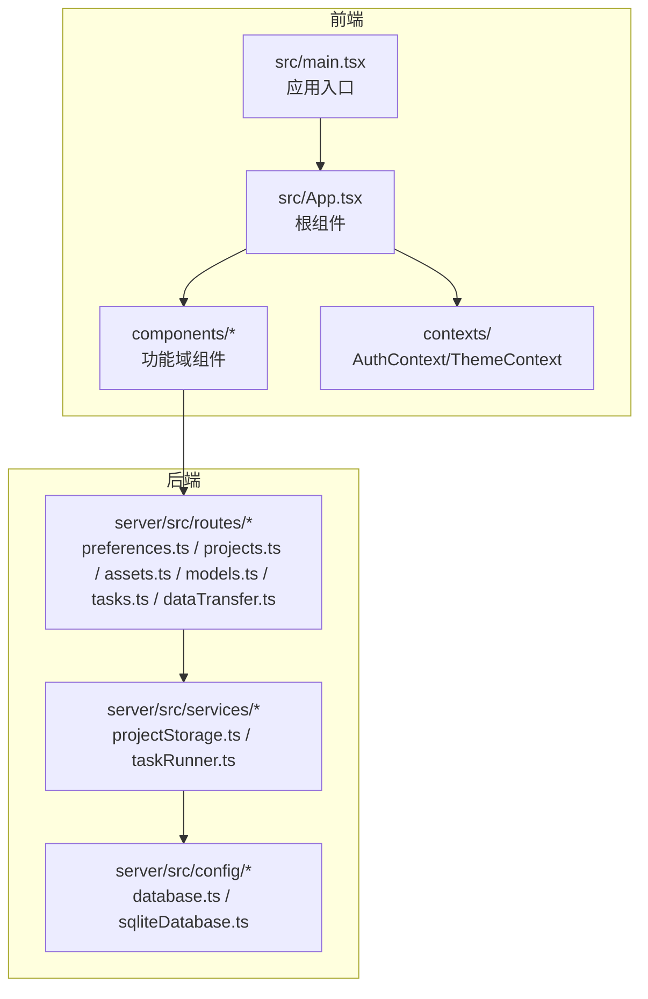
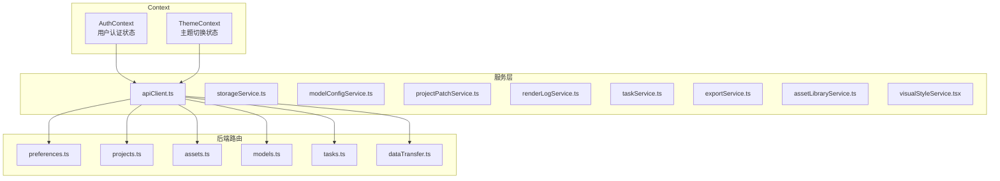
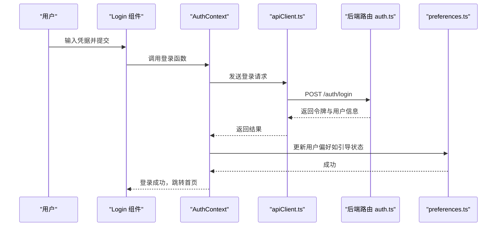
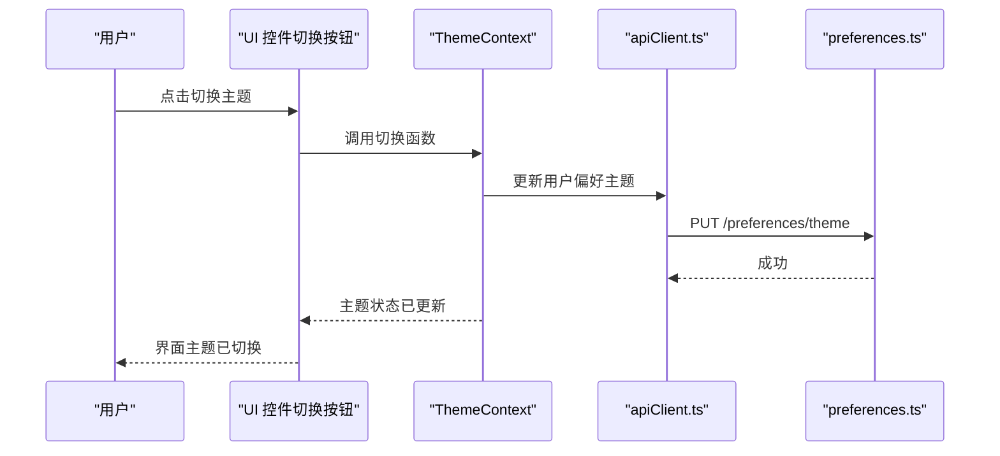
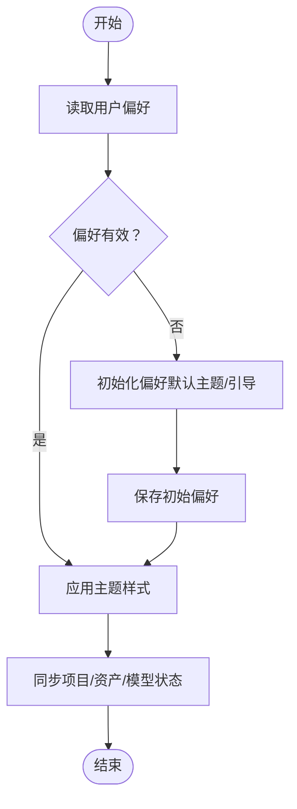
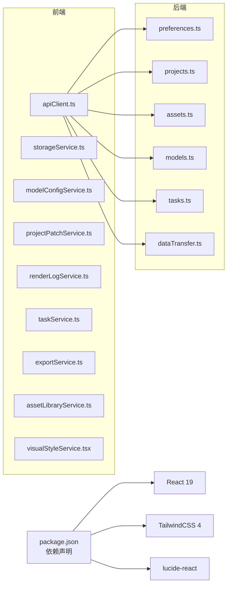

# 状态管理模式

<cite>
**本文引用的文件**
- [package.json](file://package.json)
- [src/main.tsx](file://src/main.tsx)
- [src/App.tsx](file://src/App.tsx)
- [README.md](file://README.md)
- [components/Login.tsx](file://components/Login.tsx)
- [components/Dashboard.tsx](file://components/Dashboard.tsx)
- [components/Sidebar.tsx](file://components/Sidebar.tsx)
- [components/StageScript/index.tsx](file://components/StageScript/index.tsx)
- [components/StageAssets/index.tsx](file://components/StageAssets/index.tsx)
- [components/StageDirector/index.tsx](file://components/StageDirector/index.tsx)
- [components/StageExport/index.tsx](file://components/StageExport/index.tsx)
- [components/StagePrompts/index.tsx](file://components/StagePrompts/index.tsx)
- [components/ModelConfig/index.tsx](file://components/ModelConfig/index.tsx)
- [components/VisualStyleManager.tsx](file://components/VisualStyleManager.tsx)
- [components/Onboarding/index.tsx](file://components/Onboarding/index.tsx)
- [services/apiClient.ts](file://services/apiClient.ts)
- [services/storageService.ts](file://services/storageService.ts)
- [services/modelConfigService.ts](file://services/modelConfigService.ts)
- [services/projectPatchService.ts](file://services/projectPatchService.ts)
- [services/renderLogService.ts](file://services/renderLogService.ts)
- [services/taskService.ts](file://services/taskService.ts)
- [services/exportService.ts](file://services/exportService.ts)
- [services/assetLibraryService.ts](file://services/assetLibraryService.ts)
- [services/visualStyleService.tsx](file://services/visualStyleService.tsx)
- [server/src/routes/preferences.ts](file://server/src/routes/preferences.ts)
- [server/src/routes/projects.ts](file://server/src/routes/projects.ts)
- [server/src/routes/assets.ts](file://server/src/routes/assets.ts)
- [server/src/routes/models.ts](file://server/src/routes/models.ts)
- [server/src/routes/tasks.ts](file://server/src/routes/tasks.ts)
- [server/src/routes/dataTransfer.ts](file://server/src/routes/dataTransfer.ts)
- [server/src/services/projectStorage.ts](file://server/src/services/projectStorage.ts)
- [server/src/services/taskRunner.ts](file://server/src/services/taskRunner.ts)
- [server/src/middleware/auth.ts](file://server/src/middleware/auth.ts)
- [server/src/config/database.ts](file://server/src/config/database.ts)
- [server/src/config/sqliteDatabase.ts](file://server/src/config/sqliteDatabase.ts)
- [types/model.ts](file://types/model.ts)
</cite>

## 目录
1. [引言](#引言)
2. [项目结构](#项目结构)
3. [核心组件](#核心组件)
4. [架构总览](#架构总览)
5. [详细组件分析](#详细组件分析)
6. [依赖分析](#依赖分析)
7. [性能考虑](#性能考虑)
8. [故障排查指南](#故障排查指南)
9. [结论](#结论)
10. [附录](#附录)

## 引言
本文件系统性梳理 AI Shotlive 的状态管理模式，聚焦前端 Context 上下文的使用策略与全局状态架构，涵盖用户认证状态（AuthContext）与主题切换状态（ThemeContext）的设计与实现；阐述项目状态、用户偏好设置与组件间状态同步机制；总结状态提升、状态封装与状态持久化的最佳实践；提供性能优化技巧、调试方法与冲突解决方案，并给出实际使用示例与代码规范建议。

## 项目结构
- 前端采用 React 19 + Vite + TailwindCSS，入口为 src/main.tsx，根组件为 src/App.tsx。
- 组件按功能域划分：StageScript（小说/剧本/分镜）、StageAssets（角色/场景/道具）、StageDirector（导演工作台）、StageExport（导出/剪辑）、StagePrompts（提示词管理）、ModelConfig（模型配置）、VisualStyleManager（视觉风格）、Onboarding（引导）、以及通用组件 Login、Dashboard、Sidebar 等。
- 状态相关的关键点：
  - Context：README 明确列出 contexts/ 目录用于存放 AuthContext 与 ThemeContext（尽管当前仓库未包含具体文件，但项目规划与数据库设计已体现其存在与职责）。
  - 全局状态来源：用户偏好（主题、引导状态等）通过后端路由 preferences.ts 与数据库 user_preferences 表持久化；项目状态与资产状态通过后端 routes 与 services 进行读写。
  - 组件间状态同步：通过 Context 提供的 Provider 包裹、props 传递与事件回调实现；复杂状态通过服务层集中管理。

图表来源
- [src/main.tsx](file://src/main.tsx)
- [src/App.tsx](file://src/App.tsx)
- [README.md](file://README.md)

章节来源
- [src/main.tsx](file://src/main.tsx)
- [src/App.tsx](file://src/App.tsx)
- [README.md](file://README.md)

## 核心组件
- 应用入口与根组件
  - 入口负责挂载根组件，根组件承载全局布局与上下文 Provider。
- 功能域组件
  - StageScript：项目配置、章节解析、剧集生成、分镜编辑。
  - StageAssets：角色定妆、场景概念图、道具管理。
  - StageDirector：分镜表、关键帧生成、九宫格预览、视频模式。
  - StageExport：渲染日志、时间轴可视化、视频播放器、导出下载。
  - StagePrompts：提示词管理与状态同步。
  - ModelConfig：多模型提供商配置与当前激活模型。
  - VisualStyleManager：视觉风格与提示词配置。
  - Onboarding：引导流程与用户偏好初始化。
  - 通用组件：Login、Dashboard、Sidebar 等。
- 服务层
  - apiClient.ts：统一 API 客户端封装。
  - storageService.ts：本地存储辅助。
  - modelConfigService.ts、projectPatchService.ts、renderLogService.ts、taskService.ts、exportService.ts、assetLibraryService.ts、visualStyleService.ts：各领域状态服务。
- 后端路由与服务
  - preferences.ts：用户偏好（主题、引导状态等）读写。
  - projects.ts、assets.ts、models.ts、tasks.ts、dataTransfer.ts：项目、资产、模型、任务、数据迁移等。
  - projectStorage.ts、taskRunner.ts：项目数据持久化与异步任务执行。
  - auth.ts：鉴权中间件。
  - database.ts、sqliteDatabase.ts：数据库配置。

章节来源
- [components/Login.tsx](file://components/Login.tsx)
- [components/Dashboard.tsx](file://components/Dashboard.tsx)
- [components/Sidebar.tsx](file://components/Sidebar.tsx)
- [components/StageScript/index.tsx](file://components/StageScript/index.tsx)
- [components/StageAssets/index.tsx](file://components/StageAssets/index.tsx)
- [components/StageDirector/index.tsx](file://components/StageDirector/index.tsx)
- [components/StageExport/index.tsx](file://components/StageExport/index.tsx)
- [components/StagePrompts/index.tsx](file://components/StagePrompts/index.tsx)
- [components/ModelConfig/index.tsx](file://components/ModelConfig/index.tsx)
- [components/VisualStyleManager.tsx](file://components/VisualStyleManager.tsx)
- [components/Onboarding/index.tsx](file://components/Onboarding/index.tsx)
- [services/apiClient.ts](file://services/apiClient.ts)
- [services/storageService.ts](file://services/storageService.ts)
- [services/modelConfigService.ts](file://services/modelConfigService.ts)
- [services/projectPatchService.ts](file://services/projectPatchService.ts)
- [services/renderLogService.ts](file://services/renderLogService.ts)
- [services/taskService.ts](file://services/taskService.ts)
- [services/exportService.ts](file://services/exportService.ts)
- [services/assetLibraryService.ts](file://services/assetLibraryService.ts)
- [services/visualStyleService.tsx](file://services/visualStyleService.tsx)
- [server/src/routes/preferences.ts](file://server/src/routes/preferences.ts)
- [server/src/routes/projects.ts](file://server/src/routes/projects.ts)
- [server/src/routes/assets.ts](file://server/src/routes/assets.ts)
- [server/src/routes/models.ts](file://server/src/routes/models.ts)
- [server/src/routes/tasks.ts](file://server/src/routes/tasks.ts)
- [server/src/routes/dataTransfer.ts](file://server/src/routes/dataTransfer.ts)
- [server/src/services/projectStorage.ts](file://server/src/services/projectStorage.ts)
- [server/src/services/taskRunner.ts](file://server/src/services/taskRunner.ts)
- [server/src/middleware/auth.ts](file://server/src/middleware/auth.ts)
- [server/src/config/database.ts](file://server/src/config/database.ts)
- [server/src/config/sqliteDatabase.ts](file://server/src/config/sqliteDatabase.ts)
- [types/model.ts](file://types/model.ts)

## 架构总览
- Context 设计
  - AuthContext：提供用户认证状态（登录态、用户信息、登录/登出流程），通过 Provider 包裹应用，使子树组件可消费与更新认证状态。
  - ThemeContext：提供主题切换状态（明暗主题、主题偏好），通过 Provider 包裹应用，使子树组件可消费与更新主题状态。
- 全局状态来源
  - 用户偏好（主题、引导状态等）：通过后端 preferences 路由持久化至 user_preferences 表，前端通过 apiClient 读取与更新。
  - 项目状态：通过 projects 路由与 projectStorage 服务进行读写，涉及章节、剧集、分镜、关键帧、视频片段等。
  - 资产状态：通过 assets 路由与 assetLibraryService、visualStyleService 等服务进行读写。
  - 模型配置：通过 models 路由与 modelConfigService 进行读写。
  - 任务状态：通过 tasks 路由与 taskRunner 服务进行读写。
- 组件间状态同步
  - 状态提升：将共享状态提升至最近公共祖先组件，通过 props 向子组件传递，避免重复状态。
  - 状态封装：将状态与副作用封装在服务层或 Context 内部，暴露稳定接口给组件使用。
  - 状态持久化：优先使用后端持久化（preferences、projects、assets、models、tasks），前端本地存储仅用于临时状态或离线体验。
- 性能与调试
  - 使用 React.memo、useMemo、useCallback 降低重渲染。
  - 使用 React DevTools Profiler 与 React DevTools Components 面板定位热点组件。
  - 使用 Redux DevTools（若引入）或自定义日志记录器追踪状态变化。
- 冲突解决
  - 通过服务层集中更新与幂等操作避免并发写入冲突。
  - 对关键状态使用乐观更新与回滚策略，失败时撤销 UI 变更。

图表来源
- [README.md](file://README.md)
- [services/apiClient.ts](file://services/apiClient.ts)
- [server/src/routes/preferences.ts](file://server/src/routes/preferences.ts)
- [server/src/routes/projects.ts](file://server/src/routes/projects.ts)
- [server/src/routes/assets.ts](file://server/src/routes/assets.ts)
- [server/src/routes/models.ts](file://server/src/routes/models.ts)
- [server/src/routes/tasks.ts](file://server/src/routes/tasks.ts)
- [server/src/routes/dataTransfer.ts](file://server/src/routes/dataTransfer.ts)

章节来源
- [README.md](file://README.md)
- [services/apiClient.ts](file://services/apiClient.ts)
- [server/src/routes/preferences.ts](file://server/src/routes/preferences.ts)
- [server/src/routes/projects.ts](file://server/src/routes/projects.ts)
- [server/src/routes/assets.ts](file://server/src/routes/assets.ts)
- [server/src/routes/models.ts](file://server/src/routes/models.ts)
- [server/src/routes/tasks.ts](file://server/src/routes/tasks.ts)
- [server/src/routes/dataTransfer.ts](file://server/src/routes/dataTransfer.ts)

## 详细组件分析

### AuthContext 用户认证状态
- 设计要点
  - 提供登录、登出、获取用户信息等能力；在登录成功后写入用户偏好（如引导状态）。
  - 与鉴权中间件配合，确保受保护路由的安全访问。
- 典型流程
  - 登录请求 → 验证凭据 → 设置认证状态 → 更新用户偏好 → 跳转首页。
  - 登出请求 → 清除认证状态 → 返回登录页。

图表来源
- [components/Login.tsx](file://components/Login.tsx)
- [services/apiClient.ts](file://services/apiClient.ts)
- [server/src/middleware/auth.ts](file://server/src/middleware/auth.ts)
- [server/src/routes/preferences.ts](file://server/src/routes/preferences.ts)

章节来源
- [components/Login.tsx](file://components/Login.tsx)
- [services/apiClient.ts](file://services/apiClient.ts)
- [server/src/middleware/auth.ts](file://server/src/middleware/auth.ts)
- [server/src/routes/preferences.ts](file://server/src/routes/preferences.ts)

### ThemeContext 主题切换状态
- 设计要点
  - 提供切换明/暗主题的能力；主题偏好持久化至 user_preferences 表。
  - 组件通过 Context 消费主题状态，自动响应主题切换。
- 典型流程
  - 用户触发切换 → 更新主题状态 → 写入用户偏好 → 刷新样式。

图表来源
- [README.md](file://README.md)
- [services/apiClient.ts](file://services/apiClient.ts)
- [server/src/routes/preferences.ts](file://server/src/routes/preferences.ts)

章节来源
- [README.md](file://README.md)
- [services/apiClient.ts](file://services/apiClient.ts)
- [server/src/routes/preferences.ts](file://server/src/routes/preferences.ts)

### 全局状态管理架构
- 项目状态
  - 来源：projects 路由与 projectStorage 服务；涉及章节、剧集、分镜、关键帧、视频片段等。
  - 同步：组件通过服务层读取与更新，必要时通过 Context 提供的 Provider 向子树广播。
- 用户偏好设置
  - 来源：preferences 路由与 user_preferences 表；包括主题、引导状态等。
  - 同步：通过 apiClient 读取与更新，ThemeContext 与 Onboarding 组件消费。
- 组件间状态同步机制
  - 状态提升：将共享状态提升至最近公共祖先组件，通过 props 向子组件传递。
  - 状态封装：将状态与副作用封装在服务层或 Context 内部，暴露稳定接口给组件使用。
  - 状态持久化：优先使用后端持久化，前端本地存储仅用于临时状态或离线体验。

图表来源
- [server/src/routes/preferences.ts](file://server/src/routes/preferences.ts)
- [server/src/services/projectStorage.ts](file://server/src/services/projectStorage.ts)
- [services/apiClient.ts](file://services/apiClient.ts)

章节来源
- [server/src/routes/preferences.ts](file://server/src/routes/preferences.ts)
- [server/src/services/projectStorage.ts](file://server/src/services/projectStorage.ts)
- [services/apiClient.ts](file://services/apiClient.ts)

### 最佳实践：状态提升、状态封装与状态持久化
- 状态提升
  - 将多个子组件共同依赖的状态提升至最近公共祖先，避免重复状态与不一致。
- 状态封装
  - 将状态与副作用封装在服务层或 Context 内部，暴露稳定接口给组件使用，降低耦合。
- 状态持久化
  - 优先使用后端持久化（preferences、projects、assets、models、tasks），前端本地存储仅用于临时状态或离线体验。
  - 对关键状态使用幂等更新与回滚策略，确保一致性。

章节来源
- [README.md](file://README.md)
- [services/apiClient.ts](file://services/apiClient.ts)
- [server/src/routes/preferences.ts](file://server/src/routes/preferences.ts)
- [server/src/routes/projects.ts](file://server/src/routes/projects.ts)
- [server/src/routes/assets.ts](file://server/src/routes/assets.ts)
- [server/src/routes/models.ts](file://server/src/routes/models.ts)
- [server/src/routes/tasks.ts](file://server/src/routes/tasks.ts)

## 依赖分析
- 前端依赖
  - React 19、TailwindCSS 4、lucide-react 等。
- 服务层依赖
  - apiClient.ts 作为统一 API 客户端，被各功能域组件与 Context 消费。
  - storageService.ts 提供本地存储辅助。
  - 各领域服务（modelConfigService.ts、projectPatchService.ts、renderLogService.ts、taskService.ts、exportService.ts、assetLibraryService.ts、visualStyleService.tsx）封装业务状态。
- 后端依赖
  - Express、MySQL/SQLite、JWT 鉴权、多模型适配器层。

图表来源
- [package.json](file://package.json)
- [services/apiClient.ts](file://services/apiClient.ts)
- [server/src/routes/preferences.ts](file://server/src/routes/preferences.ts)
- [server/src/routes/projects.ts](file://server/src/routes/projects.ts)
- [server/src/routes/assets.ts](file://server/src/routes/assets.ts)
- [server/src/routes/models.ts](file://server/src/routes/models.ts)
- [server/src/routes/tasks.ts](file://server/src/routes/tasks.ts)
- [server/src/routes/dataTransfer.ts](file://server/src/routes/dataTransfer.ts)

章节来源
- [package.json](file://package.json)
- [services/apiClient.ts](file://services/apiClient.ts)
- [server/src/routes/preferences.ts](file://server/src/routes/preferences.ts)
- [server/src/routes/projects.ts](file://server/src/routes/projects.ts)
- [server/src/routes/assets.ts](file://server/src/routes/assets.ts)
- [server/src/routes/models.ts](file://server/src/routes/models.ts)
- [server/src/routes/tasks.ts](file://server/src/routes/tasks.ts)
- [server/src/routes/dataTransfer.ts](file://server/src/routes/dataTransfer.ts)

## 性能考虑
- 减少重渲染
  - 使用 React.memo、useMemo、useCallback 优化高频组件与回调。
  - 将 Context 更新粒度控制在最小必要范围，避免不必要的 Provider 重渲染。
- 异步与并发
  - 使用服务层集中处理异步任务，避免组件内直接发起大量请求。
  - 对关键状态使用乐观更新与回滚策略，提升交互流畅度。
- 存储与缓存
  - 后端持久化为主，前端本地存储仅用于临时状态或离线体验。
  - 对频繁读取的数据建立内存缓存，结合失效策略。

## 故障排查指南
- 认证问题
  - 检查鉴权中间件是否正确拦截受保护路由。
  - 确认登录/登出流程中令牌与用户信息的正确传递与持久化。
- 主题问题
  - 检查 ThemeContext 是否正确包裹应用根节点。
  - 确认 preferences 路由对主题偏好的读取与写入逻辑。
- 状态不一致
  - 检查服务层更新是否幂等，是否存在并发写入冲突。
  - 对关键状态使用乐观更新与回滚策略，失败时撤销 UI 变更。
- 调试方法
  - 使用 React DevTools Profiler 与 React DevTools Components 面板定位热点组件。
  - 使用 Redux DevTools（若引入）或自定义日志记录器追踪状态变化。

章节来源
- [server/src/middleware/auth.ts](file://server/src/middleware/auth.ts)
- [server/src/routes/preferences.ts](file://server/src/routes/preferences.ts)
- [services/apiClient.ts](file://services/apiClient.ts)

## 结论
AI Shotlive 的状态管理模式以 Context 为核心，结合服务层与后端持久化，实现了用户认证、主题切换、项目状态、用户偏好与组件间状态同步的统一管理。通过状态提升、状态封装与状态持久化的最佳实践，系统在可维护性与性能上取得平衡。建议在后续迭代中完善 Context 的具体实现文件，并持续优化服务层与后端接口的一致性与健壮性。

## 附录
- 实际使用示例与代码规范
  - 示例：在功能域组件中通过 Context 消费认证与主题状态，避免重复请求与状态分散。
  - 规范：统一使用 apiClient.ts 发起请求；对关键状态更新采用幂等与回滚策略；优先后端持久化，前端本地存储仅作临时状态。
- 数据库与路由参考
  - preferences 路由与 user_preferences 表：用户偏好（主题、引导状态等）。
  - projects 路由与 projectStorage 服务：项目元数据与内容状态。
  - assets 路由与 assetLibraryService、visualStyleService：资产与视觉风格状态。
  - models 路由与 modelConfigService：模型配置状态。
  - tasks 路由与 taskRunner 服务：异步任务状态。

章节来源
- [server/src/routes/preferences.ts](file://server/src/routes/preferences.ts)
- [server/src/services/projectStorage.ts](file://server/src/services/projectStorage.ts)
- [services/apiClient.ts](file://services/apiClient.ts)
- [services/assetLibraryService.ts](file://services/assetLibraryService.ts)
- [services/visualStyleService.tsx](file://services/visualStyleService.tsx)
- [services/modelConfigService.ts](file://services/modelConfigService.ts)
- [server/src/routes/projects.ts](file://server/src/routes/projects.ts)
- [server/src/routes/assets.ts](file://server/src/routes/assets.ts)
- [server/src/routes/models.ts](file://server/src/routes/models.ts)
- [server/src/routes/tasks.ts](file://server/src/routes/tasks.ts)
- [server/src/services/taskRunner.ts](file://server/src/services/taskRunner.ts)