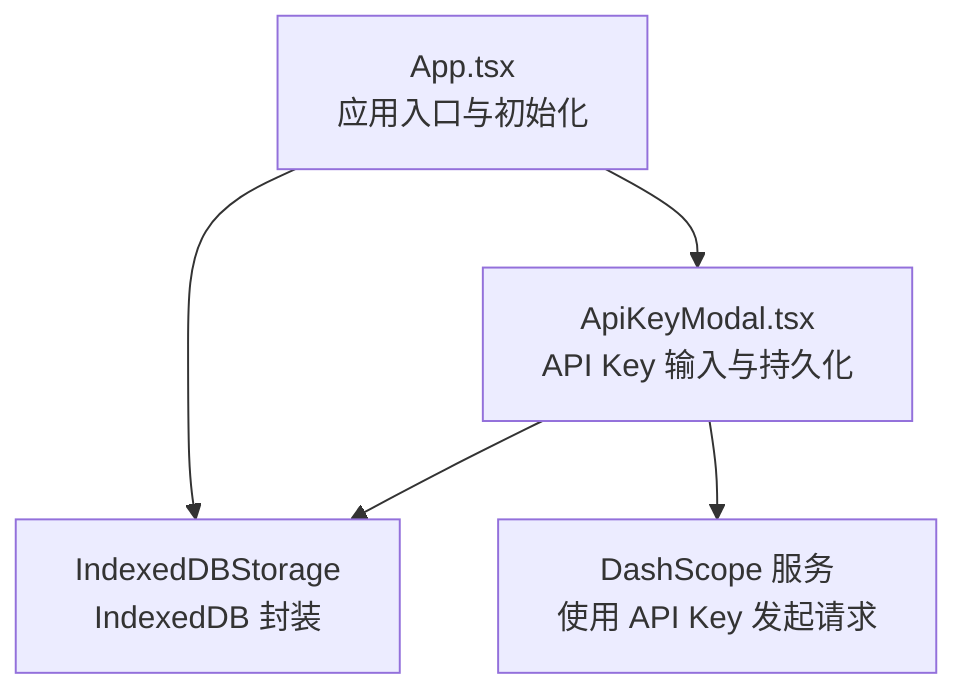
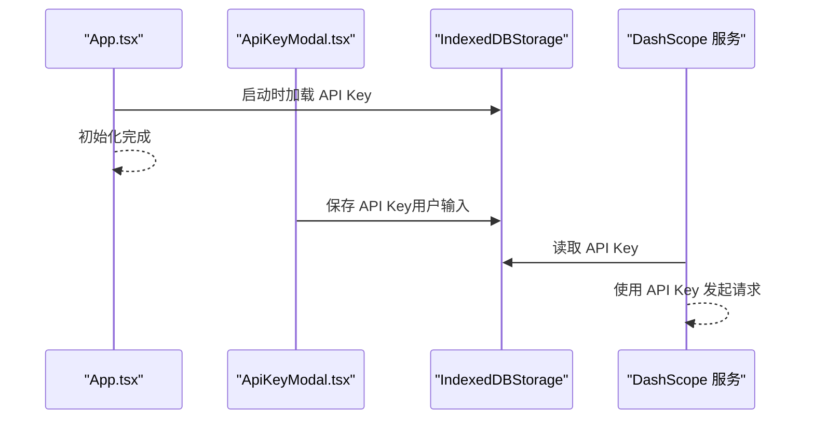
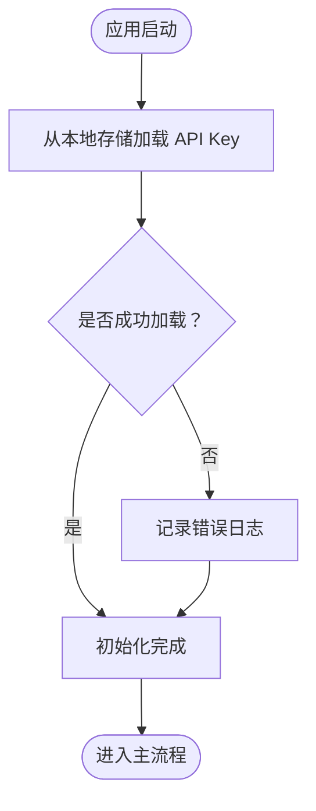
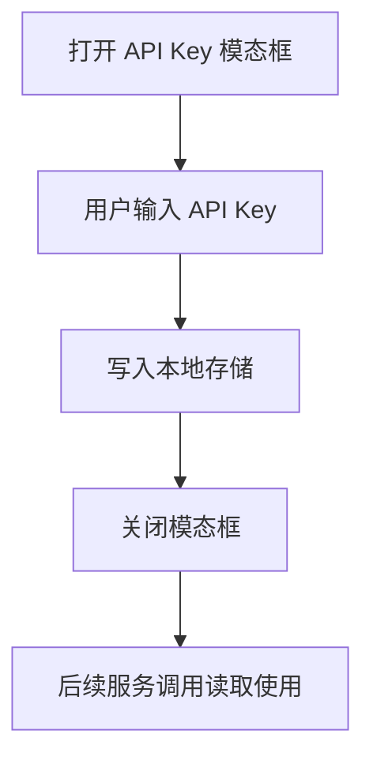
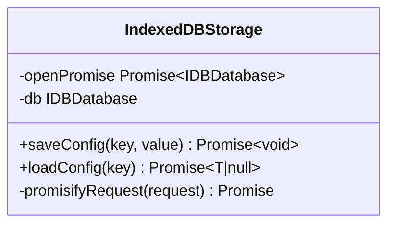
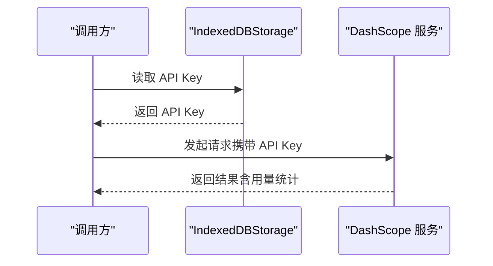
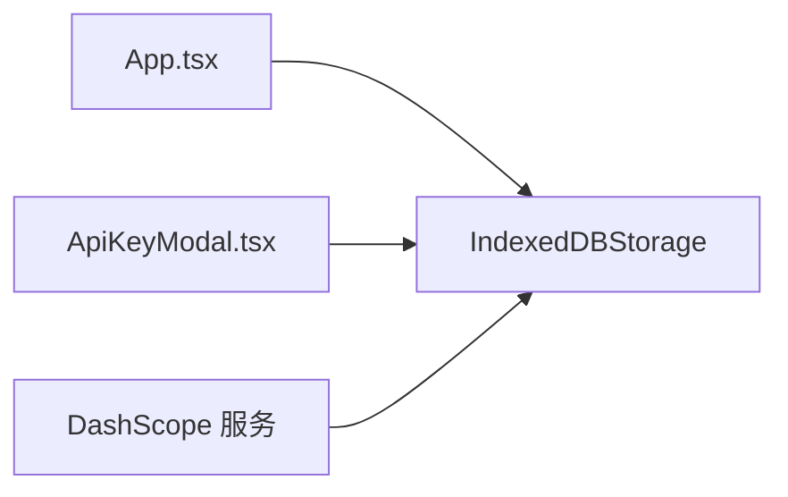

# 认证状态管理

<cite>
**本文引用的文件**
- [README.md](file://README.md)
- [README_EN.md](file://README_EN.md)
- [App.tsx](file://src/App.tsx)
- [ApiKeyModal.tsx](file://src/shared/components/ApiKeyModal.tsx)
- [storage/indexeddb.ts](file://src/services/storage/indexeddb.ts)
- [storage/index.ts](file://src/services/storage/index.ts)
- [dashscope.ts](file://src/services/ai/dashscope.ts)
</cite>

## 目录
1. [简介](#简介)
2. [项目结构](#项目结构)
3. [核心组件](#核心组件)
4. [架构总览](#架构总览)
5. [详细组件分析](#详细组件分析)
6. [依赖分析](#依赖分析)
7. [性能考虑](#性能考虑)
8. [故障排查指南](#故障排查指南)
9. [结论](#结论)
10. [附录](#附录)

## 简介
本文件围绕 AI Shotlive 的“认证状态管理”进行系统化说明，重点覆盖以下方面：
- 用户认证状态的初始化与生命周期管理
- 登录、注册、登出流程的端到端实现思路
- JWT Token 的获取、存储与验证策略
- 认证回调与自动登录检测机制
- 用户偏好与本地存储的同步策略
- 最佳实践与常见问题解决方案

需要特别说明的是：当前仓库中未发现名为 AuthContext.tsx 或 Login.tsx 的文件；认证状态管理在前端侧以“API Key 持久化与加载”的方式体现，而非传统基于 JWT 的登录态管理。本文将据此对现有能力进行准确解读，并给出可落地的扩展建议。

## 项目结构
与认证状态管理直接相关的模块分布如下：
- 应用入口与生命周期：src/App.tsx 负责应用启动时的初始化任务，例如从本地存储加载 API Key。
- 本地存储服务：src/services/storage/indexeddb.ts 提供 IndexedDB 封装，用于持久化配置数据（如 API Key）。
- API Key 管理组件：src/shared/components/ApiKeyModal.tsx 提供 API Key 的输入、展示与持久化入口。
- AI 服务集成：src/services/ai/dashscope.ts 展示了如何读取并使用 API Key 进行请求。
- 项目文档：README.md 与 README_EN.md 提供部署与环境变量说明，其中包含 JWT_SECRET 的配置项，但当前前端未使用该密钥进行认证。

图表来源
- [App.tsx:30-43](file://src/App.tsx#L30-L43)
- [ApiKeyModal.tsx:49-79](file://src/shared/components/ApiKeyModal.tsx#L49-L79)
- [storage/indexeddb.ts:171-185](file://src/services/storage/indexeddb.ts#L171-L185)
- [dashscope.ts:111-133](file://src/services/ai/dashscope.ts#L111-L133)

章节来源
- [README.md:338](file://README.md#L338)
- [README_EN.md:188-200](file://README_EN.md#L188-L200)
- [App.tsx:30-43](file://src/App.tsx#L30-L43)
- [ApiKeyModal.tsx:49-79](file://src/shared/components/ApiKeyModal.tsx#L49-L79)
- [storage/indexeddb.ts:171-185](file://src/services/storage/indexeddb.ts#L171-L185)
- [dashscope.ts:111-133](file://src/services/ai/dashscope.ts#L111-L133)

## 核心组件
- 应用入口与初始化
  - 在应用启动时，通过副作用钩子调用从本地存储加载 API Key 的逻辑，确保后续服务调用可用。
- API Key 管理组件
  - 提供模态框界面，允许用户输入或查看 API Key，并将其写入本地存储。
  - 组件明确声明 API Key 仅保存于本机 IndexedDB，不上传至服务器。
- 本地存储服务
  - 基于 IndexedDB 的通用封装，提供 saveConfig/loadConfig 等方法，支持键值对配置的持久化与读取。
- AI 服务集成
  - 在发起请求前，从本地存储读取 API Key 并注入到请求头或参数中，完成鉴权。

章节来源
- [App.tsx:30-43](file://src/App.tsx#L30-L43)
- [ApiKeyModal.tsx:49-79](file://src/shared/components/ApiKeyModal.tsx#L49-L79)
- [storage/indexeddb.ts:171-185](file://src/services/storage/indexeddb.ts#L171-L185)
- [dashscope.ts:111-133](file://src/services/ai/dashscope.ts#L111-L133)

## 架构总览
下图展示了认证状态管理在当前实现中的整体流程：应用启动时加载本地 API Key，随后在需要访问 AI 服务时使用该 Key 完成鉴权。

图表来源
- [App.tsx:30-43](file://src/App.tsx#L30-L43)
- [ApiKeyModal.tsx:49-79](file://src/shared/components/ApiKeyModal.tsx#L49-L79)
- [storage/indexeddb.ts:171-185](file://src/services/storage/indexeddb.ts#L171-L185)
- [dashscope.ts:111-133](file://src/services/ai/dashscope.ts#L111-L133)

## 详细组件分析

### 应用入口与初始化
- 职责
  - 在应用启动阶段一次性尝试从本地存储加载 API Key，保证后续功能可用。
- 关键点
  - 加载失败时记录错误日志，不影响主流程继续运行。
  - 该模式适用于“无登录态”的场景，即无需后端 JWT 验证即可使用本地凭据。

图表来源
- [App.tsx:30-43](file://src/App.tsx#L30-L43)

章节来源
- [App.tsx:30-43](file://src/App.tsx#L30-L43)

### API Key 管理组件
- 职责
  - 提供用户交互界面，输入或查看 API Key，并将其持久化到本地存储。
- 关键点
  - 明确提示 API Key 仅保存于本机 IndexedDB，不上传至服务器。
  - 与本地存储服务配合，实现配置的读取与写入。

图表来源
- [ApiKeyModal.tsx:49-79](file://src/shared/components/ApiKeyModal.tsx#L49-L79)
- [storage/indexeddb.ts:171-185](file://src/services/storage/indexeddb.ts#L171-L185)

章节来源
- [ApiKeyModal.tsx:49-79](file://src/shared/components/ApiKeyModal.tsx#L49-L79)
- [storage/indexeddb.ts:171-185](file://src/services/storage/indexeddb.ts#L171-L185)

### 本地存储服务（IndexedDB）
- 职责
  - 为配置类数据（如 API Key）提供统一的持久化接口。
- 关键点
  - 提供 saveConfig/loadConfig 等方法，内部封装事务与 Promise 化请求。
  - 支持版本变更与并发控制，避免多标签页冲突。

图表来源
- [storage/indexeddb.ts:171-185](file://src/services/storage/indexeddb.ts#L171-L185)

章节来源
- [storage/indexeddb.ts:171-185](file://src/services/storage/indexeddb.ts#L171-L185)

### AI 服务集成（DashScope）
- 职责
  - 在请求中使用本地存储的 API Key 完成鉴权。
- 关键点
  - 请求参数中包含令牌字段，用于服务端鉴权。
  - 返回结果包含用量统计等信息，便于计费与审计。

图表来源
- [storage/indexeddb.ts:171-185](file://src/services/storage/indexeddb.ts#L171-L185)
- [dashscope.ts:111-133](file://src/services/ai/dashscope.ts#L111-L133)

章节来源
- [dashscope.ts:111-133](file://src/services/ai/dashscope.ts#L111-L133)
- [storage/indexeddb.ts:171-185](file://src/services/storage/indexeddb.ts#L171-L185)

### 认证状态生命周期管理
- 自动登录检测
  - 当前实现为“启动时加载”，即应用启动时尝试恢复本地凭据，无需用户再次登录。
- 凭证有效期与刷新
  - 本地 API Key 无过期时间概念；若服务端要求刷新机制，可在服务层增加刷新逻辑并在本地存储更新。
- 回调机制
  - 可在加载成功后触发回调（例如设置全局状态、刷新界面），当前入口已具备错误兜底。

章节来源
- [App.tsx:30-43](file://src/App.tsx#L30-L43)
- [ApiKeyModal.tsx:49-79](file://src/shared/components/ApiKeyModal.tsx#L49-L79)

### 用户偏好同步机制
- 本地存储与服务器同步
  - 当前以本地存储为主，API Key 仅保存于本机。
  - 若需跨设备同步，可在服务端提供偏好同步接口，并在本地存储中增加“上次同步时间戳”等元数据，实现增量同步。

章节来源
- [ApiKeyModal.tsx:49-79](file://src/shared/components/ApiKeyModal.tsx#L49-L79)
- [storage/indexeddb.ts:171-185](file://src/services/storage/indexeddb.ts#L171-L185)

### 登录、注册、登出流程（基于现有能力的映射）
- 登录
  - 通过 API Key 模态框输入并保存，应用启动时自动加载。
- 注册
  - 本项目未提供注册流程；如需注册，应在服务端新增注册接口，并在前端引导用户完成注册后返回 API Key。
- 登出
  - 清空本地存储中的 API Key 即可视为登出；后续服务调用将失败，提示重新配置。

章节来源
- [ApiKeyModal.tsx:49-79](file://src/shared/components/ApiKeyModal.tsx#L49-L79)
- [storage/indexeddb.ts:171-185](file://src/services/storage/indexeddb.ts#L171-L185)

## 依赖分析
- 组件耦合关系
  - App.tsx 依赖本地存储加载逻辑，负责应用启动时的初始化。
  - ApiKeyModal.tsx 依赖本地存储服务，负责用户输入与持久化。
  - DashScope 服务依赖本地存储提供的 API Key。
- 外部依赖
  - 项目文档中包含 JWT_SECRET 环境变量，但当前前端未使用该密钥进行认证。

图表来源
- [App.tsx:30-43](file://src/App.tsx#L30-L43)
- [ApiKeyModal.tsx:49-79](file://src/shared/components/ApiKeyModal.tsx#L49-L79)
- [storage/indexeddb.ts:171-185](file://src/services/storage/indexeddb.ts#L171-L185)
- [dashscope.ts:111-133](file://src/services/ai/dashscope.ts#L111-L133)

章节来源
- [README_EN.md:188-200](file://README_EN.md#L188-L200)
- [App.tsx:30-43](file://src/App.tsx#L30-L43)
- [ApiKeyModal.tsx:49-79](file://src/shared/components/ApiKeyModal.tsx#L49-L79)
- [storage/indexeddb.ts:171-185](file://src/services/storage/indexeddb.ts#L171-L185)
- [dashscope.ts:111-133](file://src/services/ai/dashscope.ts#L111-L133)

## 性能考虑
- 本地存储访问
  - IndexedDB 读写为异步操作，应避免在渲染路径中频繁阻塞主线程。
- 请求频次控制
  - 对于高频率的 AI 请求，建议引入节流/去抖策略，并合并请求结果。
- 缓存策略
  - 对于重复的请求参数，可缓存响应以减少网络开销。

## 故障排查指南
- 无法加载 API Key
  - 检查 IndexedDB 是否正常打开，确认对象存储是否存在。
  - 查看控制台错误日志，定位存储读取异常。
- 服务调用失败
  - 确认 API Key 是否正确保存，且未被意外清空。
  - 检查服务端接口状态与配额限制。
- 跨设备不同步
  - 若需要同步，需在服务端提供同步接口，并在本地存储中维护同步元数据。

章节来源
- [storage/indexeddb.ts:171-185](file://src/services/storage/indexeddb.ts#L171-L185)
- [dashscope.ts:111-133](file://src/services/ai/dashscope.ts#L111-L133)

## 结论
当前 AI Shotlive 的认证状态管理采用“本地 API Key + 启动时加载”的轻量方案，适合无需后端登录态的场景。若未来需要引入 JWT 登录态、自动刷新与登出等功能，可在现有本地存储与服务层基础上进行扩展，保持 UI 与业务逻辑的低耦合。

## 附录
- 环境变量与部署
  - 项目文档提供了数据库与 JWT_SECRET 的配置说明，便于本地开发与生产部署。
- 相关文件路径
  - 应用入口：src/App.tsx
  - API Key 组件：src/shared/components/ApiKeyModal.tsx
  - 本地存储：src/services/storage/indexeddb.ts
  - AI 服务：src/services/ai/dashscope.ts

章节来源
- [README.md:338](file://README.md#L338)
- [README_EN.md:188-200](file://README_EN.md#L188-L200)
- [App.tsx:30-43](file://src/App.tsx#L30-L43)
- [ApiKeyModal.tsx:49-79](file://src/shared/components/ApiKeyModal.tsx#L49-L79)
- [storage/indexeddb.ts:171-185](file://src/services/storage/indexeddb.ts#L171-L185)
- [dashscope.ts:111-133](file://src/services/ai/dashscope.ts#L111-L133)