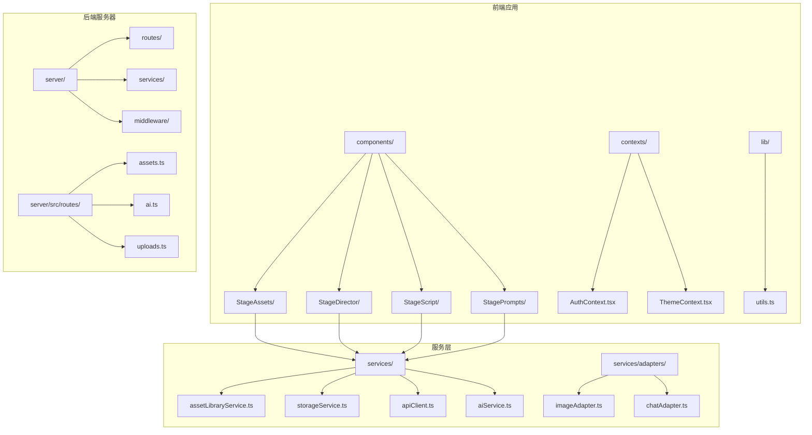
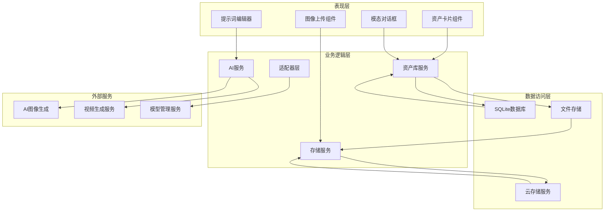
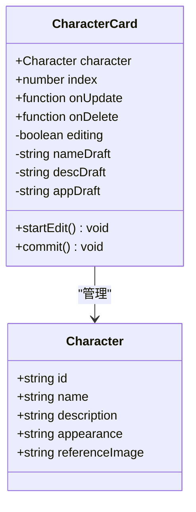
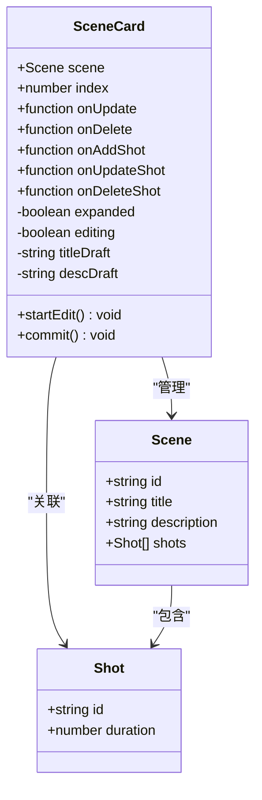
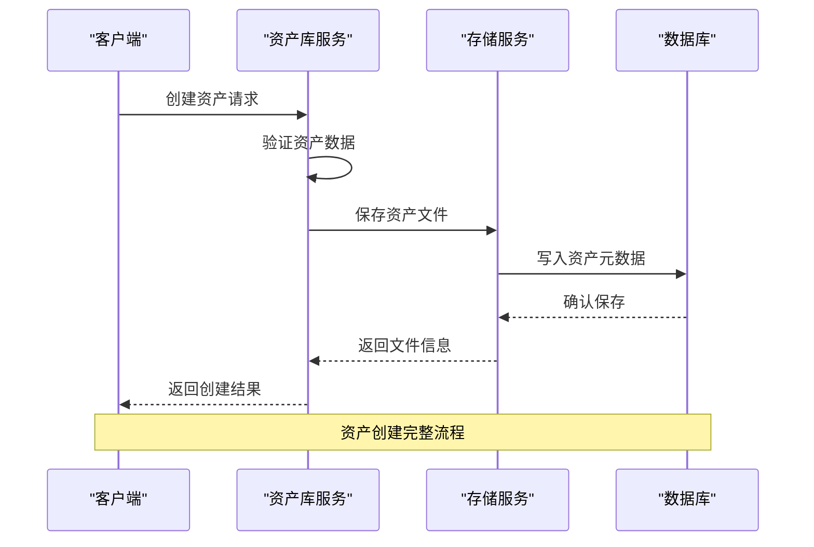
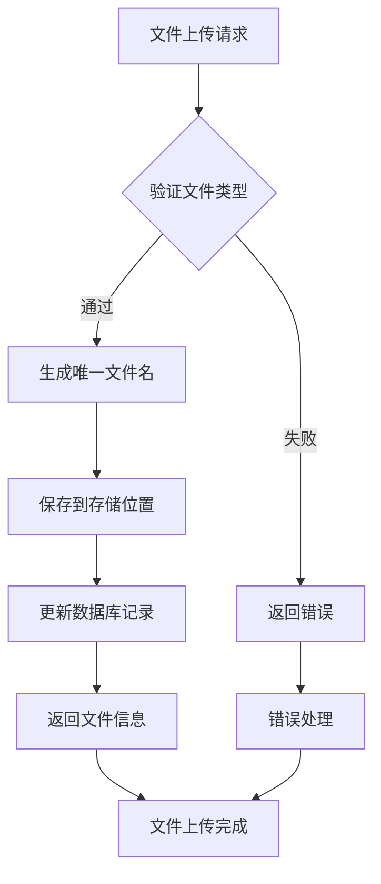

# StageAssets资产系统

<cite>
**本文档引用的文件**
- [CharacterCard.tsx](file://src/phases/script/components/CharacterCard.tsx)
- [SceneCard.tsx](file://src/phases/script/components/SceneCard.tsx)
- [README.md](file://README.md)
- [README_EN.md](file://README_EN.md)
- [package.json](file://package.json)
- [server/src/routes/assets.ts](file://server/src/routes/assets.ts)
- [server/src/services/assetLibraryService.ts](file://server/src/services/assetLibraryService.ts)
- [services/assetLibraryService.ts](file://services/assetLibraryService.ts)
- [services/storageService.ts](file://services/storageService.ts)
- [services/apiClient.ts](file://services/apiClient.ts)
- [services/aiService.ts](file://services/aiService.ts)
- [services/adapters/imageAdapter.ts](file://services/adapters/imageAdapter.ts)
- [services/adapters/chatAdapter.ts](file://services/adapters/chatAdapter.ts)
- [types.ts](file://types.ts)
</cite>

## 目录
1. [简介](#简介)
2. [项目结构](#项目结构)
3. [核心组件](#核心组件)
4. [架构概览](#架构概览)
5. [详细组件分析](#详细组件分析)
6. [依赖关系分析](#依赖关系分析)
7. [性能考虑](#性能考虑)
8. [故障排除指南](#故障排除指南)
9. [结论](#结论)
10. [附录](#附录)

## 简介

StageAssets资产系统是AI ShotLive项目中的核心资产管理模块，负责管理角色、场景和道具等创作资产。该系统提供了完整的资产生命周期管理，包括资产创建、编辑、删除、版本控制、批量操作等功能，并与AI生成服务深度集成。

系统采用React前端框架构建，后端基于Node.js和TypeScript开发，支持现代化的Web应用架构。通过组件化的设计模式，实现了高度可复用的UI组件和灵活的服务层架构。

## 项目结构

项目采用模块化组织方式，主要目录结构如下：



**图表来源**
- [package.json:1-50](file://package.json#L1-L50)
- [README.md:1-100](file://README.md#L1-L100)

**章节来源**
- [package.json:1-50](file://package.json#L1-L50)
- [README.md:1-100](file://README.md#L1-L100)

## 核心组件

### 角色资产管理

角色资产是StageAssets系统的核心组成部分，提供了完整的角色信息管理功能：

- **角色卡片组件**：支持角色基本信息的编辑和展示
- **外观描述管理**：用于AI图像生成的详细描述
- **参考图像管理**：支持角色参考图片的上传和预览
- **批量操作支持**：支持角色的增删改查操作

### 场景资产管理

场景资产管理系统负责管理电影场景相关的所有元素：

- **场景卡片组件**：支持场景标题和描述的编辑
- **镜头关联管理**：场景与具体镜头的关联关系
- **时长统计功能**：自动计算场景总时长
- **展开/折叠视图**：支持场景详情的展开和收起

### 道具资产管理

系统支持道具资产的统一管理，包括：
- 道具信息的录入和编辑
- 道具与场景的关联关系
- 道具状态的跟踪和管理

**章节来源**
- [CharacterCard.tsx:1-201](file://src/phases/script/components/CharacterCard.tsx#L1-L201)
- [SceneCard.tsx:1-216](file://src/phases/script/components/SceneCard.tsx#L1-L216)

## 架构概览

StageAssets系统采用分层架构设计，确保了系统的可维护性和扩展性：



**图表来源**
- [services/assetLibraryService.ts:1-200](file://services/assetLibraryService.ts#L1-L200)
- [services/storageService.ts:1-200](file://services/storageService.ts#L1-L200)
- [services/aiService.ts:1-200](file://services/aiService.ts#L1-L200)

系统架构特点：
- **组件化设计**：每个功能模块都是独立的React组件
- **服务层抽象**：业务逻辑集中在服务类中，便于测试和维护
- **适配器模式**：支持多种AI服务提供商的统一接口
- **分层架构**：清晰的层次分离，职责明确

## 详细组件分析

### 角色卡片组件分析

角色卡片组件是资产系统中最复杂的UI组件之一，提供了丰富的交互功能：



**图表来源**
- [CharacterCard.tsx:8-37](file://src/phases/script/components/CharacterCard.tsx#L8-L37)

组件功能特性：
- **双模式显示**：正常显示模式和编辑模式的切换
- **草稿机制**：使用草稿状态避免直接修改原始数据
- **表单验证**：对用户输入进行基本的验证和清理
- **视觉反馈**：通过图标和颜色提供清晰的操作反馈

**章节来源**
- [CharacterCard.tsx:15-200](file://src/phases/script/components/CharacterCard.tsx#L15-L200)

### 场景卡片组件分析

场景卡片组件负责管理场景级别的资产信息：



**图表来源**
- [SceneCard.tsx:12-48](file://src/phases/script/components/SceneCard.tsx#L12-L48)

组件关键特性：
- **动态展开**：支持场景详情的展开和收起
- **镜头关联**：与具体镜头建立关联关系
- **时长计算**：自动计算场景总时长
- **批量操作**：支持场景内镜头的批量管理

**章节来源**
- [SceneCard.tsx:22-215](file://src/phases/script/components/SceneCard.tsx#L22-L215)

### 资产库服务分析

资产库服务是系统的核心业务逻辑层：



**图表来源**
- [services/assetLibraryService.ts:1-200](file://services/assetLibraryService.ts#L1-L200)

服务功能包括：
- **资产生命周期管理**：从创建到删除的完整生命周期
- **版本控制**：支持资产的版本管理和历史追踪
- **批量操作**：支持多资产的批量处理
- **关联关系维护**：维护资产与分镜头的关联关系

**章节来源**
- [services/assetLibraryService.ts:1-200](file://services/assetLibraryService.ts#L1-L200)

### 存储服务分析

存储服务负责处理文件的上传、下载和管理：



**图表来源**
- [services/storageService.ts:1-200](file://services/storageService.ts#L1-L200)

存储策略：
- **文件命名**：使用UUID确保文件名唯一性
- **存储分类**：按资产类型和时间进行目录分类
- **安全检查**：对上传文件进行类型和大小验证
- **清理机制**：定期清理无效或过期的文件

**章节来源**
- [services/storageService.ts:1-200](file://services/storageService.ts#L1-L200)

## 依赖关系分析

系统采用模块化的依赖管理策略：

```mermaid
graph LR
subgraph "核心依赖"
A[react] --> B[react-dom]
C[typescript] --> D[@types/react]
E[lucide-react] --> F[图标组件]
end
subgraph "开发依赖"
G[vite] --> H[构建工具]
I[ts-node] --> J[TypeScript运行时]
K[jest] --> L[测试框架]
end
subgraph "运行时依赖"
M[axios] --> N[HTTP客户端]
O[sqlite3] --> P[数据库驱动]
Q[sharp] --> R[图像处理]
end
A --> M
G --> O
I --> Q
```

**图表来源**
- [package.json:1-50](file://package.json#L1-L50)

依赖管理特点：
- **最小化核心依赖**：只引入必要的核心库
- **类型安全**：全面使用TypeScript确保类型安全
- **模块化设计**：每个功能模块都有明确的依赖边界
- **版本锁定**：使用package-lock.json确保依赖一致性

**章节来源**
- [package.json:1-50](file://package.json#L1-L50)

## 性能考虑

系统在设计时充分考虑了性能优化：

### 前端性能优化
- **虚拟滚动**：对于大量资产列表使用虚拟滚动技术
- **懒加载**：图片和大文件采用懒加载策略
- **缓存机制**：实现多级缓存减少重复请求
- **并发处理**：支持多个资产的并发操作

### 后端性能优化
- **数据库索引**：为常用查询字段建立索引
- **连接池管理**：合理配置数据库连接池
- **文件存储优化**：使用CDN加速静态资源访问
- **内存管理**：及时释放不再使用的资源

### AI服务优化
- **请求队列**：实现AI请求的排队和限流
- **结果缓存**：缓存常用的AI生成结果
- **异步处理**：支持长时间任务的异步执行

## 故障排除指南

### 常见问题及解决方案

**资产上传失败**
- 检查文件格式是否在允许范围内
- 确认文件大小是否超过限制
- 验证存储空间是否充足
- 查看网络连接状态

**AI生成服务异常**
- 检查API密钥配置是否正确
- 验证网络连接和防火墙设置
- 查看服务日志获取详细错误信息
- 确认服务提供商的可用性状态

**数据库连接问题**
- 检查数据库配置参数
- 验证数据库服务状态
- 查看连接池配置是否合理
- 确认权限设置是否正确

**性能问题诊断**
- 使用浏览器开发者工具分析性能瓶颈
- 监控服务器资源使用情况
- 分析数据库查询性能
- 检查网络延迟和带宽使用

**章节来源**
- [services/apiClient.ts:1-200](file://services/apiClient.ts#L1-L200)
- [services/aiService.ts:1-200](file://services/aiService.ts#L1-L200)

## 结论

StageAssets资产系统是一个功能完善、架构清晰的资产管理解决方案。系统通过组件化的UI设计和模块化的服务架构，实现了资产的全生命周期管理。

系统的主要优势包括：
- **完整的功能覆盖**：从资产创建到删除的全流程支持
- **优秀的用户体验**：直观的界面设计和流畅的交互体验
- **强大的扩展性**：模块化设计便于功能扩展和维护
- **可靠的稳定性**：完善的错误处理和性能优化机制

未来可以考虑的功能增强：
- 更智能的资产搜索和推荐算法
- 更丰富的资产版本管理功能
- 更完善的协作和权限管理
- 更强大的批量操作和自动化工具

## 附录

### API接口定义

系统提供RESTful API接口用于资产的远程管理：

**资产相关接口**
- `POST /api/assets` - 创建新资产
- `GET /api/assets/:id` - 获取指定资产
- `PUT /api/assets/:id` - 更新资产信息
- `DELETE /api/assets/:id` - 删除资产
- `GET /api/assets` - 获取资产列表

**AI服务接口**
- `POST /api/ai/generate-image` - 图像生成
- `POST /api/ai/generate-video` - 视频生成
- `POST /api/ai/chat` - AI对话

### 配置选项

系统支持多种配置选项：
- 数据库连接配置
- 文件存储路径配置
- AI服务提供商配置
- 用户界面主题配置

### 最佳实践指南

**资产创建最佳实践**
- 使用清晰、唯一的资产名称
- 提供详细的资产描述信息
- 选择合适的资产分类和标签
- 上传高质量的参考图像

**资产管理最佳实践**
- 定期备份重要资产数据
- 建立标准化的资产命名规范
- 维护资产的版本历史记录
- 及时清理不再使用的资产

**性能优化最佳实践**
- 合理使用缓存机制
- 优化数据库查询性能
- 实现合理的文件存储策略
- 监控系统资源使用情况